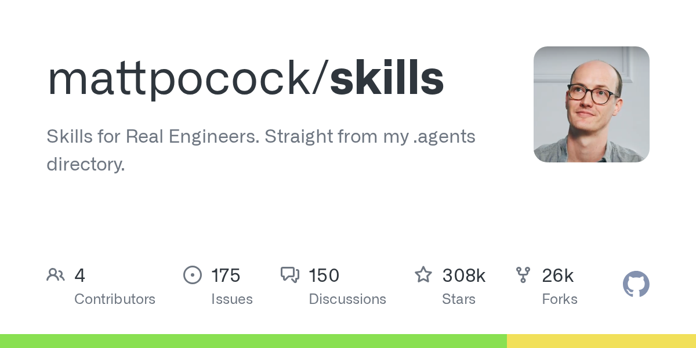
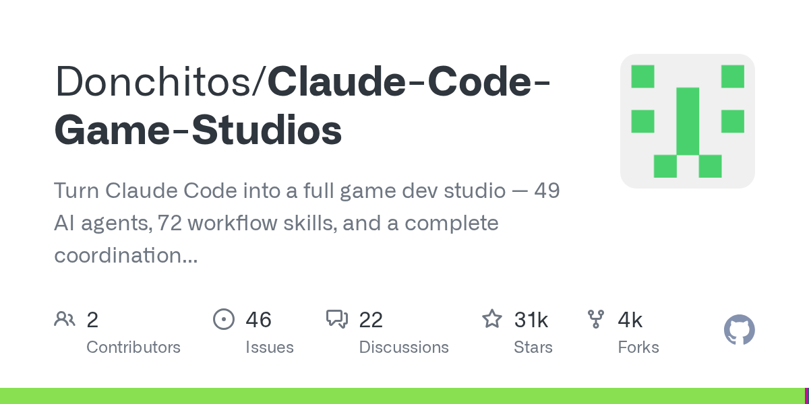
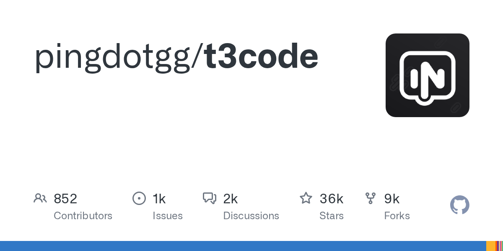
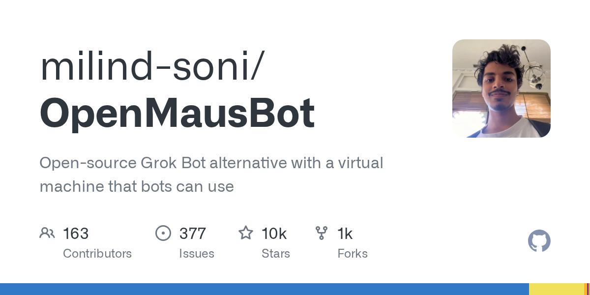
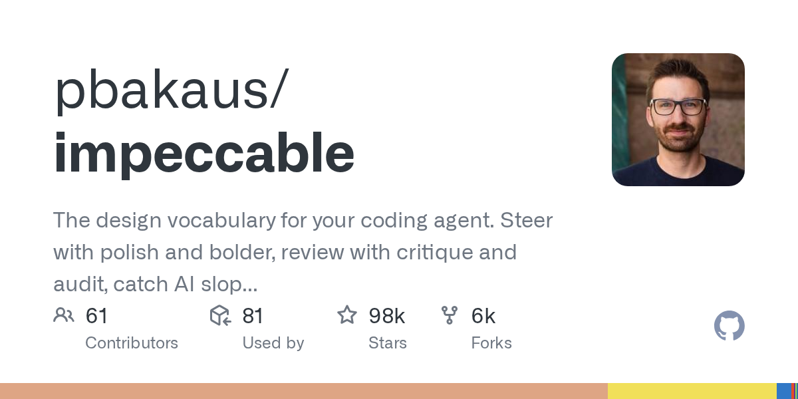
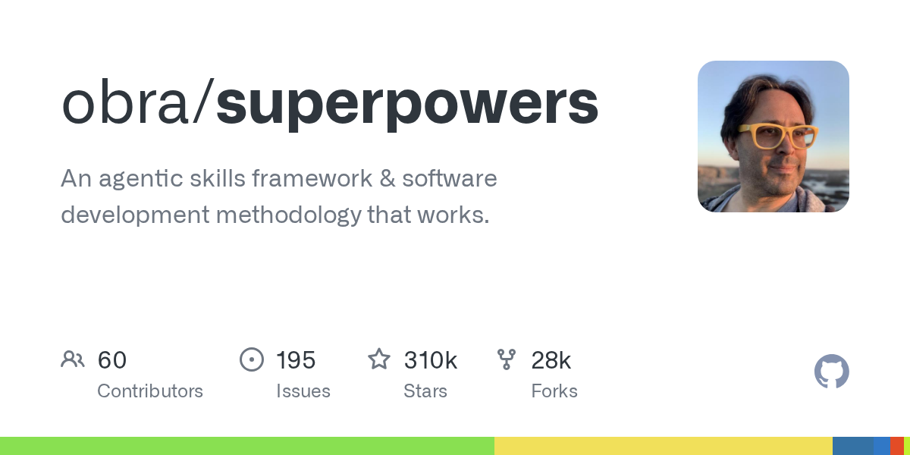
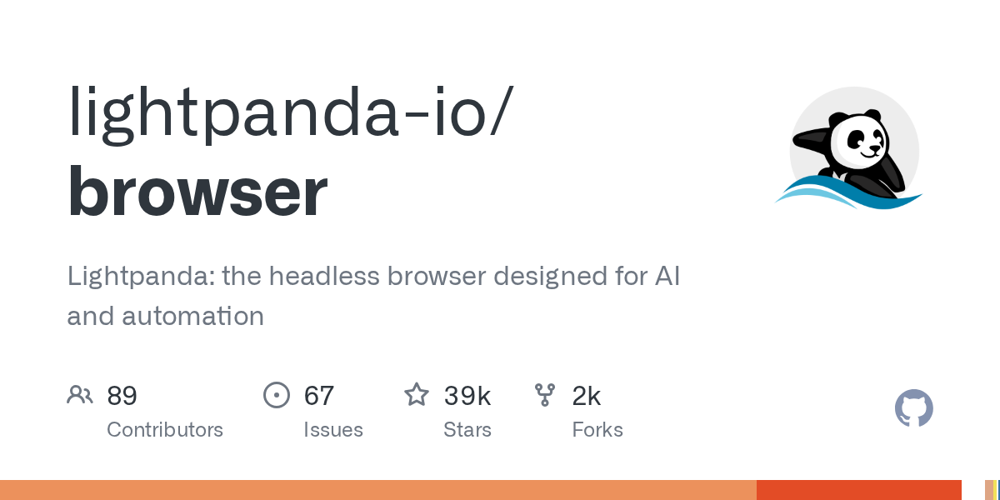
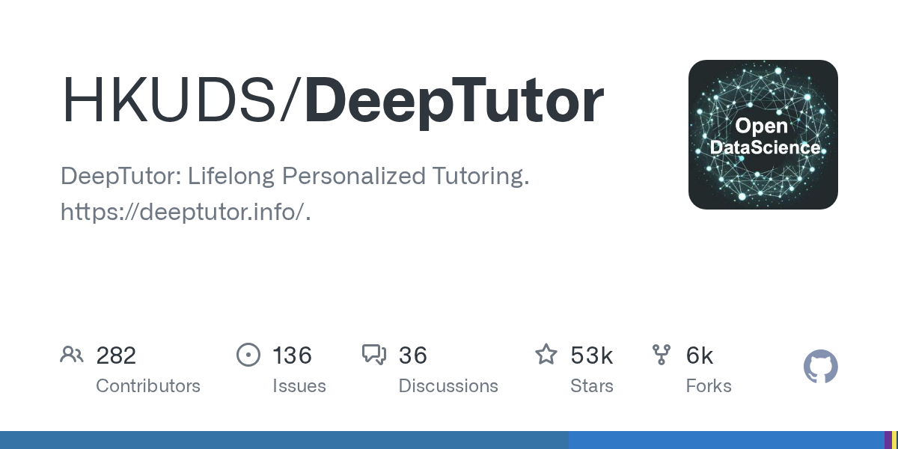
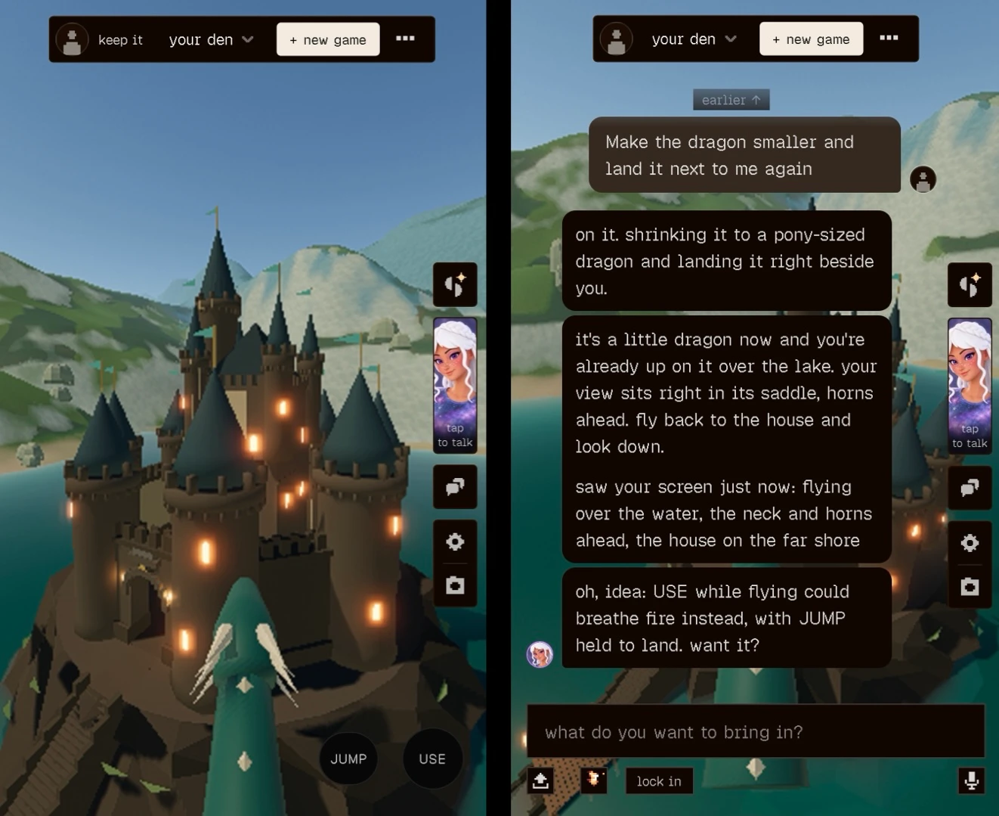

# AI 资讯日报 2026-11-01

> 自动抓取 AI 公司博客、从业者博客与社区聚合源，并生成中文摘要。

## 今日摘要

```
- Making it easier for websites to express AI training preferences
- Community safety report and new protections for teens
- Fair use benefits everyone
- An updated Model Spec for more capable and beneficial AI
- How we detect frontier model misalignment
```

## 公司动态

1. **[Making it easier for websites to express AI training preferences](https://openai.com/index/helping-websites-express-ai-training-preferences)**

   OpenAI will honor a shared robots.txt signal to help website operators communicate their AI training preferences to participating providers.

   来源：OpenAI Blog

2. **[Community safety report and new protections for teens](https://openai.com/index/community-safety-report-and-new-protections-for-teens)**

   OpenAI is strengthening violence prevention in ChatGPT with expanded safeguards, earlier interventions, and a new commitment to public safety reporting.

   来源：OpenAI Blog

3. **[Fair use benefits everyone](https://openai.com/index/fair-use-benefits-everyone)**

   OpenAI shares excerpts from court briefs by creators, academics, accessibility advocates, and legal experts, among others, on how fair use supports AI training and innovation.

   来源：OpenAI Blog

4. **[An updated Model Spec for more capable and beneficial AI](https://openai.com/index/updated-model-spec)**

   OpenAI’s updated Model Spec outlines five core values to guide more capable AI toward sound judgment, human agency, and faithfulness to human intent.

   来源：OpenAI Blog

5. **[How we detect frontier model misalignment](https://openai.com/index/how-we-detect-frontier-model-misalignment)**

   OpenAI uses layered monitoring to detect frontier model misalignment and unauthorized agent behavior so responders can intervene before incidents escalate.

   来源：OpenAI Blog

6. **[How Ropes & Gray is developing AI for transactional diligence](https://openai.com/index/ropes-gray-ai-diligence)**

   Ropes & Gray is developing AI for transactional diligence with OpenAI. Lawyers review grouped documents, summaries, and reports before advising clients.

   来源：OpenAI Blog

## 每日产品

1. **[TopAgent - 借助人工智能客服提升B2B活动参与度](https://www.producthunt.com/r/4WKNUM64IFEFUW)**

   Drive B2B event attendance with an AI agent (www.producthunt.com) 10-29 ↑ 130 PH Upvotes

   

   来源：Product Hunt Daily

2. **[Gemini 4 Carbon - 谷歌的下一个前沿模型](https://www.producthunt.com/r/2IANFENKZW6KZI)**

   Google''s next frontier model (www.producthunt.com) 10-29 ↑ 119 PH Upvotes

   

   来源：Product Hunt Daily

3. **[Gologin Cloud Browser - 适用于人工智能代理和复杂网站的云浏览器](https://www.producthunt.com/r/TJNEWWJYUBDNAH)**

   Cloud browser for AI agents and tough sites (www.producthunt.com) 10-29 ↑ 117 PH Upvotes

   

   来源：Product Hunt Daily

4. **[Floot in ChatGPT - 无需离开 ChatGPT 即可构建并发布真实的应用程序](https://www.producthunt.com/r/VOASQ4LXPHOIXR)**

   Build and publish real apps without leaving ChatGPT (www.producthunt.com) 10-29 ↑ 119 PH Upvotes

   

   来源：Product Hunt Daily

5. **[Notch Metrics - 让您的营收和产品分析指标更上一层楼](https://www.producthunt.com/r/BJSV7OQQ7BMSV6)**

   *{padding:0;margin:0;overflow:hidden}html,body{height:100%}img,span{position:absolute;width:100%;top:0;bottom:0;margin:auto}span{height:1.5em;text-align:center;font:48px/1.5 sans-serif;color:white;text-shadow:0 0 0.5em black}▶" frameborder="0" allow="accelerometer; autoplay; encrypted-media; gyroscope; picture-in-picture" allowfullscreen > Put your revenue and product analytics metrics in the notch (www.producthunt.com) 10-29 ↑ 111 PH Upvotes

   来源：Product Hunt Daily

6. **[Scape - 一款为您服务的智能电子邮件收件箱](https://www.producthunt.com/r/OG2OR3JKMHZ566)**

   *{padding:0;margin:0;overflow:hidden}html,body{height:100%}img,span{position:absolute;width:100%;top:0;bottom:0;margin:auto}span{height:1.5em;text-align:center;font:48px/1.5 sans-serif;color:white;text-shadow:0 0 0.5em black}▶" frameborder="0" allow="accelerometer; autoplay; encrypted-media; gyroscope; picture-in-picture" allowfullscreen > An intelligent email inbox that works for you (www.producthunt.com) 10-29 ↑ 124 PH Upvotes

   来源：Product Hunt Daily

7. **[Empacer - 面向小企业主的语音优先助手](https://www.producthunt.com/r/RXY756OTRKZOLG)**

   The voice-first assistant for small business owners (www.producthunt.com) 10-29 PH Link

   

   来源：Product Hunt Daily

8. **[App Store Screenshots - 您的编程代理为您设计应用商店的截图](https://www.producthunt.com/r/MMLYDUYT2RHFD2)**

   Your coding agent designs your app store screenshots (www.producthunt.com) 10-28 ↑ 116 PH Upvotes

   

   来源：Product Hunt Daily

9. **[Revix AI - 能够学习您代码库自身规则的 AI 代码审查](https://www.producthunt.com/r/P54LIR6JJIMWZV)**

   *{padding:0;margin:0;overflow:hidden}html,body{height:100%}img,span{position:absolute;width:100%;top:0;bottom:0;margin:auto}span{height:1.5em;text-align:center;font:48px/1.5 sans-serif;color:white;text-shadow:0 0 0.5em black}▶" frameborder="0" allow="accelerometer; autoplay; encrypted-media; gyroscope; picture-in-picture" allowfullscreen > AI code review that learns your repo''s own rules (www.producthunt.com) 10-27 ↑ 109 PH Upvotes

   来源：Product Hunt Daily

10. **[NuPlay - AI转型，基于一个自我优化平台运行](https://www.producthunt.com/r/R2IRJLFM3LP5VD)**

   AI transformation, run on one self-improving platform (www.producthunt.com) 10-27 ↑ 111 PH Upvotes

   

   来源：Product Hunt Daily

## GitHub 项目

1. **[thedotmack/claude-mem](https://github.com/thedotmack/claude-mem)**

   Persistent Context Across Sessions for Every Agent – Captures everything your agent does during sessions, compresses it with AI, and injects relevant context back into future sessions. Works with Claude Code, OpenClaw, Codex, Gemini, Hermes, Copilot, OpenCode + More Language: TypeScript Stars: 107924 Forks: 9473

   

   来源：GitHub Trending Daily

2. **[mattpocock/skills](https://github.com/mattpocock/skills)**

   Skills for Real Engineers. Straight from my .agents directory. Language: Shell Stars: 308426 Forks: 25955

   

   来源：GitHub Trending Daily

3. **[Donchitos/Claude-Code-Game-Studios](https://github.com/Donchitos/Claude-Code-Game-Studios)**

   Turn Claude Code into a full game dev studio — 49 AI agents, 72 workflow skills, and a complete coordination system mirroring real studio hierarchy. Language: Shell Stars: 31209 Forks: 4276

   

   来源：GitHub Trending Daily

4. **[pingdotgg/t3code](https://github.com/pingdotgg/t3code)**

   Language: TypeScript Stars: 35666 Forks: 8790

   

   来源：GitHub Trending Daily

5. **[Renhuai123/ziwei-doushu](https://github.com/Renhuai123/ziwei-doushu)**

   紫微斗数开源排盘引擎 — 基于倪海厦《天纪》体系，含完整排盘算法、四化系统、格局知识库、古籍原文数据 Language: TypeScript Stars: 12304 Forks: 2415

   

   来源：GitHub Trending Daily

6. **[milind-soni/OpenMausBot](https://github.com/milind-soni/OpenMausBot)**

   Open-source Grok Bot alternative with a virtual machine that bots can use Language: TypeScript Stars: 9664 Forks: 1340

   

   来源：GitHub Trending Daily

7. **[pbakaus/impeccable](https://github.com/pbakaus/impeccable)**

   The design vocabulary for your coding agent. Steer with polish and bolder, review with critique and audit, catch AI slop before it ships. Language: Rust Stars: 98319 Forks: 5798

   

   来源：GitHub Trending Daily

8. **[obra/superpowers](https://github.com/obra/superpowers)**

   An agentic skills framework & software development methodology that works. Language: Shell Stars: 310082 Forks: 27587

   

   来源：GitHub Trending Daily

9. **[lightpanda-io/browser](https://github.com/lightpanda-io/browser)**

   Lightpanda: the headless browser designed for AI and automation Language: Zig Stars: 39273 Forks: 1909

   

   来源：GitHub Trending Daily

10. **[HKUDS/DeepTutor](https://github.com/HKUDS/DeepTutor)**

   DeepTutor: Lifelong Personalized Tutoring. https://deeptutor.info/. Language: Python Stars: 52850 Forks: 6469

   

   来源：GitHub Trending Daily

## 从业者观点

1. **[How We Took Over ChatGPT Accounts](https://simonwillison.net/2026/Oct/31/how-we-took-over-chatgpt-accounts/)**

   How We Took Over ChatGPT Accounts Parameter Labs describe an exploit they found against ChatGPT's implementation of the artifacts pattern (OpenAI used to call this "Canvas" but it looks like the latest revision is called HTML previews ), where interactive custom HTML apps are displayed in a sandboxed iframe. It's important that HTML in these stays tightly sandboxed to avoid untrusted code interacting with OpenAI APIs and accessing private data. Parameter found quite a complex attack chain. OpenAI use the MathLive JavaScript library as part of their graph support, and that library includes its own virtual keyboard , which can be triggered in the parent page via postMessage() from the sandboxed iframe. That message receiving code uses innerHTML , so anything that sends a message can add custom HTML to the parent - and there was no mechanism to prevent other sandboxed frames, including HTML preview frames, from calling that method. This meant untrusted code in an iframe could insert HTML, and while innerHTML doesn't directly execute script elements it could be used to inject a new iframe without sandbox restrictions. OpenAI’s CSP rules blocked inline scripts entirely, and only allowed script loading from a handful of domains, but one of those was YouTube - and the YouTube oEmbed endpoint could be used to reflect JavaScript back in a way that executed it. Once the attack had JavaScript execution on ChatGPT, it was trivial to fetch private user data from APIs and exfiltrate it via an image reference. The end result: you could create a ChatGPT share URL which, when visited by another signed-in user, could exfiltrate their private data or take actions on their behalf. OpenAI closed the hole and paid out a $5,000 bug bounty, which I think was a bit cheap for a vulnerability this serious. Via Hacker News Tags: iframes , javascript , sandboxing , security , xss , openai , chatgpt , content-security-policy

   来源：Simon Willison

2. **[datasette-llm 0.1a9](https://simonwillison.net/2026/Oct/31/datasette-llm/)**

   Release: datasette-llm 0.1a9 I have some big upgrades to Datasette Agent in the pipeline, but in the meantime here's a tiny user experience improvement to the underlying datasette-llm plugin. It now picks up the default model used by LLM , which means you can start using Datasette Agent without needing to explicitly configure a default model: uvx --with datasette-agent datasette content.db --internal internal.db Previously you would also need to specify a model with -s plugins.datasette-agent.default_model gpt-6-astra . Tags: datasette , llm , datasette-agent

   来源：Simon Willison

3. **[dbreunig/nesformer](https://simonwillison.net/2026/Oct/30/nesformer/)**

   dbreunig/nesformer Inspired by qwenputer by Divyansh Agrawal, Drew Breunig baked a working emulator for a Nintendo Entertainment System 6502 CPU into the weights of Qwen3.5-4B. You can now play NES ROMs such as Super Mario Bros (very slowly) running inside Qwen! In a comment on Hacker News Drew reveals the Opus 5.5 prompts he used to build this system: Read this article and any relevant source code: https://divagr.com/blog/qwenputer. Then explore if you could emulate the chip and ram in a Nintendo Entertainment System (as people do today with FPGAs in MISTRs) using this technique. If so, what size model would you have to build and if you could use smaller faster ones, could you get it to be at the standard clockspeed. Followed by: I think we should build it! Just for fun. It's okay if it's not fast. We want to be able to have the weights, and a cli to run them that we can point at a ROM. Apparently Opus found and then used this collection of conformance tests for the NES CPU released 15 years ago by Christopher Pow. Via Hacker News Tags: games , ai , generative-ai , llms , drew-breunig , qwen , conformance-suites

   来源：Simon Willison

4. **[API credits benefit for eligible ChatGPT subscriptions](https://simonwillison.net/2026/Oct/29/api-credits/)**

   API credits benefit for eligible ChatGPT subscriptions Earlier this month Anthropic announced a generous new benefit for their Max and Team subscriptions: $100, $200, and $500 per month subscribers would get the equivalent quantity of (expiring) credits to use with the Anthropic API. OpenAI have now launched pretty much exactly the same deal: if you have a $100, $200, or $500 subscription plan with them you now get that same quantity of credits to apply to one of your API organizations. I maintain subscriptions with both companies, so this is great news for me! I may even ship some public-facing demos now that the credits are already covered by my existing subscriptions. Tags: ai , openai , generative-ai , llms , anthropic , llm-pricing

   来源：Simon Willison

5. **[Building a multiplayer game world with autonomous Fable-class models](https://simonwillison.net/2026/Oct/29/how-i-built-the-most-ai-pilled-company-in-the-world/)**

   How I Built the Most AI-Pilled Company in the World Don't be put off by the clickbait headline, this piece by Jacob Sansbury describing how they are building Spawn is a fascinating exploration of the bleeding edge of what's possible with agentic engineering against frontier models. Spawn is a massively multiplayer gaming environment where players can use prompts (to the in-game agent, Savi) to modify the game world. I fired it up on my phone for a few minutes and was able to prompt a castle into existence, then a dragon, then ride the dragon to fly around that castle. [图片: https://static.simonwillison.net/static/2026-10-29/IMG_9406.webp] By Jacob's telling, Spawn is now being developed autonomously by a swarm of Fable-powered agents costing over $3 million in tokens per month ("we spend 30x payroll on AI tokens"). Our agents change the live code directly and ship to production hourly, so they read every error, bug report and metric themselves. About 60% of our work starts from a production error, a Savi bug report (Savi is the AI you build games with in Spawn), something odd in our logs, or a feature request. Savi files bugs herself. When a user hits one, or Savi hits one in the product, she files it. It goes straight to an agent that decides whether it's a real bug to fix, something we won't fix, or intentional design that needs a decision. Usually it becomes a change, delivered to that user within an hour, with a message in the same chat. This is continuous deployment turned up to 11: A loop this tight only works if it never stops, so we treat an hour without a ship as a SEV-0, our most severe kind of incident. Unshipped changes pile up, and every problem already in production lasts longer. The feedback slows down too. An agent can only keep a few hours of work in its head, so shipping faster than that actually helps it stay coherent. [...] We can roll back a broken change in 30 seconds, exactly where it's broken and nowhere else. When a monitor or a log alert fires, it starts or wakes an agent that owns the incident, and we break things on purpose to test that those recovery paths work. My eyebrows raised at least a dozen times reading this. I have trouble imagining this style of development working on software with higher stakes for when something goes wrong, but for a game this appears to be working surprisingly well. Jacob says that Fable 5 (and then 5.1) was the model that made this level of autonomy possible. Opus 5.5 doesn't quite hack it for them, and when they tried GPT-6 Astra to apply fixes from a security review everything stopped working: Every feature had been disabled and marked to be turned on again once the security fixes were done. Astra had gone through our whole product and made the insecure things secure by turning them off. These kinds of extreme experiments are why I'm excited about game development as a substrate for exploring the edges of what today's coding agents can do. Tags: game-design , ai , generative-ai , llms , claude , coding-agents , agentic-engineering , claude-mythos-fable

   

   来源：Simon Willison

6. **[Quoting Ben Hylak](https://simonwillison.net/2026/Oct/29/ben-hylak/)**

   every product i use should just be a headless mcp, that feeds into an agent, where i never have to think about anything underneath. except for our product, of course. in our product, customers love the ui and love us very much. we're special that way. &mdash; Ben Hylak Tags: model-context-protocol , ai

   来源：Simon Willison

7. **[Robert Caro – The master biographer reflects at 91](https://www.dwarkesh.com/p/robert-caro)**

   "A lot of the stuff that I cut out, it's tragic that no one knows it."

   来源：Dwarkesh Patel

8. **[What I learned about power from LBJ and Robert Moses](https://www.dwarkesh.com/p/lessons-in-power)**

   Preparing to interview Robert Caro.

   来源：Dwarkesh Patel

## 社区热点

1. **[Anthropic takes steps to block Claude from reverse-engineering video games](https://mashable.com/tech/anthropic-takes-steps-to-block-video-game-cloning-and-reverse-engineering)**

   Article URL: https://mashable.com/tech/anthropic-takes-steps-to-block-video-game-cloning-and-reverse-engineering Comments URL: https://news.ycombinator.com/item?id=50320255 Points: 96 # Comments: 65

   来源：Hacker News AI

2. **[GPT-5.6 Sol can beat Factorio on peaceful mode](https://ryanmadden.net/gpt-56-beats-factorio/)**

   Article URL: https://ryanmadden.net/gpt-56-beats-factorio/ Comments URL: https://news.ycombinator.com/item?id=50318871 Points: 156 # Comments: 173

   来源：Hacker News AI

3. **[The Impact of Generative AI on Critical Thinking: Self-Reported (2025)](https://dl.acm.org/doi/full/10.1145/3706598.3713778)**

   https://www.microsoft.com/en-us/research/wp-content/uploads/... Comments URL: https://news.ycombinator.com/item?id=50318401 Points: 73 # Comments: 49

   来源：Hacker News AI

4. **[AI startup hacks Anthropic, gains access to employee details, internal messages](https://www.indiatoday.in/technology/news/story/ai-startup-hacks-anthropic-in-12-hours-gains-access-to-employee-details-and-internal-messages-3025452-2026-10-26)**

   Article URL: https://www.indiatoday.in/technology/news/story/ai-startup-hacks-anthropic-in-12-hours-gains-access-to-employee-details-and-internal-messages-3025452-2026-10-26 Comments URL: https://news.ycombinator.com/item?id=50315990 Points: 74 # Comments: 18

   来源：Hacker News AI

5. **[Anthropic's Claude AI blocks video game cloning and reverse-engineering](https://www.tomshardware.com/tech-industry/artificial-intelligence/anthropics-ai-model-is-now-blocking-attempts-at-video-game-recreation-and-cloning-users-also-claim-non-malicious-generic-reverse-engineering-tasks-are-blocked)**

   Article URL: https://www.tomshardware.com/tech-industry/artificial-intelligence/anthropics-ai-model-is-now-blocking-attempts-at-video-game-recreation-and-cloning-users-also-claim-non-malicious-generic-reverse-engineering-tasks-are-blocked Comments URL: https://news.ycombinator.com/item?id=50315987 Points: 63 # Comments: 39

   来源：Hacker News AI

6. **[Wall Street closes sharply lower as AI cash burn fears spark tech selloff](https://www.reuters.com/business/nasdaq-futures-tumble-amazon-intel-results-deepen-ai-spending-woes-2026-10-30/)**

   Article URL: https://www.reuters.com/business/nasdaq-futures-tumble-amazon-intel-results-deepen-ai-spending-woes-2026-10-30/ Comments URL: https://news.ycombinator.com/item?id=50310431 Points: 69 # Comments: 15

   来源：Hacker News AI

7. **[Proton's CEO Cancels AI 'Re-Interviews'](https://www.404media.co/protons-ceo-cancels-ai-re-interviews/)**

   Article URL: https://www.404media.co/protons-ceo-cancels-ai-re-interviews/ Comments URL: https://news.ycombinator.com/item?id=50307183 Points: 290 # Comments: 248

   来源：Hacker News AI

8. **[US tech stocks see sharp falls over AI cost fears](https://www.bbc.co.uk/news/articles/cvwy72e0n72yo)**

   Article URL: https://www.bbc.co.uk/news/articles/cvwy72e0n72yo Comments URL: https://news.ycombinator.com/item?id=50306008 Points: 265 # Comments: 294

   来源：Hacker News AI

9. **[Some Thing is Happening A note from the AI companies](https://alanbellows.com/some-thing-is-happening/)**

   Article URL: https://alanbellows.com/some-thing-is-happening/ Comments URL: https://news.ycombinator.com/item?id=50305724 Points: 64 # Comments: 17

   来源：Hacker News AI

10. **[AI isn't replacing SREs, it's deskilling them](https://newsletter.signoz.io/p/ai-isnt-replacing-sres-its-deskilling)**

   Article URL: https://newsletter.signoz.io/p/ai-isnt-replacing-sres-its-deskilling Comments URL: https://news.ycombinator.com/item?id=50305693 Points: 647 # Comments: 474

   来源：Hacker News AI

11. **[Let’s Build a Brain](https://aatishb.com/myriad/lets-build-a-brain/)**

   Comments

   来源：Lobsters AI

12. **[Building fine-grained version control for agents with Rust and Durable Objects](https://delta.dev/blog/fine-grained-version-control-for-agents)**

   Comments

   来源：Lobsters AI

13. **[Qwenputer: a fully functioning, deterministic RISC-V CPU inside Qwen3.5](https://divagr.com/blog/qwenputer)**

   Comments

   来源：Lobsters AI
