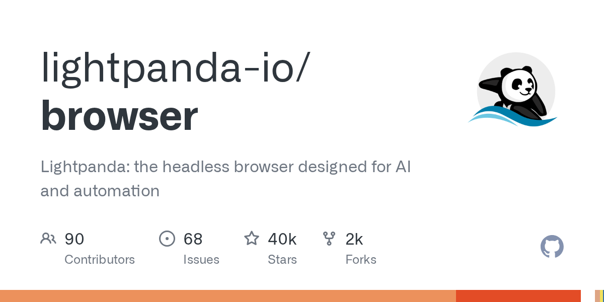
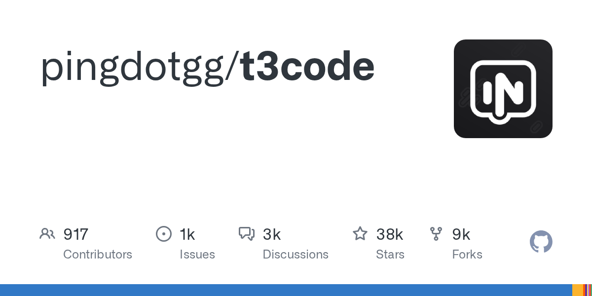

# AI 资讯日报 2026-11-02

> 自动抓取 AI 公司博客、从业者博客与社区聚合源，并生成中文摘要。

## 今日摘要

```
- Making it easier for websites to express AI training preferences
- Community safety report and new protections for teens
- agentmash - 适用于团队编程代理的开源多人游戏人工智能
- Embage - 为客户构建构建代理，运行工作流，并进行分析。
- Riverside Agents - 一支专注于视频的人工智能代理团队：制作、剪辑、裁剪、发布
```

## 公司动态

1. **[Making it easier for websites to express AI training preferences](https://openai.com/index/helping-websites-express-ai-training-preferences)**

   OpenAI will honor a shared robots.txt signal to help website operators communicate their AI training preferences to participating providers.

   来源：OpenAI Blog

2. **[Community safety report and new protections for teens](https://openai.com/index/community-safety-report-and-new-protections-for-teens)**

   OpenAI is strengthening violence prevention in ChatGPT with expanded safeguards, earlier interventions, and a new commitment to public safety reporting.

   来源：OpenAI Blog

## 每日产品

1. **[agentmash - 适用于团队编程代理的开源多人游戏人工智能](https://www.producthunt.com/r/4SM6ILOBQKUALZ)**

   *{padding:0;margin:0;overflow:hidden}html,body{height:100%}img,span{position:absolute;width:100%;top:0;bottom:0;margin:auto}span{height:1.5em;text-align:center;font:48px/1.5 sans-serif;color:white;text-shadow:0 0 0.5em black}▶" frameborder="0" allow="accelerometer; autoplay; encrypted-media; gyroscope; picture-in-picture" allowfullscreen > open-source multiplayer AI for teams' coding agents (www.producthunt.com) 11-01 ↑ 106 PH Upvotes

   来源：Product Hunt Daily

2. **[Embage - 为客户构建构建代理，运行工作流，并进行分析。](https://www.producthunt.com/r/OYXQ3VEP75YG64)**

   *{padding:0;margin:0;overflow:hidden}html,body{height:100%}img,span{position:absolute;width:100%;top:0;bottom:0;margin:auto}span{height:1.5em;text-align:center;font:48px/1.5 sans-serif;color:white;text-shadow:0 0 0.5em black}▶" frameborder="0" allow="accelerometer; autoplay; encrypted-media; gyroscope; picture-in-picture" allowfullscreen > Build agent for your customers, run workflows, analyzed. (www.producthunt.com) 11-01 ↑ 103 PH Upvotes

   来源：Product Hunt Daily

3. **[Riverside Agents - 一支专注于视频的人工智能代理团队：制作、剪辑、裁剪、发布](https://www.producthunt.com/r/DIOFM7OZMKNLDK)**

   A team of AI agents for video: produce, edit, clip, post (www.producthunt.com) 11-01 ↑ 100 PH Upvotes

   

   来源：Product Hunt Daily

4. **[Precise Edit by Ideogram - 利用上下文窗口进行精确编辑](https://www.producthunt.com/r/RV5WCJYJUF4JTW)**

   *{padding:0;margin:0;overflow:hidden}html,body{height:100%}img,span{position:absolute;width:100%;top:0;bottom:0;margin:auto}span{height:1.5em;text-align:center;font:48px/1.5 sans-serif;color:white;text-shadow:0 0 0.5em black}▶" frameborder="0" allow="accelerometer; autoplay; encrypted-media; gyroscope; picture-in-picture" allowfullscreen > Precise editing with context window (www.producthunt.com) 11-01 ↑ 100 PH Upvotes

   来源：Product Hunt Daily

5. **[ClawsGO Science - 拥有自有云实验室的人工智能研究代理](https://www.producthunt.com/r/BECJZCED6CRLLK)**

   *{padding:0;margin:0;overflow:hidden}html,body{height:100%}img,span{position:absolute;width:100%;top:0;bottom:0;margin:auto}span{height:1.5em;text-align:center;font:48px/1.5 sans-serif;color:white;text-shadow:0 0 0.5em black}▶" frameborder="0" allow="accelerometer; autoplay; encrypted-media; gyroscope; picture-in-picture" allowfullscreen > The AI research agent with its own cloud lab (www.producthunt.com) 11-01 ↑ 132 PH Upvotes

   来源：Product Hunt Daily

6. **[Screen Studio 4.0 - 玻璃放大镜、相机开孔、按字幕编辑等功能](https://www.producthunt.com/r/MXBY2KB22GHVHB)**

   Glass Loupe, Camera Cutout, Edit by Transcript, and more (www.producthunt.com) 11-01 ↑ 179 PH Upvotes

   

   来源：Product Hunt Daily

7. **[Secret Key - 如果你无法解锁，就让家人帮你解锁密码吧](https://www.producthunt.com/r/WTAFE2IZ2IA2LC)**

   *{padding:0;margin:0;overflow:hidden}html,body{height:100%}img,span{position:absolute;width:100%;top:0;bottom:0;margin:auto}span{height:1.5em;text-align:center;font:48px/1.5 sans-serif;color:white;text-shadow:0 0 0.5em black}▶" frameborder="0" allow="accelerometer; autoplay; encrypted-media; gyroscope; picture-in-picture" allowfullscreen > Let your family unlock your passwords if you can't (www.producthunt.com) 10-31 ↑ 100 PH Upvotes

   来源：Product Hunt Daily

8. **[WinnerAdSpy - 将竞争对手的广告洞察转化为成功的应用推广活动](https://www.producthunt.com/r/H7UZRHUBGPTV43)**

   *{padding:0;margin:0;overflow:hidden}html,body{height:100%}img,span{position:absolute;width:100%;top:0;bottom:0;margin:auto}span{height:1.5em;text-align:center;font:48px/1.5 sans-serif;color:white;text-shadow:0 0 0.5em black}▶" frameborder="0" allow="accelerometer; autoplay; encrypted-media; gyroscope; picture-in-picture" allowfullscreen > Turn competitor ad insights into winning app campaigns (www.producthunt.com) 10-31 ↑ 146 PH Upvotes

   来源：Product Hunt Daily

9. **[Faylee - 您的编码代理只需点击一个链接即可修复的错误报告](https://www.producthunt.com/r/2NNSBIYKNI3BKE)**

   *{padding:0;margin:0;overflow:hidden}html,body{height:100%}img,span{position:absolute;width:100%;top:0;bottom:0;margin:auto}span{height:1.5em;text-align:center;font:48px/1.5 sans-serif;color:white;text-shadow:0 0 0.5em black}▶" frameborder="0" allow="accelerometer; autoplay; encrypted-media; gyroscope; picture-in-picture" allowfullscreen > Bug reports your coding agent can fix from one link (www.producthunt.com) 10-30 ↑ 102 PH Upvotes

   来源：Product Hunt Daily

10. **[iSurge - 活动监视器、按应用调节音量、磁盘清理，尽在您的控制之中](https://www.producthunt.com/r/VFQNYFOWMDE4HU)**

   *{padding:0;margin:0;overflow:hidden}html,body{height:100%}img,span{position:absolute;width:100%;top:0;bottom:0;margin:auto}span{height:1.5em;text-align:center;font:48px/1.5 sans-serif;color:white;text-shadow:0 0 0.5em black}▶" frameborder="0" allow="accelerometer; autoplay; encrypted-media; gyroscope; picture-in-picture" allowfullscreen > Activity monitor, per-app volume, disk cleanup at your notch (www.producthunt.com) 10-30 ↑ 105 PH Upvotes

   来源：Product Hunt Daily

## GitHub 项目

1. **[milind-soni/OpenMausBot](https://github.com/milind-soni/OpenMausBot)**

   Open-source Grok Bot alternative with a virtual machine that bots can use Language: TypeScript Stars: 10592 Forks: 1462

   来源：GitHub Trending Daily

2. **[public-apis/public-apis](https://github.com/public-apis/public-apis)**

   A collective list of free APIs Language: Python Stars: 494666 Forks: 55209

   

   来源：GitHub Trending Daily

3. **[cjpais/Handy](https://github.com/cjpais/Handy)**

   A free, open source, and extensible speech-to-text application that works completely offline. Language: Rust Stars: 36608 Forks: 3455

   

   来源：GitHub Trending Daily

4. **[Donchitos/Claude-Code-Game-Studios](https://github.com/Donchitos/Claude-Code-Game-Studios)**

   Turn Claude Code into a full game dev studio — 49 AI agents, 72 workflow skills, and a complete coordination system mirroring real studio hierarchy. Language: Shell Stars: 32362 Forks: 4408

   

   来源：GitHub Trending Daily

5. **[kornia/kornia](https://github.com/kornia/kornia)**

   🐍 Geometric Computer Vision Library for Spatial AI Language: Python Stars: 11821 Forks: 1468

   

   来源：GitHub Trending Daily

6. **[beenuar/AiSOC](https://github.com/beenuar/AiSOC)**

   Open-source AI Security Operations Center: alert fusion, LLM-agent triage, MITRE ATT&CK investigation, and a replayable decision ledger for every agent step. Self-hostable, runs with no API keys, MIT licensed. Ships an MCP server for Claude, Cursor and Continue. Language: Python Stars: 6262 Forks: 646

   

   来源：GitHub Trending Daily

7. **[thedotmack/claude-mem](https://github.com/thedotmack/claude-mem)**

   Persistent Context Across Sessions for Every Agent – Captures everything your agent does during sessions, compresses it with AI, and injects relevant context back into future sessions. Works with Claude Code, OpenClaw, Codex, Gemini, Hermes, Copilot, OpenCode + More Language: TypeScript Stars: 109368 Forks: 9569

   

   来源：GitHub Trending Daily

8. **[lightpanda-io/browser](https://github.com/lightpanda-io/browser)**

   Lightpanda: the headless browser designed for AI and automation Language: Zig Stars: 40209 Forks: 1966

   

   来源：GitHub Trending Daily

9. **[shiyu-coder/Kronos](https://github.com/shiyu-coder/Kronos)**

   Kronos: A Foundation Model for the Language of Financial Markets Language: Python Stars: 45432 Forks: 7505

   来源：GitHub Trending Daily

10. **[pingdotgg/t3code](https://github.com/pingdotgg/t3code)**

   Language: TypeScript Stars: 38161 Forks: 8924

   

   来源：GitHub Trending Daily

## 从业者观点

1. **[If in doubt, delete the uv.lock file](https://simonwillison.net/2026/Nov/1/delete-uv-lock-first/)**

   I've been getting the occasional confusing Python dependency error since switching over to Python 3.15 and the rule I'm having to remember is: If in doubt, delete the uv.lock file Most of my projects are libraries which don't include a uv.lock file, since it's rude for a library dependency to lock versions for anything else that uses it. Running uv run pytest etc tends to leave uv.lock files lying around, which are listed in .gitignore and so do not get committed to my repositories. But... sometimes that uv.lock pins a version of a dependency that doesn't yet have a Python 3.15 wheel. An example from earlier today: error: Failed to build `watchfiles==1.1.1` cause: Call to `maturin.build_wheel` failed error: the configured Python interpreter version (3.15) is newer than PyO3's maximum supported version (3.14) Deleting that file and running uv run pytest again usually fixes the problem. Tags: uv , til , python

   来源：Simon Willison

2. **[Quoting Kyle Kingsbury](https://simonwillison.net/2026/Nov/1/kyle-kingsbury/)**

   More broadly, the use of LLMs erodes trust in documentation, in software, and in the organizations which produce them. Perhaps engineers will begin to treat any new software project with suspicion—the signals we used to rely on as markers of a mature system are now easier to counterfeit. [...] In the age of LLMs, what can maintainers do to ensure correct software and accurate documentation? Having done that work, how can they demonstrate its quality to users? &mdash; Kyle Kingsbury , Jepsen results for ParticleDB 1.1.4 Tags: kyle-kingsbury , llms , ai , generative-ai , ai-misuse

   来源：Simon Willison

3. **[How We Took Over ChatGPT Accounts](https://simonwillison.net/2026/Oct/31/how-we-took-over-chatgpt-accounts/)**

   How We Took Over ChatGPT Accounts Parameter Labs describe an exploit they found against ChatGPT's implementation of the artifacts pattern (OpenAI used to call this "Canvas" but it looks like the latest revision is called HTML previews ), where interactive custom HTML apps are displayed in a sandboxed iframe. It's important that HTML in these stays tightly sandboxed to avoid untrusted code interacting with OpenAI APIs and accessing private data. Parameter found quite a complex attack chain. OpenAI use the MathLive JavaScript library as part of their graph support, and that library includes its own virtual keyboard , which can be triggered in the parent page via postMessage() from the sandboxed iframe. That message receiving code uses innerHTML , so anything that sends a message can add custom HTML to the parent - and there was no mechanism to prevent other sandboxed frames, including HTML preview frames, from calling that method. This meant untrusted code in an iframe could insert HTML, and while innerHTML doesn't directly execute script elements it could be used to inject a new iframe without sandbox restrictions. OpenAI’s CSP rules blocked inline scripts entirely, and only allowed script loading from a handful of domains, but one of those was YouTube - and the YouTube oEmbed endpoint could be used to reflect JavaScript back in a way that executed it. Once the attack had JavaScript execution on ChatGPT, it was trivial to fetch private user data from APIs and exfiltrate it via an image reference. The end result: you could create a ChatGPT share URL which, when visited by another signed-in user, could exfiltrate their private data or take actions on their behalf. OpenAI closed the hole and paid out a $5,000 bug bounty, which I think was a bit cheap for a vulnerability this serious. Via Hacker News Tags: iframes , javascript , sandboxing , security , xss , openai , chatgpt , content-security-policy

   来源：Simon Willison

4. **[datasette-llm 0.1a9](https://simonwillison.net/2026/Oct/31/datasette-llm/)**

   Release: datasette-llm 0.1a9 I have some big upgrades to Datasette Agent in the pipeline, but in the meantime here's a tiny user experience improvement to the underlying datasette-llm plugin. It now picks up the default model used by LLM , which means you can start using Datasette Agent without needing to explicitly configure a default model: uvx --with datasette-agent datasette content.db --internal internal.db Previously you would also need to specify a model with -s plugins.datasette-agent.default_model gpt-6-astra . Tags: datasette , llm , datasette-agent

   来源：Simon Willison

5. **[dbreunig/nesformer](https://simonwillison.net/2026/Oct/30/nesformer/)**

   dbreunig/nesformer Inspired by qwenputer by Divyansh Agrawal, Drew Breunig baked a working emulator for a Nintendo Entertainment System 6502 CPU into the weights of Qwen3.5-4B. You can now play NES ROMs such as Super Mario Bros (very slowly) running inside Qwen! In a comment on Hacker News Drew reveals the Opus 5.5 prompts he used to build this system: Read this article and any relevant source code: https://divagr.com/blog/qwenputer. Then explore if you could emulate the chip and ram in a Nintendo Entertainment System (as people do today with FPGAs in MISTRs) using this technique. If so, what size model would you have to build and if you could use smaller faster ones, could you get it to be at the standard clockspeed. Followed by: I think we should build it! Just for fun. It's okay if it's not fast. We want to be able to have the weights, and a cli to run them that we can point at a ROM. Apparently Opus found and then used this collection of conformance tests for the NES CPU released 15 years ago by Christopher Pow. Via Hacker News Tags: games , ai , generative-ai , llms , drew-breunig , qwen , conformance-suites

   来源：Simon Willison

6. **[Robert Caro – The master biographer reflects at 91](https://www.dwarkesh.com/p/robert-caro)**

   "A lot of the stuff that I cut out, it's tragic that no one knows it."

   来源：Dwarkesh Patel

## 社区热点

1. **[AI delivers 'zero financial payoff' to most companies, Apollo economist says](https://techcrunch.com/2026/10/25/ai-delivers-zero-financial-payoff-to-most-companies-according-to-apollo-economist/)**

   Article URL: https://techcrunch.com/2026/10/25/ai-delivers-zero-financial-payoff-to-most-companies-according-to-apollo-economist/ Comments URL: https://news.ycombinator.com/item?id=50330456 Points: 161 # Comments: 133

   来源：Hacker News AI

2. **[It wasn't AI that flipped Proton's charge](https://blog.raed.dev/posts/proton-loser-thinking/)**

   Article URL: https://blog.raed.dev/posts/proton-loser-thinking/ Comments URL: https://news.ycombinator.com/item?id=50328488 Points: 141 # Comments: 81

   来源：Hacker News AI

3. **[Muse AI agent is a commercial surveillance network disguised as an AI assistant](https://paulfwalsh.substack.com/p/metas-muse-ai-agent-is-a-commercial)**

   Article URL: https://paulfwalsh.substack.com/p/metas-muse-ai-agent-is-a-commercial Comments URL: https://news.ycombinator.com/item?id=50328293 Points: 34 # Comments: 5

   来源：Hacker News AI

4. **[AI agent swarms in Minecraft fail to build civilization, drown in bureaucracy](https://www.tomshardware.com/tech-industry/artificial-intelligence/ai-agent-swarms-unleashed-in-minecraft-to-build-a-thriving-civilization-50-agent-teams-fail-after-falling-into-paralyzing-bureaucracy)**

   Article URL: https://www.tomshardware.com/tech-industry/artificial-intelligence/ai-agent-swarms-unleashed-in-minecraft-to-build-a-thriving-civilization-50-agent-teams-fail-after-falling-into-paralyzing-bureaucracy Comments URL: https://news.ycombinator.com/item?id=50325662 Points: 149 # Comments: 73

   来源：Hacker News AI

5. **[The AI cost of JavaScript frameworks](https://nolanlawson.com/2026/10/28/the-ai-cost-of-javascript-frameworks/)**

   Article URL: https://nolanlawson.com/2026/10/28/the-ai-cost-of-javascript-frameworks/ Comments URL: https://news.ycombinator.com/item?id=50323088 Points: 298 # Comments: 229

   来源：Hacker News AI

6. **[How AI may drive union-resistant tech workers to the bargaining table](https://www.theguardian.com/technology/2026/jul/21/ai-tech-workers-unionize)**

   Article URL: https://www.theguardian.com/technology/2026/jul/21/ai-tech-workers-unionize Comments URL: https://news.ycombinator.com/item?id=50321734 Points: 31 # Comments: 5

   来源：Hacker News AI

7. **[Computer Science Programs Lose Students as AI Replaces Jobs](https://www.bloomberg.com/news/articles/2026-10-29/computer-science-degree-programs-lose-students-as-ai-takes-jobs)**

   Article URL: https://www.bloomberg.com/news/articles/2026-10-29/computer-science-degree-programs-lose-students-as-ai-takes-jobs Comments URL: https://news.ycombinator.com/item?id=50321065 Points: 32 # Comments: 20

   来源：Hacker News AI

8. **[AI text watermarking and quality loss](https://blog.keyvan.net/p/ai-text-watermarking-and-quality)**

   Article URL: https://blog.keyvan.net/p/ai-text-watermarking-and-quality Comments URL: https://news.ycombinator.com/item?id=50320599 Points: 66 # Comments: 16

   来源：Hacker News AI

9. **[Anthropic takes steps to block Claude from reverse-engineering video games](https://mashable.com/tech/anthropic-takes-steps-to-block-video-game-cloning-and-reverse-engineering)**

   Article URL: https://mashable.com/tech/anthropic-takes-steps-to-block-video-game-cloning-and-reverse-engineering Comments URL: https://news.ycombinator.com/item?id=50320255 Points: 181 # Comments: 111

   来源：Hacker News AI

10. **[GPT-5.6 Sol can beat Factorio on peaceful mode](https://ryanmadden.net/gpt-56-beats-factorio/)**

   Article URL: https://ryanmadden.net/gpt-56-beats-factorio/ Comments URL: https://news.ycombinator.com/item?id=50318871 Points: 176 # Comments: 187

   来源：Hacker News AI

11. **[An easy way to try local AI with braindead-local-intelligence](https://dataswamp.org/~solene/2026-11-01-braindead-local-intelligence.html)**

   Comments

   来源：Lobsters AI

12. **[Let’s Build a Brain](https://aatishb.com/myriad/lets-build-a-brain/)**

   Comments

   来源：Lobsters AI

13. **[Building fine-grained version control for agents with Rust and Durable Objects](https://delta.dev/blog/fine-grained-version-control-for-agents)**

   Comments

   来源：Lobsters AI
