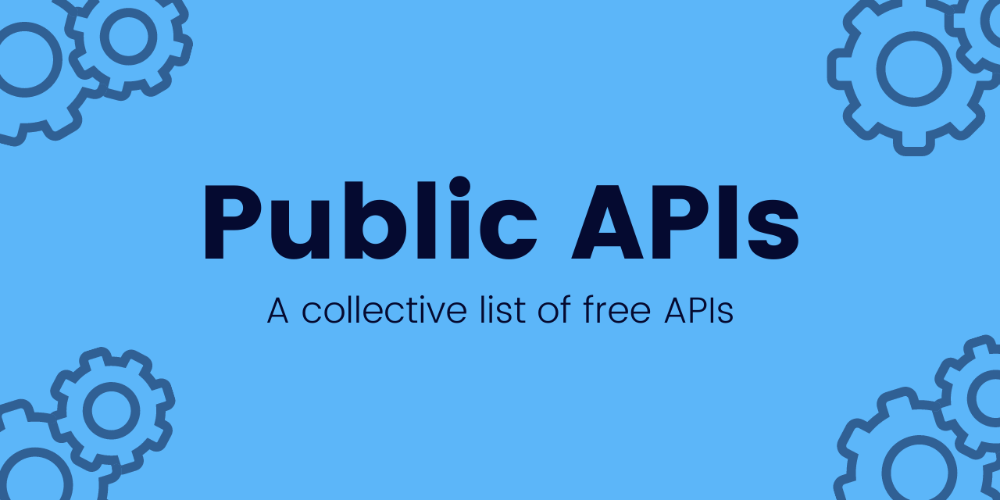
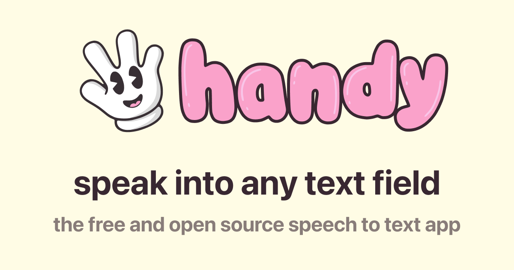
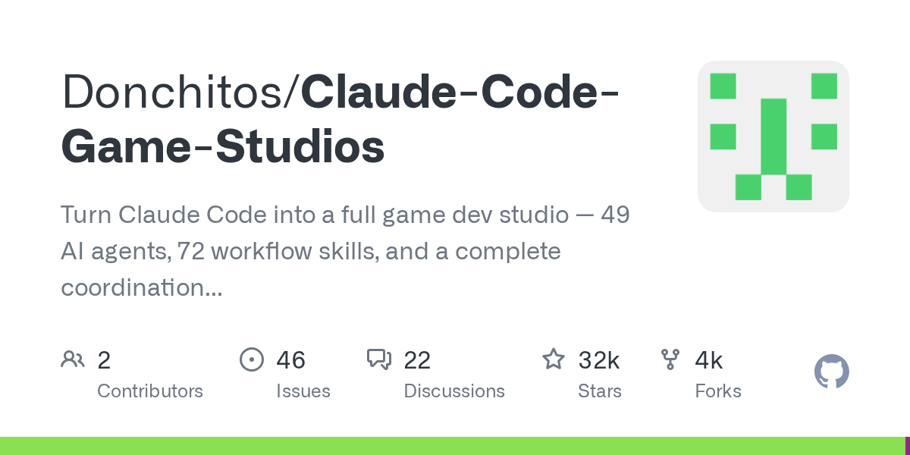
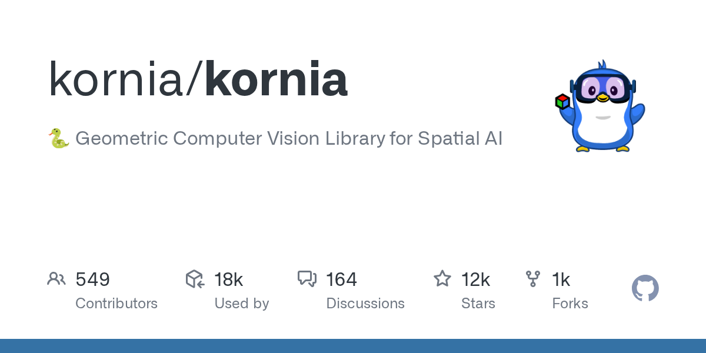
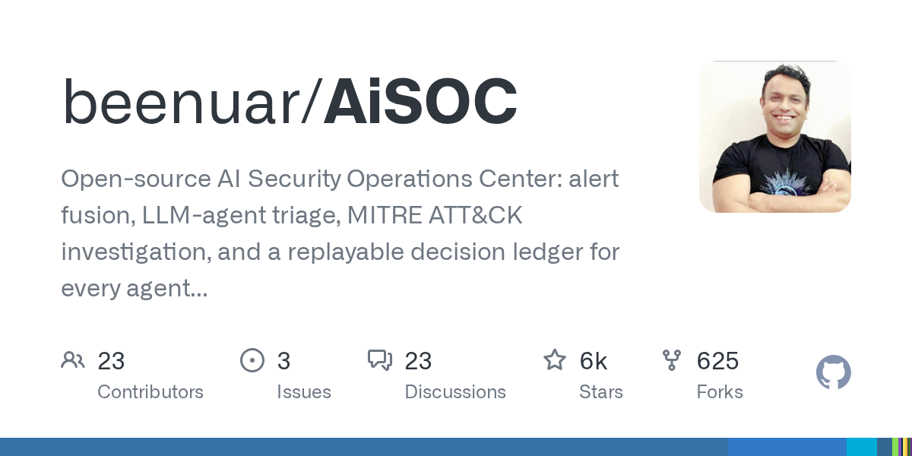

# AI 资讯日报 2026-11-02

> 自动抓取 AI 公司博客、从业者博客与社区聚合源，并生成中文摘要。

## 今日摘要

```
- Making it easier for websites to express AI training preferences
- Community safety report and new protections for teens
- Fair use benefits everyone
- An updated Model Spec for more capable and beneficial AI
- agentmash - 适用于团队编程代理的开源多人游戏人工智能
```

## 公司动态

1. **[Making it easier for websites to express AI training preferences](https://openai.com/index/helping-websites-express-ai-training-preferences)**

   OpenAI will honor a shared robots.txt signal to help website operators communicate their AI training preferences to participating providers.

   来源：OpenAI Blog

2. **[Community safety report and new protections for teens](https://openai.com/index/community-safety-report-and-new-protections-for-teens)**

   OpenAI is strengthening violence prevention in ChatGPT with expanded safeguards, earlier interventions, and a new commitment to public safety reporting.

   来源：OpenAI Blog

3. **[Fair use benefits everyone](https://openai.com/index/fair-use-benefits-everyone)**

   OpenAI shares excerpts from court briefs by creators, academics, accessibility advocates, and legal experts, among others, on how fair use supports AI training and innovation.

   来源：OpenAI Blog

4. **[An updated Model Spec for more capable and beneficial AI](https://openai.com/index/updated-model-spec)**

   OpenAI’s updated Model Spec outlines five core values to guide more capable AI toward sound judgment, human agency, and faithfulness to human intent.

   来源：OpenAI Blog

## 每日产品

1. **[agentmash - 适用于团队编程代理的开源多人游戏人工智能](https://www.producthunt.com/r/4SM6ILOBQKUALZ)**

   *{padding:0;margin:0;overflow:hidden}html,body{height:100%}img,span{position:absolute;width:100%;top:0;bottom:0;margin:auto}span{height:1.5em;text-align:center;font:48px/1.5 sans-serif;color:white;text-shadow:0 0 0.5em black}▶" frameborder="0" allow="accelerometer; autoplay; encrypted-media; gyroscope; picture-in-picture" allowfullscreen > open-source multiplayer AI for teams' coding agents (www.producthunt.com) 11-01 ↑ 106 PH Upvotes

   来源：Product Hunt Daily

2. **[Embage - 为客户构建构建代理，运行工作流，并进行分析。](https://www.producthunt.com/r/OYXQ3VEP75YG64)**

   *{padding:0;margin:0;overflow:hidden}html,body{height:100%}img,span{position:absolute;width:100%;top:0;bottom:0;margin:auto}span{height:1.5em;text-align:center;font:48px/1.5 sans-serif;color:white;text-shadow:0 0 0.5em black}▶" frameborder="0" allow="accelerometer; autoplay; encrypted-media; gyroscope; picture-in-picture" allowfullscreen > Build agent for your customers, run workflows, analyzed. (www.producthunt.com) 11-01 ↑ 103 PH Upvotes

   来源：Product Hunt Daily

3. **[Riverside Agents - 一支专注于视频的人工智能代理团队：制作、剪辑、裁剪、发布](https://www.producthunt.com/r/DIOFM7OZMKNLDK)**

   A team of AI agents for video: produce, edit, clip, post (www.producthunt.com) 11-01 ↑ 100 PH Upvotes

   

   来源：Product Hunt Daily

4. **[Precise Edit by Ideogram - 利用上下文窗口进行精确编辑](https://www.producthunt.com/r/RV5WCJYJUF4JTW)**

   *{padding:0;margin:0;overflow:hidden}html,body{height:100%}img,span{position:absolute;width:100%;top:0;bottom:0;margin:auto}span{height:1.5em;text-align:center;font:48px/1.5 sans-serif;color:white;text-shadow:0 0 0.5em black}▶" frameborder="0" allow="accelerometer; autoplay; encrypted-media; gyroscope; picture-in-picture" allowfullscreen > Precise editing with context window (www.producthunt.com) 11-01 ↑ 100 PH Upvotes

   来源：Product Hunt Daily

5. **[ClawsGO Science - 拥有自有云实验室的人工智能研究代理](https://www.producthunt.com/r/BECJZCED6CRLLK)**

   *{padding:0;margin:0;overflow:hidden}html,body{height:100%}img,span{position:absolute;width:100%;top:0;bottom:0;margin:auto}span{height:1.5em;text-align:center;font:48px/1.5 sans-serif;color:white;text-shadow:0 0 0.5em black}▶" frameborder="0" allow="accelerometer; autoplay; encrypted-media; gyroscope; picture-in-picture" allowfullscreen > The AI research agent with its own cloud lab (www.producthunt.com) 11-01 ↑ 132 PH Upvotes

   来源：Product Hunt Daily

6. **[Screen Studio 4.0 - 玻璃放大镜、相机开孔、按字幕编辑等功能](https://www.producthunt.com/r/MXBY2KB22GHVHB)**

   Glass Loupe, Camera Cutout, Edit by Transcript, and more (www.producthunt.com) 11-01 ↑ 179 PH Upvotes

   

   来源：Product Hunt Daily

7. **[Secret Key - 如果你无法解锁，就让家人帮你解锁密码吧](https://www.producthunt.com/r/WTAFE2IZ2IA2LC)**

   *{padding:0;margin:0;overflow:hidden}html,body{height:100%}img,span{position:absolute;width:100%;top:0;bottom:0;margin:auto}span{height:1.5em;text-align:center;font:48px/1.5 sans-serif;color:white;text-shadow:0 0 0.5em black}▶" frameborder="0" allow="accelerometer; autoplay; encrypted-media; gyroscope; picture-in-picture" allowfullscreen > Let your family unlock your passwords if you can't (www.producthunt.com) 10-31 ↑ 100 PH Upvotes

   来源：Product Hunt Daily

8. **[WinnerAdSpy - 将竞争对手的广告洞察转化为成功的应用推广活动](https://www.producthunt.com/r/H7UZRHUBGPTV43)**

   *{padding:0;margin:0;overflow:hidden}html,body{height:100%}img,span{position:absolute;width:100%;top:0;bottom:0;margin:auto}span{height:1.5em;text-align:center;font:48px/1.5 sans-serif;color:white;text-shadow:0 0 0.5em black}▶" frameborder="0" allow="accelerometer; autoplay; encrypted-media; gyroscope; picture-in-picture" allowfullscreen > Turn competitor ad insights into winning app campaigns (www.producthunt.com) 10-31 ↑ 146 PH Upvotes

   来源：Product Hunt Daily

9. **[Faylee - 您的编码代理只需点击一个链接即可修复的错误报告](https://www.producthunt.com/r/2NNSBIYKNI3BKE)**

   *{padding:0;margin:0;overflow:hidden}html,body{height:100%}img,span{position:absolute;width:100%;top:0;bottom:0;margin:auto}span{height:1.5em;text-align:center;font:48px/1.5 sans-serif;color:white;text-shadow:0 0 0.5em black}▶" frameborder="0" allow="accelerometer; autoplay; encrypted-media; gyroscope; picture-in-picture" allowfullscreen > Bug reports your coding agent can fix from one link (www.producthunt.com) 10-30 ↑ 102 PH Upvotes

   来源：Product Hunt Daily

10. **[iSurge - 活动监视器、按应用调节音量、磁盘清理，尽在您的控制之中](https://www.producthunt.com/r/VFQNYFOWMDE4HU)**

   *{padding:0;margin:0;overflow:hidden}html,body{height:100%}img,span{position:absolute;width:100%;top:0;bottom:0;margin:auto}span{height:1.5em;text-align:center;font:48px/1.5 sans-serif;color:white;text-shadow:0 0 0.5em black}▶" frameborder="0" allow="accelerometer; autoplay; encrypted-media; gyroscope; picture-in-picture" allowfullscreen > Activity monitor, per-app volume, disk cleanup at your notch (www.producthunt.com) 10-30 ↑ 105 PH Upvotes

   来源：Product Hunt Daily

## GitHub 项目

1. **[thedotmack/claude-mem](https://github.com/thedotmack/claude-mem)**

   Persistent Context Across Sessions for Every Agent – Captures everything your agent does during sessions, compresses it with AI, and injects relevant context back into future sessions. Works with Claude Code, OpenClaw, Codex, Gemini, Hermes, Copilot, OpenCode + More Language: TypeScript Stars: 108803 Forks: 9535

   

   来源：GitHub Trending Daily

2. **[lightpanda-io/browser](https://github.com/lightpanda-io/browser)**

   Lightpanda: the headless browser designed for AI and automation Language: Zig Stars: 39843 Forks: 1946

   来源：GitHub Trending Daily

3. **[shiyu-coder/Kronos](https://github.com/shiyu-coder/Kronos)**

   Kronos: A Foundation Model for the Language of Financial Markets Language: Python Stars: 45134 Forks: 7462

   来源：GitHub Trending Daily

4. **[pingdotgg/t3code](https://github.com/pingdotgg/t3code)**

   Language: TypeScript Stars: 37117 Forks: 8872

   来源：GitHub Trending Daily

5. **[milind-soni/OpenMausBot](https://github.com/milind-soni/OpenMausBot)**

   Open-source Grok Bot alternative with a virtual machine that bots can use Language: TypeScript Stars: 10319 Forks: 1426

   来源：GitHub Trending Daily

6. **[public-apis/public-apis](https://github.com/public-apis/public-apis)**

   A collective list of free APIs Language: Python Stars: 494257 Forks: 55174

   

   来源：GitHub Trending Daily

7. **[cjpais/Handy](https://github.com/cjpais/Handy)**

   A free, open source, and extensible speech-to-text application that works completely offline. Language: Rust Stars: 36263 Forks: 3432

   

   来源：GitHub Trending Daily

8. **[Donchitos/Claude-Code-Game-Studios](https://github.com/Donchitos/Claude-Code-Game-Studios)**

   Turn Claude Code into a full game dev studio — 49 AI agents, 72 workflow skills, and a complete coordination system mirroring real studio hierarchy. Language: Shell Stars: 31920 Forks: 4359

   

   来源：GitHub Trending Daily

9. **[kornia/kornia](https://github.com/kornia/kornia)**

   🐍 Geometric Computer Vision Library for Spatial AI Language: Python Stars: 11670 Forks: 1461

   

   来源：GitHub Trending Daily

10. **[beenuar/AiSOC](https://github.com/beenuar/AiSOC)**

   Open-source AI Security Operations Center: alert fusion, LLM-agent triage, MITRE ATT&CK investigation, and a replayable decision ledger for every agent step. Self-hostable, runs with no API keys, MIT licensed. Ships an MCP server for Claude, Cursor and Continue. Language: Python Stars: 5999 Forks: 625

   

   来源：GitHub Trending Daily

## 从业者观点

1. **[How We Took Over ChatGPT Accounts](https://simonwillison.net/2026/Oct/31/how-we-took-over-chatgpt-accounts/)**

   How We Took Over ChatGPT Accounts Parameter Labs describe an exploit they found against ChatGPT's implementation of the artifacts pattern (OpenAI used to call this "Canvas" but it looks like the latest revision is called HTML previews ), where interactive custom HTML apps are displayed in a sandboxed iframe. It's important that HTML in these stays tightly sandboxed to avoid untrusted code interacting with OpenAI APIs and accessing private data. Parameter found quite a complex attack chain. OpenAI use the MathLive JavaScript library as part of their graph support, and that library includes its own virtual keyboard , which can be triggered in the parent page via postMessage() from the sandboxed iframe. That message receiving code uses innerHTML , so anything that sends a message can add custom HTML to the parent - and there was no mechanism to prevent other sandboxed frames, including HTML preview frames, from calling that method. This meant untrusted code in an iframe could insert HTML, and while innerHTML doesn't directly execute script elements it could be used to inject a new iframe without sandbox restrictions. OpenAI’s CSP rules blocked inline scripts entirely, and only allowed script loading from a handful of domains, but one of those was YouTube - and the YouTube oEmbed endpoint could be used to reflect JavaScript back in a way that executed it. Once the attack had JavaScript execution on ChatGPT, it was trivial to fetch private user data from APIs and exfiltrate it via an image reference. The end result: you could create a ChatGPT share URL which, when visited by another signed-in user, could exfiltrate their private data or take actions on their behalf. OpenAI closed the hole and paid out a $5,000 bug bounty, which I think was a bit cheap for a vulnerability this serious. Via Hacker News Tags: iframes , javascript , sandboxing , security , xss , openai , chatgpt , content-security-policy

   来源：Simon Willison

2. **[datasette-llm 0.1a9](https://simonwillison.net/2026/Oct/31/datasette-llm/)**

   Release: datasette-llm 0.1a9 I have some big upgrades to Datasette Agent in the pipeline, but in the meantime here's a tiny user experience improvement to the underlying datasette-llm plugin. It now picks up the default model used by LLM , which means you can start using Datasette Agent without needing to explicitly configure a default model: uvx --with datasette-agent datasette content.db --internal internal.db Previously you would also need to specify a model with -s plugins.datasette-agent.default_model gpt-6-astra . Tags: datasette , llm , datasette-agent

   来源：Simon Willison

3. **[dbreunig/nesformer](https://simonwillison.net/2026/Oct/30/nesformer/)**

   dbreunig/nesformer Inspired by qwenputer by Divyansh Agrawal, Drew Breunig baked a working emulator for a Nintendo Entertainment System 6502 CPU into the weights of Qwen3.5-4B. You can now play NES ROMs such as Super Mario Bros (very slowly) running inside Qwen! In a comment on Hacker News Drew reveals the Opus 5.5 prompts he used to build this system: Read this article and any relevant source code: https://divagr.com/blog/qwenputer. Then explore if you could emulate the chip and ram in a Nintendo Entertainment System (as people do today with FPGAs in MISTRs) using this technique. If so, what size model would you have to build and if you could use smaller faster ones, could you get it to be at the standard clockspeed. Followed by: I think we should build it! Just for fun. It's okay if it's not fast. We want to be able to have the weights, and a cli to run them that we can point at a ROM. Apparently Opus found and then used this collection of conformance tests for the NES CPU released 15 years ago by Christopher Pow. Via Hacker News Tags: games , ai , generative-ai , llms , drew-breunig , qwen , conformance-suites

   来源：Simon Willison

4. **[API credits benefit for eligible ChatGPT subscriptions](https://simonwillison.net/2026/Oct/29/api-credits/)**

   API credits benefit for eligible ChatGPT subscriptions Earlier this month Anthropic announced a generous new benefit for their Max and Team subscriptions: $100, $200, and $500 per month subscribers would get the equivalent quantity of (expiring) credits to use with the Anthropic API. OpenAI have now launched pretty much exactly the same deal: if you have a $100, $200, or $500 subscription plan with them you now get that same quantity of credits to apply to one of your API organizations. I maintain subscriptions with both companies, so this is great news for me! I may even ship some public-facing demos now that the credits are already covered by my existing subscriptions. Tags: ai , openai , generative-ai , llms , anthropic , llm-pricing

   来源：Simon Willison

5. **[Building a multiplayer game world with autonomous Fable-class models](https://simonwillison.net/2026/Oct/29/how-i-built-the-most-ai-pilled-company-in-the-world/)**

   How I Built the Most AI-Pilled Company in the World Don't be put off by the clickbait headline, this piece by Jacob Sansbury describing how they are building Spawn is a fascinating exploration of the bleeding edge of what's possible with agentic engineering against frontier models. Spawn is a massively multiplayer gaming environment where players can use prompts (to the in-game agent, Savi) to modify the game world. I fired it up on my phone for a few minutes and was able to prompt a castle into existence, then a dragon, then ride the dragon to fly around that castle. [图片: https://static.simonwillison.net/static/2026-10-29/IMG_9406.webp] By Jacob's telling, Spawn is now being developed autonomously by a swarm of Fable-powered agents costing over $3 million in tokens per month ("we spend 30x payroll on AI tokens"). Our agents change the live code directly and ship to production hourly, so they read every error, bug report and metric themselves. About 60% of our work starts from a production error, a Savi bug report (Savi is the AI you build games with in Spawn), something odd in our logs, or a feature request. Savi files bugs herself. When a user hits one, or Savi hits one in the product, she files it. It goes straight to an agent that decides whether it's a real bug to fix, something we won't fix, or intentional design that needs a decision. Usually it becomes a change, delivered to that user within an hour, with a message in the same chat. This is continuous deployment turned up to 11: A loop this tight only works if it never stops, so we treat an hour without a ship as a SEV-0, our most severe kind of incident. Unshipped changes pile up, and every problem already in production lasts longer. The feedback slows down too. An agent can only keep a few hours of work in its head, so shipping faster than that actually helps it stay coherent. [...] We can roll back a broken change in 30 seconds, exactly where it's broken and nowhere else. When a monitor or a log alert fires, it starts or wakes an agent that owns the incident, and we break things on purpose to test that those recovery paths work. My eyebrows raised at least a dozen times reading this. I have trouble imagining this style of development working on software with higher stakes for when something goes wrong, but for a game this appears to be working surprisingly well. Jacob says that Fable 5 (and then 5.1) was the model that made this level of autonomy possible. Opus 5.5 doesn't quite hack it for them, and when they tried GPT-6 Astra to apply fixes from a security review everything stopped working: Every feature had been disabled and marked to be turned on again once the security fixes were done. Astra had gone through our whole product and made the insecure things secure by turning them off. These kinds of extreme experiments are why I'm excited about game development as a substrate for exploring the edges of what today's coding agents can do. Tags: game-design , ai , generative-ai , llms , claude , coding-agents , agentic-engineering , claude-mythos-fable

   

   来源：Simon Willison

6. **[Robert Caro – The master biographer reflects at 91](https://www.dwarkesh.com/p/robert-caro)**

   "A lot of the stuff that I cut out, it's tragic that no one knows it."

   来源：Dwarkesh Patel

## 社区热点

1. **[AI agent swarms in Minecraft fail to build civilization, drown in bureaucracy](https://www.tomshardware.com/tech-industry/artificial-intelligence/ai-agent-swarms-unleashed-in-minecraft-to-build-a-thriving-civilization-50-agent-teams-fail-after-falling-into-paralyzing-bureaucracy)**

   Article URL: https://www.tomshardware.com/tech-industry/artificial-intelligence/ai-agent-swarms-unleashed-in-minecraft-to-build-a-thriving-civilization-50-agent-teams-fail-after-falling-into-paralyzing-bureaucracy Comments URL: https://news.ycombinator.com/item?id=50325662 Points: 70 # Comments: 29

   来源：Hacker News AI

2. **[The AI cost of JavaScript frameworks](https://nolanlawson.com/2026/10/28/the-ai-cost-of-javascript-frameworks/)**

   Article URL: https://nolanlawson.com/2026/10/28/the-ai-cost-of-javascript-frameworks/ Comments URL: https://news.ycombinator.com/item?id=50323088 Points: 195 # Comments: 136

   来源：Hacker News AI

3. **[Computer Science Programs Lose Students as AI Replaces Jobs](https://www.bloomberg.com/news/articles/2026-10-29/computer-science-degree-programs-lose-students-as-ai-takes-jobs)**

   Article URL: https://www.bloomberg.com/news/articles/2026-10-29/computer-science-degree-programs-lose-students-as-ai-takes-jobs Comments URL: https://news.ycombinator.com/item?id=50321065 Points: 30 # Comments: 18

   来源：Hacker News AI

4. **[AI text watermarking and quality loss](https://blog.keyvan.net/p/ai-text-watermarking-and-quality)**

   Article URL: https://blog.keyvan.net/p/ai-text-watermarking-and-quality Comments URL: https://news.ycombinator.com/item?id=50320599 Points: 62 # Comments: 12

   来源：Hacker News AI

5. **[Anthropic takes steps to block Claude from reverse-engineering video games](https://mashable.com/tech/anthropic-takes-steps-to-block-video-game-cloning-and-reverse-engineering)**

   Article URL: https://mashable.com/tech/anthropic-takes-steps-to-block-video-game-cloning-and-reverse-engineering Comments URL: https://news.ycombinator.com/item?id=50320255 Points: 171 # Comments: 105

   来源：Hacker News AI

6. **[GPT-5.6 Sol can beat Factorio on peaceful mode](https://ryanmadden.net/gpt-56-beats-factorio/)**

   Article URL: https://ryanmadden.net/gpt-56-beats-factorio/ Comments URL: https://news.ycombinator.com/item?id=50318871 Points: 175 # Comments: 186

   来源：Hacker News AI

7. **[The Impact of Generative AI on Critical Thinking: Self-Reported (2025)](https://dl.acm.org/doi/full/10.1145/3706598.3713778)**

   https://www.microsoft.com/en-us/research/wp-content/uploads/... Comments URL: https://news.ycombinator.com/item?id=50318401 Points: 78 # Comments: 53

   来源：Hacker News AI

8. **[AI startup hacks Anthropic, gains access to employee details, internal messages](https://www.indiatoday.in/technology/news/story/ai-startup-hacks-anthropic-in-12-hours-gains-access-to-employee-details-and-internal-messages-3025452-2026-10-26)**

   Article URL: https://www.indiatoday.in/technology/news/story/ai-startup-hacks-anthropic-in-12-hours-gains-access-to-employee-details-and-internal-messages-3025452-2026-10-26 Comments URL: https://news.ycombinator.com/item?id=50315990 Points: 74 # Comments: 18

   来源：Hacker News AI

9. **[Anthropic's Claude AI blocks video game cloning and reverse-engineering](https://www.tomshardware.com/tech-industry/artificial-intelligence/anthropics-ai-model-is-now-blocking-attempts-at-video-game-recreation-and-cloning-users-also-claim-non-malicious-generic-reverse-engineering-tasks-are-blocked)**

   Article URL: https://www.tomshardware.com/tech-industry/artificial-intelligence/anthropics-ai-model-is-now-blocking-attempts-at-video-game-recreation-and-cloning-users-also-claim-non-malicious-generic-reverse-engineering-tasks-are-blocked Comments URL: https://news.ycombinator.com/item?id=50315987 Points: 72 # Comments: 43

   来源：Hacker News AI

10. **[Wall Street closes sharply lower as AI cash burn fears spark tech selloff](https://www.reuters.com/business/nasdaq-futures-tumble-amazon-intel-results-deepen-ai-spending-woes-2026-10-30/)**

   Article URL: https://www.reuters.com/business/nasdaq-futures-tumble-amazon-intel-results-deepen-ai-spending-woes-2026-10-30/ Comments URL: https://news.ycombinator.com/item?id=50310431 Points: 70 # Comments: 15

   来源：Hacker News AI

11. **[Let’s Build a Brain](https://aatishb.com/myriad/lets-build-a-brain/)**

   Comments

   来源：Lobsters AI

12. **[Building fine-grained version control for agents with Rust and Durable Objects](https://delta.dev/blog/fine-grained-version-control-for-agents)**

   Comments

   来源：Lobsters AI
