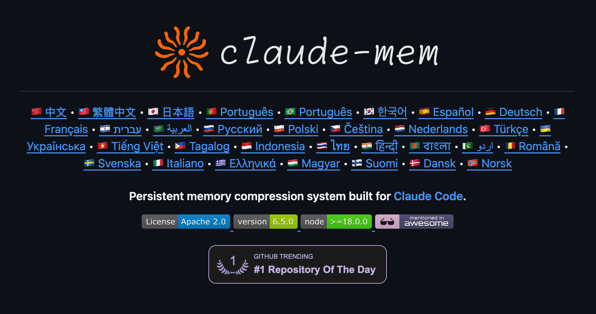
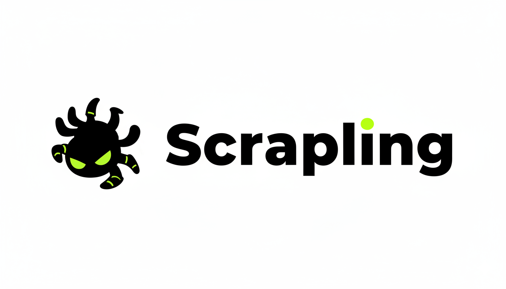
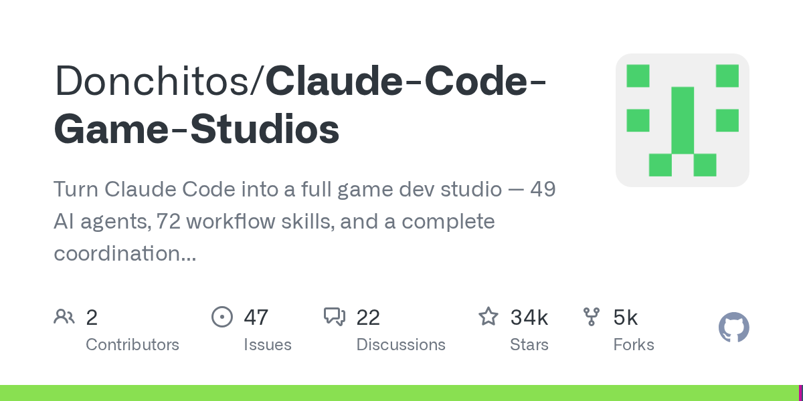
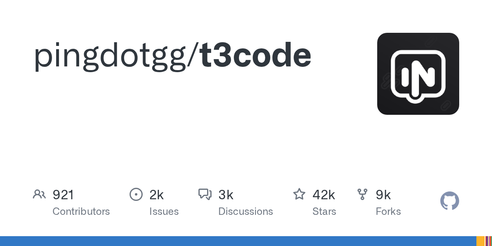
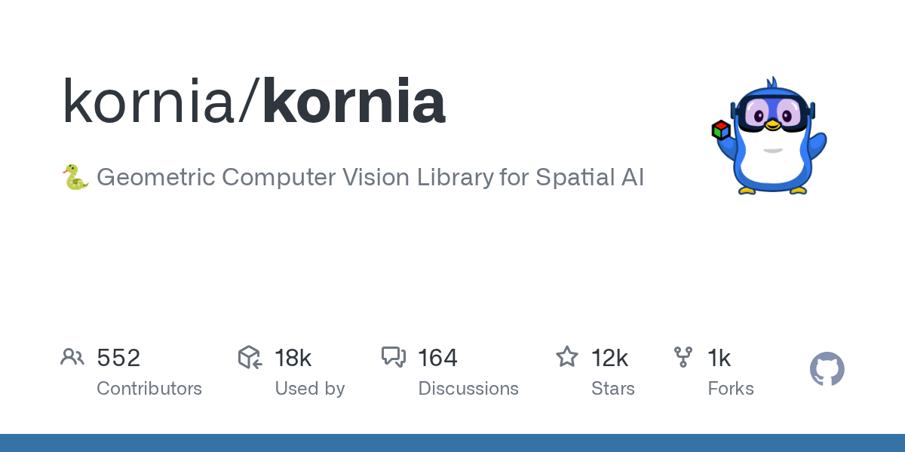
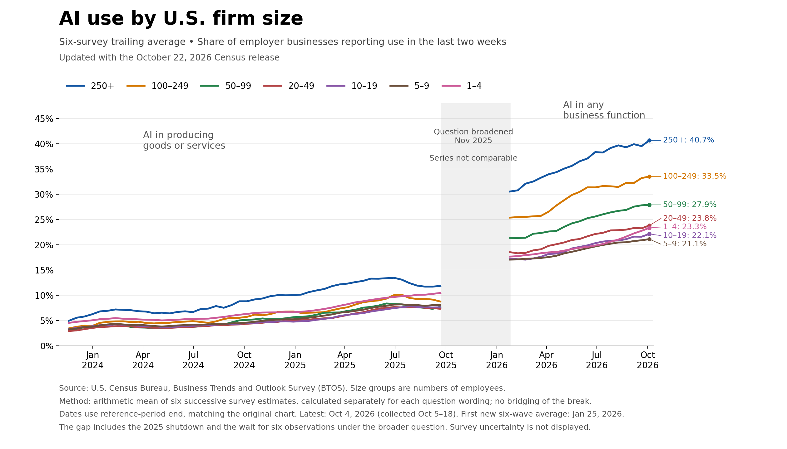

# AI 资讯日报 2026-11-03

> 自动抓取 AI 公司博客、从业者博客与社区聚合源，并生成中文摘要。

## 今日摘要

```
- Rewarding defenders with bigger bug bounties
- Preparing our next security sprint to harden OpenAI
- Scaling Git at OpenAI
- Introducing the Grid Protectors Program
- LifeVal
```

## 公司动态

1. **[Rewarding defenders with bigger bug bounties](https://openai.com/index/rewarding-defenders-with-bigger-bug-bounties)**

   OpenAI is raising Security Bug Bounty rewards and introducing report quality, loyalty, and priority campaign bonuses for independent security researchers.

   来源：OpenAI Blog

2. **[Preparing our next security sprint to harden OpenAI](https://openai.com/index/preparing-our-next-security-sprint-to-harden-openai)**

   OpenAI is preparing its next internal security sprint with Cathedral Systems to test and strengthen its defenses using AI.

   来源：OpenAI Blog

3. **[Scaling Git at OpenAI](https://openai.com/index/scaling-git-at-openai)**

   How OpenAI built Pando, a Git-compatible backend designed for the scale of development that Codex makes possible.

   来源：OpenAI Blog

4. **[Introducing the Grid Protectors Program](https://openai.com/index/grid-protectors-program)**

   OpenAI’s Grid Protectors Program will work with utilities to help future compute campuses support grid reliability and protect consumer electricity costs.

   来源：OpenAI Blog

5. **[LifeVal](https://openai.com/index/lifeval)**

   Introducing LifeVal, a benchmark measuring how well AI helps people complete everyday tasks, from finding childcare to managing finances and government paperwork.

   来源：OpenAI Blog

6. **[Qodo builds context into AI code review with Codex](https://openai.com/index/qodo-codex-plugin)**

   Qodo brings company knowledge and coding standards into Codex, helping developers catch P0 issues across repositories before opening a pull request.

   来源：OpenAI Blog

7. **[OpenAI appoints Dan Driscoll as Senior Counselor for National Security Modernization](https://openai.com/index/dan-driscoll-joins-openai)**

   OpenAI appoints Dan Driscoll to advise on responsible AI for national security modernization, cyber resilience, and collaboration with U.S. allies.

   来源：OpenAI Blog

## 每日产品

1. **[Agent Inbox - 请向您的代理提供一个电子邮箱地址、Slack 和 Telegram 用户名](https://www.producthunt.com/r/VVMJ7O2SOEPDB3)**

   *{padding:0;margin:0;overflow:hidden}html,body{height:100%}img,span{position:absolute;width:100%;top:0;bottom:0;margin:auto}span{height:1.5em;text-align:center;font:48px/1.5 sans-serif;color:white;text-shadow:0 0 0.5em black}▶" frameborder="0" allow="accelerometer; autoplay; encrypted-media; gyroscope; picture-in-picture" allowfullscreen > Give your agent an email address, Slack and Telegram handle (www.producthunt.com) 11-02 ↑ 130 PH Upvotes

   来源：Product Hunt Daily

2. **[Hera - AI 创意画布](https://www.producthunt.com/r/6URUWPJU6AOJT2)**

   *{padding:0;margin:0;overflow:hidden}html,body{height:100%}img,span{position:absolute;width:100%;top:0;bottom:0;margin:auto}span{height:1.5em;text-align:center;font:48px/1.5 sans-serif;color:white;text-shadow:0 0 0.5em black}▶" frameborder="0" allow="accelerometer; autoplay; encrypted-media; gyroscope; picture-in-picture" allowfullscreen > AI Creative Canvas (www.producthunt.com) 11-02 ↑ 121 PH Upvotes

   来源：Product Hunt Daily

3. **[Clayzo - 使用您的编程助手制作动画和动态设计](https://www.producthunt.com/r/PQXQECJKP5FJNI)**

   Create animations and motion design with your coding agent (www.producthunt.com) 11-02 ↑ 112 PH Upvotes

   

   来源：Product Hunt Daily

4. **[Display 1.0 - 在一个工作区中，使用任意代理创建文档和应用程序](https://www.producthunt.com/r/7NCNIIQEMH52HJ)**

   *{padding:0;margin:0;overflow:hidden}html,body{height:100%}img,span{position:absolute;width:100%;top:0;bottom:0;margin:auto}span{height:1.5em;text-align:center;font:48px/1.5 sans-serif;color:white;text-shadow:0 0 0.5em black}▶" frameborder="0" allow="accelerometer; autoplay; encrypted-media; gyroscope; picture-in-picture" allowfullscreen > Create docs and apps with any agent, in one workspace (www.producthunt.com) 11-02 PH Link

   来源：Product Hunt Daily

5. **[UnleashX - 将对话转化为成果的AI团队。](https://www.producthunt.com/r/LF5W4HZMDHS2VV)**

   *{padding:0;margin:0;overflow:hidden}html,body{height:100%}img,span{position:absolute;width:100%;top:0;bottom:0;margin:auto}span{height:1.5em;text-align:center;font:48px/1.5 sans-serif;color:white;text-shadow:0 0 0.5em black}▶" frameborder="0" allow="accelerometer; autoplay; encrypted-media; gyroscope; picture-in-picture" allowfullscreen > The AI workforce that turns conversations into outcomes. (www.producthunt.com) 11-02 PH Link

   来源：Product Hunt Daily

6. **[Cedric AI for Meetings - 首个能代您展示幻灯片并代您出席会议的AI助手](https://www.producthunt.com/r/3WNUZE5QLV6YEU)**

   The first AI agent to present your slides and attend for you (www.producthunt.com) 11-02 PH Link

   

   来源：Product Hunt Daily

7. **[beacon.sh - 适用于人工智能编码代理的开源自优化记忆系统](https://www.producthunt.com/r/WB3BWWZDEG2XEW)**

   Open-source self-improving memory for AI coding agents (www.producthunt.com) 11-02 PH Link

   

   来源：Product Hunt Daily

8. **[Xmind 2027 - 您的思维导图现已成为一位人工智能思维伙伴](https://www.producthunt.com/r/ITN3N4YT7NIKXS)**

   Your mind map is now an AI thinking partner (www.producthunt.com) 11-02 PH Link

   

   来源：Product Hunt Daily

9. **[Raah.dev - 跟踪您的收入、分析数据和网站性能](https://www.producthunt.com/r/JWF4HOBIH2FG6T)**

   *{padding:0;margin:0;overflow:hidden}html,body{height:100%}img,span{position:absolute;width:100%;top:0;bottom:0;margin:auto}span{height:1.5em;text-align:center;font:48px/1.5 sans-serif;color:white;text-shadow:0 0 0.5em black}▶" frameborder="0" allow="accelerometer; autoplay; encrypted-media; gyroscope; picture-in-picture" allowfullscreen > Track your revenue, analytics, and website performance (www.producthunt.com) 11-01 ↑ 94 PH Upvotes

   来源：Product Hunt Daily

10. **[magpie - 您收藏的所有内容，尽在一处可视化图库中](https://www.producthunt.com/r/CAPVPJYNGIAYEW)**

   everything you’ve saved, in one visual library (www.producthunt.com) 11-01 ↑ 116 PH Upvotes

   

   来源：Product Hunt Daily

## GitHub 项目

1. **[vercel-labs/agent-desktop](https://github.com/vercel-labs/agent-desktop)**

   Computer use CLI for AI agents Language: Rust Stars: 10282 Forks: 690

   

   来源：GitHub Trending Daily

2. **[thedotmack/claude-mem](https://github.com/thedotmack/claude-mem)**

   Persistent Context Across Sessions for Every Agent – Captures everything your agent does during sessions, compresses it with AI, and injects relevant context back into future sessions. Works with Claude Code, OpenClaw, Codex, Gemini, Hermes, Copilot, OpenCode + More Language: TypeScript Stars: 110901 Forks: 9667

   

   来源：GitHub Trending Daily

3. **[D4Vinci/Scrapling](https://github.com/D4Vinci/Scrapling)**

   🕷️ The BEST Web Scraping framework that handles everything from a single request to a full-scale crawl! Don't be shy, join here: https://discord.gg/EMgGbDceNQ and follow here for daily tips and tricks: https://x.com/Scrapling_dev Language: Python Stars: 93140 Forks: 9797

   

   来源：GitHub Trending Daily

4. **[hyprwm/Hyprland](https://github.com/hyprwm/Hyprland)**

   Hyprland is an independent, highly customizable, dynamic tiling Wayland compositor that doesn't sacrifice on its looks. Language: C++ Stars: 40010 Forks: 2158

   

   来源：GitHub Trending Daily

5. **[Donchitos/Claude-Code-Game-Studios](https://github.com/Donchitos/Claude-Code-Game-Studios)**

   Turn Claude Code into a full game dev studio — 49 AI agents, 72 workflow skills, and a complete coordination system mirroring real studio hierarchy. Language: Shell Stars: 33725 Forks: 4530

   

   来源：GitHub Trending Daily

6. **[FlashML-org/FreeToken](https://github.com/FlashML-org/FreeToken)**

   FreeToken brings datacenter-scale model serving to your desktop. Run massive models locally, fast and efficiently. Language: Python Stars: 16178 Forks: 1591

   

   来源：GitHub Trending Daily

7. **[pingdotgg/t3code](https://github.com/pingdotgg/t3code)**

   Language: TypeScript Stars: 42266 Forks: 9121

   

   来源：GitHub Trending Daily

8. **[shiyu-coder/Kronos](https://github.com/shiyu-coder/Kronos)**

   Kronos: A Foundation Model for the Language of Financial Markets Language: Python Stars: 46062 Forks: 7592

   

   来源：GitHub Trending Daily

9. **[kornia/kornia](https://github.com/kornia/kornia)**

   🐍 Geometric Computer Vision Library for Spatial AI Language: Python Stars: 12175 Forks: 1492

   

   来源：GitHub Trending Daily

10. **[JustVugg/colibri](https://github.com/JustVugg/colibri)**

   Run frontier MoE models on hardware you already own — pure C, zero deps, experts streamed from disk. Tiny engine, immense model. 🐦 Language: C Stars: 46668 Forks: 5389

   

   来源：GitHub Trending Daily

## 从业者观点

1. **[llm 0.37](https://simonwillison.net/2026/Nov/2/llm/)**

   Release: llm 0.37 There's a lot of stuff in this new release of my LLM CLI tool and Python library, representing around two months of accumulated features and fixes. I added gpt-6.1-sol and gpt-6.1-terra , plus a new llm openai endpoint add command to make it easier to configure additional models that use OpenAI-compatible endpoints. I switched the default model (if you have not set your own default) to gpt-6-luna - half the price of the previous default, gpt-5.6-luna . LLM's support for embeddings now accepts that different binary content may have different content-type - necessary for models like Gemini Embedding 2 , which can embed text, audio, images, and video. A lot of open source maintainers complain about a flood of AI-assisted PRs. LLM is my project that has been most affected by this and, to be honest, I'm not finding it to be a problem. That's mainly because I have Opus 5.5 or GPT-6 Astra help me with triage to spot the most useful fixes! This release includes fixes from 12 authors - almost all AI-assisted - and the burden of reviewing them wasn't nearly as great as I expected. I really see them as bug reports with attached examples - sometimes I land them, sometimes I implement my own fix. So thanks to 0d00ciallo0721 , ac1982 , Allen Flux , Bian Yuhan , Bishop Kammeraad , Chen Yufeiyang , Christopher Krah , Ethan Stoner , Jiachen Xie , Olamide Faniyan , Sharat Chandra Sai Boddu , nosmile99 for helping out with (or spending tokens on) this release! Tags: open-source , projects , ai , annotated-release-notes , generative-ai , llms , embeddings , llm

   来源：Simon Willison

2. **[The U.S. Census Bureau and “Super Intelligence”](https://simonwillison.net/2026/Nov/2/census-bureau-super-intelligence/)**

   I was reminded today of AI Adoption Rate Trending Down for Large Companies , a chart produced by Apollo Global Management in September 2025, which appeared to show a slowdown in U.S. corporate AI adoption based on numbers collected by the U.S. Census Bureau. At the time I used that chart to demonstrate GPT-5 data analysis , and then to experiment with Claude's new Code Interpreter . I decided to try running those numbers again to see what had changed over the past year, and in doing so learned that the Bureau has fallen foul of Executive Order 14434 , aka the asinine Super Intelligence one. First, the updated chart Every two weeks the U.S. Census Bureau runs a survey called the Business Trends and Outlook Survey (aka BTOS). Each time it goes to 200,000 businesses out of 1.2 million total - the surveyed group (a "panel") cycles such that an individual business only completes the survey every twelve weeks. The latest data is published on alternating Thursdays at 10am. I used the most recent numbers (published October 22, 2026) to create a new version ( GPT-6 Astra Extra High transcript ) of the AI adoption chart, updated to reflect both the last twelve months and a change that was made to the survey question sent out by the Bureau: [图片: Line chart titled &quot;AI use by U.S. firm size&quot;, subtitled &quot;Six-survey trailing average • Share of employer businesses reporting use in the last two weeks&quot; and &quot;Updated with the October 22, 2026 Census release&quot;. Seven lines for firm sizes 250+, 100–249, 50–99, 20–49, 10–19, 5–9 and 1–4, on a y-axis from 0% to 45% and an x-axis from Jan 2024 to Oct 2026. Left section, &quot;AI in producing goods or services&quot;: all sizes start at 3–5% in late 2023 and climb slowly to 7–13% by September 2025, with 250+ highest. A shaded gap is labeled &quot;Question broadened Nov 2025&quot; and &quot;Series not comparable&quot;. Right section, &quot;AI in any business function&quot;: all lines restart higher in February 2026 and rise steadily to &quot;250+: 40.7%&quot;, &quot;100–249: 33.5%&quot;, &quot;50–99: 27.9%&quot;, &quot;20–49: 23.8%&quot;, &quot;1–4: 23.3%&quot;, &quot;10–19: 22.1%&quot;, &quot;5–9: 21.1%&quot;. Footnotes: &quot;Source: U.S. Census Bureau, Business Trends and Outlook Survey (BTOS). Size groups are numbers of employees.&quot; &quot;Method: arithmetic mean of six successive survey estimates, calculated separately for each question wording; no bridging of the break.&quot; &quot;Dates use reference-period end, matching the original chart. Latest: Oct 4, 2026 (collected Oct 5–18). First new six-wave average: Jan 25, 2026.&quot; &quot;The gap includes the 2025 shutdown and the wait for six observations under the broader question. Survey uncertainty is not displayed.&quot; https://static.simonwillison.net/static/2026-11-01/5821A414-FAF6-4E61-B037-952C1FD80D39.png] Here's a link to the larger image . For comparison, here's that AI adoption chart from last year (my GPT-5 version): [图片: AI adoption rates starting to decline for larger firms. A chart of AI adoption rate by firm size. Includes lines for 250+, 100-249, 50-99, 20-49, 10-19, 5-9 and 1-4 sized organizations. Chart starts in November 2023 with percentages ranging from 3 to 5, then all groups grow through August 2025 albeit with the 250+ group having a higher score than the others. That 250+ group peaks in July 2025 at around 14% and then appears to slope slightly downwards to 12% by August. Some of the other lines also start to tip down, though not as much. https://static.simonwillison.net/static/2025/apollo-ai-chart.jpg] In September 2025 the largest (250+ employees) companies answered "yes" around 12% of the time to the question about whether they used AI in "producing goods or services". Under the new "any business function" wording, by February 2026, those same large companies answered "yes" around 30% of the time, and by October 2026 that had increased to around 40%. The data in the above chart comes from the "Employment size class" XLSX file, available from here . Here's a copy of the file I used. You can view the survey document that is sent out to businesses - here's my snapshot copy of that 346KB PDF. The changing language of the questions As the chart demonstrates, the question asked by the Bureau changed in a material way on November 17th, 2025. Prior to that date, the question they asked was this (emphasis mine): In the last two weeks, did this business use Artificial Intelligence (AI) in producing goods or services ? (Examples of AI: machine learning, natural language processing, virtual agents, voice recognition, etc.) On December 3rd, 2025, the Bureau announced a significant change to that question. Here's the replacement: In the last two weeks, did this business use Artificial Intelligence (AI) in any of its business functions ? (Examples of AI: machine learning, natural language processing, virtual agents, voice recognition, etc.) No more "producing goods or services" - now it's "in any of its business functions"! This means that the answers to the question before and after November 17th are not directly comparable. From October 19, 2026, they ask about Super Intelligence When I went looking for the updated question language in the latest XLSX file, I couldn't find it. I found this instead: In the last two weeks, did this business use Super Intelligence or SI (formerly referred to as Artificial Intelligence or AI) in any of its business functions? (Examples of SI use include: SI-powered data analysis; generative SI for marketing, product design, or coding; virtual SI agents for customer service; SI-powered forecasting or pricing; SI-driven computer vision for quality control, etc.) The BTOS about page explains what happened: Beginning with the October 19, 2026 collection, instrument wording was updated due to Executive Order 14434 . The current numbers reflect the old Artificial Intelligence survey wording - the first survey results reflecting the Super Intelligence wording are due for publication on Thursday. Is this going to affect the survey? The obvious open question here is whether this wording change is going to affect the survey results. The businesses answering this survey will have last seen that question twelve weeks ago, when it was still called AI. Hopefully the new language isn't going to confuse them, especially since the survey helpfully spells out "formerly referred to as Artificial Intelligence or AI". I can't help but laugh at the absurdity of "SI-powered data analysis; generative SI for marketing, product design, or coding; virtual SI agents for customer service" though. Tags: census , surveys , ai , generative-ai , llms

   

   来源：Simon Willison

3. **[If in doubt, delete the uv.lock file](https://simonwillison.net/2026/Nov/1/delete-uv-lock-first/)**

   I've been getting the occasional confusing Python dependency error since switching over to Python 3.15 and the rule I'm having to remember is: If in doubt, delete the uv.lock file Most of my projects are libraries which don't include a uv.lock file, since it's rude for a library dependency to lock versions for anything else that uses it. Running uv run pytest etc tends to leave uv.lock files lying around, which are listed in .gitignore and so do not get committed to my repositories. But... sometimes that uv.lock pins a version of a dependency that doesn't yet have a Python 3.15 wheel. An example from earlier today: error: Failed to build `watchfiles==1.1.1` cause: Call to `maturin.build_wheel` failed error: the configured Python interpreter version (3.15) is newer than PyO3's maximum supported version (3.14) Deleting that file and running uv run pytest again usually fixes the problem. Tags: uv , til , python

   来源：Simon Willison

4. **[Quoting Kyle Kingsbury](https://simonwillison.net/2026/Nov/1/kyle-kingsbury/)**

   More broadly, the use of LLMs erodes trust in documentation, in software, and in the organizations which produce them. Perhaps engineers will begin to treat any new software project with suspicion—the signals we used to rely on as markers of a mature system are now easier to counterfeit. [...] In the age of LLMs, what can maintainers do to ensure correct software and accurate documentation? Having done that work, how can they demonstrate its quality to users? &mdash; Kyle Kingsbury , Jepsen results for ParticleDB 1.1.4 Tags: kyle-kingsbury , llms , ai , generative-ai , ai-misuse

   来源：Simon Willison

5. **[How We Took Over ChatGPT Accounts](https://simonwillison.net/2026/Oct/31/how-we-took-over-chatgpt-accounts/)**

   How We Took Over ChatGPT Accounts Parameter Labs describe an exploit they found against ChatGPT's implementation of the artifacts pattern (OpenAI used to call this "Canvas" but it looks like the latest revision is called HTML previews ), where interactive custom HTML apps are displayed in a sandboxed iframe. It's important that HTML in these stays tightly sandboxed to avoid untrusted code interacting with OpenAI APIs and accessing private data. Parameter found quite a complex attack chain. OpenAI use the MathLive JavaScript library as part of their graph support, and that library includes its own virtual keyboard , which can be triggered in the parent page via postMessage() from the sandboxed iframe. That message receiving code uses innerHTML , so anything that sends a message can add custom HTML to the parent - and there was no mechanism to prevent other sandboxed frames, including HTML preview frames, from calling that method. This meant untrusted code in an iframe could insert HTML, and while innerHTML doesn't directly execute script elements it could be used to inject a new iframe without sandbox restrictions. OpenAI’s CSP rules blocked inline scripts entirely, and only allowed script loading from a handful of domains, but one of those was YouTube - and the YouTube oEmbed endpoint could be used to reflect JavaScript back in a way that executed it. Once the attack had JavaScript execution on ChatGPT, it was trivial to fetch private user data from APIs and exfiltrate it via an image reference. The end result: you could create a ChatGPT share URL which, when visited by another signed-in user, could exfiltrate their private data or take actions on their behalf. OpenAI closed the hole and paid out a $5,000 bug bounty, which I think was a bit cheap for a vulnerability this serious. Via Hacker News Tags: iframes , javascript , sandboxing , security , xss , openai , chatgpt , content-security-policy

   来源：Simon Willison

6. **[datasette-llm 0.1a9](https://simonwillison.net/2026/Oct/31/datasette-llm/)**

   Release: datasette-llm 0.1a9 I have some big upgrades to Datasette Agent in the pipeline, but in the meantime here's a tiny user experience improvement to the underlying datasette-llm plugin. It now picks up the default model used by LLM , which means you can start using Datasette Agent without needing to explicitly configure a default model: uvx --with datasette-agent datasette content.db --internal internal.db Previously you would also need to specify a model with -s plugins.datasette-agent.default_model gpt-6-astra . Tags: datasette , llm , datasette-agent

   来源：Simon Willison

7. **[Pray for Chaos](https://geohot.github.io//blog/jekyll/update/2026/11/01/pray-for-chaos.html)**

   There’s two basic ways AI can play out, one is order, the other is chaos. Order is the very dangerous one. If it turns out that models are actually capable of patching all the exploits, it’s hard to imagine what will disrupt the status quo. Fortunately, this seems unlikely, but that doesn’t mean order won’t prevail in the short term. At the end of my Yudkowsky debate we found a tangible point of disagreement. He thinks AI will be able to find a solution to the Prisoner’s dilemma. I know there already is a solution (it’s defect), EA people just aren’t happy about it. If it won’t be order (and you better pray it won’t be order) that leaves chaos. AI that can play a whole society in hours can manufacture entire histories, years of archives of daily newspapers, and an Internet that never happened. The dead Internet theory is coming true before our eyes. Now I can still see the bots, soon I won’t be able to. Scratch that, I probably already often can’t. Gwern wrote about this, it’s hard to imagine a vision of humans as prompters or enter pressers in 2030. The US AI companies don’t believe they have to offer any solution to this, why would they have to justify in any way that their products are good for society? Anthropic cannot wait until they have the leverage to ban all their users. Why would you keep around the middle man? Here’s the most positive vision I can come up with. If it turns out things can’t be secured, we enter an era of increased decentralization. Think everyone running their own custom different OS, not everyone running the same version of Linux on a computer they can touch. Because the centralized homogeneous systems are too vulnerable. Cyber attacks flying in every direction, nobody capable of keeping infrastructure up, cars sitting in driveways as bricks (or worse, rooted to steer you off a cliff). Self replicating AI hiding out in every corner of every hard drive. How powerful of a model do you need for it to stand a chance of reproduction in today’s cyberworld? GLM-5.2 and up? A media landscape that is botted and microtargeted to all hell, nonsensical elections where the only thing people agree on is the names of candidates. Massive dumps of corporate slacks and intranets. (come on Russian kids, grab an abliterated AI and do a hacking!) Whatever you hold dear the chaos army will come for too. The Internet era is over. Your life will never be the same. The chaos will come for the resistance as well as the fascists; it’s unclear who it will hurt more. Your life plan is probably already nonsense in the face of AI. Mine sort of is. What economic value you think you will have in 10 years? Who will be around for you to have that value to? Do you think you’ll be able to make any sense of the world? And remember, chaos is the good outcome. The alternative is that you are a dancing monkey in a cage you won’t be smart enough to see.

   来源：George Hotz

## 社区热点

1. **[Sparks of Weight-Space Programming: LLMs can natively read & write neural network weights](https://rikiyat.github.io/blog/weight-space-programming/)**

   Comments

   来源：Lobsters AI

2. **[Let’s Build a Brain](https://aatishb.com/myriad/lets-build-a-brain/)**

   Comments

   来源：Lobsters AI
