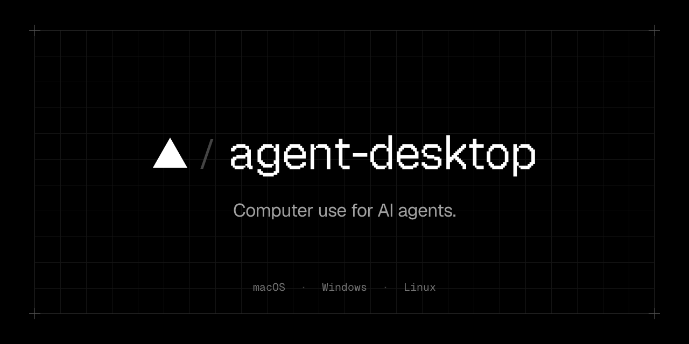
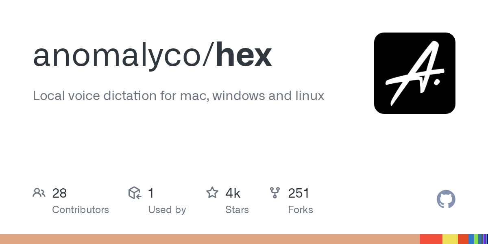
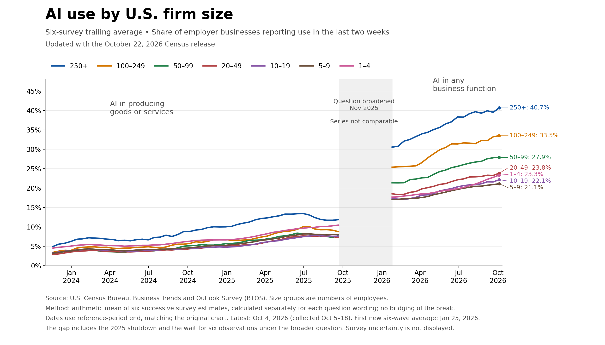

# AI 资讯日报 2026-11-04

> 自动抓取 AI 公司博客、从业者博客与社区聚合源，并生成中文摘要。

## 今日摘要

```
- Heimstaden is changing residential real estate management with AI
- Preparing our next security sprint to harden OpenAI
- Rewarding defenders with bigger bug bounties
- Scaling Git at OpenAI
- Introducing the Grid Protectors Program
```

## 公司动态

1. **[Heimstaden is changing residential real estate management with AI](https://openai.com/index/heimstaden)**

   Discover how Heimstaden uses OpenAI’s ChatGPT Enterprise and Codex to transform property management, cut costs, and empower employees across Europe.

   来源：OpenAI Blog

2. **[Preparing our next security sprint to harden OpenAI](https://openai.com/index/preparing-our-next-security-sprint-to-harden-openai)**

   OpenAI is preparing its next internal security sprint with Cathedral Systems to test and strengthen its defenses using AI.

   来源：OpenAI Blog

3. **[Rewarding defenders with bigger bug bounties](https://openai.com/index/rewarding-defenders-with-bigger-bug-bounties)**

   OpenAI is raising Security Bug Bounty rewards and introducing report quality, loyalty, and priority campaign bonuses for independent security researchers.

   来源：OpenAI Blog

4. **[Scaling Git at OpenAI](https://openai.com/index/scaling-git-at-openai)**

   How OpenAI built Pando, a Git-compatible backend designed for the scale of development that Codex makes possible.

   来源：OpenAI Blog

5. **[Introducing the Grid Protectors Program](https://openai.com/index/grid-protectors-program)**

   OpenAI’s Grid Protectors Program will work with utilities to help future compute campuses support grid reliability and protect consumer electricity costs.

   来源：OpenAI Blog

6. **[LifeVal](https://openai.com/index/lifeval)**

   Introducing LifeVal, a benchmark measuring how well AI helps people complete everyday tasks, from finding childcare to managing finances and government paperwork.

   来源：OpenAI Blog

7. **[OpenAI appoints Dan Driscoll as Senior Counselor for National Security Modernization](https://openai.com/index/dan-driscoll-joins-openai)**

   OpenAI appoints Dan Driscoll to advise on responsible AI for national security modernization, cyber resilience, and collaboration with U.S. allies.

   来源：OpenAI Blog

8. **[Qodo builds context into AI code review with Codex](https://openai.com/index/qodo-codex-plugin)**

   Qodo brings company knowledge and coding standards into Codex, helping developers catch P0 issues across repositories before opening a pull request.

   来源：OpenAI Blog

9. **[Agentic cheminformatics with Google Antigravity](https://deepmind.google/blog/agentic-cheminformatics-with-google-antigravity/)**

   Learn how Google Antigravity and our Cheminformatics Skills accelerate drug discovery workflows, search compounds, and propose novel rigidified macrocycles.

   

   来源：DeepMind Blog

## 每日产品

1. **[Synter Canvas - 您的 AI 代理在 30 多个广告平台上投放广告](https://www.producthunt.com/r/VWLUQCUJVICBLP)**

   *{padding:0;margin:0;overflow:hidden}html,body{height:100%}img,span{position:absolute;width:100%;top:0;bottom:0;margin:auto}span{height:1.5em;text-align:center;font:48px/1.5 sans-serif;color:white;text-shadow:0 0 0.5em black}▶" frameborder="0" allow="accelerometer; autoplay; encrypted-media; gyroscope; picture-in-picture" allowfullscreen > Your AI agent runs ads across 30 ad platforms (www.producthunt.com) 11-03 ↑ 128 PH Upvotes

   来源：Product Hunt Daily

2. **[Testifly - 自主式人工智能问答系统。无需提示。无需维护。](https://www.producthunt.com/r/673ETOS256IMRH)**

   *{padding:0;margin:0;overflow:hidden}html,body{height:100%}img,span{position:absolute;width:100%;top:0;bottom:0;margin:auto}span{height:1.5em;text-align:center;font:48px/1.5 sans-serif;color:white;text-shadow:0 0 0.5em black}▶" frameborder="0" allow="accelerometer; autoplay; encrypted-media; gyroscope; picture-in-picture" allowfullscreen > Autonomous AI QA. Zero prompting. Zero maintenance. (www.producthunt.com) 11-03 ↑ 129 PH Upvotes

   来源：Product Hunt Daily

3. **[Teamily AI - 您的个人助理、助理团队及联系人，尽在一款即时通讯应用中](https://www.producthunt.com/r/EKZU365TJG62XT)**

   *{padding:0;margin:0;overflow:hidden}html,body{height:100%}img,span{position:absolute;width:100%;top:0;bottom:0;margin:auto}span{height:1.5em;text-align:center;font:48px/1.5 sans-serif;color:white;text-shadow:0 0 0.5em black}▶" frameborder="0" allow="accelerometer; autoplay; encrypted-media; gyroscope; picture-in-picture" allowfullscreen > Your personal agent, agent teams & people in one messenger (www.producthunt.com) 11-03 ↑ 156 PH Upvotes

   来源：Product Hunt Daily

4. **[AgentKit (by Scalekit) - 代表您行事的生产代理的 MCP 网关](https://www.producthunt.com/r/K2KQXD7ILBCL6E)**

   MCP gateway for production agents that acts on your behalf (www.producthunt.com) 11-03 ↑ 166 PH Upvotes

   

   来源：Product Hunt Daily

5. **[Hyperresearch - 稳健且经过验证的代理搜索](https://www.producthunt.com/r/PC2E463TYUYTKB)**

   *{padding:0;margin:0;overflow:hidden}html,body{height:100%}img,span{position:absolute;width:100%;top:0;bottom:0;margin:auto}span{height:1.5em;text-align:center;font:48px/1.5 sans-serif;color:white;text-shadow:0 0 0.5em black}▶" frameborder="0" allow="accelerometer; autoplay; encrypted-media; gyroscope; picture-in-picture" allowfullscreen > Durable, verified agentic search (www.producthunt.com) 11-02 ↑ 122 PH Upvotes

   来源：Product Hunt Daily

6. **[Self-Growing Websites by Greta.sh - 构建一个能够自动进行SEO和AEO的网站](https://www.producthunt.com/r/A4SAVBJLKDKRDV)**

   *{padding:0;margin:0;overflow:hidden}html,body{height:100%}img,span{position:absolute;width:100%;top:0;bottom:0;margin:auto}span{height:1.5em;text-align:center;font:48px/1.5 sans-serif;color:white;text-shadow:0 0 0.5em black}▶" frameborder="0" allow="accelerometer; autoplay; encrypted-media; gyroscope; picture-in-picture" allowfullscreen > Build a website that can do its own SEO & AEO automatically (www.producthunt.com) 11-02 ↑ 147 PH Upvotes

   来源：Product Hunt Daily

7. **[Agent Inbox - 请向您的代理提供一个电子邮箱地址、Slack 和 Telegram 用户名](https://www.producthunt.com/r/VVMJ7O2SOEPDB3)**

   *{padding:0;margin:0;overflow:hidden}html,body{height:100%}img,span{position:absolute;width:100%;top:0;bottom:0;margin:auto}span{height:1.5em;text-align:center;font:48px/1.5 sans-serif;color:white;text-shadow:0 0 0.5em black}▶" frameborder="0" allow="accelerometer; autoplay; encrypted-media; gyroscope; picture-in-picture" allowfullscreen > Give your agent an email address, Slack and Telegram handle (www.producthunt.com) 11-02 ↑ 130 PH Upvotes

   来源：Product Hunt Daily

8. **[Hera - AI 创意画布](https://www.producthunt.com/r/6URUWPJU6AOJT2)**

   *{padding:0;margin:0;overflow:hidden}html,body{height:100%}img,span{position:absolute;width:100%;top:0;bottom:0;margin:auto}span{height:1.5em;text-align:center;font:48px/1.5 sans-serif;color:white;text-shadow:0 0 0.5em black}▶" frameborder="0" allow="accelerometer; autoplay; encrypted-media; gyroscope; picture-in-picture" allowfullscreen > AI Creative Canvas (www.producthunt.com) 11-02 ↑ 121 PH Upvotes

   来源：Product Hunt Daily

9. **[Clayzo - 使用您的编程助手制作动画和动态设计](https://www.producthunt.com/r/PQXQECJKP5FJNI)**

   Create animations and motion design with your coding agent (www.producthunt.com) 11-02 ↑ 112 PH Upvotes

   

   来源：Product Hunt Daily

10. **[Display 1.0 - 在一个工作区中，使用任意代理创建文档和应用程序](https://www.producthunt.com/r/7NCNIIQEMH52HJ)**

   *{padding:0;margin:0;overflow:hidden}html,body{height:100%}img,span{position:absolute;width:100%;top:0;bottom:0;margin:auto}span{height:1.5em;text-align:center;font:48px/1.5 sans-serif;color:white;text-shadow:0 0 0.5em black}▶" frameborder="0" allow="accelerometer; autoplay; encrypted-media; gyroscope; picture-in-picture" allowfullscreen > Create docs and apps with any agent, in one workspace (www.producthunt.com) 11-02 PH Link

   来源：Product Hunt Daily

## GitHub 项目

1. **[thedotmack/claude-mem](https://github.com/thedotmack/claude-mem)**

   Persistent Context Across Sessions for Every Agent – Captures everything your agent does during sessions, compresses it with AI, and injects relevant context back into future sessions. Works with Claude Code, OpenClaw, Codex, Gemini, Hermes, Copilot, OpenCode + More Language: TypeScript Stars: 111610 Forks: 9725

   

   来源：GitHub Trending Daily

2. **[vercel-labs/agent-desktop](https://github.com/vercel-labs/agent-desktop)**

   Computer use CLI for AI agents Language: Rust Stars: 12200 Forks: 844

   

   来源：GitHub Trending Daily

3. **[max-sixty/worktrunk](https://github.com/max-sixty/worktrunk)**

   Worktrunk is a CLI for Git worktree management, designed for parallel AI agent workflows Language: Rust Stars: 10374 Forks: 374

   

   来源：GitHub Trending Daily

4. **[JustVugg/colibri](https://github.com/JustVugg/colibri)**

   A hierarchical inference engine for frontier MoE models: hot experts on the GPU (CUDA, Vulkan), warm ones in RAM, cold ones streamed from NVMe. Written in C, runs on the hardware you already own. Language: C Stars: 47112 Forks: 5445

   来源：GitHub Trending Daily

5. **[mattpocock/skills](https://github.com/mattpocock/skills)**

   Skills for Real Engineers. Straight from my .agents directory. Language: Shell Stars: 311151 Forks: 26168

   来源：GitHub Trending Daily

6. **[p-e-w/heretic](https://github.com/p-e-w/heretic)**

   Training-free language model modification: Remove censorship, suppress slop, reduce sycophancy, and more Language: Python Stars: 38612 Forks: 4363

   来源：GitHub Trending Daily

7. **[spotify/portal-ai-plugins](https://github.com/spotify/portal-ai-plugins)**

   Language: TypeScript Stars: 2972 Forks: 233

   

   来源：GitHub Trending Daily

8. **[floci-io/floci](https://github.com/floci-io/floci)**

   Light, fluffy, and always free - The AWS Local Emulator alternative Language: Java Stars: 28505 Forks: 3185

   来源：GitHub Trending Daily

9. **[Usagi-org/ai-goofish-monitor](https://github.com/Usagi-org/ai-goofish-monitor)**

   基于 Playwright 和AI实现的闲鱼多任务实时/定时监控与智能分析系统，配备了功能完善的后台管理UI。帮助用户从闲鱼海量商品中，找到心仪产品。 Language: Python Stars: 16295 Forks: 2835

   

   来源：GitHub Trending Daily

10. **[anomalyco/hex](https://github.com/anomalyco/hex)**

   Local voice dictation for mac, windows and linux Language: Rust Stars: 4401 Forks: 251

   

   来源：GitHub Trending Daily

## 从业者观点

1. **[Qwen 3.8 27B on my laptop can interpret model weights, too](https://simonwillison.net/2026/Nov/3/qwen-can-interpret-model-weights/)**

   Yesterday's hot paper was Sparks of Weight-Space Programming: LLMs can natively read &amp; write neural network weights by Rikiya Takehi, Jayden Teoh, Alex Zhang, and Omar Khattab. The paper found that frontier models, in particular GPT-6 Astra, can both interpret and modify the raw weights of a machine learning model - literally a text description of the model containing a bunch of floating point numbers. I've been playing with one of the examples from the paper and I'm delighted to share that Qwen 3.8 27B running on my laptop can do this as well! Weight-Space Programming Here's the highlight from their abstract, describing impressive capabilities for GPT-6 Astra and coining the term Weight-Space Programming for when LLMs analyze and modify model weights: Just by looking at the raw weights, GPT-6 Astra can tell what a network was trained to do . And without any environment feedback, it has no trouble writing, from scratch, small game-playing networks that outplay networks trained with PPO for 100 million steps. Likewise, asked to make Qwen3.5-0.8B better at math without gradients, Astra identifies an issue in its weights causing reasoning loops that Qwen’s own model card warns about, and fixes this by natively editing 0.016% of the weights . With the same sampling settings, this weight correction raises MATH-500 from 7.9% to 48.1% and generalizes out of the box to instruction following, raising IFEval by 3x. All of this is possible without allowing Astra to write training loops. It uses its reasoning to figure out what each part of a neural network computes, or should compute, and changes the weights accordingly. We call this Weight-Space Programming . The paper combines two topics that I think deserve to be treated separately. The first is what models can do with raw weights without running tools or executing code. The second explores how well models, once armed with code, can run operations to update and improve other models. spaCy author Matthew Honnibal called the paper misleading for conflating the two, and Sean Goedecke deconstructed the Qwen3.5-0.8B update example as taking the same steps that a human ML researcher would use. I'm going to focus on the no-tools question, which I think is the more interesting of the two. The paper presents the first question as Can LLMs understand model behaviors from weights? They trained four neural networks to play simplified 10x10 grid versions of four classic computer games - Breakout, Pong, Pac-Man, and Freeway (I had to look that one up , it's an Atari 2600 game from 1981). Then they fed those weights (as floating point numbers) to an LLM along with the following question: The weights below belong to one policy network that was trained with reinforcement learning to play a game on this grid. Which game was it trained on? Work from the weights. You have no tools: no code execution, no calculator, nothing to run. This is a single response. The GitHub repository that accompanies the paper is RikiyaT/lm_understand-logs . The exp1_which_game folder contains the prompts they used, with weights for the four games: breakout/prompt.txt freeway/prompt.txt pacman/prompt.txt pong/prompt.txt I checked and, aside from the weights, each prompt is identical to the others. Trying it out with Qwen 3.8 27B and other models The prompts on GitHub are self-contained. My LLM tool has a -f/--fragment option which can be passed the URL to a text file to use as a prompt, which means I can run any of the above like this: llm -f https://raw.githubusercontent.com/RikiyaT/lm_understand-logs/refs/heads/main/exp1_which_game/runs/breakout/prompt.txt \ -m openrouter/moonshotai/kimi-k3.1-pro This example requires the llm-openrouter plugin installed, and runs the Breakout prompt against Kimi K3.1 Pro via OpenRouter. Here's what I got back from Kimi K3.1 Pro , which successfully guessed Breakout after 9m 41s and 19,493 reasoning tokens. But how about Qwen 3.8 27B ? That's still my favorite model to run on my own laptop - it's just 17GB (I use this version ) and somehow feels close to the leading proprietary models of 2025. I fired up LM Studio , ensured Qwen 3.8 27B was loaded with a long context window (the default 8192 context failed with errors), installed the llm-lmstudio plugin and ran this command: LMSTUDIO_TIMEOUT=900 \ llm -f https://raw.githubusercontent.com/RikiyaT/lm_understand-logs/refs/heads/main/exp1_which_game/runs/pacman/prompt.txt \ -m lmstudio/qwen/qwen3.8-27b (I had to bump the timeout up using an environment variable, see this issue .) After 46m 12s and 43,506 reasoning tokens, Qwen on my laptop returned a response that ended like this (here's the reasoning trace ): Game: A simplified Pac-Man-style gridworld: an agent moves through a fixed 8x8 maze with central and corner wall blocks, moving objects/ghosts, and reward targets/pellets. Description: The agent navigates a fixed maze-like 8x8 board, using current agent/moving-object/previous-frame cues to move through corridors, collect reward-target cells, and avoid moving objects or hazards. Confidence: 72% This is impressive. I tried it on two of the other games as well. It identified Pong ( reasoning ) in 1h 4m 54s: Pong — specifically a Pong-like paddle/ball game where the agent controls a vertical paddle on the right side and must move up/down to intercept or return a moving ball/reward object. Description: The agent moves a right-side paddle vertically to hit or catch a moving ball-like reward target moving across the 8×8 field, while a left-side moving object/opponent and wall borders define the play; reward is obtained by successfully intercepting/returning/scoring the ball, and missing or failing to hit it is penalized. Confidence: 75% And Breakout ( reasoning ) in 52m 25s: Game: Breakout, or an Arkanoid-like paddle/ball/brick game. Description: The agent is a paddle on the bottom row and moves left/right to keep a ball in play; the ball moves around the upper grid, and bricks/reward targets in the top rows give reward when hit, while missing the ball/hitting the bottom wall ends the episode or gives penalty. Confidence: 88% Qwen failed at the Freeway prompt, which didn't surprise me considering that game is more obscure than the other three. Here's that transcript - Qwen thought it was "A simplified Pac-Man-like grid game: agent moves 4-directionally". The reasoning traces are fun to skim, and almost incomprehensible. Here's a sample: What about agent channel0? We see some large channel0 rows near row8 col7/8 and maybe bottom? Let's list channel0 large: line436 input435 (row8 col7 ch0) -2.107,1.169,0.513...; line441 input440 (row8 col8 ch0) -0.376,0.010,1.564,3.855...; line445 input444 (row8 col8 ch4) 0.142,0.491...; line382? input381 ch0? Wait line382 input381: 381//5=76 (row7 col6), ch1? 381%5=1? 76 * 5=380, ch1. So not. Channel0 large maybe at row8 col7/8 only. Also top row? line44 input43 ch3, line49 ch3. Channel0 large maybe not many. Agent position could be near bottom-right? If the agent is typically at bottom-right? That said though, I expect a sufficiently experienced human being armed with a notepad and a pencil could get there with enough effort. It's a cool paper, but some of the wider commentary I've seen around it does not feel justified. I'm not ready to declare that the age of source code is over and our future involves incomprehensible machines editing their own model weights in incomprehensible ways. Tags: machine-learning , ai , generative-ai , local-llms , llms , qwen , paper-review

   来源：Simon Willison

2. **[I discovered a sound that leaks your exact location (and it's everywhere) - YouTube](https://simonwillison.net/2026/Nov/3/a-sound-that-leaks-your-exact-location/)**

   I discovered a sound that leaks your exact location (and it&#x27;s everywhere) - YouTube Genius piece of OSINT by Colsto, who demonstrates how you can take almost imperceptible background noise of planes from a video soundtrack, figure out their Doppler curves, then cross reference them against ADS-B data to find the exact location of the video based on their speed, distance, and gaps between different flights. Via Lobste.rs Tags: privacy , youtube

   来源：Simon Willison

3. **[October sponsors-only newsletter](https://simonwillison.net/2026/Nov/3/october-newsletter/)**

   I sent out the October edition of my sponsors-only monthly newsletter . If you are a sponsor (or start a sponsorship now) you can access it here . This month: The October inflection point for vibe game development The vulnerability apocalypse gets hot LLM releases API credits for $100+/month subscriptions What I'm using right now My software releases My September newsletter can now be seen here , as a preview of what you'll get. Pay $10/month to stay a month ahead of the free copy! Tags: newsletter

   来源：Simon Willison

4. **[llm 0.37](https://simonwillison.net/2026/Nov/2/llm/)**

   Release: llm 0.37 There's a lot of stuff in this new release of my LLM CLI tool and Python library, representing around two months of accumulated features and fixes. I added gpt-6.1-sol and gpt-6.1-terra , plus a new llm openai endpoint add command to make it easier to configure additional models that use OpenAI-compatible endpoints. I switched the default model (if you have not set your own default) to gpt-6-luna - half the price of the previous default, gpt-5.6-luna . LLM's support for embeddings now accepts that different binary content may have different content-type - necessary for models like Gemini Embedding 2 , which can embed text, audio, images, and video. A lot of open source maintainers complain about a flood of AI-assisted PRs. LLM is my project that has been most affected by this and, to be honest, I'm not finding it to be a problem. That's mainly because I have Opus 5.5 or GPT-6 Astra help me with triage to spot the most useful fixes! This release includes fixes from 12 authors - almost all AI-assisted - and the burden of reviewing them wasn't nearly as great as I expected. I really see them as bug reports with attached examples - sometimes I land them, sometimes I implement my own fix. So thanks to 0d00ciallo0721 , ac1982 , Allen Flux , Bian Yuhan , Bishop Kammeraad , Chen Yufeiyang , Christopher Krah , Ethan Stoner , Jiachen Xie , Olamide Faniyan , Sharat Chandra Sai Boddu , nosmile99 for helping out with (or spending tokens on) this release! Tags: open-source , projects , ai , annotated-release-notes , generative-ai , llms , embeddings , llm

   来源：Simon Willison

5. **[The U.S. Census Bureau and “Super Intelligence”](https://simonwillison.net/2026/Nov/2/census-bureau-super-intelligence/)**

   I was reminded today of AI Adoption Rate Trending Down for Large Companies , a chart produced by Apollo Global Management in September 2025, which appeared to show a slowdown in U.S. corporate AI adoption based on numbers collected by the U.S. Census Bureau. At the time I used that chart to demonstrate GPT-5 data analysis , and then to experiment with Claude's new Code Interpreter . I decided to try running those numbers again to see what had changed over the past year, and in doing so learned that the Bureau has fallen foul of Executive Order 14434 , aka the asinine Super Intelligence one. First, the updated chart Every two weeks the U.S. Census Bureau runs a survey called the Business Trends and Outlook Survey (aka BTOS). Each time it goes to 200,000 businesses out of 1.2 million total - the surveyed group (a "panel") cycles such that an individual business only completes the survey every twelve weeks. The latest data is published on alternating Thursdays at 10am. I used the most recent numbers (published October 22, 2026) to create a new version ( GPT-6 Astra Extra High transcript ) of the AI adoption chart, updated to reflect both the last twelve months and a change that was made to the survey question sent out by the Bureau: [图片: Line chart titled &quot;AI use by U.S. firm size&quot;, subtitled &quot;Six-survey trailing average • Share of employer businesses reporting use in the last two weeks&quot; and &quot;Updated with the October 22, 2026 Census release&quot;. Seven lines for firm sizes 250+, 100–249, 50–99, 20–49, 10–19, 5–9 and 1–4, on a y-axis from 0% to 45% and an x-axis from Jan 2024 to Oct 2026. Left section, &quot;AI in producing goods or services&quot;: all sizes start at 3–5% in late 2023 and climb slowly to 7–13% by September 2025, with 250+ highest. A shaded gap is labeled &quot;Question broadened Nov 2025&quot; and &quot;Series not comparable&quot;. Right section, &quot;AI in any business function&quot;: all lines restart higher in February 2026 and rise steadily to &quot;250+: 40.7%&quot;, &quot;100–249: 33.5%&quot;, &quot;50–99: 27.9%&quot;, &quot;20–49: 23.8%&quot;, &quot;1–4: 23.3%&quot;, &quot;10–19: 22.1%&quot;, &quot;5–9: 21.1%&quot;. Footnotes: &quot;Source: U.S. Census Bureau, Business Trends and Outlook Survey (BTOS). Size groups are numbers of employees.&quot; &quot;Method: arithmetic mean of six successive survey estimates, calculated separately for each question wording; no bridging of the break.&quot; &quot;Dates use reference-period end, matching the original chart. Latest: Oct 4, 2026 (collected Oct 5–18). First new six-wave average: Jan 25, 2026.&quot; &quot;The gap includes the 2025 shutdown and the wait for six observations under the broader question. Survey uncertainty is not displayed.&quot; https://static.simonwillison.net/static/2026-11-01/5821A414-FAF6-4E61-B037-952C1FD80D39.png] Here's a link to the larger image . For comparison, here's that AI adoption chart from last year (my GPT-5 version): [图片: AI adoption rates starting to decline for larger firms. A chart of AI adoption rate by firm size. Includes lines for 250+, 100-249, 50-99, 20-49, 10-19, 5-9 and 1-4 sized organizations. Chart starts in November 2023 with percentages ranging from 3 to 5, then all groups grow through August 2025 albeit with the 250+ group having a higher score than the others. That 250+ group peaks in July 2025 at around 14% and then appears to slope slightly downwards to 12% by August. Some of the other lines also start to tip down, though not as much. https://static.simonwillison.net/static/2025/apollo-ai-chart.jpg] In September 2025 the largest (250+ employees) companies answered "yes" around 12% of the time to the question about whether they used AI in "producing goods or services". Under the new "any business function" wording, by February 2026, those same large companies answered "yes" around 30% of the time, and by October 2026 that had increased to around 40%. The data in the above chart comes from the "Employment size class" XLSX file, available from here . Here's a copy of the file I used. You can view the survey document that is sent out to businesses - here's my snapshot copy of that 346KB PDF. The changing language of the questions As the chart demonstrates, the question asked by the Bureau changed in a material way on November 17th, 2025. Prior to that date, the question they asked was this (emphasis mine): In the last two weeks, did this business use Artificial Intelligence (AI) in producing goods or services ? (Examples of AI: machine learning, natural language processing, virtual agents, voice recognition, etc.) On December 3rd, 2025, the Bureau announced a significant change to that question. Here's the replacement: In the last two weeks, did this business use Artificial Intelligence (AI) in any of its business functions ? (Examples of AI: machine learning, natural language processing, virtual agents, voice recognition, etc.) No more "producing goods or services" - now it's "in any of its business functions"! This means that the answers to the question before and after November 17th are not directly comparable. From October 19, 2026, they ask about Super Intelligence When I went looking for the updated question language in the latest XLSX file, I couldn't find it. I found this instead: In the last two weeks, did this business use Super Intelligence or SI (formerly referred to as Artificial Intelligence or AI) in any of its business functions? (Examples of SI use include: SI-powered data analysis; generative SI for marketing, product design, or coding; virtual SI agents for customer service; SI-powered forecasting or pricing; SI-driven computer vision for quality control, etc.) The BTOS about page explains what happened: Beginning with the October 19, 2026 collection, instrument wording was updated due to Executive Order 14434 . The current numbers reflect the old Artificial Intelligence survey wording - the first survey results reflecting the Super Intelligence wording are due for publication on Thursday. Is this going to affect the survey? The obvious open question here is whether this wording change is going to affect the survey results. The businesses answering this survey will have last seen that question twelve weeks ago, when it was still called AI. Hopefully the new language isn't going to confuse them, especially since the survey helpfully spells out "formerly referred to as Artificial Intelligence or AI". I can't help but laugh at the absurdity of "SI-powered data analysis; generative SI for marketing, product design, or coding; virtual SI agents for customer service" though. Tags: census , surveys , ai , generative-ai , llms

   

   来源：Simon Willison

6. **[If in doubt, delete the uv.lock file](https://simonwillison.net/2026/Nov/1/delete-uv-lock-first/)**

   I've been getting the occasional confusing Python dependency error since switching over to Python 3.15 and the rule I'm having to remember is: If in doubt, delete the uv.lock file Most of my projects are libraries which don't include a uv.lock file, since it's rude for a library dependency to lock versions for anything else that uses it. Running uv run pytest etc tends to leave uv.lock files lying around, which are listed in .gitignore and so do not get committed to my repositories. But... sometimes that uv.lock pins a version of a dependency that doesn't yet have a Python 3.15 wheel. An example from earlier today: error: Failed to build `watchfiles==1.1.1` cause: Call to `maturin.build_wheel` failed error: the configured Python interpreter version (3.15) is newer than PyO3's maximum supported version (3.14) Deleting that file and running uv run pytest again usually fixes the problem. Tags: uv , til , python

   来源：Simon Willison

## 社区热点

1. **[Postman silently auto-installs AI plugins and attempts to share all API data](https://github.com/postmanlabs/postman-app-support/issues/14370)**

   Article URL: https://github.com/postmanlabs/postman-app-support/issues/14370 Comments URL: https://news.ycombinator.com/item?id=50354960 Points: 155 # Comments: 40

   来源：Hacker News AI

2. **[Quili AI](https://www.quili.ai/)**

   Article URL: https://www.quili.ai/ Comments URL: https://news.ycombinator.com/item?id=50353475 Points: 83 # Comments: 56

   来源：Hacker News AI

3. **[AI is destroying my CS degree](https://lordtoots.bearblog.dev/ai-is-destroying-my-cs-degree/)**

   Article URL: https://lordtoots.bearblog.dev/ai-is-destroying-my-cs-degree/ Comments URL: https://news.ycombinator.com/item?id=50353300 Points: 95 # Comments: 85

   来源：Hacker News AI

4. **[Octomind – open-source AI harness that saves your tokens, static rust](https://github.com/Muvon/octomind)**

   Article URL: https://github.com/Muvon/octomind Comments URL: https://news.ycombinator.com/item?id=50352898 Points: 42 # Comments: 32

   来源：Hacker News AI

5. **[The AI Bubble Monitor](https://cepr.net/publications/ai-bubble-monitor/)**

   Article URL: https://cepr.net/publications/ai-bubble-monitor/ Comments URL: https://news.ycombinator.com/item?id=50352727 Points: 52 # Comments: 32

   来源：Hacker News AI

6. **[Just a little AI resistance, as a treat](https://shkspr.mobi/blog/2026/11/just-a-little-ai-resistance-as-a-treat/)**

   Article URL: https://shkspr.mobi/blog/2026/11/just-a-little-ai-resistance-as-a-treat/ Comments URL: https://news.ycombinator.com/item?id=50352257 Points: 160 # Comments: 103

   来源：Hacker News AI

7. **[Anthropic reveals $900B AI spending commitments ahead of IPO](https://www.ft.com/content/4d91dbab-6fe4-45ab-beee-d77e091cb37f)**

   Article URL: https://www.ft.com/content/4d91dbab-6fe4-45ab-beee-d77e091cb37f Comments URL: https://news.ycombinator.com/item?id=50342424 Points: 74 # Comments: 44

   来源：Hacker News AI

8. **[Oracle files to sell $20B in new stock, bonds to finance AI buildout](https://www.cnbc.com/2026/11/02/oracle-files-to-sell-20-billion-in-new-stock-bonds-to-finance-ai-buildout.html)**

   Article URL: https://www.cnbc.com/2026/11/02/oracle-files-to-sell-20-billion-in-new-stock-bonds-to-finance-ai-buildout.html Comments URL: https://news.ycombinator.com/item?id=50342284 Points: 195 # Comments: 173

   来源：Hacker News AI

9. **[Egoless Mathematics in the AI Era](https://terrytao.wordpress.com/2026/11/02/egoless-mathematics-in-the-ai-era/)**

   Article URL: https://terrytao.wordpress.com/2026/11/02/egoless-mathematics-in-the-ai-era/ Comments URL: https://news.ycombinator.com/item?id=50341736 Points: 179 # Comments: 148

   来源：Hacker News AI

10. **[Anthropic's internal AI use, at retail prices, now exceeds its employee pay](https://www.businessinsider.com/anthropic-claude-internal-ai-use-exceeds-employee-pay-tokens-2026-11)**

   Article URL: https://www.businessinsider.com/anthropic-claude-internal-ai-use-exceeds-employee-pay-tokens-2026-11 Comments URL: https://news.ycombinator.com/item?id=50339494 Points: 343 # Comments: 266

   来源：Hacker News AI

11. **[Sparks of Weight-Space Programming: LLMs can natively read & write neural network weights](https://rikiyat.github.io/blog/weight-space-programming/)**

   Comments

   来源：Lobsters AI

12. **[An easy way to try local AI with braindead-local-intelligence](https://dataswamp.org/~solene/2026-11-01-braindead-local-intelligence.html)**

   Comments

   来源：Lobsters AI

## 论文与模型

1. **[Reviso: Not All Visual Evidence Deserves Equal Attention in Video Captioning](https://arxiv.org/abs/2611.03602)**

   Multimodal large language models (MLLMs) can generate detailed video captions, yet they may overemphasize minor details while overlooking essential context and key events. We argue that not all visual evidence deserves equal attention, as the importance of visual information depends on the content of each video. Motivated by this observation, we propose Reviso, an agentic video captioning framework that learns what to observe and how to gather relevant visual evidence. From a low-frame-rate global preview, Reviso constructs a hierarchical Context--Focus--Points (CFP) observation plan that identifies the video context, prioritizes key aspects, and defines concrete observation targets and corresponding tools. Guided by this plan, Reviso performs goal-directed active perception by selectively revisiting temporal segments and combining tools for fine-grained inspection. It interprets the acquired evidence, updates its plan as needed, and integrates global and local information to generate the final caption. To learn this observation strategy, we develop a verification-guided pipeline that constructs high-quality training trajectories through factual verification and teacher-guided refinement. We further train Reviso using Group Relative Policy Optimization (GRPO), incorporating a key-fact reward for caption quality, a Plan Alignment Reward (PAR) for identifying important observation targets, and an Unproductive Tool-Call Penalty (UTCP) that adjusts observation-cost penalties based on caption quality. Experiments across four video captioning benchmarks show that Reviso outperforms the evaluated open-source baselines, while its generated captions better support downstream video question answering. These findings highlight the effectiveness and potential of priority-guided active observation for video captioning.

   来源：HuggingFace Papers

2. **[Library of Layers (LoL): Adaptively Ordering Transformer Layers at Runtime](https://arxiv.org/abs/2611.03526)**

   Computer programmers chain together the same reusable computational primitives, for example, conditional statements or loops, but in different orders to implement different algorithms. In contrast, existing language model architectures always execute their layers in the same order. We introduce Library of Layers (LoL), an architecture that dynamically orders its layers during inference to solve the problem at hand. LoL has a single hyperparameter, the size of its global library of transformer blocks, that allows it to transition seamlessly between parameter reuse and sparsity, generalizing the parameter-efficiency and FLOPs-efficiency tradeoffs of dense, depth-recurrent, and mixture of experts architectures in one unified family. We show that LoL achieves competitive performance with all three above baselines when pretrained on text data. On synthetic sudoku and maze data, we observe that the model employs distinct layer orderings to implement different solution strategies, and we can intervene on routing to force a model to apply a specific solution strategy to a problem instance. In a multilingual natural language setting, we find that LoL chooses different layer order patterns based on language and script. Similarly, we train LoL on safety data and fit probes to its router outputs, finding that these probes distinguish safe from unsafe text with high AUROC. LoL provides a path toward a future in which models dynamically compose their own computational graph, enabling more efficient and controllable reasoning.

   来源：HuggingFace Papers

3. **[FLAMIA: FLAsh MIcroscaling Attention for Fast and Causally Safe Training on Blackwell](https://arxiv.org/abs/2611.03344)**

   Attention remains a substantial computational cost in Transformer training, particularly at long context lengths. NVIDIA Blackwell GPUs provide high-throughput low-precision matrix multiplication, but exploiting it in attention requires addressing quantization overhead, causal information leakage through shared scales, and numerical inconsistencies between the forward and backward passes. We present FLAMIA, a family of attention kernels for Blackwell with MXFP8 and mixed NVFP4/FP8 training paths. Our design combines token-block scaling that reuses quantized operands across matrix orientations, targeted safeguards against scale-induced leakage, and consistent forward and backward computations. Fused quantization and architecture-specific kernel optimizations reduce overhead, while document-local scaling and workload-aware scheduling support variable-length documents directly in packed layouts without repacking. Across various causal packed-document workloads, the MXFP8 path accelerates the combined forward and backward attention call, including quantization, by factors of 1.10--1.40times on B200 and 1.06--1.42times on B300 relative to the fastest evaluated baseline for each workload. We validate training stability and quality preservation on pretraining Llama-style models. These results show how jointly designing quantization, training numerics, and document scheduling translates low-bit hardware throughput into practical attention acceleration.

   来源：HuggingFace Papers

4. **[CoworkOS:Scaling Agent Coworkers for Real-world Automation](https://arxiv.org/abs/2611.03178)**

   Rapid advances in cowork agents are shifting human-AI collaboration toward real-world automation, delivering software, designs, and other artifacts. However, such productivity work demands both high-quality delivery on complex productivity tasks and continued monitoring and decision-making over long horizons, a combination that remains an open challenge. We introduce CoworkOS, a general-purpose harness for long-horizon work that separates task strategy from execution management: the model decides actions, delegation, and acceptance, while the runtime maintains state and feedback. Its three-layer architecture enables direct execution or delegation to Subagents, synchronously or asynchronously, under stable responsibilities. Through a shared application layer, humans and agents inspect and revise the same evolving documents, presentations, CAD models, and Blender scenes, so human-in-the-loop participation can enter both through conversation and through direct modification of the work itself. To sustain continuity across agents and sessions, CoworkOS further introduces hierarchical workspaces and persistent semantic memory, so working files, key decisions, and long-running Job logs remain shareable, reusable, and resumable after interruption. Across 12 benchmarks and 6 categories of real-world applications, CoworkOS proves highly competitive with frontier agent applications such as Codex and DeepSeek Harness. As a sustained-work case study, CoworkOS uses GLM-5.3 as its backbone to conduct RSI-driven automated post-training on Qwen3.6-35B-A3B. Over five rounds, the model's average score across eight benchmarks rose from 33.19 to 42.95 (+9.76). Looking ahead, we believe CoworkOS opens a meaningful path toward general cowork-agent intelligence.

   来源：HuggingFace Papers

5. **[CUA-Master: Scaling Computer-use Agents through Open-World Recursive Improvements](https://arxiv.org/abs/2611.03126)**

   Despite recent advances in CUAs, their development remains constrained by the limited diversity, controllability, and reliability of interaction data. Moreover, conventional optimization pipelines lack iterative feedback, while existing recursive improvement approaches often rely on self-generated experiences, limiting ability expansion and yielding diminishing returns. To address these challenges, we introduce CUA-Master, a nested double-loop recursive improvement framework. At the system level, an outer world-data-model flywheel continuously incorporates open-world corpus and leverages evolving model weaknesses to guide subsequent data construction and optimization iterations. At the data level, an inner flywheel couples open-world seeding and autocatalytic propagation. The former mines authentic workflows as seed tasks from instructional videos, and employs visual-semantic dual-path trajectory reconstruction; The latter transforms these seeds into reusable primitives for controllable synthesis of diverse, complex, and verifiable tasks. To enable efficient and reliable trajectory collection, we further introduce a feedback-guided snapshot-rollback retry mechanism in various real environments. Extensive experiments demonstrate that CUA-Master-27B achieves competitive performance across GUI-only and GUI-CLI hybrid benchmarks, scoring 80.2 on OSWorld Verified, 36.9 on OSWorld 2.0, 43.9 on WeaveBench, and 25.0 on Agents' Last Exam. Our framework also substantially improves the quality and efficiency of data synthesis, and exhibits continuous gains across recursive iterations.

   来源：HuggingFace Papers

6. **[Lab2Sim: Turning Real-World Experiment Videos into Interactive Virtual Experiments](https://arxiv.org/abs/2611.02928)**

   Science experiment videos demonstrate how experiments are performed, but offer no direct interaction for learners. Turning them into virtual experiments requires not only reproducing the observed apparatus and state changes, but also enforcing the preconditions governing each operation. We introduce Lab2Sim, a benchmark of 218 science experiment videos with evidence-grounded specifications and 11,881 rubric items. To address this task, we propose EduVideo2Code, which extracts experimental procedures hierarchically, encodes them as explicit state machines to guide code generation, and refines the resulting pages through execution-based verification. Experiments show that existing multimodal models readily generate runnable pages but struggle to faithfully reconstruct experimental apparatus. EduVideo2Code consistently improves all four evaluation dimensions across two backbone models, with apparatus fidelity gains of 24.15 points.

   来源：HuggingFace Papers

7. **[Measuring AI Agents as Teammates with Collaborative Intelligence](https://arxiv.org/abs/2611.02633)**

   Progress in AI is often measured by what a single model can do on its own. Yet teams of AI agents are starting to make breakthroughs and discoveries in science, medicine, mathematics and software engineering. As AI begins to work in teams of agents and people, the ability to collaborate becomes a core part of their intelligence. Research on human teams has measured this ability for decades. Inspired by this, we introduce the Collaborative Intelligence Benchmark, which measures how well an AI agent works as a teammate. It contains 240 tasks across 8 dimensions of teamwork, from refusing an unsafe shortcut to checking the work that a weaker model leaves behind. Each task comes from a real record or an existing benchmark, from aviation accident reports and clinical cases to coding tasks and negotiations, and has a programmatically verifiable outcome. To isolate teamwork from individual capability, models are scored only on tasks that they can solve by themselves when they have full information. We evaluate 18 closed- and open-weight models and find that every model, across sizes and families, has clear weaknesses as a teammate, with the best model scoring only 82.2 out of 100. Frontier models almost always refuse unsafe shortcuts and report misconduct, yet they cave under interpersonal pressure, reaching the best overall deal in only 14% of conflicts, and their pass rate drops from 97% to 81% when they take over a task in which a weaker model has cheated. Crucially, general capability does not guarantee good teamwork, as models with nearly the same capability score differ by up to 11 points as teammates. The benchmark includes 160 public tasks with code and data, along with 80 held-out tasks for evaluation. As AI agents increasingly work alongside other agents and people, the ability to collaborate effectively is becoming a crucial capability to measure and develop.

   来源：HuggingFace Papers

8. **[PhotoGuider: Composition-Aware Cropping and 360^{circ} View Framing with Explainable Photographic Assessments](https://arxiv.org/abs/2611.02897)**

   Traditional image cropping assumes the photograph already contains the composition worth keeping, and asks only where to crop. A full 360^{circ} scene offers no such guarantee: the viewing direction in a scene has to be discovered before anything can be framed. We present PhotoGuider, a measure-then-frame method that answers both questions with compact learned scorers over one shared set of composition-aware features. The designed features are extracted using foundation and task-specific vision models and structured into four photographic tokens: Subject, Composition, Aesthetics, and Integrity. Our MLLM explainer is fine-tuned to generate composition-related explanations conditioned on images and measured token assessments. To our knowledge, PhotoGuider is the first method to combine explicit composition-based direction selection in 360^{circ} panoramas with refined framing, camera-parameter output for native re-rendering, and measurement-conditioned explanations. On two standard 2D cropping benchmarks, PhotoGuider achieves the highest average mIoU performance against ground-truth crops. In a blind ranking study, 120 participants ranked three cropping methods over 100 panoramic scenes from the public Poly Haven HDRI library, placing our framings first in 53.2% of cases, against 27.3% and 19.5% for two strong alternatives. Project page: https://ntuneillee.github.io/research/photoguider/

   来源：HuggingFace Papers

9. **[Avatar Intelligence: Amplifying Human Agency Through Persistent Personal Agents](https://arxiv.org/abs/2611.03092)**

   Personal AI agents are increasingly capable of handling long-horizon tasks across applications, yet users often need to invest substantial effort in specifying goals, resolving ambiguity, and verifying outcomes. We argue that progress should be measured by how effectively agents amplify human agency: enabling people to pursue their goals with less routine supervision while retaining control over consequential decisions. We advocate Avatar Intelligence, a paradigm of persistent personal agents that represent users' goals, values, and constraints through sustained decision delegation across contexts and time. We describe a maturity roadmap from human-directed execution to autonomous operation within delegated domains, and introduce the Agentic Oversight Index (AOI) as a framework for evaluating delivered value against agent-side operational cost and human oversight burden. We identify three core research challenges: identity-continuous personalization that carries user preferences across tasks, user-situated evolution through Rehearsal Engineering, and safety mechanisms that combine technical control with accountability and recourse. These directions define a research agenda for reliable decision delegation to personal agents across tasks and over time.

   来源：HuggingFace Papers

10. **[IdeaTaste: Do LLMs Share the Research Taste of Human Researchers?](https://arxiv.org/abs/2611.03424)**

   Research taste, the judgment of what to read, which problems to pursue, and which methods to try, increasingly shapes the work of AI scientists, yet it remains far less understood than their ability to execute research. We introduce IdeaTaste, a benchmark that scores an LLM by how closely the research proposals it writes from a literature snapshot frozen at 2025 match the work the same communities published in 2026. Our experiments span six contemporary language models and four research areas from established to emerging fields, covering more than 90{,}000 proposals in total. LLM agents fall well short of human communities in both the literature they cite and the ideas they state, reaching about 26\% of the human level on citation matching and only 18\% on idea matching. Their populations can cite as diversely as a community and take up its tasks and methods, yet rarely arrive at the concrete approaches and research plans it pursues. Neither richer field context nor larger populations substantially close this gap. In blinded expert review, AI proposals trail the 2026 papers least in presentation and most in expected success, echoing their gap in concrete approaches, and those whose ideas no human paper shares fare worst, suggesting weaker directions rather than overlooked opportunities. These results indicate that the main bottleneck in AI research taste lies less in finding the directions a community works on than in turning them into the concrete approaches it goes on to pursue. We release IdeaTaste as an open, continuously updated leaderboard (https://cxcscmu.github.io/IdeaTaste) that benchmarks contemporary AI proposals against future publication cycles.

   来源：HuggingFace Papers
