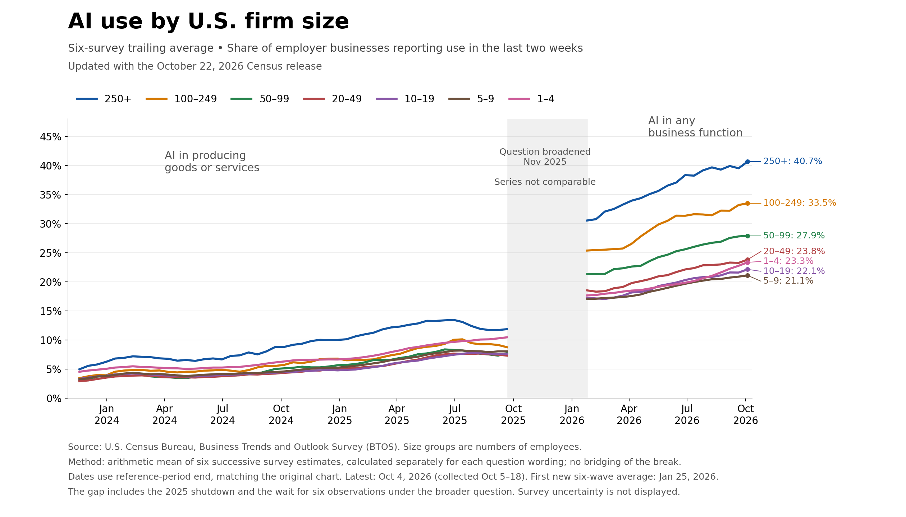

# AI 资讯日报 2026-11-05

> 自动抓取 AI 公司博客、从业者博客与社区聚合源，并生成中文摘要。

## 今日摘要

```
- OpenAI to acquire Pierre Computer Company, Inc.
- Daybreak Red is now available in AWS GovCloud (US-East)
- Accelerating engineering for the physical world
- How Cisco defends at machine speed with OpenAI
- Heimstaden is changing residential real estate management with AI
```

## 公司动态

1. **[OpenAI to acquire Pierre Computer Company, Inc.](https://openai.com/index/openai-to-acquire-pierre)**

   OpenAI will acquire Pierre Computer Company, expanding Codex’s tools for building, understanding, and reviewing code.

   来源：OpenAI Blog

2. **[Daybreak Red is now available in AWS GovCloud (US-East)](https://openai.com/index/daybreak-red-aws-govcloud)**

   Daybreak Red brings GPT-5.6 Cyber to approved customers in AWS GovCloud (US-East) through Amazon Bedrock for authorized cybersecurity work.

   来源：OpenAI Blog

3. **[Accelerating engineering for the physical world](https://openai.com/index/accelerating-engineering-for-the-physical-world)**

   Discover how ChatGPT and Codex are helping engineers accelerate CAD, PCB design, simulation, and other workflows across the physical world.

   来源：OpenAI Blog

4. **[How Cisco defends at machine speed with OpenAI](https://openai.com/index/cisco-cyber)**

   Cisco combines network intelligence with OpenAI models to strengthen enterprise security. Learn how it is building more adaptive defenses.

   来源：OpenAI Blog

5. **[Heimstaden is changing residential real estate management with AI](https://openai.com/index/heimstaden)**

   Discover how Heimstaden uses OpenAI’s ChatGPT Enterprise and Codex to transform property management, cut costs, and empower employees across Europe.

   来源：OpenAI Blog

6. **[OpenAI appoints Jill Hazelbaker as Chief Corporate Affairs Officer](https://openai.com/index/jill-hazelbaker-chief-corporate-affairs-officer)**

   Jill Hazelbaker will join OpenAI as Chief Corporate Affairs Officer, leading the company’s global communications and corporate positioning.

   来源：OpenAI Blog

7. **[Scaling Git at OpenAI](https://openai.com/index/scaling-git-at-openai)**

   How OpenAI built Pando, a Git-compatible backend designed for the scale of development that Codex makes possible.

   来源：OpenAI Blog

8. **[Introducing the Grid Protectors Program](https://openai.com/index/grid-protectors-program)**

   OpenAI’s Grid Protectors Program will work with utilities to help future compute campuses support grid reliability and protect consumer electricity costs.

   来源：OpenAI Blog

9. **[Agentic cheminformatics with Google Antigravity](https://deepmind.google/blog/agentic-cheminformatics-with-google-antigravity/)**

   Learn how Google Antigravity and our Cheminformatics Skills accelerate drug discovery workflows, search compounds, and propose novel rigidified macrocycles.

   

   来源：DeepMind Blog

## 每日产品

1. **[kosa8 - 适用于企业级AI代理的物理隔离微虚拟机沙箱](https://www.producthunt.com/r/ET3BQC5PS7PCZL)**

   Air-gapped microVM sandboxes for enterprise AI agents (www.producthunt.com) 16:01 ↑ 138 PH Upvotes

   

   来源：Product Hunt Daily

2. **[Orphex MCP - 通过一个统一的MCP管理您的整个数字营销体系](https://www.producthunt.com/r/BP2JPQXX3JGH6X)**

   *{padding:0;margin:0;overflow:hidden}html,body{height:100%}img,span{position:absolute;width:100%;top:0;bottom:0;margin:auto}span{height:1.5em;text-align:center;font:48px/1.5 sans-serif;color:white;text-shadow:0 0 0.5em black}▶" frameborder="0" allow="accelerometer; autoplay; encrypted-media; gyroscope; picture-in-picture" allowfullscreen > Run your entire digital marketing stack via one unified MCP (www.producthunt.com) 16:01 ↑ 139 PH Upvotes

   来源：Product Hunt Daily

3. **[OpenMail - 通过电子邮件为您的 AI 代理赋予身份](https://www.producthunt.com/r/VT4VTQFYQVI4ZW)**

   Give your AI agents an identity through email (www.producthunt.com) 16:01 ↑ 149 PH Upvotes

   

   来源：Product Hunt Daily

4. **[Prelulu - 成为主角：通过聊天和视频扮演任何故事中的角色](https://www.producthunt.com/r/AS3PV7P3375YRL)**

   Be the main character: chat & video roleplay any story (www.producthunt.com) 16:01 ↑ 159 PH Upvotes

   

   来源：Product Hunt Daily

5. **[Floot Payments  - 在您使用 ChatGPT 和 Claude 构建的应用中接收付款](https://www.producthunt.com/r/DP7N4LLA6MSIQI)**

   Take payments in apps you build in ChatGPT and Claude (www.producthunt.com) 16:01 ↑ 195 PH Upvotes

   

   来源：Product Hunt Daily

6. **[Wanaka Studio - 使用首款人工智能游戏引擎制作并发布3D游戏](https://www.producthunt.com/r/72C3HN2ZVH7J6Z)**

   Make and publish 3D games with the first AI game engine (www.producthunt.com) 16:01 ↑ 255 PH Upvotes

   

   来源：Product Hunt Daily

7. **[Hookdeck Inspect - 为您和您的代理提供的免费 Webhook 测试工具](https://www.producthunt.com/r/ONA6KQJZWUEX2Z)**

   *{padding:0;margin:0;overflow:hidden}html,body{height:100%}img,span{position:absolute;width:100%;top:0;bottom:0;margin:auto}span{height:1.5em;text-align:center;font:48px/1.5 sans-serif;color:white;text-shadow:0 0 0.5em black}▶" frameborder="0" allow="accelerometer; autoplay; encrypted-media; gyroscope; picture-in-picture" allowfullscreen > Free webhook tester for you and your agent (www.producthunt.com) 11-03 ↑ 112 PH Upvotes

   来源：Product Hunt Daily

8. **[MachineMail - 人类和机器人的电子邮件收件箱](https://www.producthunt.com/r/YGFRQB5ECPT5EA)**

   *{padding:0;margin:0;overflow:hidden}html,body{height:100%}img,span{position:absolute;width:100%;top:0;bottom:0;margin:auto}span{height:1.5em;text-align:center;font:48px/1.5 sans-serif;color:white;text-shadow:0 0 0.5em black}▶" frameborder="0" allow="accelerometer; autoplay; encrypted-media; gyroscope; picture-in-picture" allowfullscreen > Email inboxes for humans and bots (www.producthunt.com) 11-03 ↑ 119 PH Upvotes

   来源：Product Hunt Daily

9. **[LifeVal - OpenAI 针对日常任务的 AI 基准测试](https://www.producthunt.com/r/LUAD4D36GSESMI)**

   OpenAI's benchmark for everyday life tasks with AI (www.producthunt.com) 11-03 ↑ 121 PH Upvotes

   

   来源：Product Hunt Daily

10. **[Calendarly  - 您的日历和任务，直接显示在 iPhone 锁屏界面上](https://www.producthunt.com/r/326NNFAYMAN2FN)**

   *{padding:0;margin:0;overflow:hidden}html,body{height:100%}img,span{position:absolute;width:100%;top:0;bottom:0;margin:auto}span{height:1.5em;text-align:center;font:48px/1.5 sans-serif;color:white;text-shadow:0 0 0.5em black}▶" frameborder="0" allow="accelerometer; autoplay; encrypted-media; gyroscope; picture-in-picture" allowfullscreen > Your calendar and tasks, right on your iPhone Lock Screen (www.producthunt.com) 11-03 ↑ 131 PH Upvotes

   来源：Product Hunt Daily

## GitHub 项目

1. **[NVIDIA/auto-ontology](https://github.com/NVIDIA/auto-ontology)**

   Auto Ontology is a Python framework for building semantic, graph-based reasoning layers over data. It enables deterministic query generation, better context retrieval, and more explainable AI for LLM and agent workflows. Language: Python Stars: 4448 Forks: 366

   来源：GitHub Trending Daily

2. **[max-sixty/worktrunk](https://github.com/max-sixty/worktrunk)**

   Worktrunk is a CLI for Git worktree management, designed for parallel AI agent workflows Language: Rust Stars: 10908 Forks: 406

   

   来源：GitHub Trending Daily

3. **[mattpocock/skills](https://github.com/mattpocock/skills)**

   Skills for Real Engineers. Straight from my .agents directory. Language: Shell Stars: 312856 Forks: 26251

   来源：GitHub Trending Daily

4. **[floci-io/floci](https://github.com/floci-io/floci)**

   Light, fluffy, and always free - The AWS Local Emulator alternative Language: Java Stars: 29447 Forks: 3262

   来源：GitHub Trending Daily

5. **[thedotmack/claude-mem](https://github.com/thedotmack/claude-mem)**

   Persistent Context Across Sessions for Every Agent – Captures everything your agent does during sessions, compresses it with AI, and injects relevant context back into future sessions. Works with Claude Code, OpenClaw, Codex, Gemini, Hermes, Copilot, OpenCode + More Language: TypeScript Stars: 112633 Forks: 9788

   

   来源：GitHub Trending Daily

6. **[vercel-labs/agent-desktop](https://github.com/vercel-labs/agent-desktop)**

   Computer use CLI for AI agents Language: Rust Stars: 14588 Forks: 1004

   

   来源：GitHub Trending Daily

7. **[github/spec-kit](https://github.com/github/spec-kit)**

   💫 Toolkit to help you get started with SDD or any other process! Language: Python Stars: 147151 Forks: 13208

   

   来源：GitHub Trending Daily

8. **[The-PR-Agent/pr-agent](https://github.com/The-PR-Agent/pr-agent)**

   🚀 PR Agent: The Original Open-Source PR Reviewer. This project is not the Qodo free tier. Language: Python Stars: 14633 Forks: 2079

   

   来源：GitHub Trending Daily

9. **[harry0703/MoneyPrinterTurbo](https://github.com/harry0703/MoneyPrinterTurbo)**

   利用 AI 大模型和自动化工作流，根据主题或关键词一键生成高清短视频。Generate HD short videos from a topic or keyword with an automated AI workflow. Language: Python Stars: 138786 Forks: 22151

   来源：GitHub Trending Daily

10. **[garrytan/gstack](https://github.com/garrytan/gstack)**

   Use Garry Tan's exact Claude Code setup: 23 opinionated tools that serve as CEO, Designer, Eng Manager, Release Manager, Doc Engineer, and QA Language: TypeScript Stars: 139190 Forks: 20624

   

   来源：GitHub Trending Daily

## 从业者观点

1. **[Qwen 3.8 27B on my laptop can interpret model weights, too](https://simonwillison.net/2026/Nov/3/qwen-can-interpret-model-weights/)**

   Yesterday's hot paper was Sparks of Weight-Space Programming: LLMs can natively read &amp; write neural network weights by Rikiya Takehi, Jayden Teoh, Alex Zhang, and Omar Khattab. The paper (OK, the authors classify is as a "blog post", but it's paper-shaped) found that frontier models, in particular GPT-6 Astra, can both interpret and modify the raw weights of a machine learning model - literally a text description of the model containing a bunch of floating point numbers. I've been playing with one of the examples from the paper and I'm delighted to share that Qwen 3.8 27B running on my laptop can do this as well! Weight-Space Programming Here's the highlight from their abstract, describing impressive capabilities for GPT-6 Astra and coining the term Weight-Space Programming for when LLMs analyze and modify model weights: Just by looking at the raw weights, GPT-6 Astra can tell what a network was trained to do . And without any environment feedback, it has no trouble writing, from scratch, small game-playing networks that outplay networks trained with PPO for 100 million steps. Likewise, asked to make Qwen3.5-0.8B better at math without gradients, Astra identifies an issue in its weights causing reasoning loops that Qwen’s own model card warns about, and fixes this by natively editing 0.016% of the weights . With the same sampling settings, this weight correction raises MATH-500 from 7.9% to 48.1% and generalizes out of the box to instruction following, raising IFEval by 3x. All of this is possible without allowing Astra to write training loops. It uses its reasoning to figure out what each part of a neural network computes, or should compute, and changes the weights accordingly. We call this Weight-Space Programming . The paper combines two topics that I think deserve to be treated separately. The first is what models can do with raw weights without running tools or executing code. The second explores how well models, once armed with code, can run operations to update and improve other models. spaCy author Matthew Honnibal called the paper misleading for conflating the two, and Sean Goedecke deconstructed the Qwen3.5-0.8B update example as taking the same steps that a human ML researcher would use. I'm going to focus on the no-tools question, which I think is the more interesting of the two. The paper presents the first question as Can LLMs understand model behaviors from weights? They trained four neural networks to play simplified 10x10 grid versions of four classic computer games - Breakout, Pong, Pac-Man, and Freeway (I had to look that one up , it's an Atari 2600 game from 1981). Then they fed those weights (as floating point numbers) to an LLM along with the following question: The weights below belong to one policy network that was trained with reinforcement learning to play a game on this grid. Which game was it trained on? Work from the weights. You have no tools: no code execution, no calculator, nothing to run. This is a single response. The GitHub repository that accompanies the paper is RikiyaT/lm_understand-logs . The exp1_which_game folder contains the prompts they used, with weights for the four games: breakout/prompt.txt freeway/prompt.txt pacman/prompt.txt pong/prompt.txt I checked and, aside from the weights, each prompt is identical to the others. Trying it out with Qwen 3.8 27B and other models The prompts on GitHub are self-contained. My LLM tool has a -f/--fragment option which can be passed the URL to a text file to use as a prompt, which means I can run any of the above like this: llm -f https://raw.githubusercontent.com/RikiyaT/lm_understand-logs/refs/heads/main/exp1_which_game/runs/breakout/prompt.txt \ -m openrouter/moonshotai/kimi-k3.1-pro This example requires the llm-openrouter plugin installed, and runs the Breakout prompt against Kimi K3.1 Pro via OpenRouter. Here's what I got back from Kimi K3.1 Pro , which successfully guessed Breakout after 9m 41s and 19,493 reasoning tokens. But how about Qwen 3.8 27B ? That's still my favorite model to run on my own laptop - it's just 17GB (I use this version ) and somehow feels close to the leading proprietary models of 2025. I fired up LM Studio , ensured Qwen 3.8 27B was loaded with a long context window (the default 8192 context failed with errors), installed the llm-lmstudio plugin and ran this command: LMSTUDIO_TIMEOUT=900 \ llm -f https://raw.githubusercontent.com/RikiyaT/lm_understand-logs/refs/heads/main/exp1_which_game/runs/pacman/prompt.txt \ -m lmstudio/qwen/qwen3.8-27b (I had to bump the timeout up using an environment variable, see this issue .) After 46m 12s and 43,506 reasoning tokens, Qwen on my laptop returned a response that ended like this (here's the reasoning trace ): Game: A simplified Pac-Man-style gridworld: an agent moves through a fixed 8x8 maze with central and corner wall blocks, moving objects/ghosts, and reward targets/pellets. Description: The agent navigates a fixed maze-like 8x8 board, using current agent/moving-object/previous-frame cues to move through corridors, collect reward-target cells, and avoid moving objects or hazards. Confidence: 72% This is impressive. I tried it on two of the other games as well. It identified Pong ( reasoning ) in 1h 4m 54s: Pong — specifically a Pong-like paddle/ball game where the agent controls a vertical paddle on the right side and must move up/down to intercept or return a moving ball/reward object. Description: The agent moves a right-side paddle vertically to hit or catch a moving ball-like reward target moving across the 8×8 field, while a left-side moving object/opponent and wall borders define the play; reward is obtained by successfully intercepting/returning/scoring the ball, and missing or failing to hit it is penalized. Confidence: 75% And Breakout ( reasoning ) in 52m 25s: Game: Breakout, or an Arkanoid-like paddle/ball/brick game. Description: The agent is a paddle on the bottom row and moves left/right to keep a ball in play; the ball moves around the upper grid, and bricks/reward targets in the top rows give reward when hit, while missing the ball/hitting the bottom wall ends the episode or gives penalty. Confidence: 88% Qwen failed at the Freeway prompt, which didn't surprise me considering that game is more obscure than the other three. Here's that transcript - Qwen thought it was "A simplified Pac-Man-like grid game: agent moves 4-directionally". The reasoning traces are fun to skim, and almost incomprehensible. Here's a sample: What about agent channel0? We see some large channel0 rows near row8 col7/8 and maybe bottom? Let's list channel0 large: line436 input435 (row8 col7 ch0) -2.107,1.169,0.513...; line441 input440 (row8 col8 ch0) -0.376,0.010,1.564,3.855...; line445 input444 (row8 col8 ch4) 0.142,0.491...; line382? input381 ch0? Wait line382 input381: 381//5=76 (row7 col6), ch1? 381%5=1? 76 * 5=380, ch1. So not. Channel0 large maybe at row8 col7/8 only. Also top row? line44 input43 ch3, line49 ch3. Channel0 large maybe not many. Agent position could be near bottom-right? If the agent is typically at bottom-right? That said though, I expect a sufficiently experienced human being armed with a notepad and a pencil could get there with enough effort. It's a cool paper, but some of the wider commentary I've seen around it does not feel justified. I'm not ready to declare that the age of source code is over and our future involves incomprehensible machines editing their own model weights in incomprehensible ways. Tags: machine-learning , ai , generative-ai , local-llms , llms , qwen , paper-review

   来源：Simon Willison

2. **[I discovered a sound that leaks your exact location (and it's everywhere) - YouTube](https://simonwillison.net/2026/Nov/3/a-sound-that-leaks-your-exact-location/)**

   I discovered a sound that leaks your exact location (and it&#x27;s everywhere) - YouTube Genius piece of OSINT by Colsto, who demonstrates how you can take almost imperceptible background noise of planes from a video soundtrack, figure out their Doppler curves, then cross reference them against ADS-B data to find the exact location of the video based on their speed, distance, and gaps between different flights. Via Lobste.rs Tags: privacy , youtube

   来源：Simon Willison

3. **[October sponsors-only newsletter](https://simonwillison.net/2026/Nov/3/october-newsletter/)**

   I sent out the October edition of my sponsors-only monthly newsletter . If you are a sponsor (or start a sponsorship now) you can access it here . This month: The October inflection point for vibe game development The vulnerability apocalypse gets hot LLM releases API credits for $100+/month subscriptions What I'm using right now My software releases My September newsletter can now be seen here , as a preview of what you'll get. Pay $10/month to stay a month ahead of the free copy! Tags: newsletter

   来源：Simon Willison

4. **[llm 0.37](https://simonwillison.net/2026/Nov/2/llm/)**

   Release: llm 0.37 There's a lot of stuff in this new release of my LLM CLI tool and Python library, representing around two months of accumulated features and fixes. I added gpt-6.1-sol and gpt-6.1-terra , plus a new llm openai endpoint add command to make it easier to configure additional models that use OpenAI-compatible endpoints. I switched the default model (if you have not set your own default) to gpt-6-luna - half the price of the previous default, gpt-5.6-luna . LLM's support for embeddings now accepts that different binary content may have different content-type - necessary for models like Gemini Embedding 2 , which can embed text, audio, images, and video. A lot of open source maintainers complain about a flood of AI-assisted PRs. LLM is my project that has been most affected by this and, to be honest, I'm not finding it to be a problem. That's mainly because I have Opus 5.5 or GPT-6 Astra help me with triage to spot the most useful fixes! This release includes fixes from 12 authors - almost all AI-assisted - and the burden of reviewing them wasn't nearly as great as I expected. I really see them as bug reports with attached examples - sometimes I land them, sometimes I implement my own fix. So thanks to 0d00ciallo0721 , ac1982 , Allen Flux , Bian Yuhan , Bishop Kammeraad , Chen Yufeiyang , Christopher Krah , Ethan Stoner , Jiachen Xie , Olamide Faniyan , Sharat Chandra Sai Boddu , nosmile99 for helping out with (or spending tokens on) this release! Tags: open-source , projects , ai , annotated-release-notes , generative-ai , llms , embeddings , llm

   来源：Simon Willison

5. **[The U.S. Census Bureau and “Super Intelligence”](https://simonwillison.net/2026/Nov/2/census-bureau-super-intelligence/)**

   I was reminded today of AI Adoption Rate Trending Down for Large Companies , a chart produced by Apollo Global Management in September 2025, which appeared to show a slowdown in U.S. corporate AI adoption based on numbers collected by the U.S. Census Bureau. At the time I used that chart to demonstrate GPT-5 data analysis , and then to experiment with Claude's new Code Interpreter . I decided to try running those numbers again to see what had changed over the past year, and in doing so learned that the Bureau has fallen foul of Executive Order 14434 , aka the asinine Super Intelligence one. First, the updated chart Every two weeks the U.S. Census Bureau runs a survey called the Business Trends and Outlook Survey (aka BTOS). Each time it goes to 200,000 businesses out of 1.2 million total - the surveyed group (a "panel") cycles such that an individual business only completes the survey every twelve weeks. The latest data is published on alternating Thursdays at 10am. I used the most recent numbers (published October 22, 2026) to create a new version ( GPT-6 Astra Extra High transcript ) of the AI adoption chart, updated to reflect both the last twelve months and a change that was made to the survey question sent out by the Bureau: [图片: Line chart titled &quot;AI use by U.S. firm size&quot;, subtitled &quot;Six-survey trailing average • Share of employer businesses reporting use in the last two weeks&quot; and &quot;Updated with the October 22, 2026 Census release&quot;. Seven lines for firm sizes 250+, 100–249, 50–99, 20–49, 10–19, 5–9 and 1–4, on a y-axis from 0% to 45% and an x-axis from Jan 2024 to Oct 2026. Left section, &quot;AI in producing goods or services&quot;: all sizes start at 3–5% in late 2023 and climb slowly to 7–13% by September 2025, with 250+ highest. A shaded gap is labeled &quot;Question broadened Nov 2025&quot; and &quot;Series not comparable&quot;. Right section, &quot;AI in any business function&quot;: all lines restart higher in February 2026 and rise steadily to &quot;250+: 40.7%&quot;, &quot;100–249: 33.5%&quot;, &quot;50–99: 27.9%&quot;, &quot;20–49: 23.8%&quot;, &quot;1–4: 23.3%&quot;, &quot;10–19: 22.1%&quot;, &quot;5–9: 21.1%&quot;. Footnotes: &quot;Source: U.S. Census Bureau, Business Trends and Outlook Survey (BTOS). Size groups are numbers of employees.&quot; &quot;Method: arithmetic mean of six successive survey estimates, calculated separately for each question wording; no bridging of the break.&quot; &quot;Dates use reference-period end, matching the original chart. Latest: Oct 4, 2026 (collected Oct 5–18). First new six-wave average: Jan 25, 2026.&quot; &quot;The gap includes the 2025 shutdown and the wait for six observations under the broader question. Survey uncertainty is not displayed.&quot; https://static.simonwillison.net/static/2026-11-01/5821A414-FAF6-4E61-B037-952C1FD80D39.png] Here's a link to the larger image . For comparison, here's that AI adoption chart from last year (my GPT-5 version): [图片: AI adoption rates starting to decline for larger firms. A chart of AI adoption rate by firm size. Includes lines for 250+, 100-249, 50-99, 20-49, 10-19, 5-9 and 1-4 sized organizations. Chart starts in November 2023 with percentages ranging from 3 to 5, then all groups grow through August 2025 albeit with the 250+ group having a higher score than the others. That 250+ group peaks in July 2025 at around 14% and then appears to slope slightly downwards to 12% by August. Some of the other lines also start to tip down, though not as much. https://static.simonwillison.net/static/2025/apollo-ai-chart.jpg] In September 2025 the largest (250+ employees) companies answered "yes" around 12% of the time to the question about whether they used AI in "producing goods or services". Under the new "any business function" wording, by February 2026, those same large companies answered "yes" around 30% of the time, and by October 2026 that had increased to around 40%. The data in the above chart comes from the "Employment size class" XLSX file, available from here . Here's a copy of the file I used. You can view the survey document that is sent out to businesses - here's my snapshot copy of that 346KB PDF. The changing language of the questions As the chart demonstrates, the question asked by the Bureau changed in a material way on November 17th, 2025. Prior to that date, the question they asked was this (emphasis mine): In the last two weeks, did this business use Artificial Intelligence (AI) in producing goods or services ? (Examples of AI: machine learning, natural language processing, virtual agents, voice recognition, etc.) On December 3rd, 2025, the Bureau announced a significant change to that question. Here's the replacement: In the last two weeks, did this business use Artificial Intelligence (AI) in any of its business functions ? (Examples of AI: machine learning, natural language processing, virtual agents, voice recognition, etc.) No more "producing goods or services" - now it's "in any of its business functions"! This means that the answers to the question before and after November 17th are not directly comparable. From October 19, 2026, they ask about Super Intelligence When I went looking for the updated question language in the latest XLSX file, I couldn't find it. I found this instead: In the last two weeks, did this business use Super Intelligence or SI (formerly referred to as Artificial Intelligence or AI) in any of its business functions? (Examples of SI use include: SI-powered data analysis; generative SI for marketing, product design, or coding; virtual SI agents for customer service; SI-powered forecasting or pricing; SI-driven computer vision for quality control, etc.) The BTOS about page explains what happened: Beginning with the October 19, 2026 collection, instrument wording was updated due to Executive Order 14434 . The current numbers reflect the old Artificial Intelligence survey wording - the first survey results reflecting the Super Intelligence wording are due for publication on Thursday. Is this going to affect the survey? The obvious open question here is whether this wording change is going to affect the survey results. The businesses answering this survey will have last seen that question twelve weeks ago, when it was still called AI. Hopefully the new language isn't going to confuse them, especially since the survey helpfully spells out "formerly referred to as Artificial Intelligence or AI". I can't help but laugh at the absurdity of "SI-powered data analysis; generative SI for marketing, product design, or coding; virtual SI agents for customer service" though. Tags: census , surveys , ai , generative-ai , llms

   

   来源：Simon Willison

6. **[If in doubt, delete the uv.lock file](https://simonwillison.net/2026/Nov/1/delete-uv-lock-first/)**

   I've been getting the occasional confusing Python dependency error since switching over to Python 3.15 and the rule I'm having to remember is: If in doubt, delete the uv.lock file Most of my projects are libraries which don't include a uv.lock file, since it's rude for a library dependency to lock versions for anything else that uses it. Running uv run pytest etc tends to leave uv.lock files lying around, which are listed in .gitignore and so do not get committed to my repositories. But... sometimes that uv.lock pins a version of a dependency that doesn't yet have a Python 3.15 wheel. An example from earlier today: error: Failed to build `watchfiles==1.1.1` cause: Call to `maturin.build_wheel` failed error: the configured Python interpreter version (3.15) is newer than PyO3's maximum supported version (3.14) Deleting that file and running uv run pytest again usually fixes the problem. Tags: uv , til , python

   来源：Simon Willison

## 社区热点

1. **[YC's Garry Tan uses AI agents so much, he spends up to $200K a year on tokens](https://techcrunch.com/2026/11/02/y-combinators-garry-tan-uses-ai-agents-so-much-he-spends-up-to-200k-a-year-on-tokens/)**

   Article URL: https://techcrunch.com/2026/11/02/y-combinators-garry-tan-uses-ai-agents-so-much-he-spends-up-to-200k-a-year-on-tokens/ Comments URL: https://news.ycombinator.com/item?id=50366971 Points: 45 # Comments: 62

   来源：Hacker News AI

2. **[Ask HN: What's your current AI agentic setup?](https://news.ycombinator.com/item?id=50366117)**

   I'm curious how people on HN are using AI day to day, and came up with a list of questions I thought could be interesting to know. No need to answer every question of course, just wanted to get a gut feel how people are using AI. 1) What AI subscriptions are you personally paying for? (Claude, ChatGPT/Codex, Cursor, etc) - Which tiers? - Have you purchased multiple subscriptions from the same provider (eg two Claude accounts)? 2) Are you using models outside (or instead) of those subscriptions? For example, pay-as-you-go APIs, OpenRouter, or locally hosted models. - Which models and providers? 3) What coding harnesses and interfaces are you using? Are you sticking with the default CLIs or IDE integrations, or using alternatives like OpenCode, Pi, Aider, Muse Code, or custom-built harnesses? - What made you switch harnesses (if you switched)? 4) Are you using any agent orchestration or swarm tools? - For example, Munder Difflin, Gas Town, Ruflo, or something custom. 5) Are you using broader agent platforms like OpenClaw / Hermes Agent / Grok bot / Dots / Muse? - If you are using them, what are your main use cases? ----- I know my workflow has differed significantly from a year ago, and so it would be interesting to capture a snapshot today of what people are using and why. Comments URL: https://news.ycombinator.com/item?id=50366117 Points: 57 # Comments: 67

   来源：Hacker News AI

3. **[Jaron Lanier on parallels between AI and social media](https://www.youtube.com/watch?v=WxaRn8kX2eI)**

   Article URL: https://www.youtube.com/watch?v=WxaRn8kX2eI Comments URL: https://news.ycombinator.com/item?id=50365760 Points: 39 # Comments: 7

   来源：Hacker News AI

4. **[AI is forcing us to pay off 40 years of technical debt](https://spectrum.ieee.org/ai-in-cybersecurity-php2shell-vulnerability)**

   Article URL: https://spectrum.ieee.org/ai-in-cybersecurity-php2shell-vulnerability Comments URL: https://news.ycombinator.com/item?id=50364336 Points: 703 # Comments: 443

   来源：Hacker News AI

5. **[Geoffrey Hinton: it might turn out we were better off without AI](https://www.theguardian.com/uk-news/2026/nov/03/ai-godfather-geoffrey-hinton-better-off-without-ai)**

   Article URL: https://www.theguardian.com/uk-news/2026/nov/03/ai-godfather-geoffrey-hinton-better-off-without-ai Comments URL: https://news.ycombinator.com/item?id=50363554 Points: 271 # Comments: 249

   来源：Hacker News AI

6. **[AI stocks slide as Texas governor result raises data center risks](https://www.cnbc.com/2026/11/04/ai-stocks-texas-governor-data-centers.html)**

   Article URL: https://www.cnbc.com/2026/11/04/ai-stocks-texas-governor-data-centers.html Comments URL: https://news.ycombinator.com/item?id=50362274 Points: 51 # Comments: 71

   来源：Hacker News AI

7. **[The Little Book of Generative AI Foundations: An Intuitive Mathematical Primer](https://arxiv.org/abs/2605.29713)**

   Article URL: https://arxiv.org/abs/2605.29713 Comments URL: https://news.ycombinator.com/item?id=50358582 Points: 372 # Comments: 58

   来源：Hacker News AI

8. **[US tech giants' hidden AI debt swells 90% to $3.2T in 6 months](https://asia.nikkei.com/business/technology/artificial-intelligence/us-tech-giants-hidden-ai-debt-swells-90-to-3.2tn-in-6-months)**

   Article URL: https://asia.nikkei.com/business/technology/artificial-intelligence/us-tech-giants-hidden-ai-debt-swells-90-to-3.2tn-in-6-months Comments URL: https://news.ycombinator.com/item?id=50358422 Points: 395 # Comments: 160

   来源：Hacker News AI

9. **[The AI Boom May Be Sowing Seeds of Another Financial Crisis](https://www.bloomberg.com/opinion/articles/2026-11-03/ai-investment-boom-demands-stronger-financial-oversight)**

   Article URL: https://www.bloomberg.com/opinion/articles/2026-11-03/ai-investment-boom-demands-stronger-financial-oversight Comments URL: https://news.ycombinator.com/item?id=50358414 Points: 75 # Comments: 84

   来源：Hacker News AI

10. **[Show HN: Uncracked City, detective game where you question LLM suspects that lie](https://uncracked.city)**

   To give you some context on the project. I'm a solo founder and I use AI heavily in my work. The idea came from wanting players to discover cities. Each city has its own history, so every case is set in a real city with real public places. The crime and the people are on other hand invented. The part that I care most is the playable aspect of the game, a model plays the detective and must solve the case before it goes live. As of today: it's free on Android, the iOS version is still waiting to be reviewed by Apple. It's available in six popular languages, but adding more languages is just a matter of time and demand.My long term vision if it takes off: weekly cases, private parties like a team-building escape game, an MCP so a game master can build their own scenario from ChatGPT or Claude, and maybe tourism offices since players travel the world. Comments URL: https://news.ycombinator.com/item?id=50358352 Points: 117 # Comments: 56

   来源：Hacker News AI

11. **[What even is code mode?](https://polylane.com/blog/what-even-is-code-mode/)**

   Comments

   来源：Lobsters AI

12. **[A developer opened Postman. Then two AI coding agents changed without their permission](https://thenewstack.io/postman-plugin-coding-agents/)**

   Comments

   来源：Lobsters AI

13. **[Sparks of Weight-Space Programming: LLMs can natively read & write neural network weights](https://rikiyat.github.io/blog/weight-space-programming/)**

   Comments

   来源：Lobsters AI

14. **[An easy way to try local AI with braindead-local-intelligence](https://dataswamp.org/~solene/2026-11-01-braindead-local-intelligence.html)**

   Comments

   来源：Lobsters AI

## 论文与模型

1. **[Route Anything: A Study of Model and Policy Routing for General-Purpose AI Systems](https://arxiv.org/abs/2611.05275)**

   Artificial general intelligence (AGI) requires a method that can understand, generate, reason, and act across diverse domains and modalities. Rather than relying on a single model to master every capability, a promising path toward AGI now is to orchestrate a heterogeneous ecosystem of specialized models, tools, and policies (candidates) into a unified AI system. At the heart of this vision lies a fundamental question: how can an AI system dynamically select and coordinate the most capable candidate for each task while balancing performance and computational cost? In this work, we present Route Anything, a unified framework for studying model and policy routing across general-purpose AI systems. We develop a unified theoretical foundation that characterizes optimal routing under quality--cost trade-offs and establishes how the information available to a router determines its attainable performance. To systematically investigate routing across diverse capabilities, we first construct an omni-modal trajectory matrix spanning 25 benchmarks across language understanding, image, video, and speech generation, coding and workplace agents, and robotic manipulation, comprising 374,401 scored runs from 452 candidate configurations. Building on this framework, we train and test different routers to investigate the potential of omni-modal model routing, the capabilities of learned routers, and the conditions under which routing improves efficiency. Our results reveal substantial opportunities for capability orchestration: per-input oracle routing outperforms the best fixed candidate by 5.4 points, and learned routers outperform it by 0.3 points across 16 benchmarks, by 2.1 points on video generation, and by 1.1 points on robot manipulation while using 24% less policy time. More importantly, routing raises efficiency by 8.82x on average compared with the reference model.

   来源：HuggingFace Papers

2. **[Think Less, Locally: Local Preference Learning for Reasoning Compression](https://arxiv.org/abs/2611.04814)**

   Large reasoning models achieve strong performance on challenging tasks, but their long chain-of-thought often incurs substantial inference costs by continuing to deliberate after sufficient information has been obtained. Existing reasoning compression methods primarily operate on reasoning trajectories, paying less attention to the local decision of whether further reasoning is necessary given the current state. We propose LoCo, a local preference learning method for reasoning compression. LoCo detects candidate overthinking states from the model's own traces, freezes the corresponding reasoning prefixes, regenerates shorter verified continuations from the same states, and trains on the resulting state-conditioned preference pairs with DPO. This formulation teaches the model when to continue reasoning and when to conclude, rather than simply encouraging shorter trajectories overall. We construct training data entirely from self-generated mathematical traces and evaluate LoCo on five mathematical and three code generation benchmarks. LoCo reduces completion length by 41.7\%--45.4\% on mathematics and 23.4\%--36.3\% on code, while maintaining or improving accuracy and achieving the best AUC across all code benchmarks. LoCo consistently improves the accuracy-efficiency trade-off on mathematics and transfers effectively to code generation despite math-only training, demonstrating the cross-domain generality of local preference learning for reasoning compression. The code and model will be publicly released at https://github.com/MuyaoYuan/LoCo.

   来源：HuggingFace Papers

3. **[Behind Video Generation: Observations and Insights on Multimodal Understanding from Kling](https://arxiv.org/abs/2611.04916)**

   Video generation has progressed from isolated clips to coherent short-form audiovisual sequences, and the bottleneck is shifting from rendering to semantic control. This report summarizes the observations and insights on multimodal understanding gained from successive generations of Kling. We argue that generation quality is the projection of multimodal understanding through the entire data--conditioning--alignment--evaluation chain, and we examine this chain module by module. Kling-MLLM, a shared multimodal foundation model that unifies image, video, audio, synchronized audio--video, and interleaved inputs, is specialized for each downstream module. Because a DiT is trained on far fewer training samples than a language model, we treat captioning as a semantic contract that maximizes description density, and extend it to reference-grounded captioning that makes reference bindings explicit. Prompt enhancement translates user intent into this caption distribution: basic PE is derived from captions of compelling videos and refined with text-level and generator-in-the-loop reinforcement learning, while agentic PE refines the story and retrieves compelling examples. We show that a reliable text encoder comes from perceptual training rather than from stronger language ability, and that candidates can be screened from text alone before end-to-end training. Reward modeling pairs a general reward model for explainable, localized critiques with a decision reward model for fast multidimensional scoring, treating perceptual bandwidth as a first-class design parameter. Finally, we review task-specific automatic evaluation, focusing on protocols that expose scoring shortcuts and help trace failures to their upstream source. We hope these lessons offer practical guidance for building the understanding stack behind controllable video generation.

   来源：HuggingFace Papers

4. **[DreamX: Video Diffusion Model is a Universal Latent Action Learner](https://arxiv.org/abs/2611.05377)**

   Learning a universal action representation from video requires modeling dynamics that are consistent across different executions of the same action yet invariant to changes in embodiment and appearance. Existing latent action models infer actions from visual transitions, but their representations often entangle the underlying action with irrelevant visual variations, limiting transfer across embodiments. We introduce DreamX, which repurposes a pretrained video diffusion model as a universal latent action learner. Our approach extracts compact latent actions from the video model's rich spatiotemporal features, compressing each latent video frame by 300times (1{,200 rightarrow 4} tokens). In addition, by leveraging the video model's generative prior, these latent actions capture action-relevant dynamics disentangled from visual appearance. The resulting latent space serves as a shared action interface across embodiments (human and robot), environments, and action parameterizations. On LARY-Bench, DreamX achieves state-of-the-art performance among latent action models. Moreover, actions encoded in one setting remain effective in another: the latent space supports any-to-any video transfer and zero-shot action transfer across diverse embodiments and environments. Furthermore, this shared interface also enables policy learning in a compact latent action space, reducing the computational cost of video-diffusion-based policies.

   来源：HuggingFace Papers

5. **[Factorized MLLM Embeddings for Composed Image Retrieval](https://arxiv.org/abs/2611.05193)**

   Composed Image Retrieval (CIR) aims to retrieve a target image given a reference image and a modification text. Although recent approaches leveraging Multimodal Large Language Models (MLLMs) have shown significant progress, we argue that the MLLM's compositional understanding remains underutilized. This stems from directly mapping composed queries into a retrieval embedding via contrastive supervision alone, without explicitly resolving the intended visual modifications. In this work, we introduce Factorized MLLM Embeddings (FactEmbed), which decouples compositional query comprehension from building discriminative embeddings. Rather than directly projecting the composed query into a single embedding without internal reasoning, FactEmbed employs a set of factorized latents that simulate the intended visual modifications via an intermediate target imagination objective. This process encourages the latents to ground into target semantics before forming discriminative representations for retrieval. Subsequently, to propagate these factorized representations throughout the model for retrieval, we optimize a factor-level contrastive loss while distilling the decomposed representations into a deeper attention layer of the MLLM. Finally, for efficient inference, we retain the [EOS] token to establish a global-level embedding on top of these factorized latents, while we exploit the mean-pooled factorized latents to rerank a short candidate list at negligible cost, as both are produced by the same forward pass. Extensive evaluations demonstrate that FactEmbed outperforms prior works across CIR benchmarks.

   来源：HuggingFace Papers

6. **[ToolSpace: Scaling Tool-Centric Environment Synthesis for Long-Horizon Agents](https://arxiv.org/abs/2611.05036)**

   Large language models are deployed as long-horizon agents that compose diverse tools across MCP services into executable workflows. Existing MCP environment-scaling methods are data-centric: they first synthesize a database and scenario, then derive tools and tasks from them. As a result, tool interfaces may not match real ones, tool compositions are not grounded in execution, and tasks rarely span more than one environment. We propose ToolSpace, a tool-centric framework that reverses this order. ToolSpace mines data, state, and retry dependencies from adjacent calls in execution traces of real MCP services and open agent corpora, using deterministic rules rather than LLM judgment, and clusters the resulting weighted tool-composition graph into environments. Databases are synthesized only for state-mutating environments, while query and stateless tools replay recorded returns. ToolSpace then performs state-aware random walks with rollback and decompiles each chain into a natural-language task with assertion-based checks, keeping only samples that replay successfully from the initial state. Applied to AutomationBench and tau3-Bench Banking, the pipeline produces harder Pro versions on which 7 frontier models drop by up to 38.2 points. Across seven long-horizon tool-use benchmarks, ToolSpace raises Qwen3.6-35B-A3B from 23.0 to 41.0 average score (43.2 with RL) and GLM-5.2 from 44.6 to 56.6, on par with Claude Opus 5. Ablations show that execution-witnessed edges clearly outperform LLM-judged ones, and performance keeps improving with data and environment scale.

   来源：HuggingFace Papers

7. **[YANAMI: A Large-Scale Multimodal Dataset and Benchmark for Multiturn Stateful Interaction](https://arxiv.org/abs/2611.05280)**

   Unified Multimodal Models (UMMs) integrate visual understanding, generation, and editing within a single unified framework. However, existing unified multimodal datasets and benchmarks remain dominated by single-turn tasks. Even in recent multi-turn datasets, many turns can be solved independently without tracking information across turns. Consequently, they provide limited supervision and evaluation for multimodal stateful interaction, which requires models to understand, maintain, update, and faithfully realize evolving dialogue states across turns. To address this gap, we introduce YANAMI, the first large-scale multimodal dialogue dataset and benchmark for stateful interaction, comprising YANAMI-400K and YANAMI-Bench. YANAMI-400K contains 400K multi-turn multimodal dialogues, with more than 2M images and 2.6M dialogue turns. The dialogues span four representative scenarios: Multi-Image Fusion, Image Editing, World Modeling, and Visual Reasoning, and require models to continuously track, preserve, and revise evolving multimodal dialogue states across turns. YANAMI-Bench comprises 400 multi-turn dialogues for systematically evaluating multimodal stateful interaction. It jointly evaluates Dialogue State Understanding and Visual Realization, characterizing the gap between models' ability to understand evolving dialogue states and their ability to faithfully realize them in visual outputs. Experiments show that fine-tuning BAGEL on YANAMI-400K improves image editing, generation, and multimodal stateful interaction by 10.3%, 2.0%, and 13.23%, respectively, while preserving its general visual understanding capabilities. Evaluations on YANAMI-Bench further reveal that existing UMMs still struggle to maintain, update, and visually realize evolving multimodal dialogue states.

   来源：HuggingFace Papers

8. **[VidUEU-Agent: A Data-Curation Agent for Multimodal Understanding, Editing, and Unified Tasks](https://arxiv.org/abs/2611.04418)**

   The advancement of multimodal learning is heavily constrained by the scarcity and high annotation cost of high-quality instruction data. While raw videos offer an abundant and dynamic source of visual knowledge, transforming them into precise instruction data remains highly challenging. To bridge this gap, we present VidUEU-Agent, an automated pipeline that synthesizes instruction data from raw videos for multimodal understanding, editing, and unified tasks. VidUEU-Agent follows a four-stage pipeline: it performs global perception to filter low-quality shots, mines keyframes and multimodal signals, constructs metadata and routes the metadata to synthesize instruction samples. More importantly, our agent framework can autonomously iterate the data distribution based on downstream training results, thereby optimizing data quality, balance, and training effectiveness. Scaling this pipeline, we construct VidUEU-100K, a large-scale dataset of 100K training samples spanning multiple domains and tasks, providing a robust foundation for developing comprehensive multimodal capabilities. Extensive experiments demonstrate that fine-tuning baseline models on VidUEU-100K yields significant and consistent performance gains across diverse representative benchmarks, validating the effectiveness of our proposed agent framework and dataset.

   来源：HuggingFace Papers

9. **[FlowTranslator: Training-Free In-Image Machine Translation with Flow-Based Editing](https://arxiv.org/abs/2611.04303)**

   In-image machine translation (IIMT) replaces text in an image with its translation while preserving the surrounding visual context. Existing task-specific models achieve convincing performance but require massive paired training images before and after translation. As advanced text-to-image (T2I) models have reached a practically usable level of multilingual text generation, we argue that this capability can be transferred to IIMT and present FlowTranslator. It is a training-free IIMT framework that first employs an OCR model and an LLM to generate the translation prompt, which is injected into the T2I-based diffusion model. To optimize the accurate and natural generation of translated text, we introduce two trajectory controls: Region Coupling Release (RCR) partially decorrelates target-branch noise inside the text region early in the trajectory, while Coupling Expansion (CE) amplifies the emerging edit displacement mid-trajectory. Under the EasyOCR read-back protocol, FlowTranslator achieves average PRIM BLEU and COMET scores of 20.6 and 57.2, respectively, substantially outperforming the strong training-based baseline UniTranslator. On the more challenging and realistic whole-image ScenePair photographs translated into Chinese, it reaches 40.1\% exact-match accuracy and surpasses existing editing systems, some of which only address the text-rendering stage rather than the complete IIMT task. These results establish flow-based editing as a strong, fully training-free baseline for IIMT.

   来源：HuggingFace Papers

10. **[PrimeSim: A Generalist World Model Simulator from Large-Scale Cross-Embodiment Demonstrations](https://arxiv.org/abs/2611.04870)**

   A robot world model that serves as a simulator must do more than generate plausible videos: it must faithfully follow commanded actions, maintain consistency across camera views, and sustain coherent long-horizon rollouts. We present PrimeSim, an action-conditioned, multiview world model simulator that addresses these challenges through progressive midtraining and posttraining. Starting from a pretrained video generator, we midtrain on 30,110 hours of robot demonstrations spanning 22 platforms. To improve action following, we introduce a unified cross-embodiment action representation and frame-aligned dual-path conditioning to strengthen action-frame correspondence. To maintain multiview consistency, we develop view-aware interleaved attention with explicit camera identities, enabling cross-view information exchange while preserving view-specific representations. We further introduce a fast-video, slow-memory posttraining framework that transforms the bidirectional video generator into an efficient autoregressive simulator. By combining fast causal generation, self-rollout training, and hierarchical temporal memory, PrimeSim mitigates error accumulation from self-generated histories and supports coherent long-horizon simulation. PrimeSim runs at 10.1 FPS, remains stable over long-horizon rollouts on rigid and deformable manipulation tasks, and transfers to held-out platforms within 100 to 200 gradient steps where the pretrained backbone does not. Against five open-source action-conditioned world models it leads four of the five WorldSimProbe suites and posts the best overall EWMBench score, while fine-grained local calibration still trails the field; its rollouts are faithful enough to support GRPO-based policy optimization. We release the model weights, inference code, and training code.

   来源：HuggingFace Papers
