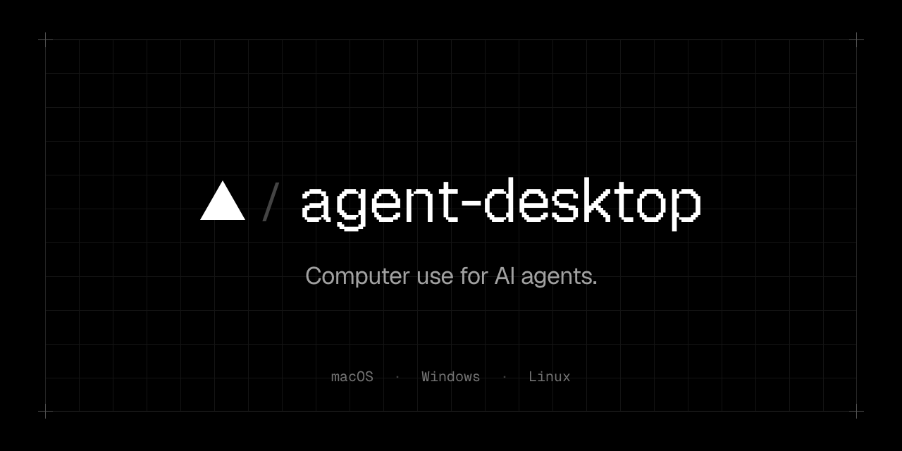
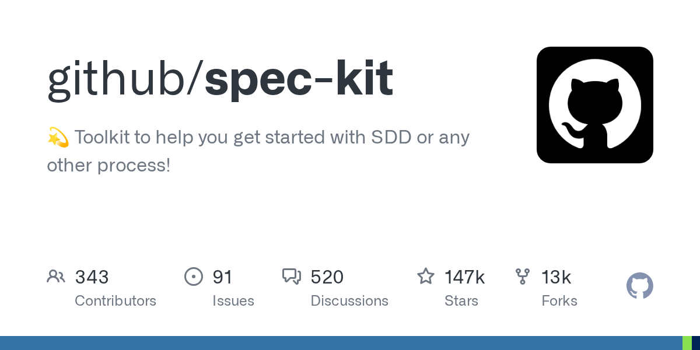
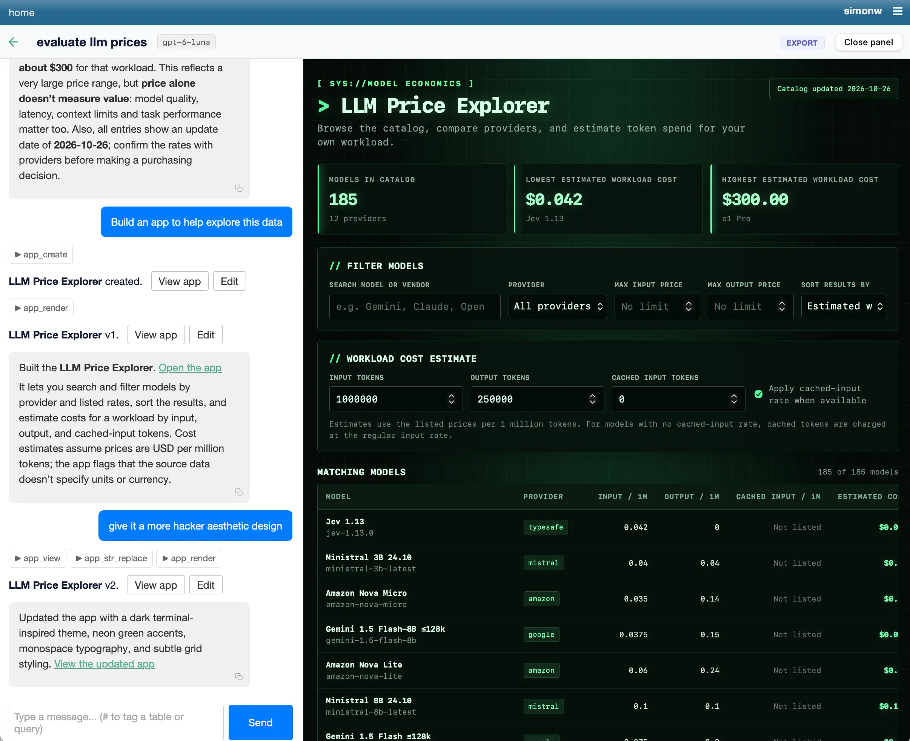

# AI 资讯日报 2026-11-05

> 自动抓取 AI 公司博客、从业者博客与社区聚合源，并生成中文摘要。

## 今日摘要

```
- OpenAI to acquire Pierre Computer Company, Inc.
- A thousand fewer paths to root
- Daybreak Red is now available in AWS GovCloud (US-East)
- Introducing Images 2.6
- DevRev delivers autonomous self-service with GPT-6.1 Sol
```

## 公司动态

1. **[OpenAI to acquire Pierre Computer Company, Inc.](https://openai.com/index/openai-to-acquire-pierre)**

   OpenAI will acquire Pierre Computer Company, expanding Codex’s tools for building, understanding, and reviewing code.

   来源：OpenAI Blog

2. **[A thousand fewer paths to root](https://openai.com/index/a-thousand-fewer-paths-to-root)**

   OpenAI built an autonomous pipeline that found, validated, and generated patches for 948 local privilege-escalation vulnerabilities in the Linux kernel.

   来源：OpenAI Blog

3. **[Daybreak Red is now available in AWS GovCloud (US-East)](https://openai.com/index/daybreak-red-aws-govcloud)**

   Daybreak Red brings GPT-5.6 Cyber to approved customers in AWS GovCloud (US-East) through Amazon Bedrock for authorized cybersecurity work.

   来源：OpenAI Blog

4. **[Introducing Images 2.6](https://openai.com/index/introducing-images-2-6)**

   Images 2.6 brings faster image generation, GIF creation, more precise editing, and new API controls across ChatGPT, Codex, and the API.

   来源：OpenAI Blog

5. **[DevRev delivers autonomous self-service with GPT-6.1 Sol](https://openai.com/index/devrev-enterprise-self-service)**

   DevRev uses GPT-6.1 Sol to power Computer and Operator, balancing reasoning, speed, and cost for enterprise service.

   来源：OpenAI Blog

6. **[Accelerating engineering for the physical world](https://openai.com/index/accelerating-engineering-for-the-physical-world)**

   Discover how ChatGPT and Codex are helping engineers accelerate CAD, PCB design, simulation, and other workflows across the physical world.

   来源：OpenAI Blog

7. **[How Cisco defends at machine speed with OpenAI](https://openai.com/index/cisco-cyber)**

   Cisco combines network intelligence with OpenAI models to strengthen enterprise security. Learn how it is building more adaptive defenses.

   来源：OpenAI Blog

8. **[Heimstaden is changing residential real estate management with AI](https://openai.com/index/heimstaden)**

   Discover how Heimstaden uses OpenAI’s ChatGPT Enterprise and Codex to transform property management, cut costs, and empower employees across Europe.

   来源：OpenAI Blog

9. **[Agentic cheminformatics with Google Antigravity](https://deepmind.google/blog/agentic-cheminformatics-with-google-antigravity/)**

   Learn how Google Antigravity and our Cheminformatics Skills accelerate drug discovery workflows, search compounds, and propose novel rigidified macrocycles.

   

   来源：DeepMind Blog

## 每日产品

1. **[Render Sandboxes - 每位代理都配备一台电脑](https://www.producthunt.com/r/RD6Q6GMJFZIXDH)**

   A computer for every agent (www.producthunt.com) 11-04 ↑ 141 PH Upvotes

   

   来源：Product Hunt Daily

2. **[kosa8 - 适用于企业级AI代理的物理隔离微虚拟机沙箱](https://www.producthunt.com/r/ET3BQC5PS7PCZL)**

   Air-gapped microVM sandboxes for enterprise AI agents (www.producthunt.com) 11-04 ↑ 138 PH Upvotes

   

   来源：Product Hunt Daily

3. **[Orphex MCP - 通过一个统一的MCP管理您的整个数字营销体系](https://www.producthunt.com/r/BP2JPQXX3JGH6X)**

   *{padding:0;margin:0;overflow:hidden}html,body{height:100%}img,span{position:absolute;width:100%;top:0;bottom:0;margin:auto}span{height:1.5em;text-align:center;font:48px/1.5 sans-serif;color:white;text-shadow:0 0 0.5em black}▶" frameborder="0" allow="accelerometer; autoplay; encrypted-media; gyroscope; picture-in-picture" allowfullscreen > Run your entire digital marketing stack via one unified MCP (www.producthunt.com) 11-04 ↑ 139 PH Upvotes

   来源：Product Hunt Daily

4. **[OpenMail - 通过电子邮件为您的 AI 代理赋予身份](https://www.producthunt.com/r/VT4VTQFYQVI4ZW)**

   Give your AI agents an identity through email (www.producthunt.com) 11-04 ↑ 149 PH Upvotes

   

   来源：Product Hunt Daily

5. **[Prelulu - 成为主角：通过聊天和视频扮演任何故事中的角色](https://www.producthunt.com/r/AS3PV7P3375YRL)**

   Be the main character: chat & video roleplay any story (www.producthunt.com) 11-04 ↑ 159 PH Upvotes

   

   来源：Product Hunt Daily

6. **[Floot Payments  - 在您使用 ChatGPT 和 Claude 构建的应用中接收付款](https://www.producthunt.com/r/DP7N4LLA6MSIQI)**

   Take payments in apps you build in ChatGPT and Claude (www.producthunt.com) 11-04 ↑ 195 PH Upvotes

   

   来源：Product Hunt Daily

7. **[Wanaka Studio - 使用首款人工智能游戏引擎制作并发布3D游戏](https://www.producthunt.com/r/72C3HN2ZVH7J6Z)**

   Make and publish 3D games with the first AI game engine (www.producthunt.com) 11-04 ↑ 255 PH Upvotes

   

   来源：Product Hunt Daily

8. **[Hookdeck Inspect - 为您和您的代理提供的免费 Webhook 测试工具](https://www.producthunt.com/r/ONA6KQJZWUEX2Z)**

   *{padding:0;margin:0;overflow:hidden}html,body{height:100%}img,span{position:absolute;width:100%;top:0;bottom:0;margin:auto}span{height:1.5em;text-align:center;font:48px/1.5 sans-serif;color:white;text-shadow:0 0 0.5em black}▶" frameborder="0" allow="accelerometer; autoplay; encrypted-media; gyroscope; picture-in-picture" allowfullscreen > Free webhook tester for you and your agent (www.producthunt.com) 11-03 ↑ 112 PH Upvotes

   来源：Product Hunt Daily

9. **[MachineMail - 人类和机器人的电子邮件收件箱](https://www.producthunt.com/r/YGFRQB5ECPT5EA)**

   *{padding:0;margin:0;overflow:hidden}html,body{height:100%}img,span{position:absolute;width:100%;top:0;bottom:0;margin:auto}span{height:1.5em;text-align:center;font:48px/1.5 sans-serif;color:white;text-shadow:0 0 0.5em black}▶" frameborder="0" allow="accelerometer; autoplay; encrypted-media; gyroscope; picture-in-picture" allowfullscreen > Email inboxes for humans and bots (www.producthunt.com) 11-03 ↑ 119 PH Upvotes

   来源：Product Hunt Daily

10. **[LifeVal - OpenAI 针对日常任务的 AI 基准测试](https://www.producthunt.com/r/LUAD4D36GSESMI)**

   OpenAI's benchmark for everyday life tasks with AI (www.producthunt.com) 11-03 ↑ 121 PH Upvotes

   

   来源：Product Hunt Daily

## GitHub 项目

1. **[NVIDIA/auto-ontology](https://github.com/NVIDIA/auto-ontology)**

   Auto Ontology is a Python framework for building semantic, graph-based reasoning layers over data. It enables deterministic query generation, better context retrieval, and more explainable AI for LLM and agent workflows. Language: Python Stars: 5299 Forks: 414

   来源：GitHub Trending Daily

2. **[max-sixty/worktrunk](https://github.com/max-sixty/worktrunk)**

   Worktrunk is a CLI for Git worktree management, designed for parallel AI agent workflows Language: Rust Stars: 11100 Forks: 416

   

   来源：GitHub Trending Daily

3. **[mattpocock/skills](https://github.com/mattpocock/skills)**

   Skills for Real Engineers. Straight from my .agents directory. Language: Shell Stars: 313464 Forks: 26293

   来源：GitHub Trending Daily

4. **[floci-io/floci](https://github.com/floci-io/floci)**

   Light, fluffy, and always free - The AWS Local Emulator alternative Language: Java Stars: 29690 Forks: 3282

   来源：GitHub Trending Daily

5. **[thedotmack/claude-mem](https://github.com/thedotmack/claude-mem)**

   Persistent Context Across Sessions for Every Agent – Captures everything your agent does during sessions, compresses it with AI, and injects relevant context back into future sessions. Works with Claude Code, OpenClaw, Codex, Gemini, Hermes, Copilot, OpenCode + More Language: TypeScript Stars: 112944 Forks: 9807

   

   来源：GitHub Trending Daily

6. **[vercel-labs/agent-desktop](https://github.com/vercel-labs/agent-desktop)**

   Computer use CLI for AI agents Language: Rust Stars: 15351 Forks: 1069

   

   来源：GitHub Trending Daily

7. **[github/spec-kit](https://github.com/github/spec-kit)**

   💫 Toolkit to help you get started with SDD or any other process! Language: Python Stars: 147379 Forks: 13225

   

   来源：GitHub Trending Daily

8. **[The-PR-Agent/pr-agent](https://github.com/The-PR-Agent/pr-agent)**

   🚀 PR Agent: The Original Open-Source PR Reviewer. This project is not the Qodo free tier. Language: Python Stars: 14822 Forks: 2099

   来源：GitHub Trending Daily

9. **[harry0703/MoneyPrinterTurbo](https://github.com/harry0703/MoneyPrinterTurbo)**

   利用 AI 大模型和自动化工作流，根据主题或关键词一键生成高清短视频。Generate HD short videos from a topic or keyword with an automated AI workflow. Language: Python Stars: 139104 Forks: 22192

   来源：GitHub Trending Daily

10. **[garrytan/gstack](https://github.com/garrytan/gstack)**

   Use Garry Tan's exact Claude Code setup: 23 opinionated tools that serve as CEO, Designer, Eng Manager, Release Manager, Doc Engineer, and QA Language: TypeScript Stars: 139398 Forks: 20639

   来源：GitHub Trending Daily

## 从业者观点

1. **[datasette-llm 0.1a10](https://simonwillison.net/2026/Nov/4/datasette-llm/)**

   Release: datasette-llm 0.1a10 Fixes a bug that affected my agent.datasette.io demo site, where the set of available LLM models was not correctly restricted to just those in the configuration. Tags: datasette , llm

   来源：Simon Willison

2. **[datasette-apps 0.3a0](https://simonwillison.net/2026/Nov/4/datasette-apps/)**

   Release: datasette-apps 0.3a0 Datasette Apps adds support for hosting and editing custom HTML applications inside of Datasette. These can be created by hand, but it's easier to create them using LLMs via Datasette Agent . This release improves that integration: Apps can now be tagged in Datasette Agent chat messages by typing # , which autocompletes from the apps the user has permission to view. New app_add_stored_queries() and app_remove_stored_queries() tools let the agent manage which stored queries an app is allowed to call. Granting a write query requires approval from the user first. app_create() now checks that each requested stored query exists and that the user can view it, and asks the user to approve any write queries before the app is created. The "View app" buttons shown by the agent tools, and the links on # app references, now open the app full screen in the Datasette Agent panel. Tags: datasette , datasette-agent , datasette-apps

   来源：Simon Willison

3. **[datasette-agent 0.5a0](https://simonwillison.net/2026/Nov/3/datasette-agent/)**

   Release: datasette-agent 0.5a0 This is a significant release of Datasette Agent . The most notable new feature is called the panel - it lets the agent chat open and then sit next to pages from Datasette, for example a table or query page. When combined with datasette-apps this means you can prompt a database-backed app into existence and then modify it from the chat that sits next to that app. [图片: https://static.simonwillison.net/static/2026/datasette-agent-panel.webp] You can try it by signing in with your GitHub account to agent.datasette.io . Tags: projects , datasette , datasette-agent

   

   来源：Simon Willison

4. **[llm 0.37.1](https://simonwillison.net/2026/Nov/3/llm/)**

   Release: llm 0.37.1 A bugfix release for LLM , with contributions from Steven Huang , Tao An , Arjan Mossel , and XQ . Tags: llm

   来源：Simon Willison

5. **[Qwen 3.8 27B on my laptop can interpret model weights, too](https://simonwillison.net/2026/Nov/3/qwen-can-interpret-model-weights/)**

   Yesterday's hot paper was Sparks of Weight-Space Programming: LLMs can natively read &amp; write neural network weights by Rikiya Takehi, Jayden Teoh, Alex Zhang, and Omar Khattab. The paper (OK, the authors classify is as a "blog post", but it's paper-shaped) found that frontier models, in particular GPT-6 Astra, can both interpret and modify the raw weights of a machine learning model - literally a text description of the model containing a bunch of floating point numbers. I've been playing with one of the examples from the paper and I'm delighted to share that Qwen 3.8 27B running on my laptop can do this as well! Weight-Space Programming Here's the highlight from their abstract, describing impressive capabilities for GPT-6 Astra and coining the term Weight-Space Programming for when LLMs analyze and modify model weights: Just by looking at the raw weights, GPT-6 Astra can tell what a network was trained to do . And without any environment feedback, it has no trouble writing, from scratch, small game-playing networks that outplay networks trained with PPO for 100 million steps. Likewise, asked to make Qwen3.5-0.8B better at math without gradients, Astra identifies an issue in its weights causing reasoning loops that Qwen’s own model card warns about, and fixes this by natively editing 0.016% of the weights . With the same sampling settings, this weight correction raises MATH-500 from 7.9% to 48.1% and generalizes out of the box to instruction following, raising IFEval by 3x. All of this is possible without allowing Astra to write training loops. It uses its reasoning to figure out what each part of a neural network computes, or should compute, and changes the weights accordingly. We call this Weight-Space Programming . The paper combines two topics that I think deserve to be treated separately. The first is what models can do with raw weights without running tools or executing code. The second explores how well models, once armed with code, can run operations to update and improve other models. spaCy author Matthew Honnibal called the paper misleading for conflating the two, and Sean Goedecke deconstructed the Qwen3.5-0.8B update example as taking the same steps that a human ML researcher would use. I'm going to focus on the no-tools question, which I think is the more interesting of the two. The paper presents the first question as Can LLMs understand model behaviors from weights? They trained four neural networks to play simplified 10x10 grid versions of four classic computer games - Breakout, Pong, Pac-Man, and Freeway (I had to look that one up , it's an Atari 2600 game from 1981). Then they fed those weights (as floating point numbers) to an LLM along with the following question: The weights below belong to one policy network that was trained with reinforcement learning to play a game on this grid. Which game was it trained on? Work from the weights. You have no tools: no code execution, no calculator, nothing to run. This is a single response. The GitHub repository that accompanies the paper is RikiyaT/lm_understand-logs . The exp1_which_game folder contains the prompts they used, with weights for the four games: breakout/prompt.txt freeway/prompt.txt pacman/prompt.txt pong/prompt.txt I checked and, aside from the weights, each prompt is identical to the others. Trying it out with Qwen 3.8 27B and other models The prompts on GitHub are self-contained. My LLM tool has a -f/--fragment option which can be passed the URL to a text file to use as a prompt, which means I can run any of the above like this: llm -f https://raw.githubusercontent.com/RikiyaT/lm_understand-logs/refs/heads/main/exp1_which_game/runs/breakout/prompt.txt \ -m openrouter/moonshotai/kimi-k3.1-pro This example requires the llm-openrouter plugin installed, and runs the Breakout prompt against Kimi K3.1 Pro via OpenRouter. Here's what I got back from Kimi K3.1 Pro , which successfully guessed Breakout after 9m 41s and 19,493 reasoning tokens. But how about Qwen 3.8 27B ? That's still my favorite model to run on my own laptop - it's just 17GB (I use this version ) and somehow feels close to the leading proprietary models of 2025. I fired up LM Studio , ensured Qwen 3.8 27B was loaded with a long context window (the default 8192 context failed with errors), installed the llm-lmstudio plugin and ran this command: LMSTUDIO_TIMEOUT=900 \ llm -f https://raw.githubusercontent.com/RikiyaT/lm_understand-logs/refs/heads/main/exp1_which_game/runs/pacman/prompt.txt \ -m lmstudio/qwen/qwen3.8-27b (I had to bump the timeout up using an environment variable, see this issue .) After 46m 12s and 43,506 reasoning tokens, Qwen on my laptop returned a response that ended like this (here's the reasoning trace ): Game: A simplified Pac-Man-style gridworld: an agent moves through a fixed 8x8 maze with central and corner wall blocks, moving objects/ghosts, and reward targets/pellets. Description: The agent navigates a fixed maze-like 8x8 board, using current agent/moving-object/previous-frame cues to move through corridors, collect reward-target cells, and avoid moving objects or hazards. Confidence: 72% This is impressive. I tried it on two of the other games as well. It identified Pong ( reasoning ) in 1h 4m 54s: Pong — specifically a Pong-like paddle/ball game where the agent controls a vertical paddle on the right side and must move up/down to intercept or return a moving ball/reward object. Description: The agent moves a right-side paddle vertically to hit or catch a moving ball-like reward target moving across the 8×8 field, while a left-side moving object/opponent and wall borders define the play; reward is obtained by successfully intercepting/returning/scoring the ball, and missing or failing to hit it is penalized. Confidence: 75% And Breakout ( reasoning ) in 52m 25s: Game: Breakout, or an Arkanoid-like paddle/ball/brick game. Description: The agent is a paddle on the bottom row and moves left/right to keep a ball in play; the ball moves around the upper grid, and bricks/reward targets in the top rows give reward when hit, while missing the ball/hitting the bottom wall ends the episode or gives penalty. Confidence: 88% Qwen failed at the Freeway prompt, which didn't surprise me considering that game is more obscure than the other three. Here's that transcript - Qwen thought it was "A simplified Pac-Man-like grid game: agent moves 4-directionally". The reasoning traces are fun to skim, and almost incomprehensible. Here's a sample: What about agent channel0? We see some large channel0 rows near row8 col7/8 and maybe bottom? Let's list channel0 large: line436 input435 (row8 col7 ch0) -2.107,1.169,0.513...; line441 input440 (row8 col8 ch0) -0.376,0.010,1.564,3.855...; line445 input444 (row8 col8 ch4) 0.142,0.491...; line382? input381 ch0? Wait line382 input381: 381//5=76 (row7 col6), ch1? 381%5=1? 76 * 5=380, ch1. So not. Channel0 large maybe at row8 col7/8 only. Also top row? line44 input43 ch3, line49 ch3. Channel0 large maybe not many. Agent position could be near bottom-right? If the agent is typically at bottom-right? That said though, I expect a sufficiently experienced human being armed with a notepad and a pencil could get there with enough effort. It's a cool paper, but some of the wider commentary I've seen around it does not feel justified. I'm not ready to declare that the age of source code is over and our future involves incomprehensible machines editing their own model weights in incomprehensible ways. Tags: machine-learning , ai , generative-ai , local-llms , llms , qwen , paper-review

   来源：Simon Willison

6. **[I discovered a sound that leaks your exact location (and it's everywhere) - YouTube](https://simonwillison.net/2026/Nov/3/a-sound-that-leaks-your-exact-location/)**

   I discovered a sound that leaks your exact location (and it&#x27;s everywhere) - YouTube Genius piece of OSINT by Colsto, who demonstrates how you can take almost imperceptible background noise of planes from a video soundtrack, figure out their Doppler curves, then cross reference them against ADS-B data to find the exact location of the video based on their speed, distance, and gaps between different flights. Via Lobste.rs Tags: privacy , youtube

   来源：Simon Willison

## 社区热点

1. **[You'll need nerves of steel to work with AI agents](https://orchidfiles.com/youll-need-nerves-of-steel-to-work-with-ai-agents/)**

   Article URL: https://orchidfiles.com/youll-need-nerves-of-steel-to-work-with-ai-agents/ Comments URL: https://news.ycombinator.com/item?id=50373149 Points: 41 # Comments: 51

   来源：Hacker News AI

2. **[Everything is an AI scam now](https://www.davidralphlewis.co.uk/posts/everything-is-an-ai-scam-now/)**

   Article URL: https://www.davidralphlewis.co.uk/posts/everything-is-an-ai-scam-now/ Comments URL: https://news.ycombinator.com/item?id=50371508 Points: 129 # Comments: 46

   来源：Hacker News AI

3. **[Qualcomm Cloud AI 100 Ultra – 150W AI Accelerator Card with 128GB at 548GB/s](https://www.qualcomm.com/data-center/products/cloud-ai-100-ultra)**

   Article URL: https://www.qualcomm.com/data-center/products/cloud-ai-100-ultra Comments URL: https://news.ycombinator.com/item?id=50370654 Points: 108 # Comments: 46

   来源：Hacker News AI

4. **[Launch HN: Kino AI (YC S23) – AI media manager and video editor](https://news.ycombinator.com/item?id=50368804)**

   Hi HN! I'm Luke from Kino (https://kino.ai). Kino lets you make great videos with your agents and your teammates. Storage of footage and assets, a rich video editor, and review links for teammates are all bundled into one. Your colleagues and Codex / Claude Code can work on the same timeline with review notes and footage all in one place. See a basic overview at https://kino.ai/walkthrough-video and our launch video (made entirely with Kino!) at https://kino.ai/launch-video Opus 5.5 can edit videos and make great motion graphics now. But with a raw agent harness, you need to describe tiny edits either in words or in quick one-off UIs, you can’t refer to footage shared across your devices, and feedback from teammates comes as screenshots on Slack. Kino is code-first. All editing, all motion graphics, all dragging of timeline items around, all teammate comments, and all 3D scenes are expressed as code, built on Remotion. This was hard to get right, as we found ourselves building a what-you-see-is-what-you-get editor for React, which we then turned into a video editor. For our launch video I told Claude-with-Kino to find a macOS Leopard install disk and reskin our whole video to match. Kino is also fully collaborative and real-time, so you can see your teammates' cursors and exactly which part of the timeline they’re currently watching. For our launch video I had 5+ agents editing the timeline concurrently while my friend Donald had his swarm working a few minutes further down. Donald had one agent rotoscoping to make our visual effects work, I had an LLM color grading all media via our LUT support, and we both made tiny tweaks to the timeline along the way. To make this code-first editor work with video footage, everything gets transcribed, embedded, described, and face-detected. You can scrub your footage locally after you drag it in, but we upload a low-res proxy so your teammates and cloud inference can see it. This local scrubbing plus custom pro media decoders means you can drag a 250GB ProRes clip from your new iPhone right into your Kino timeline. We built custom decoders for professional codecs such as ProRes, BRAW, R3D, and more (see my extremely successful nine point HN post https://news.ycombinator.com/item?id=50198052). None of the performance we’re getting would have been possible before WebCodecs and libraries like Mediabunny. I grew up making YouTube videos, and during my undergrad at MIT I co-directed a 3.5 hour archival footage documentary on the history of my school and technological development in America (https://regressions.net). Much of the work was logging footage, managing hard drives, manually syncing Premiere project state, and planning our movie in a spreadsheet. Our first launch in 2023 proclaimed that Kino was "Silicon Valley meets Hollywood." It was more like Palantir for Hollywood; we ran bespoke on-prem Kino deployments with our team of forward deployed engineers on shows like Survivor and A24's Beef. It was a rush, but it felt like the slowest way to improve video editing for the whole world. Bound by the Avid Media Composer and strict studio security rules, we couldn't touch frontier models, and we couldn't make editors >10x faster. So in 2025, we rebuilt Kino as a true editor, and we took a bet on coding-as-editing. Everything in Kino has a URL: projects, clips, footage, comments and replies, even a single frame and the line of code that draws it. Projects and media living in one place and everything being addressable means that your agents and team have a single, editable source of truth for video production. At a lower level, I now paste Kino links into my agent constantly, whether it’s making sure Codex knows exactly which timeline item (among thousands) I am referring to or which teammate’s comment needs fixing. We have teams managing their whole company’s media in Kino, spinning up agents to make new videos every day, then using review links to flag issues. One founder ships ads like this: each day he uses Kino's YouTube support to find b-roll he is allowed to use, he edits something, his co-founder leaves notes such as “we need to use this clip instead” and his agent can then apply them. Full-time filmmakers are also using Kino. They tend to resemble “toxenmaxxer” software developers, where 15+ agents iterate on a single project, each trusting Kino as the source of truth for timeline state, graphics, media, everything. The full editor is free, including unlimited imports and exports, real-time collaboration and MCP access for your own agent. Pro is $25 per editor per month and adds unlimited MCP tool calls, share links, more storage, YouTube search, and the ability to edit alongside your team. You can download it at https://kino.ai. We have not yet released Kino for the pure web browser, just Electron for now. If you make videos personally, if you have ProRes media and you want to try to break Kino, if you have legacy video editor projects to bring in, or if you want to make more content for your company, we'd love to hear how Kino works for you. Comments URL: https://news.ycombinator.com/item?id=50368804 Points: 72 # Comments: 27

   来源：Hacker News AI

5. **[AI data centers comprehensively defeated at US midterm elections](https://www.tomshardware.com/tech-industry/data-centers/ai-data-centers-comprehensively-defeated-at-us-midterm-elections-45-measures-put-on-the-ballot-as-americans-overwhelmingly-vote-against-developments)**

   Article URL: https://www.tomshardware.com/tech-industry/data-centers/ai-data-centers-comprehensively-defeated-at-us-midterm-elections-45-measures-put-on-the-ballot-as-americans-overwhelmingly-vote-against-developments Comments URL: https://news.ycombinator.com/item?id=50367085 Points: 55 # Comments: 2

   来源：Hacker News AI

6. **[YC's Garry Tan uses AI agents so much, he spends up to $200K a year on tokens](https://techcrunch.com/2026/11/02/y-combinators-garry-tan-uses-ai-agents-so-much-he-spends-up-to-200k-a-year-on-tokens/)**

   Article URL: https://techcrunch.com/2026/11/02/y-combinators-garry-tan-uses-ai-agents-so-much-he-spends-up-to-200k-a-year-on-tokens/ Comments URL: https://news.ycombinator.com/item?id=50366971 Points: 69 # Comments: 81

   来源：Hacker News AI

7. **[Ask HN: What's your current AI agentic setup?](https://news.ycombinator.com/item?id=50366117)**

   I'm curious how people on HN are using AI day to day, and came up with a list of questions I thought could be interesting to know. No need to answer every question of course, just wanted to get a gut feel how people are using AI. 1) What AI subscriptions are you personally paying for? (Claude, ChatGPT/Codex, Cursor, etc) - Which tiers? - Have you purchased multiple subscriptions from the same provider (eg two Claude accounts)? 2) Are you using models outside (or instead) of those subscriptions? For example, pay-as-you-go APIs, OpenRouter, or locally hosted models. - Which models and providers? 3) What coding harnesses and interfaces are you using? Are you sticking with the default CLIs or IDE integrations, or using alternatives like OpenCode, Pi, Aider, Muse Code, or custom-built harnesses? - What made you switch harnesses (if you switched)? 4) Are you using any agent orchestration or swarm tools? - For example, Munder Difflin, Gas Town, Ruflo, or something custom. 5) Are you using broader agent platforms like OpenClaw / Hermes Agent / Grok bot / Dots / Muse? - If you are using them, what are your main use cases? ----- I know my workflow has differed significantly from a year ago, and so it would be interesting to capture a snapshot today of what people are using and why. Comments URL: https://news.ycombinator.com/item?id=50366117 Points: 144 # Comments: 168

   来源：Hacker News AI

8. **[Jaron Lanier on parallels between AI and social media](https://www.youtube.com/watch?v=WxaRn8kX2eI)**

   Article URL: https://www.youtube.com/watch?v=WxaRn8kX2eI Comments URL: https://news.ycombinator.com/item?id=50365760 Points: 43 # Comments: 10

   来源：Hacker News AI

9. **[AI is forcing us to pay off 40 years of technical debt](https://spectrum.ieee.org/ai-in-cybersecurity-php2shell-vulnerability)**

   Article URL: https://spectrum.ieee.org/ai-in-cybersecurity-php2shell-vulnerability Comments URL: https://news.ycombinator.com/item?id=50364336 Points: 1099 # Comments: 641

   来源：Hacker News AI

10. **[Geoffrey Hinton: it might turn out we were better off without AI](https://www.theguardian.com/uk-news/2026/nov/03/ai-godfather-geoffrey-hinton-better-off-without-ai)**

   Article URL: https://www.theguardian.com/uk-news/2026/nov/03/ai-godfather-geoffrey-hinton-better-off-without-ai Comments URL: https://news.ycombinator.com/item?id=50363554 Points: 300 # Comments: 297

   来源：Hacker News AI

11. **[Sparks of Weight-Space Programming: LLMs can natively read & write neural network weights](https://rikiyat.github.io/blog/weight-space-programming/)**

   Comments

   来源：Lobsters AI

## 论文与模型

1. **[Human-to-Robot Transfer via Bridging Representation and Action Space in VLAs](https://arxiv.org/abs/2611.04391)**

   Pretrained Vision-Language-Action (VLA) policies provide a strong starting point for deployment, but adapting them to a target robot and environment still requires costly embodiment-specific demonstrations. Human demonstrations are far easier to collect, yet directly leveraging them is challenging due to the substantial human-robot embodiment gap, particularly when the underlying VLA has been pretrained primarily on robot data. We introduce H2RB (Human-To-Robot Bridge), a human-robot co-training framework for adapting pretrained VLA policies from unpaired human and robot demonstrations. H2RB bridges the embodiment gap at both interfaces: geometry-anchored alignment grounds human and robot observations in a compatible representation, while a decoupled-decoder tokenizer shares action latents without forcing both domains through a single action mapping. This design allows human demonstrations to provide useful behavioral supervision while retaining the rich visual, semantic, and control priors of the pretrained VLA. Across real-world tasks, H2RB substantially improves object transfer performance from 8.0 to 51.8 and enables skill transfer to score 62.7, in settings where co-train baselines totally fail to transfer human-demonstrated skills. The benefit also persists under object-placement shifts, improving out-of-distribution transfer from 6.0 to 45.3. H2RB suggests a way for human demonstrations to serve as a scalable supervision source for adapting pretrained robotic policies, reducing the dependence on costly target-robot data collection.

   来源：HuggingFace Papers

2. **[VeriSpoof: Beyond Real or Fake with One Audio LLM](https://arxiv.org/abs/2611.04634)**

   A speech deepfake detector estimates whether a recording is synthetic, but a forensic analyst also asks which system produced it, whether recordings share a source, and what evidence supports each conclusion. We present VeriSpoof, an audio language model that unifies five tasks with shared weights: deepfake detection, generator attribution (generator, acoustic model and vocoder), recording-condition analysis, synthesized-span localisation, and source verification. Each decision is supported by grounded rationales whose statements can be independently verified. Answers are scored by sentence likelihood, allowing detection and source verification to be thresholded without separate heads. Rationale statements can be checked against waveform measurements, span labels, or generator metadata. Counterfactual examples train decisions to follow the stated evidence. Across the 14 Speech-DF-Arena test sets, VeriSpoof-Plus achieves 2.14% pooled EER, ranking third of 28 systems and first among open-weight systems. VeriSpoof-Base, trained only on official training splits of eight corpora, achieves 4.43% EER, less than half that of the next open-weight detector. With the same weights, VeriSpoof-Plus verifies whether recordings from generators unseen in training share a source at 6.2% EER. Controlled studies show that the audio representation governs detection, the LLM governs recording comparison, and source supervision is necessary for neural-codec fakes. Statement-checkable rationales catch partial fakes missed by one-step answers (99.6% vs. 78.4% on PartialEdit) and determine decisions under edits unseen in training (99.5%). Training updates only 29.7M of 2.85B parameters, fitting a single 24 GB GPU with gradient checkpointing. We release both models, inference code, a demo, and VeriSpoof-Bench, the evaluation suite covering these questions.

   来源：HuggingFace Papers
