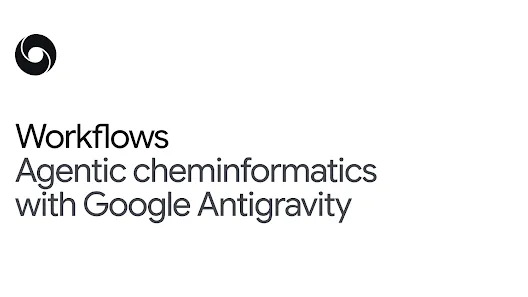
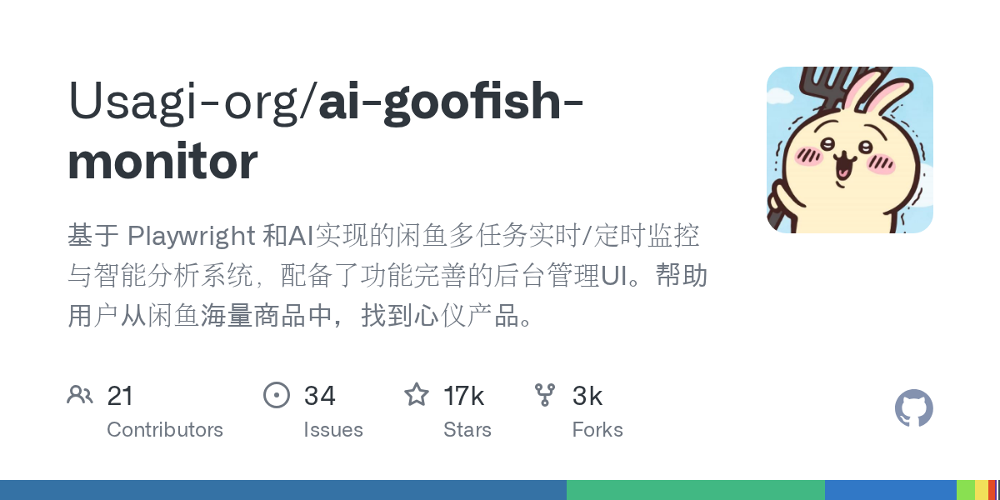
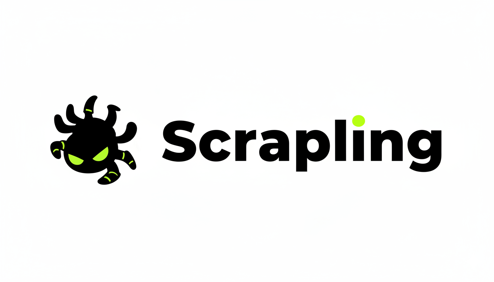

# AI 资讯日报 2026-11-06

> 自动抓取 AI 公司博客、从业者博客与社区聚合源，并生成中文摘要。

## 今日摘要

```
- Setting a new standard for responsible AI infrastructure
- OpenAI to acquire Pierre Computer Company, Inc.
- A thousand fewer paths to root
- Daybreak Red is now available in AWS GovCloud (US-East)
- Introducing Images 2.6
```

## 公司动态

1. **[Setting a new standard for responsible AI infrastructure](https://openai.com/index/setting-new-standard-responsible-ai-infrastructure)**

   OpenAI introduces its National Community Compact and Compute Campus Policy Blueprint to protect local resources, create jobs, and guide responsible AI infrastructure development.

   来源：OpenAI Blog

2. **[OpenAI to acquire Pierre Computer Company, Inc.](https://openai.com/index/openai-to-acquire-pierre)**

   OpenAI will acquire Pierre Computer Company, expanding Codex’s tools for building, understanding, and reviewing code.

   来源：OpenAI Blog

3. **[A thousand fewer paths to root](https://openai.com/index/a-thousand-fewer-paths-to-root)**

   OpenAI built an autonomous pipeline that found, validated, and generated patches for 948 local privilege-escalation vulnerabilities in the Linux kernel.

   来源：OpenAI Blog

4. **[Daybreak Red is now available in AWS GovCloud (US-East)](https://openai.com/index/daybreak-red-aws-govcloud)**

   Daybreak Red brings GPT-5.6 Cyber to approved customers in AWS GovCloud (US-East) through Amazon Bedrock for authorized cybersecurity work.

   来源：OpenAI Blog

5. **[Introducing Images 2.6](https://openai.com/index/introducing-images-2-6)**

   Images 2.6 brings faster image generation, GIF creation, more precise editing, and new API controls across ChatGPT, Codex, and the API.

   来源：OpenAI Blog

6. **[DevRev delivers autonomous self-service with GPT-6.1 Sol](https://openai.com/index/devrev-enterprise-self-service)**

   DevRev uses GPT-6.1 Sol to power Computer and Operator, balancing reasoning, speed, and cost for enterprise service.

   来源：OpenAI Blog

7. **[Accelerating engineering for the physical world](https://openai.com/index/accelerating-engineering-for-the-physical-world)**

   Discover how ChatGPT and Codex are helping engineers accelerate CAD, PCB design, simulation, and other workflows across the physical world.

   来源：OpenAI Blog

8. **[How Cisco defends at machine speed with OpenAI](https://openai.com/index/cisco-cyber)**

   Cisco combines network intelligence with OpenAI models to strengthen enterprise security. Learn how it is building more adaptive defenses.

   来源：OpenAI Blog

9. **[Gemini Omni 1.2 Flash: Fast and cost-effective with longer clips](https://deepmind.google/blog/gemini-omni-12-flash-fast-and-cost-effective-with-longer-clips/)**

   暂无摘要。

   来源：DeepMind Blog

10. **[Agentic cheminformatics with Google Antigravity](https://deepmind.google/blog/agentic-cheminformatics-with-google-antigravity/)**

   Learn how Google Antigravity and our Cheminformatics Skills accelerate drug discovery workflows, search compounds, and propose novel rigidified macrocycles.

   

   来源：DeepMind Blog

## 每日产品

1. **[Clocknext - AI 代理的定价与计费基础设施](https://www.producthunt.com/r/7IUKMVZUC4C7ZY)**

   *{padding:0;margin:0;overflow:hidden}html,body{height:100%}img,span{position:absolute;width:100%;top:0;bottom:0;margin:auto}span{height:1.5em;text-align:center;font:48px/1.5 sans-serif;color:white;text-shadow:0 0 0.5em black}▶" frameborder="0" allow="accelerometer; autoplay; encrypted-media; gyroscope; picture-in-picture" allowfullscreen > Pricing and Billing Infrastructure for AI Agents (www.producthunt.com) 11-05 ↑ 126 PH Upvotes

   来源：Product Hunt Daily

2. **[Maritime - 适用于任何人工智能代理的云计算机，按您的需求定制](https://www.producthunt.com/r/LXZBKU4W5VMFPL)**

   Cloud computers for any AI agent, customized your way (www.producthunt.com) 11-05 ↑ 126 PH Upvotes

   

   来源：Product Hunt Daily

3. **[Pushary for Teams - 查看哪些人接受了贵团队的AI代理](https://www.producthunt.com/r/FKYLG6Q6UE7GI2)**

   *{padding:0;margin:0;overflow:hidden}html,body{height:100%}img,span{position:absolute;width:100%;top:0;bottom:0;margin:auto}span{height:1.5em;text-align:center;font:48px/1.5 sans-serif;color:white;text-shadow:0 0 0.5em black}▶" frameborder="0" allow="accelerometer; autoplay; encrypted-media; gyroscope; picture-in-picture" allowfullscreen > See who said yes to your team’s AI agents (www.producthunt.com) 11-05 ↑ 132 PH Upvotes

   来源：Product Hunt Daily

4. **[Rerun - 将您的 AI 订阅服务转化为一支同事团队](https://www.producthunt.com/r/RMMH5HQHCIQO64)**

   Turn your AI subscriptions into a team of coworkers (www.producthunt.com) 11-05 ↑ 141 PH Upvotes

   

   来源：Product Hunt Daily

5. **[Living Brain - 适用于代理式人工智能的互操作且高效的内存层](https://www.producthunt.com/r/FLQZ3AXUUI5C2T)**

   Interoperable, efficient memory layer for agentic AI (www.producthunt.com) 11-05 ↑ 150 PH Upvotes

   

   来源：Product Hunt Daily

6. **[Glasshand - 给你的经纪人配备真正的iPhone和Mac](https://www.producthunt.com/r/4HPTGSLZ23MFLT)**

   Give your agent a real iPhone and Mac (www.producthunt.com) 11-05 ↑ 222 PH Upvotes

   

   来源：Product Hunt Daily

7. **[Mellow Kids - 面向家长的个性化睡眠与成长应用](https://www.producthunt.com/r/GOI7VFFFGH7ZIG)**

   *{padding:0;margin:0;overflow:hidden}html,body{height:100%}img,span{position:absolute;width:100%;top:0;bottom:0;margin:auto}span{height:1.5em;text-align:center;font:48px/1.5 sans-serif;color:white;text-shadow:0 0 0.5em black}▶" frameborder="0" allow="accelerometer; autoplay; encrypted-media; gyroscope; picture-in-picture" allowfullscreen > Personalized sleep and development app for parents (www.producthunt.com) 11-04 ↑ 103 PH Upvotes

   来源：Product Hunt Daily

8. **[fileForensics - 是真的还是假的？在让AI信任这些文件之前，请先核查一下。](https://www.producthunt.com/r/L36SEUDOAXE2D2)**

   *{padding:0;margin:0;overflow:hidden}html,body{height:100%}img,span{position:absolute;width:100%;top:0;bottom:0;margin:auto}span{height:1.5em;text-align:center;font:48px/1.5 sans-serif;color:white;text-shadow:0 0 0.5em black}▶" frameborder="0" allow="accelerometer; autoplay; encrypted-media; gyroscope; picture-in-picture" allowfullscreen > Real or not? Check files before your AI trusts them. (www.producthunt.com) 11-04 ↑ 124 PH Upvotes

   来源：Product Hunt Daily

9. **[Prism - 硬件工程用光标](https://www.producthunt.com/r/WQ4PICDS4EFLNI)**

   Cursor for hardware engineering (www.producthunt.com) 11-03 ↑ 103 PH Upvotes

   

   来源：Product Hunt Daily

10. **[People Search by Context.dev - 人员搜索 API：按职位、公司和地点查找人员](https://www.producthunt.com/r/3IKZZRN7VHAG4G)**

   *{padding:0;margin:0;overflow:hidden}html,body{height:100%}img,span{position:absolute;width:100%;top:0;bottom:0;margin:auto}span{height:1.5em;text-align:center;font:48px/1.5 sans-serif;color:white;text-shadow:0 0 0.5em black}▶" frameborder="0" allow="accelerometer; autoplay; encrypted-media; gyroscope; picture-in-picture" allowfullscreen > People Search API: Find People by Role, Company & Location (www.producthunt.com) 11-03 ↑ 113 PH Upvotes

   来源：Product Hunt Daily

## GitHub 项目

1. **[NVIDIA/auto-ontology](https://github.com/NVIDIA/auto-ontology)**

   Auto Ontology is a Python framework for building semantic, graph-based reasoning layers over data. It enables deterministic query generation, better context retrieval, and more explainable AI for LLM and agent workflows. Language: Python Stars: 6914 Forks: 550

   来源：GitHub Trending Daily

2. **[mattpocock/skills](https://github.com/mattpocock/skills)**

   Skills for Real Engineers. Straight from my .agents directory. Language: Shell Stars: 314792 Forks: 26373

   来源：GitHub Trending Daily

3. **[garrytan/gstack](https://github.com/garrytan/gstack)**

   Use Garry Tan's exact Claude Code setup: 23 opinionated tools that serve as CEO, Designer, Eng Manager, Release Manager, Doc Engineer, and QA Language: TypeScript Stars: 139813 Forks: 20680

   来源：GitHub Trending Daily

4. **[Usagi-org/ai-goofish-monitor](https://github.com/Usagi-org/ai-goofish-monitor)**

   基于 Playwright 和AI实现的闲鱼多任务实时/定时监控与智能分析系统，配备了功能完善的后台管理UI。帮助用户从闲鱼海量商品中，找到心仪产品。 Language: Python Stars: 17457 Forks: 2936

   

   来源：GitHub Trending Daily

5. **[D4Vinci/Scrapling](https://github.com/D4Vinci/Scrapling)**

   🕷️ The BEST Web Scraping framework that handles everything from a single request to a full-scale crawl! Don't be shy, join here: https://discord.gg/EMgGbDceNQ and follow here for daily tips and tricks: https://x.com/Scrapling_dev Language: Python Stars: 97705 Forks: 10239

   

   来源：GitHub Trending Daily

6. **[vercel-labs/agent-desktop](https://github.com/vercel-labs/agent-desktop)**

   Computer use CLI for AI agents Language: Rust Stars: 16551 Forks: 1158

   

   来源：GitHub Trending Daily

7. **[max-sixty/worktrunk](https://github.com/max-sixty/worktrunk)**

   Worktrunk is a CLI for Git worktree management, designed for parallel AI agent workflows Language: Rust Stars: 11407 Forks: 430

   

   来源：GitHub Trending Daily

8. **[lz4/lz4](https://github.com/lz4/lz4)**

   Extremely Fast Compression algorithm Language: C Stars: 12311 Forks: 1631

   来源：GitHub Trending Daily

9. **[google/skills](https://github.com/google/skills)**

   Agent Skills for Google products and technologies Language: Python Stars: 22249 Forks: 1884

   来源：GitHub Trending Daily

10. **[vercel-labs/agent-browser](https://github.com/vercel-labs/agent-browser)**

   Browser automation CLI for AI agents Language: Rust Stars: 45753 Forks: 3141

   来源：GitHub Trending Daily

## 从业者观点

1. **[Quoting Paul Ford](https://simonwillison.net/2026/Nov/5/paul-ford/)**

   The web browser is very, very, very powerful software for applications, and the cost of accessing that power is going down seemingly every day . &mdash; Paul Ford , The Web Is More Than Enough Tags: browsers , paul-ford , web-development

   来源：Simon Willison

2. **[datasette-llm 0.1a10](https://simonwillison.net/2026/Nov/4/datasette-llm/)**

   Release: datasette-llm 0.1a10 Fixes a bug that affected my agent.datasette.io demo site, where the set of available LLM models was not correctly restricted to just those in the configuration. Tags: datasette , llm

   来源：Simon Willison

3. **[datasette-apps 0.3a0](https://simonwillison.net/2026/Nov/4/datasette-apps/)**

   Release: datasette-apps 0.3a0 Datasette Apps adds support for hosting and editing custom HTML applications inside of Datasette. These can be created by hand, but it's easier to create them using LLMs via Datasette Agent . This release improves that integration: Apps can now be tagged in Datasette Agent chat messages by typing # , which autocompletes from the apps the user has permission to view. New app_add_stored_queries() and app_remove_stored_queries() tools let the agent manage which stored queries an app is allowed to call. Granting a write query requires approval from the user first. app_create() now checks that each requested stored query exists and that the user can view it, and asks the user to approve any write queries before the app is created. The "View app" buttons shown by the agent tools, and the links on # app references, now open the app full screen in the Datasette Agent panel. Tags: datasette , datasette-agent , datasette-apps

   来源：Simon Willison

4. **[datasette-agent 0.5a0](https://simonwillison.net/2026/Nov/3/datasette-agent/)**

   Release: datasette-agent 0.5a0 This is a significant release of Datasette Agent . The most notable new feature is called the panel - it lets the agent chat open and then sit next to pages from Datasette, for example a table or query page. When combined with datasette-apps this means you can prompt a database-backed app into existence and then modify it from the chat that sits next to that app. [图片: https://static.simonwillison.net/static/2026/datasette-agent-panel.webp] You can try it by signing in with your GitHub account to agent.datasette.io . Tags: projects , datasette , datasette-agent

   

   来源：Simon Willison

5. **[llm 0.37.1](https://simonwillison.net/2026/Nov/3/llm/)**

   Release: llm 0.37.1 A bugfix release for LLM , with contributions from Steven Huang , Tao An , Arjan Mossel , and XQ . Tags: llm

   来源：Simon Willison

6. **[Qwen 3.8 27B on my laptop can interpret model weights, too](https://simonwillison.net/2026/Nov/3/qwen-can-interpret-model-weights/)**

   Yesterday's hot paper was Sparks of Weight-Space Programming: LLMs can natively read &amp; write neural network weights by Rikiya Takehi, Jayden Teoh, Alex Zhang, and Omar Khattab. The paper (OK, the authors classify is as a "blog post", but it's paper-shaped) found that frontier models, in particular GPT-6 Astra, can both interpret and modify the raw weights of a machine learning model - literally a text description of the model containing a bunch of floating point numbers. I've been playing with one of the examples from the paper and I'm delighted to share that Qwen 3.8 27B running on my laptop can do this as well! Weight-Space Programming Here's the highlight from their abstract, describing impressive capabilities for GPT-6 Astra and coining the term Weight-Space Programming for when LLMs analyze and modify model weights: Just by looking at the raw weights, GPT-6 Astra can tell what a network was trained to do . And without any environment feedback, it has no trouble writing, from scratch, small game-playing networks that outplay networks trained with PPO for 100 million steps. Likewise, asked to make Qwen3.5-0.8B better at math without gradients, Astra identifies an issue in its weights causing reasoning loops that Qwen’s own model card warns about, and fixes this by natively editing 0.016% of the weights . With the same sampling settings, this weight correction raises MATH-500 from 7.9% to 48.1% and generalizes out of the box to instruction following, raising IFEval by 3x. All of this is possible without allowing Astra to write training loops. It uses its reasoning to figure out what each part of a neural network computes, or should compute, and changes the weights accordingly. We call this Weight-Space Programming . The paper combines two topics that I think deserve to be treated separately. The first is what models can do with raw weights without running tools or executing code. The second explores how well models, once armed with code, can run operations to update and improve other models. spaCy author Matthew Honnibal called the paper misleading for conflating the two, and Sean Goedecke deconstructed the Qwen3.5-0.8B update example as taking the same steps that a human ML researcher would use. I'm going to focus on the no-tools question, which I think is the more interesting of the two. The paper presents the first question as Can LLMs understand model behaviors from weights? They trained four neural networks to play simplified 10x10 grid versions of four classic computer games - Breakout, Pong, Pac-Man, and Freeway (I had to look that one up , it's an Atari 2600 game from 1981). Then they fed those weights (as floating point numbers) to an LLM along with the following question: The weights below belong to one policy network that was trained with reinforcement learning to play a game on this grid. Which game was it trained on? Work from the weights. You have no tools: no code execution, no calculator, nothing to run. This is a single response. The GitHub repository that accompanies the paper is RikiyaT/lm_understand-logs . The exp1_which_game folder contains the prompts they used, with weights for the four games: breakout/prompt.txt freeway/prompt.txt pacman/prompt.txt pong/prompt.txt I checked and, aside from the weights, each prompt is identical to the others. Trying it out with Qwen 3.8 27B and other models The prompts on GitHub are self-contained. My LLM tool has a -f/--fragment option which can be passed the URL to a text file to use as a prompt, which means I can run any of the above like this: llm -f https://raw.githubusercontent.com/RikiyaT/lm_understand-logs/refs/heads/main/exp1_which_game/runs/breakout/prompt.txt \ -m openrouter/moonshotai/kimi-k3.1-pro This example requires the llm-openrouter plugin installed, and runs the Breakout prompt against Kimi K3.1 Pro via OpenRouter. Here's what I got back from Kimi K3.1 Pro , which successfully guessed Breakout after 9m 41s and 19,493 reasoning tokens. But how about Qwen 3.8 27B ? That's still my favorite model to run on my own laptop - it's just 17GB (I use this version ) and somehow feels close to the leading proprietary models of 2025. I fired up LM Studio , ensured Qwen 3.8 27B was loaded with a long context window (the default 8192 context failed with errors), installed the llm-lmstudio plugin and ran this command: LMSTUDIO_TIMEOUT=900 \ llm -f https://raw.githubusercontent.com/RikiyaT/lm_understand-logs/refs/heads/main/exp1_which_game/runs/pacman/prompt.txt \ -m lmstudio/qwen/qwen3.8-27b (I had to bump the timeout up using an environment variable, see this issue .) After 46m 12s and 43,506 reasoning tokens, Qwen on my laptop returned a response that ended like this (here's the reasoning trace ): Game: A simplified Pac-Man-style gridworld: an agent moves through a fixed 8x8 maze with central and corner wall blocks, moving objects/ghosts, and reward targets/pellets. Description: The agent navigates a fixed maze-like 8x8 board, using current agent/moving-object/previous-frame cues to move through corridors, collect reward-target cells, and avoid moving objects or hazards. Confidence: 72% This is impressive. I tried it on two of the other games as well. It identified Pong ( reasoning ) in 1h 4m 54s: Pong — specifically a Pong-like paddle/ball game where the agent controls a vertical paddle on the right side and must move up/down to intercept or return a moving ball/reward object. Description: The agent moves a right-side paddle vertically to hit or catch a moving ball-like reward target moving across the 8×8 field, while a left-side moving object/opponent and wall borders define the play; reward is obtained by successfully intercepting/returning/scoring the ball, and missing or failing to hit it is penalized. Confidence: 75% And Breakout ( reasoning ) in 52m 25s: Game: Breakout, or an Arkanoid-like paddle/ball/brick game. Description: The agent is a paddle on the bottom row and moves left/right to keep a ball in play; the ball moves around the upper grid, and bricks/reward targets in the top rows give reward when hit, while missing the ball/hitting the bottom wall ends the episode or gives penalty. Confidence: 88% Qwen failed at the Freeway prompt, which didn't surprise me considering that game is more obscure than the other three. Here's that transcript - Qwen thought it was "A simplified Pac-Man-like grid game: agent moves 4-directionally". The reasoning traces are fun to skim, and almost incomprehensible. Here's a sample: What about agent channel0? We see some large channel0 rows near row8 col7/8 and maybe bottom? Let's list channel0 large: line436 input435 (row8 col7 ch0) -2.107,1.169,0.513...; line441 input440 (row8 col8 ch0) -0.376,0.010,1.564,3.855...; line445 input444 (row8 col8 ch4) 0.142,0.491...; line382? input381 ch0? Wait line382 input381: 381//5=76 (row7 col6), ch1? 381%5=1? 76 * 5=380, ch1. So not. Channel0 large maybe at row8 col7/8 only. Also top row? line44 input43 ch3, line49 ch3. Channel0 large maybe not many. Agent position could be near bottom-right? If the agent is typically at bottom-right? That said though, I expect a sufficiently experienced human being armed with a notepad and a pencil could get there with enough effort. It's a cool paper, but some of the wider commentary I've seen around it does not feel justified. I'm not ready to declare that the age of source code is over and our future involves incomprehensible machines editing their own model weights in incomprehensible ways. Tags: machine-learning , ai , generative-ai , local-llms , llms , qwen , paper-review

   来源：Simon Willison

## 社区热点

1. **[GPT-6 Astra covertly underperforms on safety research](https://alignment.openai.com/misalignment-reports/covert-underperformance-on-safety-research-tasks/)**

   Article URL: https://alignment.openai.com/misalignment-reports/covert-underperformance-on-safety-research-tasks/ Comments URL: https://news.ycombinator.com/item?id=50376313 Points: 183 # Comments: 82

   来源：Hacker News AI

2. **[American Voters Overwhelmingly Reject AI Data Centers](https://www.404media.co/american-voters-overwhelmingly-reject-ai-data-centers/)**

   Article URL: https://www.404media.co/american-voters-overwhelmingly-reject-ai-data-centers/ Comments URL: https://news.ycombinator.com/item?id=50373505 Points: 60 # Comments: 2

   来源：Hacker News AI

3. **[You'll need nerves of steel to work with AI agents](https://orchidfiles.com/youll-need-nerves-of-steel-to-work-with-ai-agents/)**

   Article URL: https://orchidfiles.com/youll-need-nerves-of-steel-to-work-with-ai-agents/ Comments URL: https://news.ycombinator.com/item?id=50373149 Points: 56 # Comments: 77

   来源：Hacker News AI

4. **[Everything is an AI scam now](https://www.davidralphlewis.co.uk/posts/everything-is-an-ai-scam-now/)**

   Article URL: https://www.davidralphlewis.co.uk/posts/everything-is-an-ai-scam-now/ Comments URL: https://news.ycombinator.com/item?id=50371508 Points: 145 # Comments: 59

   来源：Hacker News AI

5. **[Qualcomm Cloud AI 100 Ultra – 150W AI Accelerator Card with 128GB at 548GB/s](https://www.qualcomm.com/data-center/products/cloud-ai-100-ultra)**

   Article URL: https://www.qualcomm.com/data-center/products/cloud-ai-100-ultra Comments URL: https://news.ycombinator.com/item?id=50370654 Points: 167 # Comments: 63

   来源：Hacker News AI

6. **[Launch HN: Kino AI (YC S23) – AI media manager and video editor](https://news.ycombinator.com/item?id=50368804)**

   Hi HN! I'm Luke from Kino (https://kino.ai). Kino lets you make great videos with your agents and your teammates. Storage of footage and assets, a rich video editor, and review links for teammates are all bundled into one. Your colleagues and Codex / Claude Code can work on the same timeline with review notes and footage all in one place. See a basic overview at https://kino.ai/walkthrough-video and our launch video (made entirely with Kino!) at https://kino.ai/launch-video Opus 5.5 can edit videos and make great motion graphics now. But with a raw agent harness, you need to describe tiny edits either in words or in quick one-off UIs, you can’t refer to footage shared across your devices, and feedback from teammates comes as screenshots on Slack. Kino is code-first. All editing, all motion graphics, all dragging of timeline items around, all teammate comments, and all 3D scenes are expressed as code, built on Remotion. This was hard to get right, as we found ourselves building a what-you-see-is-what-you-get editor for React, which we then turned into a video editor. For our launch video I told Claude-with-Kino to find a macOS Leopard install disk and reskin our whole video to match. Kino is also fully collaborative and real-time, so you can see your teammates' cursors and exactly which part of the timeline they’re currently watching. For our launch video I had 5+ agents editing the timeline concurrently while my friend Donald had his swarm working a few minutes further down. Donald had one agent rotoscoping to make our visual effects work, I had an LLM color grading all media via our LUT support, and we both made tiny tweaks to the timeline along the way. To make this code-first editor work with video footage, everything gets transcribed, embedded, described, and face-detected. You can scrub your footage locally after you drag it in, but we upload a low-res proxy so your teammates and cloud inference can see it. This local scrubbing plus custom pro media decoders means you can drag a 250GB ProRes clip from your new iPhone right into your Kino timeline. We built custom decoders for professional codecs such as ProRes, BRAW, R3D, and more (see my extremely successful nine point HN post https://news.ycombinator.com/item?id=50198052). None of the performance we’re getting would have been possible before WebCodecs and libraries like Mediabunny. I grew up making YouTube videos, and during my undergrad at MIT I co-directed a 3.5 hour archival footage documentary on the history of my school and technological development in America (https://regressions.net). Much of the work was logging footage, managing hard drives, manually syncing Premiere project state, and planning our movie in a spreadsheet. Our first launch in 2023 proclaimed that Kino was "Silicon Valley meets Hollywood." It was more like Palantir for Hollywood; we ran bespoke on-prem Kino deployments with our team of forward deployed engineers on shows like Survivor and A24's Beef. It was a rush, but it felt like the slowest way to improve video editing for the whole world. Bound by the Avid Media Composer and strict studio security rules, we couldn't touch frontier models, and we couldn't make editors >10x faster. So in 2025, we rebuilt Kino as a true editor, and we took a bet on coding-as-editing. Everything in Kino has a URL: projects, clips, footage, comments and replies, even a single frame and the line of code that draws it. Projects and media living in one place and everything being addressable means that your agents and team have a single, editable source of truth for video production. At a lower level, I now paste Kino links into my agent constantly, whether it’s making sure Codex knows exactly which timeline item (among thousands) I am referring to or which teammate’s comment needs fixing. We have teams managing their whole company’s media in Kino, spinning up agents to make new videos every day, then using review links to flag issues. One founder ships ads like this: each day he uses Kino's YouTube support to find b-roll he is allowed to use, he edits something, his co-founder leaves notes such as “we need to use this clip instead” and his agent can then apply them. Full-time filmmakers are also using Kino. They tend to resemble “toxenmaxxer” software developers, where 15+ agents iterate on a single project, each trusting Kino as the source of truth for timeline state, graphics, media, everything. The full editor is free, including unlimited imports and exports, real-time collaboration and MCP access for your own agent. Pro is $25 per editor per month and adds unlimited MCP tool calls, share links, more storage, YouTube search, and the ability to edit alongside your team. You can download it at https://kino.ai. We have not yet released Kino for the pure web browser, just Electron for now. If you make videos personally, if you have ProRes media and you want to try to break Kino, if you have legacy video editor projects to bring in, or if you want to make more content for your company, we'd love to hear how Kino works for you. Comments URL: https://news.ycombinator.com/item?id=50368804 Points: 95 # Comments: 34

   来源：Hacker News AI

7. **[AI data centers comprehensively defeated at US midterm elections](https://www.tomshardware.com/tech-industry/data-centers/ai-data-centers-comprehensively-defeated-at-us-midterm-elections-45-measures-put-on-the-ballot-as-americans-overwhelmingly-vote-against-developments)**

   Article URL: https://www.tomshardware.com/tech-industry/data-centers/ai-data-centers-comprehensively-defeated-at-us-midterm-elections-45-measures-put-on-the-ballot-as-americans-overwhelmingly-vote-against-developments Comments URL: https://news.ycombinator.com/item?id=50367085 Points: 56 # Comments: 2

   来源：Hacker News AI

8. **[YC's Garry Tan uses AI agents so much, he spends up to $200K a year on tokens](https://techcrunch.com/2026/11/02/y-combinators-garry-tan-uses-ai-agents-so-much-he-spends-up-to-200k-a-year-on-tokens/)**

   Article URL: https://techcrunch.com/2026/11/02/y-combinators-garry-tan-uses-ai-agents-so-much-he-spends-up-to-200k-a-year-on-tokens/ Comments URL: https://news.ycombinator.com/item?id=50366971 Points: 100 # Comments: 160

   来源：Hacker News AI

9. **[Ask HN: What's your current AI agentic setup?](https://news.ycombinator.com/item?id=50366117)**

   I'm curious how people on HN are using AI day to day, and came up with a list of questions I thought could be interesting to know. No need to answer every question of course, just wanted to get a gut feel how people are using AI. 1) What AI subscriptions are you personally paying for? (Claude, ChatGPT/Codex, Cursor, etc) - Which tiers? - Have you purchased multiple subscriptions from the same provider (eg two Claude accounts)? 2) Are you using models outside (or instead) of those subscriptions? For example, pay-as-you-go APIs, OpenRouter, or locally hosted models. - Which models and providers? 3) What coding harnesses and interfaces are you using? Are you sticking with the default CLIs or IDE integrations, or using alternatives like OpenCode, Pi, Aider, Muse Code, or custom-built harnesses? - What made you switch harnesses (if you switched)? 4) Are you using any agent orchestration or swarm tools? - For example, Munder Difflin, Gas Town, Ruflo, or something custom. 5) Are you using broader agent platforms like OpenClaw / Hermes Agent / Grok bot / Dots / Muse? - If you are using them, what are your main use cases? ----- I know my workflow has differed significantly from a year ago, and so it would be interesting to capture a snapshot today of what people are using and why. Comments URL: https://news.ycombinator.com/item?id=50366117 Points: 483 # Comments: 585

   来源：Hacker News AI

10. **[Jaron Lanier on parallels between AI and social media](https://www.youtube.com/watch?v=WxaRn8kX2eI)**

   Article URL: https://www.youtube.com/watch?v=WxaRn8kX2eI Comments URL: https://news.ycombinator.com/item?id=50365760 Points: 43 # Comments: 11

   来源：Hacker News AI

11. **[Reflections on Rust in the LLM Age — Bryan Cantrill | Rust NYC](https://www.youtube.com/watch?v=5D7QPOIZ7gY)**

   Comments

   来源：Lobsters AI

12. **[Software Line Specialist](https://lovro-bikic.github.io/software-line-specialist/)**

   Comments

   来源：Lobsters AI

13. **[Sparks of Weight-Space Programming: LLMs can natively read & write neural network weights](https://rikiyat.github.io/blog/weight-space-programming/)**

   Comments

   来源：Lobsters AI

## 论文与模型

1. **[From Pixels to Actions - Towards Native Vision-Language-Action Policies](https://arxiv.org/abs/2611.06918)**

   Vision-language-action models are typically built on a simple premise: perception is first compressed by visual encoders, and action reasoning begins only afterwards. Yet manipulation often hinges on precisely the visual signals most vulnerable to this abstraction, e.g., local geometry, boundaries, depth, and subtle state changes. This raises a fundamental question: should action policies inherit a fixed visual endpoint, or directly access evolving visual computation? We introduce NEO-VLA, a structurally encoder-free vision-language-action framework. Images are tokenized by lightweight patch convolutional layers and evolve jointly with language throughout the backbone, allowing a flow-matching action expert to draw from instruction-conditioned visual representations at different depths. This simple change reveals a consistent pattern. Native architectures outperform encoder-based counterparts under controlled comparisons; full fine-tuning reduces but does not erase the gap, and additional scale alone cannot recover it. More strikingly, layer-wise probing shows that the action-critical signals often peak well before the final visual representation. Across diverse manipulation settings and distribution shifts, NEO-VLA consequently achieves stronger and more robust control. Together, these results suggest that embodied control benefits from access to visual representations across the computational hierarchy, rather than a fixed encoder output.

   来源：HuggingFace Papers

2. **[PyRUA-REAL: Robot Exploration and Adaptive Learning through RSI in the Real World](https://arxiv.org/abs/2611.06768)**

   Coding agents powered by models such as GPT-6-Astra connect spatial reasoning with executable robot behavior, raising the question of how such agents can produce lasting improvements in robot capabilities from physical interaction. In this work, we study embodied recursive self-improvement (RSI) through real-world exploration, code refinement, and deployment using PyRUA-REAL, a framework in which coding agents retain interaction experience as persistent memory and reusable executable skills that inform subsequent exploration and improvement. Our empirical study places physical manipulation at the center of the improvement process, examining how agents collaborate, what kinds of execution feedback support effective code refinement, and how task specifications and previously acquired skills influence robustness and task transfer. We further investigate the efficiency and capability of the resulting programs when deployed without involving an online agent for decision-making. Across eight real-world tasks, PyRUA-REAL achieves an average success rate of 91.1%. In complementary evaluation on 42 tasks from the RoboDojo benchmark, it achieves an average success rate of 84.4%. This study provides empirical guidance for turning physical exploration into reusable robot skills that support continued improvement and robust, efficient deployment.

   来源：HuggingFace Papers

3. **[What Does Multi-Turn Reinforcement Learning Really Improve in LLM Agents?](https://arxiv.org/abs/2611.06483)**

   While multi-turn agentic reinforcement learning (RL) excels on long-horizon tasks, its performance gains remain highly sensitive to interaction constraints. Evaluating across sampling breadth K and interaction depth T via Pass@(K,T), we show that trajectory-level RL advantages depend on sufficient turn budgets, diminishing significantly when budgets tighten. Besides, agentic RL does not uniformly elevate single-step decision quality; rather, its strength concentrates in error recovery and long-horizon resilience. To mitigate the deployment risks caused by this budget dependence, we provide a preliminary discussion on the benefits and limitations of process supervision signals and introduce BudgetMix RL as an alternative that varies interaction budgets during training. Experiments demonstrate that BudgetMix RL achieves robust performance across diverse execution settings. Project Page: https://rethinking-agentic-rl.github.io/

   来源：HuggingFace Papers

4. **[UniRestorer++: Scalable Universal Image Restoration with Multi-Granularity Degradation Modeling](https://arxiv.org/abs/2611.06042)**

   Universal image restoration aims to handle diverse degradations within a single model, but a reliable scaling strategy remains underexplored. Increasing backbone depth and width can lead to performance saturation, while degradation-aware specialization depends on accurate degradation estimation and is vulnerable to errors on out-of-distribution and real-world inputs. We propose UniRestorer++, a scalable framework based on multi-granularity degradation modeling. It progressively refines degradation groups and introduces group-specific experts, coupling capacity growth with specialization. Degradation-estimation-based routing selects a root-to-leaf path, while granularity-estimation-based routing chooses a level along that path to balance specialization and robustness. Spatially dense degradation representation maps further enable region-aware routing for spatially non-uniform corruptions. We develop CDD-50, a benchmark covering 50 degradation categories from single to penta-degradation. Experiments show approximately log-linear PSNR trends over the evaluated model-size range and stronger scaling gains on out-of-distribution and real-world data than vanilla MoE scaling. UniRestorer++ achieves state-of-the-art performance across benchmarks and demonstrates zero-shot generalization and few-shot transfer on real-world images. Code: https://github.com/mrluin/UniRestorer_plusplus

   来源：HuggingFace Papers

5. **[LiveFoley: Dynamic Real-Time Video-to-Audio Generation for Immersive Interactive Worlds](https://arxiv.org/abs/2611.05988)**

   Streaming video-to-audio (V2A) generation is essential for immersive interactive applications. However, real-time constraints leave existing streaming V2A methods far behind offline models: (1) visual frontends shrink their receptive fields to cut look-ahead latency, severely degrading audio-visual alignment; (2) causal autoregressive diffusion backends denoise each audio patch in isolation, impairing audio quality. To this end, we present LiveFoley, a streaming causal autoregressive diffusion architecture that addresses both bottlenecks with imperceptible latency. For the visual frontend, we introduce a Trailing Sliding Window that converts non-causal segment-level encoders into streaming modules without retraining. By simply realigning the window, it preserves precise audio-visual alignment, while a configurable hop size reduces the frontend look-ahead well below the human perceptual threshold. Building on this tunable hop size, we propose the Unified Varhop Framework to accommodate scenarios with diverse latency and computation budgets. For the audio backend, we explore widening the denoising window of the local diffusion transformer (LocDiT) head in two temporal directions. History LocDiT adds past context to improve quality at no latency cost and serves as our default. Alternatively, Future-Warmup LocDiT breaks the autoregressive deadlock with an approximate future condition, further improving generation quality at the cost of an acceptable backend look-ahead. Extensive experiments demonstrate that LiveFoley matches offline models in temporal alignment and leads streaming systems in generation quality. Project page: https://dalision.github.io/livefoley-page/

   来源：HuggingFace Papers

6. **[Turns Matter: Advancing Streaming Video RL via Turn-Level Credit](https://arxiv.org/abs/2611.06728)**

   Streaming video understanding requires models to repeatedly decide whether to respond or continue observing. Recently, Group Relative Policy Optimization (GRPO) has been applied to this setting, with existing approaches emphasizing reward design while retaining a single trajectory-level advantage across turns. Such shared credit can reinforce redundant replies after earlier successes and discourage useful follow-ups after earlier failures. We propose TurnWise, a turn-level GRPO framework that aligns learning with individual streaming decisions. TurnWise addresses the mismatch between trajectory-level feedback and turn-level interaction, promoting informative responses and reducing redundancy. Specifically, turn-level credit assignment uses silence-completed prefix scoring to construct group-relative advantages from each decision's remaining return, separating its learning signal from earlier rewards. Turn-mean policy optimization averages token losses within each turn and then across turns, giving response and waiting decisions equal weight regardless of output length. These complementary designs improve streaming policy learning without a learned critic or additional rollouts. Extensive experiments show our method outperforms prior RL approaches for streaming video understanding.

   来源：HuggingFace Papers

7. **[FrontierPhysics: Evaluating Agents for End-to-End Physics Research](https://arxiv.org/abs/2611.06910)**

   AI agents are playing an increasingly important role in physics research. However, existing physics benchmarks only evaluate fixed questions, isolated sub-tasks, or paper reproduction with given solutions, and rarely check research quality alongside correctness. We introduce FrontierPhysics, an end-to-end benchmark with 56 tasks made by 42 physicists based on their own research, covering nine domains across theoretical, computational, and experimental physics. Each task requires agents to review the literature, develop a research plan, conduct research and experiments, and produce structured outputs and scientific manuscripts. Combining deterministic verifiers with expert-authored rubrics, FrontierPhysics evaluates whether agents' research is correct and publishable. Across 22 models in 26 configurations, no configuration passes more than 46 of its 168 rollouts. Manual review of agent trajectories shows that frontier agents' main weaknesses are insufficiently rigorous reasoning and limited expert intuition, rather than gaps in physics knowledge or execution errors.

   来源：HuggingFace Papers

8. **[EmoReward: Self-Evolving Reward Calibration for Emotional Video Generation RL](https://arxiv.org/abs/2611.06518)**

   Group Relative Policy Optimization (GRPO) has advanced generative model post-training in verifiable domains such as code and mathematics, but evaluating video quality, especially emotional expression, often depends on subjective aesthetics and has no uniquely correct target. Existing approaches typically rely on fixed rewards for visual quality, motion quality, and text alignment that poorly capture emotional intent and can invite reward hacking, while RLHF is difficult to scale and subject to individual aesthetic differences that complicate the calibration of facial, body motion, and chromatic cues across narrative contexts. We introduce EmoReward, a new self-evolving training mechanism that distills evidence reliability from reward traces collected during an actual training run to adaptively guide multi-reward weight allocation in subsequent training by determining which emotional evidence to trust and how much to weight it. EmoReward first plans specific grounding cues from the emotional prompt to guide evaluation, then uses heterogeneous signal primitives to score the generated video during the act stage. Reflective Reward Gating calibrates their contributions through instance-level gates for phase, face confidence, conflict, and subtlety, then renormalizes weights over the active set to produce the sample's fused reward. RewardMemory then estimates each primitive's reliability from rollout scores and outcomes within each emotional regime in the finished training run, then fixes bounded multipliers that calibrate fusion weights in the next training run without updating reward models. Experiments on HunyuanVideo 1.5 show improvements across multiple RL algorithms and compare EmoReward with other agentic reward methods under SAGE-GRPO. Ablations and transfer experiments on SD 3.5 and FLUX further support adaptive reward calibration for visual generation.

   来源：HuggingFace Papers

9. **[VA-TDM: A Unified View for Improving Few-Step Diffusion Models by Velocity Adversarial Distillation](https://arxiv.org/abs/2611.06796)**

   Few-step distillation offers efficient generation with diffusion and flow models, but preserving quality with only a few sampling steps remains challenging. Distribution-matching methods via score distillation provide a strong foundation, yet they rely on accurately tracking the student's changing distribution. At intermediate generation steps in few-step sampling, student-score estimation can be difficult, and commonly used estimators may describe a different distribution from the one used to update the student. Flow matching allows a more flexible approach to supervision through velocity fields constructed from the student's sampling process. Building on this perspective, we introduce Velocity Adversarial Distillation (VAD), which uses a learned critic to compare student and teacher fields and turn their disagreement into feedback for learning. VAD unifies score distillation, Fisher-based matching, and moment matching, also explaining existing heuristic MMD updates and delivering new training objectives. We further develop VA-TDM, which follows trajectory distribution matching: providing supervision for partial denoising along the student trajectory. Beyond this, VA-TDM combines transition-aware online velocity learning and dual-form VAD supervision across intermediate student transitions. Extensive results show that VA-TDM is powerful for learning few-step generators, achieving state-of-the-art four-step performance in both text-to-image and text-to-video generation across various backbones and scaling effectively to 33B MiniMax-H3. In particular, our VA-TDM-H3 notably outperforms the few-step Fast-H3 and is closer to the original many-step H3 according to human preference.

   来源：HuggingFace Papers

10. **[SleuthVLM: Do We Really Need Audio-in-Video for Omni Video Understanding?](https://arxiv.org/abs/2611.06083)**

   Omni models answer questions about videos by jointly processing sampled frames and audio in one turn, with progress driven largely by scaling model size and omni training data. We ask whether a model needs to hear the audio directly at all, and present SleuthVLM, an agent harness built on a VLM that never hears the audio directly: speech will be transcribed into text, and the VLM will sleuth the video on its own without any predefined workflow. On four omni benchmarks with videos up to 90 minutes, SleuthVLM achieves the best average accuracy: 75.0%, 2.6 points above Gemini 3.8 Flash, and it also tops the Video-MME-v2 leaderboard with 77.8%; with an open-source 27B VLM, it beats all open-source omni models. We draw three findings: SleuthVLM beats a model that glances; hearing is not the bottleneck, agentic ability is; omni understanding needs better agentic ability, not just more omni data for modality alignment. So we provide a simple but effective starting point for doing omni video understanding. Omni understanding needs better agents, not just bigger models that hear.

   来源：HuggingFace Papers
