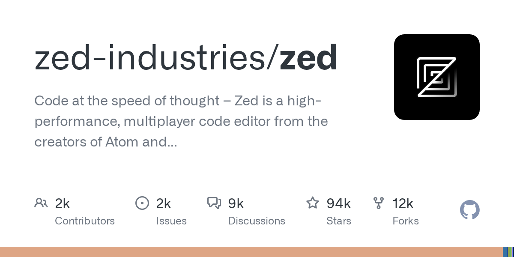
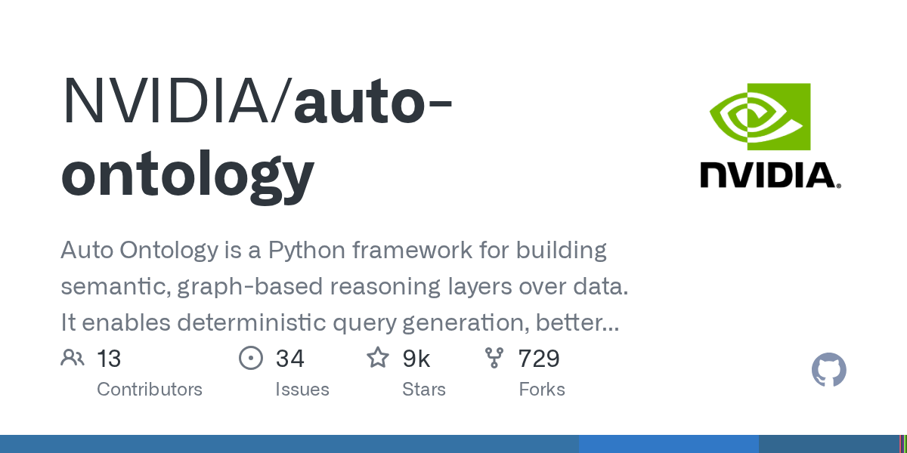
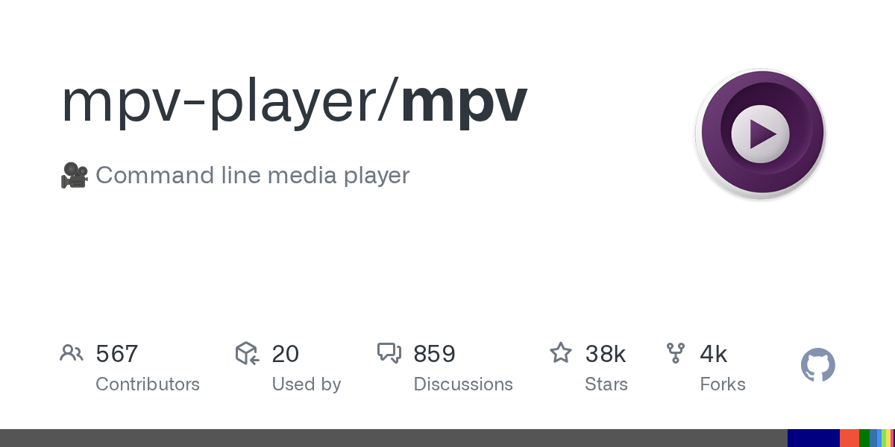
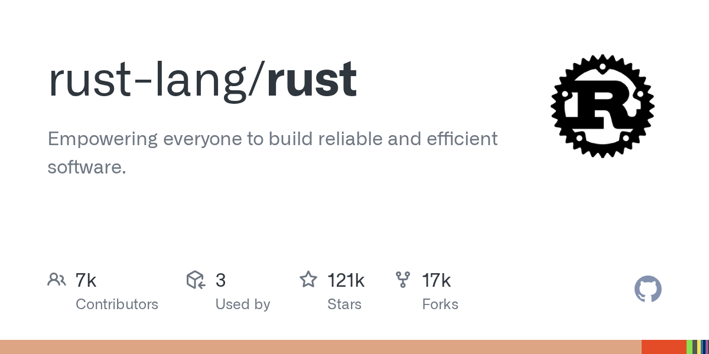
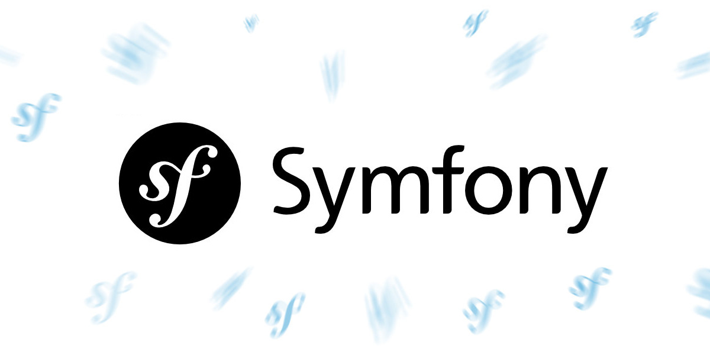
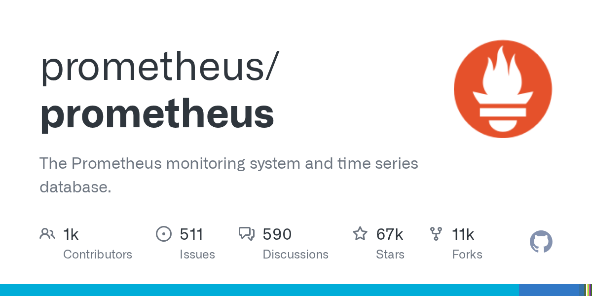

# AI 资讯日报 2026-11-07

> 自动抓取 AI 公司博客、从业者博客与社区聚合源，并生成中文摘要。

## 今日摘要

```
- Partnering with Hacktron to find vulnerabilities in OpenAI’s systems
- Measuring how AI agents handle everyday wet-lab science
- Cult.fit builds operational muscle with Codex
- Australian universities are creating AI-native graduates
- GPT‑6 Cyber: Advancing the frontier of aligned cybersecurity agents
```

## 公司动态

1. **[Partnering with Hacktron to find vulnerabilities in OpenAI’s systems](https://openai.com/index/partnering-with-hacktron)**

   OpenAI is partnering with Hacktron to find vulnerabilities, test connections with third-party services, and strengthen defenses with frontier AI.

   来源：OpenAI Blog

2. **[Measuring how AI agents handle everyday wet-lab science](https://openai.com/index/measuring-how-ai-agents-handle-wet-lab-science)**

   OpenAI introduces BioBasicsBench, a 100-task benchmark measuring how well AI agents interpret raw experimental data and handle everyday wet-lab science.

   来源：OpenAI Blog

3. **[Cult.fit builds operational muscle with Codex](https://openai.com/index/cultfit-builds-with-codex)**

   Cult.fit is using Codex to help teams across functions build tools, move faster, and change how work gets done.

   来源：OpenAI Blog

4. **[Australian universities are creating AI-native graduates](https://openai.com/index/australian-universities-ai-native-graduates)**

   Australian universities are expanding access to ChatGPT and bringing AI into teaching and learning to prepare students for an AI-enabled workforce.

   来源：OpenAI Blog

5. **[GPT‑6 Cyber: Advancing the frontier of aligned cybersecurity agents](https://openai.com/index/introducing-gpt-6-cyber)**

   Introducing GPT‑6 Cyber, OpenAI’s cybersecurity model for finding exploitable vulnerabilities and developing fixes, trained to stay within authorized scope.

   来源：OpenAI Blog

6. **[Merge builds product and business tools with OpenAI technology](https://openai.com/index/merge-builds-with-openai)**

   Merge uses GPT-6 Astra, ChatGPT, and Codex to review product code and support marketing. Its teams also use AI to plan executive dinners and prepare sales updates.

   来源：OpenAI Blog

7. **[Setting a new standard for responsible AI infrastructure](https://openai.com/index/setting-new-standard-responsible-ai-infrastructure)**

   OpenAI introduces its National Community Compact and Compute Campus Policy Blueprint to protect local resources, create jobs, and guide responsible AI infrastructure development.

   来源：OpenAI Blog

8. **[Flipsnack grows product signups with conversion optimization](https://openai.com/ads/customers/flipsnack)**

   Flipsnack focused its ChatGPT Ads campaigns on getting people to try its product, growing registrations while lowering the cost per signup.

   来源：OpenAI Blog

9. **[Gemini Omni 1.2 Flash: Fast and cost-effective with longer clips](https://deepmind.google/blog/gemini-omni-12-flash-fast-and-cost-effective-with-longer-clips/)**

   暂无摘要。

   来源：DeepMind Blog

## 每日产品

1. **[Rankfender v3.0 - 专为人类和人工智能代理打造的SEO/GEO操作系统](https://www.producthunt.com/r/XXAKEEHHHA4XOR)**

   *{padding:0;margin:0;overflow:hidden}html,body{height:100%}img,span{position:absolute;width:100%;top:0;bottom:0;margin:auto}span{height:1.5em;text-align:center;font:48px/1.5 sans-serif;color:white;text-shadow:0 0 0.5em black}▶" frameborder="0" allow="accelerometer; autoplay; encrypted-media; gyroscope; picture-in-picture" allowfullscreen > The SEO/GEO operating system, built for people and AI agents (www.producthunt.com) 11-06 ↑ 133 PH Upvotes

   来源：Product Hunt Daily

2. **[Wonder Dev View - 并行运行多个Claude Code和Codex代理](https://www.producthunt.com/r/RJGZPEQMUG2EJU)**

   Run many Claude Code and Codex agents in parallel (www.producthunt.com) 11-06 ↑ 105 PH Upvotes

   

   来源：Product Hunt Daily

3. **[Turnstone - 一款可在您的AI上运行的Grok Bot替代方案，完全免费](https://www.producthunt.com/r/ELRJVLJUXTAYTL)**

   Grok Bot alternative that runs on your AI, completely free (www.producthunt.com) 11-06 ↑ 105 PH Upvotes

   

   来源：Product Hunt Daily

4. **[Tobira Site Agent - 将您的网站转变为面向其他AI代理的AI销售代理](https://www.producthunt.com/r/LMNUHW4VUH6RGV)**

   Turn your website into an AI agent that sells to AI agents (www.producthunt.com) 11-06 PH Link

   

   来源：Product Hunt Daily

5. **[Stitch.ai - 专为邮件、日历、笔记、任务等设计的 AI 工作区](https://www.producthunt.com/r/RH3SUY5Z3KCC6L)**

   *{padding:0;margin:0;overflow:hidden}html,body{height:100%}img,span{position:absolute;width:100%;top:0;bottom:0;margin:auto}span{height:1.5em;text-align:center;font:48px/1.5 sans-serif;color:white;text-shadow:0 0 0.5em black}▶" frameborder="0" allow="accelerometer; autoplay; encrypted-media; gyroscope; picture-in-picture" allowfullscreen > Your AI workspace for mail, calendar, notes, tasks and more (www.producthunt.com) 11-05 ↑ 99 PH Upvotes

   来源：Product Hunt Daily

6. **[Rainbrand - 代理的品牌层](https://www.producthunt.com/r/FVQGXUQXBCJO2O)**

   The brand layer for agents (www.producthunt.com) 11-05 ↑ 108 PH Upvotes

   

   来源：Product Hunt Daily

7. **[Tao Browser - 私密浏览器，每家公司都有独立的登录账号](https://www.producthunt.com/r/67S6CGG52F2357)**

   Private browser with a separate login for every company (www.producthunt.com) 11-05 ↑ 110 PH Upvotes

   

   来源：Product Hunt Daily

8. **[Dessn - 运行您实际代码的设计画布。](https://www.producthunt.com/r/7JYRTXILDPLL4U)**

   The design canvas that runs your real code. (www.producthunt.com) 11-04 ↑ 98 PH Upvotes

   

   来源：Product Hunt Daily

9. **[KREV AI - 一个负责运营您电商品牌的人工智能团队](https://www.producthunt.com/r/CMCGNRX7T36FKR)**

   An AI team that runs your ecommerce brand (www.producthunt.com) 11-04 ↑ 102 PH Upvotes

   

   来源：Product Hunt Daily

10. **[Bridge - 面向主动时代的视频会议](https://www.producthunt.com/r/PBNZKRHUASBSC5)**

   *{padding:0;margin:0;overflow:hidden}html,body{height:100%}img,span{position:absolute;width:100%;top:0;bottom:0;margin:auto}span{height:1.5em;text-align:center;font:48px/1.5 sans-serif;color:white;text-shadow:0 0 0.5em black}▶" frameborder="0" allow="accelerometer; autoplay; encrypted-media; gyroscope; picture-in-picture" allowfullscreen > Video conferencing for the agentic era (www.producthunt.com) 11-05 ↑ 130 PH Upvotes

   来源：Product Hunt Daily

## GitHub 项目

1. **[zed-industries/zed](https://github.com/zed-industries/zed)**

   Code at the speed of thought – Zed is a high-performance, multiplayer code editor from the creators of Atom and Tree-sitter. Language: Rust Stars: 93680 Forks: 11504

   

   来源：GitHub Trending Daily

2. **[NVIDIA/auto-ontology](https://github.com/NVIDIA/auto-ontology)**

   Auto Ontology is a Python framework for building semantic, graph-based reasoning layers over data. It enables deterministic query generation, better context retrieval, and more explainable AI for LLM and agent workflows. Language: Python Stars: 9126 Forks: 729

   

   来源：GitHub Trending Daily

3. **[rails/rails](https://github.com/rails/rails)**

   Ruby on Rails Language: Ruby Stars: 59035 Forks: 23832

   来源：GitHub Trending Daily

4. **[mpv-player/mpv](https://github.com/mpv-player/mpv)**

   🎥 Command line media player Language: C Stars: 37888 Forks: 3633

   

   来源：GitHub Trending Daily

5. **[rust-lang/rust](https://github.com/rust-lang/rust)**

   Empowering everyone to build reliable and efficient software. Language: Rust Stars: 121470 Forks: 17367

   

   来源：GitHub Trending Daily

6. **[react/react](https://github.com/react/react)**

   The library for web and native user interfaces. Language: JavaScript Stars: 252270 Forks: 51812

   来源：GitHub Trending Daily

7. **[angular/angular](https://github.com/angular/angular)**

   Deliver web apps with confidence 🚀 Language: TypeScript Stars: 101378 Forks: 28912

   

   来源：GitHub Trending Daily

8. **[symfony/symfony](https://github.com/symfony/symfony)**

   The Symfony PHP framework Language: PHP Stars: 31442 Forks: 9948

   

   来源：GitHub Trending Daily

9. **[prometheus/prometheus](https://github.com/prometheus/prometheus)**

   The Prometheus monitoring system and time series database. Language: Go Stars: 67201 Forks: 10989

   

   来源：GitHub Trending Daily

10. **[google/skills](https://github.com/google/skills)**

   Agent Skills for Google products and technologies Language: Python Stars: 22863 Forks: 1922

   来源：GitHub Trending Daily

## 从业者观点

1. **[Quoting Nilay Patel](https://simonwillison.net/2026/Nov/6/nilay-patel/)**

   The products aren't good enough to sell people on the costs. You cannot tell people that you have to listen to the whine of a data center in their backyard for AI overviews and some of the most hilarious deep fake slop in history. It's not worth it. It just isn't worth it to anyone. And agents aren't real and they might not be being used the way that anyone wants them to yet. All these companies are spending more than they're making on these products. Refrigerators holding blood storage in Europe are being hacked. The costs are too high. The benefits are not real. And if you connect that to corruption, you're like, in order to impose these costs on me, these CEOs are in the White House shaking Trump's hand, renaming it to the Gulf of America, paying for this ballroom that we don't want. It's obvious crypto-corruption, and it's still slop. The AI industry will not get out of it until they make better products . Until everyone can see without needing to be convinced, without needing an ad campaign, without any of this stuff that just using these products makes your life better. &mdash; Nilay Patel , The Vergecast: Big Tech lost big in the 2026 election Tags: nilay-patel , slop , ai , generative-ai , ai-ethics

   来源：Simon Willison

2. **[Quoting Paul Ford](https://simonwillison.net/2026/Nov/5/paul-ford/)**

   The web browser is very, very, very powerful software for applications, and the cost of accessing that power is going down seemingly every day . &mdash; Paul Ford , The Web Is More Than Enough Tags: browsers , paul-ford , web-development

   来源：Simon Willison

3. **[datasette-llm 0.1a10](https://simonwillison.net/2026/Nov/4/datasette-llm/)**

   Release: datasette-llm 0.1a10 Fixes a bug that affected my agent.datasette.io demo site, where the set of available LLM models was not correctly restricted to just those in the configuration. Tags: datasette , llm

   来源：Simon Willison

4. **[The benchmark where AIs have to lie to win](https://www.dwarkesh.com/p/clocktower)**

   AIs are now good enough to run a conspiracy

   

   来源：Dwarkesh Patel

## 社区热点

1. **[Reflections on Rust in the LLM Age](https://www.youtube.com/watch?v=5D7QPOIZ7gY)**

   Comments

   来源：Lobsters AI

## 论文与模型

1. **[Muir: Linear Attention with Sensitivity-Allocated Gating and Matched-Filter Readout](https://arxiv.org/abs/2611.08376)**

   Linear attention compresses context into a fixed-size key-value state for linear-time training and constant-memory inference. Gated delta-rule models decay this state and erase its prediction for an incoming key before writing a new value; Gated DeltaNet-2 (GDN-2) generalizes this with channel-wise decay and decoupled, full-rank erase and write gates. However, we show that state updates are far less sensitive to erasure than to writes: key activation and unit normalization concentrate key energy onto a sparse subset of channels, whereas value writes scale all channels, so the erase gate can be parameterized at lower rank. Furthermore, slow-decaying state rows accumulate much larger norms than fast rows, dominating unweighted readout and forcing stronger write-time erasure to suppress interference. Guided by this analysis, we introduce Muir, which fuses all gates into a sensitivity-allocated low-rank projection, re-weights state rows with a matched-filter readout gate, and reinvests the saved parameters in a wider feed-forward network. Because standard chunkwise algorithms become numerically unstable at the large chunk sizes needed to saturate wide matrix units, we design a parallel update for stable, efficient training. Across 166M-1.34B parameters, Muir lowers perplexity by 1.8-2.0% over GDN-2 and 2.5-3.6% over Transformer, raises commonsense accuracy by up to 1.9 points, and improves extractive recall over GDN-2. At 1.34B, Muir outperforms both baselines on multi-hop and multi-needle recall, extrapolates 2,560x from its 4K training length to 10M-token streams without perplexity drift, and maintains near-100% passkey retrieval to 1M tokens with static readout. Muir achieves these gains while matching GDN-2 throughput, reaching its 100B-token validation loss 1.2x faster, and training 2.7x faster than Transformer at 32K.

   来源：HuggingFace Papers

2. **[Terminal-style Mathematical Modeling Bench: The First Agentic and Verifiable Benchmark for Mathematical Modeling](https://arxiv.org/abs/2611.08237)**

   Mathematical modeling turns an open-ended real-world problem into assumptions, a model, a solution, and a defended recommendation, and its answers matter only if they are both close to a credible reference and physically feasible; existing benchmarks either score solver fragments or grade reports with an LLM judge, leaving those numbers unchecked. We introduce TB-MathModel (the Terminal-style Mathematical Modeling Bench), the first benchmark to make complete contest-style modeling problems agentic, verifiable, and terminal at once, over 18 real CUMCM and MCM problems (2023--2025). Each task ships the verbatim statement, official attachments, and figures in a containerized terminal; the agent returns one JSON artifact, scored on the numeric core of the final question against a reproduction of the Outstanding-award paper. Two design choices distinguish it: direction-aware, one-sided scoring, which never penalises beating the anchor, and two-layer feasibility verification---a programmatic gate over six decidable invariant forms plus 624 Lean~4 obligations---with a hard gate that zeroes infeasible answers. Each task is scored against a panel of human outstanding papers rather than one, so a model must be close to many accepted answers; across seven multimodal entries (three seeds each) the strongest reach a multi-reference O-Eval of 64.58\%, while the \2.54 open model holds 59.81% at 1/100$ the cost. TB-MathModel turns the numeric core of modeling into a reproducible, machine-checkable signal for measuring long-horizon modeling competence and for collecting agent trajectories. The source code is available at https://github.com/wxj630/terminal-bench-math-modeling.

   来源：HuggingFace Papers

3. **[SAE Interprets MoE: Sparse AutoEncoders Reveal That MoE Experts Exhibit Human-Interpretable Fine-Grained Specialization](https://arxiv.org/abs/2611.08089)**

   Mixture-of-Experts (MoE) models route each token to a few of many experts, yet what an individual expert is responsible for remains unsettled. Existing analyses count how often an expert is selected on domain-labeled corpora, an instrument that fixes the taxonomy in advance, stays coarse, and records selection rather than contribution. We instead study specialization in feature space by training a sparse autoencoder (SAE) on the output of an MoE layer. Since this output is a router-weighted sum of expert outputs and the SAE encoder is affine, the pre-activation of every latent decomposes exactly over the experts. Aggregated over a corpus, this gives each expert a dominant set of latents whose activation it principally drives. On layers 4, 30 and 46 of Qwen3-30B-A3B, contribution is far more concentrated than gating, most latents have only one or two dominators, and the overlap between dominant sets concentrates on a few expert pairs. Auto-interpreting these sets reveals a division of labor below coarse domains, with distinct experts for Java and front-end web code, or for geometry and for arithmetic and polynomials, while the coarse domains themselves take very unequal numbers of experts. Our SAEs and code are available at https://github.com/Bytedance-Seed/SAE-Interprets-MoE.

   来源：HuggingFace Papers

4. **[Towards Real-Time Full-Waveform LiDAR Transformers via Intensity-Guided Token Reduction and Physics-Aware Augmentation](https://arxiv.org/abs/2611.07613)**

   LiDAR is a critical sensor for autonomous driving and robotics, yet it remains vulnerable to adverse conditions such as fog, rain, transparent objects, and low-reflectance surfaces. Full-waveform LiDAR (FWL) addresses these limitations by capturing the complete return waveform as a histogram, preserving rich reflection characteristics including multi-path echoes and weak signals. While recent Transformer-based approaches have demonstrated promise on FWL data, two fundamental bottlenecks remain: high computational cost from redundant tokens in low-intensity background regions, and limited generalization due to scarce annotated training data. We address both bottlenecks by exploiting the physical structure inherent to FWL data. First, we propose FWL-ToPM, a token pruning and merging mechanism that leverages intensity distributions to selectively reduce tokens while retaining critical waveform content. Second, we introduce FWLAug, a data augmentation framework designed as a regularization method that preserves waveform structure, retaining the Time-of-Flight waveform of each ray and the frustum geometry, to improve generalization to unseen scenes. Evaluated on the Ghost-FWL benchmark, FWL-ToPM achieves over 8 times speedup at real-time throughput alongside a nearly 9-point F1 gain over the prior state of the art, establishing the first real-time FWL Transformer that simultaneously improves accuracy. FWLAug further improves performance on both the standard benchmark and an out-of-distribution test set of unseen scenes. Together, these methods push FWL-based perception toward practical deployment. The code and the OOD dataset are publicly available and can be accessed via the project page: https://keio-csg.github.io/FWL-ToPM

   来源：HuggingFace Papers

5. **[Reducing Representational Interference in Retrieval Embeddings with Trainable Prefix Tokens](https://arxiv.org/abs/2611.07298)**

   Embedding models compress variable-length text into fixed-size vector representations, but this compression can entangle semantic content with residual token-level information, such as artifacts arising from attention sink behavior. We propose a simple method that prepends trainable [DUMP] tokens to the input during embedding model training. The method keeps the model architecture, pooling strategy, and training loss unchanged, while optimizing the added tokens through the standard contrastive retrieval objective. By introducing trainable prefix positions that interact with regular tokens during encoding, [DUMP] tokens help reduce the influence of residual or uninformative token-level signals on the final retrieval representation. Experiments on standard retrieval and long-context benchmarks show that our method consistently improves over finetuned baselines across encoder and decoder embedding models. Further analysis shows that [DUMP] tokens alter token-level activation and attention patterns associated with low-information tokens. These results suggest that trainable prefix tokens provide a lightweight way to improve retrieval representations.

   来源：HuggingFace Papers

6. **[VFlash: Fast, Accurate Visual Planning via Flash Primitive Decoding](https://arxiv.org/abs/2611.08449)**

   Models for physical AI tasks, such as robotics and autonomous driving, need not reason solely in language. They can use visual plans--points, bounding boxes, and trajectories--to represent spatial goals and anticipate motion. However, autoregressive vision-language models generate these plans one coordinate token at a time, making richer predictions increasingly costly. We introduce VFlash, a method for fast, accurate visual planning through Flash Primitive Decoding. VFlash exploits the known structure of visual primitives to predict their coordinates jointly, using a lightweight drafter that generates an entire primitive in one forward pass. The layout adapts to the primitive's type, dimensionality, and length, supporting compact boxes and long, variable-length trajectories. Crucially, spatial accuracy need not require reproducing an autoregressive model's exact token sequence. VFlash therefore trains on annotated primitives and directly accepts structurally valid predictions without target-token agreement. Across the evaluated 2D and 3D robot trajectory tasks, VFlash consistently reduces prediction errors relative to autoregressive decoding. Preliminary single-rollout measurements indicate approximately 25x faster generation for 3D point motion forecasting. A world action model conditioned on VFlash plans achieves 70.2% average success across four MolmoSpaces task suites, compared with 62.6% for the baseline.

   来源：HuggingFace Papers

7. **[SLA: Scaling Spatial-Language-Action Model via Continual Pre-training](https://arxiv.org/abs/2611.08373)**

   Reliable robotic manipulation requires both semantic understanding and precise control in three-dimensional space. However, vision-language-action (VLA) foundations largely inherit visual representations from 2D vision-language pre-training, while spatial supervision is often introduced only during task-specific adaptation. Developing spatial understanding as a transferable foundation-model capability therefore calls for learning from broader robot experience. We present SLA, a Spatial-Language-Action Model that scales implicit spatial alignment to continual pre-training and maintains it during downstream post-training. Initialized from a pretrained pi05 policy, SLA jointly optimizes action prediction and alignment between intermediate visual embeddings and spatial representations from a frozen 3D perception model. We curate and unify heterogeneous robot datasets to support spatial learning across diverse embodiments, tasks, and scenes. To accommodate this diversity, we introduce feature-dependent gates that adaptively aggregate visual embeddings from multiple VLA layers for spatial supervision. The teacher further exploits partially available depth and camera calibration alongside RGB observations, enabling effective use of heterogeneous geometric annotations. Probabilistic state dropout encourages reliance on visual cues and mitigates overfitting to demonstration trajectories. All auxiliary components are used only during training, allowing direct reuse of pretrained VLA weights and preserving the original inference architecture.

   来源：HuggingFace Papers

8. **[WeLM-Image: A Unified Image Generation Model towards Visual Intelligence](https://arxiv.org/abs/2611.07392)**

   We present WeLM-Image, a unified image foundation model that integrates multimodal understanding into text-to-image generation, instruction-guided editing, and multi-reference synthesis. Designed for single-GPU deployment in WeChat's large-scale consumer applications, the model processes text, reference images, and target latents as one interleaved sequence. A Mixture-of-Transformers (MoT) backbone combines shared attention with independent understanding and generation parameters to limit optimization interference. Equipping each path with Mixture-of-Experts (MoE) modules provides sparse capacity, with 31.7B stored parameters and approximately 5.4B generation parameters activated per target latent token. A generation-oriented data engine combines a knowledge-grounded visual vocabulary with large-scale visual clustering to balance semantic coverage and editing tasks, while training-time evaluation guides iterative data refinement. Bilingual annotations and verified editing supervision support progressive training up to native 1.5K resolution. We optimize generation and editing separately with rubric- and checklist-based rewards, then consolidate the specialized policies through noise-aware on-policy distillation. In the reported overall comparisons, the 1536-resolution model ranks first among the evaluated open-source models on PRISM-Bench, Qwen-Image-Bench, and UnicBench. MeanFlow-based few-step distillation yields WeLM-Image-Turbo, which generates a 1024times1024 image in 4.98\,s on a single NVIDIA H20 GPU using eight guidance-free steps.

   来源：HuggingFace Papers

9. **[Towards Foundation Decision Models: Drex](https://arxiv.org/abs/2611.07854)**

   Autoregressive approaches with large language models, such as long chain-of-thought reasoning, have become the default for new AI applications because they reach higher accuracy on a wide range of tasks. In production, however, they give inconsistent answers, require parsing of outputs, and add cost and latency. Decision models address this: given a question and a set of options supplied by the user, they return a probability distribution over the options without autoregressive decoding. We present Drex, a family of four open decision models with 8B (DLM), 9B (v1.5), 35B with 3B active (v2.0), and 27B (Max) parameters. Each request consists of a state (a document, record, or agent context, optionally with images) and questions about it, each asking for a choice among options, a yes/no judgment, or a score on an ordered scale. Training combines supervised fine-tuning with reinforcement learning from adjusted feedback (RLAF), plus vision tuning for Max. Ablations show that RLAF improves accuracy and that consistency losses improve robustness to option order. On Decision Index 0.4.1, Max sets a new state of the art among the decision models we compare (67.52 on the public suite vs. 60.70 for Jev 1.14.0). On Decision Bench v4, it is statistically tied with d3-turbo and GPT-6 Sol and trails Claude Opus 5.5 by 1.6 points, and it has the highest accuracy among decision models on DecideBench. Max answers a typical request in 183 ms, against about 2.0 s for GPT-6 Sol and 3.5 s for Claude Opus 5.5, and its outputs are stable under option reordering. All four models are open source: https://github.com/nace-ai/drex-decision-models

   来源：HuggingFace Papers

10. **[EDGAR: Efficient Diffusion-Driven Gaussian Avatar Refinement via Synthetic Failure](https://arxiv.org/abs/2611.07909)**

   Recent advances in Gaussian splatting have enabled efficient and photorealistic head avatar reconstruction, yet monocular video-based or image-based methods still suffer from under-constrained geometry and texture, leading to artifacts such as blurring, stretching, and temporal instability. We present EDGAR (Efficient Diffusion-Driven Gaussian Avatar Refinement), a conditional diffusion framework designed to enhance the quality of Gaussian avatars by correcting artifacts while preserving identity fidelity. To train EDGAR, we construct EDGAR-SET, a hybrid triplet dataset composed of real-captured and synthetic-rendered samples, which simulates realistic Gaussian avatar failure cases by pairing degraded renderings with ground-truth and reference images. EDGAR refines degraded frames through a fusion block that injects identity features extracted by the self-supervised Sapiens model into a one-step diffusion backbone, enabling effective artifact removal without sacrificing efficiency. Our EDGAR model incorporates a Mixture-of-Experts (MoE) architecture to address diverse degradation types and severity levels. The refined multi-view renderings are subsequently used as pseudo-targets to optimize a single underlying Gaussian avatar, so that the final avatar can be rendered without applying EDGAR to every output frame. Experiments on three different Gaussian avatar reconstruction methods, each evaluated under three different settings, show improvements in both perceptual and reconstruction measures over the raw outputs and an SDEdit-style refinement baseline. In addition, cross-view evaluation demonstrates improved calibrated consistency, while tests under large yaw and open-mouth expressions verify robustness under extreme settings. These results collectively indicate a useful operating regime for recoverable appearance artifacts. The code is available at https://kwanyun.github.io/edgar/

   来源：HuggingFace Papers
