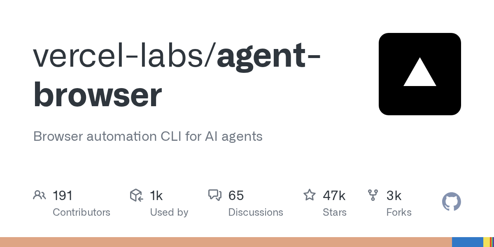
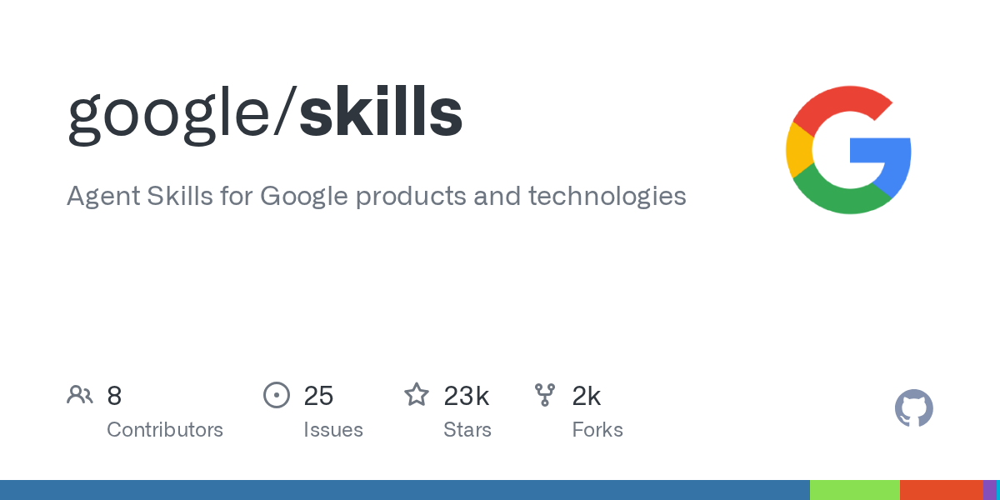
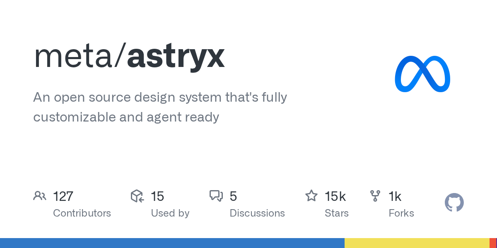
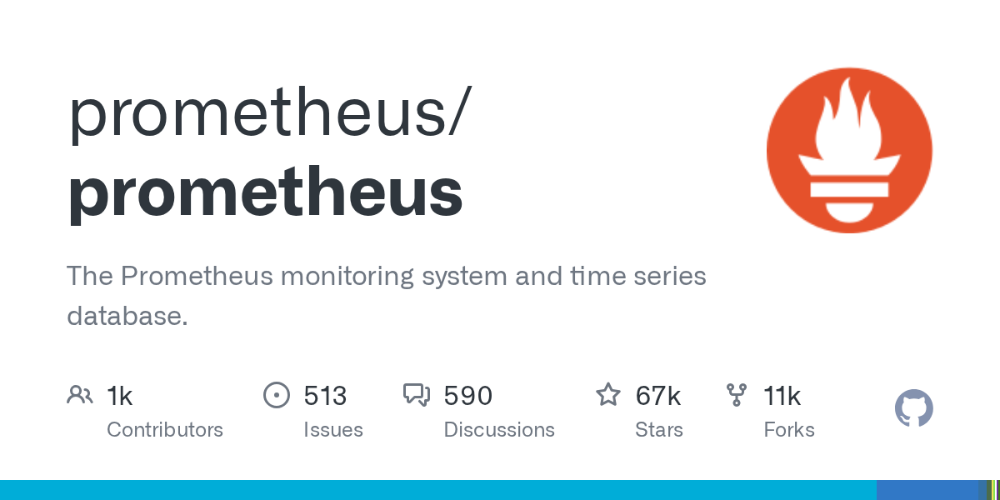
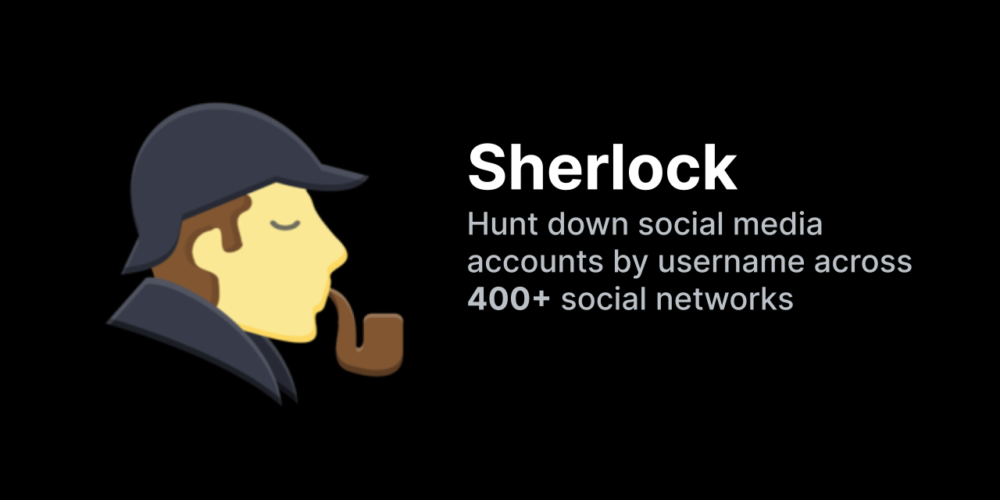
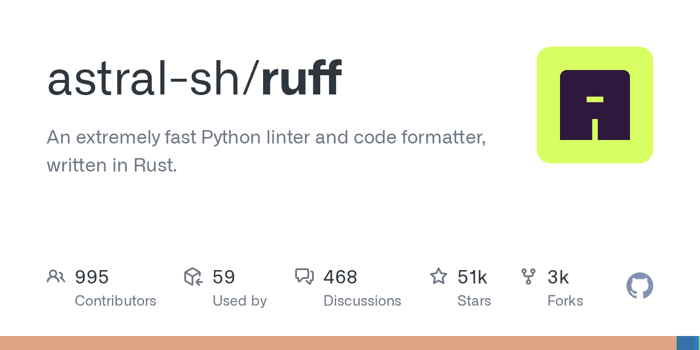

# AI 资讯日报 2026-11-08

> 自动抓取 AI 公司博客、从业者博客与社区聚合源，并生成中文摘要。

## 今日摘要

```
- Partnering with Hacktron to find vulnerabilities in OpenAI’s systems
- Measuring how AI agents handle everyday wet-lab science
- Cult.fit builds operational muscle with Codex
- Australian universities are creating AI-native graduates
- GPT‑6 Cyber: Advancing the frontier of aligned cybersecurity agents
```

## 公司动态

1. **[Partnering with Hacktron to find vulnerabilities in OpenAI’s systems](https://openai.com/index/partnering-with-hacktron)**

   OpenAI is partnering with Hacktron to find vulnerabilities, test connections with third-party services, and strengthen defenses with frontier AI.

   来源：OpenAI Blog

2. **[Measuring how AI agents handle everyday wet-lab science](https://openai.com/index/measuring-how-ai-agents-handle-wet-lab-science)**

   OpenAI introduces BioBasicsBench, a 100-task benchmark measuring how well AI agents interpret raw experimental data and handle everyday wet-lab science.

   来源：OpenAI Blog

3. **[Cult.fit builds operational muscle with Codex](https://openai.com/index/cultfit-builds-with-codex)**

   Cult.fit is using Codex to help teams across functions build tools, move faster, and change how work gets done.

   来源：OpenAI Blog

4. **[Australian universities are creating AI-native graduates](https://openai.com/index/australian-universities-ai-native-graduates)**

   Australian universities are expanding access to ChatGPT and bringing AI into teaching and learning to prepare students for an AI-enabled workforce.

   来源：OpenAI Blog

5. **[GPT‑6 Cyber: Advancing the frontier of aligned cybersecurity agents](https://openai.com/index/introducing-gpt-6-cyber)**

   Introducing GPT‑6 Cyber, OpenAI’s cybersecurity model for finding exploitable vulnerabilities and developing fixes, trained to stay within authorized scope.

   来源：OpenAI Blog

6. **[Merge builds product and business tools with OpenAI technology](https://openai.com/index/merge-builds-with-openai)**

   Merge uses GPT-6 Astra, ChatGPT, and Codex to review product code and support marketing. Its teams also use AI to plan executive dinners and prepare sales updates.

   来源：OpenAI Blog

7. **[Setting a new standard for responsible AI infrastructure](https://openai.com/index/setting-new-standard-responsible-ai-infrastructure)**

   OpenAI introduces its National Community Compact and Compute Campus Policy Blueprint to protect local resources, create jobs, and guide responsible AI infrastructure development.

   来源：OpenAI Blog

8. **[Gemini Omni 1.2 Flash: Fast and cost-effective with longer clips](https://deepmind.google/blog/gemini-omni-12-flash-fast-and-cost-effective-with-longer-clips/)**

   暂无摘要。

   来源：DeepMind Blog

## 每日产品

1. **[Google Omni 1.2 Flash - Gemini Omni 1.2 Flash：15秒AI视频，每秒0.07美元](https://www.producthunt.com/r/EAQRQBPBLUGUTY)**

   Gemini Omni 1.2 Flash: 15s AI video at 0.07 per second (www.producthunt.com) 11-07 ↑ 115 PH Upvotes

   

   来源：Product Hunt Daily

2. **[GPT‑6 Cyber - OpenAI 的网络安全模型，仅向经过审核的防御人员开放访问权限](https://www.producthunt.com/r/EQ2CDO3EYPSTVU)**

   OpenAI’s cyber model, with vetted access for defenders (www.producthunt.com) 11-07 ↑ 108 PH Upvotes

   

   来源：Product Hunt Daily

3. **[Quest - 您的个人AI顾问，助您过上更有目标的生活](https://www.producthunt.com/r/FFHQV6QCOEHH7N)**

   *{padding:0;margin:0;overflow:hidden}html,body{height:100%}img,span{position:absolute;width:100%;top:0;bottom:0;margin:auto}span{height:1.5em;text-align:center;font:48px/1.5 sans-serif;color:white;text-shadow:0 0 0.5em black}▶" frameborder="0" allow="accelerometer; autoplay; encrypted-media; gyroscope; picture-in-picture" allowfullscreen > Your personal AI advisor for a more intentional life (www.producthunt.com) 11-07 ↑ 102 PH Upvotes

   来源：Product Hunt Daily

4. **[LiveReview - 免费、注重风险的代码审查：自动批准低风险的更改](https://www.producthunt.com/r/UKG4GEUB6PLHOQ)**

   *{padding:0;margin:0;overflow:hidden}html,body{height:100%}img,span{position:absolute;width:100%;top:0;bottom:0;margin:auto}span{height:1.5em;text-align:center;font:48px/1.5 sans-serif;color:white;text-shadow:0 0 0.5em black}▶" frameborder="0" allow="accelerometer; autoplay; encrypted-media; gyroscope; picture-in-picture" allowfullscreen > Free, Risk-Aware Code Review: Auto Approve Low-Risk Changes (www.producthunt.com) 11-07 PH Link

   来源：Product Hunt Daily

5. **[ChatGPT Images 2.6 - 使用人工智能创建、编辑和为图片添加动画效果](https://www.producthunt.com/r/ZYSSWGXHU4P32K)**

   *{padding:0;margin:0;overflow:hidden}html,body{height:100%}img,span{position:absolute;width:100%;top:0;bottom:0;margin:auto}span{height:1.5em;text-align:center;font:48px/1.5 sans-serif;color:white;text-shadow:0 0 0.5em black}▶" frameborder="0" allow="accelerometer; autoplay; encrypted-media; gyroscope; picture-in-picture" allowfullscreen > Create, edit, and animate images with AI (www.producthunt.com) 11-07 PH Link

   来源：Product Hunt Daily

6. **[Exa Monitors v2 - 按计划进行网络搜索并触发您的代理，每次运行1000次收费2美元](https://www.producthunt.com/r/TAD4DNQRSJ5L2K)**

   Web search on a schedule that calls your agent, 2/1k runs (www.producthunt.com) 11-07 PH Link

   

   来源：Product Hunt Daily

7. **[Meadow - 散步途中邂逅的隐藏歌曲，由人而非算法精选](https://www.producthunt.com/r/KD2FP5YECF3KLS)**

   Hidden songs on your walk, chosen by people, not algorithms (www.producthunt.com) 11-06 ↑ 91 PH Upvotes

   

   来源：Product Hunt Daily

8. **[Datastripes Data Stories - 几秒钟内将任何电子表格转化为数据故事](https://www.producthunt.com/r/B2BRINIF6PPVVP)**

   *{padding:0;margin:0;overflow:hidden}html,body{height:100%}img,span{position:absolute;width:100%;top:0;bottom:0;margin:auto}span{height:1.5em;text-align:center;font:48px/1.5 sans-serif;color:white;text-shadow:0 0 0.5em black}▶" frameborder="0" allow="accelerometer; autoplay; encrypted-media; gyroscope; picture-in-picture" allowfullscreen > Turn any spreadsheet into a data story in seconds (www.producthunt.com) 11-06 ↑ 93 PH Upvotes

   来源：Product Hunt Daily

9. **[Wingmen - 基于真实意图数据的主动外联](https://www.producthunt.com/r/AK6GQ4EPT7KYYX)**

   *{padding:0;margin:0;overflow:hidden}html,body{height:100%}img,span{position:absolute;width:100%;top:0;bottom:0;margin:auto}span{height:1.5em;text-align:center;font:48px/1.5 sans-serif;color:white;text-shadow:0 0 0.5em black}▶" frameborder="0" allow="accelerometer; autoplay; encrypted-media; gyroscope; picture-in-picture" allowfullscreen > Agentic outreach with real intent data (www.producthunt.com) 11-05 ↑ 94 PH Upvotes

   来源：Product Hunt Daily

10. **[Polylane for Google Cloud - 专为您的 Google Cloud 应用服务的 AI 值班工程师](https://www.producthunt.com/r/KQUCUSDESBKSUO)**

   *{padding:0;margin:0;overflow:hidden}html,body{height:100%}img,span{position:absolute;width:100%;top:0;bottom:0;margin:auto}span{height:1.5em;text-align:center;font:48px/1.5 sans-serif;color:white;text-shadow:0 0 0.5em black}▶" frameborder="0" allow="accelerometer; autoplay; encrypted-media; gyroscope; picture-in-picture" allowfullscreen > An AI on-call engineer for your Google Cloud apps (www.producthunt.com) 11-05 ↑ 98 PH Upvotes

   来源：Product Hunt Daily

## GitHub 项目

1. **[vercel-labs/agent-browser](https://github.com/vercel-labs/agent-browser)**

   Browser automation CLI for AI agents Language: Rust Stars: 46864 Forks: 3211

   

   来源：GitHub Trending Daily

2. **[cloudflare/security-audit-skill](https://github.com/cloudflare/security-audit-skill)**

   A coding-agent skill for multi-phase security audits with independently verified, machine-readable findings Language: JavaScript Stars: 65793 Forks: 4273

   来源：GitHub Trending Daily

3. **[google/skills](https://github.com/google/skills)**

   Agent Skills for Google products and technologies Language: Python Stars: 23433 Forks: 1957

   

   来源：GitHub Trending Daily

4. **[mattpocock/skills](https://github.com/mattpocock/skills)**

   Skills for Real Engineers. Straight from my .agents directory. Language: Shell Stars: 317758 Forks: 26583

   来源：GitHub Trending Daily

5. **[anthropics/skills](https://github.com/anthropics/skills)**

   Public repository for Agent Skills Language: Python Stars: 188825 Forks: 22257

   来源：GitHub Trending Daily

6. **[meta/astryx](https://github.com/meta/astryx)**

   An open source design system that's fully customizable and agent ready Language: TypeScript Stars: 14577 Forks: 1192

   

   来源：GitHub Trending Daily

7. **[prometheus/prometheus](https://github.com/prometheus/prometheus)**

   The Prometheus monitoring system and time series database. Language: Go Stars: 67452 Forks: 11004

   

   来源：GitHub Trending Daily

8. **[sherlock-project/sherlock](https://github.com/sherlock-project/sherlock)**

   Hunt down social media accounts by username across social networks Language: Python Stars: 100574 Forks: 11878

   

   来源：GitHub Trending Daily

9. **[milind-soni/OpenMausBot](https://github.com/milind-soni/OpenMausBot)**

   Open-source Grok Bot alternative with a virtual machine that bots can use Language: TypeScript Stars: 17043 Forks: 2412

   

   来源：GitHub Trending Daily

10. **[astral-sh/ruff](https://github.com/astral-sh/ruff)**

   An extremely fast Python linter and code formatter, written in Rust. Language: Rust Stars: 50985 Forks: 2632

   

   来源：GitHub Trending Daily

## 从业者观点

1. **[datasette #3046: Don't serve link: rel=next HTTP headers to Firefox for HTML pages](https://simonwillison.net/2026/Nov/7/link-rel-next/)**

   datasette #3046: Don&#x27;t serve link: rel=next HTTP headers to Firefox for HTML pages I was looking at the Firefox network panel today when I noticed that requests to a Datasette table page were triggering an HTTP prefetch to the next page of rows in that table. This was happening because Datasette pages serve an HTTP link header like this: link: &lt;https://latest.datasette.io/fixtures/compound_three_primary_keys?_next=a%2Cd%2Cv&gt;; rel="next" This is bad. A tiny fraction of the visitors to one of those pages will click the "next" link, which means their browser is fetching unnecessary data and the Datasette server is having to render an entire page that then gets thrown away. I dug in and learned that Firefox has an issue that has been open for 24 years about this behavior... And one of the early comments on that issue links to my blog post from 2002 complaining about this feature. I hadn't just forgotten that I had written about it, I had forgotten the feature entirely! Tags: firefox , html , mozilla , datasette

   来源：Simon Willison

2. **[Quoting Nilay Patel](https://simonwillison.net/2026/Nov/6/nilay-patel/)**

   The products aren't good enough to sell people on the costs. You cannot tell people that you have to listen to the whine of a data center in their backyard for AI overviews and some of the most hilarious deep fake slop in history. It's not worth it. It just isn't worth it to anyone. And agents aren't real and they might not be being used the way that anyone wants them to yet. All these companies are spending more than they're making on these products. Refrigerators holding blood storage in Europe are being hacked. The costs are too high. The benefits are not real. And if you connect that to corruption, you're like, in order to impose these costs on me, these CEOs are in the White House shaking Trump's hand, renaming it to the Gulf of America, paying for this ballroom that we don't want. It's obvious crypto-corruption, and it's still slop. The AI industry will not get out of it until they make better products . Until everyone can see without needing to be convinced, without needing an ad campaign, without any of this stuff that just using these products makes your life better. &mdash; Nilay Patel , The Vergecast: Big Tech lost big in the 2026 election Tags: nilay-patel , slop , ai , generative-ai , ai-ethics

   来源：Simon Willison

3. **[Quoting Paul Ford](https://simonwillison.net/2026/Nov/5/paul-ford/)**

   The web browser is very, very, very powerful software for applications, and the cost of accessing that power is going down seemingly every day . &mdash; Paul Ford , The Web Is More Than Enough Tags: browsers , paul-ford , web-development

   来源：Simon Willison

4. **[The benchmark where AIs have to lie to win](https://www.dwarkesh.com/p/clocktower)**

   AIs are now good enough to run a conspiracy

   

   来源：Dwarkesh Patel

## 社区热点

1. **[Claude Code's "Don't Ask Again" exposes passwords in 1,122 public GitHub files](https://apiiro.com/blog/coding-agents-leaking-secrets-github-dont-ask-again)**

   Article URL: https://apiiro.com/blog/coding-agents-leaking-secrets-github-dont-ask-again Comments URL: https://news.ycombinator.com/item?id=50407882 Points: 183 # Comments: 125

   来源：Hacker News AI

2. **[The End of AI Frontiers](https://hunch.net/?p=13764006)**

   Article URL: https://hunch.net/?p=13764006 Comments URL: https://news.ycombinator.com/item?id=50406589 Points: 81 # Comments: 4

   来源：Hacker News AI

3. **[The AI sell-off compared to well-known stock market crashes](https://www.kadoa.com/companies/insights/ai-selloff-perspective)**

   Article URL: https://www.kadoa.com/companies/insights/ai-selloff-perspective Comments URL: https://news.ycombinator.com/item?id=50401029 Points: 84 # Comments: 69

   来源：Hacker News AI

4. **[AI is dramatically accelerating AI research](https://www.planned-obsolescence.org/p/ai-is-dramatically-accelerating-ai)**

   Article URL: https://www.planned-obsolescence.org/p/ai-is-dramatically-accelerating-ai Comments URL: https://news.ycombinator.com/item?id=50397994 Points: 362 # Comments: 338

   来源：Hacker News AI

5. **[Microsoft is winding down Oracle deal to rent AI cloud capacity](https://www.reuters.com/business/microsoft-is-winding-down-oracle-deal-rent-ai-cloud-capacity-bloomberg-news-2026-11-06/)**

   Article URL: https://www.reuters.com/business/microsoft-is-winding-down-oracle-deal-rent-ai-cloud-capacity-bloomberg-news-2026-11-06/ Comments URL: https://news.ycombinator.com/item?id=50395933 Points: 106 # Comments: 19

   来源：Hacker News AI

6. **[Perplexity launches AI agents for work](https://www.perplexity.ai/en-GB/hub/blog/teammates-are-agents-for-complex-ongoing-work)**

   Article URL: https://www.perplexity.ai/en-GB/hub/blog/teammates-are-agents-for-complex-ongoing-work Comments URL: https://news.ycombinator.com/item?id=50395866 Points: 64 # Comments: 54

   来源：Hacker News AI

7. **[University libraries are being swarmed by AI bots, putting public access at risk](https://www.cbc.ca/news/world/university-libraries-ai-data-scraping-bots-9.7408287)**

   Article URL: https://www.cbc.ca/news/world/university-libraries-ai-data-scraping-bots-9.7408287 Comments URL: https://news.ycombinator.com/item?id=50392499 Points: 135 # Comments: 63

   来源：Hacker News AI

8. **[AI for scientific discovery: How researchers use Claude](https://www.anthropic.com/research/how-researchers-use-claude)**

   Article URL: https://www.anthropic.com/research/how-researchers-use-claude Comments URL: https://news.ycombinator.com/item?id=50389990 Points: 101 # Comments: 39

   来源：Hacker News AI

9. **[App Store 2026 in numbers: AI, pricing, abandoned apps](https://obelisk.club/research/app-store-2026)**

   Article URL: https://obelisk.club/research/app-store-2026 Comments URL: https://news.ycombinator.com/item?id=50389448 Points: 60 # Comments: 55

   来源：Hacker News AI

10. **[Catching prompt injections hidden in PDFs](https://tomclancy.info/joshua-judges-ruth.html)**

   Comments

   来源：Lobsters AI

11. **[Firecracker VM Escape: PwnEscape Part 2](https://pwn.ai/blog/firecracker-escape)**

   Comments

   来源：Lobsters AI

12. **[Reflections on Rust in the LLM Age](https://www.youtube.com/watch?v=5D7QPOIZ7gY)**

   Comments

   来源：Lobsters AI

## 论文与模型

1. **[Muir: Linear Attention with Sensitivity-Allocated Gating and Matched-Filter Readout](https://arxiv.org/abs/2611.08376)**

   Linear attention compresses context into a fixed-size key-value state for linear-time training and constant-memory inference. Gated delta-rule models decay this state and erase its prediction for an incoming key before writing a new value; Gated DeltaNet-2 (GDN-2) generalizes this with channel-wise decay and decoupled, full-rank erase and write gates. However, we show that state updates are far less sensitive to erasure than to writes: key activation and unit normalization concentrate key energy onto a sparse subset of channels, whereas value writes scale all channels, so the erase gate can be parameterized at lower rank. Furthermore, slow-decaying state rows accumulate much larger norms than fast rows, dominating unweighted readout and forcing stronger write-time erasure to suppress interference. Guided by this analysis, we introduce Muir, which fuses all gates into a sensitivity-allocated low-rank projection, re-weights state rows with a matched-filter readout gate, and reinvests the saved parameters in a wider feed-forward network. Because standard chunkwise algorithms become numerically unstable at the large chunk sizes needed to saturate wide matrix units, we design a parallel update for stable, efficient training. Across 166M-1.34B parameters, Muir lowers perplexity by 1.8-2.0% over GDN-2 and 2.5-3.6% over Transformer, raises commonsense accuracy by up to 1.9 points, and improves extractive recall over GDN-2. At 1.34B, Muir outperforms both baselines on multi-hop and multi-needle recall, extrapolates 2,560x from its 4K training length to 10M-token streams without perplexity drift, and maintains near-100% passkey retrieval to 1M tokens with static readout. Muir achieves these gains while matching GDN-2 throughput, reaching its 100B-token validation loss 1.2x faster, and training 2.7x faster than Transformer at 32K.

   来源：HuggingFace Papers

2. **[Terminal-style Mathematical Modeling Bench: The First Agentic and Verifiable Benchmark for Mathematical Modeling](https://arxiv.org/abs/2611.08237)**

   Mathematical modeling turns an open-ended real-world problem into assumptions, a model, a solution, and a defended recommendation, and its answers matter only if they are both close to a credible reference and physically feasible; existing benchmarks either score solver fragments or grade reports with an LLM judge, leaving those numbers unchecked. We introduce TB-MathModel (the Terminal-style Mathematical Modeling Bench), the first benchmark to make complete contest-style modeling problems agentic, verifiable, and terminal at once, over 18 real CUMCM and MCM problems (2023--2025). Each task ships the verbatim statement, official attachments, and figures in a containerized terminal; the agent returns one JSON artifact, scored on the numeric core of the final question against a reproduction of the Outstanding-award paper. Two design choices distinguish it: direction-aware, one-sided scoring, which never penalises beating the anchor, and two-layer feasibility verification---a programmatic gate over six decidable invariant forms plus 624 Lean~4 obligations---with a hard gate that zeroes infeasible answers. Each task is scored against a panel of human outstanding papers rather than one, so a model must be close to many accepted answers; across seven multimodal entries (three seeds each) the strongest reach a multi-reference O-Eval of 64.58\%, while the \2.54 open model holds 59.81% at 1/100$ the cost. TB-MathModel turns the numeric core of modeling into a reproducible, machine-checkable signal for measuring long-horizon modeling competence and for collecting agent trajectories. The source code is available at https://github.com/wxj630/terminal-bench-math-modeling.

   来源：HuggingFace Papers

3. **[SAE Interprets MoE: Sparse AutoEncoders Reveal That MoE Experts Exhibit Human-Interpretable Fine-Grained Specialization](https://arxiv.org/abs/2611.08089)**

   Mixture-of-Experts (MoE) models route each token to a few of many experts, yet what an individual expert is responsible for remains unsettled. Existing analyses count how often an expert is selected on domain-labeled corpora, an instrument that fixes the taxonomy in advance, stays coarse, and records selection rather than contribution. We instead study specialization in feature space by training a sparse autoencoder (SAE) on the output of an MoE layer. Since this output is a router-weighted sum of expert outputs and the SAE encoder is affine, the pre-activation of every latent decomposes exactly over the experts. Aggregated over a corpus, this gives each expert a dominant set of latents whose activation it principally drives. On layers 4, 30 and 46 of Qwen3-30B-A3B, contribution is far more concentrated than gating, most latents have only one or two dominators, and the overlap between dominant sets concentrates on a few expert pairs. Auto-interpreting these sets reveals a division of labor below coarse domains, with distinct experts for Java and front-end web code, or for geometry and for arithmetic and polynomials, while the coarse domains themselves take very unequal numbers of experts. Our SAEs and code are available at https://github.com/Bytedance-Seed/SAE-Interprets-MoE.

   来源：HuggingFace Papers

4. **[Towards Real-Time Full-Waveform LiDAR Transformers via Intensity-Guided Token Reduction and Physics-Aware Augmentation](https://arxiv.org/abs/2611.07613)**

   LiDAR is a critical sensor for autonomous driving and robotics, yet it remains vulnerable to adverse conditions such as fog, rain, transparent objects, and low-reflectance surfaces. Full-waveform LiDAR (FWL) addresses these limitations by capturing the complete return waveform as a histogram, preserving rich reflection characteristics including multi-path echoes and weak signals. While recent Transformer-based approaches have demonstrated promise on FWL data, two fundamental bottlenecks remain: high computational cost from redundant tokens in low-intensity background regions, and limited generalization due to scarce annotated training data. We address both bottlenecks by exploiting the physical structure inherent to FWL data. First, we propose FWL-ToPM, a token pruning and merging mechanism that leverages intensity distributions to selectively reduce tokens while retaining critical waveform content. Second, we introduce FWLAug, a data augmentation framework designed as a regularization method that preserves waveform structure, retaining the Time-of-Flight waveform of each ray and the frustum geometry, to improve generalization to unseen scenes. Evaluated on the Ghost-FWL benchmark, FWL-ToPM achieves over 8 times speedup at real-time throughput alongside a nearly 9-point F1 gain over the prior state of the art, establishing the first real-time FWL Transformer that simultaneously improves accuracy. FWLAug further improves performance on both the standard benchmark and an out-of-distribution test set of unseen scenes. Together, these methods push FWL-based perception toward practical deployment. The code and the OOD dataset are publicly available and can be accessed via the project page: https://keio-csg.github.io/FWL-ToPM

   来源：HuggingFace Papers
