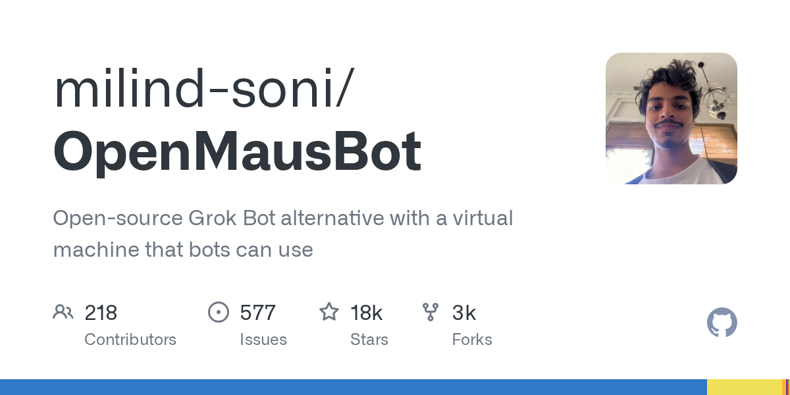
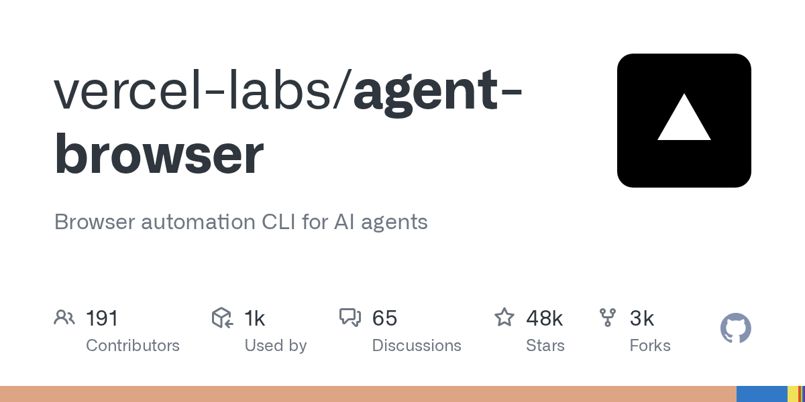
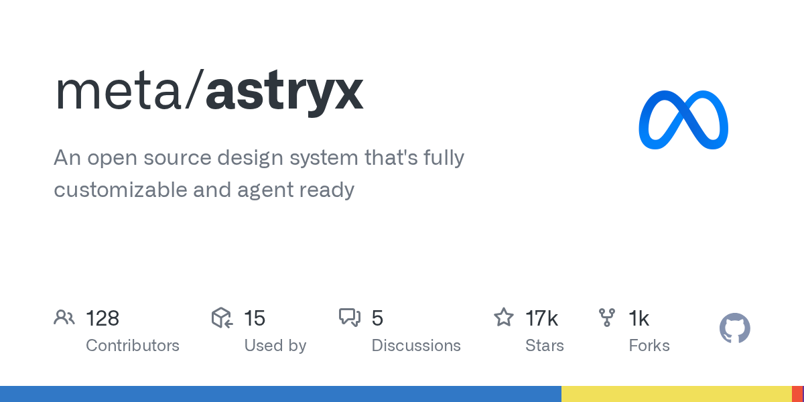
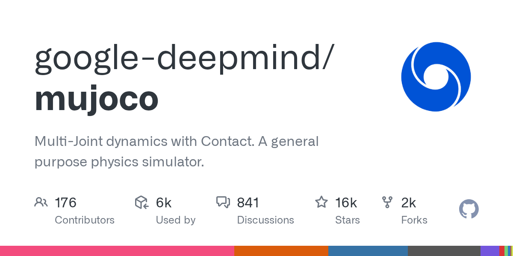
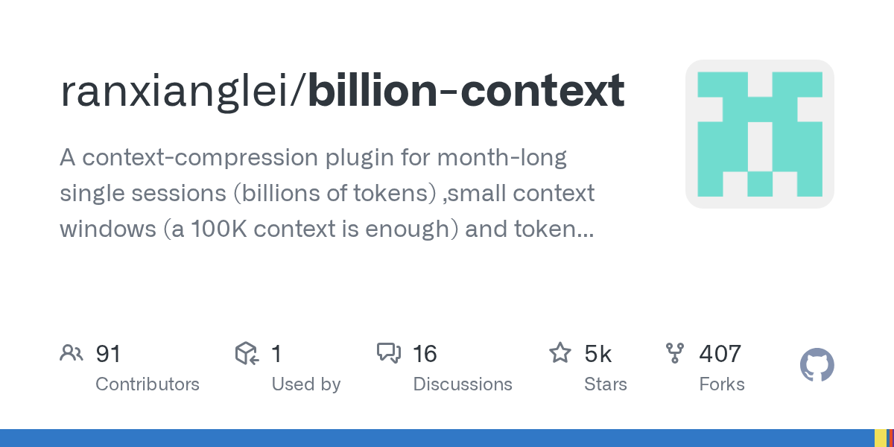

# AI 资讯日报 2026-11-09

> 自动抓取 AI 公司博客、从业者博客与社区聚合源，并生成中文摘要。

## 今日摘要

```
- Partnering with Hacktron to find vulnerabilities in OpenAI’s systems
- DocsAlot for customer support - 一款可在 Slack 和 Discord 上回答客户问题的机器人
- Archie - Mac 截图管理器与 Notch Shelf
- NoMac - 专属于您的人工智能助手的 Mac 电脑，按分钟计费。无需订阅
- AXL - 面向 AI 产品创始人的 GTM 辅助工具：通过 MCP 执行 1,200 多项操作
```

## 公司动态

1. **[Partnering with Hacktron to find vulnerabilities in OpenAI’s systems](https://openai.com/index/partnering-with-hacktron)**

   OpenAI is partnering with Hacktron to find vulnerabilities, test connections with third-party services, and strengthen defenses with frontier AI.

   来源：OpenAI Blog

## 每日产品

1. **[DocsAlot for customer support - 一款可在 Slack 和 Discord 上回答客户问题的机器人](https://www.producthunt.com/r/KH3KUD3PZ5P7SH)**

   Slack and Discord bot that answers your customers questions (www.producthunt.com) 11-08 ↑ 99 PH Upvotes

   

   来源：Product Hunt Daily

2. **[Archie - Mac 截图管理器与 Notch Shelf](https://www.producthunt.com/r/W3WAASP4DI3V2G)**

   *{padding:0;margin:0;overflow:hidden}html,body{height:100%}img,span{position:absolute;width:100%;top:0;bottom:0;margin:auto}span{height:1.5em;text-align:center;font:48px/1.5 sans-serif;color:white;text-shadow:0 0 0.5em black}▶" frameborder="0" allow="accelerometer; autoplay; encrypted-media; gyroscope; picture-in-picture" allowfullscreen > Mac Screenshot Manager & Notch Shelf (www.producthunt.com) 11-08 ↑ 105 PH Upvotes

   来源：Product Hunt Daily

3. **[NoMac - 专属于您的人工智能助手的 Mac 电脑，按分钟计费。无需订阅](https://www.producthunt.com/r/LV54W7UK6JWYO7)**

   Your AI agent's own Mac, billed per minute. No subscription (www.producthunt.com) 11-08 ↑ 94 PH Upvotes

   

   来源：Product Hunt Daily

4. **[AXL - 面向 AI 产品创始人的 GTM 辅助工具：通过 MCP 执行 1,200 多项操作](https://www.producthunt.com/r/I2M2MPP6UQVT6W)**

   *{padding:0;margin:0;overflow:hidden}html,body{height:100%}img,span{position:absolute;width:100%;top:0;bottom:0;margin:auto}span{height:1.5em;text-align:center;font:48px/1.5 sans-serif;color:white;text-shadow:0 0 0.5em black}▶" frameborder="0" allow="accelerometer; autoplay; encrypted-media; gyroscope; picture-in-picture" allowfullscreen > GTM copilot for AI product founders: 1,200 actions via MCP (www.producthunt.com) 11-08 ↑ 96 PH Upvotes

   来源：Product Hunt Daily

5. **[Deduplication  - “词”究竟属于哪种含义？](https://www.producthunt.com/r/R664WMF3WWTS65)**

   Which Meaning Owns the Word? (www.producthunt.com) 11-08 ↑ 93 PH Upvotes

   

   来源：Product Hunt Daily

6. **[Sage2 by Levanto Labs - 将实时对话转化为结构化数据并立即采取行动](https://www.producthunt.com/r/ZVZ33J42Q2NP4A)**

   *{padding:0;margin:0;overflow:hidden}html,body{height:100%}img,span{position:absolute;width:100%;top:0;bottom:0;margin:auto}span{height:1.5em;text-align:center;font:48px/1.5 sans-serif;color:white;text-shadow:0 0 0.5em black}▶" frameborder="0" allow="accelerometer; autoplay; encrypted-media; gyroscope; picture-in-picture" allowfullscreen > Turn live talk into structured data and instant actions (www.producthunt.com) 11-08 ↑ 92 PH Upvotes

   来源：Product Hunt Daily

7. **[Inkling 2 Small - 一个能够观察并优化自身构建成果的模型](https://www.producthunt.com/r/R4MZ6WWP7QAB6Z)**

   A model that can see and refine what it builds (www.producthunt.com) 11-08 PH Link

   

   来源：Product Hunt Daily

8. **[DALI AI by SupplyzPro - 那个你永远不需要打开的ERP系统](https://www.producthunt.com/r/Z4NJ6O6UCMBXQL)**

   *{padding:0;margin:0;overflow:hidden}html,body{height:100%}img,span{position:absolute;width:100%;top:0;bottom:0;margin:auto}span{height:1.5em;text-align:center;font:48px/1.5 sans-serif;color:white;text-shadow:0 0 0.5em black}▶" frameborder="0" allow="accelerometer; autoplay; encrypted-media; gyroscope; picture-in-picture" allowfullscreen > The ERP you never need to open (www.producthunt.com) 11-06 ↑ 89 PH Upvotes

   来源：Product Hunt Daily

9. **[Rex (Beta) - 构建适用于所有工作的多路复用器](https://www.producthunt.com/r/EYQQV7LWZ6MOGL)**

   Building the multiplexer for all work (www.producthunt.com) 11-07 ↑ 92 PH Upvotes

   

   来源：Product Hunt Daily

10. **[Instagram Edits for Desktop - Instagram 配备 AI 助手的功能强大的免费桌面视频编辑器](https://www.producthunt.com/r/TPRFPBACJLO5RW)**

   Instagram's free desktop video editor with AI agents (www.producthunt.com) 11-07 ↑ 93 PH Upvotes

   

   来源：Product Hunt Daily

## GitHub 项目

1. **[sherlock-project/sherlock](https://github.com/sherlock-project/sherlock)**

   Hunt down social media accounts by username across social networks Language: Python Stars: 103830 Forks: 12148

   

   来源：GitHub Trending Daily

2. **[dsx-ai-factory/nvke](https://github.com/dsx-ai-factory/nvke)**

   NVIDIA Kubernetes Engine (NVKE). A management plane for GPU Kubernetes on bare metal. Language: Go Stars: 877 Forks: 111

   

   来源：GitHub Trending Daily

3. **[milind-soni/OpenMausBot](https://github.com/milind-soni/OpenMausBot)**

   Open-source Grok Bot alternative with a virtual machine that bots can use Language: TypeScript Stars: 18370 Forks: 2544

   

   来源：GitHub Trending Daily

4. **[anthropics/claude-quickstarts](https://github.com/anthropics/claude-quickstarts)**

   A collection of projects designed to help developers quickly get started with building deployable applications using the Claude API Language: Python Stars: 19470 Forks: 3281

   

   来源：GitHub Trending Daily

5. **[vercel-labs/agent-browser](https://github.com/vercel-labs/agent-browser)**

   Browser automation CLI for AI agents Language: Rust Stars: 47684 Forks: 3260

   

   来源：GitHub Trending Daily

6. **[meta/astryx](https://github.com/meta/astryx)**

   An open source design system that's fully customizable and agent ready Language: TypeScript Stars: 17006 Forks: 1340

   

   来源：GitHub Trending Daily

7. **[anthropics/skills](https://github.com/anthropics/skills)**

   Public repository for Agent Skills Language: Python Stars: 189720 Forks: 22353

   

   来源：GitHub Trending Daily

8. **[google-deepmind/mujoco](https://github.com/google-deepmind/mujoco)**

   Multi-Joint dynamics with Contact. A general purpose physics simulator. Language: C++ Stars: 16453 Forks: 1954

   

   来源：GitHub Trending Daily

9. **[ranxianglei/billion-context](https://github.com/ranxianglei/billion-context)**

   A context-compression plugin for month-long single sessions (billions of tokens) ,small context windows (a 100K context is enough) and token savings (5x fewer tokens) .上下文压缩插件，月级长会话会话， 兼顾小窗口(100k上下文足矣)省token(省5倍token) . billion-context is all you need Language: TypeScript Stars: 5209 Forks: 407

   

   来源：GitHub Trending Daily

## 从业者观点

1. **[parse_number() as a SQLite extension: C vs Rust](https://simonwillison.net/2026/Nov/8/sqlite-parse-number-c-vs-rust/)**

   Research: parse_number() as a SQLite extension: C vs Rust I was out walking the dog when I got curious about how easy/difficult it would be to write a SQLite C extension that adds a parse_number() function for turning strings like -$1,234.56 or '12.5%' into numeric values that could be summed and sorted. I fired up regular Claude chat (Opus 5.5) and prompted : I'm thinking about a SQLite custom function 'parse_number(value)' that strips ',', '$', '£' and '%', handles a leading '-', and returns 'NULL' for anything it can’t parse Explore the difference between building this as a SQLite extension in C v.s. in Rust - I want to compare performance and code complexity and size of the resulting .so (or whatever) file This gave me a solid starting point - the Rust extension was 321 KB (using Rusqlite ) and 298 KB (using sqlite-loadable-rs ), while the C extension was 14 KB. But the Rust extension was faster! Turns out that's because the Rust equivalent of C's strtod is "twice as fast". So I prompted: Try writing your own C function for parsing text into a decimal number that catches up to or beats the Rust implementation And it did: Net cost per row over 2 million rows, lower is better: first C new C rusqlite sqlite-loadable Mixed data 67 ns 19 ns 46 ns 41 ns Integers only 25 ns 16 ns 36 ns 32 ns Decimals only 106 ns 18 ns 55 ns 47 ns Finally, I had it rewrite the prototype as a research report to match the others in simonw/research by prompting this: Clone simonw/research from GitHub and turn your above investigation into a research report as seen in that repository - you can give me a zip file to download that contains your new folder Here's the resulting report . Tags: c , research , sqlite , rust , claude

   来源：Simon Willison

2. **[datasette #3046: Don't serve link: rel=next HTTP headers to Firefox for HTML pages](https://simonwillison.net/2026/Nov/7/link-rel-next/)**

   datasette #3046: Don&#x27;t serve link: rel=next HTTP headers to Firefox for HTML pages I was looking at the Firefox network panel today when I noticed that requests to a Datasette table page were triggering an HTTP prefetch to the next page of rows in that table. This was happening because Datasette pages serve an HTTP link header like this: link: &lt;https://latest.datasette.io/fixtures/compound_three_primary_keys?_next=a%2Cd%2Cv&gt;; rel="next" This is bad. A tiny fraction of the visitors to one of those pages will click the "next" link, which means their browser is fetching unnecessary data and the Datasette server is having to render an entire page that then gets thrown away. I dug in and learned that Firefox has an issue that has been open for 24 years about this behavior... And one of the early comments on that issue links to my blog post from 2002 complaining about this feature. I hadn't just forgotten that I had written about it, I had forgotten the feature entirely! Tags: firefox , html , mozilla , datasette

   来源：Simon Willison

3. **[Quoting Nilay Patel](https://simonwillison.net/2026/Nov/6/nilay-patel/)**

   The products aren't good enough to sell people on the costs. You cannot tell people that you have to listen to the whine of a data center in their backyard for AI overviews and some of the most hilarious deep fake slop in history. It's not worth it. It just isn't worth it to anyone. And agents aren't real and they might not be being used the way that anyone wants them to yet. All these companies are spending more than they're making on these products. Refrigerators holding blood storage in Europe are being hacked. The costs are too high. The benefits are not real. And if you connect that to corruption, you're like, in order to impose these costs on me, these CEOs are in the White House shaking Trump's hand, renaming it to the Gulf of America, paying for this ballroom that we don't want. It's obvious crypto-corruption, and it's still slop. The AI industry will not get out of it until they make better products . Until everyone can see without needing to be convinced, without needing an ad campaign, without any of this stuff that just using these products makes your life better. &mdash; Nilay Patel , The Vergecast: Big Tech lost big in the 2026 election Tags: nilay-patel , slop , ai , generative-ai , ai-ethics

   来源：Simon Willison

## 社区热点

1. **[How I Fight AI Brain Fry](https://sergeykuhne.com/blog/fighting-ai-brain-fry)**

   Article URL: https://sergeykuhne.com/blog/fighting-ai-brain-fry Comments URL: https://news.ycombinator.com/item?id=50416363 Points: 156 # Comments: 130

   来源：Hacker News AI

2. **[Silicon Valley Promises AI Will Cure Disease. Drugmaker CEOs Aren't Buying It](https://www.wsj.com/tech/ai/silicon-valley-promises-ai-will-cure-disease-drugmaker-ceos-arent-buying-it-5218511c)**

   Article URL: https://www.wsj.com/tech/ai/silicon-valley-promises-ai-will-cure-disease-drugmaker-ceos-arent-buying-it-5218511c Comments URL: https://news.ycombinator.com/item?id=50415817 Points: 89 # Comments: 108

   来源：Hacker News AI

3. **[Goldman Sachs is pulling Claude Code from its bankers and traders](https://www.thestateofai.com/news/goldman-sachs-claude-code-traders-bankers)**

   Article URL: https://www.thestateofai.com/news/goldman-sachs-claude-code-traders-bankers Comments URL: https://news.ycombinator.com/item?id=50415628 Points: 609 # Comments: 359

   来源：Hacker News AI

4. **[Apple CEO Presses Software Chief to Pursue More Ambitious AI Strategy](https://www.bloomberg.com/news/newsletters/2026-11-08/apple-explores-turning-siri-ai-into-chatgpt-dots-like-agent-ios-28-shake-up)**

   Article URL: https://www.bloomberg.com/news/newsletters/2026-11-08/apple-explores-turning-siri-ai-into-chatgpt-dots-like-agent-ios-28-shake-up Comments URL: https://news.ycombinator.com/item?id=50414021 Points: 34 # Comments: 58

   来源：Hacker News AI

5. **[Goodbye Claude, hello Pi](https://caleb.software/posts/claude-to-pi.html)**

   Article URL: https://caleb.software/posts/claude-to-pi.html Comments URL: https://news.ycombinator.com/item?id=50410107 Points: 703 # Comments: 435

   来源：Hacker News AI

6. **[Claude Code's "Don't Ask Again" exposes passwords in 1,122 public GitHub files](https://apiiro.com/blog/coding-agents-leaking-secrets-github-dont-ask-again)**

   Article URL: https://apiiro.com/blog/coding-agents-leaking-secrets-github-dont-ask-again Comments URL: https://news.ycombinator.com/item?id=50407882 Points: 590 # Comments: 398

   来源：Hacker News AI

7. **[The End of AI Frontiers](https://hunch.net/?p=13764006)**

   Article URL: https://hunch.net/?p=13764006 Comments URL: https://news.ycombinator.com/item?id=50406589 Points: 81 # Comments: 4

   来源：Hacker News AI

8. **[The AI sell-off compared to well-known stock market crashes](https://www.kadoa.com/companies/insights/ai-selloff-perspective)**

   Article URL: https://www.kadoa.com/companies/insights/ai-selloff-perspective Comments URL: https://news.ycombinator.com/item?id=50401029 Points: 98 # Comments: 83

   来源：Hacker News AI

9. **[AI is dramatically accelerating AI research](https://www.planned-obsolescence.org/p/ai-is-dramatically-accelerating-ai)**

   Article URL: https://www.planned-obsolescence.org/p/ai-is-dramatically-accelerating-ai Comments URL: https://news.ycombinator.com/item?id=50397994 Points: 373 # Comments: 354

   来源：Hacker News AI

10. **[What can I realistically do with local AI on a Mac mini M5 Pro (48GB)?](https://lobste.rs/s/umsitb/what_can_i_realistically_do_with_local_ai)**

   I just got a Mac mini with an M5 Pro (base CPU config) and 48GB of unified memory. I want to run as much AI locally as makes sense, but it's hard to separate what actually works day to day from benchmark hype. What I'd like to do: Coding: autocomplete and agentic workflows with local models Image generation Anything else genuinely useful: transcription, RAG over my notes, etc. Questions: Which models and quantizations fit comfortably in 48GB and are actually usable, not just "it runs"? Which runtime and tools: MLX, llama.cpp, Ollama, LM Studio, ComfyUI, something else? What's your setup, and what did you give up on and go back to cloud APIs for? Real tokens/sec numbers and "this was a waste of time" stories are especially welcome.

   来源：Lobsters AI

11. **[Catching prompt injections hidden in PDFs](https://tomclancy.info/joshua-judges-ruth.html)**

   Comments

   来源：Lobsters AI

12. **[Firecracker VM Escape: PwnEscape Part 2](https://pwn.ai/blog/firecracker-escape)**

   Comments

   来源：Lobsters AI
