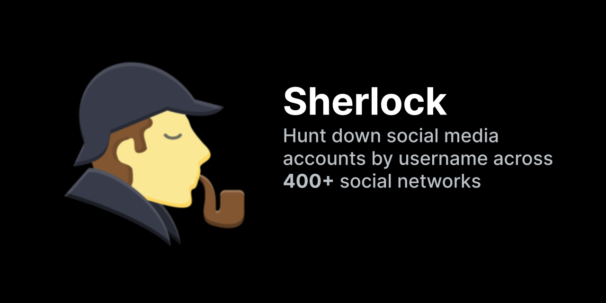
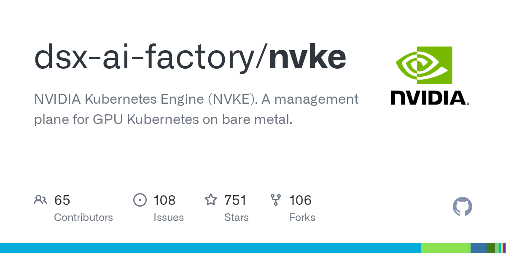
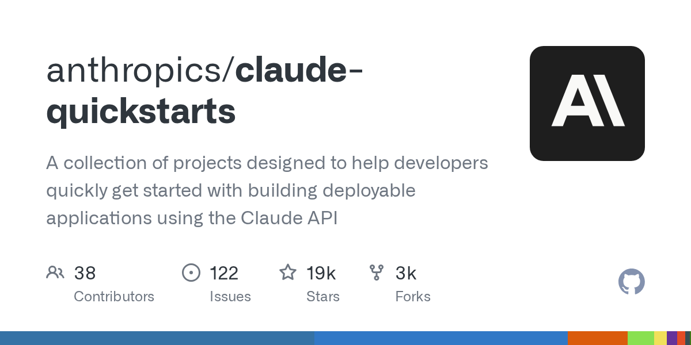
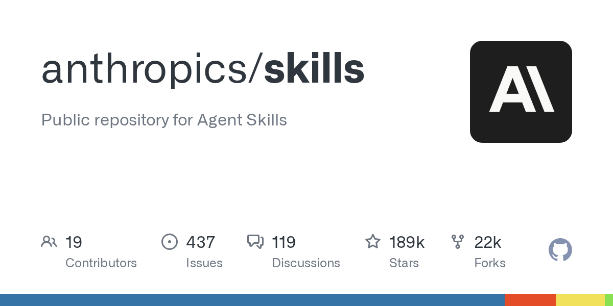

# AI 资讯日报 2026-11-09

> 自动抓取 AI 公司博客、从业者博客与社区聚合源，并生成中文摘要。

## 今日摘要

```
- Partnering with Hacktron to find vulnerabilities in OpenAI’s systems
- Measuring how AI agents handle everyday wet-lab science
- Cult.fit builds operational muscle with Codex
- Australian universities are creating AI-native graduates
- Gemini Omni 1.2 Flash: Fast and cost-effective with longer clips
```

## 公司动态

1. **[Partnering with Hacktron to find vulnerabilities in OpenAI’s systems](https://openai.com/index/partnering-with-hacktron)**

   OpenAI is partnering with Hacktron to find vulnerabilities, test connections with third-party services, and strengthen defenses with frontier AI.

   来源：OpenAI Blog

2. **[Measuring how AI agents handle everyday wet-lab science](https://openai.com/index/measuring-how-ai-agents-handle-wet-lab-science)**

   OpenAI introduces BioBasicsBench, a 100-task benchmark measuring how well AI agents interpret raw experimental data and handle everyday wet-lab science.

   来源：OpenAI Blog

3. **[Cult.fit builds operational muscle with Codex](https://openai.com/index/cultfit-builds-with-codex)**

   Cult.fit is using Codex to help teams across functions build tools, move faster, and change how work gets done.

   来源：OpenAI Blog

4. **[Australian universities are creating AI-native graduates](https://openai.com/index/australian-universities-ai-native-graduates)**

   Australian universities are expanding access to ChatGPT and bringing AI into teaching and learning to prepare students for an AI-enabled workforce.

   来源：OpenAI Blog

5. **[Gemini Omni 1.2 Flash: Fast and cost-effective with longer clips](https://deepmind.google/blog/gemini-omni-12-flash-fast-and-cost-effective-with-longer-clips/)**

   暂无摘要。

   来源：DeepMind Blog

## 每日产品

1. **[NoMac - 专属于您的人工智能助手的 Mac 电脑，按分钟计费。无需订阅](https://www.producthunt.com/r/LV54W7UK6JWYO7)**

   Your AI agent's own Mac, billed per minute. No subscription (www.producthunt.com) 16:01 ↑ 94 PH Upvotes

   

   来源：Product Hunt Daily

2. **[AXL - 面向 AI 产品创始人的 GTM 辅助工具：通过 MCP 执行 1,200 多项操作](https://www.producthunt.com/r/I2M2MPP6UQVT6W)**

   *{padding:0;margin:0;overflow:hidden}html,body{height:100%}img,span{position:absolute;width:100%;top:0;bottom:0;margin:auto}span{height:1.5em;text-align:center;font:48px/1.5 sans-serif;color:white;text-shadow:0 0 0.5em black}▶" frameborder="0" allow="accelerometer; autoplay; encrypted-media; gyroscope; picture-in-picture" allowfullscreen > GTM copilot for AI product founders: 1,200 actions via MCP (www.producthunt.com) 16:01 ↑ 96 PH Upvotes

   来源：Product Hunt Daily

3. **[Deduplication  - “词”究竟属于哪种含义？](https://www.producthunt.com/r/R664WMF3WWTS65)**

   Which Meaning Owns the Word? (www.producthunt.com) 16:01 ↑ 93 PH Upvotes

   

   来源：Product Hunt Daily

4. **[Sage2 by Levanto Labs - 将实时对话转化为结构化数据并立即采取行动](https://www.producthunt.com/r/ZVZ33J42Q2NP4A)**

   *{padding:0;margin:0;overflow:hidden}html,body{height:100%}img,span{position:absolute;width:100%;top:0;bottom:0;margin:auto}span{height:1.5em;text-align:center;font:48px/1.5 sans-serif;color:white;text-shadow:0 0 0.5em black}▶" frameborder="0" allow="accelerometer; autoplay; encrypted-media; gyroscope; picture-in-picture" allowfullscreen > Turn live talk into structured data and instant actions (www.producthunt.com) 16:01 ↑ 92 PH Upvotes

   来源：Product Hunt Daily

5. **[Inkling 2 Small - 一个能够观察并优化自身构建成果的模型](https://www.producthunt.com/r/R4MZ6WWP7QAB6Z)**

   A model that can see and refine what it builds (www.producthunt.com) 16:01 PH Link

   

   来源：Product Hunt Daily

6. **[DALI AI by SupplyzPro - 那个你永远不需要打开的ERP系统](https://www.producthunt.com/r/Z4NJ6O6UCMBXQL)**

   *{padding:0;margin:0;overflow:hidden}html,body{height:100%}img,span{position:absolute;width:100%;top:0;bottom:0;margin:auto}span{height:1.5em;text-align:center;font:48px/1.5 sans-serif;color:white;text-shadow:0 0 0.5em black}▶" frameborder="0" allow="accelerometer; autoplay; encrypted-media; gyroscope; picture-in-picture" allowfullscreen > The ERP you never need to open (www.producthunt.com) 11-06 ↑ 89 PH Upvotes

   来源：Product Hunt Daily

7. **[Rex (Beta) - 构建适用于所有工作的多路复用器](https://www.producthunt.com/r/EYQQV7LWZ6MOGL)**

   Building the multiplexer for all work (www.producthunt.com) 11-07 ↑ 92 PH Upvotes

   

   来源：Product Hunt Daily

8. **[Instagram Edits for Desktop - Instagram 配备 AI 助手的功能强大的免费桌面视频编辑器](https://www.producthunt.com/r/TPRFPBACJLO5RW)**

   Instagram's free desktop video editor with AI agents (www.producthunt.com) 11-07 ↑ 93 PH Upvotes

   

   来源：Product Hunt Daily

9. **[seam - 将 Mac 的刘海屏变身为“动态岛”](https://www.producthunt.com/r/HR47JBOCYFZV7K)**

   Turn your Mac's notch into a Dynamic Island (www.producthunt.com) 11-07 ↑ 96 PH Upvotes

   

   来源：Product Hunt Daily

10. **[Muse Realtime Avatar - 将与Muse的语音聊天转换为实时视频通话](https://www.producthunt.com/r/CEQNYNERKKN54Y)**

   Turn voice chats with Muse into live video calls (www.producthunt.com) 11-07 ↑ 109 PH Upvotes

   

   来源：Product Hunt Daily

## GitHub 项目

1. **[sherlock-project/sherlock](https://github.com/sherlock-project/sherlock)**

   Hunt down social media accounts by username across social networks Language: Python Stars: 102611 Forks: 12071

   

   来源：GitHub Trending Daily

2. **[dsx-ai-factory/nvke](https://github.com/dsx-ai-factory/nvke)**

   NVIDIA Kubernetes Engine (NVKE). A management plane for GPU Kubernetes on bare metal. Language: Go Stars: 751 Forks: 106

   

   来源：GitHub Trending Daily

3. **[milind-soni/OpenMausBot](https://github.com/milind-soni/OpenMausBot)**

   Open-source Grok Bot alternative with a virtual machine that bots can use Language: TypeScript Stars: 17931 Forks: 2503

   来源：GitHub Trending Daily

4. **[anthropics/claude-quickstarts](https://github.com/anthropics/claude-quickstarts)**

   A collection of projects designed to help developers quickly get started with building deployable applications using the Claude API Language: Python Stars: 19272 Forks: 3269

   

   来源：GitHub Trending Daily

5. **[vercel-labs/agent-browser](https://github.com/vercel-labs/agent-browser)**

   Browser automation CLI for AI agents Language: Rust Stars: 47388 Forks: 3244

   来源：GitHub Trending Daily

6. **[meta/astryx](https://github.com/meta/astryx)**

   An open source design system that's fully customizable and agent ready Language: TypeScript Stars: 15742 Forks: 1265

   来源：GitHub Trending Daily

7. **[anthropics/skills](https://github.com/anthropics/skills)**

   Public repository for Agent Skills Language: Python Stars: 189326 Forks: 22313

   

   来源：GitHub Trending Daily

8. **[google-deepmind/mujoco](https://github.com/google-deepmind/mujoco)**

   Multi-Joint dynamics with Contact. A general purpose physics simulator. Language: C++ Stars: 16251 Forks: 1944

   来源：GitHub Trending Daily

9. **[ranxianglei/billion-context](https://github.com/ranxianglei/billion-context)**

   A context-compression plugin for month-long single sessions (billions of tokens) ,small context windows (a 100K context is enough) and token savings (5x fewer tokens) .上下文压缩插件，月级长会话会话， 兼顾小窗口(100k上下文足矣)省token(省5倍token) . billion-context is all you need Language: TypeScript Stars: 4978 Forks: 397

   来源：GitHub Trending Daily

## 从业者观点

1. **[datasette #3046: Don't serve link: rel=next HTTP headers to Firefox for HTML pages](https://simonwillison.net/2026/Nov/7/link-rel-next/)**

   datasette #3046: Don&#x27;t serve link: rel=next HTTP headers to Firefox for HTML pages I was looking at the Firefox network panel today when I noticed that requests to a Datasette table page were triggering an HTTP prefetch to the next page of rows in that table. This was happening because Datasette pages serve an HTTP link header like this: link: &lt;https://latest.datasette.io/fixtures/compound_three_primary_keys?_next=a%2Cd%2Cv&gt;; rel="next" This is bad. A tiny fraction of the visitors to one of those pages will click the "next" link, which means their browser is fetching unnecessary data and the Datasette server is having to render an entire page that then gets thrown away. I dug in and learned that Firefox has an issue that has been open for 24 years about this behavior... And one of the early comments on that issue links to my blog post from 2002 complaining about this feature. I hadn't just forgotten that I had written about it, I had forgotten the feature entirely! Tags: firefox , html , mozilla , datasette

   来源：Simon Willison

2. **[Quoting Nilay Patel](https://simonwillison.net/2026/Nov/6/nilay-patel/)**

   The products aren't good enough to sell people on the costs. You cannot tell people that you have to listen to the whine of a data center in their backyard for AI overviews and some of the most hilarious deep fake slop in history. It's not worth it. It just isn't worth it to anyone. And agents aren't real and they might not be being used the way that anyone wants them to yet. All these companies are spending more than they're making on these products. Refrigerators holding blood storage in Europe are being hacked. The costs are too high. The benefits are not real. And if you connect that to corruption, you're like, in order to impose these costs on me, these CEOs are in the White House shaking Trump's hand, renaming it to the Gulf of America, paying for this ballroom that we don't want. It's obvious crypto-corruption, and it's still slop. The AI industry will not get out of it until they make better products . Until everyone can see without needing to be convinced, without needing an ad campaign, without any of this stuff that just using these products makes your life better. &mdash; Nilay Patel , The Vergecast: Big Tech lost big in the 2026 election Tags: nilay-patel , slop , ai , generative-ai , ai-ethics

   来源：Simon Willison

3. **[Quoting Paul Ford](https://simonwillison.net/2026/Nov/5/paul-ford/)**

   The web browser is very, very, very powerful software for applications, and the cost of accessing that power is going down seemingly every day . &mdash; Paul Ford , The Web Is More Than Enough Tags: browsers , paul-ford , web-development

   来源：Simon Willison

4. **[The benchmark where AIs have to lie to win](https://www.dwarkesh.com/p/clocktower)**

   AIs are now good enough to run a conspiracy

   

   来源：Dwarkesh Patel

## 社区热点

1. **[Goodbye Claude, hello Pi](https://caleb.software/posts/claude-to-pi.html)**

   Article URL: https://caleb.software/posts/claude-to-pi.html Comments URL: https://news.ycombinator.com/item?id=50410107 Points: 530 # Comments: 342

   来源：Hacker News AI

2. **[Claude Code's "Don't Ask Again" exposes passwords in 1,122 public GitHub files](https://apiiro.com/blog/coding-agents-leaking-secrets-github-dont-ask-again)**

   Article URL: https://apiiro.com/blog/coding-agents-leaking-secrets-github-dont-ask-again Comments URL: https://news.ycombinator.com/item?id=50407882 Points: 496 # Comments: 356

   来源：Hacker News AI

3. **[The End of AI Frontiers](https://hunch.net/?p=13764006)**

   Article URL: https://hunch.net/?p=13764006 Comments URL: https://news.ycombinator.com/item?id=50406589 Points: 81 # Comments: 4

   来源：Hacker News AI

4. **[The AI sell-off compared to well-known stock market crashes](https://www.kadoa.com/companies/insights/ai-selloff-perspective)**

   Article URL: https://www.kadoa.com/companies/insights/ai-selloff-perspective Comments URL: https://news.ycombinator.com/item?id=50401029 Points: 96 # Comments: 80

   来源：Hacker News AI

5. **[AI is dramatically accelerating AI research](https://www.planned-obsolescence.org/p/ai-is-dramatically-accelerating-ai)**

   Article URL: https://www.planned-obsolescence.org/p/ai-is-dramatically-accelerating-ai Comments URL: https://news.ycombinator.com/item?id=50397994 Points: 371 # Comments: 349

   来源：Hacker News AI

6. **[Microsoft is winding down Oracle deal to rent AI cloud capacity](https://www.reuters.com/business/microsoft-is-winding-down-oracle-deal-rent-ai-cloud-capacity-bloomberg-news-2026-11-06/)**

   Article URL: https://www.reuters.com/business/microsoft-is-winding-down-oracle-deal-rent-ai-cloud-capacity-bloomberg-news-2026-11-06/ Comments URL: https://news.ycombinator.com/item?id=50395933 Points: 108 # Comments: 19

   来源：Hacker News AI

7. **[Perplexity launches AI agents for work](https://www.perplexity.ai/en-GB/hub/blog/teammates-are-agents-for-complex-ongoing-work)**

   Article URL: https://www.perplexity.ai/en-GB/hub/blog/teammates-are-agents-for-complex-ongoing-work Comments URL: https://news.ycombinator.com/item?id=50395866 Points: 64 # Comments: 54

   来源：Hacker News AI

8. **[University libraries are being swarmed by AI bots, putting public access at risk](https://www.cbc.ca/news/world/university-libraries-ai-data-scraping-bots-9.7408287)**

   Article URL: https://www.cbc.ca/news/world/university-libraries-ai-data-scraping-bots-9.7408287 Comments URL: https://news.ycombinator.com/item?id=50392499 Points: 136 # Comments: 61

   来源：Hacker News AI

9. **[AI for scientific discovery: How researchers use Claude](https://www.anthropic.com/research/how-researchers-use-claude)**

   Article URL: https://www.anthropic.com/research/how-researchers-use-claude Comments URL: https://news.ycombinator.com/item?id=50389990 Points: 102 # Comments: 39

   来源：Hacker News AI

10. **[Catching prompt injections hidden in PDFs](https://tomclancy.info/joshua-judges-ruth.html)**

   Comments

   来源：Lobsters AI

11. **[Firecracker VM Escape: PwnEscape Part 2](https://pwn.ai/blog/firecracker-escape)**

   Comments

   来源：Lobsters AI

12. **[Reflections on Rust in the LLM Age](https://www.youtube.com/watch?v=5D7QPOIZ7gY)**

   Comments

   来源：Lobsters AI
