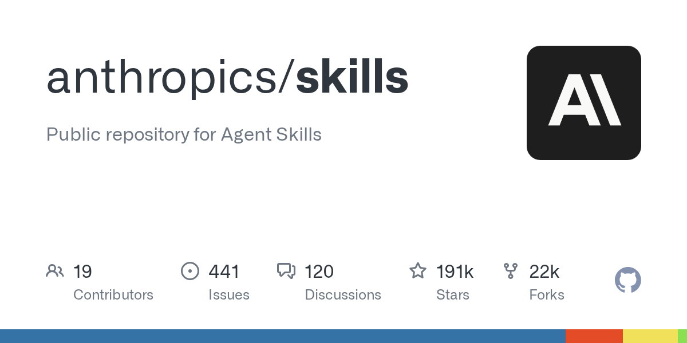
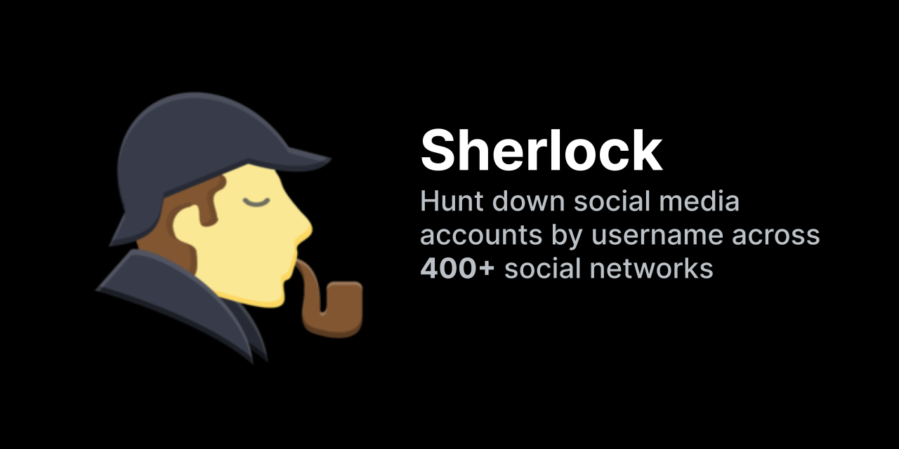
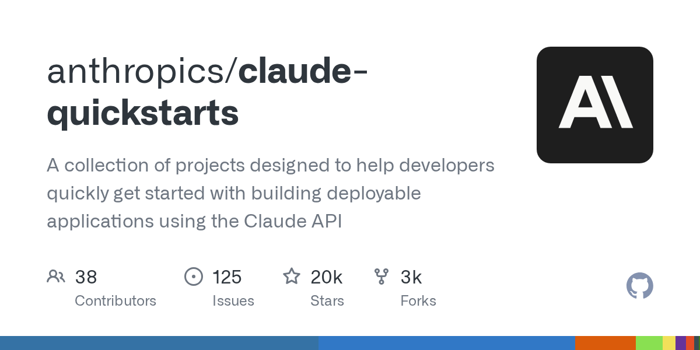
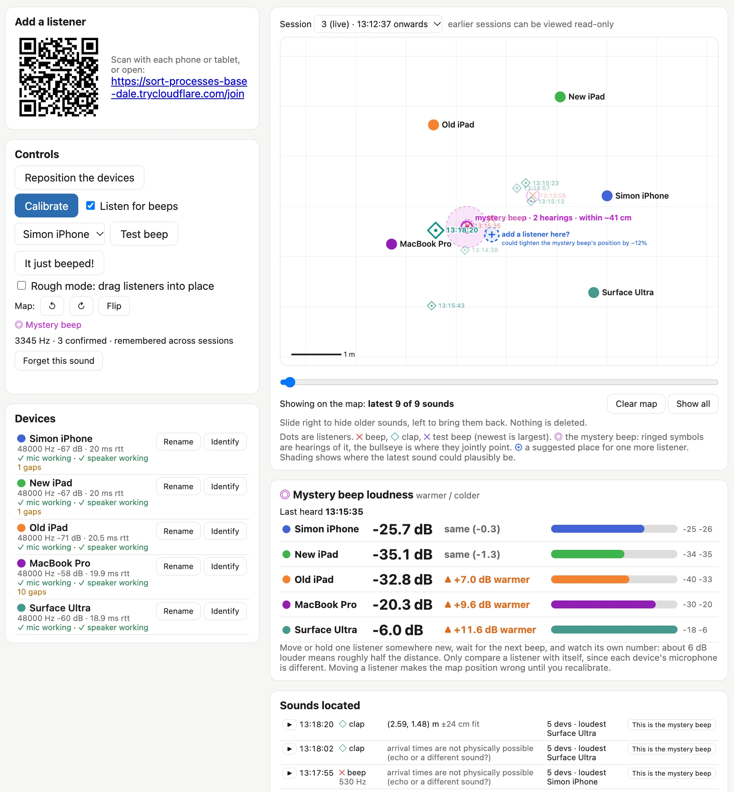

# AI 资讯日报 2026-11-10

> 自动抓取 AI 公司博客、从业者博客与社区聚合源，并生成中文摘要。

## 今日摘要

```
- ChatGPT Enterprise now available in AWS Marketplace
- Control Room: A central system to track and stop model workloads across our research infrastructure
- CodeRabbit scales agentic software development and ships 20x more
- Kuken Industries searches 70 years of drawings in minutes
- Higgsfield Miracle - 编辑视频的任意部分，而不影响其余部分
```

## 公司动态

1. **[ChatGPT Enterprise now available in AWS Marketplace](https://openai.com/index/chatgpt-enterprise-aws-marketplace)**

   ChatGPT Enterprise is now available through AWS Marketplace, helping organizations simplify procurement through existing AWS purchasing and billing relationships.

   来源：OpenAI Blog

2. **[Control Room: A central system to track and stop model workloads across our research infrastructure](https://openai.com/index/control-room)**

   Learn how OpenAI’s Control Room tracks model workloads across our research infrastructure and can rapidly stop them when safety or security concerns arise.

   来源：OpenAI Blog

3. **[CodeRabbit scales agentic software development and ships 20x more](https://openai.com/index/coderabbit-codex-daybreak)**

   CodeRabbit uses OpenAI models to govern and trust AI-generated code and Codex to ship 20 times more software with the same engineering team.

   来源：OpenAI Blog

4. **[Kuken Industries searches 70 years of drawings in minutes](https://openai.com/index/kuken)**

   Kuken Industries uses the OpenAI API to search 70 years of cooling tower drawings. Engineers can find the drawing for a repair in 4.5 minutes, down from nearly an hour.

   来源：OpenAI Blog

## 每日产品

1. **[Higgsfield Miracle - 编辑视频的任意部分，而不影响其余部分](https://www.producthunt.com/r/SQJXVLATW6UFHE)**

   *{padding:0;margin:0;overflow:hidden}html,body{height:100%}img,span{position:absolute;width:100%;top:0;bottom:0;margin:auto}span{height:1.5em;text-align:center;font:48px/1.5 sans-serif;color:white;text-shadow:0 0 0.5em black}▶" frameborder="0" allow="accelerometer; autoplay; encrypted-media; gyroscope; picture-in-picture" allowfullscreen > Edit any part of a video without changing the rest (www.producthunt.com) 11-09 ↑ 112 PH Upvotes

   来源：Product Hunt Daily

2. **[MCP1 - 每台 MCP 服务器对应一个 URL。](https://www.producthunt.com/r/QC2MD2OS3ZT23L)**

   One URL for every MCP server. (www.producthunt.com) 11-09 ↑ 111 PH Upvotes

   

   来源：Product Hunt Daily

3. **[GitHub New PR Overview - 在滚动页面之前，先看看是什么阻碍了PR的通过](https://www.producthunt.com/r/CNDTGBVSQ4JX55)**

   See what's blocking a PR before you scroll (www.producthunt.com) 11-09 ↑ 107 PH Upvotes

   

   来源：Product Hunt Daily

4. **[ProtoMap - 别再浪费 AI 代币去重新发现依赖关系了](https://www.producthunt.com/r/AK5JMQTTDBGMD4)**

   Stop wasting AI tokens rediscovering dependencies (www.producthunt.com) 11-09 ↑ 104 PH Upvotes

   

   来源：Product Hunt Daily

5. **[Product Hunt MCP - 您信赖的社区，您使用的助手](https://www.producthunt.com/r/ERQDTXX2HLG67G)**

   The community you trust in the assistant you use (www.producthunt.com) 11-09 PH Link

   

   来源：Product Hunt Daily

6. **[Arcjet AI security models - 一套针对编码代理的定制训练安全模型家族](https://www.producthunt.com/r/VT6JRMB2LSBNQT)**

   A family of custom-trained security models for coding agents (www.producthunt.com) 11-09 PH Link

   

   来源：Product Hunt Daily

7. **[Databox CLI - 终端中的代理分析平台](https://www.producthunt.com/r/BTKDEK3DQ7EK3M)**

   Your agentic analytics platform in the terminal (www.producthunt.com) 11-09 PH Link

   

   来源：Product Hunt Daily

8. **[Dageno AI 2.0 - 了解为什么人工智能会推荐你的竞争对手而不是你](https://www.producthunt.com/r/ZUTLEQZYV5KE47)**

   See why AI recommends your competitors instead of you (www.producthunt.com) 11-09 PH Link

   

   来源：Product Hunt Daily

9. **[Agent Clan - 通过手势指挥你的克劳德代码和科德克斯特工](https://www.producthunt.com/r/FM5JX2VIU22Z3M)**

   *{padding:0;margin:0;overflow:hidden}html,body{height:100%}img,span{position:absolute;width:100%;top:0;bottom:0;margin:auto}span{height:1.5em;text-align:center;font:48px/1.5 sans-serif;color:white;text-shadow:0 0 0.5em black}▶" frameborder="0" allow="accelerometer; autoplay; encrypted-media; gyroscope; picture-in-picture" allowfullscreen > Command your Claude Code and Codex agents with gestures (www.producthunt.com) 11-08 ↑ 94 PH Upvotes

   来源：Product Hunt Daily

10. **[outages.live - 面向客服代表的免费实时故障信息推送](https://www.producthunt.com/r/SO7EMFRAKO7TPP)**

   A free live outage feed for your agents (www.producthunt.com) 11-08 ↑ 100 PH Upvotes

   

   来源：Product Hunt Daily

## GitHub 项目

1. **[anthropics/skills](https://github.com/anthropics/skills)**

   Public repository for Agent Skills Language: Python Stars: 191244 Forks: 22463

   

   来源：GitHub Trending Daily

2. **[meta/astryx](https://github.com/meta/astryx)**

   An open source design system that's fully customizable and agent ready Language: TypeScript Stars: 20564 Forks: 1557

   

   来源：GitHub Trending Daily

3. **[sherlock-project/sherlock](https://github.com/sherlock-project/sherlock)**

   Hunt down social media accounts by username across social networks Language: Python Stars: 107478 Forks: 12435

   

   来源：GitHub Trending Daily

4. **[google-deepmind/mujoco](https://github.com/google-deepmind/mujoco)**

   Multi-Joint dynamics with Contact. A general purpose physics simulator. Language: C++ Stars: 17004 Forks: 2000

   

   来源：GitHub Trending Daily

5. **[anthropics/claude-quickstarts](https://github.com/anthropics/claude-quickstarts)**

   A collection of projects designed to help developers quickly get started with building deployable applications using the Claude API Language: Python Stars: 20110 Forks: 3320

   

   来源：GitHub Trending Daily

6. **[garrytan/gbrain](https://github.com/garrytan/gbrain)**

   Garry's Opinionated OpenClaw/Hermes Agent Brain Language: TypeScript Stars: 32254 Forks: 4774

   

   来源：GitHub Trending Daily

7. **[vercel-labs/agent-browser](https://github.com/vercel-labs/agent-browser)**

   Browser automation CLI for AI agents Language: Rust Stars: 48623 Forks: 3309

   

   来源：GitHub Trending Daily

8. **[ruvnet/RuView](https://github.com/ruvnet/RuView)**

   π RuView turns commodity WiFi signals into real-time spatial intelligence, vital sign monitoring, and presence detection — all without a single pixel of video. Language: Rust Stars: 103576 Forks: 13417

   

   来源：GitHub Trending Daily

9. **[ZhuLinsen/daily_stock_analysis](https://github.com/ZhuLinsen/daily_stock_analysis)**

   LLM 驱动的多市场股票智能分析系统：多源行情、实时新闻、决策看板与自动推送，支持零成本定时运行。 LLM-powered multi-market stock analysis system with multi-source market data, real-time news, decision dashboard, automated notifications, and cost-free scheduled runs. Language: Python Stars: 69095 Forks: 56443

   

   来源：GitHub Trending Daily

10. **[homeassistant-ai/ha-mcp](https://github.com/homeassistant-ai/ha-mcp)**

   Configure and automate Home Assistant with Claude, ChatGPT, and other AI assistants. Language: Python Stars: 6095 Forks: 297

   

   来源：GitHub Trending Daily

## 从业者观点

1. **[llm-anthropic 0.31](https://simonwillison.net/2026/Nov/9/llm-anthropic/)**

   Release: llm-anthropic 0.31 Anthropic released Fable 5.2 and Mythos 5.2 today. I've added them to llm-anthropic , so you can now run prompts through Fable 5.2 like this: uv tool install llm llm install llm-anthropic llm keys set anthropic # paste key here llm -m claude-fable-5.2 "Generate an SVG of a pelican riding a bicycle" I ran pelicans at all five reasoning levels - low , medium , high , xhigh , and max . You can see them all here - here's the best result I got, from xhigh : [图片: https://static.simonwillison.net/static/2026/fable-5.2-xhigh.avif] max failed to return an image at all, running out of tokens after spending 128,000 thinking about them . That's the same bug that I saw with Opus 5.5 - but it's new for the Fable series, both Fable 5 and Fable 5.1 returned max effort pelicans just fine. Tags: llm , anthropic , claude , generative-ai , pelican-riding-a-bicycle , ai , llms , claude-mythos-fable

   

   来源：Simon Willison

2. **[Locating the source of a mysterious beep with Claude](https://simonwillison.net/2026/Nov/9/mysterious-beeps/)**

   Our house has a box room, full of boxes that we still haven't unpacked from our last move. A couple of weeks ago something in that room started intermittently beeping . The beeps were far enough apart that standing in the room and trying to determine the source of the noise was frustrating, and I really didn't want to dig through every one of those boxes. So I had Claude Code build Beep Locator , a software system for triangulating the source of a mysterious beep using multiple devices scattered around the room. Here's what Beep Locator looks like after it has been running for a while: [图片: Screenshot of a web app that uses several phones, tablets and laptops as microphones to locate a mystery beeping sound in a room. The left column has an &quot;Add a listener&quot; panel with a QR code and join link, a &quot;Controls&quot; panel with buttons including &quot;Calibrate&quot;, &quot;Test beep&quot; and &quot;It just beeped!&quot; plus a &quot;Listen for beeps&quot; checkbox, and a &quot;Mystery beep&quot; note reading &quot;3345 Hz · 3 confirmed · remembered across sessions&quot;. Below that, a &quot;Devices&quot; list shows five color-coded listeners (Simon iPhone, New iPad, Old iPad, MacBook Pro, Surface Ultra), each marked &quot;✓ mic working · ✓ speaker working&quot;. The main area is a gridded map with a 1 m scale bar that shows the five devices as colored dots and earlier sounds as small timestamped markers. A pink shaded circle near the MacBook Pro is labeled &quot;mystery beep · 2 hearings · within ~41 cm&quot;, and beside it a dashed plus marker suggests &quot;add a listener here? could tighten the mystery beep's position by ~12%&quot;. Below the map, a &quot;Mystery beep loudness warmer / colder&quot; panel shows a bar for each device: Surface Ultra is loudest at &quot;-6.0 dB ▲ +11.6 dB warmer&quot;, with the note &quot;about 6 dB louder means roughly half the distance&quot;. At the bottom, a &quot;Sounds located&quot; table lists recent claps and beeps with coordinates, or the warning &quot;arrival times are not physically possible (echo or a different sound?)&quot;. https://static.simonwillison.net/static/2026/beep-locator-ui.webp] You run Python web server to show the primary UI, and then use the QR code or URL to connect as many devices as you can spare to act as listeners - I was using two iPads, a phone, a MacBook Pro and a Surface Ultra. The devices then play noises to each other to help estimate their locations. This didn't work particularly well, so I added a "Rough mode" where you can drag their icons around in the space to provide rough locations which are then adjusted based on those sounds. Once that's set up, the devices all listen for the beep! I added a clapping mode too so I could test it by clapping my hands in different locations around the room - displayed as diamonds on the map. This helped me gain confidence that it was capable of locating a sound. Beeps show up on the map as an X, plus a line in the "Sounds located" log. You can replay these sounds (from each device in turn) to confirm they are the mysterious beep you are looking for, then click "This is the mystery beep" to mark them as such. Once you've confirmed the mysterious beep frequency the system will listen out for it, measure the interval between beeps, and use the triangulated locations to lock down the most likely location on the map. The system worked as intended. It gave me the position of the beep to within about 40cm, then I dug through that specific pile of boxes and found an ancient carbon monoxide detector that desperately wanted its batteries replaced. How it works When I started working through this problem with Claude it quickly dug up BeepBeep: A High-Accuracy Acoustic-Based System for Ranging and Localization Using COTS Devices , a 2007 paper by Chunyi Peng, Guobin Shen, Yongguang Zhang, Yanlin Li, and Kun Tan. Here's that paper's abstract: We present the design, implementation, and evaluation of BeepBeep, a high-accuracy acoustic-based ranging system. It operates in a spontaneous, ad-hoc, and device-to-device context without leveraging any pre-planned infrastructure. It is a pure software-based solution and uses only the most basic set of commodity hardware – a speaker, a microphone, and some form of device-to-device communication – so that it is readily applicable to many low-cost sensor platforms and to most commercial-off-the-shelf mobile devices like cell phones and PDAs. It achieves high accuracy through a combination of three techniques: two-way sensing, self-recording, and sample counting. That sounded exactly like what we needed to build! Beep Locator runs a Python web application server that does most of the work. The listening devices then connect to that server via WebSockets and present a UI which requests browser microphone access. The listeners mainly work by recording a 60 second buffer of recent audio. They also run a simple beep detection algorithm (see detector.js ), which uses Fast Fourier Transform and a high-pass filter to identify potential beeps. It sends these events to the main server. When a beep is reported, the server has a device play a short chirp (the device with the lowest round-trip time to the server), then asks every listener upload a clip from about 0.6s before the beep to 0.8s after that chirp. This chirp allows the clips to be aligned with each other, a crucial step in locating the beep. How I built it I started this project using Claude Code Cloud via my iPhone, with Opus 5.5 running in Extra thinking effort mode. Here's that shared starter session , which began with this prompt against a newly created empty GitHub repository: Write out a problem.md file describing the problem we want to solve There is a device beeping in a room and I cannot find it I want to set up several devices - laptops, phones, iPads - around the room all listening at the same time and have them help triangulate where the beep comes from There needs to be a Python web app which coordinates it all - one device shows a web page for the app, other devices join a URL which turns them into listeners - all via browser WebAudio and WebSockets back to the Python server app Ideally I wouldn't need to manually input the relative locations of the devices - it would be amazing if they could play sounds to each other in order to locate each other in 2D space - is that even possible though? That got me this problem.md file . As part of writing that up Claude found and read the BeepBeep paper, which is described in that file. The research looked good, so I told it: Ok try and build it, add a mechanism so you can send new code to the listeners which they will then run automatically - that way I can set everything up in the room and then leave you alone to continue hacking and experiment while I do something else That got me to this point - most of the system was built, but nothing had actually tried running it yet. I cloned the new repository to my laptop and fired up Claude Code... and then Fable 5.2 was released , and this project seemed like an excellent opportunity to put that through its paces. I had Claude Code on my laptop start the server running, then made sure it could both see what was happening and make live changes to the software as it ran. This was already baked into the software: Opus 5.5 had built an installModule() method on the listeners that could be triggered over the WebSocket connection, meaning the admin server could execute arbitrary new code on any of its clients. On some devices, web pages that listen on the microphone request user permission any time the page reloads. The hot-swap module mechanism meant that we could deploy new code without having to manually interact with each of the listening devices in turn. From that point on my involvement was mainly to sit by the laptop chatting with Fable 5.2 about what was going on, and occasionally requesting new features. Here are some of the feature prompts I ran: I think we need to make it so I can drag things around on the map in “rough mode”, where my job is just to put them roughly where they are, then switch out of rough mode and it attempts to get them accurate This gave me the ability to drag listeners around the map. what’s a good way for me to test this I wonder? Can we have it listen for claps, then I could clap and it could identify the location of the clap? [...] Claps should use a different symbol on the map than beeps That added the thing where any time I clapped it would show on the map as a different symbol from the beeps. each symbol on the map should include a HH:MM:SS timestamp That made it easier to spot which symbol likely reflected which real-world sound. The log should show beeps and claps with their timestamps AND have a little play button which, when clicked, replays the recorded noise from each of the listeners in sequence (with clear text on screen showing which listener recorded which snippet) while temporarily turning off microphone recording while that replay plays Now I could replay sounds, making it much easier to identify which recorded clip was the mysterious beep I was looking for. There should be a button next to a recording for “This is the mystery beep” - then I can hit replay to see and then confirm it was the mystery beep if that’s the one I am looking for Then the system can categorize noises in the future to see if they are likely that same mysterious beep and use that information to build a more accurate idea of where it is At this point I was getting close - I had a solid idea of where the beep was coming from, but wouldn't it be neat if I could reposition the listeners around that point to get an even finer location? I want a feature for this, I don’t want to have to restart each listening device etc, I want to be able to click a “Reposition the devices” button which lets me switch into repositioning, then I click “Repositioned” and it puts me into Rough mode and asks me to roughly locate them, then I do that and click, then it starts up again. The previous session can be read-only viewed through the app. And since I had one spare device, I then said: add a feature where the map includes a spot that is a suggestion for a location that it would be useful to add a listener at - based on data collected so far Giving Claude Code ears I think the most interesting part of this project is that I demonstrated it's possible to give Claude Code ears . Claude doesn't have native audio input (yet), but it can run JavaScript and Python code that can analyze audio captured by a microphone. I told it to run a web server with WebSocket connections to multiple listening devices, then had it both run a WebAudio microphone on those devices and hook them up so they could be sent fresh JavaScript code to execute via that WebSocket. Then I could pretty much leave Claude alone, hacking away at the problem, querying the audio logs, and reconfiguring its ears to help it solve the problem. I'm reminded of a similar hack I heard about at GitHub Universe a few weeks ago, where Martin Woodward told me he had been debugging the GitHub Universe Badge computers by plugging them into a computer via USB-C and then pointing a webcam at their screen, so his coding agent could tell if updates were working correctly or not. Figuring out ways to let coding agents perceive the world around them is a whole lot of fun. Tags: projects , ai , generative-ai , llms , claude , coding-agents , claude-code , claude-mythos-fable

   

   来源：Simon Willison

3. **[The Web Is More Than Enough, by Paul Ford](https://simonwillison.net/2026/Nov/9/hn-50421091/)**

   My comment on The Web Is More Than Enough, by Paul Ford &mdash; Hacker News. OK, this comment convinced me to give that a shot. Here's a thing I made in Three.js this morning - a Nudibranch themed Faberge Egg: https://static.simonwillison.net/static/2026/Hidden-Reef-Egg... (77KB) I just asked Claude (Opus 5.5 Medium running in regular Claude Chat) to port that to Vanilla JS, in the same thread where it had built it, and got this: https://static.simonwillison.net/static/2026/Hidden-Reef-Egg... (98KB) They aren't identical - you can see what Claude said about that in the transcript (I don't fully understand why it differed): https://claude.ai/share/e56d163e-2793-4677-aa11-191d5058b414 But yeah, it turns out Claude Opus 5.5 is perfectly capable of 3D modeling in Vanilla JS + WebGL without Three.js. In eyeballing the code I find the Three.js slightly easier to understand myself, but I rarely look at the code for these 3D projects so that isn't a particularly big deal. Tags: claude , javascript , three-js , hacker-news , generative-ai , ai , llms

   来源：Simon Willison

4. **[Hide your slop PR descriptions behind <details><summary>](https://simonwillison.net/2026/Nov/9/details-summary/)**

   Most of the changes I make to my projects these days come in the form of PRs opened for me by Claude Code or Codex. The PR is my unit of work - I use them to bundle commits together, iterating on them until a feature is complete, document decisions and then merge the finished result. Today's coding agents are great at writing PR descriptions. They're too good at describing the work The problem is that they are too good. An agent-written PR description is accurate and comprehensive. It describes the problem, the detailed solution, and the steps taken to verify it. That's a lot of information to absorb. It's not necessarily slop, but it reads like slop! It's very easy to spot an AI-written PR, and as with other forms of AI writing my instant reaction is best summarized as "I'm not reading all of that". It doesn't matter how accurate or useful the information is, I'm instantly put off by the thought that it will take me longer to read than it took the driving author to write... even when that driving author is me! I want human editorial judgement. I want someone to have thought just long enough about the PR to give me a human-approved introduction that helps me understand, at a high level, what the PR is for and whether it deserves more of my attention. I think I've found a low-effort way to do this that feels right. Hide most of it in a details/summary The HTML &lt;details&gt;&lt;summary&gt; elements render as a collapsed heading (the summary) that can be expanded to view the larger piece of text. The code looks like this: &lt; details &gt; &lt; summary &gt; Claude Opus 5.5 &lt;/ summary &gt; &lt; h2 &gt; The hook &lt;/ h2 &gt; Plugins implement &lt; code &gt; register_agent_reference_types(datasette) &lt;/ code &gt; ... &lt;/ details &gt; When rendered, it looks like this : [图片: Screenshot of a GitHub PR. The text &quot;Claude Opus 5.5&quot; sits next to a little black arrow. Clicking on that text expands a full description inside the PR body. https://static.simonwillison.net/static/2026/details-summary-pr.gif] Crucially, &lt;details&gt;&lt;summary&gt; is supported in GitHub Markdown . You can drop those tags directly into an issue comment or PR description and GitHub will hide the details and display just the summary plus an expansion arrow. I've started using this for my AI-generated pull requests. The opening paragraph of my PRs will be carefully selected to act as a high-level explanation of what's going on - the shortest text a human can read that will help get them up to speed. I'll sometimes throw in a screenshot as well, since images are often the best way to quickly illustrate a new feature. The full agent-written essay then follows in a &lt;details&gt;&lt;summary&gt; . I use the model name and often the effort level as that summary, to make it abundantly clear what is going on - "Claude Opus 5.5 Medium" for example. My PRs don't feel nearly as sloppy now! The information is all still there, but a reader can glance at it and get the top, human-curated information without their eyes glazing over at multiple paragraphs of agent-written details. I don't always write the introduction myself - sometimes the agent has given me what I need already, hidden away in the avalanche of other text. My promise to the reader is that the short opener will represent my human judgement as to what is definitely worth their time. Here are some recent examples where I've used this pattern, including the opener I used: datasette PR #3052: Redesign row page as a vertical list of fields - "The row page showed its single row as a one-row table. For wide tables, like a 46-column GitHub repos table, that scrolled far off to the right and left most of the page blank." (then a screenshot) datasette PR #3043: Pagination bar showing which rows are on the current page - "Table pages that span more than one page now make it obvious where you are, and offer navigation at the top of the page as well as the bottom." (plus screenshot) datasette PR #3042: Load edit-tools.js on demand via a small loader - " edit-tools.js (~220KB) was loaded on every table, row and database page, even for users who couldn't edit anything. Now only load it for users who can edit when they first interact with an edit feature (including mouse over an edit link)." datasette-agent PR #51: register_agent_reference_types plugin hook - "Lets plugins add their own kinds of item to the # tagging in the chat composer using a new register_agent_reference_types(datasette) plugin hook." - pictured above. llm PR #1838: Add llm openai endpoint add/list/remove/path commands - "Adds commands for managing the records in extra-openai-models.yaml , so OpenAI-compatible endpoints can be saved from the command line instead of by hand-editing YAML." - then copied --help output. The mnemonic I used to have trouble remembering the order of the tags - is it &lt;details&gt;&lt;summary&gt; or &lt;summary&gt;&lt;details&gt; ? Here are two tricks that helped me. First, and most obviously, the &lt;summary&gt; is clearly the bit where you summarize the details. That's the tag for your line of text that can be clicked to expand - the &lt;details&gt; element must then wrap everything else. An even better trick is to always refer to these two tags as "details-summary". "details-summary" is two syllables followed by three syllables. That rolls off the tongue more smoothly than the three-two punch of "summary-details". Say "details-summary" out loud just a few times and you'll never forget the order of the tags again. (I still wish GitHub would add a button to their Markdown editor for this - partly to save me painstakingly typing it on my mobile keyboard, and partly to help spread the word to more GitHub users that this feature exists.) Tags: github , html , markdown , ai , datasette , generative-ai , llms , ai-assisted-programming , llm , coding-agents

   

   来源：Simon Willison

5. **[parse_number() as a SQLite extension: C vs Rust](https://simonwillison.net/2026/Nov/8/sqlite-parse-number-c-vs-rust/)**

   Research: parse_number() as a SQLite extension: C vs Rust I was out walking the dog when I got curious about how easy/difficult it would be to write a SQLite C extension that adds a parse_number() function for turning strings like -$1,234.56 or '12.5%' into numeric values that could be summed and sorted. I fired up regular Claude chat (Opus 5.5) and prompted : I'm thinking about a SQLite custom function 'parse_number(value)' that strips ',', '$', '£' and '%', handles a leading '-', and returns 'NULL' for anything it can’t parse Explore the difference between building this as a SQLite extension in C v.s. in Rust - I want to compare performance and code complexity and size of the resulting .so (or whatever) file This gave me a solid starting point - the Rust extension was 321 KB (using Rusqlite ) and 298 KB (using sqlite-loadable-rs ), while the C extension was 14 KB. But the Rust extension was faster! Turns out that's because the Rust equivalent of C's strtod is "twice as fast". So I prompted: Try writing your own C function for parsing text into a decimal number that catches up to or beats the Rust implementation And it did, using "Clinger's fast path": Net cost per row over 2 million rows, lower is better: first C new C rusqlite sqlite-loadable Mixed data 67 ns 19 ns 46 ns 41 ns Integers only 25 ns 16 ns 36 ns 32 ns Decimals only 106 ns 18 ns 55 ns 47 ns Finally, I had it rewrite the prototype as a research report to match the others in simonw/research by prompting this: Clone simonw/research from GitHub and turn your above investigation into a research report as seen in that repository - you can give me a zip file to download that contains your new folder Here's the resulting report . Tags: research , c , rust , sqlite , claude

   来源：Simon Willison

6. **[datasette #3046: Don't serve link: rel=next HTTP headers to Firefox for HTML pages](https://simonwillison.net/2026/Nov/7/link-rel-next/)**

   datasette #3046: Don&#x27;t serve link: rel=next HTTP headers to Firefox for HTML pages I was looking at the Firefox network panel today when I noticed that requests to a Datasette table page were triggering an HTTP prefetch to the next page of rows in that table. This was happening because Datasette pages serve an HTTP link header like this: link: &lt;https://latest.datasette.io/fixtures/compound_three_primary_keys?_next=a%2Cd%2Cv&gt;; rel="next" This is bad. A tiny fraction of the visitors to one of those pages will click the "next" link, which means for everyone else their browser is fetching unnecessary data and the Datasette server is having to render an entire page that then gets thrown away. I dug in and learned that Firefox has an issue that has been open for 24 years about this behavior... And one of the early comments on that issue links to my blog post from 2002 complaining about this feature. I hadn't just forgotten that I had written about it, I had forgotten the feature entirely! Tags: firefox , html , mozilla , datasette

   来源：Simon Willison

## 社区热点

1. **[CoreWeave bond yield tops 16% as AI credit stress rises](https://www.cnbc.com/2026/11/06/coreweave-bond-yield-tops-16percent-as-ai-credit-stress-rises.html)**

   Article URL: https://www.cnbc.com/2026/11/06/coreweave-bond-yield-tops-16percent-as-ai-credit-stress-rises.html Comments URL: https://news.ycombinator.com/item?id=50435660 Points: 40 # Comments: 4

   来源：Hacker News AI

2. **[A year after the 100% AI mandate nobody understands our code](https://www.reddit.com/r/ClaudeCode/comments/1xq2n3t/a_year_after_the_100_ai_mandate_nobody/)**

   https://redlib.catsarch.com/r/ClaudeCode/comments/1xq2n3t/a_... Comments URL: https://news.ycombinator.com/item?id=50433079 Points: 116 # Comments: 143

   来源：Hacker News AI

3. **[Claude Fable 5.2 scores 65 on Artificial Analysis, highest so far](https://artificialanalysis.ai/models/claude-fable-5-2)**

   Article URL: https://artificialanalysis.ai/models/claude-fable-5-2 Comments URL: https://news.ycombinator.com/item?id=50431144 Points: 310 # Comments: 230

   来源：Hacker News AI

4. **[Claude Fable 5.2](https://twitter.com/claudeai/status/2119867114450268322)**

   Article URL: https://twitter.com/claudeai/status/2119867114450268322 Comments URL: https://news.ycombinator.com/item?id=50429947 Points: 30 # Comments: 6

   来源：Hacker News AI

5. **[Claude Fable 5.2 and Mythos 5.2](https://www.anthropic.com/claude-fable-and-mythos-5-2)**

   Article URL: https://www.anthropic.com/claude-fable-and-mythos-5-2 Comments URL: https://news.ycombinator.com/item?id=50429906 Points: 967 # Comments: 6

   来源：Hacker News AI

6. **[Show HN: STE80 Humanizer – de-AI text by writing 80% of the way to ASD-STE100](https://github.com/Dodaios/ste80-humanizer)**

   Article URL: https://github.com/Dodaios/ste80-humanizer Comments URL: https://news.ycombinator.com/item?id=50429144 Points: 70 # Comments: 21

   来源：Hacker News AI

7. **[6 Hours of YouTube and 85 handtyped pages of notes on LLM Inference – Start here](https://github.com/samir-sarwar/samir-vllm)**

   Article URL: https://github.com/samir-sarwar/samir-vllm Comments URL: https://news.ycombinator.com/item?id=50424199 Points: 77 # Comments: 12

   来源：Hacker News AI

8. **[Ginux: A New Kernel Runs Linux Userspace, Made via Human-Directed AI Engineering](https://zenodo.org/records/23682548)**

   Article URL: https://zenodo.org/records/23682548 Comments URL: https://news.ycombinator.com/item?id=50424147 Points: 32 # Comments: 62

   来源：Hacker News AI

9. **[370 Books in 20 months: South African author defends her use of AI](https://www.enca.com/lifestyle/370-books-20-months-sa-author-defends-her-use-ai)**

   Article URL: https://www.enca.com/lifestyle/370-books-20-months-sa-author-defends-her-use-ai Comments URL: https://news.ycombinator.com/item?id=50422181 Points: 44 # Comments: 89

   来源：Hacker News AI

10. **[Catching prompt injections hidden in PDFs](https://tomclancy.info/joshua-judges-ruth.html)**

   Comments

   来源：Lobsters AI

11. **[Firecracker VM Escape: PwnEscape Part 2](https://pwn.ai/blog/firecracker-escape)**

   Comments

   来源：Lobsters AI

## 论文与模型

1. **[WorldFoundry: Towards Unified Infrastructure for World Intelligence](https://arxiv.org/abs/2611.10771)**

   Visual generative models increasingly blur the line between synthesizing observations and simulating environments. Yet visual plausibility alone does not constitute successful world modeling: compelling outputs may lack persistent state, physical dynamics, or causally consistent responses to interactions. We define a generative world model as a predictive dynamical system that maintains a persistent, history-conditioned representation of an environment, updates that representation in response to actions or interventions, and generates temporally coherent trajectories that reflect outcomes under observed and counterfactual interventions. From this definition, we derive an intelligence-oriented framework spanning perceptual grounding, persistent state modeling, controllable transformation, dynamics-aware prediction, and closed-loop interaction. We present WorldFoundry, open-source infrastructure for reproducible inference and evaluation across video, 3D and 4D, embodied action, and interactive world systems. WorldFoundry unifies model and benchmark discovery, runtime and asset preparation, execution orchestration, artifact management, and interactive visualization, while modality-specific adapters preserve native inputs, execution semantics, output representations, and evaluation protocols. Explicit manifests, durable artifact contracts, and evidence-aware scorecards separate execution readiness from evaluative claims, making each claim traceable to its supporting artifacts. The catalog contains 270 model entries, 74 benchmarks, and 62 registered metric entries, with readiness and execution evidence recorded separately. WorldFoundry enables reproducible comparison of persistent, controllable dynamics across heterogeneous systems, advancing the field from perceptual synthesis toward measurable world intelligence.

   来源：HuggingFace Papers

2. **[JoVox: Joint Hierarchical Flow Matching for Lightweight Voxel Generation](https://arxiv.org/abs/2611.10690)**

   Generating high-fidelity voxels while keeping their lightweight nature remains an open problem in computer vision. Current generators are either high-fidelity but computationally heavy, or lightweight but of lower fidelity. Hierarchical methods keep the lightweight nature of voxels. However, their coarse levels, which decide where all finer cells can appear, are generated with the least information about the shape and are never revisited, so they are often plausible but wrong. Our key insight is to let finer cells take part in deciding coarse cells. To this end, we propose JoVox, a discrete flow matching framework that learns the joint distribution of all levels of the voxel hierarchy, instead of a separate distribution for each level, so that coarse cells can be predicted with finer cells already generated nearby. Within this framework, we further introduce a two-level prediction, which outputs the cells two levels finer at once instead of one level finer, halving the number of levels that the network processes and yielding voxels of higher fidelity. We also introduce an unmasking strategy that revisits early decisions once finer cells are generated and corrects inconsistencies in masked diffusion models. Our framework outperforms the baselines on both unconditional and image-conditioned voxel generation. Compared with the current state-of-the-art TRELLIS.2, we achieve 8x higher training throughput, 1/15 of the FLOPs in a forward pass, train on 4 vs. 32 GPUs, and obtain higher quality with an 11% lower Chamfer distance.

   来源：HuggingFace Papers
