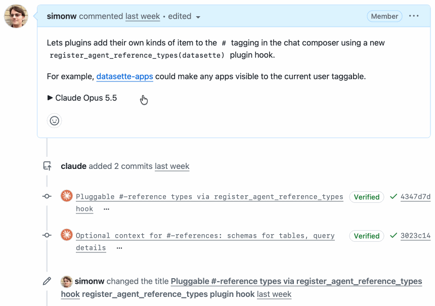

# AI 资讯日报 2026-11-10

> 自动抓取 AI 公司博客、从业者博客与社区聚合源，并生成中文摘要。

## 今日摘要

```
- ChatGPT Enterprise now available in AWS Marketplace
- Kuken Industries searches 70 years of drawings in minutes
- Higgsfield Miracle - 编辑视频的任意部分，而不影响其余部分
- MCP1 - 每台 MCP 服务器对应一个 URL。
- GitHub New PR Overview - 在滚动页面之前，先看看是什么阻碍了PR的通过
```

## 公司动态

1. **[ChatGPT Enterprise now available in AWS Marketplace](https://openai.com/index/chatgpt-enterprise-aws-marketplace)**

   ChatGPT Enterprise is now available through AWS Marketplace, helping organizations simplify procurement through existing AWS purchasing and billing relationships.

   来源：OpenAI Blog

2. **[Kuken Industries searches 70 years of drawings in minutes](https://openai.com/index/kuken)**

   Kuken Industries uses the OpenAI API to search 70 years of cooling tower drawings. Engineers can find the drawing for a repair in 4.5 minutes, down from nearly an hour.

   来源：OpenAI Blog

## 每日产品

1. **[Higgsfield Miracle - 编辑视频的任意部分，而不影响其余部分](https://www.producthunt.com/r/SQJXVLATW6UFHE)**

   *{padding:0;margin:0;overflow:hidden}html,body{height:100%}img,span{position:absolute;width:100%;top:0;bottom:0;margin:auto}span{height:1.5em;text-align:center;font:48px/1.5 sans-serif;color:white;text-shadow:0 0 0.5em black}▶" frameborder="0" allow="accelerometer; autoplay; encrypted-media; gyroscope; picture-in-picture" allowfullscreen > Edit any part of a video without changing the rest (www.producthunt.com) 11-09 ↑ 112 PH Upvotes

   来源：Product Hunt Daily

2. **[MCP1 - 每台 MCP 服务器对应一个 URL。](https://www.producthunt.com/r/QC2MD2OS3ZT23L)**

   One URL for every MCP server. (www.producthunt.com) 11-09 ↑ 111 PH Upvotes

   

   来源：Product Hunt Daily

3. **[GitHub New PR Overview - 在滚动页面之前，先看看是什么阻碍了PR的通过](https://www.producthunt.com/r/CNDTGBVSQ4JX55)**

   See what's blocking a PR before you scroll (www.producthunt.com) 11-09 ↑ 107 PH Upvotes

   

   来源：Product Hunt Daily

4. **[ProtoMap - 别再浪费 AI 代币去重新发现依赖关系了](https://www.producthunt.com/r/AK5JMQTTDBGMD4)**

   Stop wasting AI tokens rediscovering dependencies (www.producthunt.com) 11-09 ↑ 104 PH Upvotes

   

   来源：Product Hunt Daily

5. **[Product Hunt MCP - 您信赖的社区，您使用的助手](https://www.producthunt.com/r/ERQDTXX2HLG67G)**

   The community you trust in the assistant you use (www.producthunt.com) 11-09 PH Link

   

   来源：Product Hunt Daily

6. **[Arcjet AI security models - 一套针对编码代理的定制训练安全模型家族](https://www.producthunt.com/r/VT6JRMB2LSBNQT)**

   A family of custom-trained security models for coding agents (www.producthunt.com) 11-09 PH Link

   

   来源：Product Hunt Daily

7. **[Databox CLI - 终端中的代理分析平台](https://www.producthunt.com/r/BTKDEK3DQ7EK3M)**

   Your agentic analytics platform in the terminal (www.producthunt.com) 11-09 PH Link

   

   来源：Product Hunt Daily

8. **[Dageno AI 2.0 - 了解为什么人工智能会推荐你的竞争对手而不是你](https://www.producthunt.com/r/ZUTLEQZYV5KE47)**

   See why AI recommends your competitors instead of you (www.producthunt.com) 11-09 PH Link

   

   来源：Product Hunt Daily

9. **[Agent Clan - 通过手势指挥你的克劳德代码和科德克斯特工](https://www.producthunt.com/r/FM5JX2VIU22Z3M)**

   *{padding:0;margin:0;overflow:hidden}html,body{height:100%}img,span{position:absolute;width:100%;top:0;bottom:0;margin:auto}span{height:1.5em;text-align:center;font:48px/1.5 sans-serif;color:white;text-shadow:0 0 0.5em black}▶" frameborder="0" allow="accelerometer; autoplay; encrypted-media; gyroscope; picture-in-picture" allowfullscreen > Command your Claude Code and Codex agents with gestures (www.producthunt.com) 11-08 ↑ 94 PH Upvotes

   来源：Product Hunt Daily

10. **[outages.live - 面向客服代表的免费实时故障信息推送](https://www.producthunt.com/r/SO7EMFRAKO7TPP)**

   A free live outage feed for your agents (www.producthunt.com) 11-08 ↑ 100 PH Upvotes

   

   来源：Product Hunt Daily

## 从业者观点

1. **[The Web Is More Than Enough, by Paul Ford](https://simonwillison.net/2026/Nov/9/hn-50421091/)**

   My comment on The Web Is More Than Enough, by Paul Ford &mdash; Hacker News. OK, this comment convinced me to give that a shot. Here's a thing I made in Three.js this morning - a Nudibranch themed Faberge Egg: https://static.simonwillison.net/static/2026/Hidden-Reef-Egg... (77KB) I just asked Claude (Opus 5.5 Medium running in regular Claude Chat) to port that to Vanilla JS, in the same thread where it had built it, and got this: https://static.simonwillison.net/static/2026/Hidden-Reef-Egg... (98KB) They aren't identical - you can see what Claude said about that in the transcript (I don't fully understand why it differed): https://claude.ai/share/e56d163e-2793-4677-aa11-191d5058b414 But yeah, it turns out Claude Opus 5.5 is perfectly capable of 3D modeling in Vanilla JS + WebGL without Three.js. In eyeballing the code I find the Three.js slightly easier to understand myself, but I rarely look at the code for these 3D projects so that isn't a particularly big deal. Tags: hacker-news , javascript , ai , generative-ai , llms , claude , three-js

   来源：Simon Willison

2. **[Hide your slop PR descriptions behind <details><summary>](https://simonwillison.net/2026/Nov/9/details-summary/)**

   Most of the changes I make to my projects these days come in the form of PRs opened for me by Claude Code or Codex. The PR is my unit of work - I use them to bundle commits together, iterating on them until a feature is complete, document decisions and then merge the finished result. Today's coding agents are great at writing PR descriptions. They're too good at describing the work The problem is that they are too good. An agent-written PR description is accurate and comprehensive. It describes the problem, the detailed solution, and the steps taken to verify it. That's a lot of information to absorb. It's not necessarily slop, but it reads like slop! It's very easy to spot an AI-written PR, and as with other forms of AI writing my instant reaction is best summarized as "I'm not reading all of that". It doesn't matter how accurate or useful the information is, I'm instantly put off by the thought that it will take me longer to read than it took the driving author to write... even when that driving author is me! I want human editorial judgement. I want someone to have thought just long enough about the PR to give me a human-approved introduction that helps me understand, at a high level, what the PR is for and whether it deserves more of my attention. I think I've found a low-effort way to do this that feels right. Hide most of it in a details/summary The HTML &lt;details&gt;&lt;summary&gt; elements render as a collapsed heading (the summary) that can be expanded to view the larger piece of text. The code looks like this: &lt; details &gt; &lt; summary &gt; Claude Opus 5.5 &lt;/ summary &gt; &lt; h2 &gt; The hook &lt;/ h2 &gt; Plugins implement &lt; code &gt; register_agent_reference_types(datasette) &lt;/ code &gt; ... &lt;/ details &gt; When rendered, it looks like this : [图片: Screenshot of a GitHub PR. The text &quot;Claude Opus 5.5&quot; sits next to a little black arrow. Clicking on that text expands a full description inside the PR body. https://static.simonwillison.net/static/2026/details-summary-pr.gif] Crucially, &lt;details&gt;&lt;summary&gt; is supported in GitHub Markdown . You can drop those tags directly into an issue comment or PR description and GitHub will hide the details and display just the summary plus an expansion arrow. I've started using this for my AI-generated pull requests. The opening paragraph of my PRs will be carefully selected to act as a high-level explanation of what's going on - the shortest text a human can read that will help get them up to speed. I'll sometimes throw in a screenshot as well, since images are often the best way to quickly illustrate a new feature. The full agent-written essay then follows in a &lt;details&gt;&lt;summary&gt; . I use the model name and often the effort level as that summary, to make it abundantly clear what is going on - "Claude Opus 5.5 Medium" for example. My PRs don't feel nearly as sloppy now! The information is all still there, but a reader can glance at it and get the top, human-curated information without their eyes glazing over at multiple paragraphs of agent-written details. I don't always write the introduction myself - sometimes the agent has given me what I need already, hidden away in the avalanche of other text. My promise to the reader is that the short opener will represent my human judgement as to what is definitely worth their time. Here are some recent examples where I've used this pattern, including the opener I used: datasette PR #3052: Redesign row page as a vertical list of fields - "The row page showed its single row as a one-row table. For wide tables, like a 46-column GitHub repos table, that scrolled far off to the right and left most of the page blank." (then a screenshot) datasette PR #3043: Pagination bar showing which rows are on the current page - "Table pages that span more than one page now make it obvious where you are, and offer navigation at the top of the page as well as the bottom." (plus screenshot) datasette PR #3042: Load edit-tools.js on demand via a small loader - " edit-tools.js (~220KB) was loaded on every table, row and database page, even for users who couldn't edit anything. Now only load it for users who can edit when they first interact with an edit feature (including mouse over an edit link)." datasette-agent PR #51: register_agent_reference_types plugin hook - "Lets plugins add their own kinds of item to the # tagging in the chat composer using a new register_agent_reference_types(datasette) plugin hook." - pictured above. llm PR #1838: Add llm openai endpoint add/list/remove/path commands - "Adds commands for managing the records in extra-openai-models.yaml , so OpenAI-compatible endpoints can be saved from the command line instead of by hand-editing YAML." - then copied --help output. The mnemonic I used to have trouble remembering the order of the tags - is it &lt;details&gt;&lt;summary&gt; or &lt;summary&gt;&lt;details&gt; ? Here are two tricks that helped me. First, and most obviously, the &lt;summary&gt; is clearly the bit where you summarize the details. That's the tag for your line of text that can be clicked to expand - the &lt;details&gt; element must then wrap everything else. An even better trick is to always refer to these two tags as "details-summary". "details-summary" is two syllables followed by three syllables. That rolls off the tongue more smoothly than the three-two punch of "summary-details". Say "details-summary" out loud just a few times and you'll never forget the order of the tags again. (I still wish GitHub would add a button to their Markdown editor for this - partly to save me painstakingly typing it on my mobile keyboard, and partly to help spread the word to more GitHub users that this feature exists.) Tags: github , html , markdown , ai , datasette , generative-ai , llms , ai-assisted-programming , llm , coding-agents

   

   来源：Simon Willison

3. **[parse_number() as a SQLite extension: C vs Rust](https://simonwillison.net/2026/Nov/8/sqlite-parse-number-c-vs-rust/)**

   Research: parse_number() as a SQLite extension: C vs Rust I was out walking the dog when I got curious about how easy/difficult it would be to write a SQLite C extension that adds a parse_number() function for turning strings like -$1,234.56 or '12.5%' into numeric values that could be summed and sorted. I fired up regular Claude chat (Opus 5.5) and prompted : I'm thinking about a SQLite custom function 'parse_number(value)' that strips ',', '$', '£' and '%', handles a leading '-', and returns 'NULL' for anything it can’t parse Explore the difference between building this as a SQLite extension in C v.s. in Rust - I want to compare performance and code complexity and size of the resulting .so (or whatever) file This gave me a solid starting point - the Rust extension was 321 KB (using Rusqlite ) and 298 KB (using sqlite-loadable-rs ), while the C extension was 14 KB. But the Rust extension was faster! Turns out that's because the Rust equivalent of C's strtod is "twice as fast". So I prompted: Try writing your own C function for parsing text into a decimal number that catches up to or beats the Rust implementation And it did, using "Clinger's fast path": Net cost per row over 2 million rows, lower is better: first C new C rusqlite sqlite-loadable Mixed data 67 ns 19 ns 46 ns 41 ns Integers only 25 ns 16 ns 36 ns 32 ns Decimals only 106 ns 18 ns 55 ns 47 ns Finally, I had it rewrite the prototype as a research report to match the others in simonw/research by prompting this: Clone simonw/research from GitHub and turn your above investigation into a research report as seen in that repository - you can give me a zip file to download that contains your new folder Here's the resulting report . Tags: c , research , sqlite , rust , claude

   来源：Simon Willison

4. **[datasette #3046: Don't serve link: rel=next HTTP headers to Firefox for HTML pages](https://simonwillison.net/2026/Nov/7/link-rel-next/)**

   datasette #3046: Don&#x27;t serve link: rel=next HTTP headers to Firefox for HTML pages I was looking at the Firefox network panel today when I noticed that requests to a Datasette table page were triggering an HTTP prefetch to the next page of rows in that table. This was happening because Datasette pages serve an HTTP link header like this: link: &lt;https://latest.datasette.io/fixtures/compound_three_primary_keys?_next=a%2Cd%2Cv&gt;; rel="next" This is bad. A tiny fraction of the visitors to one of those pages will click the "next" link, which means for everyone else their browser is fetching unnecessary data and the Datasette server is having to render an entire page that then gets thrown away. I dug in and learned that Firefox has an issue that has been open for 24 years about this behavior... And one of the early comments on that issue links to my blog post from 2002 complaining about this feature. I hadn't just forgotten that I had written about it, I had forgotten the feature entirely! Tags: firefox , html , mozilla , datasette

   来源：Simon Willison

5. **[Terry Pratchett's Study](https://simonwillison.net/2026/Nov/7/hn-50407316/)**

   My comment on Terry Pratchett&#x27;s Study &mdash; Hacker News. Terry Pratchett once wrote about the concept of "horizontal wealth". Vertical wealth is where you spend money on rich people stuff - yachts and suchlike. Horizontal wealth is where you spend more money on the things you liked before you got rich: https://chibuikeani.blogspot.com/2017/02/the-price-of-happin... But horizontal wealth means not letting your increased income dictate your tastes. You like books and now you have money? Buy more books! Change those catenary bookshelves for good hardwood ones! In my case, build a library extension to your office. And, of course, you buy what will be useful for that most wonderful of pursuits, blind research, which is research without direction for the sheer joy of it. (Original source is his book A Slip of the Keyboard - this linked blog post quotes that bit.) Tags: hacker-news , terry-pratchett

   来源：Simon Willison

## 社区热点

1. **[Catching prompt injections hidden in PDFs](https://tomclancy.info/joshua-judges-ruth.html)**

   Comments

   来源：Lobsters AI

2. **[Firecracker VM Escape: PwnEscape Part 2](https://pwn.ai/blog/firecracker-escape)**

   Comments

   来源：Lobsters AI
