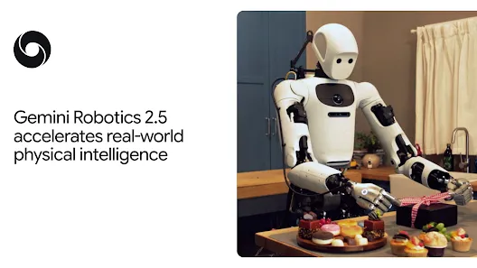
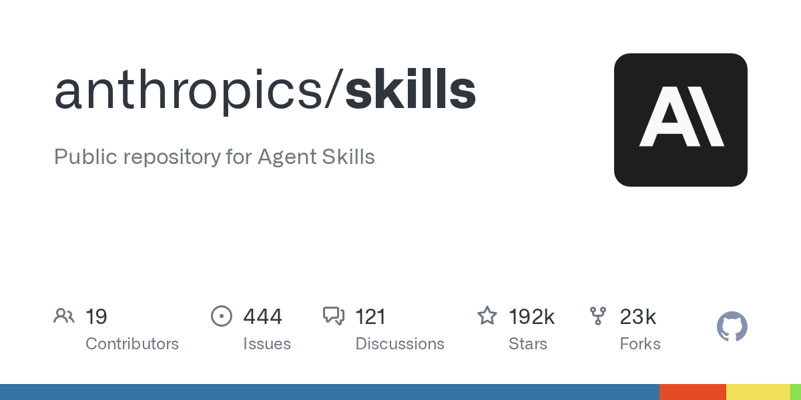
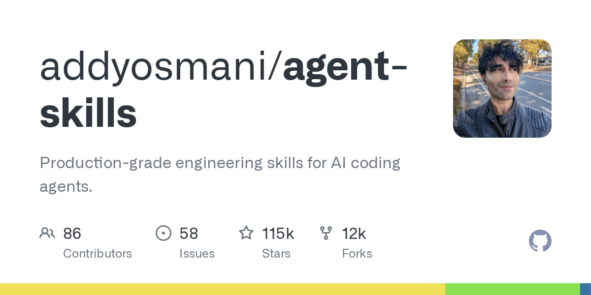
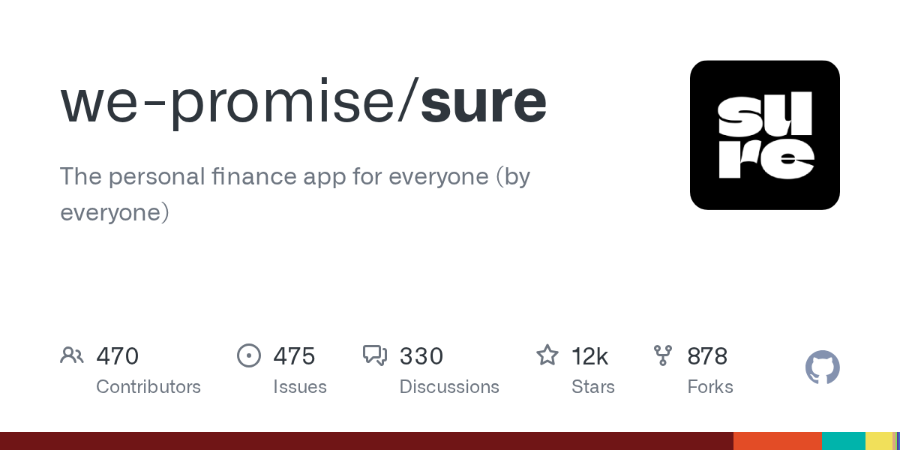
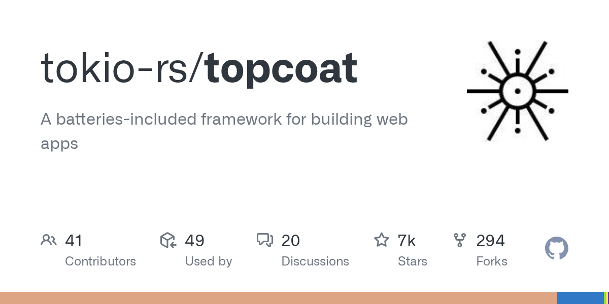
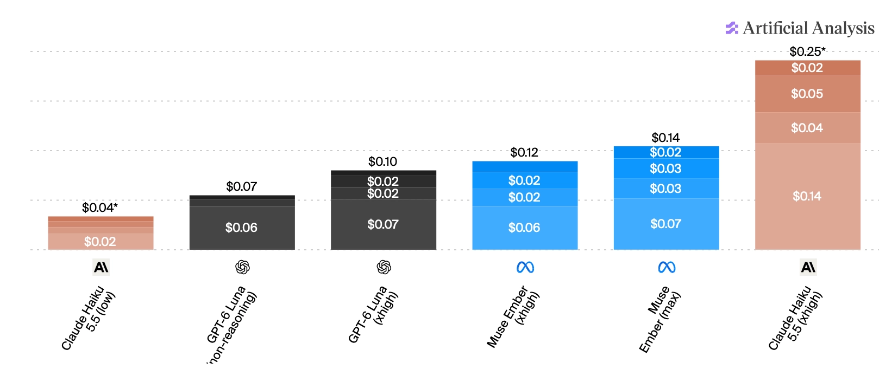
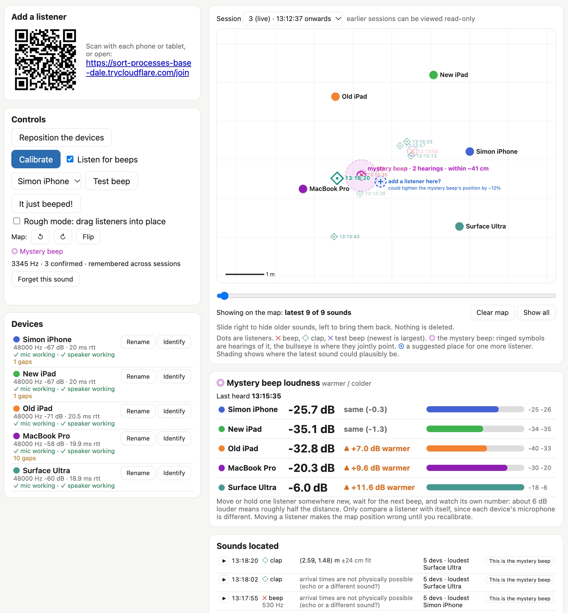

# AI 资讯日报 2026-11-11

> 自动抓取 AI 公司博客、从业者博客与社区聚合源，并生成中文摘要。

## 今日摘要

```
- Helping caregivers use AI in everyday life
- Closing the AI guidance gap in education
- Work at the Frontier: AI’s effect on freelance work
- ChatGPT Enterprise now available in AWS Marketplace
- Control Room: A central system to track and stop model workloads across our research infrastructure
```

## 公司动态

1. **[Helping caregivers use AI in everyday life](https://openai.com/index/helping-caregivers-use-ai-in-everyday-life)**

   OpenAI Academy is bringing free, hands-on ChatGPT workshops to caregivers in five U.S. cities, helping them build practical AI skills for everyday life.

   来源：OpenAI Blog

2. **[Closing the AI guidance gap in education](https://openai.com/index/closing-ai-guidance-gap-education)**

   New ThinkYoung research and lessons from OpenAI’s EMEA education partnerships on supporting teachers, AI literacy, and independent learning.

   来源：OpenAI Blog

3. **[Work at the Frontier: AI’s effect on freelance work](https://openai.com/index/ai-effect-on-freelance-work)**

   New research from OpenAI and Upwork finds shifting demand for freelance work, new skill combinations, and larger budgets and more hours for AI-related projects.

   来源：OpenAI Blog

4. **[ChatGPT Enterprise now available in AWS Marketplace](https://openai.com/index/chatgpt-enterprise-aws-marketplace)**

   ChatGPT Enterprise is now available through AWS Marketplace, helping organizations simplify procurement through existing AWS purchasing and billing relationships.

   来源：OpenAI Blog

5. **[Control Room: A central system to track and stop model workloads across our research infrastructure](https://openai.com/index/control-room)**

   Learn how OpenAI’s Control Room tracks model workloads across our research infrastructure and can rapidly stop them when safety or security concerns arise.

   来源：OpenAI Blog

6. **[CodeRabbit scales agentic software development and ships 20x more](https://openai.com/index/coderabbit-codex-daybreak)**

   CodeRabbit uses OpenAI models to govern and trust AI-generated code and Codex to ship 20 times more software with the same engineering team.

   来源：OpenAI Blog

7. **[Kuken Industries searches 70 years of drawings in minutes](https://openai.com/index/kuken)**

   Kuken Industries uses the OpenAI API to search 70 years of cooling tower drawings. Engineers can find the drawing for a repair in 4.5 minutes, down from nearly an hour.

   来源：OpenAI Blog

8. **[Gemini 4 Carbon is now available](https://deepmind.google/blog/gemini-4-carbon-is-now-available/)**

   暂无摘要。

   来源：DeepMind Blog

9. **[Introducing AlphaProof Code: a breakthrough in verifying complex software at depth](https://deepmind.google/blog/introducing-alphaproof-code/)**

   AlphaProof Code agents wrote three million lines of proofs in Lean to verify Signal’s core encryption.

   

   来源：DeepMind Blog

10. **[Gemini Robotics 2.5 accelerates real-world general dexterity](https://deepmind.google/blog/gemini-robotics-2-5-accelerates-real-world-physical-intelligence/)**

   Our most capable vision-language-action model enhances robot dexterity, reliability, and safety

   

   来源：DeepMind Blog

## 每日产品

1. **[TK by Medium - 一本助你激发最佳思维的行动力笔记本](https://www.producthunt.com/r/LI2LWCHJGY3KGQ)**

   An agentic notebook to build your best thinking (www.producthunt.com) 11-10 ↑ 129 PH Upvotes

   

   来源：Product Hunt Daily

2. **[Seldon - 像普通客户一样使用您产品的行为质量保证（QA）测试人员](https://www.producthunt.com/r/RPNOP3ZZNQ6M6M)**

   *{padding:0;margin:0;overflow:hidden}html,body{height:100%}img,span{position:absolute;width:100%;top:0;bottom:0;margin:auto}span{height:1.5em;text-align:center;font:48px/1.5 sans-serif;color:white;text-shadow:0 0 0.5em black}▶" frameborder="0" allow="accelerometer; autoplay; encrypted-media; gyroscope; picture-in-picture" allowfullscreen > Behavioral QA agents that use your product like customers do (www.producthunt.com) 11-10 ↑ 124 PH Upvotes

   来源：Product Hunt Daily

3. **[Opal Reader - 在 iPhone Duo 上阅读 PDF 和 EPUB 文件](https://www.producthunt.com/r/O24YA6ZJ2ASOV6)**

   *{padding:0;margin:0;overflow:hidden}html,body{height:100%}img,span{position:absolute;width:100%;top:0;bottom:0;margin:auto}span{height:1.5em;text-align:center;font:48px/1.5 sans-serif;color:white;text-shadow:0 0 0.5em black}▶" frameborder="0" allow="accelerometer; autoplay; encrypted-media; gyroscope; picture-in-picture" allowfullscreen > Read PDFs and EPUBs on iPhone Duo (www.producthunt.com) 11-10 ↑ 112 PH Upvotes

   来源：Product Hunt Daily

4. **[Latch.ai - 无需任何提示，即可实现复杂会计工作的自动化](https://www.producthunt.com/r/LMHIUZD4KWZDR5)**

   Automate complex accounting work without a single prompt (www.producthunt.com) 11-10 ↑ 111 PH Upvotes

   

   来源：Product Hunt Daily

5. **[Alsona - 将购买信号转化为已预约销售电话的AI代理](https://www.producthunt.com/r/6777NBXG6GHZDS)**

   AI agents that turn buying signals into booked sales calls (www.producthunt.com) 11-10 ↑ 115 PH Upvotes

   

   来源：Product Hunt Daily

6. **[Maxma - 全天候待命的AI队友，助您提升付费广告效果](https://www.producthunt.com/r/GQHET4C6E2F2ZS)**

   The 24/7 AI teammate that scales your paid ad performance (www.producthunt.com) 11-10 PH Link

   

   来源：Product Hunt Daily

7. **[Pawse.ai - 专为狗狗设计的音效，而非人类](https://www.producthunt.com/r/OJSJK4CTR4K5RL)**

   Sound engineered for dogs, not humans (www.producthunt.com) 11-09 ↑ 107 PH Upvotes

   

   来源：Product Hunt Daily

8. **[Cardboard AI - 使用人工智能编辑视频的最佳方法](https://www.producthunt.com/r/CUFL5L7KXTX4V4)**

   *{padding:0;margin:0;overflow:hidden}html,body{height:100%}img,span{position:absolute;width:100%;top:0;bottom:0;margin:auto}span{height:1.5em;text-align:center;font:48px/1.5 sans-serif;color:white;text-shadow:0 0 0.5em black}▶" frameborder="0" allow="accelerometer; autoplay; encrypted-media; gyroscope; picture-in-picture" allowfullscreen > Best way to edit videos with AI (www.producthunt.com) 11-09 ↑ 108 PH Upvotes

   来源：Product Hunt Daily

9. **[Voyager -  一款具备主动操作能力的文件浏览器，助您轻松浏览工作环境](https://www.producthunt.com/r/DECOX5K4UP7P3G)**

   An agentic file browser to navigate your work context (www.producthunt.com) 11-09 ↑ 127 PH Upvotes

   

   来源：Product Hunt Daily

10. **[Higgsfield Miracle - 编辑视频的任意部分，而不影响其余部分](https://www.producthunt.com/r/SQJXVLATW6UFHE)**

   *{padding:0;margin:0;overflow:hidden}html,body{height:100%}img,span{position:absolute;width:100%;top:0;bottom:0;margin:auto}span{height:1.5em;text-align:center;font:48px/1.5 sans-serif;color:white;text-shadow:0 0 0.5em black}▶" frameborder="0" allow="accelerometer; autoplay; encrypted-media; gyroscope; picture-in-picture" allowfullscreen > Edit any part of a video without changing the rest (www.producthunt.com) 11-09 ↑ 112 PH Upvotes

   来源：Product Hunt Daily

## GitHub 项目

1. **[meta/astryx](https://github.com/meta/astryx)**

   An open source design system that's fully customizable and agent ready Language: TypeScript Stars: 22255 Forks: 1779

   来源：GitHub Trending Daily

2. **[anthropics/skills](https://github.com/anthropics/skills)**

   Public repository for Agent Skills Language: Python Stars: 192059 Forks: 22616

   

   来源：GitHub Trending Daily

3. **[addyosmani/agent-skills](https://github.com/addyosmani/agent-skills)**

   Production-grade engineering skills for AI coding agents. Language: JavaScript Stars: 114977 Forks: 12075

   

   来源：GitHub Trending Daily

4. **[anthropics/claude-quickstarts](https://github.com/anthropics/claude-quickstarts)**

   A collection of projects designed to help developers quickly get started with building deployable applications using the Claude API Language: Python Stars: 20378 Forks: 3458

   来源：GitHub Trending Daily

5. **[google-deepmind/mujoco](https://github.com/google-deepmind/mujoco)**

   Multi-Joint dynamics with Contact. A general purpose physics simulator. Language: C++ Stars: 17261 Forks: 2138

   来源：GitHub Trending Daily

6. **[we-promise/sure](https://github.com/we-promise/sure)**

   The personal finance app for everyone (by everyone) Language: Ruby Stars: 11702 Forks: 878

   

   来源：GitHub Trending Daily

7. **[homeassistant-ai/ha-mcp](https://github.com/homeassistant-ai/ha-mcp)**

   Configure and automate Home Assistant with Claude, ChatGPT, and other AI assistants. Language: Python Stars: 6481 Forks: 424

   

   来源：GitHub Trending Daily

8. **[vercel-labs/agent-browser](https://github.com/vercel-labs/agent-browser)**

   Browser automation CLI for AI agents Language: Rust Stars: 49056 Forks: 3442

   

   来源：GitHub Trending Daily

9. **[sherlock-project/sherlock](https://github.com/sherlock-project/sherlock)**

   Hunt down social media accounts by username across social networks Language: Python Stars: 108668 Forks: 12638

   

   来源：GitHub Trending Daily

10. **[tokio-rs/topcoat](https://github.com/tokio-rs/topcoat)**

   A batteries-included framework for building web apps Language: Rust Stars: 6692 Forks: 294

   

   来源：GitHub Trending Daily

## 从业者观点

1. **[Introducing Our Smallest, Most Efficient Model: Muse Ember](https://simonwillison.net/2026/Nov/10/muse-ember/)**

   Introducing Our Smallest, Most Efficient Model: Muse Ember Meta AI just launched their entry in the Claude Haiku/GPT Luna category: Muse Ember, which they describe as: [...] our smallest and most efficient model designed for complex reasoning execution and the work agents repeat all day: tool calls, coding subtasks, routing, extraction, and long document parsing. For shorter prompts it's priced the same as GPT-6 Luna and Claude Haiku 5.5 - both are $0.10/million input tokens and $0.50/million output. Today's other big model release, Claude Fable 5.2, is 80x that price at $8/$40. The pricing is a little less straightforward as prompts get longer, though. Luna, Ember, and Haiku all support up to a million input tokens, but they also all have a threshold after which the price goes up. Taking that threshold into account Ember is priced between the two others: Model Prompt size Input ($/M) Cached input Output GPT-6 Luna ≤272k $0.10 $0.01 $0.50 &gt;272k $0.20 $0.02 $0.75 Muse Ember 1.0 ≤200k $0.10 $0.004 $0.50 &gt;200k $0.30 $0.012 $1.50 Claude Haiku 5.5 ≤100k $0.10 $0.01 $0.50 &gt;100k $0.50 $0.05 $2.50 But comparing price-per-token doesn't really make sense these days, when reasoning tokens mean that different models might use dramatically different numbers of tokens to solve the same problem. For that, one measure that's useful is the Artificial Analysis. [图片: https://static.simonwillison.net/static/2026/artificial-analysis-haiku-class.webp] And even more useful than that is their Intelligence Index vs. Cost per Task chart, which shows the following for those three models: [图片: https://static.simonwillison.net/static/2026/artificial-analysis-pareto.webp] The Muse Ember models sit right on that Pareto line - the line at which you can only improve one dimension by giving up another. Meta call this out in their announcement: It also sits on the efficiency frontier of the full Artificial Analysis leaderboard: no model scores higher for less per task. (That grey dot on the Pareto line in the middle of the green area is GPT-6.1 Terra (low) - clearly I should be paying more attention to the Terra family!) Muse Ember has six reasoning levels - minimal, low, medium, high, xhigh, and max - so I rendered six pelicans riding bicycles . The "high" reasoning level failed to return a full SVG, and the other SVGs were surprising in that the reasoning level didn't cleanly map to the visual quality of the response. Here's the "max" one, but the others are worth a look too: [图片: https://static.simonwillison.net/static/2026/muse-ember.webp] The Ember pelicans are comparable in quality to those I got from Muse Wonder , which is 40x the price of Muse Ember. Tags: ai , generative-ai , llms , meta , llm-pricing , llm-release , artificial-analysis , muse

   

   来源：Simon Willison

2. **[Quoting Prompting Claude Fable 5.2](https://simonwillison.net/2026/Nov/10/prompting-claude-fable-52/)**

   Claude Fable 5.2 responds closely to what the prompt says about who owns the code it works on. In Anthropic’s testing on small coding tasks, when a prompt said nothing about ownership or presented the code base as someone else’s, the model tended to add to the existing structure, even when that repeated existing code. [...] If you want the model to improve the structure as it works, say that the code is its own: This codebase is yours: what it's for and how it's built are your call, and you'll keep building on it. In Anthropic’s testing on small coding tasks, the model merged repeated code in about half of the tries with this sentence, and in under a tenth of the tries without it. &mdash; Prompting Claude Fable 5.2 , Anthropic documentation Tags: prompt-engineering , anthropic , generative-ai , ai , llms , claude-mythos-fable

   来源：Simon Willison

3. **[Yonkers Rises](https://simonwillison.net/2026/Nov/10/yonkers-rises/)**

   Tool: Yonkers Rises I realized I didn't know where Yonkers was, so I looked it up on Google Maps and then, to help embed its location and shape in my head (and to try out Claude Fable 5.2's 3D modeling and animation skills), I prompted Fable 5.2 Medium to: Make a three js animation where yonkers stands up as a big mech (cool stand up motion) and átomos around manhattan and queens and Brooklyn, use openstreetmap mapping data It correctly deduced that "átomos" was a mobile keyboard typo for "stomps": Tags: three-js , llms , ai , generative-ai , claude-mythos-fable

   来源：Simon Willison

4. **[llm-anthropic 0.31](https://simonwillison.net/2026/Nov/9/llm-anthropic/)**

   Release: llm-anthropic 0.31 Anthropic released Fable 5.2 and Mythos 5.2 today. Fable 5.2 is currently ranked first on Artificial Analysis . Anthropic say it "solved two open problems in the physics of black holes", so clearly their internal benchmarks have become more ambitious! I've added the new models to llm-anthropic , so you can now run prompts through Fable 5.2 like this: uv tool install llm llm install llm-anthropic llm keys set anthropic # paste key here llm -m claude-fable-5.2 "Generate an SVG of a pelican riding a bicycle" I ran pelicans at all five reasoning levels - low , medium , high , xhigh , and max . You can see them all here - here's the best result I got, from xhigh : [图片: https://static.simonwillison.net/static/2026/fable-5.2-xhigh.avif] max failed to return an image at all, running out of tokens after spending 128,000 thinking about them . That's the same bug that I saw with Opus 5.5 - but it's new for the Fable series, both Fable 5 and Fable 5.1 returned max effort pelicans just fine. It's priced at $8/million input and $40/million output, which is a 20% discount on the previous Fable 5.1 ($10/$50). I also used Fable 5.2 to help identify the source of a mysterious beep . Tags: llm , anthropic , claude , generative-ai , pelican-riding-a-bicycle , ai , llms , claude-mythos-fable

   

   来源：Simon Willison

5. **[Locating the source of a mysterious beep with Claude](https://simonwillison.net/2026/Nov/9/mysterious-beeps/)**

   Our house has a box room, full of boxes that we still haven't unpacked from our last move. A couple of weeks ago something in that room started intermittently beeping . The beeps were far enough apart that standing in the room and trying to determine the source of the noise was frustrating, and I really didn't want to dig through every one of those boxes. So I had Claude Code build Beep Locator , a software system for triangulating the source of a mysterious beep using multiple devices scattered around the room. Here's what Beep Locator looks like after it has been running for a while: [图片: Screenshot of a web app that uses several phones, tablets and laptops as microphones to locate a mystery beeping sound in a room. The left column has an &quot;Add a listener&quot; panel with a QR code and join link, a &quot;Controls&quot; panel with buttons including &quot;Calibrate&quot;, &quot;Test beep&quot; and &quot;It just beeped!&quot; plus a &quot;Listen for beeps&quot; checkbox, and a &quot;Mystery beep&quot; note reading &quot;3345 Hz · 3 confirmed · remembered across sessions&quot;. Below that, a &quot;Devices&quot; list shows five color-coded listeners (Simon iPhone, New iPad, Old iPad, MacBook Pro, Surface Ultra), each marked &quot;✓ mic working · ✓ speaker working&quot;. The main area is a gridded map with a 1 m scale bar that shows the five devices as colored dots and earlier sounds as small timestamped markers. A pink shaded circle near the MacBook Pro is labeled &quot;mystery beep · 2 hearings · within ~41 cm&quot;, and beside it a dashed plus marker suggests &quot;add a listener here? could tighten the mystery beep's position by ~12%&quot;. Below the map, a &quot;Mystery beep loudness warmer / colder&quot; panel shows a bar for each device: Surface Ultra is loudest at &quot;-6.0 dB ▲ +11.6 dB warmer&quot;, with the note &quot;about 6 dB louder means roughly half the distance&quot;. At the bottom, a &quot;Sounds located&quot; table lists recent claps and beeps with coordinates, or the warning &quot;arrival times are not physically possible (echo or a different sound?)&quot;. https://static.simonwillison.net/static/2026/beep-locator-ui.webp] You run Python web server to show the primary UI, and then use the QR code or URL to connect as many devices as you can spare to act as listeners - I was using two iPads, a phone, a MacBook Pro and a Surface Ultra. The devices then play noises to each other to help estimate their locations. This didn't work particularly well, so I added a "Rough mode" where you can drag their icons around in the space to provide rough locations which are then adjusted based on those sounds. Once that's set up, the devices all listen for the beep! I added a clapping mode too so I could test it by clapping my hands in different locations around the room - displayed as diamonds on the map. This helped me gain confidence that it was capable of locating a sound. Beeps show up on the map as an X, plus a line in the "Sounds located" log. You can replay these sounds (from each device in turn) to confirm they are the mysterious beep you are looking for, then click "This is the mystery beep" to mark them as such. Once you've confirmed the mysterious beep frequency the system will listen out for it, measure the interval between beeps, and use the triangulated locations to lock down the most likely location on the map. The system worked as intended. It gave me the position of the beep to within about 40cm, then I dug through that specific pile of boxes and found an ancient carbon monoxide detector that desperately wanted its batteries replaced. How it works When I started working through this problem with Claude it quickly dug up BeepBeep: A High-Accuracy Acoustic-Based System for Ranging and Localization Using COTS Devices , a 2007 paper by Chunyi Peng, Guobin Shen, Yongguang Zhang, Yanlin Li, and Kun Tan. Here's that paper's abstract: We present the design, implementation, and evaluation of BeepBeep, a high-accuracy acoustic-based ranging system. It operates in a spontaneous, ad-hoc, and device-to-device context without leveraging any pre-planned infrastructure. It is a pure software-based solution and uses only the most basic set of commodity hardware – a speaker, a microphone, and some form of device-to-device communication – so that it is readily applicable to many low-cost sensor platforms and to most commercial-off-the-shelf mobile devices like cell phones and PDAs. It achieves high accuracy through a combination of three techniques: two-way sensing, self-recording, and sample counting. That sounded exactly like what we needed to build! Beep Locator runs a Python web application server that does most of the work. The listening devices then connect to that server via WebSockets and present a UI which requests browser microphone access. The listeners mainly work by recording a 60 second buffer of recent audio. They also run a simple beep detection algorithm (see detector.js ), which uses Fast Fourier Transform and a high-pass filter to identify potential beeps. It sends these events to the main server. When a beep is reported, the server has a device play a short chirp (the device with the lowest round-trip time to the server), then asks every listener upload a clip from about 0.6s before the beep to 0.8s after that chirp. This chirp allows the clips to be aligned with each other, a crucial step in locating the beep. How I built it I started this project using Claude Code Cloud via my iPhone, with Opus 5.5 running in Extra thinking effort mode. Here's that shared starter session , which began with this prompt against a newly created empty GitHub repository: Write out a problem.md file describing the problem we want to solve There is a device beeping in a room and I cannot find it I want to set up several devices - laptops, phones, iPads - around the room all listening at the same time and have them help triangulate where the beep comes from There needs to be a Python web app which coordinates it all - one device shows a web page for the app, other devices join a URL which turns them into listeners - all via browser WebAudio and WebSockets back to the Python server app Ideally I wouldn't need to manually input the relative locations of the devices - it would be amazing if they could play sounds to each other in order to locate each other in 2D space - is that even possible though? That got me this problem.md file . As part of writing that up Claude found and read the BeepBeep paper, which is described in that file. The research looked good, so I told it: Ok try and build it, add a mechanism so you can send new code to the listeners which they will then run automatically - that way I can set everything up in the room and then leave you alone to continue hacking and experiment while I do something else That got me to this point - most of the system was built, but nothing had actually tried running it yet. I cloned the new repository to my laptop and fired up Claude Code... and then Fable 5.2 was released , and this project seemed like an excellent opportunity to put that through its paces. I had Claude Code on my laptop start the server running, then made sure it could both see what was happening and make live changes to the software as it ran. This was already baked into the software: Opus 5.5 had built an installModule() method on the listeners that could be triggered over the WebSocket connection, meaning the admin server could execute arbitrary new code on any of its clients. On some devices, web pages that listen on the microphone request user permission any time the page reloads. The hot-swap module mechanism meant that we could deploy new code without having to manually interact with each of the listening devices in turn. From that point on my involvement was mainly to sit by the laptop chatting with Fable 5.2 about what was going on, and occasionally requesting new features. Here are some of the feature prompts I ran: I think we need to make it so I can drag things around on the map in “rough mode”, where my job is just to put them roughly where they are, then switch out of rough mode and it attempts to get them accurate This gave me the ability to drag listeners around the map. what’s a good way for me to test this I wonder? Can we have it listen for claps, then I could clap and it could identify the location of the clap? [...] Claps should use a different symbol on the map than beeps That added the thing where any time I clapped it would show on the map as a different symbol from the beeps. each symbol on the map should include a HH:MM:SS timestamp That made it easier to spot which symbol likely reflected which real-world sound. The log should show beeps and claps with their timestamps AND have a little play button which, when clicked, replays the recorded noise from each of the listeners in sequence (with clear text on screen showing which listener recorded which snippet) while temporarily turning off microphone recording while that replay plays Now I could replay sounds, making it much easier to identify which recorded clip was the mysterious beep I was looking for. There should be a button next to a recording for “This is the mystery beep” - then I can hit replay to see and then confirm it was the mystery beep if that’s the one I am looking for Then the system can categorize noises in the future to see if they are likely that same mysterious beep and use that information to build a more accurate idea of where it is At this point I was getting close - I had a solid idea of where the beep was coming from, but wouldn't it be neat if I could reposition the listeners around that point to get an even finer location? I want a feature for this, I don’t want to have to restart each listening device etc, I want to be able to click a “Reposition the devices” button which lets me switch into repositioning, then I click “Repositioned” and it puts me into Rough mode and asks me to roughly locate them, then I do that and click, then it starts up again. The previous session can be read-only viewed through the app. And since I had one spare device, I then said: add a feature where the map includes a spot that is a suggestion for a location that it would be useful to add a listener at - based on data collected so far Giving Claude Code ears I think the most interesting part of this project is that I demonstrated it's possible to give Claude Code ears . Claude doesn't have native audio input (yet), but it can run JavaScript and Python code that can analyze audio captured by a microphone. I told it to run a web server with WebSocket connections to multiple listening devices, then had it both run a WebAudio microphone on those devices and hook them up so they could be sent fresh JavaScript code to execute via that WebSocket. Then I could pretty much leave Claude alone, hacking away at the problem, querying the audio logs, and reconfiguring its ears to help it solve the problem. I'm reminded of a similar hack I heard about at GitHub Universe a few weeks ago, where Martin Woodward told me he had been debugging the GitHub Universe Badge computers by plugging them into a computer via USB-C and then pointing a webcam at their screen, so his coding agent could tell if updates were working correctly or not. Figuring out ways to let coding agents perceive the world around them is a whole lot of fun. Tags: projects , ai , generative-ai , llms , claude , coding-agents , claude-code , claude-mythos-fable

   

   来源：Simon Willison

6. **[The Web Is More Than Enough, by Paul Ford](https://simonwillison.net/2026/Nov/9/hn-50421091/)**

   My comment on The Web Is More Than Enough, by Paul Ford &mdash; Hacker News. OK, this comment convinced me to give that a shot. Here's a thing I made in Three.js this morning - a Nudibranch themed Faberge Egg: https://static.simonwillison.net/static/2026/Hidden-Reef-Egg... (77KB) I just asked Claude (Opus 5.5 Medium running in regular Claude Chat) to port that to Vanilla JS, in the same thread where it had built it, and got this: https://static.simonwillison.net/static/2026/Hidden-Reef-Egg... (98KB) They aren't identical - you can see what Claude said about that in the transcript (I don't fully understand why it differed): https://claude.ai/share/e56d163e-2793-4677-aa11-191d5058b414 But yeah, it turns out Claude Opus 5.5 is perfectly capable of 3D modeling in Vanilla JS + WebGL without Three.js. In eyeballing the code I find the Three.js slightly easier to understand myself, but I rarely look at the code for these 3D projects so that isn't a particularly big deal. Tags: claude , javascript , three-js , hacker-news , generative-ai , ai , llms

   来源：Simon Willison

## 社区热点

1. **[Catching prompt injections hidden in PDFs](https://tomclancy.info/joshua-judges-ruth.html)**

   Comments

   来源：Lobsters AI

## 论文与模型

1. **[Learning Heterogeneous Tactile Representation for General Dexterous Manipulation](https://arxiv.org/abs/2611.12806)**

   Tactile sensing is an indispensable modality for contact-rich dexterous manipulation, a capability that hints at the ultimate frontiers of embodied intelligence. However, commercially available tactile sensors are still at a relatively early stage of development, with each type of sensor offering irreplaceable strengths alongside its own drawbacks. A key challenge is thus to free tactile understanding from sensor-specific physics, so that embodied models can effectively leverage heterogeneous tactile data. To this end, we develop LingBot-Touch, a tactile foundation model characterized by the following properties. (i) Our model yields a unified representation across different tactile sensors (i.e., piezoresistive, magnetic, and visuotactile sensors), and is easily extensible to new sensor types. (ii) The resulting tactile tokens are plug-and-play: they can be seamlessly integrated into policy models across paradigms, from diffusion policy to vision-language-action (VLA) models such as π_{0.5} and LingBot-VLA, consistently enhancing manipulation dexterity. (iii) Extensive experiments, spanning simulation and real-robot deployments across multiple hardware platforms, demonstrate that our tactile representation substantially benefits complex manipulation tasks while maintaining strong computational efficiency. We believe the findings in this work demonstrate the potential of leveraging cross-sensor data to scale tactile learning, and offer encouraging insights for the design of future hardware and embodied models.

   来源：HuggingFace Papers

2. **[Sage-Taiyi: A Metacognitive Architecture for Scientific Discovery](https://arxiv.org/abs/2611.12762)**

   We introduce Sage-Taiyi, a metacognition-inspired architecture that uses accumulated scientific understanding to guide what to investigate next and how to investigate it. Through explicit monitoring and control, the system revises its understanding of evidence, assumptions, and unresolved questions, then uses these assessments to adapt research targets and select reusable reasoning methods. On Taiyi-Bench, an AI co-scientist ideation benchmark comprising 265 tasks from 50 papers across ten disciplines, Sage-Taiyi ranks first on all eight metrics of historical rediscovery and open-ended ideation, achieving an Overall score of 54.0 compared with 47.9 for the strongest baseline, AI Scientist-v2. It also performs well on two external scientific ideation benchmarks. Five expert-guided collaborations further connect its proposals to experimental and computational validation across chemistry, materials science, and engineering. In chemistry, reaction-condition optimization raises the yield of cobalt-catalyzed carbonylation from trace amounts to 84% and photocatalytic allylic amination from 13% to 69%. These results support metacognitive regulation as an approach to scientific ideation and its progression toward practical validation.

   来源：HuggingFace Papers

3. **[Reframe: Observation-Aligned Multi-Teacher On-Policy Distillation for Agentic Visual Reasoning](https://arxiv.org/abs/2611.12886)**

   Agentic reinforcement learning (RL) and multi-teacher on-policy distillation (MOPD) offer complementary routes to post-training. For visual agents, however, tool use presents two related challenges. Models may overlook useful tool-returned observations, while poorly grounded actions can limit the evidence available for subsequent distillation. We introduce Reframe, a post-training framework that treats the observation state, rather than only the output distribution, as an object of alignment. First, Ground-Drop-GRPO (GD-GRPO) trains spatial and temporal specialists with evidence-aware rewards and stochastic removal of the original visual input, encouraging them to acquire grounded evidence and use the returned observations. Second, Observation-Gated-MOPD (OG-MOPD) replaces deficient tool actions with canonical ones mid-rollout and resumes distillation from the repaired observation. The two stages complement each other, as learning to rely on tool-returned observations can help the policy benefit from observation repair. Neither stage requires a task-specific SFT cold start. Extensive experiments over 14 image and video benchmarks demonstrate that Reframe outperforms both Mix-RL and vanilla MOPD. Ablation results show that GD-GRPO increases observation dependence and tool gain compared with outcome-based GRPO.

   来源：HuggingFace Papers

4. **[Training Vision Transformers to Focus: Emergence of Spatial Attention Head Specialization](https://arxiv.org/abs/2611.11890)**

   Self-supervised learning in Vision Transformer models, such as DINO, enables robust visual perception without requiring labeled data by leveraging large-scale image datasets. However, these models lack a focusing mechanism during training, resulting in perceptual representations that are often ambiguous or overly similar. In this work, we introduce two visual focusing loss functions designed to establish correspondence between the model's attention and specific regions within images. Specifically, we leverage the multi-head attention mechanism within the model to selectively steer the model's focus, leading to the emergence of spatial attention head specialization, characterized by diverse and spatially focused perceptual capabilities without requiring annotations. Through both qualitative and quantitative evaluations, we demonstrate that our method substantially increases the spatial selectivity and diversity of attention heads, improving both interpretability and performance on dense prediction tasks such as zero-shot image segmentation.

   来源：HuggingFace Papers

5. **[How Many Exposures Does a World Model Need? Learning Unseen Game Mechanics at Test Time](https://arxiv.org/abs/2611.12324)**

   World models enable agents to plan and learn from imagined experience, but in an unfamiliar environment they must learn its mechanics from limited interaction. A mechanic is a rule for how an action or an interaction changes part of the environment. Each occurrence of a mechanic that the model observes is one exposure. We ask how many exposures a world model needs to predict the effects of a new environment's mechanics. We address this question on ARC-AGI-3, a benchmark of interactive games defined by their programs. We introduce MechEval, which labels 69 recurring mechanics across 20 games from these programs. It scores each prediction on the cells the mechanic changes at each exposure. As a test bed, we build WARC (World model for ARC-AGI-3), a 35M-parameter vision transformer that is pretrained on other games and updates all of its parameters after each transition. On held-out games, WARC learns to predict four in five mechanics with at least 80% accuracy on the cells they change and keeps that accuracy to the end of the recordings. Half of them reach that accuracy within about 80 exposures, in a single play of the game, and without updates only one in seven does at all. In closed-loop play on the public games, WARC-Agent, which pairs WARC with a fixed graph explorer, triples the explorer's official efficiency score from 0.15 to 0.46, mostly through test-time training. On the hidden games of the Kaggle leaderboard, our entry scores 0.20.

   来源：HuggingFace Papers

6. **[SWAM: Scaling World Action Models with Cross-Modal Alignment](https://arxiv.org/abs/2611.12870)**

   World action models jointly predict video and actions conditioned on language. Existing studies focus primarily on architectures and training mechanisms, typically treating language-video alignment acquired through video pretraining as an established foundation. However, introducing action learning may impair this alignment. Principled guidance on data and supervision design for maintaining language-video alignment during action learning remains limited. To investigate this, we curate a pool of approximately 47,000 hours of general videos, egocentric videos, UMI demonstrations, and robot demonstrations. Building on this, we systematically study how language-video supervision, language-video-action supervision, and the joint use of these two forms affect WAM performance. In particular, we examine how language annotation quality affects pretrained language-video capabilities, and how action supervision from UMI and robot demonstrations extends these capabilities to language-video-action modeling. To better scale the model, we further conduct detailed studies on joint training recipe and model architecture. Under a fixed training budget, mixing egocentric videos and UMI demonstrations improves control generalization. Model architecture affects how effectively these experiences are used, while scaling pretraining under the selected configuration brings further gains. The resulting recipe, post-trained on RoboTwin Clean demonstrations only, achieves success rates of 88.10% and 61.56% under Easy (Clean-to-Clean) and Hard (Clean-to-Random) conditions, respectively. Our model achieves 40.00% SR across three real-world tasks, compared with 23.33% for the strongest baseline, indicating better generalization under unseen conditions. We release the curated data, training code, and model weights.

   来源：HuggingFace Papers

7. **[Creative Priming: Decoupling Process from Product to Escape the Creative Paradox](https://arxiv.org/abs/2611.11740)**

   Many of the most consequential advances promised by AI, from curing diseases and inventing new technologies to formulating new scientific theories, are fundamentally creative acts. Yet creativity is uniquely difficult to learn because it faces a creative paradox: learning to repeat past examples of creative success makes those specific examples more likely to recur, inhibiting the very creativity desired. This work argues that creativity is better modeled as an explicit process rather than as a property of individual artifacts, and proposes to learn the underlying generative principles behind the creative process. In particular, to escape the paradox, we introduce creative priming (CP), wherein a trained priming model generates a prompt-specific primer that assists a response model in being creative, explicitly decoupling the creative process from response generation. The priming model learns through GRPO, rewarding primers that lead to responses that are novel, high-quality, and diverse, thereby reinforcing the process that yields creative responses without reinforcing any specific response.

   来源：HuggingFace Papers

8. **[Click3R: Interactive Stereo 3D Reconstruction with Sparse Correspondence Clicks](https://arxiv.org/abs/2611.12875)**

   Despite impressive progress, existing feed-forward large 3D reconstruction models produce a single, irrevocable prediction. When these models fail, there is no mechanism to correct their mistakes. To address this limitation, we introduce Click3R, a framework for interactive geometric correction of feed-forward models using sparse human correspondence clicks. Given an image pair and a small set of cross-view point correspondences provided by a user, Click3R injects geometric constraints into the 3D reconstruction networks through a lightweight point correspondence adapter, enabling the model to resolve ambiguities in challenging scenarios such as repetitive textures, symmetric structures, large viewpoint changes, or textureless regions. To evaluate interactive reconstruction, we curate a challenging benchmark specifically designed to expose failure modes of existing feed-forward 3D reconstruction methods. Experiments show that Click3R reduces reconstruction error with as few as a single correspondence click, improving performance on both standard and our curated benchmarks. Our results highlight that sparse human interaction provides an effective and practical mechanism for correcting geometric reconstruction errors.

   来源：HuggingFace Papers

9. **[InfraRSI: Harnessing Recursive Self-Improvement for Training Infrastructure](https://arxiv.org/abs/2611.11558)**

   While Recursive Self-Improvement (RSI) accelerates isolated algorithm and kernel synthesis, distributed LLM training depends on tightly coupled launch settings, operator kernels, and communication schedules, where single edits often hit out-of-memory (OOM) boundaries, compiler conflicts, measurement jitter, or silent numerical drift. We present InfraRSI, the agentic harness that turns open-ended human commands into verified training optimizations via a five-stage workflow: init locks editable scope and a fixed task contract over workload, loss, and timing invariants to prevent reward hacking, doctor profiles baseline phases and calibrates cluster noise, run co-optimizes launch knobs and code patches before re-verifying top candidates against the baseline and logging findings to a cross-hardware experience bank, and report and apply audit source paths, track failed-trial costs, and commit promoted changes. Rather than stepping greedily from a single incumbent, InfraRSI initializes from diverse experience-seeded configurations and fits global execution-time and censored peak-memory models across all trials, including OOMs. Using these models, it prices per-setting memory costs, revises miscalibrated LLM priors from live runs, and pairs memory-hungry optimizations with memory savers and verified code patches. Across four single- and multi-node dense and Mixture-of-Experts (MoE) LLM workloads, InfraRSI achieves a speedup of up to 2.75times and lifts mean Model FLOPs Utilization (MFU) from 17.4% to 30.0%, outperforming existing tuners and coding agents while transferring experience across GPUs. As it improves training infrastructure efficiency, InfraRSI forms a two-level Recursive Self-Improvement loop---revising priors online within runs and distilling experience across clusters---to push foundation model scaling.

   来源：HuggingFace Papers

10. **[How Much Training-Inference Mismatch Can On-Policy Distillation Tolerate?](https://arxiv.org/abs/2611.11450)**

   On-policy distillation (OPD) trains a student language model on its own responses, guided by a fixed teacher. Generating these responses is expensive, so systems use quantized inference and asynchronous rollouts to reduce the cost. Both, however, introduce training-inference mismatch between the rollout engine and the model being trained. Such mismatch can destabilize reinforcement learning (RL), but its effects on OPD remain unclear. This paper investigates how much mismatch OPD tolerates, where its effects arise, and how training systems can use this tolerance. Measuring all mismatch sources on one scale, we examine quantization across three student-teacher pairs, with additional tests of weight staleness and injected noise on one pair. OPD tolerates substantial mismatch without meaningful loss of training quality but degrades at higher levels, revealing an empirical mismatch budget. Both the quality cost of mismatch and the mismatch introduced by quantization depend on the model, with some layers particularly sensitive to reduced precision. In controlled comparisons, OPD remains stable under rollout configurations that destabilize RL methods. Under weight noise, mismatch also shifts the prefixes reached during generation, introducing errors that per-token corrections cannot address. To put these findings into practice, we introduce a lightweight admission check that screens rollout configurations against a calibrated budget without requiring a full training run for each candidate. Model-specific FP8 recipes preserve training quality while providing capacity for at least 1.93times as many KV-cache tokens as BF16. Combining FP8 with asynchronous rollouts reaches the same training quality 1.62times sooner than synchronous BF16 training. Code is available at https://github.com/benyucong/train-inference-mismatch-opd

   来源：HuggingFace Papers
