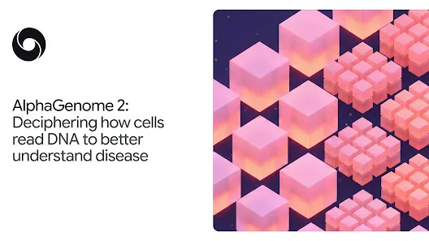
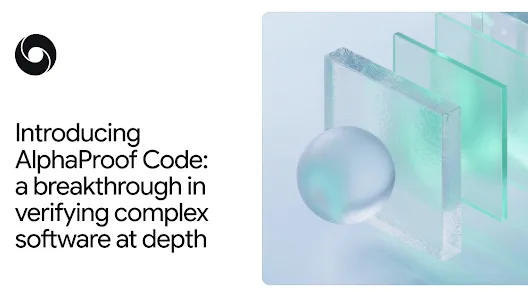
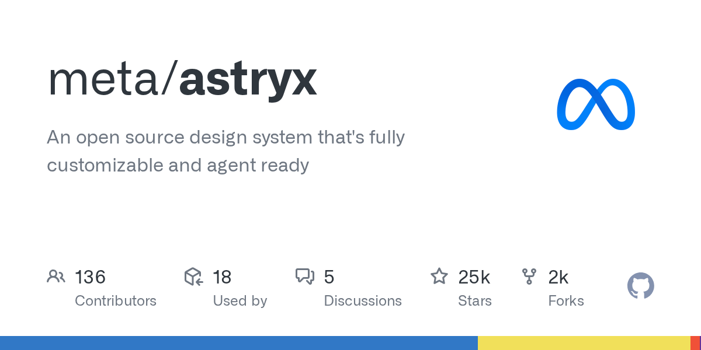
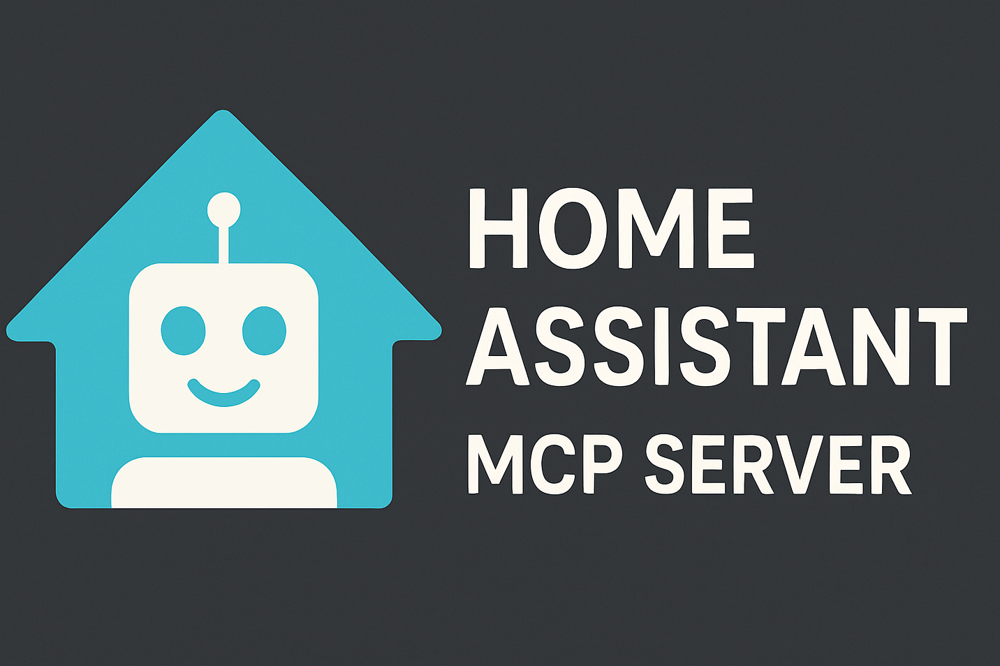
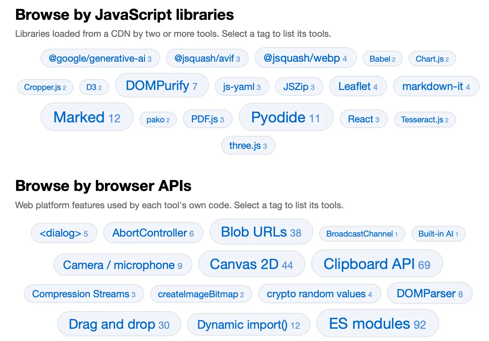

# AI 资讯日报 2026-11-12

> 自动抓取 AI 公司博客、从业者博客与社区聚合源，并生成中文摘要。

## 今日摘要

```
- Gilbert + Tobin rethinks the business of law with AI
- ChatGPT Plus for veterans and servicemembers
- JioStar’s chief architect on AI discovery at 500M-user scale
- Helping caregivers use AI in everyday life
- Introducing Businesses in ChatGPT
```

## 公司动态

1. **[Gilbert + Tobin rethinks the business of law with AI](https://openai.com/index/gilbert-tobin-sam-nickless)**

   A conversation with Sam Nickless, Partner and Chief Executive Officer at Gilbert + Tobin.

   来源：OpenAI Blog

2. **[ChatGPT Plus for veterans and servicemembers](https://openai.com/index/chatgpt-plus-for-veterans)**

   More than 20,000 veterans and transitioning service members have claimed a free year of ChatGPT Plus. See how they use it to prepare for civilian careers.

   来源：OpenAI Blog

3. **[JioStar’s chief architect on AI discovery at 500M-user scale](https://openai.com/index/jiostar-vijay-seshadri)**

   JioStar’s Vijay Seshadri explains AI discovery at 500M-user scale. Read his lessons on evals, guardrails, and taking AI into production.

   来源：OpenAI Blog

4. **[Helping caregivers use AI in everyday life](https://openai.com/index/helping-caregivers-use-ai-in-everyday-life)**

   OpenAI Academy is bringing free, hands-on ChatGPT workshops to caregivers in five U.S. cities, helping them build practical AI skills for everyday life.

   来源：OpenAI Blog

5. **[Introducing Businesses in ChatGPT](https://openai.com/index/introducing-businesses-chatgpt)**

   Manage your business information, get insights about how your business shows up, and turn interest into action in ChatGPT.

   来源：OpenAI Blog

6. **[Closing the AI guidance gap in education](https://openai.com/index/closing-ai-guidance-gap-education)**

   New ThinkYoung research and lessons from OpenAI’s EMEA education partnerships on supporting teachers, AI literacy, and independent learning.

   来源：OpenAI Blog

7. **[Singapore Airlines elevates travel & work with OpenAI technology](https://openai.com/index/singapore-airlines-travel-work)**

   Discover how Singapore Airlines uses OpenAI models and API to enhance customer support, travel discovery, and employee productivity, doubling CSAT for its Kris chatbot.

   来源：OpenAI Blog

8. **[Work at the Frontier: AI’s effect on freelance work](https://openai.com/index/ai-effect-on-freelance-work)**

   New research from OpenAI and Upwork finds shifting demand for freelance work, new skill combinations, and larger budgets and more hours for AI-related projects.

   来源：OpenAI Blog

9. **[AlphaGenome 2: Deciphering how cells read DNA to better understand disease](https://deepmind.google/blog/alphagenome-2-deciphering-how-cells-read-dna-to-better-understand-disease/)**

   Predicting how DNA sequences and their variations impact specific human cell types and disease.

   

   来源：DeepMind Blog

10. **[Gemini 4 Carbon is now available](https://deepmind.google/blog/gemini-4-carbon-is-now-available/)**

   暂无摘要。

   来源：DeepMind Blog

11. **[Introducing AlphaProof Code: a breakthrough in verifying complex software at depth](https://deepmind.google/blog/introducing-alphaproof-code/)**

   AlphaProof Code agents wrote three million lines of proofs in Lean to verify Signal’s core encryption.

   

   来源：DeepMind Blog

12. **[Gemini Robotics 2.5 accelerates real-world general dexterity](https://deepmind.google/blog/gemini-robotics-2-5-accelerates-real-world-physical-intelligence/)**

   Our most capable vision-language-action model enhances robot dexterity, reliability, and safety

   

   来源：DeepMind Blog

## 每日产品

1. **[Skillbox - 一个专为您的 AI 技能打造的库，与每个代理同步](https://www.producthunt.com/r/X2BEUWEGGSVMCM)**

   One library for your AI skills, synced to every agent (www.producthunt.com) 11-11 ↑ 136 PH Upvotes

   

   来源：Product Hunt Daily

2. **[Scribe v3 by ElevenLabs - 支持90多种语言的语音转文字功能，错误率降低27%](https://www.producthunt.com/r/5KPGASERAIN5AK)**

   Speech to text with 27% fewer errors in 90 languages (www.producthunt.com) 11-11 ↑ 119 PH Upvotes

   

   来源：Product Hunt Daily

3. **[CALL-E - AI客服专线](https://www.producthunt.com/r/Z5CBMYNIDVYDRO)**

   The phone line for AI agents (www.producthunt.com) 11-11 ↑ 115 PH Upvotes

   

   来源：Product Hunt Daily

4. **[Nod by n8n - 拥有独立计算机的开源个人助手](https://www.producthunt.com/r/BVJTK5BATUSE7H)**

   *{padding:0;margin:0;overflow:hidden}html,body{height:100%}img,span{position:absolute;width:100%;top:0;bottom:0;margin:auto}span{height:1.5em;text-align:center;font:48px/1.5 sans-serif;color:white;text-shadow:0 0 0.5em black}▶" frameborder="0" allow="accelerometer; autoplay; encrypted-media; gyroscope; picture-in-picture" allowfullscreen > Open source personal agent with its own computer (www.producthunt.com) 11-11 PH Link

   来源：Product Hunt Daily

5. **[ScroogeFrog AI  - 利用人工智能检测广告欺诈，保护您的营销预算](https://www.producthunt.com/r/XOB5A3DWYCGOGG)**

   AI ad fraud detection that protects your marketing budget (www.producthunt.com) 11-11 PH Link

   

   来源：Product Hunt Daily

6. **[Ember - 一键在 Cloudflare 上托管免费的开源版 Slack](https://www.producthunt.com/r/7ZE5I57LGNV6RS)**

   Free, open-source Slack you host on Cloudflare in one click (www.producthunt.com) 11-10 ↑ 114 PH Upvotes

   

   来源：Product Hunt Daily

7. **[Lottie AI - 根据文本提示生成的可编辑矢量动画](https://www.producthunt.com/r/GMX3MUBTRDCNPA)**

   *{padding:0;margin:0;overflow:hidden}html,body{height:100%}img,span{position:absolute;width:100%;top:0;bottom:0;margin:auto}span{height:1.5em;text-align:center;font:48px/1.5 sans-serif;color:white;text-shadow:0 0 0.5em black}▶" frameborder="0" allow="accelerometer; autoplay; encrypted-media; gyroscope; picture-in-picture" allowfullscreen > Editable vector animations from a text prompt (www.producthunt.com) 11-10 ↑ 137 PH Upvotes

   来源：Product Hunt Daily

8. **[Co-Review - 使用构建该仓库的代理读取整个仓库](https://www.producthunt.com/r/HWOHHCDD334GSS)**

   Read the whole repository with the agent that built it (www.producthunt.com) 11-10 ↑ 101 PH Upvotes

   

   来源：Product Hunt Daily

9. **[TK by Medium - 一本助你激发最佳思维的行动力笔记本](https://www.producthunt.com/r/LI2LWCHJGY3KGQ)**

   An agentic notebook to build your best thinking (www.producthunt.com) 11-10 ↑ 129 PH Upvotes

   

   来源：Product Hunt Daily

10. **[Seldon - 像普通客户一样使用您产品的行为质量保证（QA）测试人员](https://www.producthunt.com/r/RPNOP3ZZNQ6M6M)**

   *{padding:0;margin:0;overflow:hidden}html,body{height:100%}img,span{position:absolute;width:100%;top:0;bottom:0;margin:auto}span{height:1.5em;text-align:center;font:48px/1.5 sans-serif;color:white;text-shadow:0 0 0.5em black}▶" frameborder="0" allow="accelerometer; autoplay; encrypted-media; gyroscope; picture-in-picture" allowfullscreen > Behavioral QA agents that use your product like customers do (www.producthunt.com) 11-10 ↑ 124 PH Upvotes

   来源：Product Hunt Daily

## GitHub 项目

1. **[meta/astryx](https://github.com/meta/astryx)**

   An open source design system that's fully customizable and agent ready Language: TypeScript Stars: 25235 Forks: 1966

   

   来源：GitHub Trending Daily

2. **[ZhuLinsen/daily_stock_analysis](https://github.com/ZhuLinsen/daily_stock_analysis)**

   LLM 驱动的多市场股票智能分析系统：多源行情、实时新闻、决策看板与自动推送，支持零成本定时运行。 LLM-powered multi-market stock analysis system with multi-source market data, real-time news, decision dashboard, automated notifications, and cost-free scheduled runs. Language: Python Stars: 70440 Forks: 56909

   

   来源：GitHub Trending Daily

3. **[GoogleChrome/modern-web-guidance-src](https://github.com/GoogleChrome/modern-web-guidance-src)**

   Language: TypeScript Stars: 1881 Forks: 147

   

   来源：GitHub Trending Daily

4. **[shadcn/improve](https://github.com/shadcn/improve)**

   Use your most capable model to audit your codebase and write plans for cheaper models to execute. Language: Unknown Stars: 11016 Forks: 448

   

   来源：GitHub Trending Daily

5. **[addyosmani/agent-skills](https://github.com/addyosmani/agent-skills)**

   Production-grade engineering skills for AI coding agents. Language: JavaScript Stars: 116042 Forks: 12170

   来源：GitHub Trending Daily

6. **[vercel-labs/agent-browser](https://github.com/vercel-labs/agent-browser)**

   Browser automation CLI for AI agents Language: Rust Stars: 49957 Forks: 3492

   

   来源：GitHub Trending Daily

7. **[we-promise/sure](https://github.com/we-promise/sure)**

   The personal finance app for everyone (by everyone) Language: Ruby Stars: 13063 Forks: 962

   

   来源：GitHub Trending Daily

8. **[homeassistant-ai/ha-mcp](https://github.com/homeassistant-ai/ha-mcp)**

   Configure and automate Home Assistant with Claude, ChatGPT, and other AI assistants. Language: Python Stars: 7444 Forks: 454

   

   来源：GitHub Trending Daily

9. **[openai/codex-security](https://github.com/openai/codex-security)**

   OpenAI's Codex Security CLI and TypeScript SDK for finding, validating, and fixing security vulnerabilities. npm: https://www.npmjs.com/package/@openai/codex-security Language: TypeScript Stars: 11833 Forks: 945

   

   来源：GitHub Trending Daily

10. **[TheAlgorithms/Java](https://github.com/TheAlgorithms/Java)**

   All Algorithms implemented in Java Language: Java Stars: 67084 Forks: 21513

   

   来源：GitHub Trending Daily

## 从业者观点

1. **[Gemini Decisions API](https://simonwillison.net/2026/Nov/11/gemini-decisions-api/)**

   Gemini Decisions API Google join Jev and OpenAI in the decision model category with "Gemini Decision 1". This new model API is almost identical to Jev: it supports the same three types of questions (yes/no, choice, and rubric-scoring) and even reuses Jev's term "Noul" for a yes/no question. It's priced the same as the GPT-6 Luna decision model: 10 cents per million input tokens, and output is free. Jev remains the cheapest of the three, at 4.2 cents per million. Jev is text (and JSON) only. OpenAI can handle text and images. Gemini Decision 1 is fully multi-model: it covers text, images, audio, video, and PDFs. I tested it against video by passing these questions to it along with my Yonkers stomping robot video file: dragon: Does this video have a dragon in it? robot: Does this video have a robot in it? france: Is this video set in France? usa: Is this video set in the USA? Jev and OpenAI both return 1.0 or 0.0 for yes/no questions, but Gemini insists on being a little less confident than that: { "dragon" : { "type" : " yes_no " , "probability" : 0.04976021841520312 }, "robot" : { "type" : " yes_no " , "probability" : 0.9234055387792485 }, "france" : { "type" : " yes_no " , "probability" : 0.08329171353166241 }, "usa" : { "type" : " yes_no " , "probability" : 0.9230459995157706 } } Via Hacker News Tags: ai , generative-ai , gemini , llm-release , jev , decision-models

   来源：Simon Willison

2. **[aws-emulator](https://simonwillison.net/2026/Nov/11/aws-emulator/)**

   aws-emulator Finally, an official emulator from AWS to run tests against a local clone of their many different services without having to provision a paid API key to do so. It's written in Rust by a huge swarm of agents - 29,684 commits in the first three weeks of the project. Swaminathan (Swami) Sivasubramanian wrote about how it came to be in a guest post on Werner Vogels' blog. It currently requires Docker to run on macOS or Windows. I'm hoping they fix that in the future - it would be great if you could download a single binary and use that as part of a standard test suite in other languages and on other platforms. Tags: amazon , amazon-web-services , testing , werner-vogels , ai , rust , docker , generative-ai , llms , agentic-engineering

   来源：Simon Willison

3. **[Browse tools.simonwillison.net by tag](https://simonwillison.net/2026/Nov/11/tools-tags/)**

   Browse tools.simonwillison.net by tag I've been wanting a better way to browse my collection of vibe-coded tools (244 and counting) for a while. I had a few Fable 5.2 credits left over before my weekly reset so I set it to work using tree-sitter to analyze the code for JavaScript APIs, libraries, and web API hosts used by each tool. The homepage now features tag clouds for browsing by each of those categories of tag: [图片: https://static.simonwillison.net/static/2026/tools-tag-cloud.webp] Tags: javascript , tools , ai , generative-ai , llms , claude , vibe-coding

   

   来源：Simon Willison

4. **[llm 0.37.2](https://simonwillison.net/2026/Nov/11/llm/)**

   Release: llm 0.37.2 Fixes a security issue reported by Daniel de Araujo in GHSA-v9h7-jj4g-f862 and GHSA-r639-rr7r-x72w . LLM has a mechanism called extra-openai-models.yaml - now managed by the new-in-0.37 llm openai endpoint add command - for using LLM with OpenAI-compatible API endpoints from other providers. Daniel reported two ways this could accidentally send your configured OpenAI API key to one of those providers: if the key named by api_key_name had never been stored, or if a responses: true model was run with -o chat_completions 1 . Tags: projects , security , llm , releases

   来源：Simon Willison

5. **[Anthropic's IPO roadshow video](https://simonwillison.net/2026/Nov/11/anthropic-ipo-roadshow/)**

   Anthropic&#x27;s IPO roadshow video Anthropic kicked off their IPO roadshow yesterday, and their roadshow video has some previously unreleased information about how their business works. The section on "Approach to compute" with co-founder Tom Brown is particularly interesting, describing how Anthropic train and serve Claude across AWS Trainium, Google TPUs, NVIDIA GPUs, and AMD GPUs. I'm not sure why there's no official video transcript, but here's one that I extracted using MacWhisper. Highlights below: We train and serve Claude now across all four major chip families. That's only possible because early on we made an unconventional bet on a multi-chip strategy. At the time, many people thought that running AI models on different chips wasn't worth the effort. Each chip needs its own tailored software stack and inference stack, which is expensive and difficult to build. We've now been doing it for years, and we've gotten incredibly good at it. [...] As an example, this year, we started working with AMD GPUs for the first time. In the past, bringing on a new chip platform took dozens of engineers months of work This time, we had Mythos try it out. It got Claude running on AMD in just three days, with basically no human intervention . Claude ported or wrote almost 100% of the kernels. [...] The second driver of our compute advantage is our rate of discovery of compute multipliers. We focus on total effective compute, which is the multiplicative product of physical capacity times the compute multipliers that we discover. Each one we discover makes our pool of total effective compute bigger. For example, say you need 100 units of compute to train a model of a certain intelligence. A 4x compute multiplier means you can use 25 units of compute to train the exact same model. Or you can use those hundred physical units to train an even more intelligent model that would have previously required 400 units. Compute multipliers create a competitive advantage for us that's hard to replicate. They build on each other. Each new multiplier we discover has a positive effect on the multipliers before it. They stack. We believe that this can accelerate even further as we approach recursive self-improvement. Claude will be able to discover compute multipliers entirely by itself , allowing the number of compute multipliers to grow faster and faster. We got a hint at Anthropic's multi-chip strategy last September in their postmortem of three recent issues , where they described bugs that affected just their TPU deployments. Tags: ai , generative-ai , llms , anthropic , gpus , claude-mythos-fable , recursive-self-improvement

   来源：Simon Willison

6. **[llm-gemini 0.36](https://simonwillison.net/2026/Nov/10/llm-gemini/)**

   Release: llm-gemini 0.36 Gemini 4 Carbon was announced two weeks ago for "a subset of cyber defenders", but today it's available to everyone else . This is Google's best ever Gemini, priced at $2/million input and $10/million output at launch (that's GPT-6.1 Sol / Claude Sonnet 5.5 prices) but scheduled to double in price to $4/$20 on December 1st (same as Opus 5.5). Here are three pelicans for the low, medium and high thinking efforts (it defaults to medium). This is the pelican I got for high: [图片: https://static.simonwillison.net/static/2026/carbon-pelican.webp] Gemini pelicans have all been great for a while now, so I also tested it out using Google's Antigravity IDE with a prompt I first tried with Claude Fable 5.2 yesterday : Make a three js animation where yonkers stands up as a big mech (cool stand up motion) and stomps around manhattan and queens and Brooklyn, use openstreetmap mapping data Here's the HTML result (I had to prompt "build that into a standalone HTML file" to get a version with no external dependencies). I then screen-captured that as a video: Update : Huh, just saw this on YouTube (and tweeted by Google CEO Sundar Pichai ): Using Google Antigravity’s /swarm feature, Carbon built an open-world 3D game where you explore Google’s Mountain View campus as a pelican riding a GBike — coordinating subagents to model 3D assets in Blender from Omni and Nano Banana references, build the browser game in Three.js with WebGL shaders, and pair procedural Web Audio sound effects with Lyria music. Here's the playable version in AI Studio. Tags: llm-release , gemini , llm , google , generative-ai , ai , llms , pelican-riding-a-bicycle

   

   来源：Simon Willison

## 社区热点

1. **[Writing a SIGGRAPH paper from scratch](https://alexandergoslin.me/writing-a-siggraph-paper-from-scratch/)**

   Comments

   来源：Lobsters AI

2. **[Online learning on the programmable dataplane (2022)](https://theses.gla.ac.uk/83235/3/2022SimpsonPhD.pdf)**

   Comments

   来源：Lobsters AI
