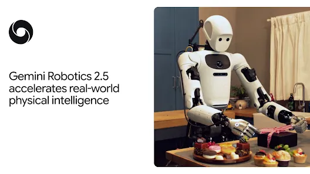
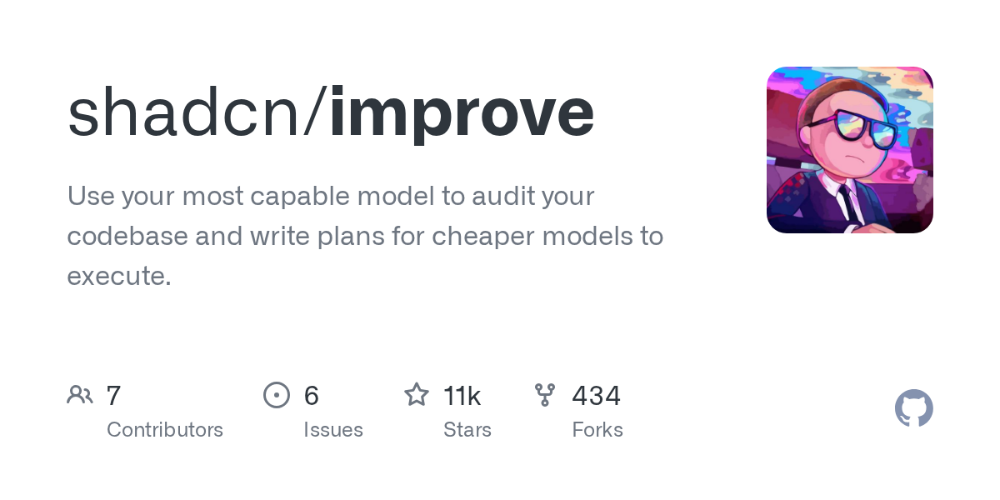
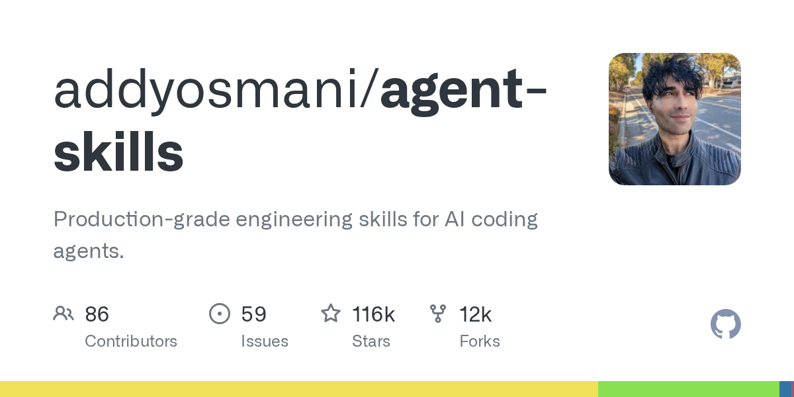
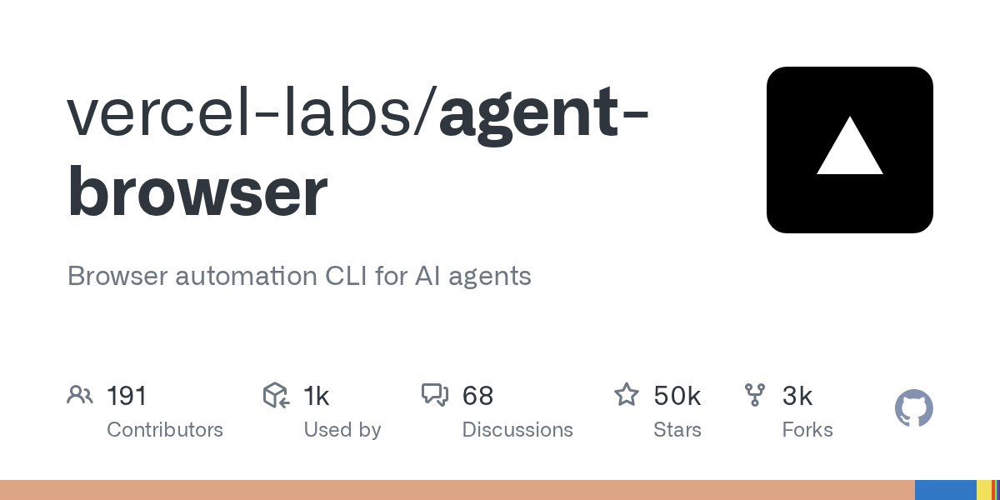
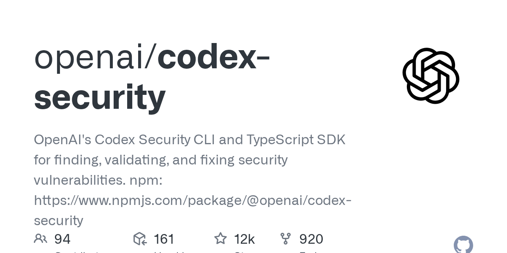
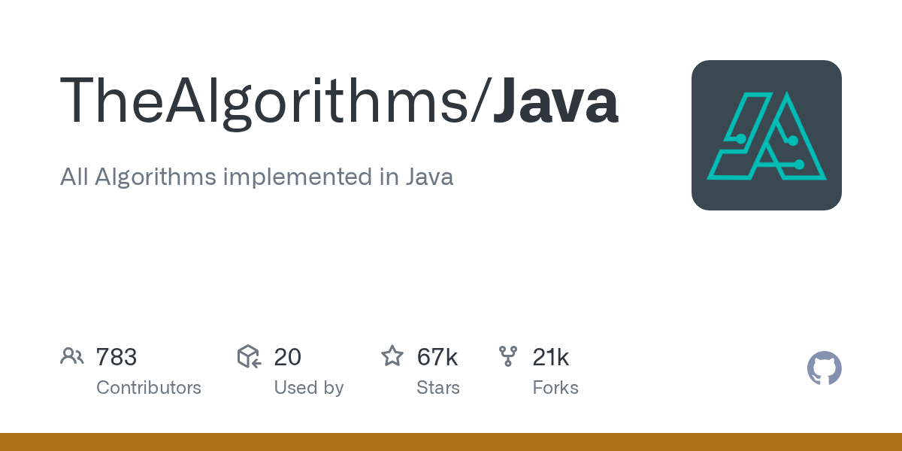

# AI 资讯日报 2026-11-12

> 自动抓取 AI 公司博客、从业者博客与社区聚合源，并生成中文摘要。

## 今日摘要

```
- Gilbert + Tobin rethinks the business of law with AI
- ChatGPT Plus for veterans and servicemembers
- Helping caregivers use AI in everyday life
- Introducing Businesses in ChatGPT
- Closing the AI guidance gap in education
```

## 公司动态

1. **[Gilbert + Tobin rethinks the business of law with AI](https://openai.com/index/gilbert-tobin-sam-nickless)**

   A conversation with Sam Nickless, Partner and Chief Executive Officer at Gilbert + Tobin.

   来源：OpenAI Blog

2. **[ChatGPT Plus for veterans and servicemembers](https://openai.com/index/chatgpt-plus-for-veterans)**

   More than 20,000 veterans and transitioning service members have claimed a free year of ChatGPT Plus. See how they use it to prepare for civilian careers.

   来源：OpenAI Blog

3. **[Helping caregivers use AI in everyday life](https://openai.com/index/helping-caregivers-use-ai-in-everyday-life)**

   OpenAI Academy is bringing free, hands-on ChatGPT workshops to caregivers in five U.S. cities, helping them build practical AI skills for everyday life.

   来源：OpenAI Blog

4. **[Introducing Businesses in ChatGPT](https://openai.com/index/introducing-businesses-chatgpt)**

   Manage your business information, get insights about how your business shows up, and turn interest into action in ChatGPT.

   来源：OpenAI Blog

5. **[Closing the AI guidance gap in education](https://openai.com/index/closing-ai-guidance-gap-education)**

   New ThinkYoung research and lessons from OpenAI’s EMEA education partnerships on supporting teachers, AI literacy, and independent learning.

   来源：OpenAI Blog

6. **[Singapore Airlines elevates travel & work with OpenAI technology](https://openai.com/index/singapore-airlines-travel-work)**

   Discover how Singapore Airlines uses OpenAI models and API to enhance customer support, travel discovery, and employee productivity, doubling CSAT for its Kris chatbot.

   来源：OpenAI Blog

7. **[Work at the Frontier: AI’s effect on freelance work](https://openai.com/index/ai-effect-on-freelance-work)**

   New research from OpenAI and Upwork finds shifting demand for freelance work, new skill combinations, and larger budgets and more hours for AI-related projects.

   来源：OpenAI Blog

8. **[Cogent and OpenAI build cyber defense factories for enterprises](https://openai.com/index/cogent-security)**

   Cogent combines OpenAI models with enterprise context to help automatically remediate vulnerabilities with agents.

   来源：OpenAI Blog

9. **[AlphaGenome 2: Deciphering how cells read DNA to better understand disease](https://deepmind.google/blog/alphagenome-2-deciphering-how-cells-read-dna-to-better-understand-disease/)**

   Predicting how DNA sequences and their variations impact specific human cell types and disease.

   

   来源：DeepMind Blog

10. **[Gemini 4 Carbon is now available](https://deepmind.google/blog/gemini-4-carbon-is-now-available/)**

   暂无摘要。

   来源：DeepMind Blog

11. **[Introducing AlphaProof Code: a breakthrough in verifying complex software at depth](https://deepmind.google/blog/introducing-alphaproof-code/)**

   AlphaProof Code agents wrote three million lines of proofs in Lean to verify Signal’s core encryption.

   

   来源：DeepMind Blog

12. **[Gemini Robotics 2.5 accelerates real-world general dexterity](https://deepmind.google/blog/gemini-robotics-2-5-accelerates-real-world-physical-intelligence/)**

   Our most capable vision-language-action model enhances robot dexterity, reliability, and safety

   

   来源：DeepMind Blog

## 每日产品

1. **[Scribe v3 by ElevenLabs - 支持90多种语言的语音转文字功能，错误率降低27%](https://www.producthunt.com/r/5KPGASERAIN5AK)**

   Speech to text with 27% fewer errors in 90 languages (www.producthunt.com) 16:01 ↑ 119 PH Upvotes

   

   来源：Product Hunt Daily

2. **[CALL-E - AI客服专线](https://www.producthunt.com/r/Z5CBMYNIDVYDRO)**

   The phone line for AI agents (www.producthunt.com) 16:01 ↑ 115 PH Upvotes

   

   来源：Product Hunt Daily

3. **[Nod by n8n - 拥有独立计算机的开源个人助手](https://www.producthunt.com/r/BVJTK5BATUSE7H)**

   *{padding:0;margin:0;overflow:hidden}html,body{height:100%}img,span{position:absolute;width:100%;top:0;bottom:0;margin:auto}span{height:1.5em;text-align:center;font:48px/1.5 sans-serif;color:white;text-shadow:0 0 0.5em black}▶" frameborder="0" allow="accelerometer; autoplay; encrypted-media; gyroscope; picture-in-picture" allowfullscreen > Open source personal agent with its own computer (www.producthunt.com) 16:01 PH Link

   来源：Product Hunt Daily

4. **[ScroogeFrog AI  - 利用人工智能检测广告欺诈，保护您的营销预算](https://www.producthunt.com/r/XOB5A3DWYCGOGG)**

   AI ad fraud detection that protects your marketing budget (www.producthunt.com) 16:01 PH Link

   

   来源：Product Hunt Daily

5. **[Ember - 一键在 Cloudflare 上托管免费的开源版 Slack](https://www.producthunt.com/r/7ZE5I57LGNV6RS)**

   Free, open-source Slack you host on Cloudflare in one click (www.producthunt.com) 11-10 ↑ 114 PH Upvotes

   

   来源：Product Hunt Daily

6. **[Lottie AI - 根据文本提示生成的可编辑矢量动画](https://www.producthunt.com/r/GMX3MUBTRDCNPA)**

   *{padding:0;margin:0;overflow:hidden}html,body{height:100%}img,span{position:absolute;width:100%;top:0;bottom:0;margin:auto}span{height:1.5em;text-align:center;font:48px/1.5 sans-serif;color:white;text-shadow:0 0 0.5em black}▶" frameborder="0" allow="accelerometer; autoplay; encrypted-media; gyroscope; picture-in-picture" allowfullscreen > Editable vector animations from a text prompt (www.producthunt.com) 11-10 ↑ 137 PH Upvotes

   来源：Product Hunt Daily

7. **[Co-Review - 使用构建该仓库的代理读取整个仓库](https://www.producthunt.com/r/HWOHHCDD334GSS)**

   Read the whole repository with the agent that built it (www.producthunt.com) 11-10 ↑ 101 PH Upvotes

   

   来源：Product Hunt Daily

8. **[TK by Medium - 一本助你激发最佳思维的行动力笔记本](https://www.producthunt.com/r/LI2LWCHJGY3KGQ)**

   An agentic notebook to build your best thinking (www.producthunt.com) 11-10 ↑ 129 PH Upvotes

   

   来源：Product Hunt Daily

9. **[Seldon - 像普通客户一样使用您产品的行为质量保证（QA）测试人员](https://www.producthunt.com/r/RPNOP3ZZNQ6M6M)**

   *{padding:0;margin:0;overflow:hidden}html,body{height:100%}img,span{position:absolute;width:100%;top:0;bottom:0;margin:auto}span{height:1.5em;text-align:center;font:48px/1.5 sans-serif;color:white;text-shadow:0 0 0.5em black}▶" frameborder="0" allow="accelerometer; autoplay; encrypted-media; gyroscope; picture-in-picture" allowfullscreen > Behavioral QA agents that use your product like customers do (www.producthunt.com) 11-10 ↑ 124 PH Upvotes

   来源：Product Hunt Daily

10. **[Opal Reader - 在 iPhone Duo 上阅读 PDF 和 EPUB 文件](https://www.producthunt.com/r/O24YA6ZJ2ASOV6)**

   *{padding:0;margin:0;overflow:hidden}html,body{height:100%}img,span{position:absolute;width:100%;top:0;bottom:0;margin:auto}span{height:1.5em;text-align:center;font:48px/1.5 sans-serif;color:white;text-shadow:0 0 0.5em black}▶" frameborder="0" allow="accelerometer; autoplay; encrypted-media; gyroscope; picture-in-picture" allowfullscreen > Read PDFs and EPUBs on iPhone Duo (www.producthunt.com) 11-10 ↑ 112 PH Upvotes

   来源：Product Hunt Daily

## GitHub 项目

1. **[meta/astryx](https://github.com/meta/astryx)**

   An open source design system that's fully customizable and agent ready Language: TypeScript Stars: 24587 Forks: 1921

   来源：GitHub Trending Daily

2. **[ZhuLinsen/daily_stock_analysis](https://github.com/ZhuLinsen/daily_stock_analysis)**

   LLM 驱动的多市场股票智能分析系统：多源行情、实时新闻、决策看板与自动推送，支持零成本定时运行。 LLM-powered multi-market stock analysis system with multi-source market data, real-time news, decision dashboard, automated notifications, and cost-free scheduled runs. Language: Python Stars: 70025 Forks: 56807

   

   来源：GitHub Trending Daily

3. **[GoogleChrome/modern-web-guidance-src](https://github.com/GoogleChrome/modern-web-guidance-src)**

   Language: TypeScript Stars: 1597 Forks: 134

   

   来源：GitHub Trending Daily

4. **[shadcn/improve](https://github.com/shadcn/improve)**

   Use your most capable model to audit your codebase and write plans for cheaper models to execute. Language: Unknown Stars: 10644 Forks: 433

   

   来源：GitHub Trending Daily

5. **[addyosmani/agent-skills](https://github.com/addyosmani/agent-skills)**

   Production-grade engineering skills for AI coding agents. Language: JavaScript Stars: 115738 Forks: 12139

   

   来源：GitHub Trending Daily

6. **[vercel-labs/agent-browser](https://github.com/vercel-labs/agent-browser)**

   Browser automation CLI for AI agents Language: Rust Stars: 49735 Forks: 3480

   

   来源：GitHub Trending Daily

7. **[we-promise/sure](https://github.com/we-promise/sure)**

   The personal finance app for everyone (by everyone) Language: Ruby Stars: 12724 Forks: 941

   

   来源：GitHub Trending Daily

8. **[homeassistant-ai/ha-mcp](https://github.com/homeassistant-ai/ha-mcp)**

   Configure and automate Home Assistant with Claude, ChatGPT, and other AI assistants. Language: Python Stars: 7144 Forks: 446

   

   来源：GitHub Trending Daily

9. **[openai/codex-security](https://github.com/openai/codex-security)**

   OpenAI's Codex Security CLI and TypeScript SDK for finding, validating, and fixing security vulnerabilities. npm: https://www.npmjs.com/package/@openai/codex-security Language: TypeScript Stars: 11558 Forks: 920

   

   来源：GitHub Trending Daily

10. **[TheAlgorithms/Java](https://github.com/TheAlgorithms/Java)**

   All Algorithms implemented in Java Language: Java Stars: 66933 Forks: 21497

   

   来源：GitHub Trending Daily

## 从业者观点

1. **[Anthropic's IPO roadshow video](https://simonwillison.net/2026/Nov/11/anthropic-ipo-roadshow/)**

   Anthropic&#x27;s IPO roadshow video Anthropic kicked off their IPO roadshow yesterday, and their roadshow video has some previously unreleased information about how their business works. The section on "Approach to compute" with co-founder Tom Brown is particularly interesting, describing how Anthropic train and serve Claude across AWS Trainium, Google TPUs, NVIDIA GPUs, and AMD GPUs. I'm not sure why there's no official video transcript, but here's one that I extracted using MacWhisper. Highlights below: We train and serve Claude now across all four major chip families. That's only possible because early on we made an unconventional bet on a multi-chip strategy. At the time, many people thought that running AI models on different chips wasn't worth the effort. Each chip needs its own tailored software stack and inference stack, which is expensive and difficult to build. We've now been doing it for years, and we've gotten incredibly good at it. [...] As an example, this year, we started working with AMD GPUs for the first time. In the past, bringing on a new chip platform took dozens of engineers months of work This time, we had Mythos try it out. It got Claude running on AMD in just three days, with basically no human intervention . Claude ported or wrote almost 100% of the kernels. [...] The second driver of our compute advantage is our rate of discovery of compute multipliers. We focus on total effective compute, which is the multiplicative product of physical capacity times the compute multipliers that we discover. Each one we discover makes our pool of total effective compute bigger. For example, say you need 100 units of compute to train a model of a certain intelligence. A 4x compute multiplier means you can use 25 units of compute to train the exact same model. Or you can use those hundred physical units to train an even more intelligent model that would have previously required 400 units. Compute multipliers create a competitive advantage for us that's hard to replicate. They build on each other. Each new multiplier we discover has a positive effect on the multipliers before it. They stack. We believe that this can accelerate even further as we approach recursive self-improvement. Claude will be able to discover compute multipliers entirely by itself , allowing the number of compute multipliers to grow faster and faster. We got a hint at Anthropic's multi-chip strategy last September in their postmortem of three recent issues , where they described bugs that affected just their TPU deployments. Tags: ai , generative-ai , llms , anthropic , gpus , claude-mythos-fable , recursive-self-improvement

   来源：Simon Willison

2. **[llm-gemini 0.36](https://simonwillison.net/2026/Nov/10/llm-gemini/)**

   Release: llm-gemini 0.36 Gemini 4 Carbon was announced two weeks ago for "a subset of cyber defenders", but today it's available to everyone else . This is Google's best ever Gemini, priced at $2/million input and $10/million output at launch (that's GPT-6.1 Sol / Claude Sonnet 5.5 prices) but scheduled to double in price to $4/$20 on December 1st (same as Opus 5.5). Here are three pelicans for the low, medium and high thinking efforts (it defaults to medium). This is the pelican I got for high: [图片: https://static.simonwillison.net/static/2026/carbon-pelican.webp] Gemini pelicans have all been great for a while now, so I also tested it out using Google's Antigravity IDE with a prompt I first tried with Claude Fable 5.2 yesterday : Make a three js animation where yonkers stands up as a big mech (cool stand up motion) and stomps around manhattan and queens and Brooklyn, use openstreetmap mapping data Here's the HTML result (I had to prompt "build that into a standalone HTML file" to get a version with no external dependencies). I then screen-captured that as a video: Update : Huh, just saw this on YouTube (and tweeted by Sundar Pichai ): Using Google Antigravity’s /swarm feature, Carbon built an open-world 3D game where you explore Google’s Mountain View campus as a pelican riding a GBike — coordinating subagents to model 3D assets in Blender from Omni and Nano Banana references, build the browser game in Three.js with WebGL shaders, and pair procedural Web Audio sound effects with Lyria music. Here's the playable version in AI Studio. Tags: llm-release , gemini , llm , google , generative-ai , ai , llms , pelican-riding-a-bicycle

   

   来源：Simon Willison

3. **[Introducing Our Smallest, Most Efficient Model: Muse Ember](https://simonwillison.net/2026/Nov/10/muse-ember/)**

   Introducing Our Smallest, Most Efficient Model: Muse Ember Meta AI just launched their entry in the Claude Haiku/GPT Luna category: Muse Ember, which they describe as: [...] our smallest and most efficient model designed for complex reasoning execution and the work agents repeat all day: tool calls, coding subtasks, routing, extraction, and long document parsing. For shorter prompts it's priced the same as GPT-6 Luna and Claude Haiku 5.5 - both are $0.10/million input tokens and $0.50/million output. Today's other big model release, Claude Fable 5.2, is 80x that price at $8/$40. The pricing is a little less straightforward as prompts get longer, though. Luna, Ember, and Haiku all support up to a million input tokens, but they also all have a threshold after which the price goes up. Taking that threshold into account Ember is priced between the two others: Model Prompt size Input ($/M) Cached input Output GPT-6 Luna ≤272k $0.10 $0.01 $0.50 &gt;272k $0.20 $0.02 $0.75 Muse Ember 1.0 ≤200k $0.10 $0.004 $0.50 &gt;200k $0.30 $0.012 $1.50 Claude Haiku 5.5 ≤100k $0.10 $0.01 $0.50 &gt;100k $0.50 $0.05 $2.50 But comparing price-per-token doesn't really make sense these days, when reasoning tokens mean that different models might use dramatically different numbers of tokens to solve the same problem. For that, one measure that's useful is the Artificial Analysis. [图片: https://static.simonwillison.net/static/2026/artificial-analysis-haiku-class.webp] And even more useful than that is their Intelligence Index vs. Cost per Task chart, which shows the following for those three models: [图片: https://static.simonwillison.net/static/2026/artificial-analysis-pareto.webp] The Muse Ember models sit right on that Pareto line - the line at which you can only improve one dimension by giving up another. Meta call this out in their announcement: It also sits on the efficiency frontier of the full Artificial Analysis leaderboard: no model scores higher for less per task. (That grey dot on the Pareto line in the middle of the green area is GPT-6.1 Terra (low) - clearly I should be paying more attention to the Terra family!) Muse Ember has six reasoning levels - minimal, low, medium, high, xhigh, and max - so I rendered six pelicans riding bicycles . The "high" reasoning level failed to return a full SVG, and the other SVGs were surprising in that the reasoning level didn't cleanly map to the visual quality of the response. Here's the "max" one, but the others are worth a look too: [图片: https://static.simonwillison.net/static/2026/muse-ember.webp] The Ember pelicans are comparable in quality to those I got from Muse Wonder , which is 40x the price of Muse Ember. Tags: ai , generative-ai , llms , meta , llm-pricing , llm-release , artificial-analysis , muse

   

   来源：Simon Willison

4. **[Quoting Prompting Claude Fable 5.2](https://simonwillison.net/2026/Nov/10/prompting-claude-fable-52/)**

   Claude Fable 5.2 responds closely to what the prompt says about who owns the code it works on. In Anthropic’s testing on small coding tasks, when a prompt said nothing about ownership or presented the code base as someone else’s, the model tended to add to the existing structure, even when that repeated existing code. [...] If you want the model to improve the structure as it works, say that the code is its own: This codebase is yours: what it's for and how it's built are your call, and you'll keep building on it. In Anthropic’s testing on small coding tasks, the model merged repeated code in about half of the tries with this sentence, and in under a tenth of the tries without it. &mdash; Prompting Claude Fable 5.2 , Anthropic documentation Tags: prompt-engineering , anthropic , generative-ai , ai , llms , claude-mythos-fable

   来源：Simon Willison

5. **[Yonkers Rises](https://simonwillison.net/2026/Nov/10/yonkers-rises/)**

   Tool: Yonkers Rises I realized I didn't know where Yonkers was, so I looked it up on Google Maps and then, to help embed its location and shape in my head (and to try out Claude Fable 5.2's 3D modeling and animation skills), I prompted Fable 5.2 Medium to: Make a three js animation where yonkers stands up as a big mech (cool stand up motion) and átomos around manhattan and queens and Brooklyn, use openstreetmap mapping data It correctly deduced that "átomos" was a mobile keyboard typo for "stomps": Tags: three-js , llms , ai , generative-ai , claude-mythos-fable

   来源：Simon Willison

6. **[llm-anthropic 0.31](https://simonwillison.net/2026/Nov/9/llm-anthropic/)**

   Release: llm-anthropic 0.31 Anthropic released Fable 5.2 and Mythos 5.2 today. Fable 5.2 is currently ranked first on Artificial Analysis . Anthropic say it "solved two open problems in the physics of black holes", so clearly their internal benchmarks have become more ambitious! I've added the new models to llm-anthropic , so you can now run prompts through Fable 5.2 like this: uv tool install llm llm install llm-anthropic llm keys set anthropic # paste key here llm -m claude-fable-5.2 "Generate an SVG of a pelican riding a bicycle" I ran pelicans at all five reasoning levels - low , medium , high , xhigh , and max . You can see them all here - here's the best result I got, from xhigh : [图片: https://static.simonwillison.net/static/2026/fable-5.2-xhigh.avif] max failed to return an image at all, running out of tokens after spending 128,000 thinking about them . That's the same bug that I saw with Opus 5.5 - but it's new for the Fable series, both Fable 5 and Fable 5.1 returned max effort pelicans just fine. It's priced at $8/million input and $40/million output, which is a 20% discount on the previous Fable 5.1 ($10/$50). I also used Fable 5.2 to help identify the source of a mysterious beep . Tags: llm-release , llm , anthropic , claude , generative-ai , pelican-riding-a-bicycle , ai , llms , claude-mythos-fable

   

   来源：Simon Willison

## 社区热点

1. **[Google SWE points 48 AI agents at NASA Lidar, finds unmapped Maya pyramid in 72h](https://pietromiotti.com/latest/maya-site/?maya)**

   Article URL: https://pietromiotti.com/latest/maya-site/?maya Comments URL: https://news.ycombinator.com/item?id=50452455 Points: 740 # Comments: 281

   来源：Hacker News AI

2. **[OSS projects banning AI-generated contributions](https://osssaysno.com)**

   Article URL: https://osssaysno.com Comments URL: https://news.ycombinator.com/item?id=50451102 Points: 58 # Comments: 101

   来源：Hacker News AI

3. **[AI is becoming an information gateway. Audiences still don’t want it making news](https://www.niemanlab.org/2026/11/ai-is-becoming-an-information-gateway-audiences-still-dont-want-it-making-their-news/)**

   Article URL: https://www.niemanlab.org/2026/11/ai-is-becoming-an-information-gateway-audiences-still-dont-want-it-making-their-news/ Comments URL: https://news.ycombinator.com/item?id=50448174 Points: 55 # Comments: 74

   来源：Hacker News AI

4. **[Apple has new Mac app coming to make running local AI models easy](https://9to5mac.com/2026/11/10/apple-has-new-mac-app-coming-to-make-running-local-ai-models-easy/)**

   Article URL: https://9to5mac.com/2026/11/10/apple-has-new-mac-app-coming-to-make-running-local-ai-models-easy/ Comments URL: https://news.ycombinator.com/item?id=50446520 Points: 462 # Comments: 479

   来源：Hacker News AI

5. **[Claude Whiteboards, Claude Sheets, and Claude Data](https://claude.com/resources/articles/sheets-whiteboards-data)**

   Article URL: https://claude.com/resources/articles/sheets-whiteboards-data Comments URL: https://news.ycombinator.com/item?id=50443716 Points: 273 # Comments: 208

   来源：Hacker News AI

6. **[Life on Claude Nine](https://babuschk.in/posts/2026-01-25-life-on-claude-nine.html)**

   Article URL: https://babuschk.in/posts/2026-01-25-life-on-claude-nine.html Comments URL: https://news.ycombinator.com/item?id=50443587 Points: 122 # Comments: 82

   来源：Hacker News AI

7. **[Compress any LLM 3x in one click,near-lossless,in under 50 MB RAM](https://neuracryption.com/research)**

   Article URL: https://neuracryption.com/research Comments URL: https://news.ycombinator.com/item?id=50440359 Points: 34 # Comments: 31

   来源：Hacker News AI

8. **[AI Users have workdays up to 90 min longer than non-users](https://www.activtrak.com/news/productivity-lab-ai-users-longer-workdays/)**

   Article URL: https://www.activtrak.com/news/productivity-lab-ai-users-longer-workdays/ Comments URL: https://news.ycombinator.com/item?id=50439686 Points: 60 # Comments: 25

   来源：Hacker News AI

9. **[Meet the Sad Wives of AI](https://www.wired.com/story/meet-the-sad-wives-of-ai/)**

   Article URL: https://www.wired.com/story/meet-the-sad-wives-of-ai/ Comments URL: https://news.ycombinator.com/item?id=50438429 Points: 78 # Comments: 71

   来源：Hacker News AI

10. **[Writing a SIGGRAPH paper from scratch](https://alexandergoslin.me/writing-a-siggraph-paper-from-scratch/)**

   Comments

   来源：Lobsters AI

11. **[Online learning on the programmable dataplane (2022)](https://theses.gla.ac.uk/83235/3/2022SimpsonPhD.pdf)**

   Comments

   来源：Lobsters AI

## 论文与模型

1. **[Tree-Ising: Repairing Language Models with Bit-Level Ising Edits](https://arxiv.org/abs/2611.14210)**

   Weight-space programming, introduced in recent MIT work by Takehi et al., enables a frontier LLM agent to read a network's weights and write a repair. Their GPT-6 Astra agent corrected the reasoning loops of Qwen3.5-0.8B without gradients, using 158 agent turns, 89.7 million tokens, and 50 forward-pass requests. Our method, Tree-Ising, casts this repair as a sparse discrete optimization problem over the model's own BF16 weights. Forward statistics define an objective that weakens a loop direction, strengthens a concluding direction, and preserves the layer's output on productive tokens. Within a state-tree representation, where lossless BF16 storage acts as a special case, the admissible edits are sign flips and exponent shifts that preserve all shared group exponents and mantissas. We decompose this objective exactly into independent QUBO (Ising) problems, one per output row, which we solve on a GPU using simulated annealing or quantum-inspired simulated bifurcation. On the agent's two layers, Tree-Ising achieves 54.6% on MATH-500, outperforming the agent's edit (51.7%) under the same evaluation protocol, while the base model scores 7.9% as reported. The simulated bifurcation solver yields a statistically indistinguishable repair at 55.1%. Both solvers outperform the agent edit across all five math benchmarks, with statistically significant improvements on MATH-500 and GSM8K after correcting for multiple comparisons. Our approach modifies 13% to 17% fewer weights and reduces BF16 bit flips by a factor of 2.2 to 2.3. It requires only four forward-pass requests and zero LLM tokens, with the annealing recipe costing about $0.90 in GPU time. On Qwen3.5-2B, with layers and dose selected using only the base model, the same recipe increases greedy GSM8K accuracy from 21.6% to 69.4%. As a proof of concept, we execute an eight-variable repair subproblem using QAOA on an IBM Heron processor.

   来源：HuggingFace Papers

2. **[Few-Step Streaming Video Generation via Condition Shifting](https://arxiv.org/abs/2611.14033)**

   Few-step sampling reduces the cost of streaming video generation. Distribution Matching Distillation (DMD) supervises few-step generators with a separate fake-score network, which adds training memory and computation and must track the evolving generator. We extend APEX to streaming video by using condition shifting to estimate the velocity field of the generated distribution within the generator. The original text condition selects generation, while a shifted condition selects fake estimation using the same parameters. This removes the independent fake network while retaining S2-Avatar's frozen reference teacher, Self-Replay Forcing, and perceptual regularization. We evaluate APEX on 180-second videos using three backbone evaluations per block and a one-step spatial Refiner, with a 70-case human study and a 320-case StreamAV-Bench comparison. Compared with S2-Avatar, APEX achieves higher video instruction fulfillment on the Progressive track (3.856 versus 3.831) and higher visual aesthetics across both tracks (0.641898 versus 0.632606). Human raters favor APEX most strongly on instruction following, with +30.0% net preference, followed by consistency and video quality at +4.3% each. Motion quality favors S2-Avatar, audiovisual synchronization is predominantly tied, and usability is unchanged. Separate measurements under matched training settings show 4.4% lower peak allocated GPU memory per GPU and 9.2% shorter mean iteration time than DMD.

   来源：HuggingFace Papers

3. **[Don't Just Trust Your Memory: Evidence-Linked Memory Reduces Memory-Induced Degradation in LLM Agents](https://arxiv.org/abs/2611.14320)**

   External memory enables LLM agents to improve from experience by distilling trajectories of past tasks into concise lessons for new tasks. However, memory can also lead to memory-induced degradation, where an agent fails on tasks it would solve without memory, often because it follows a lesson that is incorrect, or misapplies or misreads a valid one. This is because lessons are inferred from trajectories labeled only with task success or failure, yet are typically provided without the trajectories they came from, leaving the agent no way to check them. To address this, we introduce WikiTrace, an evidence-linked memory system designed to let agents check each lesson against its original trajectory. Specifically, motivated by the finding that a trajectory often still holds the evidence needed to catch an erroneous lesson, WikiTrace stores each lesson as a concise insight linked to a summary of why its trajectory succeeded or failed and to the raw trajectory itself. Then, on a new task, the agent starts from all insights and, whenever one lacks details needed to act, conflicts with another, or comes from a failed task, descends through its links with terminal tools to fill in missing details or correct the insight before acting. We validate WikiTrace on five agentic benchmarks, showing that it consistently outperforms existing memory approaches and a baseline given the same insights alone, while also reducing memory-induced degradation. Our code is available at https://github.com/yukyeongleee/wikitrace

   来源：HuggingFace Papers

4. **[MMDM: Measuring Massive Multitask Decision Making](https://arxiv.org/abs/2611.14309)**

   System-1 Decision Models directly make structured probabilistic decisions over query-specified options given a state in a single forward pass, without autoregressively generating reasoning trajectories or textual responses. Recent evaluations cover diverse tasks but often rely on existing benchmarks, where prior exposure to test material can obscure generalization. Moreover, real-world decision making often involves long contexts, large option spaces, and complex logical dependencies, challenges that existing benchmarks do not adequately capture together. Thus, we introduce MMDM (Massive Multitask Decision Making), a benchmark of 5,448 high-quality questions across 16 task categories, combining newly constructed tasks with source-grounded recompositions and rewrites for single-select, multi-select, and soft-label decision making in fresh contexts. It covers realistic scenarios such as agent state tracking, tool and skill selection, preference judgments, and rubric scoring, with option spaces ranging from 2 to 1,024 and inputs extending to 64,817 tokens. With MMDM, we conduct a comprehensive quantitative evaluation of 28 decision models, showing that many perform well on common knowledge yet struggle with interdependent options, constrained decisions, and multi-select tasks. For example, Perplexity Decider-V1.2 reaches 78.75% Hard Single-select Accuracy on world knowledge, but only 53.95% on option logic and 47.95% on constraint planning, while the best Hard Multi-select Accuracy across all models is 36.81%. These results highlight joint reasoning, constraint-aware selection, and complete multi-select recovery as key priorities for decision model development, with MMDM providing a testbed for measuring this progress.

   来源：HuggingFace Papers

5. **[DexForesight: Grounding Dexterous Policies with Implicit Spatial Foresight](https://arxiv.org/abs/2611.11166)**

   Dexterous manipulation requires rich spatial foresight over both the surrounding scene and the robot hand. Existing world-action models often acquire such predictive knowledge through explicit future prediction. We introduce DexForesight, a framework that learns spatial foresight implicitly by injecting dynamics-aware world representations into the latent space of a dexterous policy. During training, DexForesight learns an action-conditioned spatial world model from offline scene depth, kinematic hand geometry, and demonstration trajectories. The world model predicts 3D hand-point motion and visual feature changes, capturing both articulated hand dynamics and scene changes under demonstrated actions, including the motion of fingers occluded from the cameras. We then freeze the world model and align policy queries with its predictive world queries, transferring the learned spatial dynamics into policy latents and using them to condition action generation. At deployment, only the policy is retained, operating on RGB observations, language, and robot state without depth input or explicit future prediction. On 11 DexJoCo simulation tasks, DexForesight improves the overall success rate of the base policy from 49.4% to 60.5%. On three real-robot dexterous manipulation tasks, DexForesight achieves 58.3% success, compared with 50.0% for the strongest baseline. Project page https://dexforesight.github.io/

   来源：HuggingFace Papers

6. **[PhyRubric: Rubric-Grounded Diagnostic Evaluation of Physical Commonsense in Text-to-Video Generation](https://arxiv.org/abs/2611.13576)**

   As text-to-video (T2V) models are increasingly positioned as world simulators, it is essential to evaluate whether their videos conform to physical commonsense. However, existing benchmarks rely on annotators who rate each video with a single score based on intuition, yielding ratings that are subjective and do not tell which physical principle is violated. We introduce PhyRubric, a rubric-grounded diagnostic framework for evaluating physical commonsense in T2V generation. For each caption, PhyRubric constructs a caption-specific rubric before any video is seen, decomposing the caption into semantic and physical items, and derives scores from item-level verdicts grounded in timestamped evidence. We instantiate this framework as PhyRubric-Bench, which spans 34 categories across five physical domains, and scale it up to PhyRubric-Train with 3,788 videos, on which we fine-tune the open-source PhyRubric-Judge. Empirical results across ten T2V models show that physical commonsense remains far from solved, and that PhyRubric-Judge correlates more closely with human judgments than existing open-source judges while matching the frontier proprietary Gemini 4 Argon. Further analysis provides actionable insights for T2V models.

   来源：HuggingFace Papers

7. **[Is Your Robot's Memory Just a Clock? Temporal Shortcuts in Memory-Augmented VLA Policies](https://arxiv.org/abs/2611.14488)**

   Memory-augmented vision-language-action (VLA) policies are meant to remember what happened. Many of them, however, fill memory by time: they sample frames uniformly across the episode and stamp each frame with its time step. Because time passes even when nothing happens, such a memory may not tell waiting from working. We show that it does not. On the counting tasks of RoboMME, we make the robot briefly pause or fidget its wrist. Such a null event changes nothing the task depends on, yet a released memory VLA counts the interval as work done and stops early. We call this failure phantom progress. It cuts success from 47 to 16 of 50 on one task and from 44 to 10 on the other. When the same frames are withheld from memory, success returns, so the cause lies in memory rather than in the interruption itself. We trace the failure to a temporal shortcut: because demonstrations proceed at a steady pace, elapsed time predicts progress. Indeed, rescaling the time stamps alone makes the policy stop early when the clock runs fast and repeat when it runs slow. Surprisingly, removing the time encoding does not cure the failure, because the frames of a null event still occupy slots of the time-sampled memory. Across RoboMME's released designs, vulnerability follows how memory is indexed. Of the fixes the diagnosis suggests, training with injected pauses does not remove the failure and impairs counting, whereas indexing memory by events recovers half or more of the loss without retraining. A memory meant to remember what happened should count events rather than clock ticks.

   来源：HuggingFace Papers

8. **[Market-Conditioned JEPA: Learning from Unpredictable Market Shocks](https://arxiv.org/abs/2611.13572)**

   Much of the variation in financial time series is driven by market-wide shocks that cannot be predicted from an asset's own history. Per-asset self-supervised learning treats this variation as irreducible noise. Under a latent factor model, we show that conditioning prediction on the realized market factor makes the asset's market exposure necessary for optimal prediction, while reducing the noise against which the asset-specific component is learned. Building on this insight, we introduce Market-Conditioned JEPA (MC-JEPA), a joint-embedding predictive architecture for financial time series. During training, we construct a leave-one-out market condition for each asset from the future target embeddings of other assets and incorporate it through factor loadings derived from the asset's own representation. On 11 years of minute-level Chinese A-share data, MC-JEPA improves over per-asset JEPA across nine targets spanning returns, market exposure, risk, and liquidity, with the strongest and most statistically significant gains in exposure, risk, and liquidity. It achieves the best RankIC on all liquidity targets and on return horizons from two hours to five days, outperforming time-series foundation models and self-supervised baselines, and delivers the best portfolio performance in a historical backtest. Ablations show that the return and exposure gains require the condition to be aligned with the realized market movement. After restoring the volatility scale removed by normalization, the predictor's factor loadings rank stocks by market beta nearly as well as a supervised probe, without labels. A synthetic factor-model study with known parameters shows that conditioning improves the recovery of both market exposure and the asset-specific component.

   来源：HuggingFace Papers

9. **[ExRL: Sample-Efficient Online Adaptation of Long-Chunk Policies via Execution Length Control](https://arxiv.org/abs/2611.13482)**

   Predicting long action chunks, often spanning dozens of timesteps, has become a key ingredient in increasingly capable robot policies. In this paper, we find that adapting these long-chunk policies with existing reinforcement learning (RL) methods can require many online samples due to the high dimensionality of the action chunks being optimized, making such adaptation impractical in real-world scenarios where interaction data are costly to collect. Our key insight is to shift adaptation from optimizing actions to optimizing how long to execute each predicted action chunk. This keeps the adaptation space low-dimensional while its expressivity grows with the chunk size. We thus introduce Execution at the Right Length (ExRL), a simple approach which augments the base policy with a lightweight adapter that predicts the execution length of each chunk and is trained using off-policy RL algorithms. Across simulation benchmarks and real-world robotic tasks, ExRL enables sample-efficient adaptation of a diverse range of long-chunk policies with minimal task-specific hyperparameter tuning.

   来源：HuggingFace Papers

10. **[Are Causal Neuron Circuits Unique and Transferable?](https://arxiv.org/abs/2611.13885)**

   Interpretability demonstrations often show that intervening on a group of neurons changes a model's answer. A recent example removes an 18-neuron group in Qwen3-32B and the model answers "Simba" instead of "Scar" to a two-hop Lion King riddle. Such a demonstration establishes that the group matters, but not how much of it is necessary, whether other groups could do the same, or whether the effect carries over to other inputs. We ask: when intervening on a group of neurons changes a model's answer, how much of that group is actually necessary? For every selected group we measure all 4,096 subsets of 12 MLP neurons. On a two-alternative capital task (Qwen3-0.6B), zero-ablating 12 selected neurons lowers the answer margin by 27% while random neurons barely change it, yet replacing the same neurons with their values from other questions also barely changes it: their activations are nearly constant across questions, and we find no evidence that they carry question-specific content. On two-hop relation chains, patching 12 neurons with activations from the first-hop question shifts the answer to the bridge entity (from Scar to Simba): the greedy answer starts with the bridge in 9/11 chains for Qwen3-1.7B, 9/11 for Llama-3.2-1B and 8/10 for Gemma-3-1B; random neurons never do. The full group is rarely necessary: a few neurons often suffice, and in many chains disjoint subsets each flip the answer on their own, in an exploratory analysis most often when the model is less confident. Group effects transfer to rephrasings of the same chain but are much weaker on other tested chains. We study neuron-level causal interventions and alternative subsets; we do not recover the full connectivity of circuits.

   来源：HuggingFace Papers
