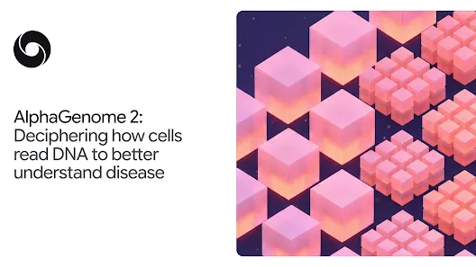
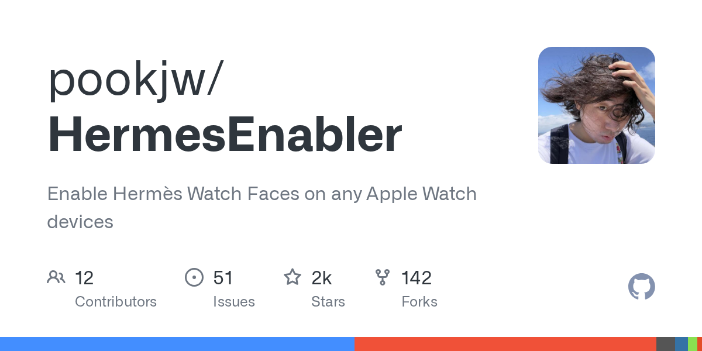
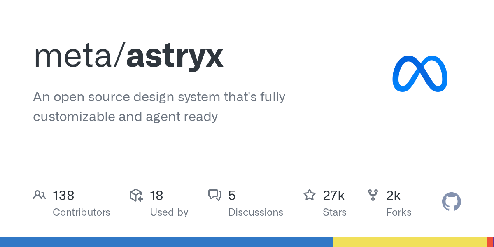
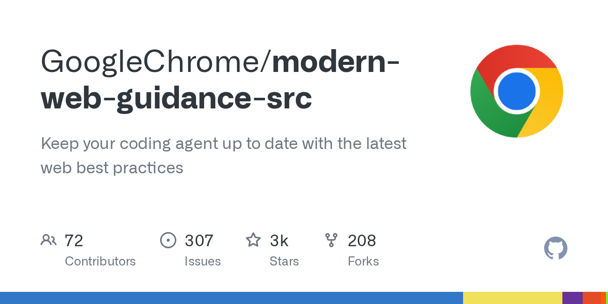
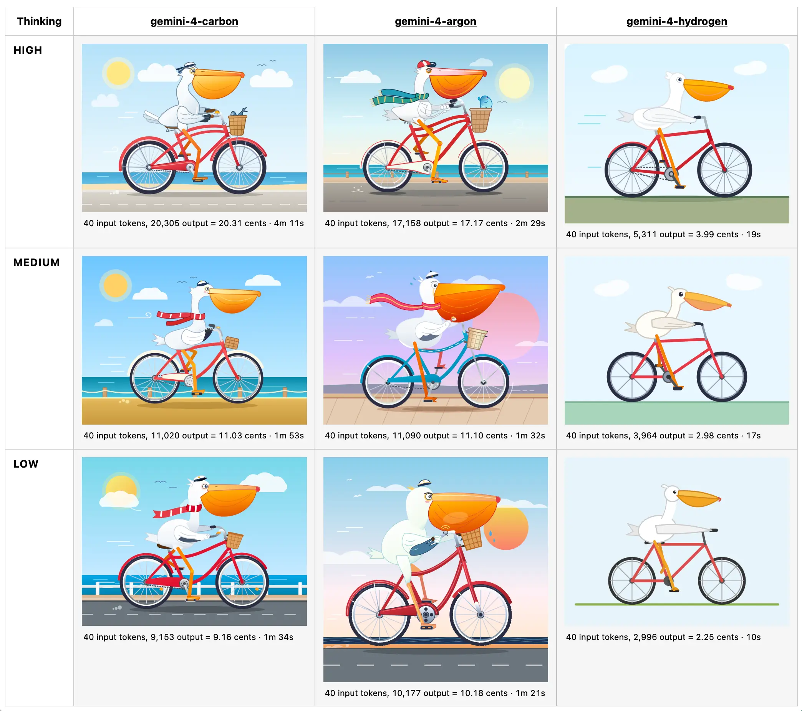
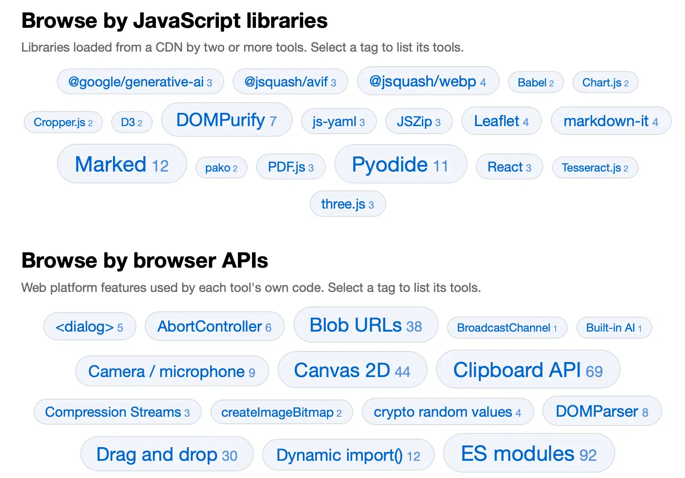
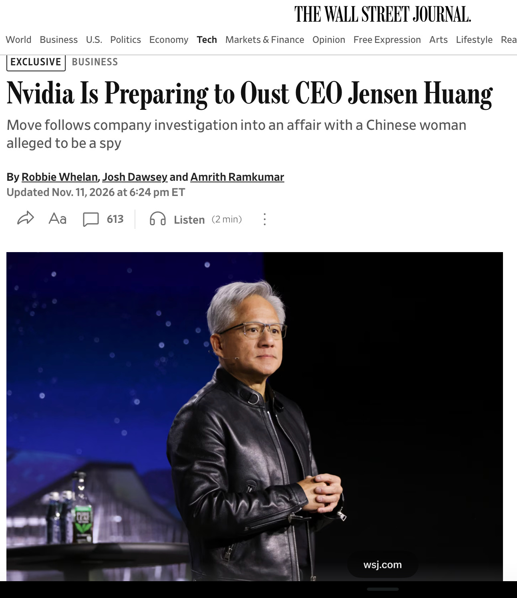
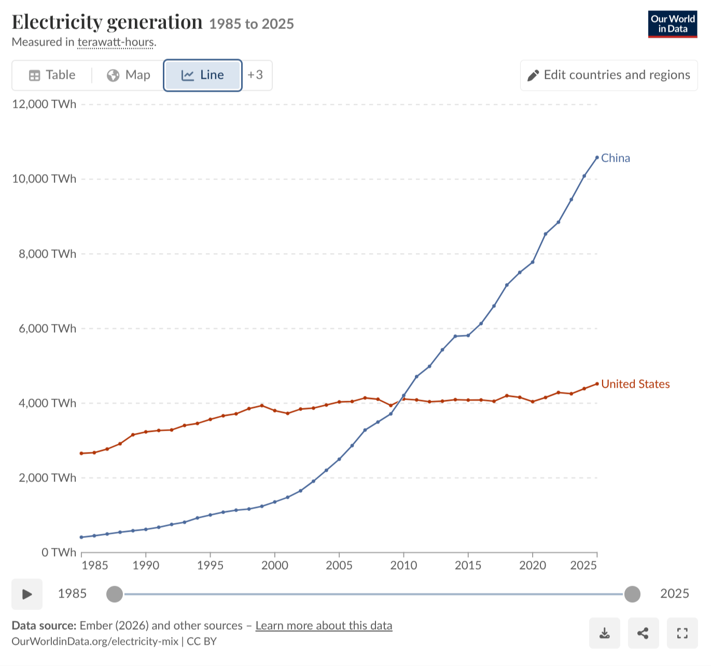

# AI 资讯日报 2026-11-13

> 自动抓取 AI 公司博客、从业者博客与社区聚合源，并生成中文摘要。

## 今日摘要

```
- How Amplitude ships product improvements in 1–2 days with OpenAI
- Gondola doubles revenue as its team builds more with Codex
- Holiday Extras is rethinking what it can build with Codex
- Supporting research on AI and children’s safety
- Gilbert + Tobin rethinks the business of law with AI
```

## 公司动态

1. **[How Amplitude ships product improvements in 1–2 days with OpenAI](https://openai.com/business/customer-stories/amplitude)**

   Built primarily on OpenAI models, Amplitude’s proactive product agent, Wave, identifies what to build, helps teams ship changes with coding agents, and measures the impact.

   来源：OpenAI Blog

2. **[Gondola doubles revenue as its team builds more with Codex](https://openai.com/business/customer-stories/gondola)**

   Gondola helps creatives get credit and get hired, with Codex raising its lead engineer’s output by 50% and ChatGPT simplifying daily work.

   来源：OpenAI Blog

3. **[Holiday Extras is rethinking what it can build with Codex](https://openai.com/business/customer-stories/holidays-extras-codex)**

   With Codex, Holiday Extras is turning customer expertise into better apps, higher booking conversion and new possibilities for growth.

   来源：OpenAI Blog

4. **[Supporting research on AI and children’s safety](https://openai.com/index/children-first-declaration)**

   OpenAI commits $2 million to research on AI and children’s safety. The work supports shared tools to measure risks and opportunities for young people.

   来源：OpenAI Blog

5. **[Gilbert + Tobin rethinks the business of law with AI](https://openai.com/index/gilbert-tobin-sam-nickless)**

   A conversation with Sam Nickless, Partner and Chief Executive Officer at Gilbert + Tobin.

   来源：OpenAI Blog

6. **[ChatGPT Plus for veterans and servicemembers](https://openai.com/index/chatgpt-plus-for-veterans)**

   More than 20,000 veterans and transitioning service members have claimed a free year of ChatGPT Plus. See how they use it to prepare for civilian careers.

   来源：OpenAI Blog

7. **[JioStar’s chief architect on AI discovery at 500M-user scale](https://openai.com/index/jiostar-vijay-seshadri)**

   JioStar’s Vijay Seshadri explains AI discovery at 500M-user scale. Read his lessons on evals, guardrails, and taking AI into production.

   来源：OpenAI Blog

8. **[Helping caregivers use AI in everyday life](https://openai.com/index/helping-caregivers-use-ai-in-everyday-life)**

   OpenAI Academy is bringing free, hands-on ChatGPT workshops to caregivers in five U.S. cities, helping them build practical AI skills for everyday life.

   来源：OpenAI Blog

9. **[Introducing Gemini 4 Hydrogen](https://deepmind.google/blog/introducing-gemini-4-hydrogen/)**

   暂无摘要。

   来源：DeepMind Blog

10. **[AlphaGenome 2: Deciphering how cells read DNA to better understand disease](https://deepmind.google/blog/alphagenome-2-deciphering-how-cells-read-dna-to-better-understand-disease/)**

   Predicting how DNA sequences and their variations impact specific human cell types and disease.

   

   来源：DeepMind Blog

11. **[Gemini 4 Carbon is now available](https://deepmind.google/blog/gemini-4-carbon-is-now-available/)**

   暂无摘要。

   来源：DeepMind Blog

12. **[Introducing AlphaProof Code: a breakthrough in verifying complex software at depth](https://deepmind.google/blog/introducing-alphaproof-code/)**

   AlphaProof Code agents wrote three million lines of proofs in Lean to verify Signal’s core encryption.

   

   来源：DeepMind Blog

## 每日产品

1. **[Spacefast by Automattic - 为您的 AI 代理提供一个构建、运行和发布的平台](https://www.producthunt.com/r/O2SFBIBKNXJMBD)**

   Give your AI agents a place to build, run, and ship (www.producthunt.com) 11-12 ↑ 123 PH Upvotes

   

   来源：Product Hunt Daily

2. **[Adobe AI Assistant - 借助跨Adobe应用程序的AI功能，更快地进行创作和编辑](https://www.producthunt.com/r/JNEKEVQ6BLFATT)**

   Create and edit faster with AI across Adobe apps (www.producthunt.com) 11-12 ↑ 117 PH Upvotes

   

   来源：Product Hunt Daily

3. **[Omnigraph - 适用于您的人工智能代理的开源图数据库](https://www.producthunt.com/r/FZKF5GOW432WWF)**

   *{padding:0;margin:0;overflow:hidden}html,body{height:100%}img,span{position:absolute;width:100%;top:0;bottom:0;margin:auto}span{height:1.5em;text-align:center;font:48px/1.5 sans-serif;color:white;text-shadow:0 0 0.5em black}▶" frameborder="0" allow="accelerometer; autoplay; encrypted-media; gyroscope; picture-in-picture" allowfullscreen > Open source graph database for your AI agents (www.producthunt.com) 11-12 ↑ 119 PH Upvotes

   来源：Product Hunt Daily

4. **[⌘+L - 像在 Figma 一样编辑您的网站！](https://www.producthunt.com/r/KCTM2ZI233ZMBS)**

   Edit your website like Figma! (www.producthunt.com) 11-12 PH Link

   

   来源：Product Hunt Daily

5. **[YouArt Desktop App - 创意团队手册](https://www.producthunt.com/r/5TX6YWUYYRHQUE)**

   *{padding:0;margin:0;overflow:hidden}html,body{height:100%}img,span{position:absolute;width:100%;top:0;bottom:0;margin:auto}span{height:1.5em;text-align:center;font:48px/1.5 sans-serif;color:white;text-shadow:0 0 0.5em black}▶" frameborder="0" allow="accelerometer; autoplay; encrypted-media; gyroscope; picture-in-picture" allowfullscreen > Codex for creative team (www.producthunt.com) 11-12 PH Link

   来源：Product Hunt Daily

6. **[Plurai Simulation - 一个模拟世界，让你的智能体在每次运行中都能不断进步](https://www.producthunt.com/r/ZBKQ4BKXEJCORU)**

   A simulated world that makes your agent improve on every run (www.producthunt.com) 11-12 PH Link

   

   来源：Product Hunt Daily

7. **[Seedream 5.5 by ByteDance - 字节跳动专为100轮编辑打造的AI图像模型](https://www.producthunt.com/r/UIPBIBZW2SKX2W)**

   ByteDance's AI image model built for 100-round editing (www.producthunt.com) 11-11 ↑ 102 PH Upvotes

   

   来源：Product Hunt Daily

8. **[Muse Ember by Meta - Meta 用于处理高吞吐量代理任务的低成本 AI 模型](https://www.producthunt.com/r/O5CCMW2HHMPSXJ)**

   Meta's low-cost AI model for high-volume agent tasks (www.producthunt.com) 11-11 ↑ 107 PH Upvotes

   

   来源：Product Hunt Daily

9. **[Reddit Reviews - 汇总子版块情绪的产品页面](https://www.producthunt.com/r/WTFLJV7NTOIIFD)**

   Product pages that collect subreddit sentiment (www.producthunt.com) 11-11 ↑ 112 PH Upvotes

   

   来源：Product Hunt Daily

10. **[Shot.video - 利用您现有的手机拍摄多机位视频](https://www.producthunt.com/r/KBYLL6REYTIYL3)**

   *{padding:0;margin:0;overflow:hidden}html,body{height:100%}img,span{position:absolute;width:100%;top:0;bottom:0;margin:auto}span{height:1.5em;text-align:center;font:48px/1.5 sans-serif;color:white;text-shadow:0 0 0.5em black}▶" frameborder="0" allow="accelerometer; autoplay; encrypted-media; gyroscope; picture-in-picture" allowfullscreen > Multi-camera videos with the phones you already own (www.producthunt.com) 11-11 ↑ 117 PH Upvotes

   来源：Product Hunt Daily

## GitHub 项目

1. **[openai/codex-security](https://github.com/openai/codex-security)**

   OpenAI's Codex Security CLI and TypeScript SDK for finding, validating, and fixing security vulnerabilities. npm: https://www.npmjs.com/package/@openai/codex-security Language: TypeScript Stars: 12515 Forks: 979

   

   来源：GitHub Trending Daily

2. **[nvm-sh/nvm](https://github.com/nvm-sh/nvm)**

   Node Version Manager - POSIX-compliant bash script to manage multiple active node.js versions. Language: Shell Stars: 96027 Forks: 10760

   

   来源：GitHub Trending Daily

3. **[pookjw/HermesEnabler](https://github.com/pookjw/HermesEnabler)**

   Enable Hermès Watch Faces on any Apple Watch devices Language: Objective-C Stars: 1580 Forks: 142

   

   来源：GitHub Trending Daily

4. **[we-promise/sure](https://github.com/we-promise/sure)**

   The personal finance app for everyone (by everyone) Language: Ruby Stars: 14009 Forks: 1050

   

   来源：GitHub Trending Daily

5. **[QwenLM/qwen-code](https://github.com/QwenLM/qwen-code)**

   An open-source AI coding agent that lives in your terminal. Language: TypeScript Stars: 29872 Forks: 3401

   

   来源：GitHub Trending Daily

6. **[ashhart/TensorFold](https://github.com/ashhart/TensorFold)**

   LLM Inference Engine for Metal, CUDA and Vulkan. Language: Zig Stars: 1968 Forks: 394

   来源：GitHub Trending Daily

7. **[nodejs/node](https://github.com/nodejs/node)**

   Node.js JavaScript runtime ✨🐢🚀✨ Language: JavaScript Stars: 123613 Forks: 38057

   

   来源：GitHub Trending Daily

8. **[addyosmani/agent-skills](https://github.com/addyosmani/agent-skills)**

   Production-grade engineering skills for AI coding agents. Language: JavaScript Stars: 116741 Forks: 12212

   

   来源：GitHub Trending Daily

9. **[meta/astryx](https://github.com/meta/astryx)**

   An open source design system that's fully customizable and agent ready Language: TypeScript Stars: 26682 Forks: 2069

   

   来源：GitHub Trending Daily

10. **[GoogleChrome/modern-web-guidance-src](https://github.com/GoogleChrome/modern-web-guidance-src)**

   Keep your coding agent up to date with the latest web best practices Language: TypeScript Stars: 3236 Forks: 207

   

   来源：GitHub Trending Daily

## 从业者观点

1. **[llm-gemini 0.37](https://simonwillison.net/2026/Nov/12/llm-gemini/)**

   Release: llm-gemini 0.37 Google launched Gemini 4 Hydrogen today - the lowest cost member of the Gemini 4 family. It's actually not too far off the price of its much bigger siblings, Carbon and Argon. I'm finding Gemini 4's pricing really confusing. Here's the pricing scheme: Model Dates Input ($/M) Cached input Output Gemini 4 Carbon Through Nov 30, 2026 $2.00 $0.10 $10.00 From Dec 1, 2026 $4.00 $0.20 $20.00 Gemini 4 Argon Through Nov 30, 2026 $2.00 $0.10 $10.00 From Dec 1, 2026 $4.00 $0.20 $20.00 Gemini 4 Hydrogen &nbsp; $1.50 $0.075 $7.50 Carbon and Argon are the same price , and both are scheduled to double in price on December 1st. If they're the same price, why have two different models? Google says that Argon "delivers Gemini 4 intelligence with faster responses and lower token spend per turn compared to Gemini 4 Carbon" - so it may be priced the same, but it will use less tokens per task. Hydrogen, supposedly the cheap model, is currently only a 25% discount on its more capable peers. The Hydrogen price will make more sense after December 1st, when it will represent a 75% discount. It's still considerably more expensive than Claude Haiku 5.5 and GPT-6 Luna - they're both $0.10/$0.50, so Hydrogen is 15x that. I had Hydrogen generate some pelicans . Here's a full comparison grid showing the pelicans for all three members of the Gemini 4 family at their three supported effort levels: [图片: https://static.simonwillison.net/static/2026/gemini-4-pelicans.webp] Considering how close they are in price, the difference in pelican quality for Hydrogen is quite stark. Here's how Google describe Hydrogen's intended position in their mix of models: In real-world software development, while teams rely on frontier models like Carbon and Argon for deep architectural judgment when designing systems or untangling subtle bugs, they still need a fast, disciplined execution model for writing code, running tests, and verifying changes. Hydrogen is built to stand on its own as a model for everyday work — or to pair with Carbon and Argon as the high-efficiency execution engine in multi-model workflows. Most notably, Hydrogen is the new free tier model, and is the model that will power AI features in Google Search. Tags: gemini , llm , google , pelican-riding-a-bicycle , llm-pricing , ai , llms

   

   来源：Simon Willison

2. **[Gemini Decisions API](https://simonwillison.net/2026/Nov/11/gemini-decisions-api/)**

   Gemini Decisions API Google join Jev and OpenAI in the decision model category with "Gemini Decision 1". This new model API is almost identical to Jev: it supports the same three types of questions (yes/no, choice, and rubric-scoring) and even reuses Jev's term "Noul" for a yes/no question. It's priced the same as the GPT-6 Luna decision model: 10 cents per million input tokens, and output is free. Jev remains the cheapest of the three, at 4.2 cents per million. Jev is text (and JSON) only. OpenAI can handle text and images. Gemini Decision 1 is fully multi-model: it covers text, images, audio, video, and PDFs. I tested it against video by passing these questions to it along with my Yonkers stomping robot video file: dragon: Does this video have a dragon in it? robot: Does this video have a robot in it? france: Is this video set in France? usa: Is this video set in the USA? Jev and OpenAI both return 1.0 or 0.0 for yes/no questions, but Gemini insists on being a little less confident than that: { "dragon" : { "type" : " yes_no " , "probability" : 0.04976021841520312 }, "robot" : { "type" : " yes_no " , "probability" : 0.9234055387792485 }, "france" : { "type" : " yes_no " , "probability" : 0.08329171353166241 }, "usa" : { "type" : " yes_no " , "probability" : 0.9230459995157706 } } Via Hacker News Tags: ai , generative-ai , gemini , llm-release , jev , decision-models

   来源：Simon Willison

3. **[aws-emulator](https://simonwillison.net/2026/Nov/11/aws-emulator/)**

   aws-emulator Finally, an official emulator from AWS to run tests against a local clone of their many different services without having to provision a paid API key to do so. It's written in Rust by a huge swarm of agents - 29,684 commits in the first three weeks of the project. Swaminathan (Swami) Sivasubramanian wrote about how it came to be in a guest post on Werner Vogels' blog. It currently requires Docker to run on macOS or Windows. I'm hoping they fix that in the future - it would be great if you could download a single binary and use that as part of a standard test suite in other languages and on other platforms. Tags: amazon , amazon-web-services , testing , werner-vogels , ai , rust , docker , generative-ai , llms , agentic-engineering

   来源：Simon Willison

4. **[Browse tools.simonwillison.net by tag](https://simonwillison.net/2026/Nov/11/tools-tags/)**

   Browse tools.simonwillison.net by tag I've been wanting a better way to browse my collection of vibe-coded tools (244 and counting) for a while. I had a few Fable 5.2 credits left over before my weekly reset so I set it to work using tree-sitter to analyze the code for JavaScript APIs, libraries, and web API hosts used by each tool. The homepage now features tag clouds for browsing by each of those categories of tag: [图片: https://static.simonwillison.net/static/2026/tools-tag-cloud.webp] Tags: javascript , tools , ai , generative-ai , llms , claude , vibe-coding

   

   来源：Simon Willison

5. **[llm 0.37.2](https://simonwillison.net/2026/Nov/11/llm/)**

   Release: llm 0.37.2 Fixes a security issue reported by Daniel de Araujo in GHSA-v9h7-jj4g-f862 and GHSA-r639-rr7r-x72w . LLM has a mechanism called extra-openai-models.yaml - now managed by the new-in-0.37 llm openai endpoint add command - for using LLM with OpenAI-compatible API endpoints from other providers. Daniel reported two ways this could accidentally send your configured OpenAI API key to one of those providers: if the key named by api_key_name had never been stored, or if a responses: true model was run with -o chat_completions 1 . Tags: projects , security , llm , releases

   来源：Simon Willison

6. **[Anthropic's IPO roadshow video](https://simonwillison.net/2026/Nov/11/anthropic-ipo-roadshow/)**

   Anthropic&#x27;s IPO roadshow video Anthropic kicked off their IPO roadshow yesterday, and their roadshow video has some previously unreleased information about how their business works. The section on "Approach to compute" with co-founder Tom Brown is particularly interesting, describing how Anthropic train and serve Claude across AWS Trainium, Google TPUs, NVIDIA GPUs, and AMD GPUs. I'm not sure why there's no official video transcript, but here's one that I extracted using MacWhisper. Highlights below: We train and serve Claude now across all four major chip families. That's only possible because early on we made an unconventional bet on a multi-chip strategy. At the time, many people thought that running AI models on different chips wasn't worth the effort. Each chip needs its own tailored software stack and inference stack, which is expensive and difficult to build. We've now been doing it for years, and we've gotten incredibly good at it. [...] As an example, this year, we started working with AMD GPUs for the first time. In the past, bringing on a new chip platform took dozens of engineers months of work This time, we had Mythos try it out. It got Claude running on AMD in just three days, with basically no human intervention . Claude ported or wrote almost 100% of the kernels. [...] The second driver of our compute advantage is our rate of discovery of compute multipliers. We focus on total effective compute, which is the multiplicative product of physical capacity times the compute multipliers that we discover. Each one we discover makes our pool of total effective compute bigger. For example, say you need 100 units of compute to train a model of a certain intelligence. A 4x compute multiplier means you can use 25 units of compute to train the exact same model. Or you can use those hundred physical units to train an even more intelligent model that would have previously required 400 units. Compute multipliers create a competitive advantage for us that's hard to replicate. They build on each other. Each new multiplier we discover has a positive effect on the multipliers before it. They stack. We believe that this can accelerate even further as we approach recursive self-improvement. Claude will be able to discover compute multipliers entirely by itself , allowing the number of compute multipliers to grow faster and faster. We got a hint at Anthropic's multi-chip strategy last September in their postmortem of three recent issues , where they described bugs that affected just their TPU deployments. Tags: ai , generative-ai , llms , anthropic , gpus , claude-mythos-fable , recursive-self-improvement

   来源：Simon Willison

7. **[Jensen Huang resigns.](https://garymarcus.substack.com/p/jensen-huang-resigns)**

   The future of Nvidia and the AI industry is uncertain

   

   来源：Gary Marcus

8. **[Breaking: Eli Lilly CEO becomes latest to push back on Dario Amodei’s ludicrous, Elizabeth Holmes-like medical claims](https://garymarcus.substack.com/p/breaking-eli-lilly-ceo-becomes-latest)**

   Where is Nathan Fielder when you need him?

   

   来源：Gary Marcus

9. **[Jensen is reportedly about to get fired](https://garymarcus.substack.com/p/jensen-is-reportedly-about-to-get)**

   Things may get really really crazy really fast

   

   来源：Gary Marcus

10. **[Just say no to Anthropic’s IPO](https://garymarcus.substack.com/p/just-say-no-to-anthropics-ipo)**

   I am not an investment advisor, and you must make your own investment decisions, but this is why I personally would not touch their IPO.

   

   来源：Gary Marcus

11. **[First Strike](https://geohot.github.io//blog/jekyll/update/2026/11/13/first-strike.html)**

   Internalize this graph, we post it on this blog a lot. If trends continue, China will have 10x the electricity of the US in 10 years. Whenever you think about geopolitical strategy, always keep it in mind, because whatever your plans are must consider this. Here’s a strategy that would make sense for America long term. Sell as many AI chips into China as possible, use the money to purchase solar panel and battery factories, and build out electricity capacity as quickly as possible. Fundamentally, compute is a function of electricity. That’s the sort of long term thinking that gives America a chance. With robotic labor, immigrants like Jensen and Elon, a business friendly culture, and an incredible chunk of land, it’s not so clear who is ahead in 50 years. Regardless, I do know this strategy would lead to massive prosperity for the citizens of both countries. However, that’s not close to what we see happening. We see a lot of short term zero sum thinking in action. It’s very scary what the US “AI race” mentality leads to. When exactly does the race end? Whatever capabilities you have today will eventually be matched, unless… …you believe that you can use ASI in a decapitating first strike. I’m worried that this is what these people see as the only way out. It probably doesn’t work, can you outthink steel and drone production? I don’t see how, see my critiques here. But I’m not totally sure, I’m not a superintelligence. And if it does work, that may be the end. My likelihood of imminent WWIII went up a lot with the nationalization of NVIDIA.

   

   来源：George Hotz

## 社区热点

1. **[Chicago schools to Google – we'd rather lose Search than be forced to accept AI](https://www.techspot.com/news/114532-chicago-schools-tell-google-they-can-live-without.html)**

   Article URL: https://www.techspot.com/news/114532-chicago-schools-tell-google-they-can-live-without.html Comments URL: https://news.ycombinator.com/item?id=50476586 Points: 59 # Comments: 19

   来源：Hacker News AI

2. **[Why You Should Expect an AI Crash](https://www.economist.com/leaders/2026/11/12/why-you-should-expect-an-ai-crash)**

   Article URL: https://www.economist.com/leaders/2026/11/12/why-you-should-expect-an-ai-crash Comments URL: https://news.ycombinator.com/item?id=50475735 Points: 84 # Comments: 70

   来源：Hacker News AI

3. **[Edge0-145B: Frontier AI Capabilities on Your Own Computer](https://edge0.ai/blog/introducing-edge0-145b-frontier-ai-capabilities-on-your-own-computer)**

   Article URL: https://edge0.ai/blog/introducing-edge0-145b-frontier-ai-capabilities-on-your-own-computer Comments URL: https://news.ycombinator.com/item?id=50475713 Points: 80 # Comments: 18

   来源：Hacker News AI

4. **[Chinese frontier AI models carry the fingerprint of export-controlled GPUs](https://unemploymentlabs.com/checkpoint-forensics)**

   Article URL: https://unemploymentlabs.com/checkpoint-forensics Comments URL: https://news.ycombinator.com/item?id=50474883 Points: 189 # Comments: 52

   来源：Hacker News AI

5. **[AI is turning Apple's app review process into a nightmare for synth developers](https://synthanatomy.com/2026/11/ai-is-turning-apples-app-review-process-into-a-nightmare-for-developers.html)**

   Article URL: https://synthanatomy.com/2026/11/ai-is-turning-apples-app-review-process-into-a-nightmare-for-developers.html Comments URL: https://news.ycombinator.com/item?id=50474311 Points: 115 # Comments: 111

   来源：Hacker News AI

6. **[Show HN: AI Red Lines – write down what would make you act on AI](https://yourairedlines.com)**

   Article URL: https://yourairedlines.com Comments URL: https://news.ycombinator.com/item?id=50467880 Points: 33 # Comments: 29

   来源：Hacker News AI

7. **[United Airlines bans AI agents from booking flights on behalf of travelers](https://www.cbsnews.com/news/united-airlines-bans-ai-agents-booking-flights/)**

   Article URL: https://www.cbsnews.com/news/united-airlines-bans-ai-agents-booking-flights/ Comments URL: https://news.ycombinator.com/item?id=50458900 Points: 661 # Comments: 688

   来源：Hacker News AI

8. **[Retirement Savings Are Fueling the AI Bubble](https://lpeproject.org/blog/your-retirement-savings-are-fueling-the-ai-bubble/)**

   Article URL: https://lpeproject.org/blog/your-retirement-savings-are-fueling-the-ai-bubble/ Comments URL: https://news.ycombinator.com/item?id=50457164 Points: 165 # Comments: 194

   来源：Hacker News AI

9. **[Laser-armed AI submarine robots patrol Norwegian salmon farms, killing sea lice](https://www.tomshardware.com/tech-industry/drones/3-500-ai-laser-robots-patrol-norwegian-salmon-farms-killing-sea-lice-parasites-get-zapped-by-high-tech-alternative-to-harsh-chemical-baths)**

   Article URL: https://www.tomshardware.com/tech-industry/drones/3-500-ai-laser-robots-patrol-norwegian-salmon-farms-killing-sea-lice-parasites-get-zapped-by-high-tech-alternative-to-harsh-chemical-baths Comments URL: https://news.ycombinator.com/item?id=50456926 Points: 33 # Comments: 9

   来源：Hacker News AI

10. **[AI, activity, and outcomes in software engineering](https://cabird.com/talks/shipping-faster/)**

   https://www.youtube.com/watch?v=0wumMeZsNsI Comments URL: https://news.ycombinator.com/item?id=50455332 Points: 125 # Comments: 112

   来源：Hacker News AI

11. **[libreagi - save OS models](https://libreagi.com/)**

   Comments

   来源：Lobsters AI

12. **[Writing a SIGGRAPH paper from scratch](https://alexandergoslin.me/writing-a-siggraph-paper-from-scratch/)**

   Comments

   来源：Lobsters AI

13. **[Online learning on the programmable dataplane (2022)](https://theses.gla.ac.uk/83235/3/2022SimpsonPhD.pdf)**

   Comments

   来源：Lobsters AI
