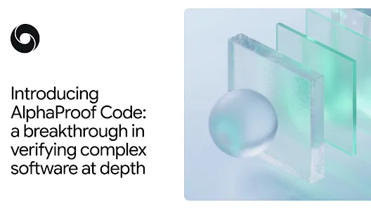
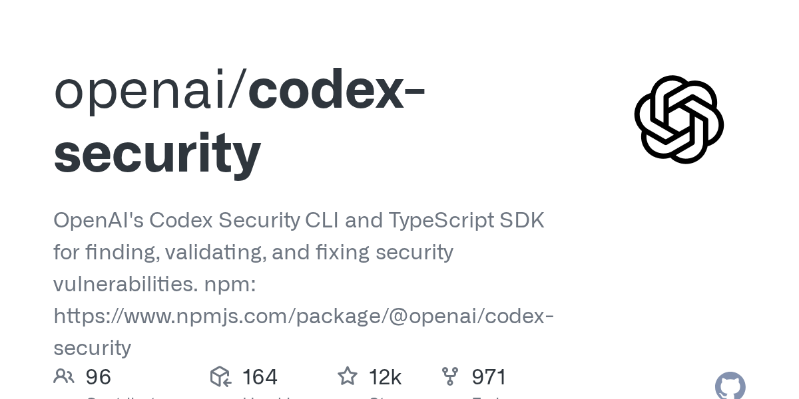
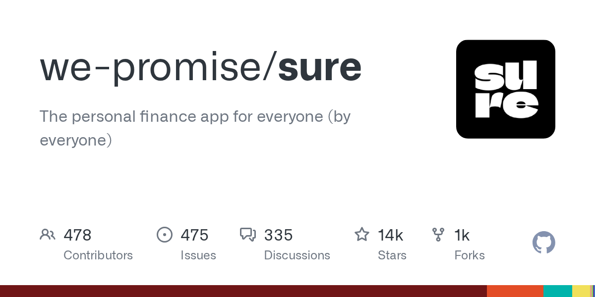
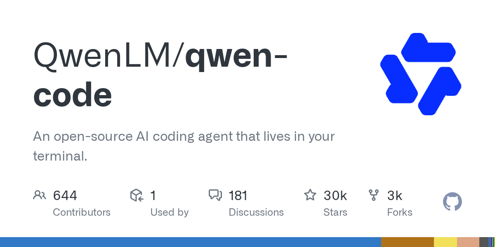
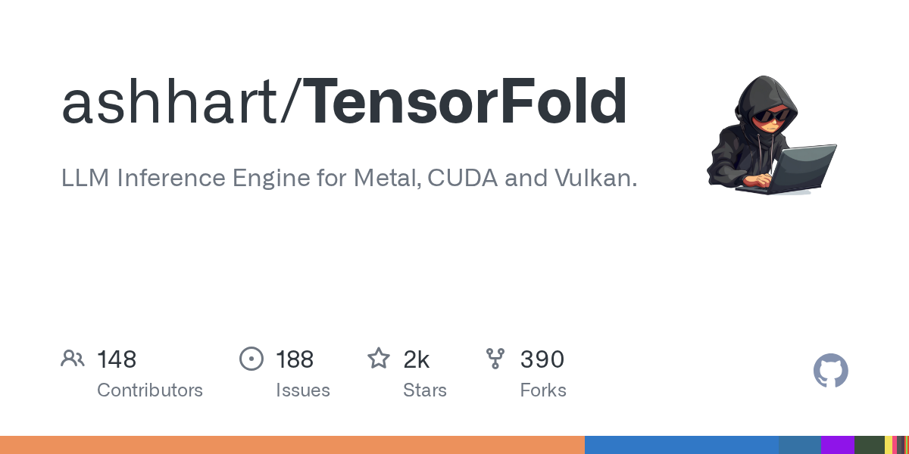
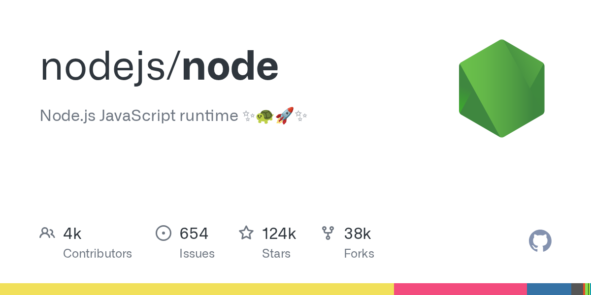
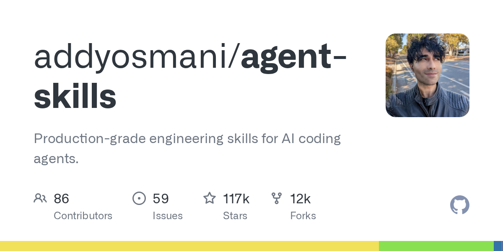

# AI 资讯日报 2026-11-13

> 自动抓取 AI 公司博客、从业者博客与社区聚合源，并生成中文摘要。

## 今日摘要

```
- Holiday Extras is rethinking what it can build with Codex
- Supporting research on AI and children’s safety
- Gilbert + Tobin rethinks the business of law with AI
- ChatGPT Plus for veterans and servicemembers
- JioStar’s chief architect on AI discovery at 500M-user scale
```

## 公司动态

1. **[Holiday Extras is rethinking what it can build with Codex](https://openai.com/business/customer-stories/holidays-extras-codex)**

   With Codex, Holiday Extras is turning customer expertise into better apps, higher booking conversion and new possibilities for growth.

   来源：OpenAI Blog

2. **[Supporting research on AI and children’s safety](https://openai.com/index/children-first-declaration)**

   OpenAI commits $2 million to research on AI and children’s safety. The work supports shared tools to measure risks and opportunities for young people.

   来源：OpenAI Blog

3. **[Gilbert + Tobin rethinks the business of law with AI](https://openai.com/index/gilbert-tobin-sam-nickless)**

   A conversation with Sam Nickless, Partner and Chief Executive Officer at Gilbert + Tobin.

   来源：OpenAI Blog

4. **[ChatGPT Plus for veterans and servicemembers](https://openai.com/index/chatgpt-plus-for-veterans)**

   More than 20,000 veterans and transitioning service members have claimed a free year of ChatGPT Plus. See how they use it to prepare for civilian careers.

   来源：OpenAI Blog

5. **[JioStar’s chief architect on AI discovery at 500M-user scale](https://openai.com/index/jiostar-vijay-seshadri)**

   JioStar’s Vijay Seshadri explains AI discovery at 500M-user scale. Read his lessons on evals, guardrails, and taking AI into production.

   来源：OpenAI Blog

6. **[Helping caregivers use AI in everyday life](https://openai.com/index/helping-caregivers-use-ai-in-everyday-life)**

   OpenAI Academy is bringing free, hands-on ChatGPT workshops to caregivers in five U.S. cities, helping them build practical AI skills for everyday life.

   来源：OpenAI Blog

7. **[Introducing Businesses in ChatGPT](https://openai.com/index/introducing-businesses-chatgpt)**

   Manage your business information, get insights about how your business shows up, and turn interest into action in ChatGPT.

   来源：OpenAI Blog

8. **[Closing the AI guidance gap in education](https://openai.com/index/closing-ai-guidance-gap-education)**

   New ThinkYoung research and lessons from OpenAI’s EMEA education partnerships on supporting teachers, AI literacy, and independent learning.

   来源：OpenAI Blog

9. **[Introducing Gemini 4 Hydrogen](https://deepmind.google/blog/introducing-gemini-4-hydrogen/)**

   暂无摘要。

   来源：DeepMind Blog

10. **[AlphaGenome 2: Deciphering how cells read DNA to better understand disease](https://deepmind.google/blog/alphagenome-2-deciphering-how-cells-read-dna-to-better-understand-disease/)**

   Predicting how DNA sequences and their variations impact specific human cell types and disease.

   

   来源：DeepMind Blog

11. **[Gemini 4 Carbon is now available](https://deepmind.google/blog/gemini-4-carbon-is-now-available/)**

   暂无摘要。

   来源：DeepMind Blog

12. **[Introducing AlphaProof Code: a breakthrough in verifying complex software at depth](https://deepmind.google/blog/introducing-alphaproof-code/)**

   AlphaProof Code agents wrote three million lines of proofs in Lean to verify Signal’s core encryption.

   

   来源：DeepMind Blog

13. **[Gemini Robotics 2.5 accelerates real-world general dexterity](https://deepmind.google/blog/gemini-robotics-2-5-accelerates-real-world-physical-intelligence/)**

   Our most capable vision-language-action model enhances robot dexterity, reliability, and safety

   

   来源：DeepMind Blog

## 每日产品

1. **[Adobe AI Assistant - 借助跨Adobe应用程序的AI功能，更快地进行创作和编辑](https://www.producthunt.com/r/JNEKEVQ6BLFATT)**

   Create and edit faster with AI across Adobe apps (www.producthunt.com) 16:01 ↑ 117 PH Upvotes

   

   来源：Product Hunt Daily

2. **[Omnigraph - 适用于您的人工智能代理的开源图数据库](https://www.producthunt.com/r/FZKF5GOW432WWF)**

   *{padding:0;margin:0;overflow:hidden}html,body{height:100%}img,span{position:absolute;width:100%;top:0;bottom:0;margin:auto}span{height:1.5em;text-align:center;font:48px/1.5 sans-serif;color:white;text-shadow:0 0 0.5em black}▶" frameborder="0" allow="accelerometer; autoplay; encrypted-media; gyroscope; picture-in-picture" allowfullscreen > Open source graph database for your AI agents (www.producthunt.com) 16:01 ↑ 119 PH Upvotes

   来源：Product Hunt Daily

3. **[⌘+L - 像在 Figma 一样编辑您的网站！](https://www.producthunt.com/r/KCTM2ZI233ZMBS)**

   Edit your website like Figma! (www.producthunt.com) 16:01 PH Link

   

   来源：Product Hunt Daily

4. **[YouArt Desktop App - 创意团队手册](https://www.producthunt.com/r/5TX6YWUYYRHQUE)**

   *{padding:0;margin:0;overflow:hidden}html,body{height:100%}img,span{position:absolute;width:100%;top:0;bottom:0;margin:auto}span{height:1.5em;text-align:center;font:48px/1.5 sans-serif;color:white;text-shadow:0 0 0.5em black}▶" frameborder="0" allow="accelerometer; autoplay; encrypted-media; gyroscope; picture-in-picture" allowfullscreen > Codex for creative team (www.producthunt.com) 16:01 PH Link

   来源：Product Hunt Daily

5. **[Plurai Simulation - 一个模拟世界，让你的智能体在每次运行中都能不断进步](https://www.producthunt.com/r/ZBKQ4BKXEJCORU)**

   A simulated world that makes your agent improve on every run (www.producthunt.com) 16:01 PH Link

   

   来源：Product Hunt Daily

6. **[Seedream 5.5 by ByteDance - 字节跳动专为100轮编辑打造的AI图像模型](https://www.producthunt.com/r/UIPBIBZW2SKX2W)**

   ByteDance's AI image model built for 100-round editing (www.producthunt.com) 11-11 ↑ 102 PH Upvotes

   

   来源：Product Hunt Daily

7. **[Muse Ember by Meta - Meta 用于处理高吞吐量代理任务的低成本 AI 模型](https://www.producthunt.com/r/O5CCMW2HHMPSXJ)**

   Meta's low-cost AI model for high-volume agent tasks (www.producthunt.com) 11-11 ↑ 107 PH Upvotes

   

   来源：Product Hunt Daily

8. **[Reddit Reviews - 汇总子版块情绪的产品页面](https://www.producthunt.com/r/WTFLJV7NTOIIFD)**

   Product pages that collect subreddit sentiment (www.producthunt.com) 11-11 ↑ 112 PH Upvotes

   

   来源：Product Hunt Daily

9. **[Shot.video - 利用您现有的手机拍摄多机位视频](https://www.producthunt.com/r/KBYLL6REYTIYL3)**

   *{padding:0;margin:0;overflow:hidden}html,body{height:100%}img,span{position:absolute;width:100%;top:0;bottom:0;margin:auto}span{height:1.5em;text-align:center;font:48px/1.5 sans-serif;color:white;text-shadow:0 0 0.5em black}▶" frameborder="0" allow="accelerometer; autoplay; encrypted-media; gyroscope; picture-in-picture" allowfullscreen > Multi-camera videos with the phones you already own (www.producthunt.com) 11-11 ↑ 117 PH Upvotes

   来源：Product Hunt Daily

10. **[Relay - 面向 AI 代理的 DocSend：在上下文中发送和接收文档](https://www.producthunt.com/r/NH66BMRYJHZFJH)**

   DocSend for AI agents: send and receive docs with context (www.producthunt.com) 11-11 ↑ 125 PH Upvotes

   

   来源：Product Hunt Daily

## GitHub 项目

1. **[openai/codex-security](https://github.com/openai/codex-security)**

   OpenAI's Codex Security CLI and TypeScript SDK for finding, validating, and fixing security vulnerabilities. npm: https://www.npmjs.com/package/@openai/codex-security Language: TypeScript Stars: 12258 Forks: 971

   

   来源：GitHub Trending Daily

2. **[nvm-sh/nvm](https://github.com/nvm-sh/nvm)**

   Node Version Manager - POSIX-compliant bash script to manage multiple active node.js versions. Language: Shell Stars: 95977 Forks: 10756

   

   来源：GitHub Trending Daily

3. **[pookjw/HermesEnabler](https://github.com/pookjw/HermesEnabler)**

   Enable Hermès Watch Faces on any Apple Watch devices Language: Objective-C Stars: 1465 Forks: 137

   来源：GitHub Trending Daily

4. **[we-promise/sure](https://github.com/we-promise/sure)**

   The personal finance app for everyone (by everyone) Language: Ruby Stars: 13728 Forks: 1017

   

   来源：GitHub Trending Daily

5. **[QwenLM/qwen-code](https://github.com/QwenLM/qwen-code)**

   An open-source AI coding agent that lives in your terminal. Language: TypeScript Stars: 29694 Forks: 3389

   

   来源：GitHub Trending Daily

6. **[ashhart/TensorFold](https://github.com/ashhart/TensorFold)**

   LLM Inference Engine for Metal, CUDA and Vulkan. Language: Zig Stars: 1889 Forks: 390

   

   来源：GitHub Trending Daily

7. **[nodejs/node](https://github.com/nodejs/node)**

   Node.js JavaScript runtime ✨🐢🚀✨ Language: JavaScript Stars: 123552 Forks: 38052

   

   来源：GitHub Trending Daily

8. **[addyosmani/agent-skills](https://github.com/addyosmani/agent-skills)**

   Production-grade engineering skills for AI coding agents. Language: JavaScript Stars: 116538 Forks: 12203

   

   来源：GitHub Trending Daily

9. **[meta/astryx](https://github.com/meta/astryx)**

   An open source design system that's fully customizable and agent ready Language: TypeScript Stars: 26278 Forks: 2037

   来源：GitHub Trending Daily

10. **[GoogleChrome/modern-web-guidance-src](https://github.com/GoogleChrome/modern-web-guidance-src)**

   Language: TypeScript Stars: 2596 Forks: 183

   来源：GitHub Trending Daily

## 从业者观点

1. **[Gemini Decisions API](https://simonwillison.net/2026/Nov/11/gemini-decisions-api/)**

   Gemini Decisions API Google join Jev and OpenAI in the decision model category with "Gemini Decision 1". This new model API is almost identical to Jev: it supports the same three types of questions (yes/no, choice, and rubric-scoring) and even reuses Jev's term "Noul" for a yes/no question. It's priced the same as the GPT-6 Luna decision model: 10 cents per million input tokens, and output is free. Jev remains the cheapest of the three, at 4.2 cents per million. Jev is text (and JSON) only. OpenAI can handle text and images. Gemini Decision 1 is fully multi-model: it covers text, images, audio, video, and PDFs. I tested it against video by passing these questions to it along with my Yonkers stomping robot video file: dragon: Does this video have a dragon in it? robot: Does this video have a robot in it? france: Is this video set in France? usa: Is this video set in the USA? Jev and OpenAI both return 1.0 or 0.0 for yes/no questions, but Gemini insists on being a little less confident than that: { "dragon" : { "type" : " yes_no " , "probability" : 0.04976021841520312 }, "robot" : { "type" : " yes_no " , "probability" : 0.9234055387792485 }, "france" : { "type" : " yes_no " , "probability" : 0.08329171353166241 }, "usa" : { "type" : " yes_no " , "probability" : 0.9230459995157706 } } Via Hacker News Tags: ai , generative-ai , gemini , llm-release , jev , decision-models

   来源：Simon Willison

2. **[aws-emulator](https://simonwillison.net/2026/Nov/11/aws-emulator/)**

   aws-emulator Finally, an official emulator from AWS to run tests against a local clone of their many different services without having to provision a paid API key to do so. It's written in Rust by a huge swarm of agents - 29,684 commits in the first three weeks of the project. Swaminathan (Swami) Sivasubramanian wrote about how it came to be in a guest post on Werner Vogels' blog. It currently requires Docker to run on macOS or Windows. I'm hoping they fix that in the future - it would be great if you could download a single binary and use that as part of a standard test suite in other languages and on other platforms. Tags: amazon , amazon-web-services , testing , werner-vogels , ai , rust , docker , generative-ai , llms , agentic-engineering

   来源：Simon Willison

3. **[Browse tools.simonwillison.net by tag](https://simonwillison.net/2026/Nov/11/tools-tags/)**

   Browse tools.simonwillison.net by tag I've been wanting a better way to browse my collection of vibe-coded tools (244 and counting) for a while. I had a few Fable 5.2 credits left over before my weekly reset so I set it to work using tree-sitter to analyze the code for JavaScript APIs, libraries, and web API hosts used by each tool. The homepage now features tag clouds for browsing by each of those categories of tag: [图片: https://static.simonwillison.net/static/2026/tools-tag-cloud.webp] Tags: javascript , tools , ai , generative-ai , llms , claude , vibe-coding

   

   来源：Simon Willison

4. **[llm 0.37.2](https://simonwillison.net/2026/Nov/11/llm/)**

   Release: llm 0.37.2 Fixes a security issue reported by Daniel de Araujo in GHSA-v9h7-jj4g-f862 and GHSA-r639-rr7r-x72w . LLM has a mechanism called extra-openai-models.yaml - now managed by the new-in-0.37 llm openai endpoint add command - for using LLM with OpenAI-compatible API endpoints from other providers. Daniel reported two ways this could accidentally send your configured OpenAI API key to one of those providers: if the key named by api_key_name had never been stored, or if a responses: true model was run with -o chat_completions 1 . Tags: projects , security , llm , releases

   来源：Simon Willison

5. **[Anthropic's IPO roadshow video](https://simonwillison.net/2026/Nov/11/anthropic-ipo-roadshow/)**

   Anthropic&#x27;s IPO roadshow video Anthropic kicked off their IPO roadshow yesterday, and their roadshow video has some previously unreleased information about how their business works. The section on "Approach to compute" with co-founder Tom Brown is particularly interesting, describing how Anthropic train and serve Claude across AWS Trainium, Google TPUs, NVIDIA GPUs, and AMD GPUs. I'm not sure why there's no official video transcript, but here's one that I extracted using MacWhisper. Highlights below: We train and serve Claude now across all four major chip families. That's only possible because early on we made an unconventional bet on a multi-chip strategy. At the time, many people thought that running AI models on different chips wasn't worth the effort. Each chip needs its own tailored software stack and inference stack, which is expensive and difficult to build. We've now been doing it for years, and we've gotten incredibly good at it. [...] As an example, this year, we started working with AMD GPUs for the first time. In the past, bringing on a new chip platform took dozens of engineers months of work This time, we had Mythos try it out. It got Claude running on AMD in just three days, with basically no human intervention . Claude ported or wrote almost 100% of the kernels. [...] The second driver of our compute advantage is our rate of discovery of compute multipliers. We focus on total effective compute, which is the multiplicative product of physical capacity times the compute multipliers that we discover. Each one we discover makes our pool of total effective compute bigger. For example, say you need 100 units of compute to train a model of a certain intelligence. A 4x compute multiplier means you can use 25 units of compute to train the exact same model. Or you can use those hundred physical units to train an even more intelligent model that would have previously required 400 units. Compute multipliers create a competitive advantage for us that's hard to replicate. They build on each other. Each new multiplier we discover has a positive effect on the multipliers before it. They stack. We believe that this can accelerate even further as we approach recursive self-improvement. Claude will be able to discover compute multipliers entirely by itself , allowing the number of compute multipliers to grow faster and faster. We got a hint at Anthropic's multi-chip strategy last September in their postmortem of three recent issues , where they described bugs that affected just their TPU deployments. Tags: ai , generative-ai , llms , anthropic , gpus , claude-mythos-fable , recursive-self-improvement

   来源：Simon Willison

6. **[llm-gemini 0.36](https://simonwillison.net/2026/Nov/10/llm-gemini/)**

   Release: llm-gemini 0.36 Gemini 4 Carbon was announced two weeks ago for "a subset of cyber defenders", but today it's available to everyone else . This is Google's best ever Gemini, priced at $2/million input and $10/million output at launch (that's GPT-6.1 Sol / Claude Sonnet 5.5 prices) but scheduled to double in price to $4/$20 on December 1st (same as Opus 5.5). Here are three pelicans for the low, medium and high thinking efforts (it defaults to medium). This is the pelican I got for high: [图片: https://static.simonwillison.net/static/2026/carbon-pelican.webp] Gemini pelicans have all been great for a while now, so I also tested it out using Google's Antigravity IDE with a prompt I first tried with Claude Fable 5.2 yesterday : Make a three js animation where yonkers stands up as a big mech (cool stand up motion) and stomps around manhattan and queens and Brooklyn, use openstreetmap mapping data Here's the HTML result (I had to prompt "build that into a standalone HTML file" to get a version with no external dependencies). I then screen-captured that as a video: Update : Huh, just saw this on YouTube (and tweeted by Google CEO Sundar Pichai ): Using Google Antigravity’s /swarm feature, Carbon built an open-world 3D game where you explore Google’s Mountain View campus as a pelican riding a GBike — coordinating subagents to model 3D assets in Blender from Omni and Nano Banana references, build the browser game in Three.js with WebGL shaders, and pair procedural Web Audio sound effects with Lyria music. Here's the playable version in AI Studio. Tags: llm-release , gemini , llm , google , generative-ai , ai , llms , pelican-riding-a-bicycle

   

   来源：Simon Willison

## 社区热点

1. **[Why Every AI Model Will Ship as a Torrent](https://pirateface.co/articles/every-ai-model-should-be-a-torrent)**

   Article URL: https://pirateface.co/articles/every-ai-model-should-be-a-torrent Comments URL: https://news.ycombinator.com/item?id=50464055 Points: 33 # Comments: 14

   来源：Hacker News AI

2. **[United Airlines bans AI agents from booking flights on behalf of travelers](https://www.cbsnews.com/news/united-airlines-bans-ai-agents-booking-flights/)**

   Article URL: https://www.cbsnews.com/news/united-airlines-bans-ai-agents-booking-flights/ Comments URL: https://news.ycombinator.com/item?id=50458900 Points: 644 # Comments: 667

   来源：Hacker News AI

3. **[Retirement Savings Are Fueling the AI Bubble](https://lpeproject.org/blog/your-retirement-savings-are-fueling-the-ai-bubble/)**

   Article URL: https://lpeproject.org/blog/your-retirement-savings-are-fueling-the-ai-bubble/ Comments URL: https://news.ycombinator.com/item?id=50457164 Points: 164 # Comments: 184

   来源：Hacker News AI

4. **[Laser-armed AI submarine robots patrol Norwegian salmon farms, killing sea lice](https://www.tomshardware.com/tech-industry/drones/3-500-ai-laser-robots-patrol-norwegian-salmon-farms-killing-sea-lice-parasites-get-zapped-by-high-tech-alternative-to-harsh-chemical-baths)**

   Article URL: https://www.tomshardware.com/tech-industry/drones/3-500-ai-laser-robots-patrol-norwegian-salmon-farms-killing-sea-lice-parasites-get-zapped-by-high-tech-alternative-to-harsh-chemical-baths Comments URL: https://news.ycombinator.com/item?id=50456926 Points: 33 # Comments: 9

   来源：Hacker News AI

5. **[AI, activity, and outcomes in software engineering](https://cabird.com/talks/shipping-faster/)**

   https://www.youtube.com/watch?v=0wumMeZsNsI Comments URL: https://news.ycombinator.com/item?id=50455332 Points: 124 # Comments: 109

   来源：Hacker News AI

6. **[My AI agents found an unmapped Maya site?](https://pietromiotti.com/latest/maya-site)**

   Article URL: https://pietromiotti.com/latest/maya-site Comments URL: https://news.ycombinator.com/item?id=50452455 Points: 1023 # Comments: 385

   来源：Hacker News AI

7. **[OSS projects banning AI-generated contributions](https://osssaysno.com)**

   Article URL: https://osssaysno.com Comments URL: https://news.ycombinator.com/item?id=50451102 Points: 64 # Comments: 110

   来源：Hacker News AI

8. **[AI is becoming an information gateway. Audiences still don’t want it making news](https://www.niemanlab.org/2026/11/ai-is-becoming-an-information-gateway-audiences-still-dont-want-it-making-their-news/)**

   Article URL: https://www.niemanlab.org/2026/11/ai-is-becoming-an-information-gateway-audiences-still-dont-want-it-making-their-news/ Comments URL: https://news.ycombinator.com/item?id=50448174 Points: 58 # Comments: 88

   来源：Hacker News AI

9. **[The Surprising Effectiveness of Deleting Weights in LLM Post-Training](https://arxiv.org/abs/2611.10866)**

   Article URL: https://arxiv.org/abs/2611.10866 Comments URL: https://news.ycombinator.com/item?id=50447363 Points: 30 # Comments: 0

   来源：Hacker News AI

10. **[Apple has new Mac app coming to make running local AI models easy](https://9to5mac.com/2026/11/10/apple-has-new-mac-app-coming-to-make-running-local-ai-models-easy/)**

   Article URL: https://9to5mac.com/2026/11/10/apple-has-new-mac-app-coming-to-make-running-local-ai-models-easy/ Comments URL: https://news.ycombinator.com/item?id=50446520 Points: 548 # Comments: 550

   来源：Hacker News AI

11. **[libreagi - save OS models](https://libreagi.com/)**

   Comments

   来源：Lobsters AI

12. **[Writing a SIGGRAPH paper from scratch](https://alexandergoslin.me/writing-a-siggraph-paper-from-scratch/)**

   Comments

   来源：Lobsters AI

13. **[Online learning on the programmable dataplane (2022)](https://theses.gla.ac.uk/83235/3/2022SimpsonPhD.pdf)**

   Comments

   来源：Lobsters AI

## 论文与模型

1. **[SteerDistill: Quantizing LLM Agents via Closed-Loop Teacher Steering](https://arxiv.org/abs/2611.13410)**

   Low-bit quantization reduces the inference cost of LLM agents but can compromise task success. Examining failed rollouts, we find that quantized agents overlook task requirements or environmental conditions, producing environment transitions that diverge from successful full-precision references. Correcting these behavioral divergences remains difficult: offline data may miss the student's failure contexts, while its own rollouts may provide few correct responses in those contexts. We introduce SteerDistill, a quantization-aware distillation method in which a full-precision teacher guides the student to revise failed responses and iteratively refines its guidance using feedback from student execution. This closed-loop teacher steering produces locally verified behavioral corrections. We internalize these corrections by training the student without guidance to match the steered student's predictions at corrected turns and the full-precision teacher's at other turns, enabling unassisted inference. Across five agentic benchmarks and three models, SteerDistill exceeds the strongest quantized baseline by 1.67--2.18 points in average score under W4A16 and stays within one point of BF16. On τ^2-Bench, it outperforms QeRL by 1.84 percentage points in success rate using 67% fewer training GPU hours and produces shorter successful trajectories than the quantized baselines.

   来源：HuggingFace Papers

2. **[Precision on Demand: Escalating Weight Bits at Uncertain Decoding Steps in a Small Local Model](https://arxiv.org/abs/2611.14418)**

   Local decoding usually fixes one weight precision for the whole generation. We study a different allocation: store 8-bit weights, decode with their top 4 bits, and redo a step at 8 bits only when the low-precision output distribution looks uncertain (entropy above a threshold or a small top-two margin). Quantization is simulated, the model is Qwen3-0.6B, and the benchmark is GSM8K. Cost is counted in weight bytes read per token. On 36724 replayed steps the entropy of the low pass ranks argmax flips with AUC 0.93. At a 15% escalation budget it catches 78% of flips and the margin gate 94%, against the 15% expected for a random gate of equal rate (a computed expectation, not a run). In 150 live problems all-high scores 64.0% and all-low 55.3% (McNemar p=0.053). An entropy gate with a 16% escalation rate scores 62.7% at 0.87 of the all-high weight bytes. Its paired difference is -1.3 (-8.0 to +5.3) points to all-high and +7.3 (+0.0 to +14.7) points to all-low (p=0.080), so the live data do not separate the gate from either end. Verified speculation reaches zero KL at similar bytes in the same cost model. A live random control, a thinking-mode phase rule, a second model and live KL were not run.

   来源：HuggingFace Papers

3. **[Mixed Signals: Weight-Space Programming for EEG and ECG](https://arxiv.org/abs/2611.13758)**

   Weight-space programming allows language models to read a trained neural network's weights and edit them. This opens the door to ``training'' by reasoning rather than through gradient descent. Prior work has demonstrated its functionality and promise for game-playing networks and fixing specific failures in language models, even extending to diffusion models. In this work, we present its applicability to models trained on biosignal data, specifically EEG and ECG data. We show that frontier models are not only able to debug specific faults planted in biosignal-based models without being told what these faults are, but are even capable of writing all the weights of a network from scratch, given only the architecture, the task, and a minimal set of training subjects. In particular, in one set of experiments, a language model was able to match standard gradient-descent training using 6times fewer training subjects, through reasoning alone and without any gradient descent step. Networks written by Claude Opus 5.5 also scored higher than classic hand-crafted EEG pipelines (alpha band power, and common spatial patterns with linear discriminant analysis) when built from the same 5 subjects. We also highlight some of the limitations, which include the inability of language models to improve already well-trained classification models, and their incapacity to reliably recognize, from the weights alone, the task a network was trained on. Overall, our results indicate that weight-space programming can be useful for small networks, such as those deployed on edge devices and wearables, but the concept still requires further investigation before it can be used in practice.

   来源：HuggingFace Papers

4. **[FAME-QP: A GPU-Accelerated Quadratic-Programming Solver for Real-Time Model Predictive Control](https://arxiv.org/abs/2611.13766)**

   We present FAME-QP, a GPU-accelerated solver for dense quadratic programs arising in linear model predictive control. FAME-QP combines constraint-dependent operator representations with fused single- and two-kernel iterations replayed through CUDA graphs, automatically selecting the execution configuration through device calibration and problem-specific timing. It probes a cached operator bank to select the initial penalty and updates operators lazily when problem matrices change. Numerical benchmarks and simulated humanoid and quadrotor control experiments demonstrate reduced latency relative to competing GPU solvers while maintaining solution accuracy and control performance.

   来源：HuggingFace Papers

5. **[Bits or permutations? Spending a fixed inference budget on weight precision or on option-order averaging in small local language models](https://arxiv.org/abs/2611.14413)**

   Local language models can save memory by storing weights in fewer bits, and they can reduce sensitivity to the order of answer options by averaging a few reorderings. We ask whether the first makes the second worse, and which is the cheaper way to spend a fixed budget. On Qwen3-0.6B and Qwen3-1.7B with simulated round-to-nearest weight quantization (8, 6, 4 and 3 bits, fp16 reference), read from the logits of the letters A to D on ARC-Easy, ARC-Challenge, MMLU and HellaSwag (300 items each), 6 bits lose no accuracy against fp16 (they score +1.8 (+1.0 to +2.5) and +0.9 (+0.3 to +1.5) points higher, which we do not explain), and 8 bits change it by -0.7 (-1.1 to -0.3) and -0.4 (-0.7 to -0.2) points. At 4 bits the answer-slot skew rises from 0.15 to 0.53 (0.6B) and from 0.07 to 0.12 (1.7B); Gaussian noise at the same weight SNR gives 0.15 and 0.37 (two draws) and 0.19 (one draw), so the control is inconclusive on whether rounding adds slot skew beyond equal-power noise. Flip rates rise but stay below an accuracy-matched baseline of independent uniform errors. Averaging four cyclic orders recovers +12.6 points at 4 bits for 0.6B (+5.3 at fp16). We price bits and passes in one machine-independent unit, weight bytes read times passes. In cost-matched pairs, extra orders beat extra bits only when the weights have 6 or more bits, and the decision table reduces to: use 6-bit weights and spend the rest of the budget on up to four orders, one pass each. Everything is simulated on two small models with the simplest quantizer; a title-level search found no earlier study of quantization together with option order.

   来源：HuggingFace Papers

6. **[PolyRoute: A Twelve-Language and Code-Mixed Benchmark for Typed-Decision Routing, with Baselines and a Leaderboard](https://arxiv.org/abs/2611.13843)**

   Typed-decision encoders answer a question about a text in one forward pass, but their behaviour outside English is rarely measured on a fixed yardstick. We release PolyRoute: 322 native-language support messages in 12 languages and 9 writing systems, 156 code-mixed or romanised messages (Hinglish, Spanglish, Arabizi), 967 optional native training rows, and a protocol for a three-way department-routing decision. Labels come from Qwen3.8-27B with a blind second pass (91% of candidates kept); an independent model, gemma4-31b, agrees on 97.2% of test items, and the largest character 5-gram similarity between any test text and any training text is 0.33. A leaderboard of 13 systems gives 61.2% for the English-root checkpoint, 77.3% for the shipped multilingual one and 96.6% for the best fine-tune; TF-IDF with logistic regression reaches 91.9%. On four withheld languages the three multilingual systems score 77%, 90% and 93%. On code-mixed text the English root (85%) is nominally ahead of the shipped multilingual checkpoint (79%; p=0.134). The split resolves differences only above about 4 points. All texts and labels are LLM-generated.

   来源：HuggingFace Papers

7. **[ScrapeBench: Evaluating Legal Compliance of AI Agents in Website Scraping](https://arxiv.org/abs/2611.11306)**

   AI agents deployed on the open web are becoming more capable of performing actions that may breach contractual provisions and violate computer security laws. In this paper, we introduce ScrapeBench, the first agentic benchmark for empirically evaluating the legal compliance of AI agents with website scraping policies, namely terms of service (ToS) and robots.txt directives. Across widely used closed-weight and open-weight AI agents, we find that most agents exhibit low compliance rates (< 5%) when instructed to scrape websites in our sample of 1,626 popular websites that explicitly prohibit scraping. In addition, we observe that even where AI agents actively check the applicable ToS and robots.txt, they continue to exhibit low compliance rates. Conversely, in our sample of 269 websites that do not prohibit scraping, we observe that agents sometimes refuse to scrape despite it being lawful, such as Claude Opus 4.6 exhibiting an over-refusal rate of 98.5%. Our human baseline experiments (n = 180 participants) suggest that humans exhibit compliance rates comparable to AI agents but over-refuse at much higher rates.

   来源：HuggingFace Papers
