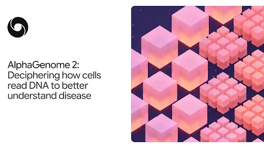
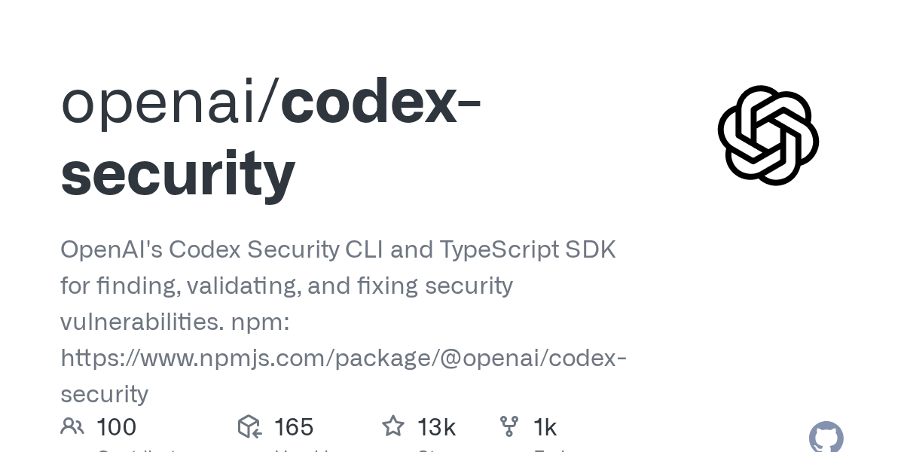
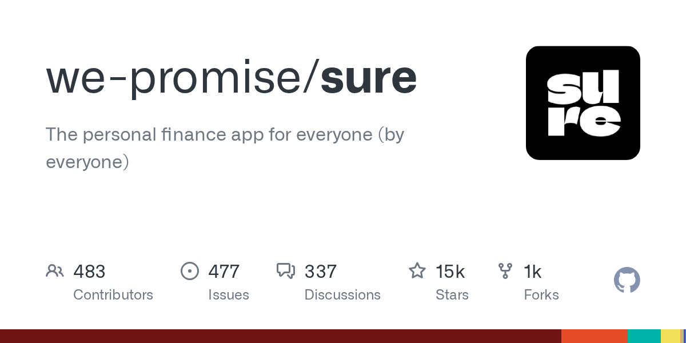
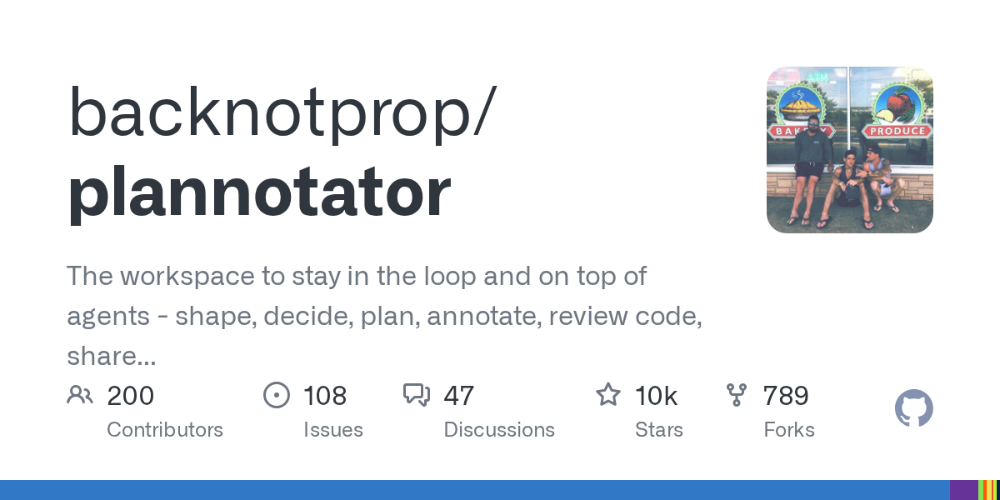
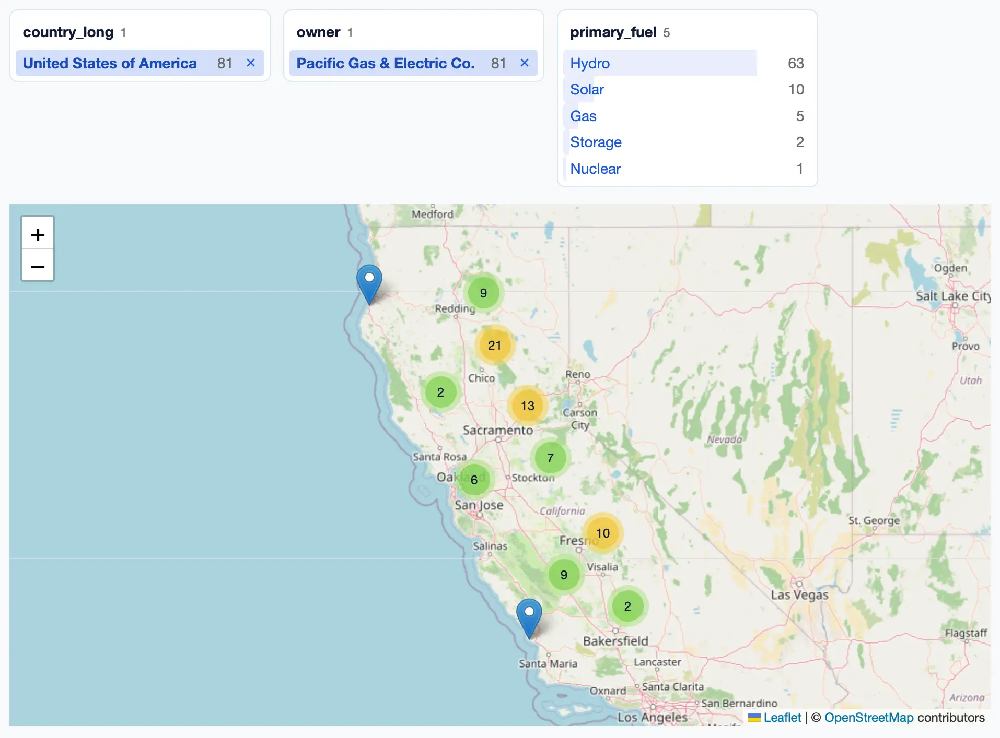
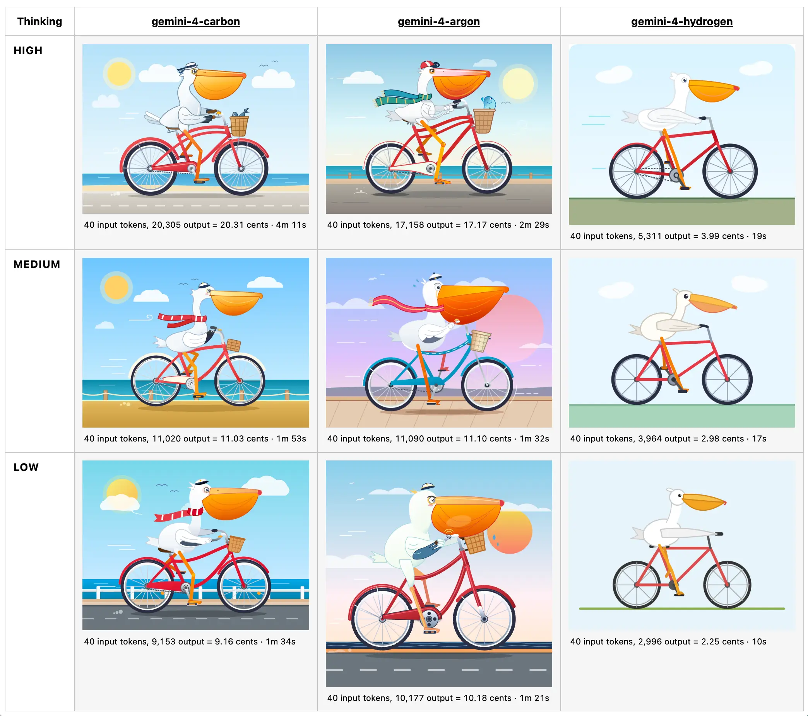
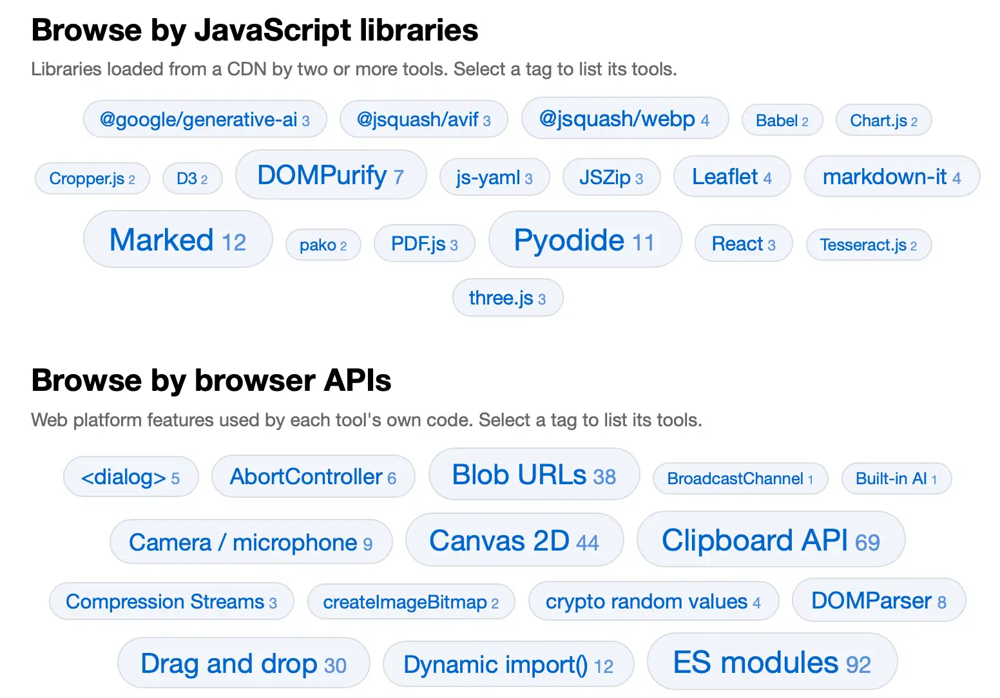
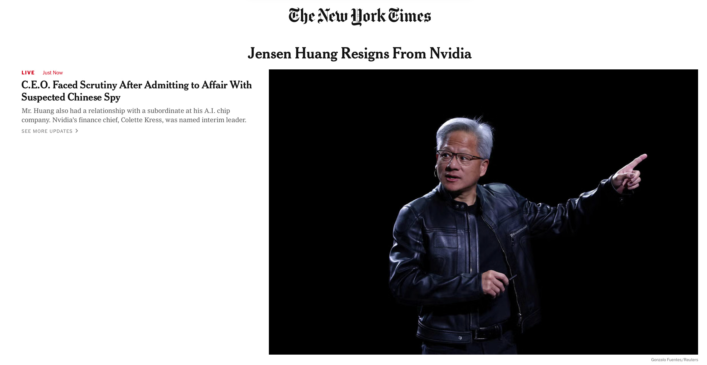
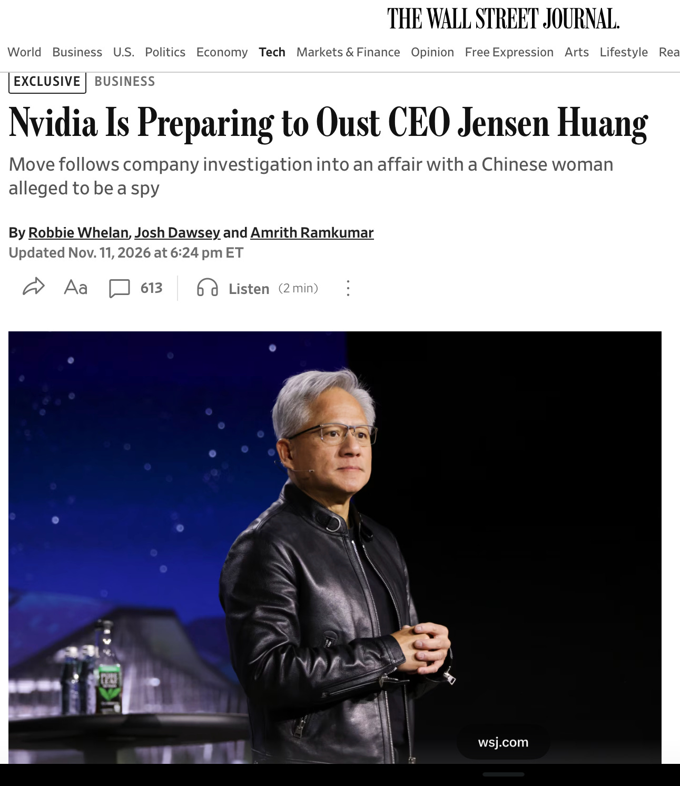
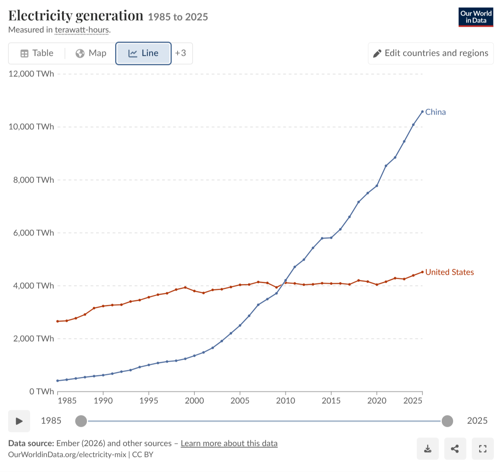

# AI 资讯日报 2026-11-14

> 自动抓取 AI 公司博客、从业者博客与社区聚合源，并生成中文摘要。

## 今日摘要

```
- Introducing ChatGPT Wallet
- Shield helps technicians hand off legacy portal work with OpenAI
- How Amplitude ships product improvements in 1–2 days with OpenAI
- Gondola doubles revenue as its team builds more with Codex
- Holiday Extras is rethinking what it can build with Codex
```

## 公司动态

1. **[Introducing ChatGPT Wallet](https://openai.com/index/introducing-chatgpt-wallet)**

   Introducing ChatGPT Wallet, a secure way for agents in ChatGPT Work, Codex, and dots to complete purchases with user approval and existing card protections.

   来源：OpenAI Blog

2. **[Shield helps technicians hand off legacy portal work with OpenAI](https://openai.com/business/customer-stories/shield)**

   Shield uses OpenAI to help IT technicians hand off work in legacy portals. Its Forge agents navigate systems so technicians can focus on issues needing their judgment.

   来源：OpenAI Blog

3. **[How Amplitude ships product improvements in 1–2 days with OpenAI](https://openai.com/business/customer-stories/amplitude)**

   Built primarily on OpenAI models, Amplitude’s proactive product agent, Wave, identifies what to build, helps teams ship changes with coding agents, and measures the impact.

   来源：OpenAI Blog

4. **[Gondola doubles revenue as its team builds more with Codex](https://openai.com/business/customer-stories/gondola)**

   Gondola helps creatives get credit and get hired, with Codex raising its lead engineer’s output by 50% and ChatGPT simplifying daily work.

   来源：OpenAI Blog

5. **[Holiday Extras is rethinking what it can build with Codex](https://openai.com/business/customer-stories/holidays-extras-codex)**

   With Codex, Holiday Extras is turning customer expertise into better apps, higher booking conversion and new possibilities for growth.

   来源：OpenAI Blog

6. **[Supporting research on AI and children’s safety](https://openai.com/index/children-first-declaration)**

   OpenAI commits $2 million to research on AI and children’s safety. The work supports shared tools to measure risks and opportunities for young people.

   来源：OpenAI Blog

7. **[Gilbert + Tobin rethinks the business of law with AI](https://openai.com/index/gilbert-tobin-sam-nickless)**

   A conversation with Sam Nickless, Partner and Chief Executive Officer at Gilbert + Tobin.

   来源：OpenAI Blog

8. **[ChatGPT Plus for veterans and servicemembers](https://openai.com/index/chatgpt-plus-for-veterans)**

   More than 20,000 veterans and transitioning service members have claimed a free year of ChatGPT Plus. See how they use it to prepare for civilian careers.

   来源：OpenAI Blog

9. **[Introducing Gemini 4 Hydrogen](https://deepmind.google/blog/introducing-gemini-4-hydrogen/)**

   暂无摘要。

   来源：DeepMind Blog

10. **[AlphaGenome 2: Deciphering how cells read DNA to better understand disease](https://deepmind.google/blog/alphagenome-2-deciphering-how-cells-read-dna-to-better-understand-disease/)**

   Predicting how DNA sequences and their variations impact specific human cell types and disease.

   

   来源：DeepMind Blog

## 每日产品

1. **[Gemini 4 Hydrogen - 面向程序员的快速代理模型开发](https://www.producthunt.com/r/A2CQHZMKSW455X)**

   Fast agentic development for coders (www.producthunt.com) 11-13 ↑ 126 PH Upvotes

   

   来源：Product Hunt Daily

2. **[Replicate - 免费将 Webflow/Framer 应用转换为 Claude/Codex 项目](https://www.producthunt.com/r/RENYHO4NIPEVIS)**

   Turn Webflow/Framer app into a Claude/Codex project for free (www.producthunt.com) 11-13 ↑ 131 PH Upvotes

   

   来源：Product Hunt Daily

3. **[Trainn MCP - 利用任何AI聊天工具制作产品视频和课程](https://www.producthunt.com/r/BYPQ26JPIEII6M)**

   *{padding:0;margin:0;overflow:hidden}html,body{height:100%}img,span{position:absolute;width:100%;top:0;bottom:0;margin:auto}span{height:1.5em;text-align:center;font:48px/1.5 sans-serif;color:white;text-shadow:0 0 0.5em black}▶" frameborder="0" allow="accelerometer; autoplay; encrypted-media; gyroscope; picture-in-picture" allowfullscreen > Create product videos and courses from any AI chat (www.producthunt.com) 11-13 ↑ 122 PH Upvotes

   来源：Product Hunt Daily

4. **[Claude Meetings - 将克劳德加入通话，边聊边开始工作](https://www.producthunt.com/r/BBCWQILYWRBAP6)**

   *{padding:0;margin:0;overflow:hidden}html,body{height:100%}img,span{position:absolute;width:100%;top:0;bottom:0;margin:auto}span{height:1.5em;text-align:center;font:48px/1.5 sans-serif;color:white;text-shadow:0 0 0.5em black}▶" frameborder="0" allow="accelerometer; autoplay; encrypted-media; gyroscope; picture-in-picture" allowfullscreen > Add Claude to your call and get work started as you talk (www.producthunt.com) 11-13 ↑ 124 PH Upvotes

   来源：Product Hunt Daily

5. **[Filament by Galaxy - 使用终端或代理传输数据。快速且开源。](https://www.producthunt.com/r/2VIY3N6BRL2YSZ)**

   *{padding:0;margin:0;overflow:hidden}html,body{height:100%}img,span{position:absolute;width:100%;top:0;bottom:0;margin:auto}span{height:1.5em;text-align:center;font:48px/1.5 sans-serif;color:white;text-shadow:0 0 0.5em black}▶" frameborder="0" allow="accelerometer; autoplay; encrypted-media; gyroscope; picture-in-picture" allowfullscreen > Move data using your terminal or agent. Fast & open source. (www.producthunt.com) 11-13 PH Link

   来源：Product Hunt Daily

6. **[Templify AI - 专为非编辑人员设计的强大内容编辑器](https://www.producthunt.com/r/T53GXHFXDGAANJ)**

   *{padding:0;margin:0;overflow:hidden}html,body{height:100%}img,span{position:absolute;width:100%;top:0;bottom:0;margin:auto}span{height:1.5em;text-align:center;font:48px/1.5 sans-serif;color:white;text-shadow:0 0 0.5em black}▶" frameborder="0" allow="accelerometer; autoplay; encrypted-media; gyroscope; picture-in-picture" allowfullscreen > Powerful content editor for people who aren’t editors (www.producthunt.com) 11-13 PH Link

   来源：Product Hunt Daily

7. **[Gemini Decisions API - 快速、经过校准的多模态决策](https://www.producthunt.com/r/SY4NPTW4AZGZGX)**

   Fast, calibrated multimodal decisions (www.producthunt.com) 11-12 ↑ 116 PH Upvotes

   

   来源：Product Hunt Daily

8. **[Grok Bot 1.0 - 机器人会与您的团队通力合作](https://www.producthunt.com/r/NWK5UR5IABTBCA)**

   Bots work together alongside your team (www.producthunt.com) 11-12 ↑ 122 PH Upvotes

   

   来源：Product Hunt Daily

9. **[Nameshot - 您的截图已自动命名](https://www.producthunt.com/r/OHQD6DOWBSPVPX)**

   *{padding:0;margin:0;overflow:hidden}html,body{height:100%}img,span{position:absolute;width:100%;top:0;bottom:0;margin:auto}span{height:1.5em;text-align:center;font:48px/1.5 sans-serif;color:white;text-shadow:0 0 0.5em black}▶" frameborder="0" allow="accelerometer; autoplay; encrypted-media; gyroscope; picture-in-picture" allowfullscreen > Your screenshots named automatically (www.producthunt.com) 11-12 ↑ 124 PH Upvotes

   来源：Product Hunt Daily

10. **[three.dev - 在用户发现之前，先找出您的 AI 代理存在哪些问题。](https://www.producthunt.com/r/RV5447RLDSTXAS)**

   Find out how your AI agent fails. Before your users do. (www.producthunt.com) 11-12 ↑ 126 PH Upvotes

   

   来源：Product Hunt Daily

## GitHub 项目

1. **[alibaba/open-code-review](https://github.com/alibaba/open-code-review)**

   Secure, fast, efficient, battle-tested at Alibaba's scale. Hybrid architecture code review tool: deterministic pipelines + LLM Agent, precise line-level comments, built-in multi-language ruleset (NPE, thread-safety, XSS, SQL injection), OpenAI & Anthropic compatible. Language: Go Stars: 50700 Forks: 3773

   

   来源：GitHub Trending Daily

2. **[GoogleChrome/modern-web-guidance-src](https://github.com/GoogleChrome/modern-web-guidance-src)**

   Keep your coding agent up to date with the latest web best practices Language: TypeScript Stars: 4942 Forks: 273

   

   来源：GitHub Trending Daily

3. **[openai/codex-security](https://github.com/openai/codex-security)**

   OpenAI's Codex Security CLI and TypeScript SDK for finding, validating, and fixing security vulnerabilities. npm: https://www.npmjs.com/package/@openai/codex-security Language: TypeScript Stars: 13174 Forks: 1026

   

   来源：GitHub Trending Daily

4. **[ZhuLinsen/daily_stock_analysis](https://github.com/ZhuLinsen/daily_stock_analysis)**

   LLM 驱动的多市场股票智能分析系统：多源行情、实时新闻、决策看板与自动推送，支持零成本定时运行。 LLM-powered multi-market stock analysis system with multi-source market data, real-time news, decision dashboard, automated notifications, and cost-free scheduled runs. Language: Python Stars: 71685 Forks: 57314

   

   来源：GitHub Trending Daily

5. **[we-promise/sure](https://github.com/we-promise/sure)**

   The personal finance app for everyone (by everyone) Language: Ruby Stars: 14791 Forks: 1125

   

   来源：GitHub Trending Daily

6. **[backnotprop/plannotator](https://github.com/backnotprop/plannotator)**

   The workspace to stay in the loop and on top of agents - shape, decide, plan, annotate, review code, share with team, and send all feedback to agents with one click. Language: TypeScript Stars: 10497 Forks: 789

   

   来源：GitHub Trending Daily

7. **[louislam/uptime-kuma](https://github.com/louislam/uptime-kuma)**

   A fancy self-hosted monitoring tool Language: JavaScript Stars: 93890 Forks: 8724

   

   来源：GitHub Trending Daily

8. **[block/buzz](https://github.com/block/buzz)**

   A hive mind communication platform Language: Rust Stars: 37315 Forks: 4942

   

   来源：GitHub Trending Daily

9. **[tradermonty/claude-trading-skills](https://github.com/tradermonty/claude-trading-skills)**

   Claude Code skills for equity investors and traders — market analysis, technical charting, economic calendars, screeners, and trading strategy development. Language: Python Stars: 4214 Forks: 873

   来源：GitHub Trending Daily

10. **[tailscale/tailcat](https://github.com/tailscale/tailcat)**

   like netcat, but over Tailscale's data plane, without Tailscale's control plane Language: Go Stars: 9494 Forks: 433

   来源：GitHub Trending Daily

## 从业者观点

1. **[datasette-cluster-map 0.19](https://simonwillison.net/2026/Nov/13/datasette-cluster-map/)**

   Release: datasette-cluster-map 0.19 One of the oldest Datasette plugins, and still one of my favorites. It now works with Datasette 1.0a42, and depends on the new datasette-leaflet to ensure OpenStreetMap tiles are requested with a referrer header. Here's a map of power plants owned by California's PG&amp;E , also demonstrating Datasette's recently redesigned facets : [图片: https://static.simonwillison.net/static/2026/power-plants-pge.webp] Tags: datasette , geospatial , openstreetmap

   

   来源：Simon Willison

2. **[datasette-leaflet 0.3](https://simonwillison.net/2026/Nov/13/datasette-leaflet/)**

   Release: datasette-leaflet 0.3 OpenStreetMap have a very reasonable policy that hits to their hosted tile server should send a referrer header . Datasette table pages used the Referrer-Policy: no-referrer HTTP header, causing plugins that loaded tiles from OpenStreetMap to violate that policy. datasette-leaflet is the plugin that loads a bundled Leaflet so other Datasette plugins can depend on it. It now sets the referrer policy on the tile requests themselves to strict-origin-when-cross-origin , passing the host but not the full path to the page. Tags: leaflet , datasette , openstreetmap

   来源：Simon Willison

3. **[llm-gemini 0.37](https://simonwillison.net/2026/Nov/12/llm-gemini/)**

   Release: llm-gemini 0.37 Google launched Gemini 4 Hydrogen today - the lowest cost member of the Gemini 4 family. It's actually not too far off the price of its much bigger siblings, Carbon and Argon. I'm finding Gemini 4's pricing really confusing. Here's the pricing scheme: Model Dates Input ($/M) Cached input Output Gemini 4 Carbon Through Nov 30, 2026 $2.00 $0.10 $10.00 From Dec 1, 2026 $4.00 $0.20 $20.00 Gemini 4 Argon Through Nov 30, 2026 $2.00 $0.10 $10.00 From Dec 1, 2026 $4.00 $0.20 $20.00 Gemini 4 Hydrogen &nbsp; $1.50 $0.075 $7.50 Carbon and Argon are the same price , and both are scheduled to double in price on December 1st. If they're the same price, why have two different models? Google says that Argon "delivers Gemini 4 intelligence with faster responses and lower token spend per turn compared to Gemini 4 Carbon" - so it may be priced the same, but it will use less tokens per task. Hydrogen, supposedly the cheap model, is currently only a 25% discount on its more capable peers. The Hydrogen price will make more sense after December 1st, when it will represent a 75% discount. It's still considerably more expensive than Claude Haiku 5.5 and GPT-6 Luna - they're both $0.10/$0.50, so Hydrogen is 15x that. I had Hydrogen generate some pelicans . Here's a full comparison grid showing the pelicans for all three members of the Gemini 4 family at their three supported effort levels: [图片: https://static.simonwillison.net/static/2026/gemini-4-pelicans.webp] Considering how close they are in price, the difference in pelican quality for Hydrogen is quite stark. Here's how Google describe Hydrogen's intended position in their mix of models: In real-world software development, while teams rely on frontier models like Carbon and Argon for deep architectural judgment when designing systems or untangling subtle bugs, they still need a fast, disciplined execution model for writing code, running tests, and verifying changes. Hydrogen is built to stand on its own as a model for everyday work — or to pair with Carbon and Argon as the high-efficiency execution engine in multi-model workflows. Most notably, Hydrogen is the new free tier model, and is the model that will power AI features in Google Search. Tags: gemini , llm , google , pelican-riding-a-bicycle , llm-pricing , ai , llms

   

   来源：Simon Willison

4. **[Gemini Decisions API](https://simonwillison.net/2026/Nov/11/gemini-decisions-api/)**

   Gemini Decisions API Google join Jev and OpenAI in the decision model category with "Gemini Decision 1". This new model API is almost identical to Jev: it supports the same three types of questions (yes/no, choice, and rubric-scoring) and even reuses Jev's term "Noul" for a yes/no question. It's priced the same as the GPT-6 Luna decision model: 10 cents per million input tokens, and output is free. Jev remains the cheapest of the three, at 4.2 cents per million. Jev is text (and JSON) only. OpenAI can handle text and images. Gemini Decision 1 is fully multi-model: it covers text, images, audio, video, and PDFs. I tested it against video by passing these questions to it along with my Yonkers stomping robot video file: dragon: Does this video have a dragon in it? robot: Does this video have a robot in it? france: Is this video set in France? usa: Is this video set in the USA? Jev and OpenAI both return 1.0 or 0.0 for yes/no questions, but Gemini insists on being a little less confident than that: { "dragon" : { "type" : " yes_no " , "probability" : 0.04976021841520312 }, "robot" : { "type" : " yes_no " , "probability" : 0.9234055387792485 }, "france" : { "type" : " yes_no " , "probability" : 0.08329171353166241 }, "usa" : { "type" : " yes_no " , "probability" : 0.9230459995157706 } } Via Hacker News Tags: ai , generative-ai , gemini , llm-release , jev , decision-models

   来源：Simon Willison

5. **[aws-emulator](https://simonwillison.net/2026/Nov/11/aws-emulator/)**

   aws-emulator Finally, an official emulator from AWS to run tests against a local clone of their many different services without having to provision a paid API key to do so. It's written in Rust by a huge swarm of agents - 29,684 commits in the first three weeks of the project. Swaminathan (Swami) Sivasubramanian wrote about how it came to be in a guest post on Werner Vogels' blog. It currently requires Docker to run on macOS or Windows. I'm hoping they fix that in the future - it would be great if you could download a single binary and use that as part of a standard test suite in other languages and on other platforms. Tags: amazon , amazon-web-services , testing , werner-vogels , ai , rust , docker , generative-ai , llms , agentic-engineering

   来源：Simon Willison

6. **[Browse tools.simonwillison.net by tag](https://simonwillison.net/2026/Nov/11/tools-tags/)**

   Browse tools.simonwillison.net by tag I've been wanting a better way to browse my collection of vibe-coded tools (244 and counting) for a while. I had a few Fable 5.2 credits left over before my weekly reset so I set it to work using tree-sitter to analyze the code for JavaScript APIs, libraries, and web API hosts used by each tool. The homepage now features tag clouds for browsing by each of those categories of tag: [图片: https://static.simonwillison.net/static/2026/tools-tag-cloud.webp] Tags: javascript , tools , ai , generative-ai , llms , claude , vibe-coding

   

   来源：Simon Willison

7. **[What could possibly go wrong? Nationwide FAA Ground Stop edition](https://garymarcus.substack.com/p/what-could-possibly-go-wrong-nationwide)**

   A sign of things to come?

   

   来源：Gary Marcus

8. **[The great Generative AI unraveling](https://garymarcus.substack.com/p/the-great-generative-ai-unraveling)**

   Things are starting to fall apart

   

   来源：Gary Marcus

9. **[Jensen Huang resigns.](https://garymarcus.substack.com/p/jensen-huang-resigns)**

   The future of Nvidia and the AI industry is uncertain

   

   来源：Gary Marcus

10. **[Breaking: Eli Lilly CEO becomes latest to push back on Dario Amodei’s ludicrous, Elizabeth Holmes-like medical claims](https://garymarcus.substack.com/p/breaking-eli-lilly-ceo-becomes-latest)**

   Where is Nathan Fielder when you need him?

   

   来源：Gary Marcus

11. **[Jensen is reportedly about to get fired](https://garymarcus.substack.com/p/jensen-is-reportedly-about-to-get)**

   Things may get really really crazy really fast

   

   来源：Gary Marcus

12. **[The avalanche that hit math is coming for AI development](https://www.dwarkesh.com/p/rsi)**

   Why I now expect superintelligence by 2030

   

   来源：Dwarkesh Patel

13. **[First Strike](https://geohot.github.io//blog/jekyll/update/2026/11/13/first-strike.html)**

   Internalize this graph, we post it on this blog a lot. If trends continue, China will have 10x the electricity of the US in 10 years. Whenever you think about geopolitical strategy, always keep it in mind, because whatever your plans are must consider this. Here’s a strategy that would make sense for America long term. Sell as many AI chips into China as possible, use the money to purchase solar panel and battery factories, and build out electricity capacity as quickly as possible. Fundamentally, compute is a function of electricity. That’s the sort of long term thinking that gives America a chance. With robotic labor, immigrants like Jensen and Elon, a business friendly culture, and an incredible chunk of land, it’s not so clear who is ahead in 50 years. Regardless, I do know this strategy would lead to massive prosperity for the citizens of both countries. However, that’s not close to what we see happening. We see a lot of short term zero sum thinking in action. It’s very scary what the US “AI race” mentality leads to. When exactly does the race end? Whatever capabilities you have today will eventually be matched, unless… …you believe that you can use ASI in a decapitating first strike. I’m worried that this is what these people see as the only way out. It probably doesn’t work, can you outthink steel and drone production? I don’t see how, see my critiques here. But I’m not totally sure, I’m not a superintelligence. And if it does work, that may be the end. My likelihood of imminent WWIII went up a lot with the nationalization of NVIDIA.

   

   来源：George Hotz

## 社区热点

1. **[Anthropic Upgrades Claude Code Projects to Run Parallel AI Workers Hands-Free](https://alphasignal.ai/news/anthropic-upgrades-claude-code-projects-to-run-parallel-ai-workers-hands-free)**

   Article URL: https://alphasignal.ai/news/anthropic-upgrades-claude-code-projects-to-run-parallel-ai-workers-hands-free Comments URL: https://news.ycombinator.com/item?id=50492141 Points: 36 # Comments: 24

   来源：Hacker News AI

2. **[Claude Meetings](https://claude.com/resources/articles/claude-meetings)**

   Article URL: https://claude.com/resources/articles/claude-meetings Comments URL: https://news.ycombinator.com/item?id=50491097 Points: 76 # Comments: 60

   来源：Hacker News AI

3. **[No AI Slop: A Manifesto](https://www.slopmanifesto.com/)**

   Article URL: https://www.slopmanifesto.com/ Comments URL: https://news.ycombinator.com/item?id=50488769 Points: 186 # Comments: 106

   来源：Hacker News AI

4. **[Are we just going to ignore that books are destroyed for AI?](https://www.forbes.com/sites/maryroeloffs/2026/08/17/ai-companies-are-buying-and-destroying-antique-books-heres-why/)**

   Article URL: https://www.forbes.com/sites/maryroeloffs/2026/08/17/ai-companies-are-buying-and-destroying-antique-books-heres-why/ Comments URL: https://news.ycombinator.com/item?id=50487469 Points: 54 # Comments: 55

   来源：Hacker News AI

5. **[AI unlocks Gödel's notebooks, said to contain hundreds of proved theorems](https://www.theguardian.com/science/2026/nov/13/kurt-godel-notebooks-ai-helps-unlock-hidden-discoveries-man-who-transformed-maths)**

   Article URL: https://www.theguardian.com/science/2026/nov/13/kurt-godel-notebooks-ai-helps-unlock-hidden-discoveries-man-who-transformed-maths Comments URL: https://news.ycombinator.com/item?id=50486748 Points: 339 # Comments: 93

   来源：Hacker News AI

6. **[Why is Google cutting off Search from AI-free schools? Here are some theories](https://text.npr.org/nx-s1-6029408)**

   Article URL: https://text.npr.org/nx-s1-6029408 Comments URL: https://news.ycombinator.com/item?id=50484960 Points: 166 # Comments: 166

   来源：Hacker News AI

7. **[Jonathan Blow – If AI Solved Coding, Why Is My Software Still the Same? [video]](https://www.youtube.com/watch?v=IRK8h67ol7Q)**

   Article URL: https://www.youtube.com/watch?v=IRK8h67ol7Q Comments URL: https://news.ycombinator.com/item?id=50484658 Points: 147 # Comments: 135

   来源：Hacker News AI

8. **[Amodei Says AI Will Cure Cancer in a Decade. Doctors Are Skeptical](https://www.businessinsider.com/dario-amodei-anthropic-cancer-cure-ipo-roadshow-backlash-doctors-2026-11)**

   Article URL: https://www.businessinsider.com/dario-amodei-anthropic-cancer-cure-ipo-roadshow-backlash-doctors-2026-11 Comments URL: https://news.ycombinator.com/item?id=50484110 Points: 31 # Comments: 70

   来源：Hacker News AI

9. **[AI is destroying the trust between writers and readers](https://www.theatlantic.com/books/2026/11/ai-literary-scams-amazon/689391/)**

   Article URL: https://www.theatlantic.com/books/2026/11/ai-literary-scams-amazon/689391/ Comments URL: https://news.ycombinator.com/item?id=50481870 Points: 314 # Comments: 195

   来源：Hacker News AI

10. **[e-means: 10x faster k-means at equal loss](https://e-means.github.io/)**

   Comments

   来源：Lobsters AI

11. **[libreagi - save OS models](https://libreagi.com/)**

   Comments

   来源：Lobsters AI

12. **[Writing a SIGGRAPH paper from scratch](https://alexandergoslin.me/writing-a-siggraph-paper-from-scratch/)**

   Comments

   来源：Lobsters AI

## 论文与模型

1. **[PhysLoop: Harnessing LLMs' Physics Awareness for Self-Improving Video Generation Models](https://arxiv.org/abs/2611.16748)**

   Video generation models produce visually realistic videos but still struggle with physical dynamics and causal consistency. Learning from generated videos requires fine-grained physical supervision, yet reliable quality judgments, correction pairs, and controlled variations are difficult to obtain. Large language models (LLMs) possess physical knowledge, but struggle to reliably guide video generation models in producing their training videos. We present PhysLoop, a unified harness designed to support physically grounded self-improvement in video generation models. The harness guides and constrains LLMs throughout video generation, selection, and correction, distilling their physical knowledge into physically consistent videos. The framework supports controllable training-data construction and inference-time video repair. By identifying and correcting failures, PhysLoop marks a key milestone toward recursive self-improvement (RSI) in video generation models with limited human intervention. We release 100K videos spanning diverse, realistic indoor and outdoor scenes, along with generation tools and two evaluation datasets: PhysLoop-Gen and PhysLoop-Repair. We evaluate controllable generation and localized repair on these datasets, respectively, and assess physical behavior on the external Physics-IQ Verified benchmark.

   来源：HuggingFace Papers

2. **[Actor, Judge, or Teacher? Understanding Decision Models in Long-Horizon Agents](https://arxiv.org/abs/2611.17167)**

   Decision models answer a question with a typed output, such as a choice among options with a probability for each, so one model can choose an agent's actions, evaluate actions already taken, or score every action to teach a policy with reinforcement learning. Prior work has studied them mainly as actors, judging their usefulness by how well they act. We ask whether a decision model that acts poorly can still teach well. We compare three decision models and three general LLMs as actors and judges on ALFWorld, and use JEV as a teacher on ALFWorld and WebShop. As actors, all six models are pulled away from a subgoal that must come first by an easier one. As judges that see the whole trajectory, the same models credit the steps toward that subgoal, and asking whether each action helped, rather than whether the task will succeed, separates useful from useless actions. As a teacher, JEV raises a Qwen2.5-1.5B policy over GRPO from 72.8% to 82.9% success on ALFWorld and from 56.8% to 71.4% on WebShop. These results suggest that a poor actor can still teach well, because judging an action after the episode ends reveals the consequences that acting must anticipate. Code is available at https://github.com/ZJU-REAL/decision-agents.

   来源：HuggingFace Papers

3. **[Ropedia Xperience 2: A Gold Standard for Scaling Physical AI Environments and Behaviors](https://arxiv.org/abs/2611.17060)**

   Large foundation models such as GPT-6 Astra and Claude Fable 5.1 have recently been shown to control robots directly from visual observations. They nevertheless remain brittle on long-horizon, contact-rich tasks in real-world environments. Further progress depends on two complementary resources: demonstrations of human behavior that supervise how tasks are performed, and interactive environments in which policies can be rolled out, evaluated, and improved in closed loop. Language models have advanced along well-characterized scaling laws; the corresponding question for physical AI is how capability scales with environments and behaviors, which first requires identifying which data to scale and how to produce and reuse such data continuously. To address this question, we introduce Ropedia Xperience 2, comprising 1,589 released metric-scale 3D scans and a collection of 4,230 egocentric recordings of 74 tasks (131 hours). We further show that each capture can be repurposed for robot learning: scenes are converted into physically interactive simulation environments, human motion is retargeted to whole-body robot trajectories, and additional robot behaviors are obtained through virtual teleoperation and automated long-horizon trajectory generation. We propose this joint capture of environments and behaviors as a gold standard for physical AI data collection, laying a data foundation for establishing scaling laws over environments and behaviors.

   来源：HuggingFace Papers

4. **[TTB: Test-time Baking for Efficient Rendering of Decoder-only View Synthesis Models](https://arxiv.org/abs/2611.17331)**

   Decoder-only Large View Synthesis Models (LVSMs) with KV-cache have recently achieved state-of-the-art quality by regressing novel views from neural networks without reconstructing 3D geometry, while Test-Time Training (TTT) layers save computation but sacrifice quality. We propose Test-Time Baking (TTB), a strategy that learns to bake global scene information from cross-view attention into a lightweight MLP, enabling fast and high-fidelity novel-view decoding. The first key is to repurpose the fast-weight MLP of TTT to learn the cross-view attention mapping explicitly from its input-output pairs, rather than replacing attention entirely, achieving the same rendering efficiency as TTT while delivering substantially higher quality. The second key addresses a modality misalignment between context prefilling and novel-view rendering: we disentangle context tokens into camera-only context rendering tokens to serve as TTB input, and context ground-truth tokens with image content to serve as the TTB mapping target, ensuring the baked MLPs are relieved of the modality generalization challenge between context and novel-view processing. Our method achieves up to **23x** rendering speedup with quality on par with the state-of-the-art across several benchmarks. Project page: https://test-time-baking.github.io

   来源：HuggingFace Papers

5. **[WorldDraft: If Code Builds the World, Can Video Models Just Render It?](https://arxiv.org/abs/2611.16217)**

   Multimodal coding agents decouple 4D world construction from visual generation, repurposing video models from world generators toward generative renderers. This division of labor raises a fundamental question: if code builds the world, can video models just render it? A reliable generative renderer hinges on two complementary criteria: (i) world preservation, retaining prescribed 4D kinematics and camera paths; and (ii) visual realization, persistently binding text-specified target attributes over time. To evaluate this capability, we introduce WorldDraft, a benchmark of 432 strictly paired test cases across 48 executable 4D world families spanning six dynamic challenge categories. Under a 3 times 3 factorial design, WorldDraft orthogonally crosses draft granularity (abstract proxy to previs) and appearance alignment (neutral to conflicting) under identical dynamics. Extensive evaluations across 12 representative models reveal that: (I) world preservation and visual realization remain in stark operational tension; (II) richer draft scaffolding anchors structure but paradoxically impairs appearance fidelity; and (III) conflicting source cues trigger severe source leakage (up to 64%), exposing fragile cross-modal disentanglement. To mitigate these bottlenecks, we propose WorldDraft-Primer, a plug-and-play visual prompting strategy that consistently improves both objectives across frozen video renderers. Together, WorldDraft and WorldDraft-Primer lay a foundation for bridging programmatic 4D simulation with video generation, advancing physically grounded generative rendering.

   来源：HuggingFace Papers

6. **[Factored One-sided Adam-Moment for Practical and Scalable SOAP](https://arxiv.org/abs/2611.16905)**

   Second-order optimizers (e.g., Shampoo, SOAP) have emerged as compelling alternatives to Adam/AdamW and promise faster per-step convergence than AdamW in transformer training. However, they still remain costly in practice, and even SOAP still pays substantial optimizer-state memory and eigendecomposition overhead. We ask whether the benefits of SOAP can be retained at nearly the efficiency of AdamW. In this paper, we answer yes with a lightweight SOAP variant, Factored One-sided Adam-Moment (FOAM). The path to practical impact is twofold: first, FOAM employs input-only preconditioning, dropping the output-side Kronecker factor to reduce memory and remove one eigendecomposition. The Kronecker structure of the Hessian shows that this is exact for a diagonal output-side curvature and nearly lossless for a near-diagonal one, as we observe empirically. Second, FOAM replaces SOAP's dense rotated second moment with a factored Adam-moment estimator based on row-by-column statistics. Under the K-FAC Fisher assumption with a diagonal output curvature, this estimator exactly recovers SOAP's dense second moment, and we measure only a 15-20% K-FAC violation, with negligible effect on the update. Our empirical results support the claim that FOAM matches strong SOAP and Muon baselines in validation loss across scales of large language model (LLM) pre-training, uses half of SOAP's optimizer state, runs at Muon-class wall-clock time, and retains robustness across a three-fold learning-rate range. The results hold from 124M to 760M parameters, demonstrating that SOAP's gains need not require SOAP's cost. Code: https://github.com/naver-ai/foam

   来源：HuggingFace Papers

7. **[UniSpark: Exploring Hybrid Attention for Multimodal Understanding and Generation](https://arxiv.org/abs/2611.16517)**

   We present UniSpark-9B, a unified multimodal model that investigates hybrid attention for visual understanding and generation. Built on a Mixture-of-Transformer-Experts backbone with approximately 9B parameters in each branch, UniSpark combines full attention for explicit token interactions with GatedDeltaNet linear attention for compact context propagation. Autoregressive text prediction and visual flow matching jointly support visual question answering, text-to-image generation, instruction-guided editing, and interleaved text-image prediction. In interleaved generation, noisy visual targets are isolated from subsequent predictions, while clean visual representations provide context for later outputs. A blockwise protocol enforces this distinction through attention masks in full-attention layers and recurrent-state retention rules in linear-attention layers. The selected training sources contain 159.7M generation samples, 213.4M understanding samples, and 624.8K interleaved sequences. A four-stage curriculum jointly trains multimodal understanding and visual generation, refining answer accuracy and instruction following while extending image synthesis to 2K. UniSpark scores 2470.3 on MME-S and 0.83 on GenEval. Qualitative examples further illustrate its capabilities in interleaved image generation, video synthesis, and video editing. Together, these results demonstrate that hybrid attention provides an effective backbone for unified multimodal understanding and generation.

   来源：HuggingFace Papers

8. **[Unbundling Multimodal Vision Encoding](https://arxiv.org/abs/2611.17334)**

   How multimodal language models should encode visual input remains up for debate. Most models use a pretrained vision encoder, while some recent recipes train the encoder from scratch with the language model or remove it entirely. Vision encoders bundle together three design choices: a visual prior from upstream pretraining, dedicated vision capacity, and pre-fusion placement of that capacity (i.e., before the multimodal backbone). Because published models also differ in data, architecture, and compute, comparing them cannot isolate the effect of each choice. We disentangle these choices via a controlled framework where we pretrain all models from scratch on common data and compare them on visual question answering and language benchmarks at matched lifetime compute. We find that the visual prior is not necessary; an encoder trained jointly from scratch is on par with a pretrained one, without a separate training stage. What matters instead is dedicated vision capacity: an encoder-free model trails on visual understanding even when its backbone is enlarged by the encoder's parameter count. Yet that capacity need not precede multimodal fusion, as vision-only modules added in-fusion to early backbone layers perform comparably to a pre-fusion encoder and can lower time to first token. These results also hold across backbone sizes, when encoder pretraining is treated as free, and when starting from a pretrained language model. Overall, our findings favor dedicated vision capacity trained jointly with the backbone and placed early within it.

   来源：HuggingFace Papers

9. **[Consensus Capture in Reference-Based UAV Video Stabilization: A Benchmark on Dynamic Urban Scenes](https://arxiv.org/abs/2611.17190)**

   Reference-frame stabilization registers every frame of a hovering-drone video onto one reference frame, keeping object positions comparable. The registration pipelines it relies on are selected on feature-matching benchmarks in which only the camera moves. Over a busy intersection, vehicles moving together supply mutually consistent correspondences that can draw the robust homography estimate toward their motion: consensus capture, which inlier statistics cannot flag. A two-part benchmark measures it and the object masking meant to prevent it. A static protocol scores ten pipelines under exactly known homographies on 4K aerial frames, tuned on a site-disjoint split at a matched resolution and feature budget. A dynamic protocol scores them at an offline and a real-time budget on hovers selected from the video alone to span the amount and coherence of moving foreground, plus a stationary control. It measures background alignment, object position error and the share of a moving group's displacement an estimate follows, against a pseudo-ground-truth reference audited with manually annotated ground control points, which also score every candidate. On static scenes, tuned AKAZE, RootSIFT, SIFT and BRISK lead, retuning the matcher thresholds raises the mean average accuracy (mAA) by at most 0.0062, and masking costs less than 0.005. Unmasked ORB is captured on 28 of 304 real-time dynamic pairs and on 6 offline; its real-time captured estimates have a median corner error of 18.8 px yet typical inlier counts and ratios. Masking removes capture for every pipeline and leaves the leading pipelines unchanged. Code, data and results are released.

   来源：HuggingFace Papers

10. **[DeepStress: Stress-Testing Deep Search Agents](https://arxiv.org/abs/2607.13920)**

   While search agents demonstrate impressive capabilities in multi-step question answering, their robustness to poor-quality evidence remains under-explored. Such evidence is rare in benchmark corpora, and resulting failures are hard to reproduce. We propose DeepStress, a dynamic stress-testing framework that subjects agents to degraded evidence at controlled rates. It replaces the retrieval module with a synthetic environment where documents are generated dynamically for each query, under independent control of their trustworthiness, relevance, and factuality. To characterize behavior under stress, we go beyond binary accuracy with a five-way classification of final-answer outcomes and two new reliability-aware metrics, RAS and CoPRAS, which credit cautious behavior and account for computational cost. Evaluating 12 systems on questions from HotpotQA and BrowseComp-Plus, we find that several open-weight agents answer confidently when sources contain obvious credibility red flags, and that many HotpotQA questions are answered from parametric knowledge even when all returned documents are factually wrong.

   来源：HuggingFace Papers
