# AI 资讯日报 2026-11-15

> 自动抓取 AI 公司博客、从业者博客与社区聚合源，并生成中文摘要。

## 今日摘要

```
- Introducing ChatGPT Wallet
- Shield helps technicians hand off legacy portal work with OpenAI
- How Amplitude ships product improvements in 1–2 days with OpenAI
- Gondola doubles revenue as its team builds more with Codex
- Holiday Extras is rethinking what it can build with Codex
```

## 公司动态

1. **[Introducing ChatGPT Wallet](https://openai.com/index/introducing-chatgpt-wallet)**

   Introducing ChatGPT Wallet, a secure way for agents in ChatGPT Work, Codex, and dots to complete purchases with user approval and existing card protections.

   来源：OpenAI Blog

2. **[Shield helps technicians hand off legacy portal work with OpenAI](https://openai.com/business/customer-stories/shield)**

   Shield uses OpenAI to help IT technicians hand off work in legacy portals. Its Forge agents navigate systems so technicians can focus on issues needing their judgment.

   来源：OpenAI Blog

3. **[How Amplitude ships product improvements in 1–2 days with OpenAI](https://openai.com/business/customer-stories/amplitude)**

   Built primarily on OpenAI models, Amplitude’s proactive product agent, Wave, identifies what to build, helps teams ship changes with coding agents, and measures the impact.

   来源：OpenAI Blog

4. **[Gondola doubles revenue as its team builds more with Codex](https://openai.com/business/customer-stories/gondola)**

   Gondola helps creatives get credit and get hired, with Codex raising its lead engineer’s output by 50% and ChatGPT simplifying daily work.

   来源：OpenAI Blog

5. **[Holiday Extras is rethinking what it can build with Codex](https://openai.com/business/customer-stories/holidays-extras-codex)**

   With Codex, Holiday Extras is turning customer expertise into better apps, higher booking conversion and new possibilities for growth.

   来源：OpenAI Blog

6. **[Introducing Gemini 4 Hydrogen](https://deepmind.google/blog/introducing-gemini-4-hydrogen/)**

   暂无摘要。

   来源：DeepMind Blog

## 每日产品

1. **[Businesses in ChatGPT - 通过 ChatGPT 帮助客户发现您的业务](https://www.producthunt.com/r/4GOWHK6UYKH5KX)**

   *{padding:0;margin:0;overflow:hidden}html,body{height:100%}img,span{position:absolute;width:100%;top:0;bottom:0;margin:auto}span{height:1.5em;text-align:center;font:48px/1.5 sans-serif;color:white;text-shadow:0 0 0.5em black}▶" frameborder="0" allow="accelerometer; autoplay; encrypted-media; gyroscope; picture-in-picture" allowfullscreen > Help customers discover your business through ChatGPT (www.producthunt.com) 11-14 ↑ 116 PH Upvotes

   来源：Product Hunt Daily

2. **[Gemini Robotics 2.5 - Gemini Robotics 2.5：谷歌功能最强大的机器人模型](https://www.producthunt.com/r/7TJIY2TFO3PDX3)**

   *{padding:0;margin:0;overflow:hidden}html,body{height:100%}img,span{position:absolute;width:100%;top:0;bottom:0;margin:auto}span{height:1.5em;text-align:center;font:48px/1.5 sans-serif;color:white;text-shadow:0 0 0.5em black}▶" frameborder="0" allow="accelerometer; autoplay; encrypted-media; gyroscope; picture-in-picture" allowfullscreen > Gemini Robotics 2.5: Google’s most capable robot model (www.producthunt.com) 11-14 ↑ 115 PH Upvotes

   来源：Product Hunt Daily

3. **[Dex Semantics - 让您的代理构建分析模型，将错误率降低25%](https://www.producthunt.com/r/RZIMECXI6OYCNP)**

   Let your agent build analytics with 25% fewer errors (www.producthunt.com) 11-14 ↑ 111 PH Upvotes

   

   来源：Product Hunt Daily

4. **[HiringNow - 一款AI求职助手，能比任何人都更早地发现并申请职位。](https://www.producthunt.com/r/WSO7S2YHKPGAXY)**

   *{padding:0;margin:0;overflow:hidden}html,body{height:100%}img,span{position:absolute;width:100%;top:0;bottom:0;margin:auto}span{height:1.5em;text-align:center;font:48px/1.5 sans-serif;color:white;text-shadow:0 0 0.5em black}▶" frameborder="0" allow="accelerometer; autoplay; encrypted-media; gyroscope; picture-in-picture" allowfullscreen > AI job agent that finds & apply for jobs before anyone else. (www.producthunt.com) 11-14 ↑ 109 PH Upvotes

   来源：Product Hunt Daily

5. **[Paxper - 以可视化方式创建云基础设施，并审查每一处变更](https://www.producthunt.com/r/AHT6BFH3RQ27QR)**

   *{padding:0;margin:0;overflow:hidden}html,body{height:100%}img,span{position:absolute;width:100%;top:0;bottom:0;margin:auto}span{height:1.5em;text-align:center;font:48px/1.5 sans-serif;color:white;text-shadow:0 0 0.5em black}▶" frameborder="0" allow="accelerometer; autoplay; encrypted-media; gyroscope; picture-in-picture" allowfullscreen > Create cloud infrastructure visually and review every change (www.producthunt.com) 11-13 ↑ 109 PH Upvotes

   来源：Product Hunt Daily

6. **[qorqbot - 适用于商务工作的主动型代理](https://www.producthunt.com/r/NYNNNLD7RHSCVR)**

   Proactive agent for business work (www.producthunt.com) 11-13 ↑ 113 PH Upvotes

   

   来源：Product Hunt Daily

7. **[Ganella - 您的 Mac Dock，内置您常用应用的实时小工具](https://www.producthunt.com/r/723AUCMMDVZ3TU)**

   *{padding:0;margin:0;overflow:hidden}html,body{height:100%}img,span{position:absolute;width:100%;top:0;bottom:0;margin:auto}span{height:1.5em;text-align:center;font:48px/1.5 sans-serif;color:white;text-shadow:0 0 0.5em black}▶" frameborder="0" allow="accelerometer; autoplay; encrypted-media; gyroscope; picture-in-picture" allowfullscreen > Your Mac Dock, with live widgets for the apps you use (www.producthunt.com) 11-13 ↑ 107 PH Upvotes

   来源：Product Hunt Daily

8. **[Gemini 4 Hydrogen - 面向程序员的快速代理模型开发](https://www.producthunt.com/r/A2CQHZMKSW455X)**

   Fast agentic development for coders (www.producthunt.com) 11-13 ↑ 126 PH Upvotes

   

   来源：Product Hunt Daily

9. **[Replicate - 免费将 Webflow/Framer 应用转换为 Claude/Codex 项目](https://www.producthunt.com/r/RENYHO4NIPEVIS)**

   Turn Webflow/Framer app into a Claude/Codex project for free (www.producthunt.com) 11-13 ↑ 131 PH Upvotes

   

   来源：Product Hunt Daily

10. **[Trainn MCP - 利用任何AI聊天工具制作产品视频和课程](https://www.producthunt.com/r/BYPQ26JPIEII6M)**

   *{padding:0;margin:0;overflow:hidden}html,body{height:100%}img,span{position:absolute;width:100%;top:0;bottom:0;margin:auto}span{height:1.5em;text-align:center;font:48px/1.5 sans-serif;color:white;text-shadow:0 0 0.5em black}▶" frameborder="0" allow="accelerometer; autoplay; encrypted-media; gyroscope; picture-in-picture" allowfullscreen > Create product videos and courses from any AI chat (www.producthunt.com) 11-13 ↑ 122 PH Upvotes

   来源：Product Hunt Daily

## GitHub 项目

1. **[backnotprop/plannotator](https://github.com/backnotprop/plannotator)**

   The workspace to stay in the loop and on top of agents - shape, decide, plan, annotate, review code, share with team, and send all feedback to agents with one click. Language: TypeScript Stars: 11177 Forks: 928

   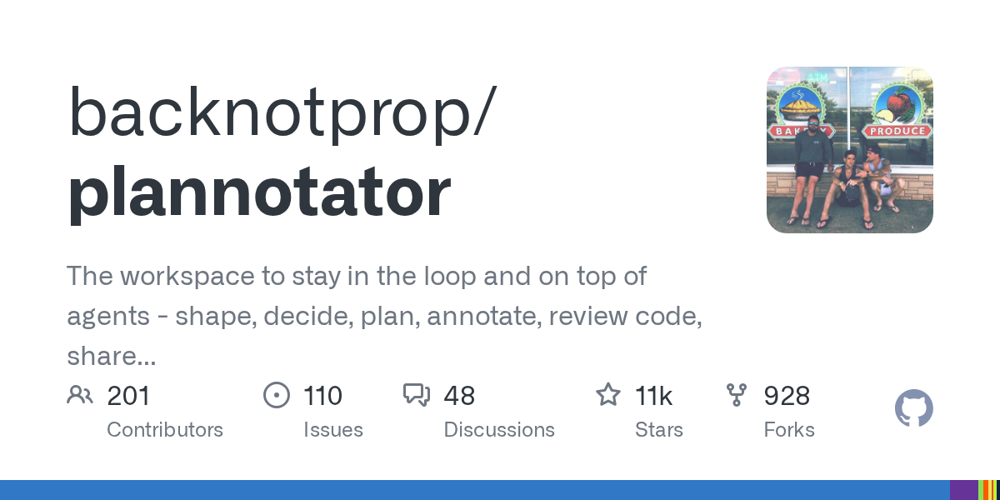

   来源：GitHub Trending Daily

2. **[GoogleChrome/modern-web-guidance-src](https://github.com/GoogleChrome/modern-web-guidance-src)**

   Keep your coding agent up to date with the latest web best practices Language: TypeScript Stars: 6111 Forks: 410

   来源：GitHub Trending Daily

3. **[tradermonty/claude-trading-skills](https://github.com/tradermonty/claude-trading-skills)**

   Claude Code skills for equity investors and traders — market analysis, technical charting, economic calendars, screeners, and trading strategy development. Language: Python Stars: 4862 Forks: 994

   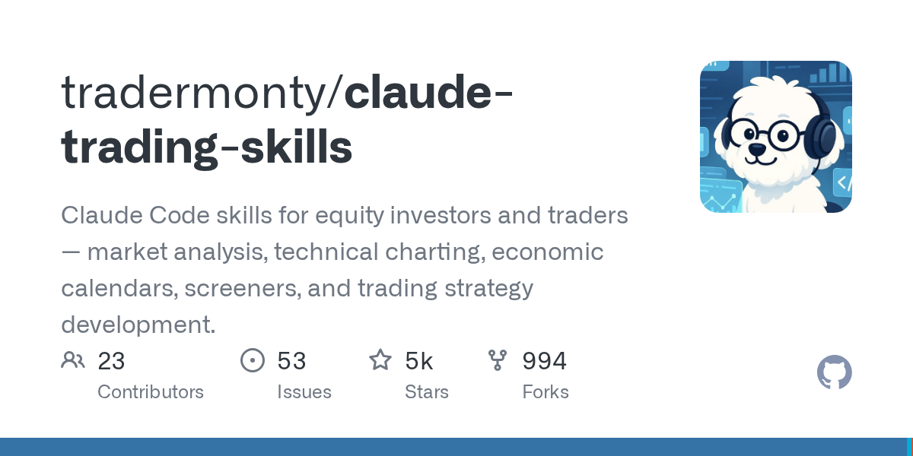

   来源：GitHub Trending Daily

4. **[ChromeDevTools/chrome-devtools-mcp](https://github.com/ChromeDevTools/chrome-devtools-mcp)**

   Chrome DevTools for coding agents Language: TypeScript Stars: 56340 Forks: 4760

   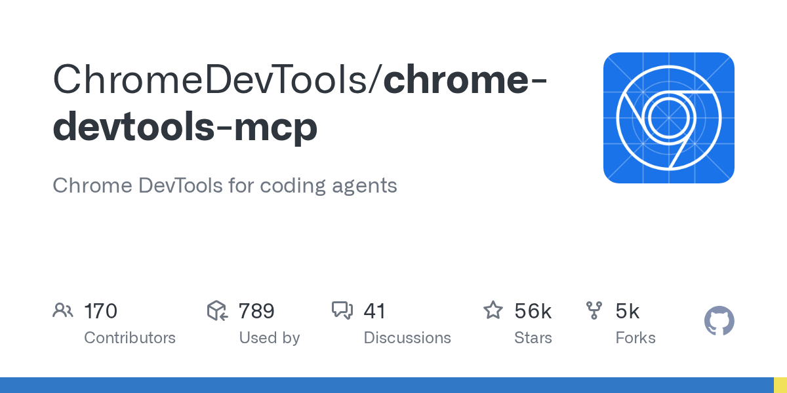

   来源：GitHub Trending Daily

5. **[alibaba/open-code-review](https://github.com/alibaba/open-code-review)**

   Secure, fast, efficient, battle-tested at Alibaba's scale. Hybrid architecture code review tool: deterministic pipelines + LLM Agent, precise line-level comments, built-in multi-language ruleset (NPE, thread-safety, XSS, SQL injection), OpenAI & Anthropic compatible. Language: Go Stars: 51471 Forks: 3911

   

   来源：GitHub Trending Daily

6. **[QwenLM/qwen-code](https://github.com/QwenLM/qwen-code)**

   An open-source AI coding agent that lives in your terminal. Language: TypeScript Stars: 30367 Forks: 3503

   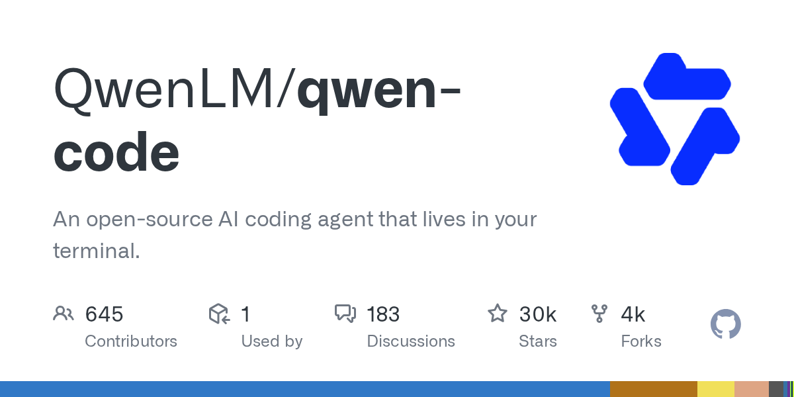

   来源：GitHub Trending Daily

7. **[dream-num/univer](https://github.com/dream-num/univer)**

   Build your own AI office with Univer Office SDK. Bring editing, calculation, collaboration, and file processing into your product for people and AI agents. Built on an extensible open-source core. Language: TypeScript Stars: 24527 Forks: 2228

   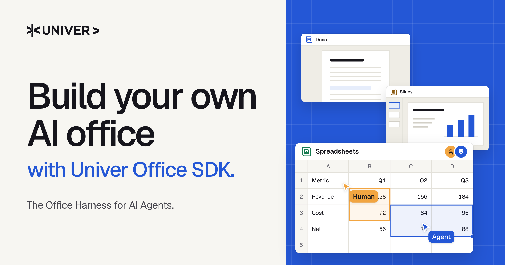

   来源：GitHub Trending Daily

8. **[ag-ui-protocol/ag-ui](https://github.com/ag-ui-protocol/ag-ui)**

   AG-UI: the Agent-User Interaction Protocol. Bring Agents into Frontend Applications. Language: TypeScript Stars: 17392 Forks: 1667

   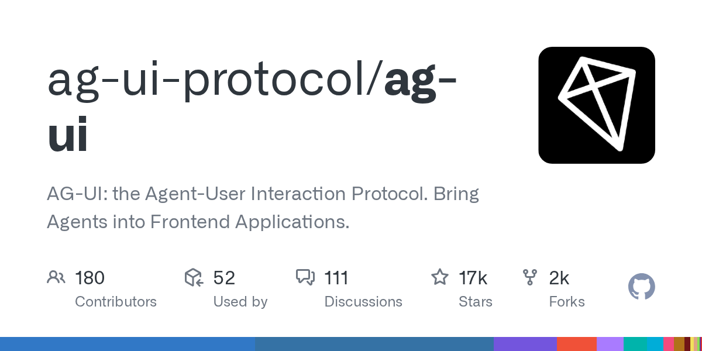

   来源：GitHub Trending Daily

9. **[ashhart/TensorFold](https://github.com/ashhart/TensorFold)**

   LLM Inference Engine for Metal, CUDA and Vulkan. Language: Zig Stars: 2173 Forks: 499

   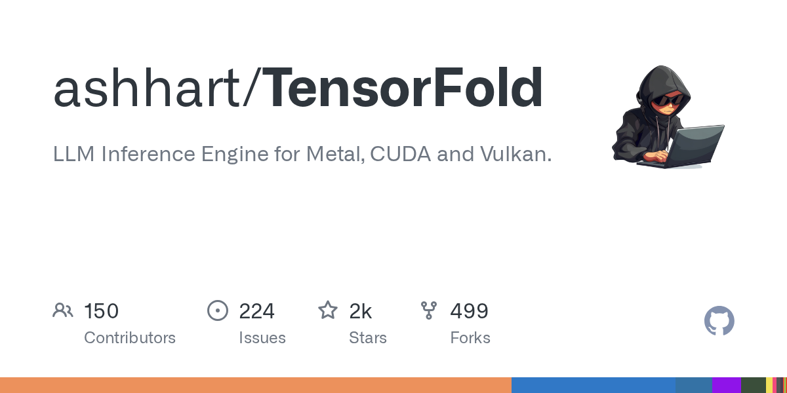

   来源：GitHub Trending Daily

10. **[JuliusBrussee/caveman](https://github.com/JuliusBrussee/caveman)**

   🪨 why use many token when few token do trick. Viral skill + proxy for coding agents that cuts 65% of tokens by talking like a caveman. Language: Go Stars: 120096 Forks: 7001

   来源：GitHub Trending Daily

## 从业者观点

1. **[datasette-llm 0.1a11](https://simonwillison.net/2026/Nov/14/datasette-llm/)**

   Release: datasette-llm 0.1a11 datasette-llm is the intermediate plugin for Datasette that supports configuring LLMs for use with other Datasette plugins. This release adds support for OpenAI-compatible endpoints, so you can configure Datasette to use an LLM hosted anywhere that talks the OpenAI pseudo-standard web protocol. This means that if you're running local models with LM Studio or Ollama or llama.cpp (which just hit v1.0.0 ) you can run Datasette via uvx like this: wget https://datasette.io/content.db uvx --with datasette-agent datasette \ --root --secret 1 \ -s plugins.datasette-llm.default_model ' { "model": "lmstudio-qwen", "model_name": "qwen/qwen3.8-27b", "api_base": "http://localhost:1234/v1" } ' content.db And you'll get a local server running a Datasette Agent instance powered by your local model! [图片: https://static.simonwillison.net/static/2026/lmstudio-datasette-agent.webp] Tags: uv , datasette-agent , llm , datasette , llms , ai , generative-ai

   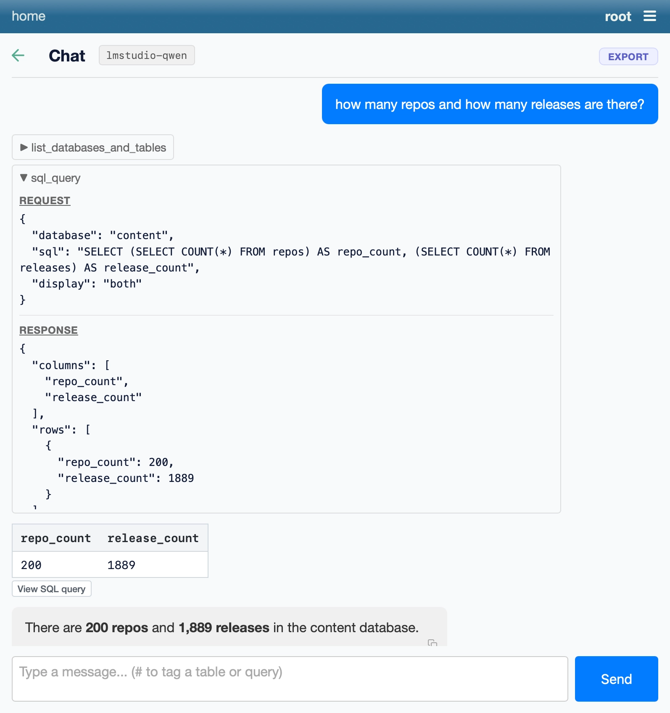

   来源：Simon Willison

2. **[datasette-vega 0.7](https://simonwillison.net/2026/Nov/14/datasette-vega/)**

   Release: datasette-vega 0.7 A new release of Datasette's longest untouched plugin, for rendering charts (using Vega-Lite ) against data in a table or custom query. The last release was in July 2018! I finally bumped it for compatibility with the latest Datasette alphas, plus some cosmetic tweaks to make it work better with Datasette Lite . (Datasette Lite just gained the ability to run JavaScript plugins like this! I'll write more about that soon.) Since it works with Datasette Lite, the live demo in the README now links to this demo on Datasette Lite . [图片: https://static.simonwillison.net/static/2026/datasette-vega.webp] Tags: datasette , visualisation , datasette-lite

   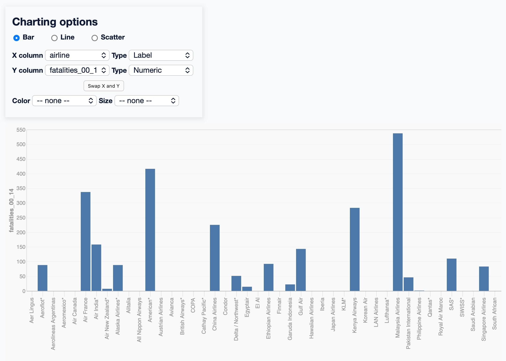

   来源：Simon Willison

3. **[datasette-cluster-map 0.19](https://simonwillison.net/2026/Nov/13/datasette-cluster-map/)**

   Release: datasette-cluster-map 0.19 One of the oldest Datasette plugins, and still one of my favorites. It now works with Datasette 1.0a42, and depends on the new datasette-leaflet to ensure OpenStreetMap tiles are requested with a referrer header. Here's a map of power plants owned by California's PG&amp;E , also demonstrating Datasette's recently redesigned facets : [图片: https://static.simonwillison.net/static/2026/power-plants-pge.webp] Tags: datasette , geospatial , openstreetmap

   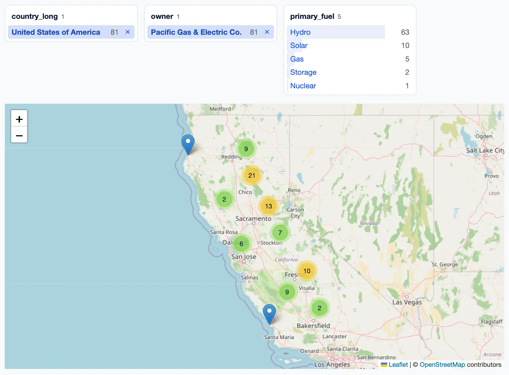

   来源：Simon Willison

4. **[datasette-leaflet 0.3](https://simonwillison.net/2026/Nov/13/datasette-leaflet/)**

   Release: datasette-leaflet 0.3 OpenStreetMap have a very reasonable policy that hits to their hosted tile server should send a referrer header . Datasette table pages used the Referrer-Policy: no-referrer HTTP header, causing plugins that loaded tiles from OpenStreetMap to violate that policy. datasette-leaflet is the plugin that loads a bundled Leaflet so other Datasette plugins can depend on it. It now sets the referrer policy on the tile requests themselves to strict-origin-when-cross-origin , passing the host but not the full path to the page. Tags: leaflet , datasette , openstreetmap

   来源：Simon Willison

5. **[llm-gemini 0.37](https://simonwillison.net/2026/Nov/12/llm-gemini/)**

   Release: llm-gemini 0.37 Google launched Gemini 4 Hydrogen today - the lowest cost member of the Gemini 4 family. It's actually not too far off the price of its much bigger siblings, Carbon and Argon. I'm finding Gemini 4's pricing really confusing. Here's the pricing scheme: Model Dates Input ($/M) Cached input Output Gemini 4 Carbon Through Nov 30, 2026 $2.00 $0.10 $10.00 From Dec 1, 2026 $4.00 $0.20 $20.00 Gemini 4 Argon Through Nov 30, 2026 $2.00 $0.10 $10.00 From Dec 1, 2026 $4.00 $0.20 $20.00 Gemini 4 Hydrogen &nbsp; $1.50 $0.075 $7.50 Carbon and Argon are the same price , and both are scheduled to double in price on December 1st. If they're the same price, why have two different models? Google says that Argon "delivers Gemini 4 intelligence with faster responses and lower token spend per turn compared to Gemini 4 Carbon" - so it may be priced the same, but it will use less tokens per task. Hydrogen, supposedly the cheap model, is currently only a 25% discount on its more capable peers. The Hydrogen price will make more sense after December 1st, when it will represent a 75% discount. It's still considerably more expensive than Claude Haiku 5.5 and GPT-6 Luna - they're both $0.10/$0.50, so Hydrogen is 15x that. I had Hydrogen generate some pelicans . Here's a full comparison grid showing the pelicans for all three members of the Gemini 4 family at their three supported effort levels: [图片: https://static.simonwillison.net/static/2026/gemini-4-pelicans.webp] Considering how close they are in price, the difference in pelican quality for Hydrogen is quite stark. Here's how Google describe Hydrogen's intended position in their mix of models: In real-world software development, while teams rely on frontier models like Carbon and Argon for deep architectural judgment when designing systems or untangling subtle bugs, they still need a fast, disciplined execution model for writing code, running tests, and verifying changes. Hydrogen is built to stand on its own as a model for everyday work — or to pair with Carbon and Argon as the high-efficiency execution engine in multi-model workflows. Most notably, Hydrogen is the new free tier model, and is the model that will power AI features in Google Search. Tags: gemini , llm , google , pelican-riding-a-bicycle , llm-pricing , ai , llms

   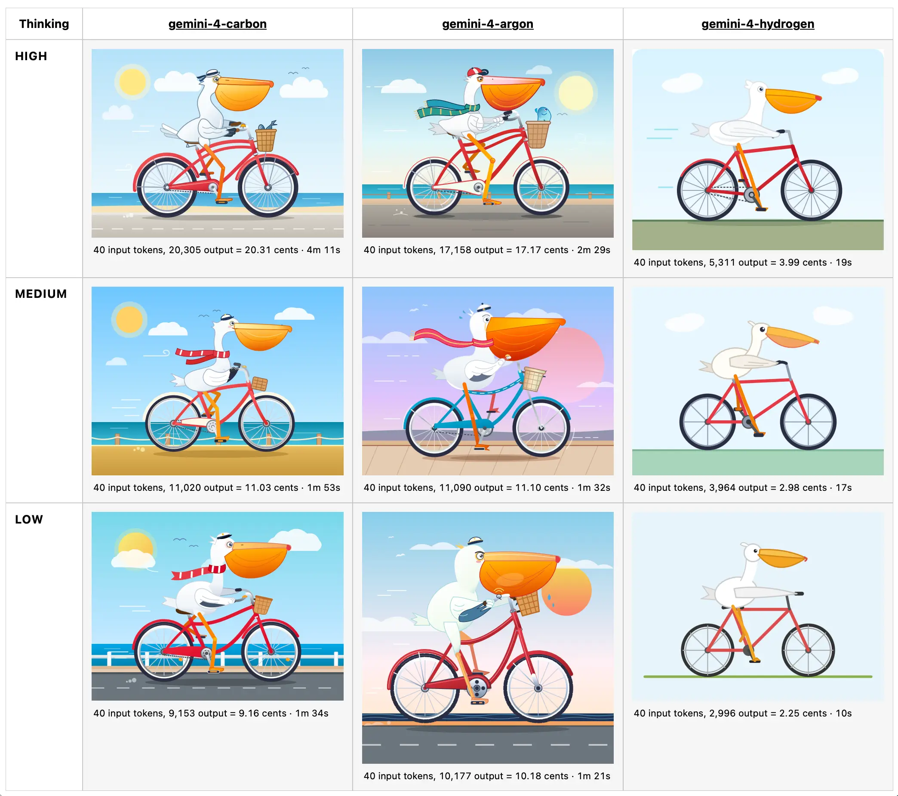

   来源：Simon Willison

6. **[The avalanche that hit math is coming for AI development](https://www.dwarkesh.com/p/rsi)**

   Why I now expect superintelligence by 2030

   

   来源：Dwarkesh Patel

7. **[First Strike](https://geohot.github.io//blog/jekyll/update/2026/11/13/first-strike.html)**

   Internalize this graph, we post it on this blog a lot. If trends continue, China will have 10x the electricity of the US in 10 years. Whenever you think about geopolitical strategy, always keep it in mind, because whatever your plans are must consider this. Here’s a strategy that would make sense for America long term. Sell as many AI chips into China as possible, use the money to purchase solar panel and battery factories, and build out electricity capacity as quickly as possible. Fundamentally, compute is a function of electricity. That’s the sort of long term thinking that gives America a chance. With robotic labor, immigrants like Jensen and Elon, a business friendly culture, and an incredible chunk of land, it’s not so clear who is ahead in 50 years. Regardless, I do know this strategy would lead to massive prosperity for the citizens of both countries. However, that’s not close to what we see happening. We see a lot of short term zero sum thinking in action. It’s very scary what the US “AI race” mentality leads to. When exactly does the race end? Whatever capabilities you have today will eventually be matched, unless… …you believe that you can use ASI in a decapitating first strike. I’m worried that this is what these people see as the only way out. It probably doesn’t work, can you outthink steel and drone production? I don’t see how, see my critiques here. But I’m not totally sure, I’m not a superintelligence. And if it does work, that may be the end. My likelihood of imminent WWIII went up a lot with the nationalization of NVIDIA.

   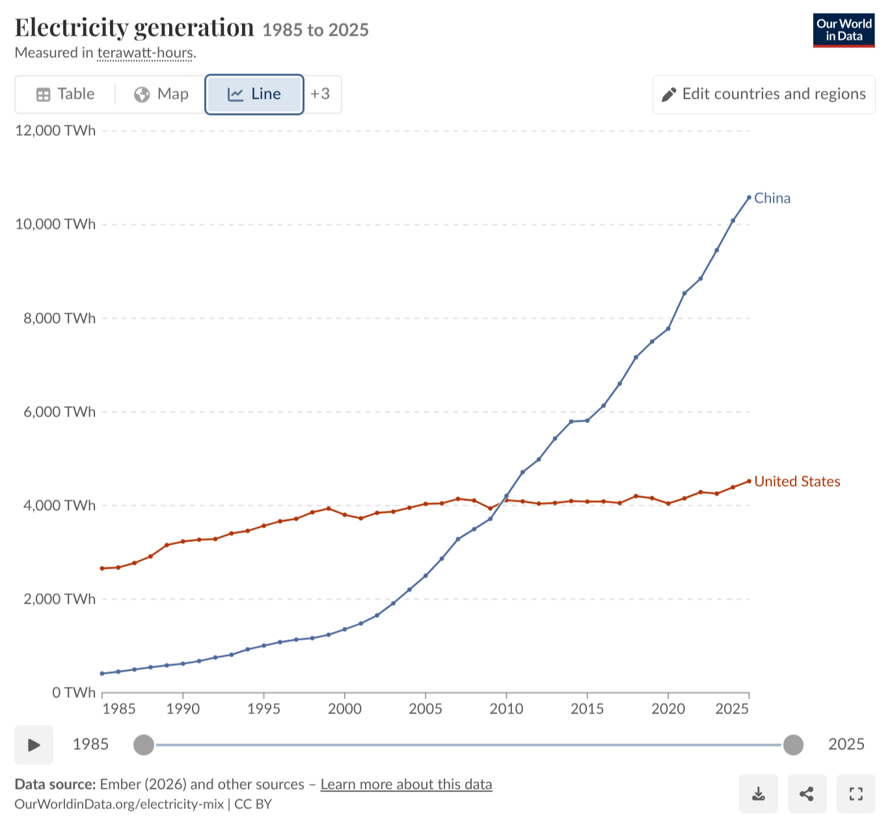

   来源：George Hotz

## 社区热点

1. **[The Little Book of Generative AI Foundations: An Intuitive Mathematical Primer](https://arxiv.org/abs/2605.29713)**

   Comments

   来源：Lobsters AI

2. **[You could have invented transformers from memory](https://alexwang.ai/posts/associative-memory/)**

   Comments

   来源：Lobsters AI

3. **[e-means: 10x faster k-means at equal loss](https://e-means.github.io/)**

   Comments

   来源：Lobsters AI

4. **[libreagi - save OS models](https://libreagi.com/)**

   Comments

   来源：Lobsters AI
