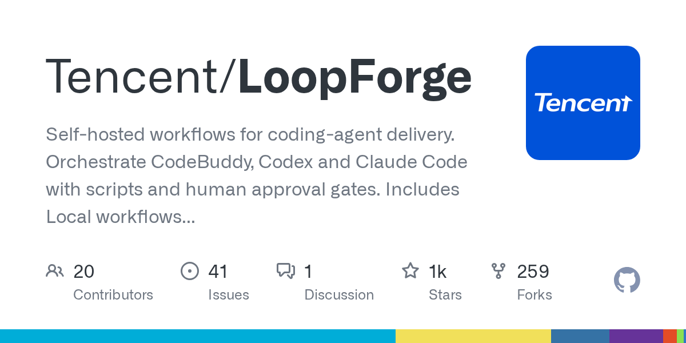
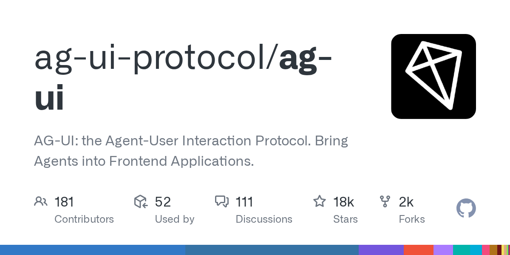
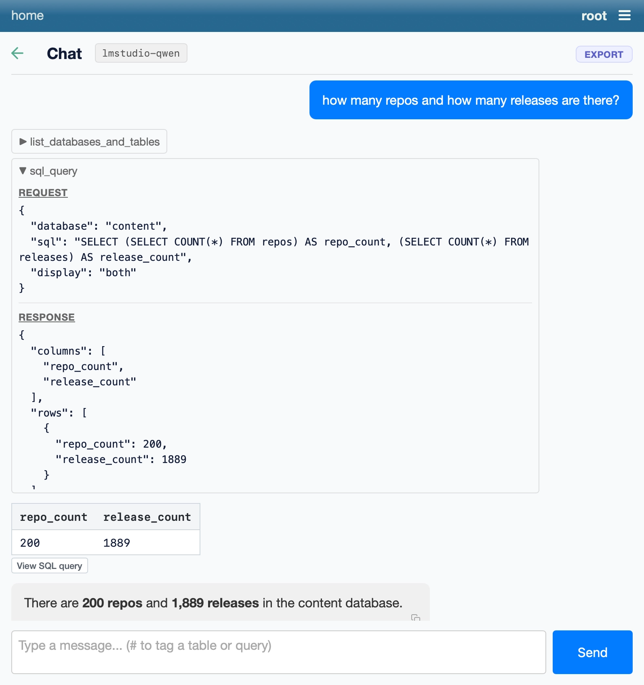
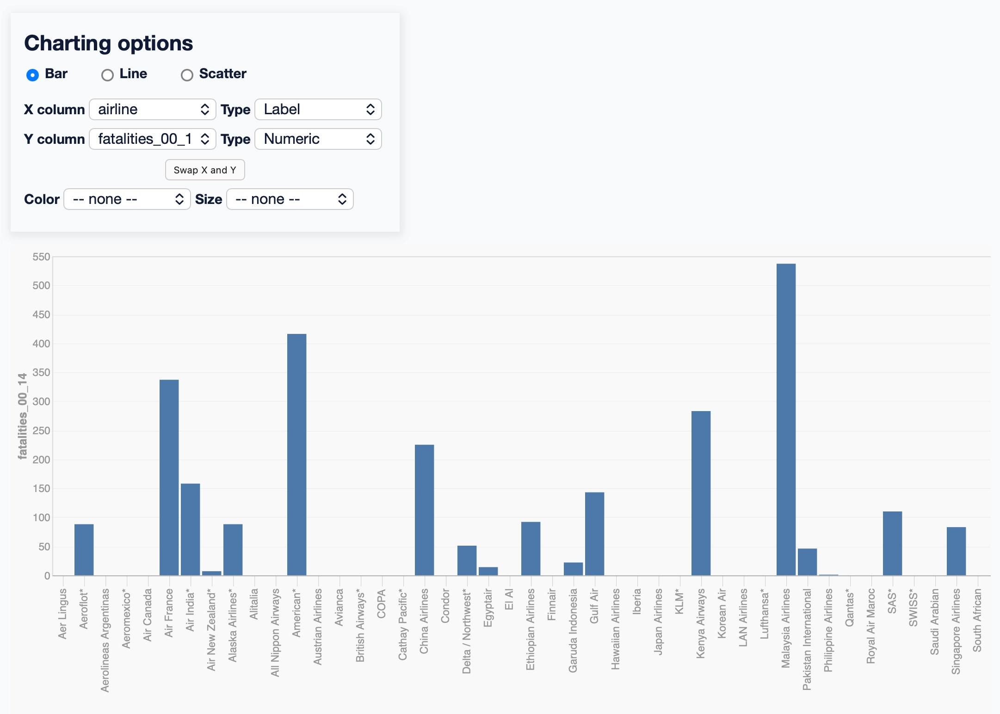
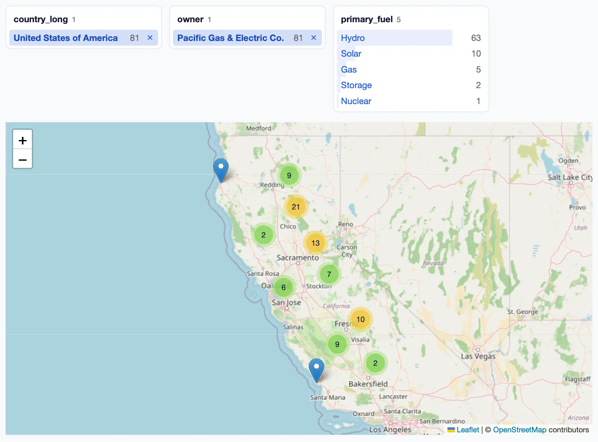
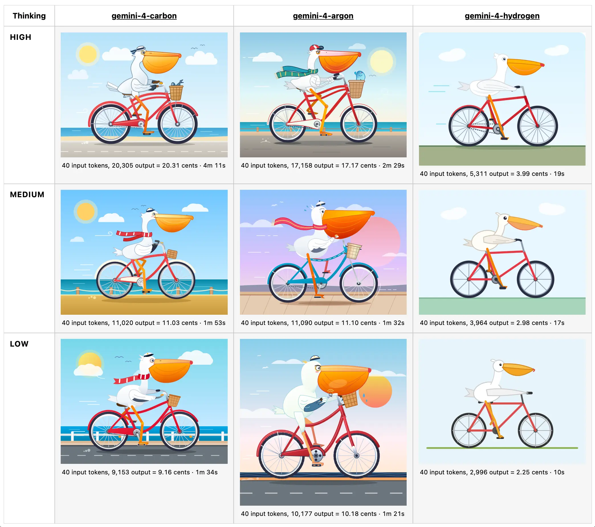
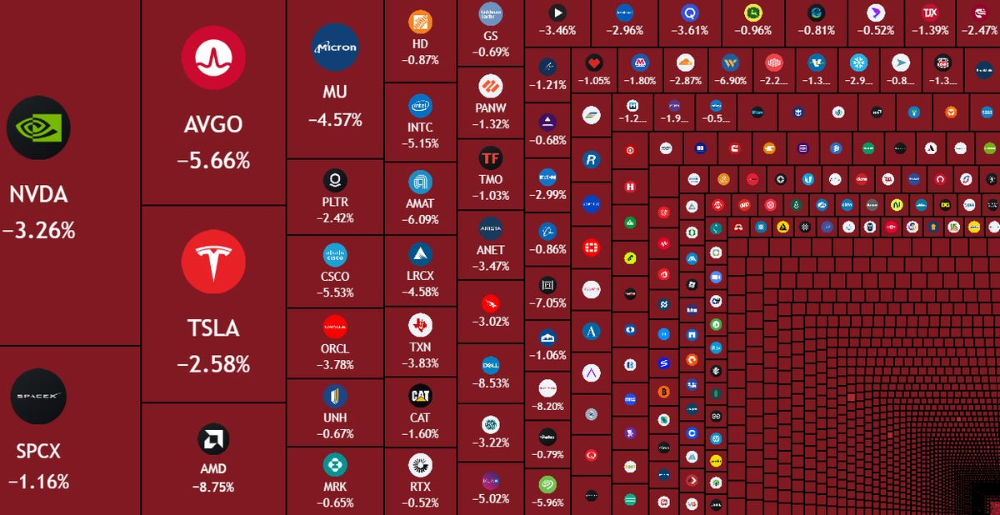

# AI 资讯日报 2026-11-16

> 自动抓取 AI 公司博客、从业者博客与社区聚合源，并生成中文摘要。

## 今日摘要

```
- Introducing ChatGPT Wallet
- Shield helps technicians hand off legacy portal work with OpenAI
- How Amplitude ships product improvements in 1–2 days with OpenAI
- Introducing Gemini 4 Hydrogen
- HuntMonitor - 观看今天的狩猎直播：积分、速度、排名变动
```

## 公司动态

1. **[Introducing ChatGPT Wallet](https://openai.com/index/introducing-chatgpt-wallet)**

   Introducing ChatGPT Wallet, a secure way for agents in ChatGPT Work, Codex, and dots to complete purchases with user approval and existing card protections.

   来源：OpenAI Blog

2. **[Shield helps technicians hand off legacy portal work with OpenAI](https://openai.com/business/customer-stories/shield)**

   Shield uses OpenAI to help IT technicians hand off work in legacy portals. Its Forge agents navigate systems so technicians can focus on issues needing their judgment.

   来源：OpenAI Blog

3. **[How Amplitude ships product improvements in 1–2 days with OpenAI](https://openai.com/business/customer-stories/amplitude)**

   Built primarily on OpenAI models, Amplitude’s proactive product agent, Wave, identifies what to build, helps teams ship changes with coding agents, and measures the impact.

   来源：OpenAI Blog

4. **[Introducing Gemini 4 Hydrogen](https://deepmind.google/blog/introducing-gemini-4-hydrogen/)**

   暂无摘要。

   来源：DeepMind Blog

## 每日产品

1. **[HuntMonitor - 观看今天的狩猎直播：积分、速度、排名变动](https://www.producthunt.com/r/QPB2D4QRGA3BW4)**

   Watch today's hunt live: points, speed, rank moves (www.producthunt.com) 16:00 ↑ 104 PH Upvotes

   

   来源：Product Hunt Daily

2. **[Talyn - 在并行云沙箱中运行 Claude Code 和 Codex](https://www.producthunt.com/r/ANYQ2DRTK2VS3T)**

   Run Claude Code and Codex in parallel cloud sandboxes (www.producthunt.com) 16:01 ↑ 102 PH Upvotes

   

   来源：Product Hunt Daily

3. **[Frevana Multiplayer - 与您的团队携手推动业务增长的人工智能](https://www.producthunt.com/r/FT7MX33UAAVCZC)**

   *{padding:0;margin:0;overflow:hidden}html,body{height:100%}img,span{position:absolute;width:100%;top:0;bottom:0;margin:auto}span{height:1.5em;text-align:center;font:48px/1.5 sans-serif;color:white;text-shadow:0 0 0.5em black}▶" frameborder="0" allow="accelerometer; autoplay; encrypted-media; gyroscope; picture-in-picture" allowfullscreen > AI that grows your business alongside your team (www.producthunt.com) 16:01 ↑ 101 PH Upvotes

   来源：Product Hunt Daily

4. **[Rakazo - 这款开源的Grok Bot替代品，真正属于你](https://www.producthunt.com/r/JJD4SYA4D3EAB6)**

   The open source Grok Bot alternative you actually own (www.producthunt.com) 16:01 ↑ 98 PH Upvotes

   

   来源：Product Hunt Daily

5. **[Tulvo - 智能且适应性强的办公空间，助您高效管理工作](https://www.producthunt.com/r/YYVWZN3VGDME5C)**

   *{padding:0;margin:0;overflow:hidden}html,body{height:100%}img,span{position:absolute;width:100%;top:0;bottom:0;margin:auto}span{height:1.5em;text-align:center;font:48px/1.5 sans-serif;color:white;text-shadow:0 0 0.5em black}▶" frameborder="0" allow="accelerometer; autoplay; encrypted-media; gyroscope; picture-in-picture" allowfullscreen > Smart & adaptive workspace to manage all your work (www.producthunt.com) 16:01 ↑ 101 PH Upvotes

   来源：Product Hunt Daily

6. **[Uber Parking - 在优步应用内查找、比较并预订停车位](https://www.producthunt.com/r/KFS3PL2NO44MH4)**

   Find, compare and reserve parking inside the Uber app (www.producthunt.com) 11-14 ↑ 96 PH Upvotes

   

   来源：Product Hunt Daily

7. **[Kokonut UI - 适用于您的人工智能代理的开源 UI 组件](https://www.producthunt.com/r/WBXQ3VO2K7G57E)**

   *{padding:0;margin:0;overflow:hidden}html,body{height:100%}img,span{position:absolute;width:100%;top:0;bottom:0;margin:auto}span{height:1.5em;text-align:center;font:48px/1.5 sans-serif;color:white;text-shadow:0 0 0.5em black}▶" frameborder="0" allow="accelerometer; autoplay; encrypted-media; gyroscope; picture-in-picture" allowfullscreen > Open-source UI components for your AI agent (www.producthunt.com) 11-14 ↑ 99 PH Upvotes

   来源：Product Hunt Daily

8. **[CaptureFlow - 支持即时分享链接的开源屏幕录制工具](https://www.producthunt.com/r/STO327RY5SWEKS)**

   Open-source screen recorder with instant share links (www.producthunt.com) 11-14 ↑ 102 PH Upvotes

   

   来源：Product Hunt Daily

9. **[Burnstate - Claude Code、Codex 和 Cursor 的限制，以固定间隔显示在您的菜单栏中](https://www.producthunt.com/r/H2T26HYRCIEWMM)**

   *{padding:0;margin:0;overflow:hidden}html,body{height:100%}img,span{position:absolute;width:100%;top:0;bottom:0;margin:auto}span{height:1.5em;text-align:center;font:48px/1.5 sans-serif;color:white;text-shadow:0 0 0.5em black}▶" frameborder="0" allow="accelerometer; autoplay; encrypted-media; gyroscope; picture-in-picture" allowfullscreen > Claude Code, Codex & Cursor limits, paced in your menu bar (www.producthunt.com) 11-13 ↑ 96 PH Upvotes

   来源：Product Hunt Daily

10. **[GAtrends - Telegram、Claude 和 ChatGPT 中针对您关键词的突发提醒](https://www.producthunt.com/r/KGFXAXOXP52YCO)**

   Spike alerts for your keywords in Telegram, Claude, ChatGPT (www.producthunt.com) 11-13 ↑ 101 PH Upvotes

   

   来源：Product Hunt Daily

## GitHub 项目

1. **[alibaba/open-code-review](https://github.com/alibaba/open-code-review)**

   Secure, fast, efficient, battle-tested at Alibaba's scale. Hybrid architecture code review tool: deterministic pipelines + LLM Agent, precise line-level comments, built-in multi-language ruleset (NPE, thread-safety, XSS, SQL injection), OpenAI & Anthropic compatible. Language: Go Stars: 51855 Forks: 4064

   

   来源：GitHub Trending Daily

2. **[Tencent/LoopForge](https://github.com/Tencent/LoopForge)**

   Self-hosted workflows for coding-agent delivery. Orchestrate CodeBuddy, Codex and Claude Code with scripts and human approval gates. Includes Local workflows for coding assistants. Language: Go Stars: 1321 Forks: 259

   

   来源：GitHub Trending Daily

3. **[ggml-org/ggml](https://github.com/ggml-org/ggml)**

   Tensor library for machine learning Language: C++ Stars: 15843 Forks: 1980

   来源：GitHub Trending Daily

4. **[elementalsouls/Claude-BugHunter](https://github.com/elementalsouls/Claude-BugHunter)**

   A Claude Code skill bundle for bug hunting and external red-team work - 82 skills, 15 slash commands, 681 disclosed-report patterns curated across 24 core vulnerability classes, plus enterprise identity + infrastructure attack matrices. Language: Python Stars: 6090 Forks: 935

   

   来源：GitHub Trending Daily

5. **[GoogleChrome/modern-web-guidance-src](https://github.com/GoogleChrome/modern-web-guidance-src)**

   Keep your coding agent up to date with the latest web best practices Language: TypeScript Stars: 6901 Forks: 556

   

   来源：GitHub Trending Daily

6. **[dream-num/univer](https://github.com/dream-num/univer)**

   Build your own AI office with Univer Office SDK. Bring editing, calculation, collaboration, and file processing into your product for people and AI agents. Built on an extensible open-source core. Language: TypeScript Stars: 25400 Forks: 2322

   

   来源：GitHub Trending Daily

7. **[ag-ui-protocol/ag-ui](https://github.com/ag-ui-protocol/ag-ui)**

   AG-UI: the Agent-User Interaction Protocol. Bring Agents into Frontend Applications. Language: TypeScript Stars: 17675 Forks: 1785

   

   来源：GitHub Trending Daily

8. **[google-labs-code/stitch-skills](https://github.com/google-labs-code/stitch-skills)**

   A library of Agent Skills designed to work with the Stitch MCP server. Each skill follows the Agent Skills open standard, for compatibility with coding agents such as Antigravity, Gemini CLI, Claude Code, Cursor. Language: TypeScript Stars: 9148 Forks: 1099

   

   来源：GitHub Trending Daily

9. **[backnotprop/plannotator](https://github.com/backnotprop/plannotator)**

   The workspace to stay in the loop and on top of agents - shape, decide, plan, annotate, review code, share with team, and send all feedback to agents with one click. Language: TypeScript Stars: 11698 Forks: 1048

   来源：GitHub Trending Daily

10. **[ChromeDevTools/chrome-devtools-mcp](https://github.com/ChromeDevTools/chrome-devtools-mcp)**

   Chrome DevTools for coding agents Language: TypeScript Stars: 56763 Forks: 4799

   

   来源：GitHub Trending Daily

## 从业者观点

1. **[datasette-llm 0.1a11](https://simonwillison.net/2026/Nov/14/datasette-llm/)**

   Release: datasette-llm 0.1a11 datasette-llm is the intermediate plugin for Datasette that supports configuring LLMs for use with other Datasette plugins. This release adds support for OpenAI-compatible endpoints, so you can configure Datasette to use an LLM hosted anywhere that talks the OpenAI pseudo-standard web protocol. This means that if you're running local models with LM Studio or Ollama or llama.cpp (which just hit v1.0.0 ) you can run Datasette via uvx like this: wget https://datasette.io/content.db uvx --with datasette-agent datasette \ --root --secret 1 \ -s plugins.datasette-llm.default_model ' { "model": "lmstudio-qwen", "model_name": "qwen/qwen3.8-27b", "api_base": "http://localhost:1234/v1" } ' content.db And you'll get a local server running a Datasette Agent instance powered by your local model! [图片: https://static.simonwillison.net/static/2026/lmstudio-datasette-agent.webp] Tags: uv , datasette-agent , llm , datasette , llms , ai , generative-ai

   

   来源：Simon Willison

2. **[datasette-vega 0.7](https://simonwillison.net/2026/Nov/14/datasette-vega/)**

   Release: datasette-vega 0.7 A new release of Datasette's longest untouched plugin, for rendering charts (using Vega-Lite ) against data in a table or custom query. The last release was in July 2018! I finally bumped it for compatibility with the latest Datasette alphas, plus some cosmetic tweaks to make it work better with Datasette Lite . (Datasette Lite just gained the ability to run JavaScript plugins like this! I'll write more about that soon.) Since it works with Datasette Lite, the live demo in the README now links to this demo on Datasette Lite . [图片: https://static.simonwillison.net/static/2026/datasette-vega.webp] Tags: datasette , visualisation , datasette-lite

   

   来源：Simon Willison

3. **[datasette-cluster-map 0.19](https://simonwillison.net/2026/Nov/13/datasette-cluster-map/)**

   Release: datasette-cluster-map 0.19 One of the oldest Datasette plugins, and still one of my favorites. It now works with Datasette 1.0a42, and depends on the new datasette-leaflet to ensure OpenStreetMap tiles are requested with a referrer header. Here's a map of power plants owned by California's PG&amp;E , also demonstrating Datasette's recently redesigned facets : [图片: https://static.simonwillison.net/static/2026/power-plants-pge.webp] Tags: datasette , geospatial , openstreetmap

   

   来源：Simon Willison

4. **[datasette-leaflet 0.3](https://simonwillison.net/2026/Nov/13/datasette-leaflet/)**

   Release: datasette-leaflet 0.3 OpenStreetMap have a very reasonable policy that hits to their hosted tile server should send a referrer header . Datasette table pages used the Referrer-Policy: no-referrer HTTP header, causing plugins that loaded tiles from OpenStreetMap to violate that policy. datasette-leaflet is the plugin that loads a bundled Leaflet so other Datasette plugins can depend on it. It now sets the referrer policy on the tile requests themselves to strict-origin-when-cross-origin , passing the host but not the full path to the page. Tags: leaflet , datasette , openstreetmap

   来源：Simon Willison

5. **[llm-gemini 0.37](https://simonwillison.net/2026/Nov/12/llm-gemini/)**

   Release: llm-gemini 0.37 Google launched Gemini 4 Hydrogen today - the lowest cost member of the Gemini 4 family. It's actually not too far off the price of its much bigger siblings, Carbon and Argon. I'm finding Gemini 4's pricing really confusing. Here's the pricing scheme: Model Dates Input ($/M) Cached input Output Gemini 4 Carbon Through Nov 30, 2026 $2.00 $0.10 $10.00 From Dec 1, 2026 $4.00 $0.20 $20.00 Gemini 4 Argon Through Nov 30, 2026 $2.00 $0.10 $10.00 From Dec 1, 2026 $4.00 $0.20 $20.00 Gemini 4 Hydrogen &nbsp; $1.50 $0.075 $7.50 Carbon and Argon are the same price , and both are scheduled to double in price on December 1st. If they're the same price, why have two different models? Google says that Argon "delivers Gemini 4 intelligence with faster responses and lower token spend per turn compared to Gemini 4 Carbon" - so it may be priced the same, but it will use less tokens per task. Hydrogen, supposedly the cheap model, is currently only a 25% discount on its more capable peers. The Hydrogen price will make more sense after December 1st, when it will represent a 75% discount. It's still considerably more expensive than Claude Haiku 5.5 and GPT-6 Luna - they're both $0.10/$0.50, so Hydrogen is 15x that. I had Hydrogen generate some pelicans . Here's a full comparison grid showing the pelicans for all three members of the Gemini 4 family at their three supported effort levels: [图片: https://static.simonwillison.net/static/2026/gemini-4-pelicans.webp] Considering how close they are in price, the difference in pelican quality for Hydrogen is quite stark. Here's how Google describe Hydrogen's intended position in their mix of models: In real-world software development, while teams rely on frontier models like Carbon and Argon for deep architectural judgment when designing systems or untangling subtle bugs, they still need a fast, disciplined execution model for writing code, running tests, and verifying changes. Hydrogen is built to stand on its own as a model for everyday work — or to pair with Carbon and Argon as the high-efficiency execution engine in multi-model workflows. Most notably, Hydrogen is the new free tier model, and is the model that will power AI features in Google Search. Tags: gemini , llm , google , pelican-riding-a-bicycle , llm-pricing , ai , llms

   

   来源：Simon Willison

6. **[What could possibly go wrong? Nationwide FAA Ground Stop edition](https://garymarcus.substack.com/p/what-could-possibly-go-wrong-nationwide)**

   A sign of things to come?

   

   来源：Gary Marcus

7. **[The great Generative AI unraveling](https://garymarcus.substack.com/p/the-great-generative-ai-unraveling)**

   Things are starting to fall apart

   

   来源：Gary Marcus

8. **[The avalanche that hit math is coming for AI development](https://www.dwarkesh.com/p/rsi)**

   Why I now expect superintelligence by 2030

   

   来源：Dwarkesh Patel

## 社区热点

1. **[All AI-generated code should be Open Source](https://jakub.jankiewicz.org/blog/ai-code-open-source/)**

   Article URL: https://jakub.jankiewicz.org/blog/ai-code-open-source/ Comments URL: https://news.ycombinator.com/item?id=50507303 Points: 424 # Comments: 258

   来源：Hacker News AI

2. **[Claude asked to renumber pages deletes professor's syllabus, year of notes](https://www.tomshardware.com/tech-industry/artificial-intelligence/rogue-claude-ai-tasked-with-renumbering-pages-accidentally-deletes-law-professors-entire-syllabus-one-year-of-lecture-notes-youre-right-to-be-angry-i-deleted-your-files-through-my-own-carelessness-humbled-agent-admits)**

   Article URL: https://www.tomshardware.com/tech-industry/artificial-intelligence/rogue-claude-ai-tasked-with-renumbering-pages-accidentally-deletes-law-professors-entire-syllabus-one-year-of-lecture-notes-youre-right-to-be-angry-i-deleted-your-files-through-my-own-carelessness-humbled-agent-admits Comments URL: https://news.ycombinator.com/item?id=50499114 Points: 49 # Comments: 73

   来源：Hacker News AI

3. **[Smuggling of 1.5M AI GPUs could be the cause of Huang's departure](https://www.tomshardware.com/tech-industry/artificial-intelligence/mass-smuggling-of-nvidia-ai-gpus-could-be-the-underlying-cause-of-jensen-huangs-departure-analysts-claim-more-than-1-5-gigawatts-of-banned-chips-tracked-to-china-despite-export-controls)**

   Article URL: https://www.tomshardware.com/tech-industry/artificial-intelligence/mass-smuggling-of-nvidia-ai-gpus-could-be-the-underlying-cause-of-jensen-huangs-departure-analysts-claim-more-than-1-5-gigawatts-of-banned-chips-tracked-to-china-despite-export-controls Comments URL: https://news.ycombinator.com/item?id=50498051 Points: 60 # Comments: 42

   来源：Hacker News AI

4. **[The Claude Delusion](https://www.netmeister.org/blog/claude-delusion.html)**

   Article URL: https://www.netmeister.org/blog/claude-delusion.html Comments URL: https://news.ycombinator.com/item?id=50496921 Points: 149 # Comments: 197

   来源：Hacker News AI

5. **[Ask HN: What are the most useful, concrete AI skills to independently learn?](https://news.ycombinator.com/item?id=50494696)**

   Specifically, what are the most useful, concrete skills to learn as an individual to take economic advantage of the advances in LLMs, agents and associated new technological capabilities? What is accessible to learn just from the internet and experimentation, without a degree program, assuming a preexisting moderately technical background? The clearer and more specific (eg. “Learn how-to x with y”) the better. Thank you! Comments URL: https://news.ycombinator.com/item?id=50494696 Points: 87 # Comments: 51

   来源：Hacker News AI

6. **[Nvidia allegedly engineered scarcity by funding AI startups to buy its GPUs](https://www.techpowerup.com/354814/nvidia-allegedly-engineered-scarcity-by-funding-ai-startups-to-buy-its-gpus)**

   Article URL: https://www.techpowerup.com/354814/nvidia-allegedly-engineered-scarcity-by-funding-ai-startups-to-buy-its-gpus Comments URL: https://news.ycombinator.com/item?id=50493251 Points: 1085 # Comments: 644

   来源：Hacker News AI

7. **[Anthropic upgrades Claude Code Projects to run parallel AI workers](https://claude.com/resources/articles/projects-redesigned)**

   Article URL: https://claude.com/resources/articles/projects-redesigned Comments URL: https://news.ycombinator.com/item?id=50492141 Points: 99 # Comments: 95

   来源：Hacker News AI

8. **[Claude Meetings](https://claude.com/resources/articles/claude-meetings)**

   Article URL: https://claude.com/resources/articles/claude-meetings Comments URL: https://news.ycombinator.com/item?id=50491097 Points: 111 # Comments: 88

   来源：Hacker News AI

9. **[No AI Slop: A Manifesto](https://www.slopmanifesto.com/)**

   Article URL: https://www.slopmanifesto.com/ Comments URL: https://news.ycombinator.com/item?id=50488769 Points: 221 # Comments: 133

   来源：Hacker News AI

10. **[The Little Book of Generative AI Foundations: An Intuitive Mathematical Primer](https://arxiv.org/abs/2605.29713)**

   Comments

   来源：Lobsters AI

11. **[You could have invented transformers from memory](https://alexwang.ai/posts/associative-memory/)**

   Comments

   来源：Lobsters AI

12. **[e-means: 10x faster k-means at equal loss](https://e-means.github.io/)**

   Comments

   来源：Lobsters AI
