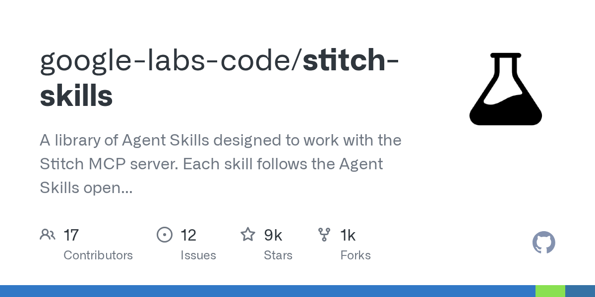
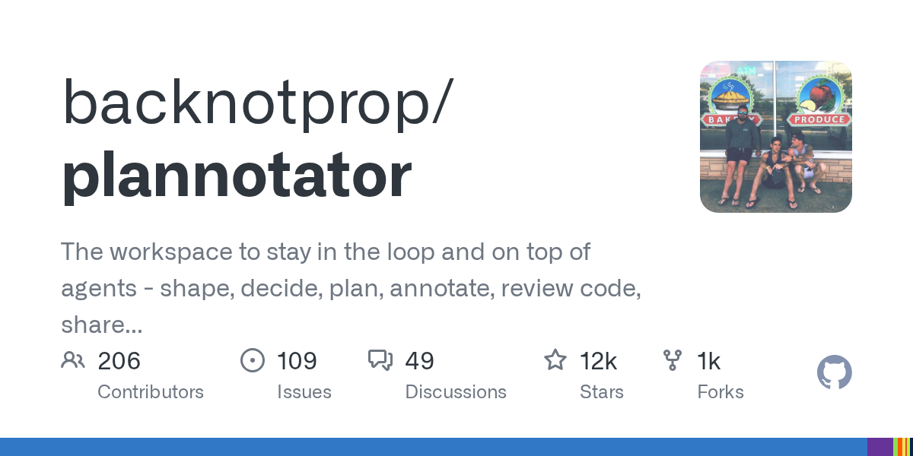
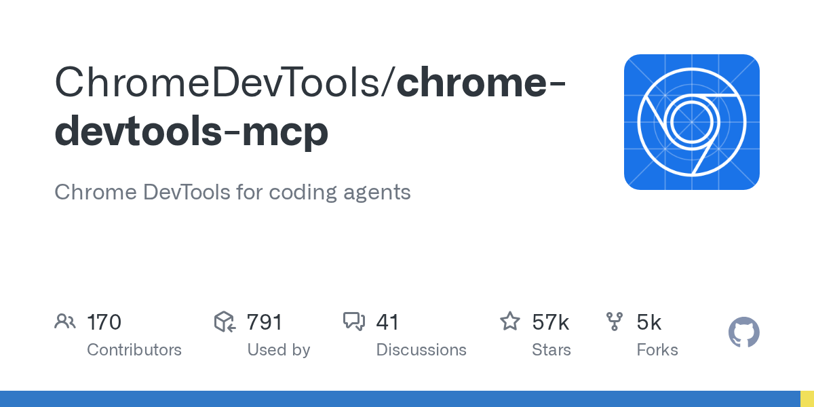
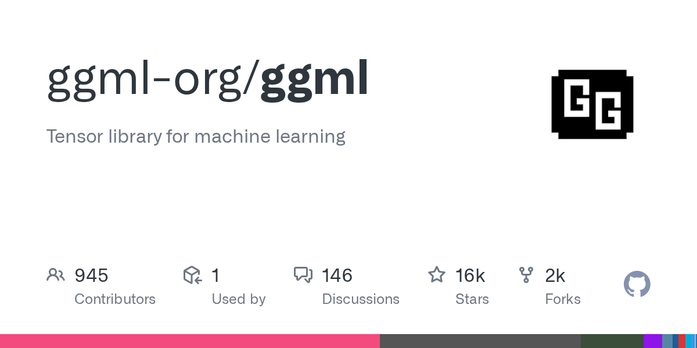
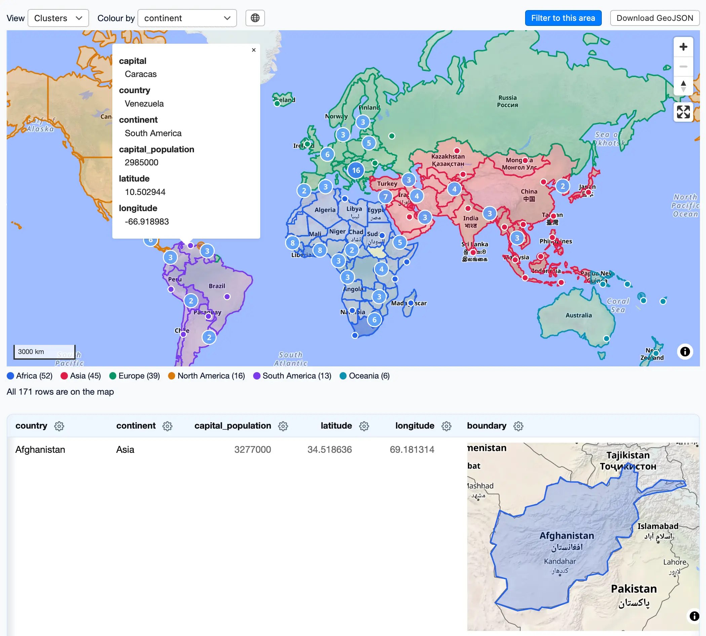
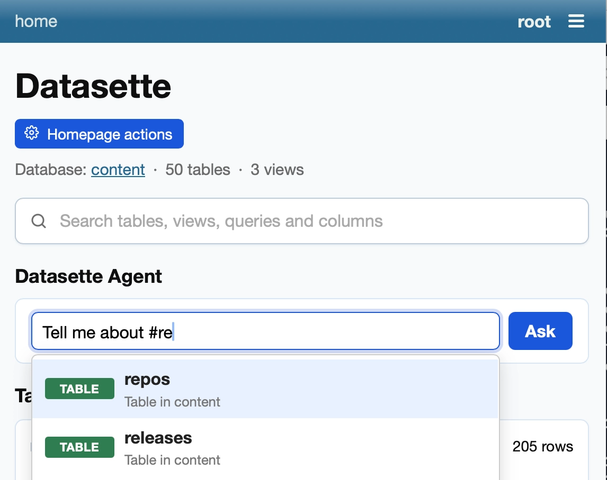

# AI 资讯日报 2026-11-16

> 自动抓取 AI 公司博客、从业者博客与社区聚合源，并生成中文摘要。

## 今日摘要

```
- A step toward defining the Standard Model on a lattice
- Our new blog for science
- Introducing ChatGPT Wallet
- Shield helps technicians hand off legacy portal work with OpenAI
- TwoBucket - 一款适合初学者的移动端汽车美容预约软件
```

## 公司动态

1. **[A step toward defining the Standard Model on a lattice](https://openai.com/index/step-toward-defining-the-standard-model)**

   Explore a candidate nonperturbative lattice definition of the Standard Model and how GPT-6 Astra helped turn the idea into a detailed proof.

   来源：OpenAI Blog

2. **[Our new blog for science](https://openai.com/index/our-new-blog-for-science)**

   The OpenAI science blog shares new findings, practical methods, and firsthand accounts from researchers using AI to advance scientific discovery.

   来源：OpenAI Blog

3. **[Introducing ChatGPT Wallet](https://openai.com/index/introducing-chatgpt-wallet)**

   Introducing ChatGPT Wallet, a secure way for agents in ChatGPT Work, Codex, and dots to complete purchases with user approval and existing card protections.

   来源：OpenAI Blog

4. **[Shield helps technicians hand off legacy portal work with OpenAI](https://openai.com/business/customer-stories/shield)**

   Shield uses OpenAI to help IT technicians hand off work in legacy portals. Its Forge agents navigate systems so technicians can focus on issues needing their judgment.

   来源：OpenAI Blog

## 每日产品

1. **[TwoBucket - 一款适合初学者的移动端汽车美容预约软件](https://www.producthunt.com/r/66Z4N5DIRAO47A)**

   Beginner-friendly mobile detailing software for bookings (www.producthunt.com) 11-15 ↑ 108 PH Upvotes

   

   来源：Product Hunt Daily

2. **[Canvas by AgentGrid.io - 代理设计画布——一种与人工智能协作的可视化方式](https://www.producthunt.com/r/OI335FP7TS27LE)**

   *{padding:0;margin:0;overflow:hidden}html,body{height:100%}img,span{position:absolute;width:100%;top:0;bottom:0;margin:auto}span{height:1.5em;text-align:center;font:48px/1.5 sans-serif;color:white;text-shadow:0 0 0.5em black}▶" frameborder="0" allow="accelerometer; autoplay; encrypted-media; gyroscope; picture-in-picture" allowfullscreen > Agentic Design Canvas - A visual way to collaborate with AI (www.producthunt.com) 11-15 ↑ 108 PH Upvotes

   来源：Product Hunt Daily

3. **[HuntMonitor - 观看今天的狩猎直播：积分、速度、排名变动](https://www.producthunt.com/r/QPB2D4QRGA3BW4)**

   Watch today's hunt live: points, speed, rank moves (www.producthunt.com) 11-15 ↑ 104 PH Upvotes

   

   来源：Product Hunt Daily

4. **[Talyn - 在并行云沙箱中运行 Claude Code 和 Codex](https://www.producthunt.com/r/ANYQ2DRTK2VS3T)**

   Run Claude Code and Codex in parallel cloud sandboxes (www.producthunt.com) 11-15 ↑ 102 PH Upvotes

   

   来源：Product Hunt Daily

5. **[Frevana Multiplayer - 与您的团队携手推动业务增长的人工智能](https://www.producthunt.com/r/FT7MX33UAAVCZC)**

   *{padding:0;margin:0;overflow:hidden}html,body{height:100%}img,span{position:absolute;width:100%;top:0;bottom:0;margin:auto}span{height:1.5em;text-align:center;font:48px/1.5 sans-serif;color:white;text-shadow:0 0 0.5em black}▶" frameborder="0" allow="accelerometer; autoplay; encrypted-media; gyroscope; picture-in-picture" allowfullscreen > AI that grows your business alongside your team (www.producthunt.com) 11-15 ↑ 101 PH Upvotes

   来源：Product Hunt Daily

6. **[Rakazo - 这款开源的Grok Bot替代品，真正属于你](https://www.producthunt.com/r/JJD4SYA4D3EAB6)**

   The open source Grok Bot alternative you actually own (www.producthunt.com) 11-15 ↑ 98 PH Upvotes

   

   来源：Product Hunt Daily

7. **[Tulvo - 智能且适应性强的办公空间，助您高效管理工作](https://www.producthunt.com/r/YYVWZN3VGDME5C)**

   *{padding:0;margin:0;overflow:hidden}html,body{height:100%}img,span{position:absolute;width:100%;top:0;bottom:0;margin:auto}span{height:1.5em;text-align:center;font:48px/1.5 sans-serif;color:white;text-shadow:0 0 0.5em black}▶" frameborder="0" allow="accelerometer; autoplay; encrypted-media; gyroscope; picture-in-picture" allowfullscreen > Smart & adaptive workspace to manage all your work (www.producthunt.com) 11-15 ↑ 101 PH Upvotes

   来源：Product Hunt Daily

8. **[Uber Parking - 在优步应用内查找、比较并预订停车位](https://www.producthunt.com/r/KFS3PL2NO44MH4)**

   Find, compare and reserve parking inside the Uber app (www.producthunt.com) 11-14 ↑ 96 PH Upvotes

   

   来源：Product Hunt Daily

9. **[Kokonut UI - 适用于您的人工智能代理的开源 UI 组件](https://www.producthunt.com/r/WBXQ3VO2K7G57E)**

   *{padding:0;margin:0;overflow:hidden}html,body{height:100%}img,span{position:absolute;width:100%;top:0;bottom:0;margin:auto}span{height:1.5em;text-align:center;font:48px/1.5 sans-serif;color:white;text-shadow:0 0 0.5em black}▶" frameborder="0" allow="accelerometer; autoplay; encrypted-media; gyroscope; picture-in-picture" allowfullscreen > Open-source UI components for your AI agent (www.producthunt.com) 11-14 ↑ 99 PH Upvotes

   来源：Product Hunt Daily

10. **[CaptureFlow - 支持即时分享链接的开源屏幕录制工具](https://www.producthunt.com/r/STO327RY5SWEKS)**

   Open-source screen recorder with instant share links (www.producthunt.com) 11-14 ↑ 102 PH Upvotes

   

   来源：Product Hunt Daily

## GitHub 项目

1. **[dream-num/univer](https://github.com/dream-num/univer)**

   Build your own AI office with Univer Office SDK. Bring editing, calculation, collaboration, and file processing into your product for people and AI agents. Built on an extensible open-source core. Language: TypeScript Stars: 26217 Forks: 2365

   

   来源：GitHub Trending Daily

2. **[ag-ui-protocol/ag-ui](https://github.com/ag-ui-protocol/ag-ui)**

   AG-UI: the Agent-User Interaction Protocol. Bring Agents into Frontend Applications. Language: TypeScript Stars: 17964 Forks: 1823

   来源：GitHub Trending Daily

3. **[google-labs-code/stitch-skills](https://github.com/google-labs-code/stitch-skills)**

   A library of Agent Skills designed to work with the Stitch MCP server. Each skill follows the Agent Skills open standard, for compatibility with coding agents such as Antigravity, Gemini CLI, Claude Code, Cursor. Language: TypeScript Stars: 9354 Forks: 1130

   

   来源：GitHub Trending Daily

4. **[backnotprop/plannotator](https://github.com/backnotprop/plannotator)**

   The workspace to stay in the loop and on top of agents - shape, decide, plan, annotate, review code, share with team, and send all feedback to agents with one click. Language: TypeScript Stars: 11913 Forks: 1086

   

   来源：GitHub Trending Daily

5. **[ChromeDevTools/chrome-devtools-mcp](https://github.com/ChromeDevTools/chrome-devtools-mcp)**

   Chrome DevTools for coding agents Language: TypeScript Stars: 57033 Forks: 4813

   

   来源：GitHub Trending Daily

6. **[alibaba/open-code-review](https://github.com/alibaba/open-code-review)**

   Secure, fast, efficient, battle-tested at Alibaba's scale. Hybrid architecture code review tool: deterministic pipelines + LLM Agent, precise line-level comments, built-in multi-language ruleset (NPE, thread-safety, XSS, SQL injection), OpenAI & Anthropic compatible. Language: Go Stars: 52188 Forks: 4120

   

   来源：GitHub Trending Daily

7. **[Tencent/LoopForge](https://github.com/Tencent/LoopForge)**

   Self-hosted workflows for coding-agent delivery. Orchestrate CodeBuddy, Codex and Claude Code with scripts and human approval gates. Includes Local workflows for coding assistants. Language: Go Stars: 1614 Forks: 282

   

   来源：GitHub Trending Daily

8. **[ggml-org/ggml](https://github.com/ggml-org/ggml)**

   Tensor library for machine learning Language: C++ Stars: 15940 Forks: 2020

   

   来源：GitHub Trending Daily

9. **[elementalsouls/Claude-BugHunter](https://github.com/elementalsouls/Claude-BugHunter)**

   A Claude Code skill bundle for bug hunting and external red-team work - 82 skills, 15 slash commands, 681 disclosed-report patterns curated across 24 core vulnerability classes, plus enterprise identity + infrastructure attack matrices. Language: Python Stars: 6524 Forks: 978

   

   来源：GitHub Trending Daily

10. **[GoogleChrome/modern-web-guidance-src](https://github.com/GoogleChrome/modern-web-guidance-src)**

   Keep your coding agent up to date with the latest web best practices Language: TypeScript Stars: 7270 Forks: 606

   

   来源：GitHub Trending Daily

## 从业者观点

1. **[datasette-maplibre 0.1a0](https://simonwillison.net/2026/Nov/15/datasette-maplibre/)**

   Release: datasette-maplibre 0.1a0 The first new Datasette geospatial plugin in quite a while! This one combines the excellent MapLibre GL library with OpenFreeMap , the free vector map server operated by Zsolt Ero (you should sponsor Zsolt on GitHub .) I built most of this with a single prompt to Claude Fable 5.2: Look at datasette-cluster-map and datasette-leaflet-geojson plugins, then look at ~/dev/tools/openfreemap-demo.html - then build a brand new Datasette plugin that uses maplibreGL and openfreemap and combines the features of those other two plugins - but be creative and think outside the box for other useful features the plugin might have "Be creative and think outside the box" resulted in a few neat ideas - my favorite is that it displays SVG previews of GeoJSON shapes, then loads a WebGL preview only when they scroll into view. I also had Claude build a comprehensive demo which works in the latest Datasette Lite, so you can visit this link to load the plugin and a demo database in your browser via Pyodide and WebAssembly. I like this demo page showing both GeoJSON shapes and lat/lon points on the same map: [图片: https://static.simonwillison.net/static/cors-allow/2026/datasette-maplibre.webp] Tags: visualization , generative-ai , datasette-lite , claude-mythos-fable , ai , llms , geospatial , openstreetmap , datasette

   

   来源：Simon Willison

2. **[datasette 1.0a43](https://simonwillison.net/2026/Nov/15/datasette/)**

   Release: datasette 1.0a43 I've been leaning hard into Claude Fable 5.2 to help knock things off the 1.0 milestone , which is now 53% complete. The biggest 1.0 item in this release is streaming support for output renderers - the built-in TSV and CSV export mechanisms now use this as well, and plugins can register themselves as capable of streaming every row in a table in one go via the new Response.stream() method. There are a couple of security fixes, one of which I deemed deserving of a GitHub advisory : private stored queries could be exposed, granting access to the title and SQL of the query (but not allowing that query to be executed). There are dozens of smaller improvements. The row page JSON representation finally has a design suitable for 1.0 . A new &lt;datasette-copy-button&gt; Web Component provides copy-schema in various places. JSON in columns on the row page can be pretty-printed. There's a new DatasetteModal.confirm() JavaScript utility method. Plus dozens of bug fixes, including contributions by Zihan Dai , Peter Olkhovets , Ilya Khalafi , and Ankita Advitot . The feature I'm most excited about is a pretty tiny one: I've added CSS multi-page view transitions to Datasette! Here's the commit - key CSS is as follows: /* Enable cross-document view transitions, for anyone without prefers-reduced-motion */ @media ( prefers-reduced-motion : no-preference ) { @view-transition { navigation : auto ; } } /* .facet-results should morph from old position to new */ html : active-view-transition . content &gt; . facet-results { view-transition-name : facet-results ; } /* So should a .table-wrapper, provided it contains .rows-and-columns */ html : active-view-transition . table-wrapper : has ( &gt; table . rows-and-columns ) { view-transition-name : rows-table ; } With that in place, navigations within Datasette - still staunchly a multi-page application - feel more like an SPA. This works on Safari and Chrome at the moment and I believe supports for Firefox is due to land in Firefox 162 on December 8th 2026 (seeing as they are no longer feature-flagged in Firefox Nightly.) Tags: security , datasette , css , browsers , annotated-release-notes , firefox , javascript , safari , chrome

   来源：Simon Willison

3. **[datasette 0.65.6](https://simonwillison.net/2026/Nov/15/datasette-2/)**

   Release: datasette 0.65.6 I backported a minor security fix from 1.0a43: Fixed a security issue where a database registered using add_database(db, name=..., route=...) with a route that differs from its name could be downloaded from /&lt;route&gt;.db by actors who were denied access to it. [...] Tags: security , datasette

   来源：Simon Willison

4. **[datasette-apps 0.4a0](https://simonwillison.net/2026/Nov/15/datasette-apps/)**

   Release: datasette-apps 0.4a0 Datasette Apps are sandboxed HTML and JavaScript applications that live inside Datasette - think Claude Artifacts, but these ones can run SQL queries against your data. 0.4a0 adds support for linking: you can link to an app with #fragments in the URL and the app can see and use those, plus supported URL schemes are reported back to Datasette Agent so it can help write apps that link to each other. This means you can have e.g. an app that shows details about a specific record, and a completely separate app that searches those records and links to their representations in the first app. Tags: datasette-agent , datasette-apps , datasette , urls

   来源：Simon Willison

5. **[datasette-agent 0.6a0](https://simonwillison.net/2026/Nov/15/datasette-agent/)**

   Release: datasette-agent 0.6a0 Accumulated small fixes for Datasette Agent, my agent plugin for Datasette that lets you ask questions about your data. Most notably, it now adds an agent prompt directly to the Datasette homepage, with support for hash-mentions of tables and queries: [图片: https://static.simonwillison.net/static/cors-allow/2026/datasette-agent-homepage.webp] Tags: datasette-agent , llm , datasette , llms , ai , generative-ai

   

   来源：Simon Willison

6. **[datasette-llm 0.1a11](https://simonwillison.net/2026/Nov/14/datasette-llm/)**

   Release: datasette-llm 0.1a11 datasette-llm is the intermediate plugin for Datasette that supports configuring LLMs for use with other Datasette plugins. This release adds support for OpenAI-compatible endpoints, so you can configure Datasette to use an LLM hosted anywhere that talks the OpenAI pseudo-standard web protocol. This means that if you're running local models with LM Studio or Ollama or llama.cpp (which just hit v1.0.0 ) you can run Datasette via uvx like this: wget https://datasette.io/content.db uvx --with datasette-agent datasette \ --root --secret 1 \ -s plugins.datasette-llm.default_model ' { "model": "lmstudio-qwen", "model_name": "qwen/qwen3.8-27b", "api_base": "http://localhost:1234/v1" } ' content.db And you'll get a local server running a Datasette Agent instance powered by your local model! [图片: https://static.simonwillison.net/static/2026/lmstudio-datasette-agent.webp] Tags: uv , datasette-agent , llm , datasette , llms , ai , generative-ai

   

   来源：Simon Willison

7. **[What could possibly go wrong? Nationwide FAA Ground Stop edition](https://garymarcus.substack.com/p/what-could-possibly-go-wrong-nationwide)**

   A sign of things to come?

   

   来源：Gary Marcus

8. **[The great Generative AI unraveling](https://garymarcus.substack.com/p/the-great-generative-ai-unraveling)**

   Things are starting to fall apart

   

   来源：Gary Marcus

9. **[The avalanche that hit math is coming for AI development](https://www.dwarkesh.com/p/rsi)**

   Why I now expect superintelligence by 2030

   

   来源：Dwarkesh Patel

## 社区热点

1. **["Who is Hiring?" postings stuck near 12-year lows as AI reaches half of all jobs](https://www.hntrends.com/2026/november.html)**

   Article URL: https://www.hntrends.com/2026/november.html Comments URL: https://news.ycombinator.com/item?id=50512950 Points: 44 # Comments: 13

   来源：Hacker News AI

2. **[Parents pay $75k for Alpha's AI school. Half of its students missed math target](https://fortune.com/2026/11/14/alpha-school-ai-students-tuition-learning-goals/)**

   Article URL: https://fortune.com/2026/11/14/alpha-school-ai-students-tuition-learning-goals/ Comments URL: https://news.ycombinator.com/item?id=50509953 Points: 63 # Comments: 61

   来源：Hacker News AI

3. **[All AI-generated code should be Open Source](https://jakub.jankiewicz.org/blog/ai-code-open-source/)**

   Article URL: https://jakub.jankiewicz.org/blog/ai-code-open-source/ Comments URL: https://news.ycombinator.com/item?id=50507303 Points: 1098 # Comments: 597

   来源：Hacker News AI

4. **[Show HN: db-branch – database branches in seconds for AI agents and CI, via ZFS](https://github.com/db-branch/db-branch)**

   Article URL: https://github.com/db-branch/db-branch Comments URL: https://news.ycombinator.com/item?id=50506940 Points: 33 # Comments: 10

   来源：Hacker News AI

5. **[Claude asked to renumber pages deletes professor's syllabus, year of notes](https://www.tomshardware.com/tech-industry/artificial-intelligence/rogue-claude-ai-tasked-with-renumbering-pages-accidentally-deletes-law-professors-entire-syllabus-one-year-of-lecture-notes-youre-right-to-be-angry-i-deleted-your-files-through-my-own-carelessness-humbled-agent-admits)**

   Article URL: https://www.tomshardware.com/tech-industry/artificial-intelligence/rogue-claude-ai-tasked-with-renumbering-pages-accidentally-deletes-law-professors-entire-syllabus-one-year-of-lecture-notes-youre-right-to-be-angry-i-deleted-your-files-through-my-own-carelessness-humbled-agent-admits Comments URL: https://news.ycombinator.com/item?id=50499114 Points: 50 # Comments: 75

   来源：Hacker News AI

6. **[Smuggling of 1.5M AI GPUs could be the cause of Huang's departure](https://www.tomshardware.com/tech-industry/artificial-intelligence/mass-smuggling-of-nvidia-ai-gpus-could-be-the-underlying-cause-of-jensen-huangs-departure-analysts-claim-more-than-1-5-gigawatts-of-banned-chips-tracked-to-china-despite-export-controls)**

   Article URL: https://www.tomshardware.com/tech-industry/artificial-intelligence/mass-smuggling-of-nvidia-ai-gpus-could-be-the-underlying-cause-of-jensen-huangs-departure-analysts-claim-more-than-1-5-gigawatts-of-banned-chips-tracked-to-china-despite-export-controls Comments URL: https://news.ycombinator.com/item?id=50498051 Points: 61 # Comments: 43

   来源：Hacker News AI

7. **[The Claude Delusion](https://www.netmeister.org/blog/claude-delusion.html)**

   Article URL: https://www.netmeister.org/blog/claude-delusion.html Comments URL: https://news.ycombinator.com/item?id=50496921 Points: 152 # Comments: 199

   来源：Hacker News AI

8. **[Ask HN: What are the most useful, concrete AI skills to independently learn?](https://news.ycombinator.com/item?id=50494696)**

   Specifically, what are the most useful, concrete skills to learn as an individual to take economic advantage of the advances in LLMs, agents and associated new technological capabilities? What is accessible to learn just from the internet and experimentation, without a degree program, assuming a preexisting moderately technical background? The clearer and more specific (eg. “Learn how-to x with y”) the better. Thank you! Comments URL: https://news.ycombinator.com/item?id=50494696 Points: 88 # Comments: 53

   来源：Hacker News AI

9. **[Nvidia allegedly engineered scarcity by funding AI startups to buy its GPUs](https://www.techpowerup.com/354814/nvidia-allegedly-engineered-scarcity-by-funding-ai-startups-to-buy-its-gpus)**

   Article URL: https://www.techpowerup.com/354814/nvidia-allegedly-engineered-scarcity-by-funding-ai-startups-to-buy-its-gpus Comments URL: https://news.ycombinator.com/item?id=50493251 Points: 1099 # Comments: 648

   来源：Hacker News AI

10. **[Anthropic upgrades Claude Code Projects to run parallel AI workers](https://claude.com/resources/articles/projects-redesigned)**

   Article URL: https://claude.com/resources/articles/projects-redesigned Comments URL: https://news.ycombinator.com/item?id=50492141 Points: 100 # Comments: 95

   来源：Hacker News AI

11. **[Designing nextest's install scripts](https://sunshowers.io/posts/nextest-install-scripts/)**

   Comments

   来源：Lobsters AI

12. **[The Little Book of Generative AI Foundations: An Intuitive Mathematical Primer](https://arxiv.org/abs/2605.29713)**

   Comments

   来源：Lobsters AI

13. **[You could have invented transformers from memory](https://alexwang.ai/posts/associative-memory/)**

   Comments

   来源：Lobsters AI

14. **[e-means: 10x faster k-means at equal loss](https://e-means.github.io/)**

   Comments

   来源：Lobsters AI
