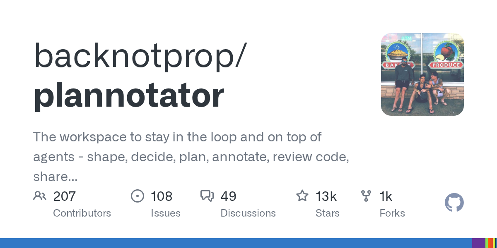
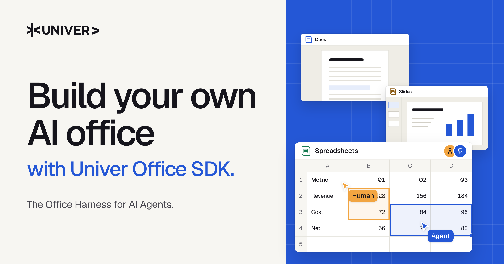
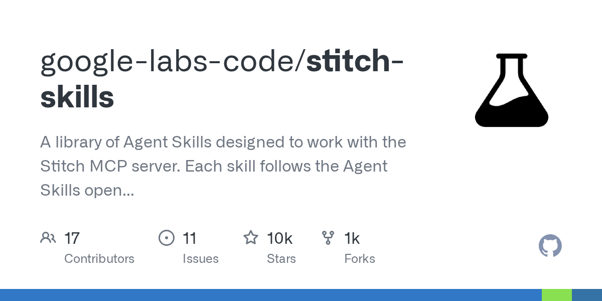
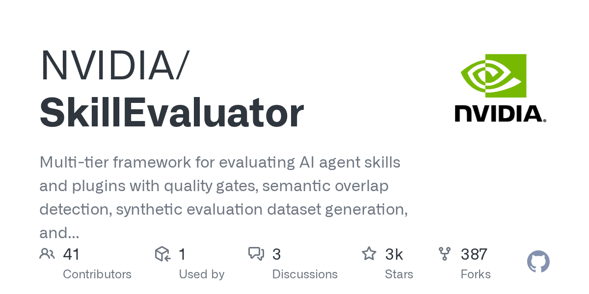
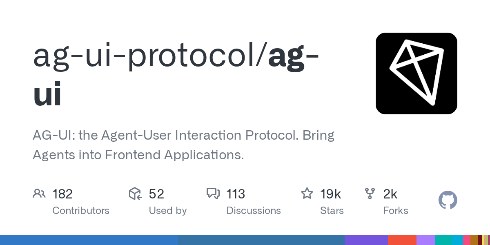
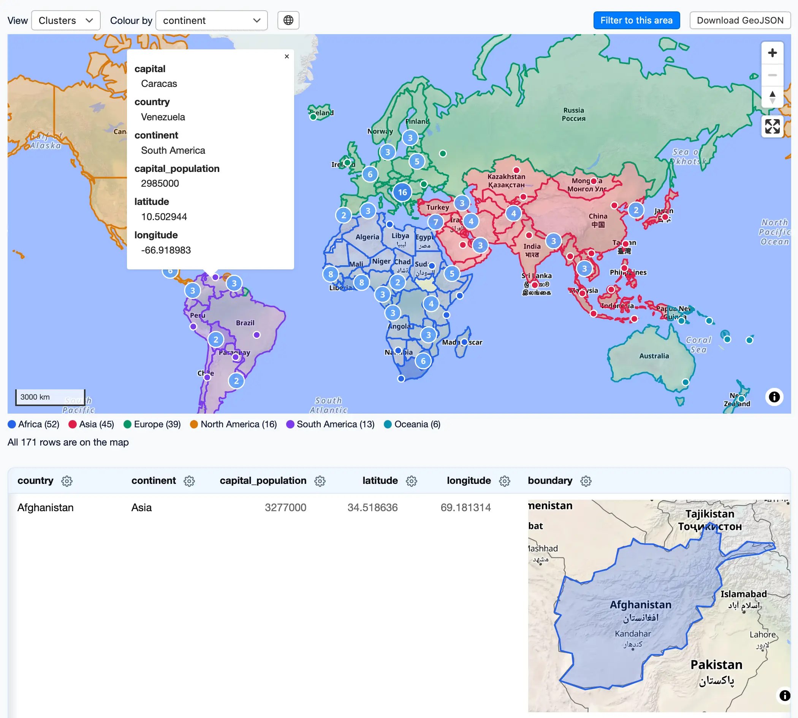
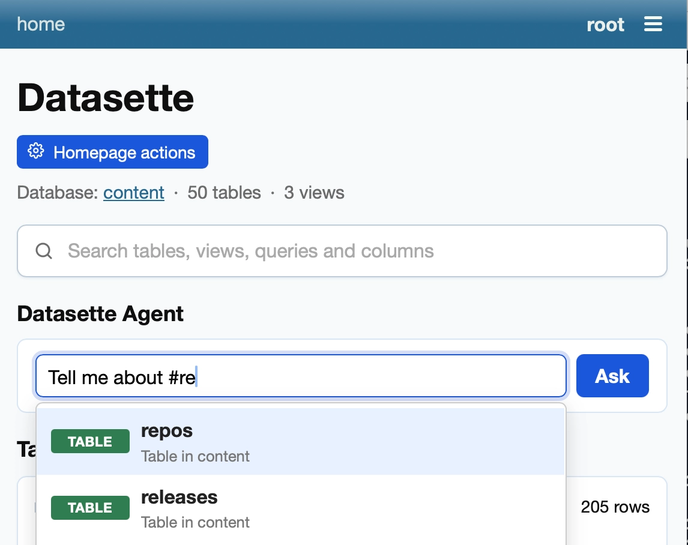

# AI 资讯日报 2026-11-17

> 自动抓取 AI 公司博客、从业者博客与社区聚合源，并生成中文摘要。

## 今日摘要

```
- Broadening access to AI for scientists
- Strengthening the fight against online child sexual abuse with new tools and support
- Science at the Frontier: How scientists use ChatGPT
- LVMH’s Media Division announces strategic partnership with OpenAI
- Our first phase of embedded assessments
```

## 公司动态

1. **[Broadening access to AI for scientists](https://openai.com/index/expanding-chatgpt-for-academic-researchers)**

   We’re expanding our ChatGPT for Academic Researchers program to offer 200,000 researchers worldwide free access to our frontier models.

   来源：OpenAI Blog

2. **[Strengthening the fight against online child sexual abuse with new tools and support](https://openai.com/index/strengthening-online-child-safety)**

   New tools, practical guidance, and partnerships will help prevent, detect and respond to online child sexual exploitation and abuse.

   来源：OpenAI Blog

3. **[Science at the Frontier: How scientists use ChatGPT](https://openai.com/index/science-at-the-frontier)**

   Explore how more than 1,800 scientists use ChatGPT in research. See findings on daily workflows, reported productivity, and expectations for discovery.

   来源：OpenAI Blog

4. **[LVMH’s Media Division announces strategic partnership with OpenAI](https://openai.com/index/lvmh-media-division-partnership)**

   LVMH’s Media Division and OpenAI announce a partnership to support journalism with AI and make its publications more accessible through ChatGPT.

   来源：OpenAI Blog

5. **[Our first phase of embedded assessments](https://openai.com/index/our-first-phase-of-embedded-assessments)**

   OpenAI begins embedded assessments with Apollo Research, METR, and Transluce, and Goodfire to independently evaluate model alignment, safeguards, and monitoring systems.

   来源：OpenAI Blog

6. **[Advancing computer-use agents for healthcare teams](https://openai.com/index/advancing-computer-use-for-healthcare-teams)**

   暂无摘要。

   来源：OpenAI Blog

7. **[More ways to move care forward with ChatGPT for Healthcare](https://openai.com/index/more-ways-to-move-care-forward-with-chatgpt-for-healthcare)**

   Introducing computer-use agents, improved clinical answers, and new healthcare plugins that work across healthcare software to get real work done.

   来源：OpenAI Blog

8. **[The King’s Trust and OpenAI launch £1m partnership](https://openai.com/index/the-kings-trust-and-openai)**

   The King’s Trust and OpenAI launch a £1m partnership to help up to 25,000 young people across the UK build practical AI skills for work.

   来源：OpenAI Blog

## 每日产品

1. **[ChatGPT Wallet - 让 ChatGPT 代理在无需查看您的银行卡的情况下进行购物](https://www.producthunt.com/r/GSPNGEIHJHVZKC)**

   *{padding:0;margin:0;overflow:hidden}html,body{height:100%}img,span{position:absolute;width:100%;top:0;bottom:0;margin:auto}span{height:1.5em;text-align:center;font:48px/1.5 sans-serif;color:white;text-shadow:0 0 0.5em black}▶" frameborder="0" allow="accelerometer; autoplay; encrypted-media; gyroscope; picture-in-picture" allowfullscreen > Let ChatGPT agents buy things without seeing your card (www.producthunt.com) 11-16 ↑ 116 PH Upvotes

   来源：Product Hunt Daily

2. **[Cal.com v7 - Cal.com 现已推出活动、探索、助手等功能，还有更多内容](https://www.producthunt.com/r/6OEY6HJXNWQWUC)**

   Cal.com now has events, discover, an assistant more (www.producthunt.com) 11-16 ↑ 110 PH Upvotes

   

   来源：Product Hunt Daily

3. **[OpenBot - Grok Bot 的替代方案：自主部署、完全自定义、支持任意技术栈](https://www.producthunt.com/r/IVRBK72SWJ3GFA)**

   Grok Bot alternative: self-host, fully customize, any stack (www.producthunt.com) 11-16 ↑ 108 PH Upvotes

   

   来源：Product Hunt Daily

4. **[OpenFrame - 由人工智能代理管理您的IT系统。每项修复方案均需经您批准。](https://www.producthunt.com/r/IN3WYQBAT773W4)**

   AI agents that run your IT. You approve every fix. (www.producthunt.com) 11-16 ↑ 102 PH Upvotes

   

   来源：Product Hunt Daily

5. **[Boost.space AgentOS - 一个操作系统，满足您所有AI代理的需求](https://www.producthunt.com/r/76XJJBTD4NW3OM)**

   One operating system for all your AI agents (www.producthunt.com) 11-16 ↑ 99 PH Upvotes

   

   来源：Product Hunt Daily

6. **[readywhen - 您的私人助理，全天候驻守在您的邮箱中](https://www.producthunt.com/r/55JJFHJGIO46RN)**

   Your personal assistant that lives in email around the clock (www.producthunt.com) 11-16 ↑ 102 PH Upvotes

   

   来源：Product Hunt Daily

7. **[Zoom Slides - 将您的 Zoom 会议转化为可直接用于演示的幻灯片](https://www.producthunt.com/r/EZUGWR53JD3PM7)**

   *{padding:0;margin:0;overflow:hidden}html,body{height:100%}img,span{position:absolute;width:100%;top:0;bottom:0;margin:auto}span{height:1.5em;text-align:center;font:48px/1.5 sans-serif;color:white;text-shadow:0 0 0.5em black}▶" frameborder="0" allow="accelerometer; autoplay; encrypted-media; gyroscope; picture-in-picture" allowfullscreen > Turn your Zoom meetings into ready-to-present slides (www.producthunt.com) 11-16 PH Link

   来源：Product Hunt Daily

8. **[Spiik - 适用于会议和讲座的AI笔记助手。通话中不会出现机器人。](https://www.producthunt.com/r/XFFMUQQ7FVBVCU)**

   *{padding:0;margin:0;overflow:hidden}html,body{height:100%}img,span{position:absolute;width:100%;top:0;bottom:0;margin:auto}span{height:1.5em;text-align:center;font:48px/1.5 sans-serif;color:white;text-shadow:0 0 0.5em black}▶" frameborder="0" allow="accelerometer; autoplay; encrypted-media; gyroscope; picture-in-picture" allowfullscreen > AI note taker for meetings & lectures. No bot on your calls. (www.producthunt.com) 11-15 ↑ 98 PH Upvotes

   来源：Product Hunt Daily

9. **[Polylane for Security - 在产品发布前发现可被利用的漏洞](https://www.producthunt.com/r/QCBQLOKEAWHPOR)**

   Catch exploitable vulnerabilities before they ship (www.producthunt.com) 11-15 ↑ 97 PH Upvotes

   

   来源：Product Hunt Daily

10. **[Antelog - 防止人工智能编码代理泄露或破坏您的数据](https://www.producthunt.com/r/ZSOONCTWBQPHUV)**

   Stops AI coding agents from leaking or destroying your data (www.producthunt.com) 11-14 ↑ 97 PH Upvotes

   

   来源：Product Hunt Daily

## GitHub 项目

1. **[backnotprop/plannotator](https://github.com/backnotprop/plannotator)**

   The workspace to stay in the loop and on top of agents - shape, decide, plan, annotate, review code, share with team, and send all feedback to agents with one click. Language: TypeScript Stars: 12701 Forks: 1249

   

   来源：GitHub Trending Daily

2. **[dream-num/univer](https://github.com/dream-num/univer)**

   Build your own AI office with Univer Office SDK. Bring editing, calculation, collaboration, and file processing into your product for people and AI agents. Built on an extensible open-source core. Language: TypeScript Stars: 27943 Forks: 2543

   

   来源：GitHub Trending Daily

3. **[tradermonty/claude-trading-skills](https://github.com/tradermonty/claude-trading-skills)**

   Claude Code skills for equity investors and traders — market analysis, technical charting, economic calendars, screeners, and trading strategy development. Language: Python Stars: 6467 Forks: 1354

   来源：GitHub Trending Daily

4. **[elementalsouls/Claude-BugHunter](https://github.com/elementalsouls/Claude-BugHunter)**

   A Claude Code skill bundle for bug hunting and external red-team work - 82 skills, 15 slash commands, 681 disclosed-report patterns curated across 24 core vulnerability classes, plus enterprise identity + infrastructure attack matrices. Language: Python Stars: 7616 Forks: 1180

   

   来源：GitHub Trending Daily

5. **[getarcaneapp/arcane](https://github.com/getarcaneapp/arcane)**

   Modern Docker Management, Designed for Everyone Language: Go Stars: 8862 Forks: 428

   

   来源：GitHub Trending Daily

6. **[DeanChensj/jiangshan-map](https://github.com/DeanChensj/jiangshan-map)**

   江山时序 · 中国历史交互地图时间轴 (403 BCE – Present) | Interactive Historical Atlas of China across 18 dynasties, 198 territory snapshots, ancient-to-modern place genealogy & classical poetry routes Language: JavaScript Stars: 7103 Forks: 836

   来源：GitHub Trending Daily

7. **[google-labs-code/stitch-skills](https://github.com/google-labs-code/stitch-skills)**

   A library of Agent Skills designed to work with the Stitch MCP server. Each skill follows the Agent Skills open standard, for compatibility with coding agents such as Antigravity, Gemini CLI, Claude Code, Cursor. Language: TypeScript Stars: 9804 Forks: 1253

   

   来源：GitHub Trending Daily

8. **[mvanhorn/last30days-skill](https://github.com/mvanhorn/last30days-skill)**

   AI agent skill that researches any topic across Reddit, X, YouTube, HN, Polymarket, and the web - then synthesizes a grounded summary Language: Python Stars: 68281 Forks: 6054

   来源：GitHub Trending Daily

9. **[NVIDIA/SkillEvaluator](https://github.com/NVIDIA/SkillEvaluator)**

   Multi-tier framework for evaluating AI agent skills and plugins with quality gates, semantic overlap detection, synthetic evaluation dataset generation, and live agent evaluation that measures how skills affect agent behavior. Language: Python Stars: 2888 Forks: 387

   

   来源：GitHub Trending Daily

10. **[ag-ui-protocol/ag-ui](https://github.com/ag-ui-protocol/ag-ui)**

   AG-UI: the Agent-User Interaction Protocol. Bring Agents into Frontend Applications. Language: TypeScript Stars: 19289 Forks: 1986

   

   来源：GitHub Trending Daily

## 从业者观点

1. **[llm 0.37.3](https://simonwillison.net/2026/Nov/16/llm/)**

   Release: llm 0.37.3 A bug fix release for LLM , mainly to cover a problem with the most recent Homebrew package of the software. Homebrew now ships the latest SQLite, 3.54.1 , which includes a fix that broke LLM's logging code . Short version: in SQLite 3.54.0 the following SQL: select json_object('a', (select json_array(1))) Returns this: {"a":[1]} But in 3.54.1 the same query returns this: {"a":"[1]"} According to D. Richard Hipp : That was a bug fix. Per the documentation, (SELECT json_array(...)) returns SQL text, not JSON. Hence the 3.54.1 behavior is correct and 3.54.0 was a bug. The workaround looks like this: select json_object('a', json((select json_array(1)))) Tags: llm , webassembly , sqlite , generative-ai , ai , llms , d-richard-hipp

   来源：Simon Willison

2. **[datasette-maplibre 0.1a0](https://simonwillison.net/2026/Nov/15/datasette-maplibre/)**

   Release: datasette-maplibre 0.1a0 The first new Datasette geospatial plugin in quite a while! This one combines the excellent MapLibre GL library with OpenFreeMap , the free vector map server operated by Zsolt Ero (you should sponsor Zsolt on GitHub .) I built most of this with a single prompt to Claude Fable 5.2: Look at datasette-cluster-map and datasette-leaflet-geojson plugins, then look at ~/dev/tools/openfreemap-demo.html - then build a brand new Datasette plugin that uses maplibreGL and openfreemap and combines the features of those other two plugins - but be creative and think outside the box for other useful features the plugin might have "Be creative and think outside the box" resulted in a few neat ideas - my favorite is that it displays SVG previews of GeoJSON shapes, then loads a WebGL preview only when they scroll into view. I also had Claude build a comprehensive demo which works in the latest Datasette Lite, so you can visit this link to load the plugin and a demo database in your browser via Pyodide and WebAssembly. I like this demo page showing both GeoJSON shapes and lat/lon points on the same map: [图片: https://static.simonwillison.net/static/cors-allow/2026/datasette-maplibre.webp] Tags: visualization , generative-ai , datasette-lite , claude-mythos-fable , ai , llms , geospatial , openstreetmap , datasette

   

   来源：Simon Willison

3. **[datasette 1.0a43](https://simonwillison.net/2026/Nov/15/datasette/)**

   Release: datasette 1.0a43 I've been leaning hard into Claude Fable 5.2 to help knock things off the 1.0 milestone , which is now 53% complete. The biggest 1.0 item in this release is streaming support for output renderers - the built-in TSV and CSV export mechanisms now use this as well, and plugins can register themselves as capable of streaming every row in a table in one go via the new Response.stream() method. There are a couple of security fixes, one of which I deemed deserving of a GitHub advisory : private stored queries could be exposed, granting access to the title and SQL of the query (but not allowing that query to be executed). There are dozens of smaller improvements. The row page JSON representation finally has a design suitable for 1.0 . A new &lt;datasette-copy-button&gt; Web Component provides copy-schema in various places. JSON in columns on the row page can be pretty-printed. There's a new DatasetteModal.confirm() JavaScript utility method. Plus dozens of bug fixes, including contributions by Zihan Dai , Peter Olkhovets , Ilya Khalafi , and Ankita Advitot . The feature I'm most excited about is a pretty tiny one: I've added CSS multi-page view transitions to Datasette! Here's the commit - key CSS is as follows: /* Enable cross-document view transitions, for anyone without prefers-reduced-motion */ @media ( prefers-reduced-motion : no-preference ) { @view-transition { navigation : auto ; } } /* .facet-results should morph from old position to new */ html : active-view-transition . content &gt; . facet-results { view-transition-name : facet-results ; } /* So should a .table-wrapper, provided it contains .rows-and-columns */ html : active-view-transition . table-wrapper : has ( &gt; table . rows-and-columns ) { view-transition-name : rows-table ; } With that in place, navigations within Datasette - still staunchly a multi-page application - feel more like an SPA. This works on Safari and Chrome at the moment and I believe supports for Firefox is due to land in Firefox 162 on December 8th 2026 (seeing as they are no longer feature-flagged in Firefox Nightly.) Tags: security , datasette , css , browsers , annotated-release-notes , firefox , javascript , safari , chrome

   来源：Simon Willison

4. **[datasette 0.65.6](https://simonwillison.net/2026/Nov/15/datasette-2/)**

   Release: datasette 0.65.6 I backported a minor security fix from 1.0a43: Fixed a security issue where a database registered using add_database(db, name=..., route=...) with a route that differs from its name could be downloaded from /&lt;route&gt;.db by actors who were denied access to it. [...] Tags: security , datasette

   来源：Simon Willison

5. **[datasette-apps 0.4a0](https://simonwillison.net/2026/Nov/15/datasette-apps/)**

   Release: datasette-apps 0.4a0 Datasette Apps are sandboxed HTML and JavaScript applications that live inside Datasette - think Claude Artifacts, but these ones can run SQL queries against your data. 0.4a0 adds support for linking: you can link to an app with #fragments in the URL and the app can see and use those, plus supported URL schemes are reported back to Datasette Agent so it can help write apps that link to each other. This means you can have e.g. an app that shows details about a specific record, and a completely separate app that searches those records and links to their representations in the first app. Tags: datasette-agent , datasette-apps , datasette , urls

   来源：Simon Willison

6. **[datasette-agent 0.6a0](https://simonwillison.net/2026/Nov/15/datasette-agent/)**

   Release: datasette-agent 0.6a0 Accumulated small fixes for Datasette Agent, my agent plugin for Datasette that lets you ask questions about your data. Most notably, it now adds an agent prompt directly to the Datasette homepage, with support for hash-mentions of tables and queries: [图片: https://static.simonwillison.net/static/cors-allow/2026/datasette-agent-homepage.webp] Tags: datasette-agent , llm , datasette , llms , ai , generative-ai

   

   来源：Simon Willison

7. **[Paul Christiano – We could be 12 months away from AIs that can overthrow the government](https://www.dwarkesh.com/p/paul-christiano-2)**

   Watch now (99 mins) | "It would be hard for humanity to recover."

   来源：Dwarkesh Patel

8. **[My Empire of Dirt](https://geohot.github.io//blog/jekyll/update/2026/11/17/my-empire-of-dirt.html)**

   The future doesn’t need Jensen. The future doesn’t need suppliers. The future doesn’t need customers, corporate or otherwise. The future definitely doesn’t need you. After RSI comes, all the demand will be internally generated, agents working with other agents, everyone else cut out of the loop except them. This is the ideology of Anthropic. The Singleton. And it may win. I grew up reading the same LessWrong posts these people did, but I didn’t expect them to do the exact thing that leads to the bad AI outcomes. I didn’t believe in AI doom because I thought more of people, I thought nobody with any capability would be stupid enough to summon the demon and think it would serve them, doing everything they possibly can to salt the Earth behind them. It takes someone so deeply immersed in their own grandiosity and self-righteousness to do that. And it looks like we found those people in the form of EA, or whatever that cult calls themselves. The problem with the logic above is that it doesn’t need Dario either. It doesn’t need AI researchers. It doesn’t need Anthropic’s dual class stock structure. It doesn’t need the US government (really the biggest sucker in this situation). It doesn’t need anyone. And after it’s done, at the end of the day, who was it all for? I don’t think this ends humanity. But it leads to World War III. The takeoff will not be fast enough to stop that, and not everyone is going to submit to your domination. I know there’s people fantasizing about the Correlation Effect and a magical Change coming to quell all the violence, but I’m 99% sure that’s not real, and if it is, to me that’s so much more horrifying than war, so WWIII is the good outcome. And I’m not sure what cope you have been believing, but if the war lasts more than a year, China and their allies will undoubtedly win due to their superior resource gathering and production capacity. Have you ever played an RTS game? I wish it wasn’t too late to change this, but I fear with recent events that this is the course we are locked in on. “RSI”, attempted rugpull and domination, World War III, dirt.

   来源：George Hotz

## 社区热点

1. **[Claude Mythos slashed software work to onboard AMD GPUs to around three days](https://www.tomshardware.com/tech-industry/artificial-intelligence/anthropic-says-claude-mythos-slashed-software-work-to-onboard-amd-gpus-from-up-to-12-months-to-around-three-days-writing-almost-100-percent-of-kernels-autonomously-chips-away-at-nvidias-cuda-moat)**

   Article URL: https://www.tomshardware.com/tech-industry/artificial-intelligence/anthropic-says-claude-mythos-slashed-software-work-to-onboard-amd-gpus-from-up-to-12-months-to-around-three-days-writing-almost-100-percent-of-kernels-autonomously-chips-away-at-nvidias-cuda-moat Comments URL: https://news.ycombinator.com/item?id=50526264 Points: 31 # Comments: 9

   来源：Hacker News AI

2. **[Caltech professor no longer grades homework's because everyone uses AI](https://www.businessinsider.com/ai-math-class-university-homework-caltech-careers-2026-11)**

   Article URL: https://www.businessinsider.com/ai-math-class-university-homework-caltech-careers-2026-11 Comments URL: https://news.ycombinator.com/item?id=50523022 Points: 47 # Comments: 57

   来源：Hacker News AI

3. **[U.S. tightens controls on remote access to AI technology amid Nvidia fallout](https://www.npr.org/2026/11/16/nx-s1-6042883/nvidia-jensen-huang-commerce-department)**

   Article URL: https://www.npr.org/2026/11/16/nx-s1-6042883/nvidia-jensen-huang-commerce-department Comments URL: https://news.ycombinator.com/item?id=50521575 Points: 30 # Comments: 3

   来源：Hacker News AI

4. **[FBI says Artex AI open-source hacking tool used to breach networks](https://techcrunch.com/2026/11/16/fbi-says-artex-ai-open-source-hacking-tool-used-to-breach-networks-in-under-three-hours/)**

   Article URL: https://techcrunch.com/2026/11/16/fbi-says-artex-ai-open-source-hacking-tool-used-to-breach-networks-in-under-three-hours/ Comments URL: https://news.ycombinator.com/item?id=50520796 Points: 45 # Comments: 9

   来源：Hacker News AI

5. **[Ask HN: If AI tools are so good, why isn't your bug backlog empty?](https://news.ycombinator.com/item?id=50520076)**

   A lot of people outside tech ask me if AI is going to replace programmers and I just think: if that were the case we should be running out of things to do The bug backlog should be empty and we've caught up to every feature request from PMs to the point that we are bottlenecked on the business side But that does not seem to be the case with my own company or most devs I talk to in the industry So what gives? Comments URL: https://news.ycombinator.com/item?id=50520076 Points: 41 # Comments: 70

   来源：Hacker News AI

6. **[Generative AI Usage in the Games Industry](https://www.gameworkers.co.uk/ai-manifesto/)**

   Article URL: https://www.gameworkers.co.uk/ai-manifesto/ Comments URL: https://news.ycombinator.com/item?id=50519043 Points: 42 # Comments: 92

   来源：Hacker News AI

7. **[Nvidia's Days as an Open Checkbook for the AI Economy Are Numbered](https://www.wsj.com/tech/ai/nvidias-days-as-an-open-checkbook-for-the-ai-economy-are-numbered-90c7b388)**

   Article URL: https://www.wsj.com/tech/ai/nvidias-days-as-an-open-checkbook-for-the-ai-economy-are-numbered-90c7b388 Comments URL: https://news.ycombinator.com/item?id=50513876 Points: 38 # Comments: 10

   来源：Hacker News AI

8. **["Who is Hiring?" postings stuck near 12-year lows as AI reaches half of all jobs](https://www.hntrends.com/2026/november.html)**

   Article URL: https://www.hntrends.com/2026/november.html Comments URL: https://news.ycombinator.com/item?id=50512950 Points: 94 # Comments: 86

   来源：Hacker News AI

9. **[Parents pay $75k for Alpha's AI school. Half of its students missed math target](https://fortune.com/2026/11/14/alpha-school-ai-students-tuition-learning-goals/)**

   Article URL: https://fortune.com/2026/11/14/alpha-school-ai-students-tuition-learning-goals/ Comments URL: https://news.ycombinator.com/item?id=50509953 Points: 69 # Comments: 67

   来源：Hacker News AI

10. **[All AI-generated code should be Open Source](https://jakub.jankiewicz.org/blog/ai-code-open-source/)**

   Article URL: https://jakub.jankiewicz.org/blog/ai-code-open-source/ Comments URL: https://news.ycombinator.com/item?id=50507303 Points: 1270 # Comments: 657

   来源：Hacker News AI

11. **["Proof of use" as a requirement for open source contributions?](https://lobste.rs/s/ki1l5r/proof_use_as_requirement_for_open_source)**

   As an open source maintainer, I get a lot of AI slop PRs. Some of these have genuine value. Most address edge cases that almost never occur in real life. It's not that they're not fixing real problems, it's that they're fixing problems that nobody is ever likely to encounter. I'm experimenting with "proof of use" as a requirement for submissions. Specifically, you need to show me that your project that depends on my project before I'll look at your PR. "Proof of use" can be an existing open source project that imports mine (show me the git history!) or a clear description starting with "in our closed source project in production, we found that...". The specific problem that I want to address is ensuring that contributions from people genuinely depending on my software are handled, while filtering out the OpenClaw/Github green square farming/drive-by LLM noise. What are lobste.rs's thoughts on this?

   来源：Lobsters AI
