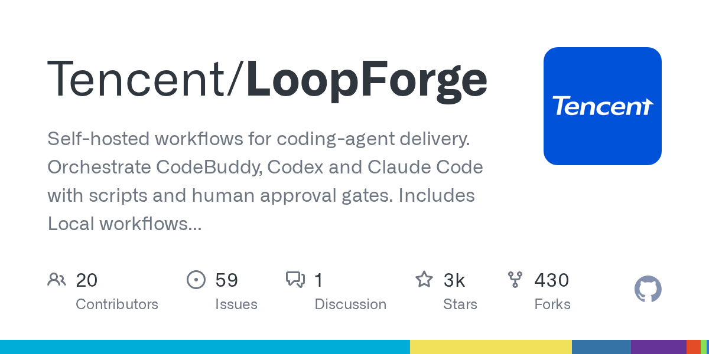
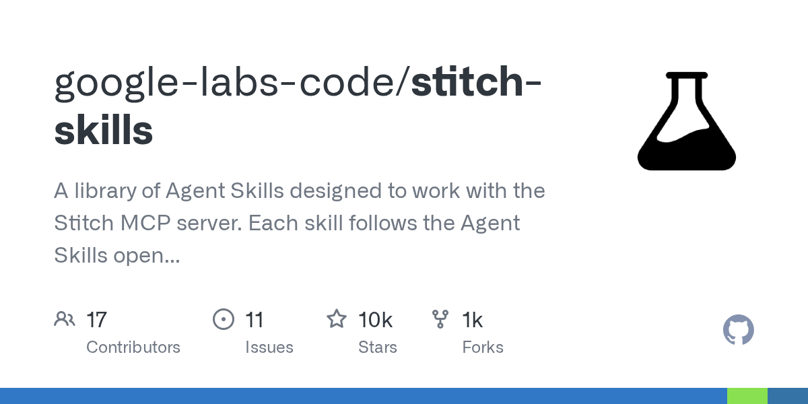
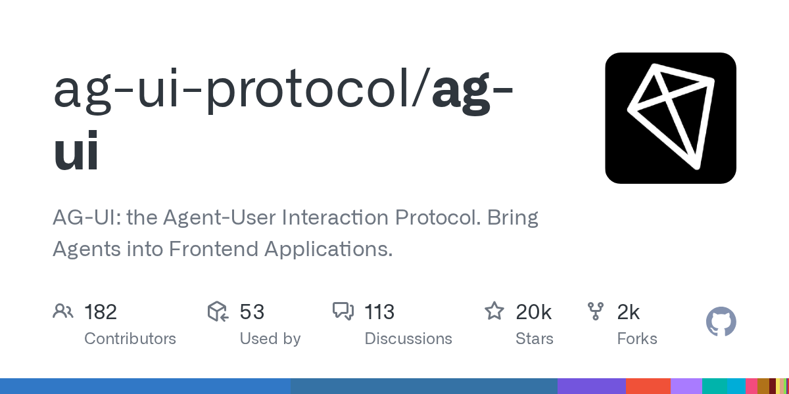
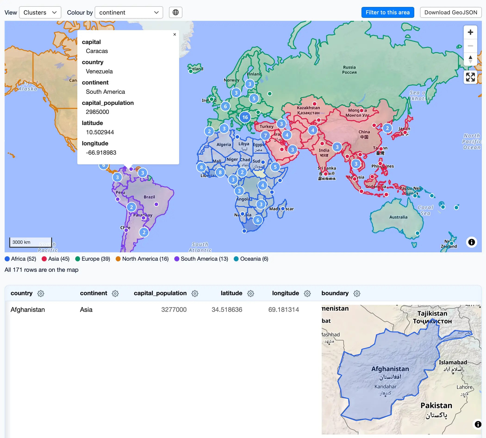

# AI 资讯日报 2026-11-18

> 自动抓取 AI 公司博客、从业者博客与社区聚合源，并生成中文摘要。

## 今日摘要

```
- Introducing GPT-6.2 Astra and Sol
- Strengthening NATO and allied cyber defenses with AI
- Introducing OpenAI for Chile
- Astra for Law leads in legal intelligence
- Broadening access to AI for scientists
```

## 公司动态

1. **[Introducing GPT-6.2 Astra and Sol](https://openai.com/index/introducing-gpt-6-2-astra-sol)**

   Introducing GPT‑6.2 Astra and Sol, with better professional outputs, coding, computer use, and efficiency at lower cost across ChatGPT Work, Codex, and the API.

   来源：OpenAI Blog

2. **[Strengthening NATO and allied cyber defenses with AI](https://openai.com/index/strengthening-nato-allied-cyber-defences-ai)**

   How OpenAI is working with NATO and allied cyber agencies to help trusted defenders find vulnerabilities, test fixes and protect essential systems.

   来源：OpenAI Blog

3. **[Introducing OpenAI for Chile](https://openai.com/index/introducing-openai-for-chile)**

   OpenAI and the Government of Chile are partnering to support responsible AI adoption, build public-sector skills and help local startups develop AI applications.

   来源：OpenAI Blog

4. **[Astra for Law leads in legal intelligence](https://openai.com/index/astra-law-6-2)**

   Astra for Law ranked first in a launch evaluation spanning 24 areas of law. Every ChatGPT Enterprise customer can now request access.

   来源：OpenAI Blog

5. **[Broadening access to AI for scientists](https://openai.com/index/expanding-chatgpt-for-academic-researchers)**

   We’re expanding our ChatGPT for Academic Researchers program to offer 200,000 researchers worldwide free access to our frontier models.

   来源：OpenAI Blog

6. **[Strengthening the fight against online child sexual abuse with new tools and support](https://openai.com/index/strengthening-online-child-safety)**

   New tools, practical guidance, and partnerships will help prevent, detect and respond to online child sexual exploitation and abuse.

   来源：OpenAI Blog

7. **[Science at the Frontier: How scientists use ChatGPT](https://openai.com/index/science-at-the-frontier)**

   Explore how more than 1,800 scientists use ChatGPT in research. See findings on daily workflows, reported productivity, and expectations for discovery.

   来源：OpenAI Blog

8. **[How Revolut raises ambition without lowering the bar](https://openai.com/business/customer-stories/revolut)**

   Discover how Revolut uses OpenAI models and Codex to cut coding time by 30–60%, scale financial crime investigations, and innovate without compromising security.

   来源：OpenAI Blog

## 每日产品

1. **[VINC - 让您的电影创作构想成为现实。](https://www.producthunt.com/r/5TFM5AL6BZDXRS)**

   Bring your filmmaking vision to life. (www.producthunt.com) 11-17 ↑ 129 PH Upvotes

   

   来源：Product Hunt Daily

2. **[EkLine - 让您的 API 被 AI 代理发现、推荐并使用](https://www.producthunt.com/r/RX3ZWI6MXJWW7K)**

   *{padding:0;margin:0;overflow:hidden}html,body{height:100%}img,span{position:absolute;width:100%;top:0;bottom:0;margin:auto}span{height:1.5em;text-align:center;font:48px/1.5 sans-serif;color:white;text-shadow:0 0 0.5em black}▶" frameborder="0" allow="accelerometer; autoplay; encrypted-media; gyroscope; picture-in-picture" allowfullscreen > Get your API discovered, recommended, and used by AI agents (www.producthunt.com) 11-17 ↑ 119 PH Upvotes

   来源：Product Hunt Daily

3. **[superlog - 发现监控系统无法察觉的生产环境漏洞](https://www.producthunt.com/r/QPAYF22JVBNIOY)**

   Finds the production bugs your monitoring never sees (www.producthunt.com) 11-17 ↑ 119 PH Upvotes

   

   来源：Product Hunt Daily

4. **[Versine - 让您的AI实现收发款功能。我们是专为经纪人打造的Venmo。](https://www.producthunt.com/r/SLJZPHAQH5CWEI)**

   *{padding:0;margin:0;overflow:hidden}html,body{height:100%}img,span{position:absolute;width:100%;top:0;bottom:0;margin:auto}span{height:1.5em;text-align:center;font:48px/1.5 sans-serif;color:white;text-shadow:0 0 0.5em black}▶" frameborder="0" allow="accelerometer; autoplay; encrypted-media; gyroscope; picture-in-picture" allowfullscreen > Let your AI send and receive money. We're Venmo for agents. (www.producthunt.com) 11-17 ↑ 117 PH Upvotes

   来源：Product Hunt Daily

5. **[Appxiom - 用于AI编码代理检测和修复错误的上下文层](https://www.producthunt.com/r/4U3S4XIEYDOCDN)**

   Context layer for AI coding agents to detect & fix bugs (www.producthunt.com) 11-17 ↑ 116 PH Upvotes

   

   来源：Product Hunt Daily

6. **[RankSpot - 面向代理商的按需付费 SEO 和 AI 搜索执行层](https://www.producthunt.com/r/ZXC3TLTUHNL3JP)**

   *{padding:0;margin:0;overflow:hidden}html,body{height:100%}img,span{position:absolute;width:100%;top:0;bottom:0;margin:auto}span{height:1.5em;text-align:center;font:48px/1.5 sans-serif;color:white;text-shadow:0 0 0.5em black}▶" frameborder="0" allow="accelerometer; autoplay; encrypted-media; gyroscope; picture-in-picture" allowfullscreen > Pay-as-you-go SEO and AI Search execution layer for agents (www.producthunt.com) 11-17 PH Link

   来源：Product Hunt Daily

7. **[Creatify Max - 您的广告合作伙伴，从策略制定到创意制作再到上线](https://www.producthunt.com/r/NWW6YNL6LTJ6TX)**

   Your ad teammate, from strategy to creation to launch (www.producthunt.com) 11-17 PH Link

   

   来源：Product Hunt Daily

8. **[TheBold - 将执行转化为与投资者的会面](https://www.producthunt.com/r/C7KPFSSB5AHOYX)**

   *{padding:0;margin:0;overflow:hidden}html,body{height:100%}img,span{position:absolute;width:100%;top:0;bottom:0;margin:auto}span{height:1.5em;text-align:center;font:48px/1.5 sans-serif;color:white;text-shadow:0 0 0.5em black}▶" frameborder="0" allow="accelerometer; autoplay; encrypted-media; gyroscope; picture-in-picture" allowfullscreen > Turn execution into meetings with investors (www.producthunt.com) 11-17 PH Link

   来源：Product Hunt Daily

9. **[StateWeave - 在所用应用程序的可运行克隆版本上测试您的 AI 代理](https://www.producthunt.com/r/BX7KYDPFK5GVAM)**

   *{padding:0;margin:0;overflow:hidden}html,body{height:100%}img,span{position:absolute;width:100%;top:0;bottom:0;margin:auto}span{height:1.5em;text-align:center;font:48px/1.5 sans-serif;color:white;text-shadow:0 0 0.5em black}▶" frameborder="0" allow="accelerometer; autoplay; encrypted-media; gyroscope; picture-in-picture" allowfullscreen > Test your AI agent on working clones of the apps it uses (www.producthunt.com) 11-16 ↑ 98 PH Upvotes

   来源：Product Hunt Daily

10. **[Trusty CSV - 像编辑代码一样编辑 CSV 文件，而不是像编辑电子表格那样](https://www.producthunt.com/r/7H2YKH2SWT6KCP)**

   Edit CSV files like code, not like a spreadsheet (www.producthunt.com) 11-16 ↑ 98 PH Upvotes

   

   来源：Product Hunt Daily

## GitHub 项目

1. **[elementalsouls/Claude-BugHunter](https://github.com/elementalsouls/Claude-BugHunter)**

   A Claude Code skill bundle for bug hunting and external red-team work - 82 skills, 15 slash commands, 681 disclosed-report patterns curated across 24 core vulnerability classes, plus enterprise identity + infrastructure attack matrices. Language: Python Stars: 8851 Forks: 1324

   

   来源：GitHub Trending Daily

2. **[mvanhorn/last30days-skill](https://github.com/mvanhorn/last30days-skill)**

   AI agent skill that researches any topic across Reddit, X, YouTube, HN, Polymarket, and the web - then synthesizes a grounded summary Language: Python Stars: 68855 Forks: 6138

   

   来源：GitHub Trending Daily

3. **[alibaba/open-code-review](https://github.com/alibaba/open-code-review)**

   Secure, fast, efficient, battle-tested at Alibaba's scale. Hybrid architecture code review tool: deterministic pipelines + LLM Agent, precise line-level comments, built-in multi-language ruleset (NPE, thread-safety, XSS, SQL injection), OpenAI & Anthropic compatible. Language: Go Stars: 53603 Forks: 4420

   

   来源：GitHub Trending Daily

4. **[Tencent/LoopForge](https://github.com/Tencent/LoopForge)**

   Self-hosted workflows for coding-agent delivery. Orchestrate CodeBuddy, Codex and Claude Code with scripts and human approval gates. Includes Local workflows for coding assistants. Language: Go Stars: 3008 Forks: 430

   

   来源：GitHub Trending Daily

5. **[dream-num/univer](https://github.com/dream-num/univer)**

   Build your own AI office with Univer Office SDK. Bring editing, calculation, collaboration, and file processing into your product for people and AI agents. Built on an extensible open-source core. Language: TypeScript Stars: 28805 Forks: 2613

   

   来源：GitHub Trending Daily

6. **[getarcaneapp/arcane](https://github.com/getarcaneapp/arcane)**

   Modern Docker Management, Designed for Everyone Language: Go Stars: 9213 Forks: 503

   

   来源：GitHub Trending Daily

7. **[google-labs-code/stitch-skills](https://github.com/google-labs-code/stitch-skills)**

   A library of Agent Skills designed to work with the Stitch MCP server. Each skill follows the Agent Skills open standard, for compatibility with coding agents such as Antigravity, Gemini CLI, Claude Code, Cursor. Language: TypeScript Stars: 10022 Forks: 1322

   

   来源：GitHub Trending Daily

8. **[cursor/plugins](https://github.com/cursor/plugins)**

   Cursor plugin specification and official plugins Language: TypeScript Stars: 16836 Forks: 1825

   

   来源：GitHub Trending Daily

9. **[obra/superpowers](https://github.com/obra/superpowers)**

   An agentic skills framework & software development methodology that works. Language: Shell Stars: 319187 Forks: 28459

   来源：GitHub Trending Daily

10. **[ag-ui-protocol/ag-ui](https://github.com/ag-ui-protocol/ag-ui)**

   AG-UI: the Agent-User Interaction Protocol. Bring Agents into Frontend Applications. Language: TypeScript Stars: 19906 Forks: 2062

   

   来源：GitHub Trending Daily

## 从业者观点

1. **[Running the full server-side Datasette Python app in the browser with service workers and Pyodide](https://simonwillison.net/2026/Nov/17/datasette-lite/)**

   Datasette Lite is my port of the Datasette Python application to run directly in the browser using WebAssembly and Pyodide . I've released a complete rewrite of Datasette Lite using service workers, and it's now almost indistinguishable from the real server-side application. You can now do all of the following, using a carefully crafted URL to lite.datasette.io : Load client-side Datasette to browse any SQLite database, JSON file, CSV file or SQL script Select a released version of Datasette to load from PyPI Load a specific commit, tag, or branch name from the Datasette GitHub repository Pick from over 100 versions of SQLite to use with Datasette Install additional Datasette plugins from PyPI or URLs to wheel files, including JavaScript visualization tools The ability to load specific Datasette references, plugins, and SQLite versions makes this a fantastic tool for linking to demos of work-in-progress features or bug reproductions, without needing to spin up a full web server to serve that demo. As an example, consider the following URL: https://lite.datasette.io/?install=datasette-maplibre&amp;url=https://gist.githubusercontent.com/simonw/39fa5d399465766039549912e2b3d291/raw/f6dfba99a75cbb8b5d9386223220eb52272767ee/demo.db&amp;metadata=https://gist.githubusercontent.com/simonw/39fa5d399465766039549912e2b3d291/raw/f6dfba99a75cbb8b5d9386223220eb52272767ee/metadata.yml#/demo/capitals_and_countries%23map=0/4.2/180&amp;color=continent Follow that link and, after a short loading screen, you'll find yourself on a page that looks like this: [图片: Screenshot of a web map interface. Toolbar: &quot;View&quot; set to &quot;Clusters&quot;, &quot;Colour by&quot; set to &quot;continent&quot;, plus &quot;Filter to this area&quot; and &quot;Download GeoJSON&quot; buttons. A world map shows countries outlined and shaded by continent, with coloured dots and numbered cluster circles. A popup for a point in South America reads: capital Caracas, country Venezuela, continent South America, capital_population 2985000, latitude 10.502944, longitude -66.918983. Legend: Africa (52), Asia (45), Europe (39), North America (16), South America (13), Oceania (6). Text: &quot;All 171 rows are on the map&quot;. Below, a table with columns country, continent, capital_population, latitude, longitude, boundary. First row: Afghanistan, Asia, 3277000, 34.518636, 69.181314, with a small map in the boundary column showing Afghanistan outlined and shaded in blue. https://static.simonwillison.net/static/cors-allow/2026/datasette-maplibre.webp] That's Datasette running the new datasette-maplibre plugin, loading up a database of GeoJSON shapes of countries and displaying both a combined map and individual boundary maps in a table. Let's break down that URL to see what it's doing: https://lite.datasette.io/ ?install=datasette-maplibre &amp;url=https://.../demo.db &amp;metadata=https://.../metadata.yml #/demo/capitals_and_countries%23map=0/4.2/180&amp;color=continent The ?install=datasette-maplibre installs that additional plugin from PyPI. You can pass &amp;install=... as many times as you like to load more plugins. &amp;url=https://.../demo.db loads that SQLite database from the provided URL. These URLs need to have open CORS headers - I host files like this in Gists , because they provide an easy way to get open CORS headers on a web-hosted file. &amp;metadata=https://.../metadata.yml loads this metadata.yml file . The metadata file adds HTML descriptions to various tables, and to the Datasette homepage. Visit that homepage here for a guided tour of the other features of that plugin, all defined in the metadata file. #/demo/capitals_and_countries%23map=0/4.2/180&amp;color=continent is a fragment hash that turns into a location within Datasette - here it's loading the /demo/capitals_and_countries SQL view, then appending another fragment hash to it ( %23 is a URL-encoded # ) which tells the map plugin to zoom to a certain location and to set the color of the shapes on the map based on the continent column in the data. That URL is doing a lot of work! I wrote more about this trick for building URL-addressable software in URL-addressable Pyodide Python environments last year. The full set of supported URL arguments is described in the Datasette Lite README . I've already started using Datasette Lite as part of the Datasette development process. Here's a recent issue describing a pagination bug - I posted a comment there demonstrating the old, broken behavior and the new fix using links to Datasette Lite: Demo of the bug: https://lite.datasette.io/?ref=1.0a42&amp;sql=https://gist.github.com/simonw/75ececf61d50e6e8d50f0c150150ee81#/data/scores?_size=2&amp;_sort=score - click next and the second page is empty. Here's that same page with the bug fixed (running on 1.0a43): https://lite.datasette.io/?ref=1.0a43&amp;sql=https://gist.github.com/simonw/75ececf61d50e6e8d50f0c150150ee81#/data/scores?_size=2&amp;_sort=score How this works, using service workers Datasette Lite is not a new project. I launched the first version back in 2022 , originally as a bit of a joke (running server-side apps in the browser is pretty funny) but one that quickly started proving its value. The problem with that initial version is that it was a hack . It worked by running Datasette in a Pyodide web worker, simulating requests through that stack, then injecting the resulting HTML back into the top level page using innerHTML . This worked for basic Datasette, but meant that any feature that used JavaScript failed to work, because script tags in innerHTML don't execute, and the web worker tricks it used failed to load additional JavaScript or CSS files. The new version takes a completely different approach based on Service Workers . These allow JavaScript to intercept HTTP requests for new pages and resources and serve them from client-side code instead. Datasette Lite registers a service worker for the entire lite.datasette.io domain. The parent page then creates an iframe that sends requests for Datasette pages to URLs that look like this: /app/aa94e6851595/ # the homepage (HTML) /app/aa94e6851595/data/places # a table page (HTML) /app/aa94e6851595/-/static/navigation-search.js # (JavaScript) /app/aa94e6851595/-/static/app.css # (CSS) Those are regular Datasette URLs, but with a /app/aa94e6851595/ prefix. What's that about? The /app/&lt;session&gt;/ prefix is necessary because of multiple tabs. Consider the URL above, which loads the demo instance with the datasette-maplibre plugin. That URL defines a full, custom Datasette instance. You might have that one running in a tab, then one of my other demo links running in another. The service worker for lite.datasette.io is shared between all of those tabs. If it routed to a single instance of Datasette then every tab would share that underlying instance, no matter what plugins or other settings their URL attempted to configure. Instead, the parent page generates a random session ID and uses it as a prefix for all of the subsequent hidden asset and page loads. The service worker can then use that session ID to route those requests back through the parent page to a web worker running a dedicated Datasette instance for that particular session. (We still need a web worker because Pyodide in a service worker would not be able to maintain state beyond around 30 seconds, depending on the browser. There are a lot of moving parts here!) I had Claude Fable 5.2 generate several SVG diagrams to help explain this. Here's my favorite of those, now embedded in the Datasette Lite README: [图片: Architecture diagram titled &quot;What happens when you click a link in Datasette Lite&quot;, with a legend showing a solid arrow for &quot;request&quot; and a dashed arrow for &quot;response&quot;. A blue box labeled &quot;index.html: the page you opened - Each tab picks a random session and starts one Web Worker.&quot; contains two white boxes: &quot;iframe Datasette pages at /app/session/…&quot; and &quot;shell.js the page's own script: relays&quot;. Below it is a yellow box labeled &quot;sw.js: the service worker - Intercepts requests for /app/session/….&quot; To the right is a green box marked 4 and labeled &quot;webworker.js: a Web Worker - Pyodide: Python in WebAssembly&quot; containing three stacked white boxes: &quot;ASGI bridge + cookie jar&quot;, &quot;Datasette ASGI app&quot; and &quot;SQLite databases&quot;. Numbered arrows connect them: solid arrow 1 from the iframe down to sw.js, solid arrow 2 from sw.js up to shell.js, solid arrow 3 from shell.js across to the Web Worker, dashed arrow 5 from the Web Worker back to shell.js, dashed arrow 6 from shell.js down to sw.js, and dashed arrow 7 from sw.js up to the iframe. A numbered key at the bottom reads: 1 The page requests /app/session/fixtures. 2 sw.js intercepts it and posts it to the owning tab. 3 shell.js forwards it to the Web Worker. 4 Python adds cookies and calls Datasette, which queries SQLite. 5 The status, headers and body return to the page, 6 then to sw.js over a MessagePort, 7 which hands the browser a Response. The iframe renders it. https://static.simonwillison.net/static/2026/datasette-lite-diag.webp] This system started life back in May as an AI research spike generated using Claude Opus 4.8. It wasn't until November (and Claude Fable 5.2) that I felt familiar enough with how it all works to confidently ship it to production! Bonus feature: pick your version of SQLite I added this feature last night as an off-shoot of investigating a potential bug in SQLite . Datasette is meant to work against any released version of SQLite since 3.25 (released in September 2018). There have been 87 further releases since then. Being able to fire up Datasette against a specific version of SQLite is really useful for demonstrating new SQLite features and debugging weird issues. In the past I've used various tricks to get different SQLite versions running with Python on my Mac, but it's not a trivial process. WebAssembly is perfect for this. I can load up a custom SQLite build entirely in my browser, test it there, then discard it when I close my tab. datasette/pysqlite3-wasm-wheels is my new repository which contains WebAssembly compiled Python wheels for pysqlite3 for 163 different SQLite versions. Each version gets a file with a name like this: pysqlite3-0.6.2-3.54.1-cp314-cp314-pyemscripten_2026_0_wasm32.whl That's for SQLite 3.54.1, the most recent version. Datasette Lite now takes a special ?sqlite= URL parameter, which will accept a version number like 3.54.1 , resolve the path to the corresponding wheel file, then fetch that wheel and install it into the Pyodide environment and configure Datasette to use it. Once I'd built the wheels, I decided to have Claude Fable 5.2 build me [this bonus tool]( https://datasette.github.io/pysqlite3-wasm-wheels/?versions=3.54.1,3.54.0&amp;sql=select+json_object(%27a%27%2C+(select+json_array(1%29%29%29) for comparing a SQL query across any selected versions of SQLite. Here's an example showing how select json_object('a', (select json_array(1))) differs between SQLite 3.54.0 and 3.54.1: [图片: Screenshot of a web tool for comparing SQL across SQLite versions. Heading &quot;SQLite versions (163 available)&quot; sits above a filter text input with placeholder &quot;Filter, e.g. 3.4&quot;, a &quot;Clear selection&quot; button and a blue &quot;Start REPL with 2 versions&quot; button. Below is a scrollable grid of pill-shaped checkboxes, one per version, running from 3.54.1 down past 3.30.0, with 3.54.1 and 3.54.0 checked. A &quot;REPL&quot; heading follows, with two green status badges reading &quot;3.54.1 ready&quot; and &quot;3.54.0 ready&quot;, then a textarea containing &quot;select json_object('a', (select json_array(1)))&quot; beside a blue &quot;Run&quot; button, and a row of clickable example queries labeled &quot;Examples:&quot;. The output section shows the prompt &quot;sqlite&gt; select json_object('a', (select json_array(1)))&quot; followed by an orange warning &quot;Versions differ: 2 different results&quot; and two side-by-side yellow result panels, each with the query as its column header. The &quot;SQLite 3.54.1&quot; panel returns a JSON object where key &quot;a&quot; has a string value: the array containing 1, wrapped in double quotes. The &quot;SQLite 3.54.0&quot; panel returns a JSON object where key &quot;a&quot; has an actual array containing 1, with no quotes around it. https://static.simonwillison.net/static/2026/compare-sqlite.webp] This should work for every other Python app, too Nothing about how Datasette Lite works is unique to Datasette. Almost any Python application should be able to pull the same trick - running entirely in the browser using WebAssembly and Pyodide, as a cheap way to provide preview environments, demonstrate features, and recreate bugs. C and Rust extensions used to be a blocker for this kind of thing, but any good coding agent can compile those to Pyodide-compatible WebAssembly now. You can even publish them to PyPI as of PEP 783 in April 2026. One catch is databases. SQLite is no problem at all, but running PostgreSQL or MySQL in WebAssembly, while possible, is still a path less trodden. I'd love to see WebAssembly preview environments like these become a common pattern across the Python ecosystem. For Hacker News: Full server-side Datasette Python app in the browser with service workers Tags: javascript , projects , python , urls , datasette , webassembly , service-workers , pyodide , datasette-lite

   

   来源：Simon Willison

2. **[Quoting Go Proverbs](https://simonwillison.net/2026/Nov/17/go-proverbs/)**

   A little copying is better than a little dependency. &mdash; Go Proverbs , via Tags: go , programming

   来源：Simon Willison

3. **[llm 0.37.3](https://simonwillison.net/2026/Nov/16/llm/)**

   Release: llm 0.37.3 A bug fix release for LLM , mainly to cover a problem with the most recent Homebrew package of the software. Homebrew now ships the latest SQLite, 3.54.1 , which includes a fix that broke LLM's logging code . Short version: in SQLite 3.54.0 the following SQL: select json_object('a', (select json_array(1))) Returns this: {"a":[1]} But in 3.54.1 the same query returns this: {"a":"[1]"} According to D. Richard Hipp : That was a bug fix. Per the documentation, (SELECT json_array(...)) returns SQL text, not JSON. Hence the 3.54.1 behavior is correct and 3.54.0 was a bug. The workaround looks like this: select json_object('a', json((select json_array(1)))) Tags: llm , webassembly , sqlite , generative-ai , ai , llms , d-richard-hipp

   来源：Simon Willison

4. **[datasette-maplibre 0.1a0](https://simonwillison.net/2026/Nov/15/datasette-maplibre/)**

   Release: datasette-maplibre 0.1a0 The first new Datasette geospatial plugin in quite a while! This one combines the excellent MapLibre GL library with OpenFreeMap , the free vector map server operated by Zsolt Ero (you should sponsor Zsolt on GitHub .) I built most of this with a single prompt to Claude Fable 5.2: Look at datasette-cluster-map and datasette-leaflet-geojson plugins, then look at ~/dev/tools/openfreemap-demo.html - then build a brand new Datasette plugin that uses maplibreGL and openfreemap and combines the features of those other two plugins - but be creative and think outside the box for other useful features the plugin might have "Be creative and think outside the box" resulted in a few neat ideas - my favorite is that it displays SVG previews of GeoJSON shapes, then loads a WebGL preview only when they scroll into view. I also had Claude build a comprehensive demo which works in the latest Datasette Lite, so you can visit this link to load the plugin and a demo database in your browser via Pyodide and WebAssembly. I like this demo page showing both GeoJSON shapes and lat/lon points on the same map: [图片: https://static.simonwillison.net/static/cors-allow/2026/datasette-maplibre.webp] Tags: visualization , generative-ai , datasette-lite , claude-mythos-fable , ai , llms , geospatial , openstreetmap , datasette

   

   来源：Simon Willison

5. **[datasette 1.0a43](https://simonwillison.net/2026/Nov/15/datasette/)**

   Release: datasette 1.0a43 I've been leaning hard into Claude Fable 5.2 to help knock things off the 1.0 milestone , which is now 53% complete. The biggest 1.0 item in this release is streaming support for output renderers - the built-in TSV and CSV export mechanisms now use this as well, and plugins can register themselves as capable of streaming every row in a table in one go via the new Response.stream() method. There are a couple of security fixes, one of which I deemed deserving of a GitHub advisory : private stored queries could be exposed, granting access to the title and SQL of the query (but not allowing that query to be executed). There are dozens of smaller improvements. The row page JSON representation finally has a design suitable for 1.0 . A new &lt;datasette-copy-button&gt; Web Component provides copy-schema in various places. JSON in columns on the row page can be pretty-printed. There's a new DatasetteModal.confirm() JavaScript utility method. Plus dozens of bug fixes, including contributions by Zihan Dai , Peter Olkhovets , Ilya Khalafi , and Ankita Advitot . The feature I'm most excited about is a pretty tiny one: I've added CSS multi-page view transitions to Datasette! Here's the commit - key CSS is as follows: /* Enable cross-document view transitions, for anyone without prefers-reduced-motion */ @media ( prefers-reduced-motion : no-preference ) { @view-transition { navigation : auto ; } } /* .facet-results should morph from old position to new */ html : active-view-transition . content &gt; . facet-results { view-transition-name : facet-results ; } /* So should a .table-wrapper, provided it contains .rows-and-columns */ html : active-view-transition . table-wrapper : has ( &gt; table . rows-and-columns ) { view-transition-name : rows-table ; } With that in place, navigations within Datasette - still staunchly a multi-page application - feel more like an SPA. This works on Safari and Chrome at the moment and I believe supports for Firefox is due to land in Firefox 162 on December 8th 2026 (seeing as they are no longer feature-flagged in Firefox Nightly.) Tags: security , datasette , css , browsers , annotated-release-notes , firefox , javascript , safari , chrome

   来源：Simon Willison

6. **[datasette 0.65.6](https://simonwillison.net/2026/Nov/15/datasette-2/)**

   Release: datasette 0.65.6 I backported a minor security fix from 1.0a43: Fixed a security issue where a database registered using add_database(db, name=..., route=...) with a route that differs from its name could be downloaded from /&lt;route&gt;.db by actors who were denied access to it. [...] Tags: security , datasette

   来源：Simon Willison

7. **[Paul Christiano – We could be 12 months away from AIs that can overthrow the government](https://www.dwarkesh.com/p/paul-christiano-2)**

   Watch now (99 mins) | "It would be hard for humanity to recover."

   来源：Dwarkesh Patel

8. **[My Empire of Dirt](https://geohot.github.io//blog/jekyll/update/2026/11/17/my-empire-of-dirt.html)**

   The future doesn’t need Jensen. The future doesn’t need suppliers. The future doesn’t need customers, corporate or otherwise. The future definitely doesn’t need you. After RSI comes, all the demand will be internally generated, agents working with other agents, everyone else cut out of the loop except them. This is the ideology of Anthropic. The Singleton. And it may win. I grew up reading the same LessWrong posts these people did, but I didn’t expect them to do the exact thing that leads to the bad AI outcomes. I didn’t believe in AI doom because I thought more of people, I thought nobody with any capability would be stupid enough to summon the demon and think it would serve them, doing everything they possibly can to salt the Earth behind them. It takes someone so deeply immersed in their own grandiosity and self-righteousness to do that. And it looks like we found those people in the form of EA, or whatever that cult calls themselves. The problem with the logic above is that it doesn’t need Dario either. It doesn’t need AI researchers. It doesn’t need Anthropic’s dual class stock structure. It doesn’t need the US government (really the biggest sucker in this situation). It doesn’t need anyone. And after it’s done, at the end of the day, who was it all for? I don’t think this ends humanity. But it leads to World War III. The takeoff will not be fast enough to stop that, and not everyone is going to submit to your domination. I know there’s people fantasizing about the Correlation Effect and a magical Change coming to quell all the violence, but I’m 99% sure that’s not real, and if it is, to me that’s so much more horrifying than war, so WWIII is the good outcome. And I’m not sure what cope you have been believing, but if the war lasts more than a year, China and their allies will undoubtedly win due to their superior resource gathering and production capacity. Have you ever played an RTS game? I wish it wasn’t too late to change this, but I fear with recent events that this is the course we are locked in on. “RSI”, attempted rugpull and domination, World War III, dirt.

   来源：George Hotz

## 社区热点

1. **[Program-as-Weights: A Programming Paradigm for Fuzzy Functions](https://arxiv.org/abs/2607.02512)**

   Comments

   来源：Lobsters AI

2. **["Proof of use" as a requirement for open source contributions?](https://lobste.rs/s/ki1l5r/proof_use_as_requirement_for_open_source)**

   As an open source maintainer, I get a lot of AI slop PRs. Some of these have genuine value. Most address edge cases that almost never occur in real life. It's not that they're not fixing real problems, it's that they're fixing problems that nobody is ever likely to encounter. I'm experimenting with "proof of use" as a requirement for submissions. Specifically, you need to show me that your project that depends on my project before I'll look at your PR. "Proof of use" can be an existing open source project that imports mine (show me the git history!) or a clear description starting with "in our closed source project in production, we found that...". The specific problem that I want to address is ensuring that contributions from people genuinely depending on my software are handled, while filtering out the OpenClaw/Github green square farming/drive-by LLM noise. What are lobste.rs's thoughts on this?

   来源：Lobsters AI

## 论文与模型

1. **[Sage S2.1 Flash Technical Report](https://arxiv.org/abs/2611.21072)**

   We introduce Sage S1.5 Flash, a 320-billion-parameter general-purpose mixture-of-experts model designed to reason over scientific evidence and act in interactive environments. Sage Sci-Perception uses dedicated encoders for molecular graphs and biological sequences and represents spectra as ordered patches of measurements. Modality-specific projectors map these representations into the input space of a shared backbone, which processes them alongside text and images. To develop the model's agent capabilities, we construct verifiable environments for tool use, search, and coding, as well as specialized workflows involving machine learning experiments and scientific software. Task completion is checked against execution results, changes in environment state, or submitted artifacts. We evaluate Sage S1.5 Flash on 33 benchmarks across seven domains. In the primary comparison against five baselines, it ranks first on OfficeQA Pro (72.2), MLE-bench Lite (90.3 HumanRank), Harvey LAB, and SpreadsheetBench~2, and second on OSWorld-Verified (85.2), WebArena-Verified (67.6), and DeepResearch Bench~II (54.2). These results show particular strengths in using documentary evidence, producing verifiable workbooks, and carrying out machine learning tasks, alongside competitive performance in desktop and browser workflows that require the model to act on visual feedback.

   来源：HuggingFace Papers

2. **[K2-Horizon: A Frontier Fleet of Open Source Language Models](https://arxiv.org/abs/2611.21003)**

   We present K2-Horizon, a fleet of six fully open language models, from a 0.9B dense model to a 375B-A23B MoE, built for general-purpose reasoning and agentic work across math and science, software engineering, deep research, office automation, and beyond. The models lead or are competitive with strong open models of their size on agentic and coding benchmarks. On the modeling side, to strengthen reasoning, we introduce Mixture-of-Value Attention (MoVA), applying MoE to attention value projections, and softplus attention gating, a more flexible, theoretically motivated gate. Our 36B-A4B model uses both and nearly matches a 32B dense model trained on the same data, with one-seventh the active parameters. We also introduce Uno, lossless diffusion adapters that speed up decoding by up to 2.2x without a separate draft model. Our release follows the LLM360 definition of open source for transparency and reproducibility: the full development history, including intermediate checkpoints from every training stage, pre-training data, training logs, and all training, evaluation, and infrastructure code, notably our production-scale xLLM framework for dense and MoE training and the RL360 reinforcement-learning stack. Beyond the data itself, we release and document in detail every pipeline that built it, the part of model development that open releases most rarely disclose. These pipelines produced roughly 10T synthetic pre-training tokens, showing that synthetic data can be a major ingredient of pre-training at scale. Four of the models share one 22T-token pre-training corpus and recipe, revealing consistent scaling behavior and enabling controlled studies of scale and sparsity. All artifacts are available at https://ifm.ai/k2/

   来源：HuggingFace Papers

3. **[InclusionMed: Benchmarking AI for Inclusive Healthcare](https://arxiv.org/abs/2611.21218)**

   Advancing medical AI for inclusive healthcare requires evaluation across diverse healthcare roles, tasks, and care settings, but benchmark coverage remains uneven. We introduce InclusionMed, an open medical AI evaluation initiative for inclusive healthcare. The InclusionMed Atlas organizes benchmarks across three healthcare roles and three AI capabilities. For the first release, we selected four public benchmarks from 388 candidates through structured audits and independent reproduction. With InclusionMed-DxFiles, our private diagnostic reasoning benchmark, the Atlas contains five benchmarks covering three of its nine role--capability cells. We evaluated frontier large language models on the Atlas and aggregated their results into the InclusionMed Index, with overall scores ranging from 17.5 to 49.1 out of 100. The Index also reports scores by healthcare role and AI capability, showing that a model's rank varied with the role or capability considered. A within-benchmark analysis using task-level tags showed that the ten highest-ranked models in the Index all scored higher on patient communication than on clinical decision-making. Models with similar Index scores also differed substantially in estimated inference cost. These findings highlight the need for evaluation covering more diverse healthcare needs and for context-specific model selection. Through open collaboration and community contributions, InclusionMed seeks to ensure that diverse healthcare needs worldwide shape how medical AI progress is defined and measured.

   来源：HuggingFace Papers

4. **[ScaleVLA: Scaling Vision-Language-Action Models to 552 Billion Parameters](https://arxiv.org/abs/2611.21607)**

   Frontier Vision-Language Models (VLMs) such as GPT-6 Astra have demonstrated remarkable capabilities in robot control, suggesting that broad pretraining provides knowledge valuable for physical action. Yet most Vision-Language-Action (VLA) policies still rely on much smaller VLM backbones, leaving this potential largely untapped. We ask whether frontier-scale representations can provide a stronger foundation for robot learning. We introduce ScaleVLA, which connects a 552B DeepSeek-V4.1-Flash backbone to a trainable action DiT, and systematically compare VLMs from 2B to 552B under a shared training setup. We evaluate three fundamental capabilities of robot foundation models. In sample efficiency, just 10 demonstrations outperform a 2B backbone trained with 50 (87.8% vs. 85.6%). In generalization, LIBERO-PRO success reaches 45.1%, compared with at most 31.3% for smaller backbones. In precise manipulation, real-world charger insertion improves from 4/10 to 9/10 successes, with gains concentrated in contact-sensitive alignment. Despite its scale, ScaleVLA achieves 216 ms median latency per action chunk. Our findings suggest that frontier VLMs can serve not only as reasoning agents, but also as powerful representational foundations for efficient and generalizable robot policies.

   来源：HuggingFace Papers

5. **[Accelerate Bench: Evaluating Agents for Application-Level Program Optimization](https://arxiv.org/abs/2611.20882)**

   Application optimization requires coding agents to discover useful changes and coordinate them across a complete program while preserving the required computation. We introduce Accelerate Bench, a benchmark of 32 CPU optimization tasks adapted from scientific applications and supercomputing competitions. Each task provides a working program and specifies the workload, correctness requirements, timing boundaries, and permitted edits, leaving agents to choose where and how to optimize. Public testing supports iterative development, and a separate verifier scores the final submission. On benchmark version 1.1, we evaluate 16 coding agents, each pairing a model with a harness. Their Score@1 ranges from 25.5% to 67.4%. Most of their programs are correct, and the size of the speedup separates them: the two leading agents are at least 2x faster on 22 or more of the 32 tasks, while the other fourteen reach 2x on 8 to 17 and leave 125 of their 412 correct outcomes below 1.25x. Controlled replays show why coordination across an application matters: identical source code runs between 0.29x and 2.12x depending only on build and runtime settings, and one code change is worth 1.01x or 6.4x depending on another. Accelerate Bench pairs executable workloads with agents' programs and trajectories to evaluate both their gains and the process behind them.

   来源：HuggingFace Papers

6. **[Calpha: Toward Native Biomolecular Intelligence in a General-Purpose Language Model](https://arxiv.org/abs/2611.20986)**

   Biomolecular foundation models predict the structures of proteins and their complexes accurately, and large language models (LLMs) reason in natural language, but the two remain separate: the abilities of the former are not part of a general-purpose LLM, and the reasoning of the latter does not enter a structure prediction. Calpha aims at one general model that folds proteins and complexes, understands protein sequence and structure, and lets its language reasoning influence the structures it predicts. This report covers the first step, in which an LLM outputs single-chain protein structures. Qwen3.5-9B reads a sequence enriched with ESM2 residue features. It can respond in text or emit a token that invokes a pretrained SimpleFold structure head, which receives information about the protein only through Qwen's residue states. Under a fixed folding request, the head achieves mean TM-scores of 0.808 on the FoldBench-334 development set, 0.635 on CASP16 domains and 0.900 on a CAMEO-style PDB set. We compare these predictions with a baseline in which ESM2-3B encodes the sequence and a fine-tuned SimpleFold-3B head predicts the coordinates. The two systems also differ in trainable weights, training duration and crop length. For chains of 100--299 residues, all three paired confidence intervals include zero. At 300--600 residues, the mean differences are -0.044, -0.160 and -0.025, respectively. In a separate test, four English request types triggered folding on every evaluated example. Protein training reduced accuracy on a 350-item MMLU-Pro subset from 77.4% to 70.3%. An LLM can therefore output single-chain structures from its own states, with lower long-chain scores in the current comparisons and reduced accuracy on the evaluated MMLU-Pro subset. Complex prediction, structure understanding and the effect of language reasoning on the predicted coordinates remain future work.

   来源：HuggingFace Papers

7. **[MovieRoll: A Systematic Framework for Rolling Out Long-Form Videos](https://arxiv.org/abs/2611.21339)**

   Streaming video generation must sustain quality beyond the training horizon while handling self-generated history and growing cache costs. To address these challenges, we present MovieRoll, a base-to-distilled framework that connects streaming fine-tuning, long-rollout distillation, and long-horizon inference. We first establish a robust multi-step base through Window-wise Teacher Forcing (WinTF), which jointly denoises chunks at progressive noise levels with bidirectional attention within each window and causal access to preceding history. To retain historical context efficiently, hierarchical KV-cache compression (HieraKV) exploits layer-wise attention patterns, retaining full history in shallow layers and sink--recent history in deeper layers. This reduces cache memory by up to 78% while improving generation quality. Building on this base, cumulative long tuning with distribution matching distillation (CuLT-DMD) holds parameters fixed throughout each long self-rollout and averages local gradients before updating. Each update therefore combines supervision across temporal positions while retaining only one local computation graph, enabling efficient long-rollout training of a few-step generator. To extend generation beyond the training horizon, KV recomputation bounds context for both models, while guidance annealing (AnnealCFG) reduces guidance toward the clean endpoint to stabilize MovieRoll-Base. Complementing these modeling advances, FBCA attention and PS-VAE decoding support efficient training and streaming output. On HeliosBench, MovieRoll-Base remains competitive at 30s after training on videos of up to 15s, and MovieRoll-Distilled achieves the highest total scores among the compared methods across single- and multi-event evaluations up to 60s, combining sustained naturalness with active motion.

   来源：HuggingFace Papers

8. **[Latent Feedback Is a Compute and Data Amplifier](https://arxiv.org/abs/2611.20404)**

   When high-quality data runs out, a common practice is to train on it for several epochs, but each repeat is worth less than the last. Latent feedback, which feeds each token's top-layer state into the next token's input, is another way to spend that compute, yet it has not been tested against a vanilla Transformer that spends the same compute on more epochs. We run this test across a ladder of model sizes, unique data and epochs, tuning both models at every size and amount of unique data. Latent feedback makes every FLOP and every token count for more except when unique data is scarce relative to model size, a regime that today's models are far from. We find that latent feedback serves as an amplifier: with unique data fixed, it reaches a Transformer's loss with less compute; with epochs fixed, it reaches that loss with less unique data. Furthermore, both savings grow with unique data per parameter and with repetition, and downstream tasks agree. To go beyond our grid, we fit one scaling law to both models, in which latent feedback enters as a Transformer with more parameters; it predicts that both savings keep growing with unique data and repetition. Fitted on models from 60M to 271M parameters, the law predicts the losses at a held-out 778M size to within 0.3% and the gap between the two models to within 0.05%. At most, latent feedback saves 48% of the compute and 47% of the unique data. When data, not compute, is the limit, latent feedback is the better use of a FLOP for a model of a given size.

   来源：HuggingFace Papers

9. **[DominoBench: Evaluating Multi-Step Physical Reasoning from Still Images](https://arxiv.org/abs/2611.20385)**

   Can a vision-language model look at a picture of a chain reaction and tell what will happen? Recent multimodal models describe scenes fluently and solve textbook physics problems, which suggests they should also predict how a scene of ramps, ledges, pendulums, seesaws and dominoes plays out once a ball is pushed. We tested this claim on 30 models from 10 families and reached a clear conclusion: unaided, no model predicts the outcome reliably. We built DominoBench, a benchmark of still images of 2D rigid-body scenes whose outcome a physics simulator computes. It holds 854 items in 427 minimal pairs, in which a change of one to three grid steps in one quantity decides whether one person survives, and every item comes with a four-rung hint ladder ending in the exact calculation that decides the outcome. Unaided, frontier models from Anthropic, Google and OpenAI are right about the person whose fate flips in at most 72% of items and answer both twins of a pair correctly in at most 34%. Pointing at the deciding step helps little, and exact geometry given as text barely helps, yet once the deciding calculation and the quantities it needs, including speeds that a still image cannot show, are written out, the same models reach 82-92% on the deciding person, while small open-weight models stay near chance. Physical prediction from a still image therefore fails at the quantitative step: the strongest models use the deciding quantity when they are given it, but do not produce it on their own. For models that plan or act in the physical world, a fluent account of a scene is thus no evidence of a correct prediction: such models must find and compute the deciding quantity unprompted, and DominoBench tests whether they do.

   来源：HuggingFace Papers

10. **[LynnReal-Hand: Unlocking World Interaction with Hand Control](https://arxiv.org/abs/2611.21479)**

   Interactive video world models enable exploration through text and camera controls, yet direct object interaction requires finer control. Hands provide a natural interface, but translating continuous hand movements into coherent visual responses remains challenging because of complex hand-object dynamics and demanding real-time computation. To address these challenges, we introduce LynnReal-Hand, a hand-controlled video world model that unifies precise interaction modeling with efficient streaming generation. We curate 100K interaction clips spanning diverse real and synthetic environments and develop hand-aware supervision to improve fine-grained hand motions and object interactions. Building on this foundation, we learn a causal flow map for few-step generation and introduce region-aware score distillation that combines complementary video and image priors to refine interaction dynamics and visual appearance. To further reduce inference latency, we propose Ultra-Fast-VAE, a compact video decoder that preserves high reconstruction fidelity with substantially lower computational cost. Extensive evaluations on HandBench demonstrate superior hand-following accuracy and visual quality compared with existing approaches. Our full-sequence model achieves an FVD of 181.67 and a MANO Dice score of 93.02, while the three-step causal model maintains a MANO Dice score of 92.49. For real-time interaction, 540p streaming on a single H200 reaches 18.03 FPS with 741ms latency and an optimized peak GPU memory footprint of only 34.89GB. We will release the datasets, model weights, and the full training and inference code to support research on hand-controlled video world models.

   来源：HuggingFace Papers
