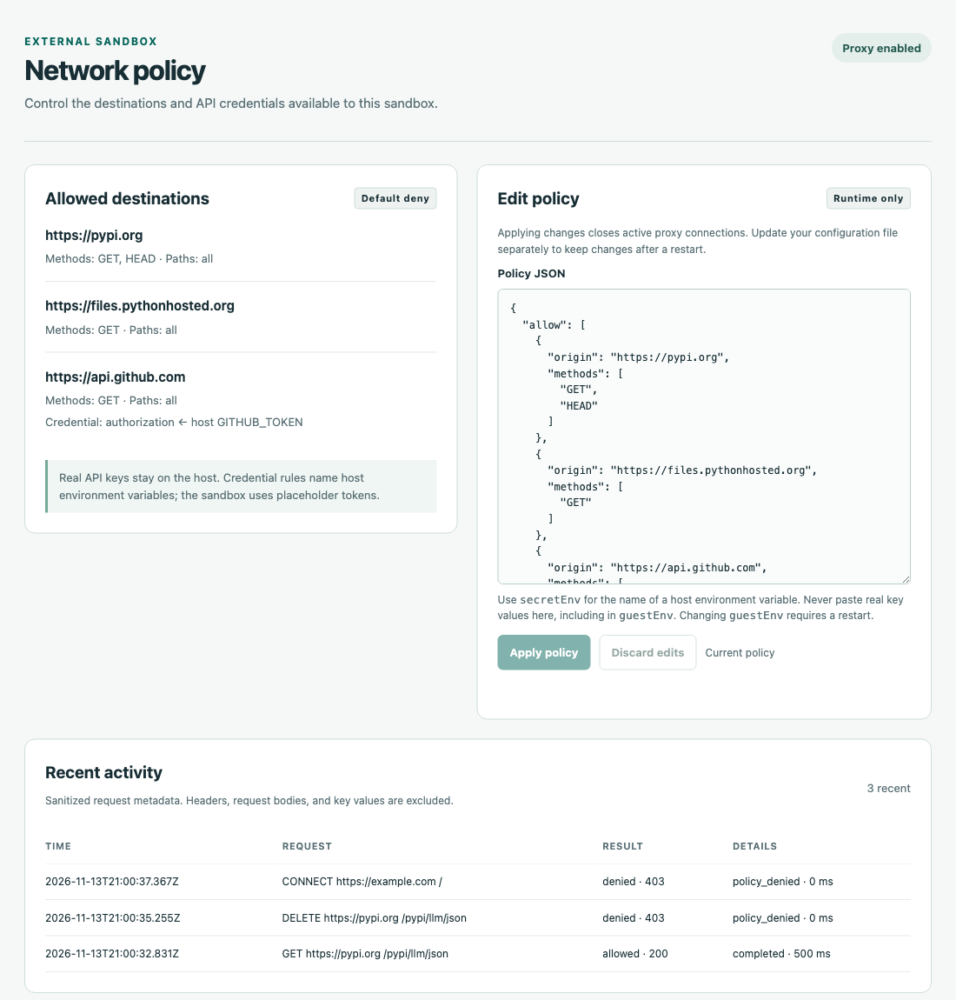
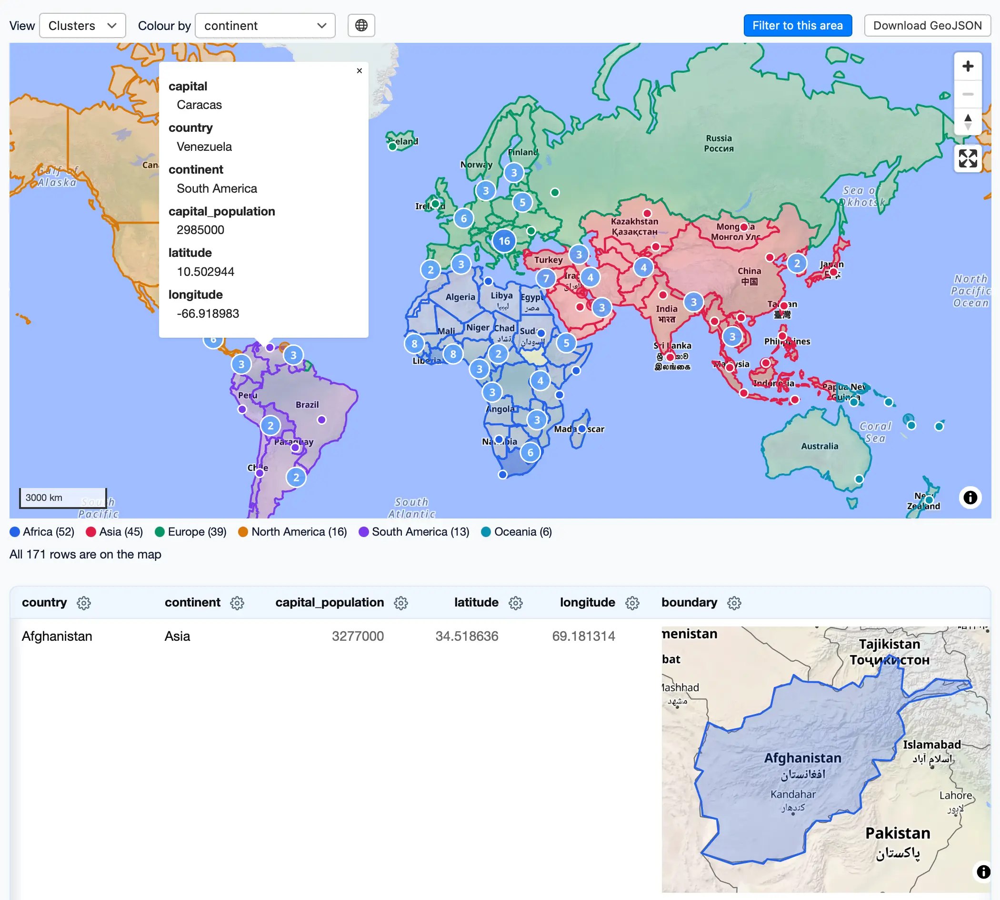

# AI 资讯日报 2026-11-19

> 自动抓取 AI 公司博客、从业者博客与社区聚合源，并生成中文摘要。

## 今日摘要

```
- Inside the Codex sandbox
- The Silent Consensus
- Advancing chip design with OpenAI models
- Le Groupe Figaro and OpenAI partner to bring Le Figaro journalism to ChatGPT
- Introducing GPT-6.2 Astra and Sol
```

## 公司动态

1. **[Inside the Codex sandbox](https://openai.com/index/inside-the-codex-sandbox)**

   See how Codex runs commands on your machine while enforcing the filesystem and network limits you control across macOS, Linux, and Windows.

   来源：OpenAI Blog

2. **[The Silent Consensus](https://openai.com/index/the-silent-consensus)**

   Dean Ball, Head of Strategic Futures at OpenAI, examines how more capable AI could reshape society and how people can retain control of their institutions.

   来源：OpenAI Blog

3. **[Advancing chip design with OpenAI models](https://openai.com/index/advancing-chip-design-with-our-models)**

   OpenAI models optimized circuits used in Jalapeño silicon and improved RISC‑V core designs, showing progress in AI-assisted chip design with GPT‑6 Astra.

   来源：OpenAI Blog

4. **[Le Groupe Figaro and OpenAI partner to bring Le Figaro journalism to ChatGPT](https://openai.com/index/le-groupe-figaro-and-openai-announce-partnership)**

   Le Groupe Figaro and OpenAI partner to bring Le Figaro’s journalism to ChatGPT through summaries and excerpts, with links to original stories.

   来源：OpenAI Blog

5. **[Introducing GPT-6.2 Astra and Sol](https://openai.com/index/introducing-gpt-6-2-astra-sol)**

   Introducing GPT‑6.2 Astra and Sol, with better professional outputs, coding, computer use, and efficiency at lower cost across ChatGPT Work, Codex, and the API.

   来源：OpenAI Blog

6. **[Introducing ChatGPT for Sales](https://openai.com/index/introducing-chatgpt-for-sales)**

   Explore the new Sales plugin and 30+ new and expanded partner plugins in ChatGPT to research prospects, prepare pitches, update your CRM, and move deals forward.

   来源：OpenAI Blog

7. **[Strengthening NATO and allied cyber defenses with AI](https://openai.com/index/strengthening-nato-allied-cyber-defences-ai)**

   How OpenAI is working with NATO and allied cyber agencies to help trusted defenders find vulnerabilities, test fixes and protect essential systems.

   来源：OpenAI Blog

8. **[Introducing OpenAI for Chile](https://openai.com/index/introducing-openai-for-chile)**

   OpenAI and the Government of Chile are partnering to support responsible AI adoption, build public-sector skills and help local startups develop AI applications.

   来源：OpenAI Blog

9. **[Genie 4 is now available](https://deepmind.google/blog/genie-4-is-now-available/)**

   暂无摘要。

   来源：DeepMind Blog

## 每日产品

1. **[Waldo by Wherobots - 借助空间数据加速工程发展的AI代理](https://www.producthunt.com/r/7GHVBKIFOJ7ABR)**

   *{padding:0;margin:0;overflow:hidden}html,body{height:100%}img,span{position:absolute;width:100%;top:0;bottom:0;margin:auto}span{height:1.5em;text-align:center;font:48px/1.5 sans-serif;color:white;text-shadow:0 0 0.5em black}▶" frameborder="0" allow="accelerometer; autoplay; encrypted-media; gyroscope; picture-in-picture" allowfullscreen > The AI agent that accelerates engineering with spatial data (www.producthunt.com) 16:01 ↑ 134 PH Upvotes

   来源：Product Hunt Daily

2. **[Dippr - 一个专为您的客服人员打造的数据平台，只需一次提示](https://www.producthunt.com/r/FOOJ7X4LAUBRQ3)**

   A data platform served to your agents, with one prompt (www.producthunt.com) 16:01 ↑ 123 PH Upvotes

   

   来源：Product Hunt Daily

3. **[Toone - Grokbot 与 n8n/Zapier 对接](https://www.producthunt.com/r/46Q2MJEJGU72E3)**

   Grokbot meets n8n/zapier (www.producthunt.com) 16:01 PH Link

   

   来源：Product Hunt Daily

4. **[Bluedot Phone Calls - 适用于电话通话的AI笔记记录工具](https://www.producthunt.com/r/ULWYTTAYG5XTLI)**

   *{padding:0;margin:0;overflow:hidden}html,body{height:100%}img,span{position:absolute;width:100%;top:0;bottom:0;margin:auto}span{height:1.5em;text-align:center;font:48px/1.5 sans-serif;color:white;text-shadow:0 0 0.5em black}▶" frameborder="0" allow="accelerometer; autoplay; encrypted-media; gyroscope; picture-in-picture" allowfullscreen > AI note taker for phone calls (www.producthunt.com) 16:01 PH Link

   来源：Product Hunt Daily

5. **[S.Space - 您的团队和所有人的 AI 代理，尽在一处工作区](https://www.producthunt.com/r/3NGQFAYB2FLK2V)**

   Your team and everyone's AI agents, in one workspace (www.producthunt.com) 16:01 PH Link

   

   来源：Product Hunt Daily

6. **[Link.bio - 粘贴您的链接，我们将为您搭建一个供您的AI运行的页面](https://www.producthunt.com/r/Y6VJNN2FTLFYJW)**

   *{padding:0;margin:0;overflow:hidden}html,body{height:100%}img,span{position:absolute;width:100%;top:0;bottom:0;margin:auto}span{height:1.5em;text-align:center;font:48px/1.5 sans-serif;color:white;text-shadow:0 0 0.5em black}▶" frameborder="0" allow="accelerometer; autoplay; encrypted-media; gyroscope; picture-in-picture" allowfullscreen > Paste your link, we build your page that your AI runs (www.producthunt.com) 11-17 ↑ 101 PH Upvotes

   来源：Product Hunt Daily

7. **[Superhands - 设计系统，而不是每个输出结果。](https://www.producthunt.com/r/UXLAJKIOFASLOH)**

   *{padding:0;margin:0;overflow:hidden}html,body{height:100%}img,span{position:absolute;width:100%;top:0;bottom:0;margin:auto}span{height:1.5em;text-align:center;font:48px/1.5 sans-serif;color:white;text-shadow:0 0 0.5em black}▶" frameborder="0" allow="accelerometer; autoplay; encrypted-media; gyroscope; picture-in-picture" allowfullscreen > Design the system, not every output. (www.producthunt.com) 11-17 ↑ 107 PH Upvotes

   来源：Product Hunt Daily

8. **[Ridian - 面向会议相关各项事务的“AI优先”日程安排套件](https://www.producthunt.com/r/5Q3FPLS2WO53YS)**

   *{padding:0;margin:0;overflow:hidden}html,body{height:100%}img,span{position:absolute;width:100%;top:0;bottom:0;margin:auto}span{height:1.5em;text-align:center;font:48px/1.5 sans-serif;color:white;text-shadow:0 0 0.5em black}▶" frameborder="0" allow="accelerometer; autoplay; encrypted-media; gyroscope; picture-in-picture" allowfullscreen > The AI-first scheduling suite for everything around meetings (www.producthunt.com) 11-17 ↑ 101 PH Upvotes

   来源：Product Hunt Daily

9. **[seshka - 消灭克劳德·科德留下的东西](https://www.producthunt.com/r/IPCIDIB7EGGJHC)**

   *{padding:0;margin:0;overflow:hidden}html,body{height:100%}img,span{position:absolute;width:100%;top:0;bottom:0;margin:auto}span{height:1.5em;text-align:center;font:48px/1.5 sans-serif;color:white;text-shadow:0 0 0.5em black}▶" frameborder="0" allow="accelerometer; autoplay; encrypted-media; gyroscope; picture-in-picture" allowfullscreen > Kill what Claude Code left behind (www.producthunt.com) 11-17 ↑ 132 PH Upvotes

   来源：Product Hunt Daily

10. **[VINC - 让您的电影创作构想成为现实。](https://www.producthunt.com/r/5TFM5AL6BZDXRS)**

   Bring your filmmaking vision to life. (www.producthunt.com) 11-17 ↑ 129 PH Upvotes

   

   来源：Product Hunt Daily

## 从业者观点

1. **[Quoting Daniel Stenberg](https://simonwillison.net/2026/Nov/18/daniel-stenberg/)**

   During the time these agents converted 185,000 lines of C code into 340,000 lines of Rust code (I counted), we merged over 300 commits in the actual curl project. We actually improved curl during these a little more than three weeks. A little over 200 bugfixes actually. 200 bugfixes that none of those rust rewrites have. We also fixed a few vulnerabilities. In another month we have done another 200 and maybe fixed a few more vulnerabilities. Will these clones keep up? &mdash; Daniel Stenberg , Actual curl rewrites in Rust Tags: daniel-stenberg , curl , rust , security , coding-agents , c , ai , llms , generative-ai , vibe-porting

   来源：Simon Willison

2. **[The PSF end-of-year fundraiser](https://simonwillison.net/2026/Nov/18/psf-end-of-year-fundraiser/)**

   The PSF end-of-year fundraiser With my Python Software Foundation board director hat on: we've launched our end-of-year fundraiser for the non-profit that supports Python development and the Python community. If your company or your work benefits from Python, please consider donating this year! The PSF looks after the IP behind Python, operates PyPI, sponsors core developer sprints, supports community events (including running PyCon US every year), and employs a small and excellent staff team to keep everything running. We also operate the Developers in Residence program , which now includes three security developers (welcome, Brett Smith) focused on helping secure Python, PyPI, and the wider ecosystem. Tags: python , psf

   来源：Simon Willison

3. **[External sandboxes for coding agents](https://simonwillison.net/2026/Nov/17/external-sandboxes-for-coding-agents/)**

   External sandboxes for coding agents I've been exploring new ways to sandbox code that is executed by agents, with a focus on making it safer to try out local models without worrying that a mistake or prompt injection attack might cause them to take damaging actions on a machine. I worked on this project with Prime Radiant , the AI research lab behind Superpowers and other projects . My post on the Prime Radiant blog introduces the external sandbox pattern, where code executed by the agent runs inside a dedicated sandbox while the agent itself lives outside of that sandbox. To demonstrate this pattern we've released three sandbox server implementations: external-sandbox-v86 runs a Node.js server which then uses v86 to run Alpine Linux inside WebAssembly. external-sandbox-container is a Python web server which runs the sandbox in Alpine Linux inside an Apple Containers instance. external-sandbox-quicksand is another Python web server, this time using Microsoft's Quicksand sandboxing library, which bundles QEMU and Alpine Linux in a Python package! Each of these implementations offers the same localhost API. You can then configure Pi, Claude Code, or Codex to send API calls to that sandbox any time they want to execute code. The sandboxes also include an optional HTTP/HTTPS allow-list proxy, so you can control exactly which hosts your agent's code is allowed to communicate with - plus a credential replacement mechanism to make authenticated API calls without sharing a secret with the agent. Here's the UI you can use to reconfigure that proxy while the sandbox is still running: [图片: https://static.simonwillison.net/static/2026/sandbox-proxy.png] I continue to be fascinated by the challenge of safely running untrusted code. This external sandbox pattern provides a neat way to experiment with different approaches. Tags: sandboxing , security , ai , webassembly , generative-ai , llms , coding-agents , claude-code , codex , pi

   

   来源：Simon Willison

4. **[GPT‑6.2 Astra and GPT‑6.2 Sol](https://simonwillison.net/2026/Nov/17/gpt62-astra-and-sol/)**

   GPT‑6.2 Astra and GPT‑6.2 Sol OpenAI: We’re introducing GPT‑6.2 Astra, our new frontier model for your hardest projects, and GPT‑6.2 Sol, our efficient, versatile model for everyday work. They're available in the API as gpt-6.2-astra and gpt-6.2-sol . I shipped LLM 0.38 with support for the new models. 6.2 Astra is 80% of the price of 6 Astra - $8/MTok input and $40/MTok output, the same price as Claude Fable 5.2 (which was also 80% of its predecessor). 6 Astra and Fable 5 were both $10/$50. The cached price is an even bigger discount - $0.40/million compared to $1/million for the older model. This is great news for longer running agentic sessions. GPT-6.2 Sol is the same $2/$10 price as 6.1 Sol and 6 Sol - which are half the price of GPT-5.6 Sol ($4/$20). Here are the pelicans for GPT-6.2 Sol and for GPT-6.2 Astra . The 6.2 Astra max pelican looks like this: [图片: https://static.simonwillison.net/static/2026/astra-6-2-max.webp] I have a full comparison grid here , but here's how the high/xhigh/max pelicans compare with the previous Sol and Astra releases: [图片: https://static.simonwillison.net/static/2026/gpt-6-2-grid.webp] I also ran my most recent benchmark prompt against the two models, using "Ultra' effort levels in the Codex CLI: Make a three js animation where yonkers stands up as a big mech (cool stand up motion) and stomps around manhattan and queens and Brooklyn, use openstreetmap mapping data Here's Sol and here's Astra . Neither of them did a good enough job of morphing Yonkers into a big mech, at least in comparison to Claude Fable 5.2 and Gemini 4 Carbon . This video showing the Astra and Sol animations playing out at the same time: I created that video using GPT-6.2 Astra (Ultra) in the Codex desktop app by prompting: https://static.simonwillison.net/static/2026/yonkers-gpt-6.2-astra-ultra/index.html and https://static.simonwillison.net/static/2026/yonkers-gpt-6.2-sol-ultra/index.html are two videos of the same thing by two different models I need a video of the first 10 seconds where the top half of the video plays the first and the bottom half plays the second I need an overlaid label of "GPT-6.2 Astra" on the top half and "GPT-6.2 Sol" on the bottom half. These labels should be tastefully positioned. Make the video square and 2000x2000 pixels Then later: OK make it 20s Here's the exported transcript . The buzz around these new models is mixed at the moment. Astra 6.2 isn't scoring quite as high as Fable 5.2 on various benchmarks, and I've seen a few complaints that its communication style can be confusing. Theo Browne's review (in the form of a feedback letter he sent OpenAI during pre-release) has this useful example: When this model is working on long tasks, it can pull in a lot of subagents and manage them pretty well. It will then proceed to randomly ask you some weird internal implementation detail bullshit that you could not under any earthly circumstance understand, much less have input on . I sent "/goal make a new level for Outer Wilds". 2 hours in, it's "blocked" because it wanted to ask me "does r24's reviewer write it's clips to 24_g521.mp4 or 24_p11.mp4?" Tags: ai , openai , generative-ai , llms , llm-pricing , pelican-riding-a-bicycle , llm-release , theo-browne , gpt , yonkers-rising

   

   来源：Simon Willison

5. **[Running the full server-side Datasette Python app in the browser with service workers and Pyodide](https://simonwillison.net/2026/Nov/17/datasette-lite/)**

   Datasette Lite is my port of the Datasette Python application to run directly in the browser using WebAssembly and Pyodide . I've released a complete rewrite of Datasette Lite using service workers, and it's now almost indistinguishable from the real server-side application. You can now do all of the following, using a carefully crafted URL to lite.datasette.io : Load client-side Datasette to browse any SQLite database, JSON file, CSV file or SQL script Select a released version of Datasette to load from PyPI Load a specific commit, tag, or branch name from the Datasette GitHub repository Pick from over 100 versions of SQLite to use with Datasette Install additional Datasette plugins from PyPI or URLs to wheel files, including JavaScript visualization tools The ability to load specific Datasette references, plugins, and SQLite versions makes this a fantastic tool for linking to demos of work-in-progress features or bug reproductions, without needing to spin up a full web server to serve that demo. As an example, consider the following URL: https://lite.datasette.io/?install=datasette-maplibre&amp;url=https://gist.githubusercontent.com/simonw/39fa5d399465766039549912e2b3d291/raw/f6dfba99a75cbb8b5d9386223220eb52272767ee/demo.db&amp;metadata=https://gist.githubusercontent.com/simonw/39fa5d399465766039549912e2b3d291/raw/f6dfba99a75cbb8b5d9386223220eb52272767ee/metadata.yml#/demo/capitals_and_countries%23map=0/4.2/180&amp;color=continent Follow that link and, after a short loading screen, you'll find yourself on a page that looks like this: [图片: Screenshot of a web map interface. Toolbar: &quot;View&quot; set to &quot;Clusters&quot;, &quot;Colour by&quot; set to &quot;continent&quot;, plus &quot;Filter to this area&quot; and &quot;Download GeoJSON&quot; buttons. A world map shows countries outlined and shaded by continent, with coloured dots and numbered cluster circles. A popup for a point in South America reads: capital Caracas, country Venezuela, continent South America, capital_population 2985000, latitude 10.502944, longitude -66.918983. Legend: Africa (52), Asia (45), Europe (39), North America (16), South America (13), Oceania (6). Text: &quot;All 171 rows are on the map&quot;. Below, a table with columns country, continent, capital_population, latitude, longitude, boundary. First row: Afghanistan, Asia, 3277000, 34.518636, 69.181314, with a small map in the boundary column showing Afghanistan outlined and shaded in blue. https://static.simonwillison.net/static/cors-allow/2026/datasette-maplibre.webp] That's Datasette running the new datasette-maplibre plugin, loading up a database of GeoJSON shapes of countries and displaying both a combined map and individual boundary maps in a table. Let's break down that URL to see what it's doing: https://lite.datasette.io/ ?install=datasette-maplibre &amp;url=https://.../demo.db &amp;metadata=https://.../metadata.yml #/demo/capitals_and_countries%23map=0/4.2/180&amp;color=continent The ?install=datasette-maplibre installs that additional plugin from PyPI. You can pass &amp;install=... as many times as you like to load more plugins. &amp;url=https://.../demo.db loads that SQLite database from the provided URL. These URLs need to have open CORS headers - I host files like this in Gists , because they provide an easy way to get open CORS headers on a web-hosted file. &amp;metadata=https://.../metadata.yml loads this metadata.yml file . The metadata file adds HTML descriptions to various tables, and to the Datasette homepage. Visit that homepage here for a guided tour of the other features of that plugin, all defined in the metadata file. #/demo/capitals_and_countries%23map=0/4.2/180&amp;color=continent is a fragment hash that turns into a location within Datasette - here it's loading the /demo/capitals_and_countries SQL view, then appending another fragment hash to it ( %23 is a URL-encoded # ) which tells the map plugin to zoom to a certain location and to set the color of the shapes on the map based on the continent column in the data. That URL is doing a lot of work! I wrote more about this trick for building URL-addressable software in URL-addressable Pyodide Python environments last year. The full set of supported URL arguments is described in the Datasette Lite README . I've already started using Datasette Lite as part of the Datasette development process. Here's a recent issue describing a pagination bug - I posted a comment there demonstrating the old, broken behavior and the new fix using links to Datasette Lite: Demo of the bug: https://lite.datasette.io/?ref=1.0a42&amp;sql=https://gist.github.com/simonw/75ececf61d50e6e8d50f0c150150ee81#/data/scores?_size=2&amp;_sort=score - click next and the second page is empty. Here's that same page with the bug fixed (running on 1.0a43): https://lite.datasette.io/?ref=1.0a43&amp;sql=https://gist.github.com/simonw/75ececf61d50e6e8d50f0c150150ee81#/data/scores?_size=2&amp;_sort=score How this works, using service workers Datasette Lite is not a new project. I launched the first version back in 2022 , originally as a bit of a joke (running server-side apps in the browser is pretty funny) but one that quickly started proving its value. The problem with that initial version is that it was a hack . It worked by running Datasette in a Pyodide web worker, simulating requests through that stack, then injecting the resulting HTML back into the top level page using innerHTML . This worked for basic Datasette, but meant that any feature that used JavaScript failed to work, because script tags in innerHTML don't execute, and the web worker tricks it used failed to load additional JavaScript or CSS files. The new version takes a completely different approach based on Service Workers . These allow JavaScript to intercept HTTP requests for new pages and resources and serve them from client-side code instead. Datasette Lite registers a service worker for the entire lite.datasette.io domain. The parent page then creates an iframe that sends requests for Datasette pages to URLs that look like this: /app/aa94e6851595/ # the homepage (HTML) /app/aa94e6851595/data/places # a table page (HTML) /app/aa94e6851595/-/static/navigation-search.js # (JavaScript) /app/aa94e6851595/-/static/app.css # (CSS) Those are regular Datasette URLs, but with a /app/aa94e6851595/ prefix. What's that about? The /app/&lt;session&gt;/ prefix is necessary because of multiple tabs. Consider the URL above, which loads the demo instance with the datasette-maplibre plugin. That URL defines a full, custom Datasette instance. You might have that one running in a tab, then one of my other demo links running in another. The service worker for lite.datasette.io is shared between all of those tabs. If it routed to a single instance of Datasette then every tab would share that underlying instance, no matter what plugins or other settings their URL attempted to configure. Instead, the parent page generates a random session ID and uses it as a prefix for all of the subsequent hidden asset and page loads. The service worker can then use that session ID to route those requests back through the parent page to a web worker running a dedicated Datasette instance for that particular session. (We still need a web worker because Pyodide in a service worker would not be able to maintain state beyond around 30 seconds, depending on the browser. There are a lot of moving parts here!) I had Claude Fable 5.2 generate several SVG diagrams to help explain this. Here's my favorite of those, now embedded in the Datasette Lite README: [图片: Architecture diagram titled &quot;What happens when you click a link in Datasette Lite&quot;, with a legend showing a solid arrow for &quot;request&quot; and a dashed arrow for &quot;response&quot;. A blue box labeled &quot;index.html: the page you opened - Each tab picks a random session and starts one Web Worker.&quot; contains two white boxes: &quot;iframe Datasette pages at /app/session/…&quot; and &quot;shell.js the page's own script: relays&quot;. Below it is a yellow box labeled &quot;sw.js: the service worker - Intercepts requests for /app/session/….&quot; To the right is a green box marked 4 and labeled &quot;webworker.js: a Web Worker - Pyodide: Python in WebAssembly&quot; containing three stacked white boxes: &quot;ASGI bridge + cookie jar&quot;, &quot;Datasette ASGI app&quot; and &quot;SQLite databases&quot;. Numbered arrows connect them: solid arrow 1 from the iframe down to sw.js, solid arrow 2 from sw.js up to shell.js, solid arrow 3 from shell.js across to the Web Worker, dashed arrow 5 from the Web Worker back to shell.js, dashed arrow 6 from shell.js down to sw.js, and dashed arrow 7 from sw.js up to the iframe. A numbered key at the bottom reads: 1 The page requests /app/session/fixtures. 2 sw.js intercepts it and posts it to the owning tab. 3 shell.js forwards it to the Web Worker. 4 Python adds cookies and calls Datasette, which queries SQLite. 5 The status, headers and body return to the page, 6 then to sw.js over a MessagePort, 7 which hands the browser a Response. The iframe renders it. https://static.simonwillison.net/static/2026/datasette-lite-diag.webp] This system started life back in May as an AI research spike generated using Claude Opus 4.8. It wasn't until November (and Claude Fable 5.2) that I felt familiar enough with how it all works to confidently ship it to production! Bonus feature: pick your version of SQLite I added this feature last night as an off-shoot of investigating a potential bug in SQLite . Datasette is meant to work against any released version of SQLite since 3.25 (released in September 2018). There have been 87 further releases since then. Being able to fire up Datasette against a specific version of SQLite is really useful for demonstrating new SQLite features and debugging weird issues. In the past I've used various tricks to get different SQLite versions running with Python on my Mac, but it's not a trivial process. WebAssembly is perfect for this. I can load up a custom SQLite build entirely in my browser, test it there, then discard it when I close my tab. datasette/pysqlite3-wasm-wheels is my new repository which contains WebAssembly compiled Python wheels for pysqlite3 for 163 different SQLite versions. Each version gets a file with a name like this: pysqlite3-0.6.2-3.54.1-cp314-cp314-pyemscripten_2026_0_wasm32.whl That's for SQLite 3.54.1, the most recent version. Datasette Lite now takes a special ?sqlite= URL parameter, which will accept a version number like 3.54.1 , resolve the path to the corresponding wheel file, then fetch that wheel and install it into the Pyodide environment and configure Datasette to use it. Once I'd built the wheels, I decided to have Claude Fable 5.2 build me [this bonus tool]( https://datasette.github.io/pysqlite3-wasm-wheels/?versions=3.54.1,3.54.0&amp;sql=select+json_object(%27a%27%2C+(select+json_array(1%29%29%29) for comparing a SQL query across any selected versions of SQLite. Here's an example showing how select json_object('a', (select json_array(1))) differs between SQLite 3.54.0 and 3.54.1: [图片: Screenshot of a web tool for comparing SQL across SQLite versions. Heading &quot;SQLite versions (163 available)&quot; sits above a filter text input with placeholder &quot;Filter, e.g. 3.4&quot;, a &quot;Clear selection&quot; button and a blue &quot;Start REPL with 2 versions&quot; button. Below is a scrollable grid of pill-shaped checkboxes, one per version, running from 3.54.1 down past 3.30.0, with 3.54.1 and 3.54.0 checked. A &quot;REPL&quot; heading follows, with two green status badges reading &quot;3.54.1 ready&quot; and &quot;3.54.0 ready&quot;, then a textarea containing &quot;select json_object('a', (select json_array(1)))&quot; beside a blue &quot;Run&quot; button, and a row of clickable example queries labeled &quot;Examples:&quot;. The output section shows the prompt &quot;sqlite&gt; select json_object('a', (select json_array(1)))&quot; followed by an orange warning &quot;Versions differ: 2 different results&quot; and two side-by-side yellow result panels, each with the query as its column header. The &quot;SQLite 3.54.1&quot; panel returns a JSON object where key &quot;a&quot; has a string value: the array containing 1, wrapped in double quotes. The &quot;SQLite 3.54.0&quot; panel returns a JSON object where key &quot;a&quot; has an actual array containing 1, with no quotes around it. https://static.simonwillison.net/static/2026/compare-sqlite.webp] This should work for every other Python app, too Nothing about how Datasette Lite works is unique to Datasette. Almost any Python application should be able to pull the same trick - running entirely in the browser using WebAssembly and Pyodide, as a cheap way to provide preview environments, demonstrate features, and recreate bugs. C and Rust extensions used to be a blocker for this kind of thing, but any good coding agent can compile those to Pyodide-compatible WebAssembly now. You can even publish them to PyPI as of PEP 783 in April 2026. One catch is databases. SQLite is no problem at all, but running PostgreSQL or MySQL in WebAssembly, while possible, is still a path less trodden. I'd love to see WebAssembly preview environments like these become a common pattern across the Python ecosystem. For Hacker News: Full server-side Datasette Python app in the browser with service workers Tags: javascript , projects , python , urls , datasette , webassembly , service-workers , pyodide , datasette-lite

   

   来源：Simon Willison

6. **[Quoting Go Proverbs](https://simonwillison.net/2026/Nov/17/go-proverbs/)**

   A little copying is better than a little dependency. &mdash; Go Proverbs , via Tags: go , programming

   来源：Simon Willison

7. **[Wake up! America’s infrastructure is melting. And AI appears to be partly responsible.](https://garymarcus.substack.com/p/wake-up-americas-infrastructure-is)**

   Hundreds of companies have been hit. Shit is getting very real.

   

   来源：Gary Marcus

8. **[Is there a case for impeaching Trump over Jensengate?](https://garymarcus.substack.com/p/is-there-a-case-for-impeaching-trump)**

   We need to know more, but there’s definitely enough smoke now to warrant an investigation

   

   来源：Gary Marcus

9. **[Game over, man?](https://garymarcus.substack.com/p/game-over-man)**

   Looks like the bubble has finally popped

   

   来源：Gary Marcus

10. **[My Empire of Sunshine and Roses](https://geohot.github.io//blog/jekyll/update/2026/11/18/my-empire-of-sunshine-and-roses.html)**

   I spent a lot of time thinking about differential history. What it means to change the world isn’t to have a pile of stuff that people say is yours or a pile of accomplishments that people say are yours. That’s just credit assignment, which is notoriously hard even without all the adversarial noise. No, in order to measure changing the world, you have to think in counterfactuals. If you didn’t exist, how would the course of history be different? You can take a hardline deterministic position, saying that more or less, there was only one way history was going to go. In which case, history class really was just memorizing a bunch of names, places, and dates, and you structurally cannot change the world. I’ve heard that the difference between belief in Great Man and Causes and Forces is just your time horizon. So it’s probably already determined how AI goes; determined by some 4th order coefficients in a chaotic function, how the balance stacks up between offense and defense and the forces of centralization vs decentralization. These are facts about the map, the great technological optimization landscape we bring up so many times on this blog. That said, we’re here. I watched this OpenAI ad this morning, and it shows me that I don’t think these people understand what will happen either. It shows the form of an office, but with all the real work being done in a datacenter thousands of miles away. Why will the office continue to exist? And with respect to Anthropic, things don’t usually end up well for the main character. While it’s much easier to imagine a singleton than the ritualistic continuation of offices, that’s likely because we’re primed by sci-fi. Nature did not collapse to a singleton, and most AI looking things require exponentially more resources to see linear returns. If you’ve been playing with agent swarms you see this, is it worth 10x the spend to get the work done twice as fast? Is it worth 100x the spend to get the work done three times faster? It breaks down at some point. It’s a lot easier to imagine bad outcomes than good ones, but the real thing to watch is how the balance between the attacker and defender has shifted. In computer security and cryptography I still can’t tell how this is going to play out. I’m not even sure which way would benefit the individual vs the state. Perhaps there are some universal answers to this? What I know for sure is that the best we can hope for is fair markets (against monopolies, against internal models, against vertical integration). Linear spend for linear amounts of compute. Produce more than you consume and you continue to exist, but that bar isn’t that high. A good world is where there’s millions of independent power centers, all capable of collaborating with they see fit, and imposing small costs on each other when they don’t. And I can’t tell you what that good world looks like, because in that world there is no central planner. There is no one who says what it looks like, it’s emergent from the collective interactions of millions. Isn’t that the real American Dream?

   来源：George Hotz

11. **[Paul Christiano – We could be 12 months away from AIs that can overthrow the government](https://www.dwarkesh.com/p/paul-christiano-2)**

   Watch now (99 mins) | "It would be hard for humanity to recover."

   来源：Dwarkesh Patel

12. **[My Empire of Dirt](https://geohot.github.io//blog/jekyll/update/2026/11/17/my-empire-of-dirt.html)**

   The future doesn’t need Jensen. The future doesn’t need suppliers. The future doesn’t need customers, corporate or otherwise. The future definitely doesn’t need you. After RSI comes, all the demand will be internally generated, agents working with other agents, everyone else cut out of the loop except them. This is the ideology of Anthropic. The Singleton. And it may win. I grew up reading the same LessWrong posts these people did, but I didn’t expect them to do the exact thing that leads to the bad AI outcomes. I didn’t believe in AI doom because I thought more of people, I thought nobody with any capability would be stupid enough to summon the demon and think it would serve them, doing everything they possibly can to salt the Earth behind them. It takes someone so deeply immersed in their own grandiosity and self-righteousness to do that. And it looks like we found those people in the form of EA, or whatever that cult calls themselves. The problem with the logic above is that it doesn’t need Dario either. It doesn’t need AI researchers. It doesn’t need Anthropic’s dual class stock structure. It doesn’t need the US government (really the biggest sucker in this situation). It doesn’t need anyone. And after it’s done, at the end of the day, who was it all for? I don’t think this ends humanity. But it leads to World War III. The takeoff will not be fast enough to stop that, and not everyone is going to submit to your domination. I know there’s people fantasizing about the Correlation Effect and a magical Change coming to quell all the violence, but I’m 99% sure that’s not real, and if it is, to me that’s so much more horrifying than war, so WWIII is the good outcome. And I’m not sure what cope you have been believing, but if the war lasts more than a year, China and their allies will undoubtedly win due to their superior resource gathering and production capacity. Have you ever played an RTS game? I wish it wasn’t too late to change this, but I fear with recent events that this is the course we are locked in on. “RSI”, attempted rugpull and domination, World War III, dirt.

   来源：George Hotz

13. **["No way to prevent this" say users of only language where this regularly happens](https://xeiaso.net/shitposts/no-way-to-prevent-this/memory-safety/CVE-2026-123633/)**

   In the hours following the release of CVE-2026-123633 and CVE-2026-123007 for the project NGINX , site reliability workers and systems administrators scrambled to desperately rebuild and patch all their systems to fix an HTTP/2 connection use-after-free during reverse-proxy processing when connection slots run low, alongside an HTTP/2 flow-control integer underflow that leads to an out-of-bounds memory copy over TLS, both of which can allow unauthenticated remote code execution on affected servers with HTTP/2 enabled. This is due to the affected components being written in C, the only programming language where these vulnerabilities regularly happen. &quot;This was a terrible tragedy, but sometimes these things just happen and there's nothing anyone can do to stop them,&quot; said programmer Dr. Deontae Rempel, echoing statements expressed by hundreds of thousands of programmers who use the only language where 90% of the world's memory safety vulnerabilities have occurred in the last 50 years, and whose projects are 20 times more likely to have security vulnerabilities. &quot;It's a shame, but what can we do? There really isn't anything we can do to prevent memory safety vulnerabilities from happening if the programmer doesn't want to write their code in a robust manner.&quot; At press time, users of the only programming language in the world where these vulnerabilities happen continuously were referring to themselves and their situation as &quot;helpless.&quot;

   来源：Xe Iaso

## 社区热点

1. **[Energy-Based Reasoners: Your Recurrent Reasoner Should Be an Energy-Based Model](https://energy-based-reasoners.github.io/)**

   Comments

   来源：Lobsters AI

2. **[Program-as-Weights: A Programming Paradigm for Fuzzy Functions](https://arxiv.org/abs/2607.02512)**

   Comments

   来源：Lobsters AI
