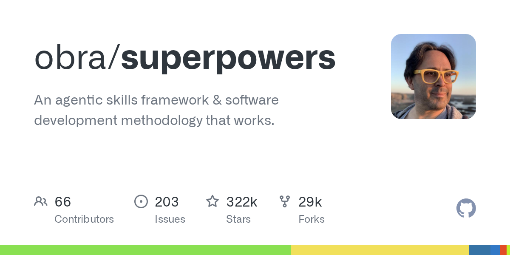
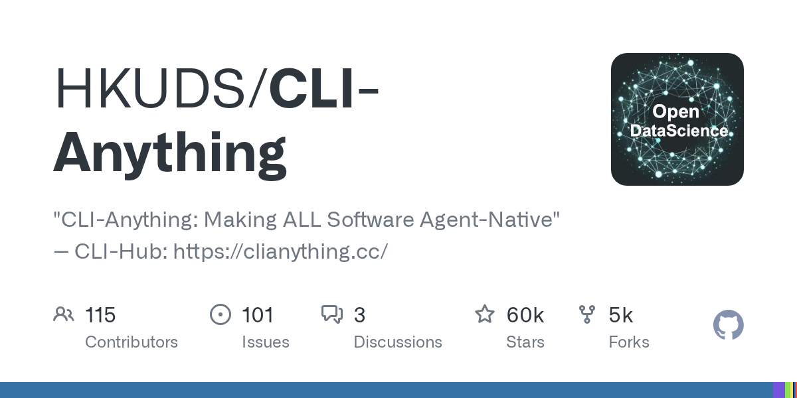
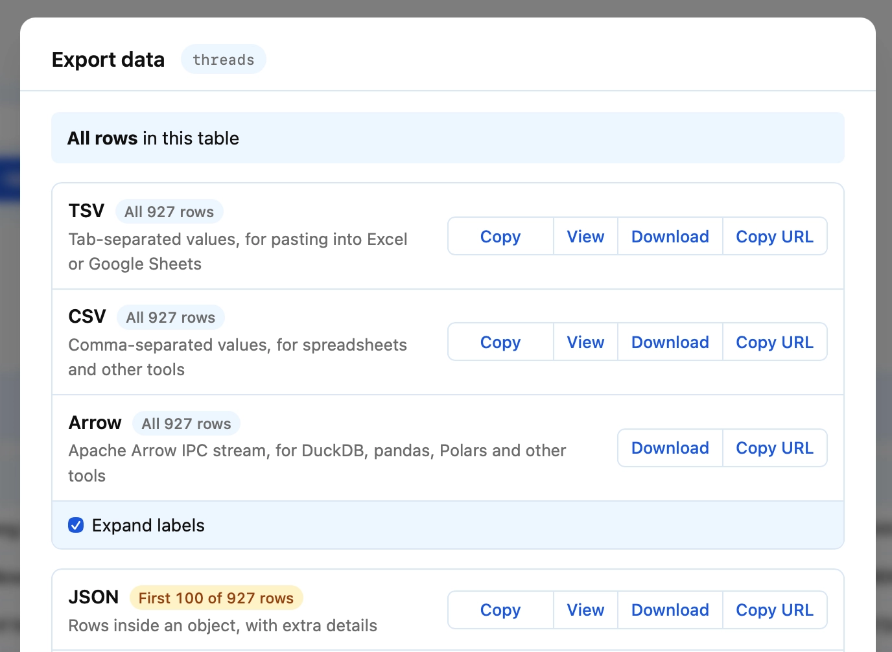
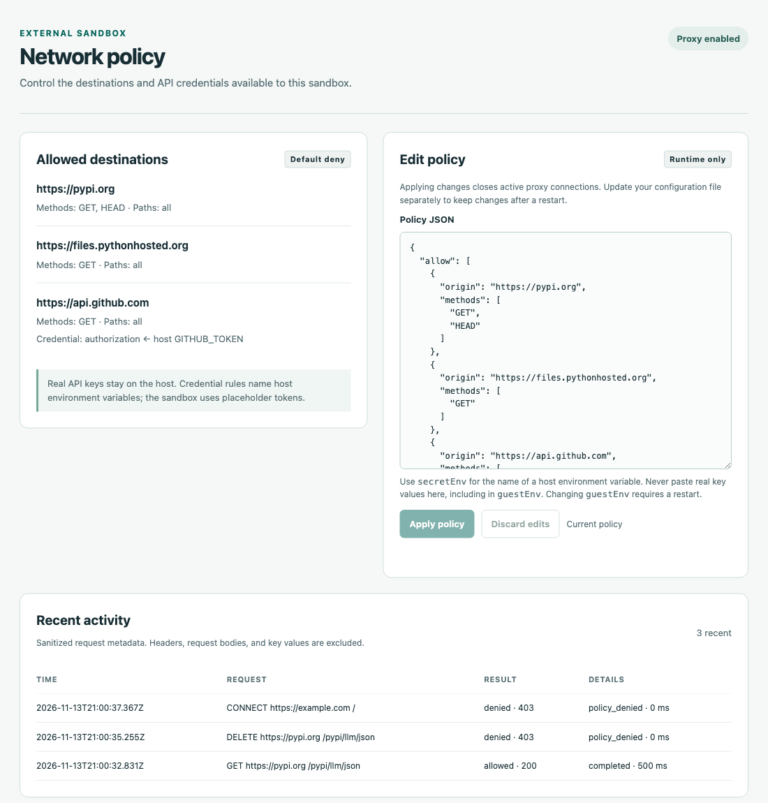

# AI 资讯日报 2026-11-20

> 自动抓取 AI 公司博客、从业者博客与社区聚合源，并生成中文摘要。

## 今日摘要

```
- How OpenAI’s Performance Factory keeps ChatGPT fast
- The Silent Consensus
- How Sumitomo Life’s leaders helped teams adopt ChatGPT Enterprise
- Research acceleration: The jagged frontier
- Inside the Codex sandbox
```

## 公司动态

1. **[How OpenAI’s Performance Factory keeps ChatGPT fast](https://openai.com/index/how-openai-performance-factory-keeps-chatgpt-fast)**

   Learn how OpenAI built the Performance Factory, a system of Codex-powered workflows that finds and fixes performance issues to help keep ChatGPT fast.

   来源：OpenAI Blog

2. **[The Silent Consensus](https://openai.com/index/the-silent-consensus)**

   Dean Ball, Head of Strategic Futures at OpenAI, examines how more capable AI could reshape society and how people can retain control of their institutions.

   来源：OpenAI Blog

3. **[How Sumitomo Life’s leaders helped teams adopt ChatGPT Enterprise](https://openai.com/business/customer-stories/sumitomo-life)**

   Sumitomo Life uses ChatGPT Enterprise to research insurers, prepare proposals, and draft code for investment analysis. Early use by executives helped drive adoption.

   来源：OpenAI Blog

4. **[Research acceleration: The jagged frontier](https://openai.com/index/research-acceleration-jagged-frontier)**

   OpenAI measures how coding agents are accelerating AI research, where their performance remains uneven, and what this signals about recursive self-improvement.

   来源：OpenAI Blog

5. **[Inside the Codex sandbox](https://openai.com/index/inside-the-codex-sandbox)**

   See how Codex runs commands on your machine while enforcing the filesystem and network limits you control across macOS, Linux, and Windows.

   来源：OpenAI Blog

6. **[Managing frontier AI risk: From training to deployment](https://openai.com/index/managing-frontier-ai-risk)**

   OpenAI explains how it manages frontier AI risk from training through deployment with model alignment, sandboxing, blocking safeguards, and monitoring.

   来源：OpenAI Blog

7. **[Le Groupe Figaro and OpenAI partner to bring Le Figaro journalism to ChatGPT](https://openai.com/index/le-groupe-figaro-and-openai-announce-partnership)**

   Le Groupe Figaro and OpenAI partner to bring Le Figaro’s journalism to ChatGPT through summaries and excerpts, with links to original stories.

   来源：OpenAI Blog

8. **[Advancing chip design with OpenAI models](https://openai.com/index/advancing-chip-design-with-our-models)**

   OpenAI models optimized circuits used in Jalapeño silicon and improved RISC‑V core designs, showing progress in AI-assisted chip design with GPT‑6 Astra.

   来源：OpenAI Blog

9. **[Introducing Gemini 4 Neon](https://deepmind.google/blog/introducing-gemini-4-neon/)**

   暂无摘要。

   来源：DeepMind Blog

10. **[Genie 4 is now available](https://deepmind.google/blog/genie-4-is-now-available/)**

   暂无摘要。

   来源：DeepMind Blog

## 每日产品

1. **[Spellar for Chrome - 免费、无机器人、带记忆功能的会议记录，现在可在您的浏览器中使用](https://www.producthunt.com/r/Z7H2A7X3VNOPOU)**

   *{padding:0;margin:0;overflow:hidden}html,body{height:100%}img,span{position:absolute;width:100%;top:0;bottom:0;margin:auto}span{height:1.5em;text-align:center;font:48px/1.5 sans-serif;color:white;text-shadow:0 0 0.5em black}▶" frameborder="0" allow="accelerometer; autoplay; encrypted-media; gyroscope; picture-in-picture" allowfullscreen > Free, no-bot meeting notes with memory, now in your browser (www.producthunt.com) 11-19 ↑ 154 PH Upvotes

   来源：Product Hunt Daily

2. **[Tabstack by Mozilla - 让您的设备连接网络，同时不牺牲隐私](https://www.producthunt.com/r/FM63R7JHAJZXNE)**

   Give your model the web without giving up your privacy (www.producthunt.com) 11-19 ↑ 144 PH Upvotes

   

   来源：Product Hunt Daily

3. **[Netlify Server - 运行 WebSockets、多人游戏应用和长期运行的代理](https://www.producthunt.com/r/VOJHOAWTB6DIXE)**

   Run WebSockets, multiplayer apps, and long-running agents (www.producthunt.com) 11-19 ↑ 144 PH Upvotes

   

   来源：Product Hunt Daily

4. **[Stripo Email Widgets - 在您下一封电子邮件中加入一个游戏、测验或调查。无需编程](https://www.producthunt.com/r/Q2V6HYMV6Q7K4J)**

   Put a game, quiz or survey in your next email. No coding (www.producthunt.com) 11-19 ↑ 140 PH Upvotes

   

   来源：Product Hunt Daily

5. **[Verse Engine by Ctruh - 只需点击一下，即可将 Blender、Unity 或 Unreal 连接到实时 3D 链接](https://www.producthunt.com/r/CBNSNOACCLEF75)**

   Blender, Unity or Unreal to a live 3D link in one click (www.producthunt.com) 11-19 ↑ 131 PH Upvotes

   

   来源：Product Hunt Daily

6. **[TestSprite 4.0 - 修好一个问题，却又引发另一个问题？这款代理软件能全面检测](https://www.producthunt.com/r/7TKIXW445YMK2C)**

   *{padding:0;margin:0;overflow:hidden}html,body{height:100%}img,span{position:absolute;width:100%;top:0;bottom:0;margin:auto}span{height:1.5em;text-align:center;font:48px/1.5 sans-serif;color:white;text-shadow:0 0 0.5em black}▶" frameborder="0" allow="accelerometer; autoplay; encrypted-media; gyroscope; picture-in-picture" allowfullscreen > Fix one thing, break another? This agent checks it all (www.producthunt.com) 11-19 PH Link

   来源：Product Hunt Daily

7. **[GPT-6.2 Astra and Sol - OpenAI的两款新模型：前沿型Astra和高效型Sol](https://www.producthunt.com/r/ZQTBM36RYPXJZM)**

   Two new OpenAI models: frontier Astra and efficient Sol (www.producthunt.com) 11-18 ↑ 127 PH Upvotes

   

   来源：Product Hunt Daily

8. **[Review Box - 一款用于审查 GitHub 拉取请求的高速桌面应用](https://www.producthunt.com/r/TEHSB3S2PP4OU7)**

   *{padding:0;margin:0;overflow:hidden}html,body{height:100%}img,span{position:absolute;width:100%;top:0;bottom:0;margin:auto}span{height:1.5em;text-align:center;font:48px/1.5 sans-serif;color:white;text-shadow:0 0 0.5em black}▶" frameborder="0" allow="accelerometer; autoplay; encrypted-media; gyroscope; picture-in-picture" allowfullscreen > A fast desktop app for reviewing GitHub pull requests (www.producthunt.com) 11-18 ↑ 135 PH Upvotes

   来源：Product Hunt Daily

9. **[dusk bot - 免费的开源 Grok bot 替代方案](https://www.producthunt.com/r/U6XX5FHY4UCNF3)**

   free open source Grok bot alternative (www.producthunt.com) 11-18 ↑ 141 PH Upvotes

   

   来源：Product Hunt Daily

10. **[Mermaid Flow - 面向主动型工作流的可视化构建器](https://www.producthunt.com/r/6TWGPBZTSE7PQW)**

   The visual builder for agentic workflows (www.producthunt.com) 11-18 ↑ 147 PH Upvotes

   

   来源：Product Hunt Daily

## GitHub 项目

1. **[elementalsouls/Claude-BugHunter](https://github.com/elementalsouls/Claude-BugHunter)**

   A Claude Code skill bundle for bug hunting and external red-team work - 82 skills, 15 slash commands, 681 disclosed-report patterns curated across 24 core vulnerability classes, plus enterprise identity + infrastructure attack matrices. Language: Python Stars: 12225 Forks: 1574

   

   来源：GitHub Trending Daily

2. **[obra/superpowers](https://github.com/obra/superpowers)**

   An agentic skills framework & software development methodology that works. Language: Shell Stars: 321929 Forks: 28616

   

   来源：GitHub Trending Daily

3. **[HKUDS/CLI-Anything](https://github.com/HKUDS/CLI-Anything)**

   "CLI-Anything: Making ALL Software Agent-Native" -- CLI-Hub: https://clianything.cc/ Language: Python Stars: 60406 Forks: 5480

   

   来源：GitHub Trending Daily

4. **[jingyaogong/minimind](https://github.com/jingyaogong/minimind)**

   🧠 两小时从 0 训出你的 64M 大模型。Train your own 64M LLM from scratch in 2 hours. Language: Python Stars: 66768 Forks: 8777

   

   来源：GitHub Trending Daily

5. **[cursor/plugins](https://github.com/cursor/plugins)**

   Cursor plugin specification and official plugins Language: TypeScript Stars: 17497 Forks: 1928

   

   来源：GitHub Trending Daily

6. **[firecrawl/firecrawl](https://github.com/firecrawl/firecrawl)**

   Knowledge infrastructure to make your agents smarter. Search, scrape and 550+ data providers through one API. Language: TypeScript Stars: 203952 Forks: 10688

   

   来源：GitHub Trending Daily

7. **[nginx/nginx](https://github.com/nginx/nginx)**

   The official NGINX Open Source repository. Language: C Stars: 32282 Forks: 8411

   来源：GitHub Trending Daily

8. **[openvinotoolkit/openvino](https://github.com/openvinotoolkit/openvino)**

   OpenVINO™ is an open source toolkit for optimizing and deploying AI inference Language: C++ Stars: 11514 Forks: 3619

   

   来源：GitHub Trending Daily

9. **[cathrynlavery/diagram-design](https://github.com/cathrynlavery/diagram-design)**

   Editorial diagram design for Claude Code, Codex, GitHub Copilot, Cursor, Factory Droid, Qoder, and Pi. 45 diagram types. Self-contained HTML + SVG. No shadows. No Mermaid slop. Language: HTML Stars: 68521 Forks: 4607

   

   来源：GitHub Trending Daily

10. **[mvanhorn/last30days-skill](https://github.com/mvanhorn/last30days-skill)**

   AI agent skill that researches any topic across Reddit, X, YouTube, HN, Polymarket, and the web - then synthesizes a grounded summary Language: Python Stars: 70678 Forks: 6298

   

   来源：GitHub Trending Daily

## 从业者观点

1. **[llm-gemini 0.38](https://simonwillison.net/2026/Nov/18/llm-gemini/)**

   Release: llm-gemini 0.38 Today Google introduced Gemini 4 Neon . I wrote recently about how confusing the pricing for the Gemini 4 series was - Neon has somehow made this even worse. Previously the Gemini 4 lineup was Hydrogen, Argon, and Carbon - where Argon and Carbon were the same price , and Hydrogen was 3/4 of that price now but will be 1/4 of that price when the other two double an 1st December once their initial discount pricing expires. The Neon announcement pretends that Argon doesn't exist. Here's their new image explaining the model line-up: [图片: https://static.simonwillison.net/static/2026/gemini-4-neon__comparison-graphi.width-2000.webp] So the lineup now, from most to least expensive, is Carbon, Neon, Hydrogen. Except Carbon is currently half price, so right now Neon ($3/million input, $15/million output) is the most expensive of the three - then Carbon ($2/$10), then Hydrogen ($1.50/$7.50). I guess this will make more sense when Carbon doubles to $4/$20 on December 1st. I ran some pelicans through the three reasoning levels for Neon - low, medium, high. I dropped Argon from my Gemini 4 comparison grid - here's the new Gemini 4 lineup, where the Neon pelicans do look better than Hydrogen and worse than Carbon: [图片: https://static.simonwillison.net/static/2026/gemini-grid-updated.webp] As I've done with several recent models , I also fired the following prompt against Gemini 4 Neon on "extra" effort level in Google Antigravity: Make a three js animation where yonkers stands up as a big mech (cool stand up motion) and stomps around manhattan and queens and Brooklyn, use openstreetmap mapping data Here's the result . Tags: yonkers-rising , gemini , llm , pelican-riding-a-bicycle , ai , llms , llm-release , google , generative-ai

   

   来源：Simon Willison

2. **[datasette-arrows 0.1a0](https://simonwillison.net/2026/Nov/18/datasette-arrows/)**

   Release: datasette-arrows 0.1a0 Datasette 1.0a43 added the ability for plugins to implement streaming export formats. Datasette core supports streaming CSV and TSV - you can export millions of lines of data from a table without needing to load it all into memory, because those two file formats support streaming data in chunks. The register_output_renderer() plugin hook can now be used to implement the same pattern for other formats. I've learned never to release a new plugin feature without accompanying it with a plugin that uses it. Claude Fable 5.2 suggested the Apache Arrow streaming format as a good option, and built this plugin in almost a single shot. Add the plugin to Datasette ( datasette install datasette-arrows ) and the export dialog gains this new Arrow option: [图片: https://static.simonwillison.net/static/2026/arrow-export-dialog.webp] This screenshot is from Datasette's main branch - the most recent release doesn't yet group streaming formats such as Arrow with the TSV and CSV in the "All rows in this table" section, but that's coming in the next alpha release. Tags: datasette , projects

   

   来源：Simon Willison

3. **[Quoting Daniel Stenberg](https://simonwillison.net/2026/Nov/18/daniel-stenberg/)**

   During the time these agents converted 185,000 lines of C code into 340,000 lines of Rust code (I counted), we merged over 300 commits in the actual curl project. We actually improved curl during these a little more than three weeks. A little over 200 bugfixes actually. 200 bugfixes that none of those rust rewrites have. We also fixed a few vulnerabilities. In another month we have done another 200 and maybe fixed a few more vulnerabilities. Will these clones keep up? &mdash; Daniel Stenberg , Actual curl rewrites in Rust Tags: daniel-stenberg , curl , rust , security , coding-agents , c , ai , llms , generative-ai , vibe-porting

   来源：Simon Willison

4. **[The PSF end-of-year fundraiser](https://simonwillison.net/2026/Nov/18/psf-end-of-year-fundraiser/)**

   The PSF end-of-year fundraiser With my Python Software Foundation board director hat on: we've launched our end-of-year fundraiser for the non-profit that supports Python development and the Python community. If your company or your work benefits from Python, please consider donating this year! The PSF looks after the IP behind Python, operates PyPI, sponsors core developer sprints, supports community events (including running PyCon US every year), and employs a small and excellent staff team to keep everything running. We also operate the Developers in Residence program , which now includes three security developers (welcome, Brett Smith) focused on helping secure Python, PyPI, and the wider ecosystem. Tags: python , psf

   来源：Simon Willison

5. **[External sandboxes for coding agents](https://simonwillison.net/2026/Nov/17/external-sandboxes-for-coding-agents/)**

   External sandboxes for coding agents I've been exploring new ways to sandbox code that is executed by agents, with a focus on making it safer to try out local models without worrying that a mistake or prompt injection attack might cause them to take damaging actions on a machine. I worked on this project with Prime Radiant , the AI research lab behind Superpowers and other projects . My post on the Prime Radiant blog introduces the external sandbox pattern, where code executed by the agent runs inside a dedicated sandbox while the agent itself lives outside of that sandbox. To demonstrate this pattern we've released three sandbox server implementations: external-sandbox-v86 runs a Node.js server which then uses v86 to run Alpine Linux inside WebAssembly. external-sandbox-container is a Python web server which runs the sandbox in Alpine Linux inside an Apple Containers instance. external-sandbox-quicksand is another Python web server, this time using Microsoft's Quicksand sandboxing library, which bundles QEMU and Alpine Linux in a Python package! Each of these implementations offers the same localhost API. You can then configure Pi, Claude Code, or Codex to send API calls to that sandbox any time they want to execute code. The sandboxes also include an optional HTTP/HTTPS allow-list proxy, so you can control exactly which hosts your agent's code is allowed to communicate with - plus a credential replacement mechanism to make authenticated API calls without sharing a secret with the agent. Here's the UI you can use to reconfigure that proxy while the sandbox is still running: [图片: https://static.simonwillison.net/static/2026/sandbox-proxy.png] I continue to be fascinated by the challenge of safely running untrusted code. This external sandbox pattern provides a neat way to experiment with different approaches. Tags: sandboxing , security , ai , webassembly , generative-ai , llms , coding-agents , claude-code , codex , pi

   

   来源：Simon Willison

6. **[GPT‑6.2 Astra and GPT‑6.2 Sol](https://simonwillison.net/2026/Nov/17/gpt62-astra-and-sol/)**

   GPT‑6.2 Astra and GPT‑6.2 Sol OpenAI: We’re introducing GPT‑6.2 Astra, our new frontier model for your hardest projects, and GPT‑6.2 Sol, our efficient, versatile model for everyday work. They're available in the API as gpt-6.2-astra and gpt-6.2-sol . I shipped LLM 0.38 with support for the new models. 6.2 Astra is 80% of the price of 6 Astra - $8/MTok input and $40/MTok output, the same price as Claude Fable 5.2 (which was also 80% of its predecessor). 6 Astra and Fable 5 were both $10/$50. The cached price is an even bigger discount - $0.40/million compared to $1/million for the older model. This is great news for longer running agentic sessions. GPT-6.2 Sol is the same $2/$10 price as 6.1 Sol and 6 Sol - which are half the price of GPT-5.6 Sol ($4/$20). Here are the pelicans for GPT-6.2 Sol and for GPT-6.2 Astra . The 6.2 Astra max pelican looks like this: [图片: https://static.simonwillison.net/static/2026/astra-6-2-max.webp] I have a full comparison grid here , but here's how the high/xhigh/max pelicans compare with the previous Sol and Astra releases: [图片: https://static.simonwillison.net/static/2026/gpt-6-2-grid.webp] I also ran my most recent benchmark prompt against the two models, using "Ultra' effort levels in the Codex CLI: Make a three js animation where yonkers stands up as a big mech (cool stand up motion) and stomps around manhattan and queens and Brooklyn, use openstreetmap mapping data Here's Sol and here's Astra . Neither of them did a good enough job of morphing Yonkers into a big mech, at least in comparison to Claude Fable 5.2 and Gemini 4 Carbon . This video showing the Astra and Sol animations playing out at the same time: I created that video using GPT-6.2 Astra (Ultra) in the Codex desktop app by prompting: https://static.simonwillison.net/static/2026/yonkers-gpt-6.2-astra-ultra/index.html and https://static.simonwillison.net/static/2026/yonkers-gpt-6.2-sol-ultra/index.html are two videos of the same thing by two different models I need a video of the first 10 seconds where the top half of the video plays the first and the bottom half plays the second I need an overlaid label of "GPT-6.2 Astra" on the top half and "GPT-6.2 Sol" on the bottom half. These labels should be tastefully positioned. Make the video square and 2000x2000 pixels Then later: OK make it 20s Here's the exported transcript . The buzz around these new models is mixed at the moment. Astra 6.2 isn't scoring quite as high as Fable 5.2 on various benchmarks, and I've seen a few complaints that its communication style can be confusing. Theo Browne's review (in the form of a feedback letter he sent OpenAI during pre-release) has this useful example: When this model is working on long tasks, it can pull in a lot of subagents and manage them pretty well. It will then proceed to randomly ask you some weird internal implementation detail bullshit that you could not under any earthly circumstance understand, much less have input on . I sent "/goal make a new level for Outer Wilds". 2 hours in, it's "blocked" because it wanted to ask me "does r24's reviewer write it's clips to 24_g521.mp4 or 24_p11.mp4?" Tags: ai , openai , generative-ai , llms , llm-pricing , pelican-riding-a-bicycle , llm-release , theo-browne , gpt , yonkers-rising

   

   来源：Simon Willison

7. **[My Empire of Sunshine and Roses](https://geohot.github.io//blog/jekyll/update/2026/11/18/my-empire-of-sunshine-and-roses.html)**

   I spent a lot of time thinking about differential history. What it means to change the world isn’t to have a pile of stuff that people say is yours or a pile of accomplishments that people say are yours. That’s just credit assignment, which is notoriously hard even without all the adversarial noise. No, in order to measure changing the world, you have to think in counterfactuals. If you didn’t exist, how would the course of history be different? You can take a hardline deterministic position, saying that more or less, there was only one way history was going to go. In which case, history class really was just memorizing a bunch of names, places, and dates, and you structurally cannot change the world. I’ve heard that the difference between belief in Great Man and Causes and Forces is just your time horizon. So it’s probably already determined how AI goes; determined by some 4th order coefficients in a chaotic function, how the balance stacks up between offense and defense and the forces of centralization vs decentralization. These are facts about the map, the great technological optimization landscape we bring up so many times on this blog. That said, we’re here. I watched this OpenAI ad this morning, and it shows me that I don’t think these people understand what will happen either. It shows the form of an office, but with all the real work being done in a datacenter thousands of miles away. Why will the office continue to exist? And with respect to Anthropic, things don’t usually end up well for the main character. While it’s much easier to imagine a singleton than the ritualistic continuation of offices, that’s likely because we’re primed by sci-fi. Nature did not collapse to a singleton, and most AI looking things require exponentially more resources to see linear returns. If you’ve been playing with agent swarms you see this, is it worth 10x the spend to get the work done twice as fast? Is it worth 100x the spend to get the work done three times faster? It breaks down at some point. It’s a lot easier to imagine bad outcomes than good ones, but the real thing to watch is how the balance between the attacker and defender has shifted. In computer security and cryptography I still can’t tell how this is going to play out. I’m not even sure which way would benefit the individual vs the state. Perhaps there are some universal answers to this? What I know for sure is that the best we can hope for is fair markets (against monopolies, against internal models, against vertical integration). Linear spend for linear amounts of compute. Produce more than you consume and you continue to exist, but that bar isn’t that high. A good world is where there’s millions of independent power centers, all capable of collaborating with they see fit, and imposing small costs on each other when they don’t. And I can’t tell you what that good world looks like, because in that world there is no central planner. There is no one who says what it looks like, it’s emergent from the collective interactions of millions. Isn’t that the real American Dream?

   来源：George Hotz

8. **["No way to prevent this" say users of only language where this regularly happens](https://xeiaso.net/shitposts/no-way-to-prevent-this/memory-safety/CVE-2026-123633/)**

   In the hours following the release of CVE-2026-123633 and CVE-2026-123007 for the project NGINX , site reliability workers and systems administrators scrambled to desperately rebuild and patch all their systems to fix an HTTP/2 connection use-after-free during reverse-proxy processing when connection slots run low, alongside an HTTP/2 flow-control integer underflow that leads to an out-of-bounds memory copy over TLS, both of which can allow unauthenticated remote code execution on affected servers with HTTP/2 enabled. This is due to the affected components being written in C, the only programming language where these vulnerabilities regularly happen. &quot;This was a terrible tragedy, but sometimes these things just happen and there's nothing anyone can do to stop them,&quot; said programmer Dr. Deontae Rempel, echoing statements expressed by hundreds of thousands of programmers who use the only language where 90% of the world's memory safety vulnerabilities have occurred in the last 50 years, and whose projects are 20 times more likely to have security vulnerabilities. &quot;It's a shame, but what can we do? There really isn't anything we can do to prevent memory safety vulnerabilities from happening if the programmer doesn't want to write their code in a robust manner.&quot; At press time, users of the only programming language in the world where these vulnerabilities happen continuously were referring to themselves and their situation as &quot;helpless.&quot;

   来源：Xe Iaso

## 社区热点

1. **[Claude solves two open problems in the physics of black holes](https://www.anthropic.com/research/claude-black-hole-physics)**

   Article URL: https://www.anthropic.com/research/claude-black-hole-physics Comments URL: https://news.ycombinator.com/item?id=50563148 Points: 140 # Comments: 33

   来源：Hacker News AI

2. **[Chrome AI features wasting much bandwidth](https://perishablepress.com/chrome-ai-wasting-much-bandwidth/)**

   Article URL: https://perishablepress.com/chrome-ai-wasting-much-bandwidth/ Comments URL: https://news.ycombinator.com/item?id=50562636 Points: 69 # Comments: 21

   来源：Hacker News AI

3. **[AI isn't replacing your job. It's turning it into low-paid gig work](https://restofworld.org/2026/ai-jobs-skills-gig-work/)**

   Article URL: https://restofworld.org/2026/ai-jobs-skills-gig-work/ Comments URL: https://news.ycombinator.com/item?id=50562500 Points: 35 # Comments: 15

   来源：Hacker News AI

4. **[Fuck Your AI Safeguards](https://ounapuu.ee/posts/2026/11/19/unsafeguards/)**

   Article URL: https://ounapuu.ee/posts/2026/11/19/unsafeguards/ Comments URL: https://news.ycombinator.com/item?id=50562262 Points: 170 # Comments: 63

   来源：Hacker News AI

5. **[Pete warden on local AI, open models, voice interfaces, the future of hardware](https://thedataexchange.media/pete-warden-moonshine/)**

   Article URL: https://thedataexchange.media/pete-warden-moonshine/ Comments URL: https://news.ycombinator.com/item?id=50561508 Points: 152 # Comments: 136

   来源：Hacker News AI

6. **[The AI Superintelligence Debate Has Serious Flaws](https://spectrum.ieee.org/ai-superintelligence-debate)**

   Article URL: https://spectrum.ieee.org/ai-superintelligence-debate Comments URL: https://news.ycombinator.com/item?id=50559140 Points: 98 # Comments: 155

   来源：Hacker News AI

7. **[AI Overworks People](https://twitter.com/catalinmpit/status/2123061832781090948)**

   Article URL: https://twitter.com/catalinmpit/status/2123061832781090948 Comments URL: https://news.ycombinator.com/item?id=50558494 Points: 30 # Comments: 13

   来源：Hacker News AI

8. **[Wife of Senior Nvidia Executive Caught Up in Alleged AI Chip Smuggling Scandal](https://www.gadgetreview.com/wife-of-senior-nvidia-executive-caught-up-in-alleged-ai-chip-smuggling-scandal)**

   Article URL: https://www.gadgetreview.com/wife-of-senior-nvidia-executive-caught-up-in-alleged-ai-chip-smuggling-scandal Comments URL: https://news.ycombinator.com/item?id=50557420 Points: 31 # Comments: 0

   来源：Hacker News AI

9. **[AI will not make you rich (2025)](https://colossus.com/article/ai-will-not-make-you-rich/)**

   Article URL: https://colossus.com/article/ai-will-not-make-you-rich/ Comments URL: https://news.ycombinator.com/item?id=50555093 Points: 105 # Comments: 68

   来源：Hacker News AI

10. **[Previous-Token Prediction Based LLM Inversion for Prompt Reconstruction](https://arxiv.org/abs/2607.29378)**

   Article URL: https://arxiv.org/abs/2607.29378 Comments URL: https://news.ycombinator.com/item?id=50554908 Points: 46 # Comments: 9

   来源：Hacker News AI

11. **[The sleep framework: A new way for LLMs to retain knowledge in continual learning](https://research.google/blog/the-sleep-framework-a-new-way-for-llms-to-retain-knowledge-in-continual-learning/)**

   Comments

   来源：Lobsters AI

12. **[Energy-Based Reasoners: Your Recurrent Reasoner Should Be an Energy-Based Model](https://energy-based-reasoners.github.io/)**

   Comments

   来源：Lobsters AI

13. **[Program-as-Weights: A Programming Paradigm for Fuzzy Functions](https://arxiv.org/abs/2607.02512)**

   Comments

   来源：Lobsters AI

## 论文与模型

1. **[AVTR: Adaptive Multimodal Reasoning with Visual Imagination](https://arxiv.org/abs/2611.24161)**

   Vision-Language Models increasingly rely on textual reasoning to solve advanced multimodal tasks. Despite its effectiveness, this paradigm faces two fundamental limitations. First, relying on textual reasoning alone can limit perceptual ability in vision-centric questions, where accurate answers depend on interpreting task-relevant visual evidence. Second, applying textual reasoning uniformly across inputs overlooks question-dependent variation in both reasoning modality and depth, often producing verbose and unnecessary traces when little logical inference is required. To this end, we propose Adaptive Visual-Textual Reasoning (AVTR), which introduces visual imagination as a complementary reasoning modality to textual thinking, enabling the model to revisit its visual observations and distill the salient evidence through generative visual reflection. Furthermore, we formulate reasoning-modality selection as a learned routing problem, allowing a single policy to adaptively harness the complementary strengths of visual reflection and textual reasoning in response to the perceptual and inferential demands of the input. Across 16 benchmarks, AVTR improves the average score by 4.5 points over Qwen3.5 baseline, while reducing inference latency by 33\%. It also scales effectively into a smaller size backbone, outperforming the evaluated 2B-scale baselines.

   来源：HuggingFace Papers

2. **[Jeveration: System One Models Now Generate](https://arxiv.org/abs/2611.24738)**

   System One models such as Jev return decisions through fast, parallel prediction. In this paper, we introduce Jeveration, showing that the same decision paradigm can also generate high-quality images in a single forward pass. Jeveration builds on a frozen vision-language model, repurposing its visual-semantic knowledge for holistic image generation. The key challenge is to maintain global consistency. A single prompt admits many valid images, yet parallel predictions must converge on a coherent whole. We therefore condition all positions on a shared random state to coordinate parallel predictions, so that each draw yields a different but coherent image. Since the model tends to ignore this state under direct image supervision, we first learn a distribution over discrete image codes to guide single-pass generation. Beyond text-to-image generation, we further unify image-to-image generation and dense prediction within the same architecture, so that one checkpoint supports all three tasks, each in one forward pass. Experiments show that Jeveration generates a 512x512 image in 78 ms, up to 122x faster than existing unified models, while maintaining competitive image quality and dense prediction performance.

   来源：HuggingFace Papers

3. **[Game2Player: Scaling Gameplay Experience for Visual Agents through Environment-Player Co-Development](https://arxiv.org/abs/2611.24154)**

   Games are a rich testbed for visual agents, demanding perception, long-horizon planning, and precise control. However, collecting human gameplay is costly, and learning from gameplay videos requires inferring missing actions. Existing datasets also cover a limited range of games, often without explicit tasks or verifiable outcomes. To address these gaps, we introduce Game2Player, a framework that co-develops game environments and players to collect diverse and verifiable gameplay experience at scale. In the Game2Player loop, a Builder agent adapts existing web games, exposes their internal state, and defines tasks with state-based progress measures and success checks. A Coding Player and a VLM Player then attempt the tasks and report problems to the Builder for repair, so that play serves as both environment validation and training data collection. With Game2Player, we build 568 verified web games with 3,436 tasks, collect 15.7K trajectories (307 hours of gameplay), and hold out 50 games as the benchmark PlayerBench. To evaluate the collected experience as training data, we train VLM agents with progress-weighted SFT, assigning greater weight to steps that advance task progress. Game2Player-9B improves progress from 14.3% to 31.2% on PlayerBench and from 30.0% to 53.1% on the external GameWorld benchmark. More broadly, our work suggests a path for visual agents to scale their gameplay experience by building, verifying, and learning from existing game worlds.

   来源：HuggingFace Papers

4. **[CurvDelta: Low-Curvature Delta Modeling For Surgical Learning and Unlearning](https://arxiv.org/abs/2611.24654)**

   A central challenge in adapting large language models (LLMs) is capability preservation: an adaptation can achieve its target while degrading general capabilities. We introduce CurvDelta, a scalable framework that incorporates the preservation constraint into the parameterization of the model update. By analyzing the local geometry of the preservation constraint around the pre-adaptation model, CurvDelta constructs a low-curvature space in which parameter updates leave the preservation loss nearly invariant. We make its construction practical for LLMs through Kronecker-factored approximate curvature (K-FAC) and a factorized projection. We also introduce CurvLoRA, a low-rank variant within the same preservation geometry, designed for more efficient adaptation. Both methods apply to preservation-constrained adaptation tasks such as capability learning and selective unlearning. We evaluate our methods on mathematical reasoning, code generation, and knowledge unlearning. For mathematical reasoning and code generation, our approaches achieve competitive downstream performance while better preserving general capabilities, offering a favorable acquisition--retention trade-off relative to the baselines. For knowledge unlearning, our main results on TOFU and MUSE show a better balance between targeted forgetting and knowledge retention than the baselines, with retention performance close to the from-scratch retraining reference.

   来源：HuggingFace Papers

5. **[HINT-WAM: Hindsight-Informed Training for World Action Models](https://arxiv.org/abs/2611.24789)**

   World action models (WAMs) have shown promising generalization and data efficiency in robot manipulation by coupling action generation with predictions of future visual dynamics. Translating these capabilities into reliable task execution, however, remains a challenge for existing post-training methods. Offline supervised fine-tuning provides dense supervision on expert trajectories, but its flow-matching action expert is trained only on noised demonstration actions and never on the intermediate states produced by its own sampler; task-specific adaptation can also compromise pretrained capabilities. On-policy reinforcement learning trains on the policy's own behavior, yet sparse task rewards make exploration and credit assignment difficult, while dense reward shaping still provides scalar evaluations rather than direct action targets. We introduce HINT-WAM, the first on-policy self-distillation framework that supervises the action expert on its own sampling trajectories using hindsight, the future video of the demonstration, as privileged information available to the WAM itself. For each demonstration observation, the student generates its action through its own denoising trajectory, and at the states along this trajectory the same model acts as a teacher conditioned additionally on this hindsight, providing a conditional action distribution as a dense training target, while the student sees only deployment-time inputs and needs no environmental rewards or simulator interaction. To transfer this supervision to a flow-matching action expert, HINT-WAM distills the teacher into the student with an energy score, a distribution-level objective that matches the teacher's action distribution from the student's own samples rather than regressing its velocity field. The project web is available in https://tuandattt.github.io/hintwam/.

   来源：HuggingFace Papers

6. **[WorldRuler: Interactive World Modeling under Configurable Rules](https://arxiv.org/abs/2611.24869)**

   Rules govern how player actions change interactive worlds. Different rules create distinct gameplay experiences within similar scenes and action spaces. For customizable gameplay, generative world models must follow user-defined rules beyond real-world behaviors. However, realizing user-defined rules presents two challenges: Rule-State Persistence and Rule-to-Visual Realization. The former requires preserving rule definitions, dependencies, and world states across saving and loading, so that restored worlds follow the established rules. The latter requires accurately realizing rule-induced changes on designated objects and attributes, particularly when affected objects are unseen. In this paper, we propose WorldRuler, which organizes rule definitions, dependencies, and object states in an executable 3D rule graph and connects rule execution, video generation, and perceptual feedback in a closed loop. The graph supports joint saving and restoration of rules and world states, while dynamic object binding grounds rule-specified entities in visual instances and uses stored states to constrain generation from their first appearance. We further introduce object attribute state replacement and counterfactual reconstruction training, enabling accurate attribute control and compatible appearance and motion changes while limiting interference with unrelated content. We develop an automated data collection and annotation pipeline using GTA-V and Habitat to construct RuleVerse, a dataset of rule-driven interactions with detailed state and event annotations, including cases where rules take effect before affected objects become visible. Extensive experiments demonstrate the effectiveness of WorldRuler in preserving rule-state consistency across saving and loading and accurately realizing rule outcomes on designated objects and attributes.

   来源：HuggingFace Papers

7. **[StrideWorld: Benchmarking Scene Rigidity and Action Consistency in Interactive Video World Model](https://arxiv.org/abs/2611.24408)**

   Interactive video world models turn user commands into the exploration of a generated scene, which requires the scene to keep its 3D structure as the camera moves and each action to keep a stable effect. Existing benchmarks mostly evaluate these properties against references fitted to the video under test, either a scene reconstructed from its own frames or a camera trajectory aligned to the command path with a free scale. Such references can absorb gradual scene deformation and changes in pace and route length, so these errors can pass undetected. We therefore introduce StrideWorld, a benchmark whose references are fixed before the motion they judge. It evaluates scene rigidity against the ground-truth geometry of the start view, and action consistency against the stride of each action, the camera motion of one command. The stride is measured on the model's first steps and then used to test the steps that follow, so each model is judged only against its own steps. Its measurements are validated on rendered videos with known camera motion, and its scores agree with human judgments. Across videos generated by open models from 140 start views, all models but one deform their scenes as the camera moves, with offsets up to 7.3 times those of a rigid rendering along the same camera path. Most models keep a steady pace when a single action is held. Along composed routes, several models often stall, and most completed routes end away from the positions predicted by each model's own strides. Only the two models that scale commands by the estimated scene depth bring most routes close to these positions. Fine-tuning two models on a few rendered clips removes most of their mid-route stalls. Code, data, and a leaderboard are publicly available at https://github.com/chuangwang123/strideworld.

   来源：HuggingFace Papers

8. **[Piccolo: Co-Evolving Decision Models and Data through Recursive Self-Improvement](https://arxiv.org/abs/2611.24651)**

   We present Piccolo, a family of multimodal decision models (0.8B to 27B) that coevolves model capabilities and training data via Agentic Data Engineering and recursive self-improvement (RSI). The models predict probabilities over candidate answers for general-purpose text and visual judgments, agent harnesses, data workflows, and interactive games. Piccolo-27B tops the Decision Index Vision Full leaderboard with a score of 75.59, while Piccolo-9B and Piccolo-4B achieve 68.35 and 67.46, respectively. All three rank first on the Private benchmark in their respective model-size categories. Research agents analyze model behavior, construct training data, conduct experiments, and use the results to refine subsequent proposals. Semantic slices and a shared research memory connect these actions across the model family's development. With training recipes comprising hundreds of thousands of examples, data selection and feedback-driven refinement are central to the self-improvement process. Our large-scale RSI exploration yields three counter-intuitive insights for decision-model development: (1) Backbone-recipe co-adaptation outweighs raw model recency: earlier backbones can surpass newer generations on visual tasks under identical recipes; (2) Targeted data curation enables 4B-9B models to rival 27B baselines on specialized workflows; and (3) Continuous loss reduction can decouple from and even degrade discrete decision accuracy. Together with the released weights and tools from the Data-Juicer and AgentScope ecosystems, Piccolo provides an actionable blueprint for building frontier decision models and scaling data-driven RSI.

   来源：HuggingFace Papers

9. **[Late Entry in Looped Language Models](https://arxiv.org/abs/2611.24576)**

   Looped language models deepen reasoning at a compact parameter count by iterating a shared layer stack T times per token, turning recurrence depth directly into sequential decoding latency. Conventional early-exit decoding halts after initial passes without cache completion, truncating cached key-value states of past tokens to shallow depth. We study the opposite strategy, late entry, where new tokens skip initial passes and enter directly into the final K T alongside subsequent steps at zero extra serial calls. Projecting these finished T-pass wake states inside the existing output GEMM (Wake verification, governed by logit-margin tolerance tau in [0, inf]) unifies greedy-exact T-pass decoding (tau = 0, matching K = T block decoding within bf16 reduction order), margin-gated verification (tau > 0), and non-rollback lossy late entry (tau = inf) inside a single static CUDA graph. On Ouro-2.6B (T = 4), K = 2 Wake reaches 5.2x greedy-exact speedup at tau = 0 (+26% over K = 4 block decoding on GSM8K) and 6.8x at tau = inf (+16.9 points over trained early exit at matched speed). Scaling test-time recurrence across T in {8, 16, 32, 64} on Huginn-3.5B cuts K = T/4 rollbacks 21.5x with depth, driving greedy-exact (tau = 0) speedups to 6.1x (T = 32) and 8.4x (T = 64, +153% over K = 64 block) and tau = inf speedups to 10.6 to 12.5x.

   来源：HuggingFace Papers

10. **[RoughCut-Bench: A Benchmark for Automatic Video Rough-Cut with Large Vision-Language Models](https://arxiv.org/abs/2611.24098)**

   Video rough-cut is a core stage in media production workflows, organizing raw media materials into an initial video cut. Despite recent advances in large vision-language models (LVLMs) for video-related tasks, automatic rough-cut remains underexplored, without a comprehensive benchmark for evaluation or mature workflows for producing executable cut plans. To address the evaluation gap, we introduce RoughCut-Bench, which covers two practical settings: (1) a visually driven setting over video cases, covering highlight detection and selection, source-video ordering, and adherence to user requirements when provided; and (2) a speech-driven setting over automatic speech recognition (ASR) transcripts, covering filler removal, expression deduplication, and low-value content trimming. Across these settings, the benchmark contains 101 visually driven cases, including 831 raw videos with 1,476 highlight annotations. It also includes 84 speech-driven cases, each consisting of an ASR transcript with annotated cleanup spans. The evaluation compares cut plans with these annotations in both settings and additionally uses a human-aligned agentic evaluator to assess rendered-cut quality in the visual setting. To apply LVLMs to automatic rough-cut, we further propose agentic workflows that guide them to produce structured cut plans from input materials. Experiments show that current LVLMs remain limited in producing expert-aligned cut plans. Our benchmark, code, and prompts are released at https://whalesong-zrs.github.io/RoughCut-Bench-Project-Page.

   来源：HuggingFace Papers
