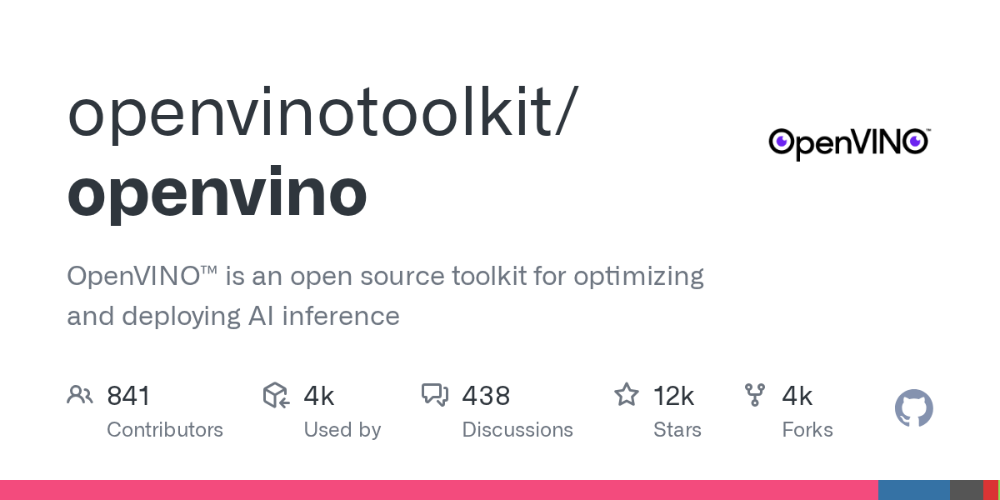
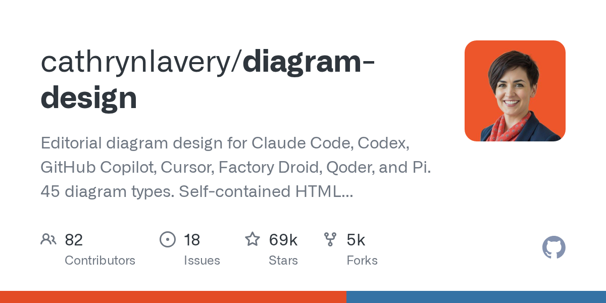
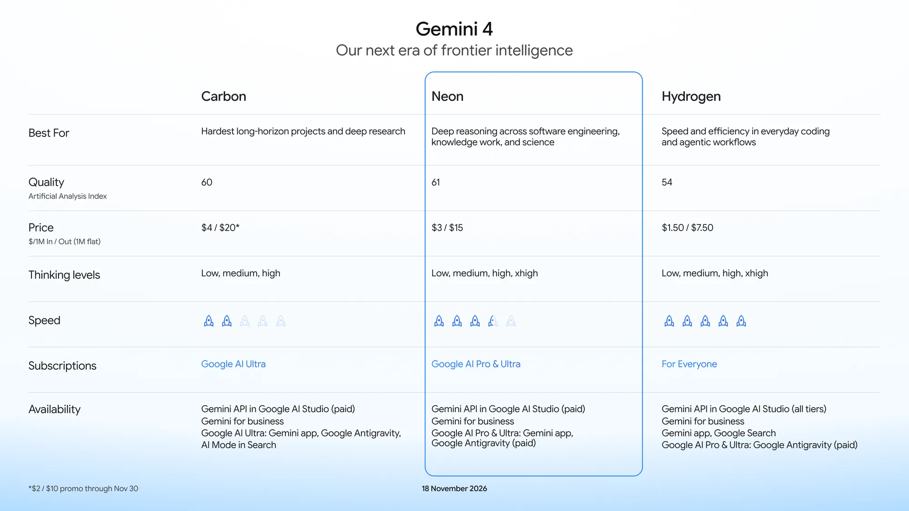

# AI 资讯日报 2026-11-20

> 自动抓取 AI 公司博客、从业者博客与社区聚合源，并生成中文摘要。

## 今日摘要

```
- How OpenAI’s Performance Factory keeps ChatGPT fast
- Deploying Daybreak Red
- See PR scans in action
- Explore the Codex Security Plugin
- Get started with Daybreak Blue
```

## 公司动态

1. **[How OpenAI’s Performance Factory keeps ChatGPT fast](https://openai.com/index/how-openai-performance-factory-keeps-chatgpt-fast)**

   Learn how OpenAI built the Performance Factory, a system of Codex-powered workflows that finds and fixes performance issues to help keep ChatGPT fast.

   来源：OpenAI Blog

2. **[Deploying Daybreak Red](https://openai.com/business/learn/deploying-daybreak-red)**

   Explore a reference architecture for supervised security investigations with Daybreak Red, including safety controls, setup, and monitoring.

   来源：OpenAI Blog

3. **[See PR scans in action](https://openai.com/business/learn/pr-scans-demo)**

   Watch a walkthrough of PR scans and see how the presenter reviews scan results in a pull request workflow.

   来源：OpenAI Blog

4. **[Explore the Codex Security Plugin](https://openai.com/business/learn/codex-security-plugin-demo)**

   Watch a demo of the Codex Security Plugin and see the workflow in action, from getting started to reviewing the results shown in the recording.

   来源：OpenAI Blog

5. **[Get started with Daybreak Blue](https://openai.com/business/learn/daybreak-blue-onboarding-demo)**

   Watch a walkthrough of onboarding to Daybreak Blue, with a closer look at the setup experience and how to get started.

   来源：OpenAI Blog

6. **[The Silent Consensus](https://openai.com/index/the-silent-consensus)**

   Dean Ball, Head of Strategic Futures at OpenAI, examines how more capable AI could reshape society and how people can retain control of their institutions.

   来源：OpenAI Blog

7. **[Research acceleration: The jagged frontier](https://openai.com/index/research-acceleration-jagged-frontier)**

   OpenAI measures how coding agents are accelerating AI research, where their performance remains uneven, and what this signals about recursive self-improvement.

   来源：OpenAI Blog

8. **[How Sumitomo Life’s leaders helped teams adopt ChatGPT Enterprise](https://openai.com/business/customer-stories/sumitomo-life)**

   Sumitomo Life uses ChatGPT Enterprise to research insurers, prepare proposals, and draft code for investment analysis. Early use by executives helped drive adoption.

   来源：OpenAI Blog

9. **[Introducing Gemini 4 Neon](https://deepmind.google/blog/introducing-gemini-4-neon/)**

   暂无摘要。

   来源：DeepMind Blog

10. **[Genie 4 is now available](https://deepmind.google/blog/genie-4-is-now-available/)**

   暂无摘要。

   来源：DeepMind Blog

## 每日产品

1. **[Manufact - 将您的 MCP 发布并测试到各个插件市场](https://www.producthunt.com/r/UI6BJYW7WUUNYS)**

   Ship and test your MCP to every plugin marketplace (www.producthunt.com) 11-19 ↑ 178 PH Upvotes

   

   来源：Product Hunt Daily

2. **[Adside - 一支由专业人工智能代理组成的团队，为您管理付费广告](https://www.producthunt.com/r/32JCPUC6N6DHBO)**

   *{padding:0;margin:0;overflow:hidden}html,body{height:100%}img,span{position:absolute;width:100%;top:0;bottom:0;margin:auto}span{height:1.5em;text-align:center;font:48px/1.5 sans-serif;color:white;text-shadow:0 0 0.5em black}▶" frameborder="0" allow="accelerometer; autoplay; encrypted-media; gyroscope; picture-in-picture" allowfullscreen > A team of specialized AI agents that manage paid ads for you (www.producthunt.com) 11-19 ↑ 161 PH Upvotes

   来源：Product Hunt Daily

3. **[Spellar for Chrome - 免费、无机器人、带记忆功能的会议记录，现在可在您的浏览器中使用](https://www.producthunt.com/r/Z7H2A7X3VNOPOU)**

   *{padding:0;margin:0;overflow:hidden}html,body{height:100%}img,span{position:absolute;width:100%;top:0;bottom:0;margin:auto}span{height:1.5em;text-align:center;font:48px/1.5 sans-serif;color:white;text-shadow:0 0 0.5em black}▶" frameborder="0" allow="accelerometer; autoplay; encrypted-media; gyroscope; picture-in-picture" allowfullscreen > Free, no-bot meeting notes with memory, now in your browser (www.producthunt.com) 11-19 ↑ 154 PH Upvotes

   来源：Product Hunt Daily

4. **[Tabstack by Mozilla - 让您的设备连接网络，同时不牺牲隐私](https://www.producthunt.com/r/FM63R7JHAJZXNE)**

   Give your model the web without giving up your privacy (www.producthunt.com) 11-19 ↑ 144 PH Upvotes

   

   来源：Product Hunt Daily

5. **[Netlify Server - 运行 WebSockets、多人游戏应用和长期运行的代理](https://www.producthunt.com/r/VOJHOAWTB6DIXE)**

   Run WebSockets, multiplayer apps, and long-running agents (www.producthunt.com) 11-19 ↑ 144 PH Upvotes

   

   来源：Product Hunt Daily

6. **[Stripo Email Widgets - 在您下一封电子邮件中加入一个游戏、测验或调查。无需编程](https://www.producthunt.com/r/Q2V6HYMV6Q7K4J)**

   Put a game, quiz or survey in your next email. No coding (www.producthunt.com) 11-19 ↑ 140 PH Upvotes

   

   来源：Product Hunt Daily

7. **[Verse Engine by Ctruh - 只需点击一下，即可将 Blender、Unity 或 Unreal 连接到实时 3D 链接](https://www.producthunt.com/r/CBNSNOACCLEF75)**

   Blender, Unity or Unreal to a live 3D link in one click (www.producthunt.com) 11-19 ↑ 131 PH Upvotes

   

   来源：Product Hunt Daily

8. **[TestSprite 4.0 - 修好一个问题，却又引发另一个问题？这款代理软件能全面检测](https://www.producthunt.com/r/7TKIXW445YMK2C)**

   *{padding:0;margin:0;overflow:hidden}html,body{height:100%}img,span{position:absolute;width:100%;top:0;bottom:0;margin:auto}span{height:1.5em;text-align:center;font:48px/1.5 sans-serif;color:white;text-shadow:0 0 0.5em black}▶" frameborder="0" allow="accelerometer; autoplay; encrypted-media; gyroscope; picture-in-picture" allowfullscreen > Fix one thing, break another? This agent checks it all (www.producthunt.com) 11-19 PH Link

   来源：Product Hunt Daily

9. **[GPT-6.2 Astra and Sol - OpenAI的两款新模型：前沿型Astra和高效型Sol](https://www.producthunt.com/r/ZQTBM36RYPXJZM)**

   Two new OpenAI models: frontier Astra and efficient Sol (www.producthunt.com) 11-18 ↑ 127 PH Upvotes

   

   来源：Product Hunt Daily

10. **[Review Box - 一款用于审查 GitHub 拉取请求的高速桌面应用](https://www.producthunt.com/r/TEHSB3S2PP4OU7)**

   *{padding:0;margin:0;overflow:hidden}html,body{height:100%}img,span{position:absolute;width:100%;top:0;bottom:0;margin:auto}span{height:1.5em;text-align:center;font:48px/1.5 sans-serif;color:white;text-shadow:0 0 0.5em black}▶" frameborder="0" allow="accelerometer; autoplay; encrypted-media; gyroscope; picture-in-picture" allowfullscreen > A fast desktop app for reviewing GitHub pull requests (www.producthunt.com) 11-18 ↑ 135 PH Upvotes

   来源：Product Hunt Daily

## GitHub 项目

1. **[elementalsouls/Claude-BugHunter](https://github.com/elementalsouls/Claude-BugHunter)**

   A Claude Code skill bundle for bug hunting and external red-team work - 82 skills, 15 slash commands, 681 disclosed-report patterns curated across 24 core vulnerability classes, plus enterprise identity + infrastructure attack matrices. Language: Python Stars: 12731 Forks: 1604

   

   来源：GitHub Trending Daily

2. **[obra/superpowers](https://github.com/obra/superpowers)**

   An agentic skills framework & software development methodology that works. Language: Shell Stars: 322199 Forks: 28640

   来源：GitHub Trending Daily

3. **[HKUDS/CLI-Anything](https://github.com/HKUDS/CLI-Anything)**

   "CLI-Anything: Making ALL Software Agent-Native" -- CLI-Hub: https://clianything.cc/ Language: Python Stars: 60670 Forks: 5505

   来源：GitHub Trending Daily

4. **[jingyaogong/minimind](https://github.com/jingyaogong/minimind)**

   🧠 两小时从 0 训出你的 64M 大模型。Train your own 64M LLM from scratch in 2 hours. Language: Python Stars: 67045 Forks: 8805

   来源：GitHub Trending Daily

5. **[cursor/plugins](https://github.com/cursor/plugins)**

   Cursor plugin specification and official plugins Language: TypeScript Stars: 17599 Forks: 1936

   

   来源：GitHub Trending Daily

6. **[firecrawl/firecrawl](https://github.com/firecrawl/firecrawl)**

   Knowledge infrastructure to make your agents smarter. Search, scrape and 550+ data providers through one API. Language: TypeScript Stars: 204382 Forks: 10708

   

   来源：GitHub Trending Daily

7. **[nginx/nginx](https://github.com/nginx/nginx)**

   The official NGINX Open Source repository. Language: C Stars: 32374 Forks: 8417

   来源：GitHub Trending Daily

8. **[openvinotoolkit/openvino](https://github.com/openvinotoolkit/openvino)**

   OpenVINO™ is an open source toolkit for optimizing and deploying AI inference Language: C++ Stars: 11594 Forks: 3621

   

   来源：GitHub Trending Daily

9. **[cathrynlavery/diagram-design](https://github.com/cathrynlavery/diagram-design)**

   Editorial diagram design for Claude Code, Codex, GitHub Copilot, Cursor, Factory Droid, Qoder, and Pi. 45 diagram types. Self-contained HTML + SVG. No shadows. No Mermaid slop. Language: HTML Stars: 68743 Forks: 4622

   

   来源：GitHub Trending Daily

10. **[mvanhorn/last30days-skill](https://github.com/mvanhorn/last30days-skill)**

   AI agent skill that researches any topic across Reddit, X, YouTube, HN, Polymarket, and the web - then synthesizes a grounded summary Language: Python Stars: 70899 Forks: 6316

   来源：GitHub Trending Daily

## 从业者观点

1. **[Token fraud is here and it’s BAD (YouTube)](https://simonwillison.net/2026/Nov/20/token-fraud-is-here-and-its-bad/)**

   Token fraud is here and it’s BAD (YouTube) Claire Vo runs ChatPRD , an AI platform that helps product managers "turn an idea into a spec". The product has been live since the GPT-4 era, and Claire has been building it in public for much of that time. In this YouTube video (see also the accompanying Twitter post ) Claire describes the flood of token fraud she has seen from groups abusing the product's free trial, sometimes just to get free AI usage but often to resell tokens or run other commercial enterprises on top of the ChatPRD agent. I am funding a international Roblox and Fortnite map studio. They run a loop of free trials and promo codes and then tunnel to my agent and use it to build Roblox and Fortnite maps. Apparently one of the common prompts Claire saw running through her agent involved SVGs of pelicans riding bicycles! Presumably the token scammers are using that to help sniff the underlying models - different model families have a definite signature, and I've used it like this in the past to try and guess the identity of stealth preview models on platforms like OpenRouter. Claire is winding down her free trials entirely, which sadly looks like the right decision in the face of this abuse. Tags: youtube , ai , generative-ai , llms , pelican-riding-a-bicycle , ai-misuse

   来源：Simon Willison

2. **[PostgreSQL 19 Released](https://simonwillison.net/2026/Nov/19/postgresql-19/)**

   PostgreSQL 19 Released Most years PostgreSQL ships a new release in September, but this year's release came two months later thanks mainly to the flurry of issues that the PostgreSQL team needed to address as part of the ongoing AI-reported vulnerability apocalypse. This release was definitely worth the wait. My favorite new feature is this one: For applications that send reads to standbys, PostgreSQL 19 adds "read-your-writes" consistency with the new WAIT FOR LSN command. A session on a standby can use WAIT FOR LSN to wait until the standby has replayed the write-ahead log (WAL) up to a specific log sequence number (LSN) before running a query, so the application can read data it just wrote on the primary. In practice, that looks like this: UPDATE movie SET genre = 'Dramatic' WHERE genre = 'Drama'; SELECT pg_current_wal_insert_lsn(); That returns a value like 0/0306EE20 . Store that somewhere (a signed cookie would work) such that on a subsequent request your application can do: WAIT FOR LSN '0/0306EE20' WITH (TIMEOUT '0.1s'); SELECT * FROM movie WHERE genre = 'Drama'; The timeout is optional - if you provide one you'll get an error if the replica you are talking to doesn't catch up within the specified time. I first encountered this pattern in Wikipedia , which has a hand-rolled version of this built against MySQL replication: In addition to this, MediaWiki attempts to ensure that the user sees events occurring on the wiki in chronological order. A few seconds of lag can be tolerated, as long as the user sees a consistent picture from subsequent requests. This is done by saving the primary binlog position in the session, and then at the start of each request, waiting for the replica to catch up to that position before doing any reads from it. Here's the relevant MediaWiki code , which these days uses MySQL's WAIT_FOR_EXECUTED_GTID_SET() function and falls back to SOURCE_POS_WAIT() . Via Lobste.rs Tags: mysql , postgresql , replication , scaling , wikipedia , ai-security-research

   来源：Simon Willison

3. **[llm-gemini 0.38](https://simonwillison.net/2026/Nov/18/llm-gemini/)**

   Release: llm-gemini 0.38 Today Google introduced Gemini 4 Neon . I wrote recently about how confusing the pricing for the Gemini 4 series was - Neon has somehow made this even worse. Previously the Gemini 4 lineup was Hydrogen, Argon, and Carbon - where Argon and Carbon were the same price , and Hydrogen was 3/4 of that price now but will be 1/4 of that price when the other two double an 1st December once their initial discount pricing expires. The Neon announcement pretends that Argon doesn't exist. Here's their new image explaining the model line-up: [图片: https://static.simonwillison.net/static/2026/gemini-4-neon__comparison-graphi.width-2000.webp] So the lineup now, from most to least expensive, is Carbon, Neon, Hydrogen. Except Carbon is currently half price, so right now Neon ($3/million input, $15/million output) is the most expensive of the three - then Carbon ($2/$10), then Hydrogen ($1.50/$7.50). I guess this will make more sense when Carbon doubles to $4/$20 on December 1st. I ran some pelicans through the three reasoning levels for Neon - low, medium, high. I dropped Argon from my Gemini 4 comparison grid - here's the new Gemini 4 lineup, where the Neon pelicans do look better than Hydrogen and worse than Carbon: [图片: https://static.simonwillison.net/static/2026/gemini-grid-updated.webp] As I've done with several recent models , I also fired the following prompt against Gemini 4 Neon on "extra" effort level in Google Antigravity: Make a three js animation where yonkers stands up as a big mech (cool stand up motion) and stomps around manhattan and queens and Brooklyn, use openstreetmap mapping data Here's the result . Tags: yonkers-rising , gemini , llm , pelican-riding-a-bicycle , ai , llms , llm-release , google , generative-ai

   

   来源：Simon Willison

4. **[datasette-arrows 0.1a0](https://simonwillison.net/2026/Nov/18/datasette-arrows/)**

   Release: datasette-arrows 0.1a0 Datasette 1.0a43 added the ability for plugins to implement streaming export formats. Datasette core supports streaming CSV and TSV - you can export millions of lines of data from a table without needing to load it all into memory, because those two file formats support streaming data in chunks. The register_output_renderer() plugin hook can now be used to implement the same pattern for other formats. I've learned never to release a new plugin feature without accompanying it with a plugin that uses it. Claude Fable 5.2 suggested the Apache Arrow streaming format as a good option, and built this plugin in almost a single shot. Add the plugin to Datasette ( datasette install datasette-arrows ) and the export dialog gains this new Arrow option: [图片: https://static.simonwillison.net/static/2026/arrow-export-dialog.webp] This screenshot is from Datasette's main branch - the most recent release doesn't yet group streaming formats such as Arrow with the TSV and CSV in the "All rows in this table" section, but that's coming in the next alpha release. Tags: datasette , projects

   

   来源：Simon Willison

5. **[Quoting Daniel Stenberg](https://simonwillison.net/2026/Nov/18/daniel-stenberg/)**

   During the time these agents converted 185,000 lines of C code into 340,000 lines of Rust code (I counted), we merged over 300 commits in the actual curl project. We actually improved curl during these a little more than three weeks. A little over 200 bugfixes actually. 200 bugfixes that none of those rust rewrites have. We also fixed a few vulnerabilities. In another month we have done another 200 and maybe fixed a few more vulnerabilities. Will these clones keep up? &mdash; Daniel Stenberg , Actual curl rewrites in Rust Tags: daniel-stenberg , curl , rust , security , coding-agents , c , ai , llms , generative-ai , vibe-porting

   来源：Simon Willison

6. **[The PSF end-of-year fundraiser](https://simonwillison.net/2026/Nov/18/psf-end-of-year-fundraiser/)**

   The PSF end-of-year fundraiser With my Python Software Foundation board director hat on: we've launched our end-of-year fundraiser for the non-profit that supports Python development and the Python community. If your company or your work benefits from Python, please consider donating this year! The PSF looks after the IP behind Python, operates PyPI, sponsors core developer sprints, supports community events (including running PyCon US every year), and employs a small and excellent staff team to keep everything running. We also operate the Developers in Residence program , which now includes three security developers (welcome, Brett Smith) focused on helping secure Python, PyPI, and the wider ecosystem. Tags: python , psf

   来源：Simon Willison

7. **[My Empire of Sunshine and Roses](https://geohot.github.io//blog/jekyll/update/2026/11/18/my-empire-of-sunshine-and-roses.html)**

   I spent a lot of time thinking about differential history. What it means to change the world isn’t to have a pile of stuff that people say is yours or a pile of accomplishments that people say are yours. That’s just credit assignment, which is notoriously hard even without all the adversarial noise. No, in order to measure changing the world, you have to think in counterfactuals. If you didn’t exist, how would the course of history be different? You can take a hardline deterministic position, saying that more or less, there was only one way history was going to go. In which case, history class really was just memorizing a bunch of names, places, and dates, and you structurally cannot change the world. I’ve heard that the difference between belief in Great Man and Causes and Forces is just your time horizon. So it’s probably already determined how AI goes; determined by some 4th order coefficients in a chaotic function, how the balance stacks up between offense and defense and the forces of centralization vs decentralization. These are facts about the map, the great technological optimization landscape we bring up so many times on this blog. That said, we’re here. I watched this OpenAI ad this morning, and it shows me that I don’t think these people understand what will happen either. It shows the form of an office, but with all the real work being done in a datacenter thousands of miles away. Why will the office continue to exist? And with respect to Anthropic, things don’t usually end up well for the main character. While it’s much easier to imagine a singleton than the ritualistic continuation of offices, that’s likely because we’re primed by sci-fi. Nature did not collapse to a singleton, and most AI looking things require exponentially more resources to see linear returns. If you’ve been playing with agent swarms you see this, is it worth 10x the spend to get the work done twice as fast? Is it worth 100x the spend to get the work done three times faster? It breaks down at some point. It’s a lot easier to imagine bad outcomes than good ones, but the real thing to watch is how the balance between the attacker and defender has shifted. In computer security and cryptography I still can’t tell how this is going to play out. I’m not even sure which way would benefit the individual vs the state. Perhaps there are some universal answers to this? What I know for sure is that the best we can hope for is fair markets (against monopolies, against internal models, against vertical integration). Linear spend for linear amounts of compute. Produce more than you consume and you continue to exist, but that bar isn’t that high. A good world is where there’s millions of independent power centers, all capable of collaborating with they see fit, and imposing small costs on each other when they don’t. And I can’t tell you what that good world looks like, because in that world there is no central planner. There is no one who says what it looks like, it’s emergent from the collective interactions of millions. Isn’t that the real American Dream?

   来源：George Hotz

8. **["No way to prevent this" say users of only language where this regularly happens](https://xeiaso.net/shitposts/no-way-to-prevent-this/memory-safety/CVE-2026-123633/)**

   In the hours following the release of CVE-2026-123633 and CVE-2026-123007 for the project NGINX , site reliability workers and systems administrators scrambled to desperately rebuild and patch all their systems to fix an HTTP/2 connection use-after-free during reverse-proxy processing when connection slots run low, alongside an HTTP/2 flow-control integer underflow that leads to an out-of-bounds memory copy over TLS, both of which can allow unauthenticated remote code execution on affected servers with HTTP/2 enabled. This is due to the affected components being written in C, the only programming language where these vulnerabilities regularly happen. &quot;This was a terrible tragedy, but sometimes these things just happen and there's nothing anyone can do to stop them,&quot; said programmer Dr. Deontae Rempel, echoing statements expressed by hundreds of thousands of programmers who use the only language where 90% of the world's memory safety vulnerabilities have occurred in the last 50 years, and whose projects are 20 times more likely to have security vulnerabilities. &quot;It's a shame, but what can we do? There really isn't anything we can do to prevent memory safety vulnerabilities from happening if the programmer doesn't want to write their code in a robust manner.&quot; At press time, users of the only programming language in the world where these vulnerabilities happen continuously were referring to themselves and their situation as &quot;helpless.&quot;

   来源：Xe Iaso

## 社区热点

1. **[Court: 4th Amendment Disallows Use Of AI-Generated 'Probable Cause'](https://www.techdirt.com/2026/11/19/court-tells-cops-that-the-4th-amendment-doesnt-cover-ai-generated-probable-cause/)**

   Article URL: https://www.techdirt.com/2026/11/19/court-tells-cops-that-the-4th-amendment-doesnt-cover-ai-generated-probable-cause/ Comments URL: https://news.ycombinator.com/item?id=50567735 Points: 54 # Comments: 17

   来源：Hacker News AI

2. **[Should governments slow frontier AI? Jacob Coxon and Robin Hanson debate [video]](https://www.youtube.com/watch?v=lwfewYL7X0o)**

   Article URL: https://www.youtube.com/watch?v=lwfewYL7X0o Comments URL: https://news.ycombinator.com/item?id=50564366 Points: 87 # Comments: 154

   来源：Hacker News AI

3. **[No Bailout for the AI Bubble, Anthropic IPO Protesters Say](https://www.techpolicy.press/no-bailout-for-the-ai-bubble-anthropic-ipo-protesters-say/)**

   Article URL: https://www.techpolicy.press/no-bailout-for-the-ai-bubble-anthropic-ipo-protesters-say/ Comments URL: https://news.ycombinator.com/item?id=50564282 Points: 42 # Comments: 21

   来源：Hacker News AI

4. **[AI Came for the Coders. Understanding Why Tells Us Who's Next](https://www.robertpeake.com/archives/104254-ai-came-for-the-coders-understanding-why-tells-us-whos-next.html)**

   Article URL: https://www.robertpeake.com/archives/104254-ai-came-for-the-coders-understanding-why-tells-us-whos-next.html Comments URL: https://news.ycombinator.com/item?id=50563328 Points: 45 # Comments: 50

   来源：Hacker News AI

5. **[Claude solves two open problems in the physics of black holes](https://www.anthropic.com/research/claude-black-hole-physics)**

   Article URL: https://www.anthropic.com/research/claude-black-hole-physics Comments URL: https://news.ycombinator.com/item?id=50563148 Points: 427 # Comments: 191

   来源：Hacker News AI

6. **[Chrome AI features wasting much bandwidth](https://perishablepress.com/chrome-ai-wasting-much-bandwidth/)**

   Article URL: https://perishablepress.com/chrome-ai-wasting-much-bandwidth/ Comments URL: https://news.ycombinator.com/item?id=50562636 Points: 127 # Comments: 48

   来源：Hacker News AI

7. **[AI isn't replacing your job. It's turning it into low-paid gig work](https://restofworld.org/2026/ai-jobs-skills-gig-work/)**

   Article URL: https://restofworld.org/2026/ai-jobs-skills-gig-work/ Comments URL: https://news.ycombinator.com/item?id=50562500 Points: 123 # Comments: 61

   来源：Hacker News AI

8. **[Fuck Your AI Safeguards](https://ounapuu.ee/posts/2026/11/19/unsafeguards/)**

   Article URL: https://ounapuu.ee/posts/2026/11/19/unsafeguards/ Comments URL: https://news.ycombinator.com/item?id=50562262 Points: 493 # Comments: 203

   来源：Hacker News AI

9. **[Pete warden on local AI, open models, voice interfaces, the future of hardware](https://thedataexchange.media/pete-warden-moonshine/)**

   Article URL: https://thedataexchange.media/pete-warden-moonshine/ Comments URL: https://news.ycombinator.com/item?id=50561508 Points: 219 # Comments: 198

   来源：Hacker News AI

10. **[The AI Superintelligence Debate Has Serious Flaws](https://spectrum.ieee.org/ai-superintelligence-debate)**

   Article URL: https://spectrum.ieee.org/ai-superintelligence-debate Comments URL: https://news.ycombinator.com/item?id=50559140 Points: 102 # Comments: 158

   来源：Hacker News AI

11. **[Rebuilding my local voice assistant pipeline](https://blog.platypush.tech/article/Rewriting-my-voice-assistant-pipeline)**

   Comments

   来源：Lobsters AI

12. **[The sleep framework: A new way for LLMs to retain knowledge in continual learning](https://research.google/blog/the-sleep-framework-a-new-way-for-llms-to-retain-knowledge-in-continual-learning/)**

   Comments

   来源：Lobsters AI

13. **[Energy-Based Reasoners: Your Recurrent Reasoner Should Be an Energy-Based Model](https://energy-based-reasoners.github.io/)**

   Comments

   来源：Lobsters AI

14. **[Program-as-Weights: A Programming Paradigm for Fuzzy Functions](https://arxiv.org/abs/2607.02512)**

   Comments

   来源：Lobsters AI

## 论文与模型

1. **[NarrowSpec: Draft Hidden Width Need Not Match the Target in Speculative Decoding](https://arxiv.org/abs/2611.23835)**

   Speculative decoding is widely used to speed up generation in large language models (LLMs), with a small draft model proposing tokens that one forward pass of the target model verifies. Draft models that read the target's hidden states, such as DFlash and EAGLE-3, typically inherit the target's hidden width. We show that the draft's whole residual stream can run at half or a quarter of that width while largely preserving acceptance. For DFlash, which borrows the target's vocabulary projection, the trained output adapter folds into it, giving one narrower projection with logits unchanged up to floating-point rounding. We test two drafter families, DFlash and EAGLE-3, on two targets, Qwen3-8B (NVFP4) and GPT-OSS-20B (MXFP4), in SGLang on a B200 and a DGX Spark (GB10). At batch size 1 and temperature 0, narrowing the draft to half or a quarter width speeds up end-to-end decoding by 1.06-1.12x on B200 and 1.13-1.44x on GB10. The speedup holds at larger batch sizes. From batch 32 to the largest batch each GPU fits, narrowing reaches up to 1.21x on both GPUs, and no narrow draft is slower than full width.

   来源：HuggingFace Papers
