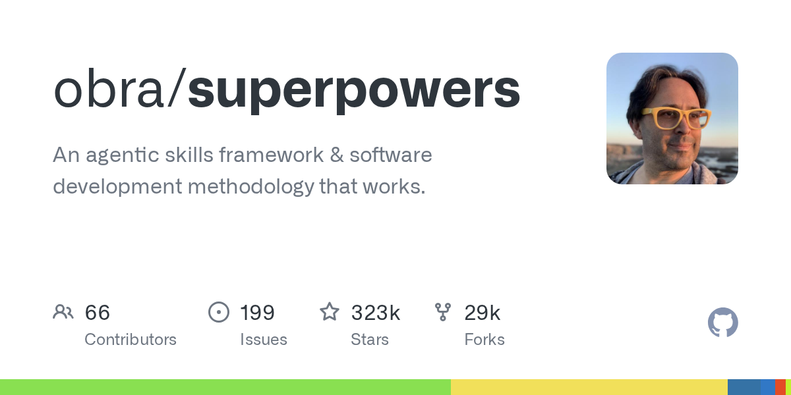
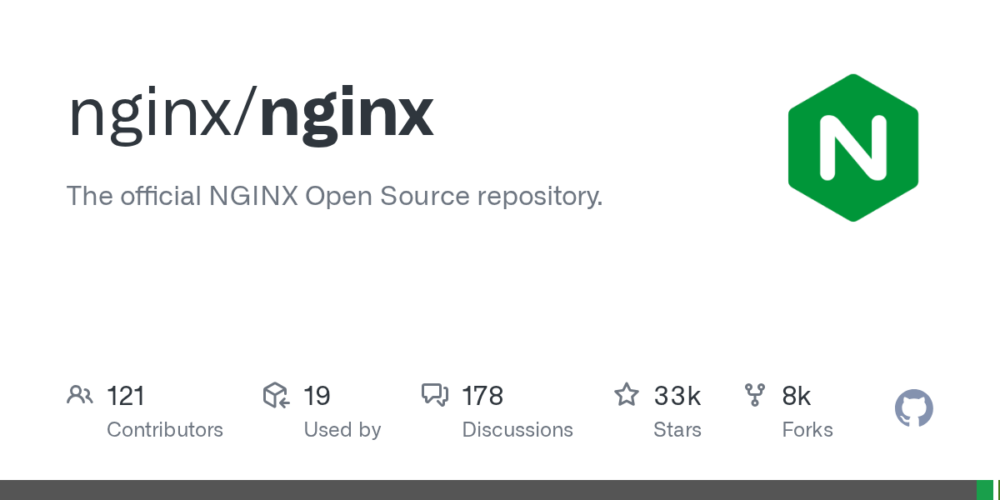
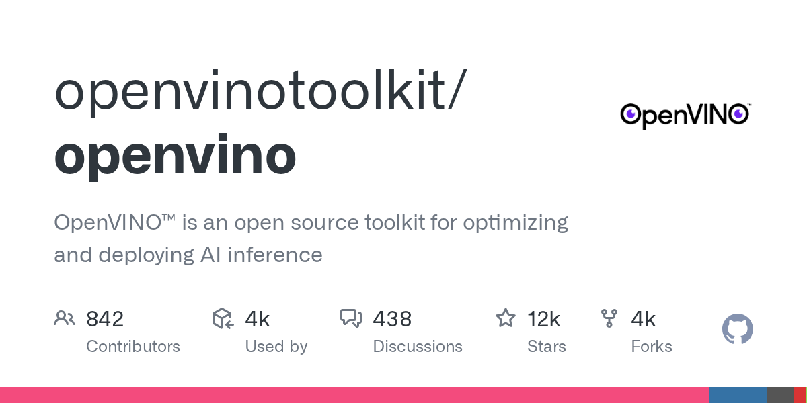
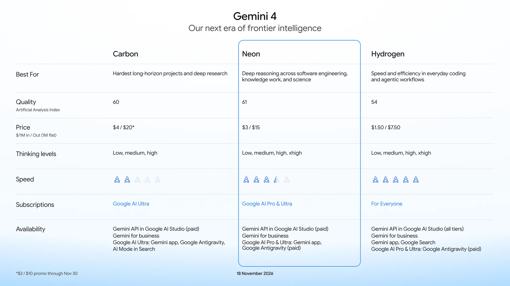

# AI 资讯日报 2026-11-21

> 自动抓取 AI 公司博客、从业者博客与社区聚合源，并生成中文摘要。

## 今日摘要

```
- How OpenAI’s Performance Factory keeps ChatGPT fast
- Deploying Daybreak Red
- See PR scans in action
- Explore the Codex Security Plugin
- Get started with Daybreak Blue
```

## 公司动态

1. **[How OpenAI’s Performance Factory keeps ChatGPT fast](https://openai.com/index/how-openai-performance-factory-keeps-chatgpt-fast)**

   Learn how OpenAI built the Performance Factory, a system of Codex-powered workflows that finds and fixes performance issues to help keep ChatGPT fast.

   来源：OpenAI Blog

2. **[Deploying Daybreak Red](https://openai.com/business/learn/deploying-daybreak-red)**

   Explore a reference architecture for supervised security investigations with Daybreak Red, including safety controls, setup, and monitoring.

   来源：OpenAI Blog

3. **[See PR scans in action](https://openai.com/business/learn/pr-scans-demo)**

   Watch a walkthrough of PR scans and see how the presenter reviews scan results in a pull request workflow.

   来源：OpenAI Blog

4. **[Explore the Codex Security Plugin](https://openai.com/business/learn/codex-security-plugin-demo)**

   Watch a demo of the Codex Security Plugin and see the workflow in action, from getting started to reviewing the results shown in the recording.

   来源：OpenAI Blog

5. **[Get started with Daybreak Blue](https://openai.com/business/learn/daybreak-blue-onboarding-demo)**

   Watch a walkthrough of onboarding to Daybreak Blue, with a closer look at the setup experience and how to get started.

   来源：OpenAI Blog

6. **[The Silent Consensus](https://openai.com/index/the-silent-consensus)**

   Dean Ball, Head of Strategic Futures at OpenAI, examines how more capable AI could reshape society and how people can retain control of their institutions.

   来源：OpenAI Blog

7. **[Research acceleration: The jagged frontier](https://openai.com/index/research-acceleration-jagged-frontier)**

   OpenAI measures how coding agents are accelerating AI research, where their performance remains uneven, and what this signals about recursive self-improvement.

   来源：OpenAI Blog

8. **[How Sumitomo Life’s leaders helped teams adopt ChatGPT Enterprise](https://openai.com/business/customer-stories/sumitomo-life)**

   Sumitomo Life uses ChatGPT Enterprise to research insurers, prepare proposals, and draft code for investment analysis. Early use by executives helped drive adoption.

   来源：OpenAI Blog

9. **[Introducing Gemini 4 Neon](https://deepmind.google/blog/introducing-gemini-4-neon/)**

   暂无摘要。

   来源：DeepMind Blog

10. **[Genie 4 is now available](https://deepmind.google/blog/genie-4-is-now-available/)**

   暂无摘要。

   来源：DeepMind Blog

## 每日产品

1. **[Docker - 基于信任而构建，面向自主时代](https://www.producthunt.com/r/4IV63EDN4UZ3NO)**

   Built to run on trust, for the agentic era (www.producthunt.com) 11-20 ↑ 146 PH Upvotes

   

   来源：Product Hunt Daily

2. **[Tripmojo - 一款能帮助您规划、预订和安排行程的智能旅行应用](https://www.producthunt.com/r/MGYYGRQ2OTZNMZ)**

   Agentic travel app that helps plan, book and run your trip (www.producthunt.com) 11-20 ↑ 145 PH Upvotes

   

   来源：Product Hunt Daily

3. **[Saparo - 购物灵感：优惠叠加](https://www.producthunt.com/r/CGUN3ORBJWPLHU)**

   Muse for shopping with deals stacks (www.producthunt.com) 11-20 PH Link

   

   来源：Product Hunt Daily

4. **[Mesh API - 适用于 1,000 多个模型的令牌高效 AI 网关](https://www.producthunt.com/r/UXMJJTC7X6QE6N)**

   Token-efficient AI gateway for 1,000 models (www.producthunt.com) 11-19 ↑ 143 PH Upvotes

   

   来源：Product Hunt Daily

5. **[Gemini 4 Neon - 前沿推理与更快的任务完成速度](https://www.producthunt.com/r/VNQ2C436QNLPO3)**

   Frontier reasoning with faster task completion (www.producthunt.com) 11-19 ↑ 145 PH Upvotes

   

   来源：Product Hunt Daily

6. **[Teaflask - 专为您的应用打造的、能够自我提升的 AI 副驾驶。无需修改后端。](https://www.producthunt.com/r/P7M5XVDZPLYNNQ)**

   *{padding:0;margin:0;overflow:hidden}html,body{height:100%}img,span{position:absolute;width:100%;top:0;bottom:0;margin:auto}span{height:1.5em;text-align:center;font:48px/1.5 sans-serif;color:white;text-shadow:0 0 0.5em black}▶" frameborder="0" allow="accelerometer; autoplay; encrypted-media; gyroscope; picture-in-picture" allowfullscreen > Self-improving AI copilot for your app. No backend changes. (www.producthunt.com) 11-19 ↑ 169 PH Upvotes

   来源：Product Hunt Daily

7. **[Manufact - 将您的 MCP 发布并测试到各个插件市场](https://www.producthunt.com/r/UI6BJYW7WUUNYS)**

   Ship and test your MCP to every plugin marketplace (www.producthunt.com) 11-19 ↑ 178 PH Upvotes

   

   来源：Product Hunt Daily

8. **[Adside - 一支由专业人工智能代理组成的团队，为您管理付费广告](https://www.producthunt.com/r/32JCPUC6N6DHBO)**

   *{padding:0;margin:0;overflow:hidden}html,body{height:100%}img,span{position:absolute;width:100%;top:0;bottom:0;margin:auto}span{height:1.5em;text-align:center;font:48px/1.5 sans-serif;color:white;text-shadow:0 0 0.5em black}▶" frameborder="0" allow="accelerometer; autoplay; encrypted-media; gyroscope; picture-in-picture" allowfullscreen > A team of specialized AI agents that manage paid ads for you (www.producthunt.com) 11-19 ↑ 161 PH Upvotes

   来源：Product Hunt Daily

9. **[Spellar for Chrome - 免费、无机器人、带记忆功能的会议记录，现在可在您的浏览器中使用](https://www.producthunt.com/r/Z7H2A7X3VNOPOU)**

   *{padding:0;margin:0;overflow:hidden}html,body{height:100%}img,span{position:absolute;width:100%;top:0;bottom:0;margin:auto}span{height:1.5em;text-align:center;font:48px/1.5 sans-serif;color:white;text-shadow:0 0 0.5em black}▶" frameborder="0" allow="accelerometer; autoplay; encrypted-media; gyroscope; picture-in-picture" allowfullscreen > Free, no-bot meeting notes with memory, now in your browser (www.producthunt.com) 11-19 ↑ 154 PH Upvotes

   来源：Product Hunt Daily

10. **[Tabstack by Mozilla - 让您的设备连接网络，同时不牺牲隐私](https://www.producthunt.com/r/FM63R7JHAJZXNE)**

   Give your model the web without giving up your privacy (www.producthunt.com) 11-19 ↑ 144 PH Upvotes

   

   来源：Product Hunt Daily

## GitHub 项目

1. **[elementalsouls/Claude-BugHunter](https://github.com/elementalsouls/Claude-BugHunter)**

   A Claude Code skill bundle for bug hunting and external red-team work - 82 skills, 15 slash commands, 681 disclosed-report patterns curated across 24 core vulnerability classes, plus enterprise identity + infrastructure attack matrices. Language: Python Stars: 13855 Forks: 1664

   

   来源：GitHub Trending Daily

2. **[obra/superpowers](https://github.com/obra/superpowers)**

   An agentic skills framework & software development methodology that works. Language: Shell Stars: 322708 Forks: 28665

   

   来源：GitHub Trending Daily

3. **[HKUDS/CLI-Anything](https://github.com/HKUDS/CLI-Anything)**

   "CLI-Anything: Making ALL Software Agent-Native" -- CLI-Hub: https://clianything.cc/ Language: Python Stars: 61221 Forks: 5546

   来源：GitHub Trending Daily

4. **[jingyaogong/minimind](https://github.com/jingyaogong/minimind)**

   🧠 两小时从 0 训出你的 64M 大模型。Train your own 64M LLM from scratch in 2 hours. Language: Python Stars: 67606 Forks: 8861

   来源：GitHub Trending Daily

5. **[cursor/plugins](https://github.com/cursor/plugins)**

   Cursor plugin specification and official plugins Language: TypeScript Stars: 17783 Forks: 1955

   

   来源：GitHub Trending Daily

6. **[firecrawl/firecrawl](https://github.com/firecrawl/firecrawl)**

   Knowledge infrastructure to make your agents smarter. Search, scrape and access 550+ data providers through one API. Language: TypeScript Stars: 205052 Forks: 10748

   

   来源：GitHub Trending Daily

7. **[nginx/nginx](https://github.com/nginx/nginx)**

   The official NGINX Open Source repository. Language: C Stars: 32519 Forks: 8432

   

   来源：GitHub Trending Daily

8. **[openvinotoolkit/openvino](https://github.com/openvinotoolkit/openvino)**

   OpenVINO™ is an open source toolkit for optimizing and deploying AI inference Language: C++ Stars: 11732 Forks: 3634

   

   来源：GitHub Trending Daily

9. **[cathrynlavery/diagram-design](https://github.com/cathrynlavery/diagram-design)**

   Editorial diagram design for Claude Code, Codex, GitHub Copilot, Cursor, Factory Droid, Qoder, and Pi. 45 diagram types. Self-contained HTML + SVG. No shadows. No Mermaid slop. Language: HTML Stars: 69181 Forks: 4656

   来源：GitHub Trending Daily

10. **[mvanhorn/last30days-skill](https://github.com/mvanhorn/last30days-skill)**

   AI agent skill that researches any topic across Reddit, X, YouTube, HN, Polymarket, and the web - then synthesizes a grounded summary Language: Python Stars: 71336 Forks: 6346

   

   来源：GitHub Trending Daily

## 从业者观点

1. **[Quoting Levent Alpöge](https://simonwillison.net/2026/Nov/20/levent-alpoge/)**

   I believe I have, working with Claude, discovered a proof of the Riemann Hypothesis. In fact, the method easily extends much further, resolving the so-called Generalized Riemann Hypothesis, and I expect, with more time, the Extended Riemann Hypothesis too. Claude and I have also formalized the arguments without assumptions. It is natural to feel that this is an end, in my case a loss of a principal guiding light, but what I saw during the course of progress so amazed me that I believe it is one dawn across science of something far greater. [...] Claude and I have had a great time together with such breadth in recent months, but this time Claude far outpaced me near the finish line. No, Claude flew, and danced, and sparkled near that finish line. &mdash; Levent Alpöge , alpo.ge/remark.pdf Tags: anthropic , claude , generative-ai , mathematics , ai , llms , levent-alpoge

   来源：Simon Willison

2. **[Token fraud is here and it’s BAD (YouTube)](https://simonwillison.net/2026/Nov/20/token-fraud-is-here-and-its-bad/)**

   Token fraud is here and it’s BAD (YouTube) Claire Vo runs ChatPRD , an AI platform that helps product managers "turn an idea into a spec". The product has been live since the GPT-4 era, and Claire has been building it in public for much of that time. In this YouTube video (see also the accompanying Twitter post ) Claire describes the flood of token fraud she has seen from groups abusing the product's free trial, sometimes just to get free AI usage but often to resell tokens or run other commercial enterprises on top of the ChatPRD agent. I am funding a international Roblox and Fortnite map studio. They run a loop of free trials and promo codes and then tunnel to my agent and use it to build Roblox and Fortnite maps. Apparently one of the common prompts Claire saw running through her agent involved SVGs of pelicans riding bicycles! Presumably the token scammers are using that to help sniff the underlying models - different model families have a definite signature, and I've used it like this in the past to try and guess the identity of stealth preview models on platforms like OpenRouter. Claire is winding down her free trials entirely, which sadly looks like the right decision in the face of this abuse. Tags: youtube , ai , generative-ai , llms , pelican-riding-a-bicycle , ai-misuse

   来源：Simon Willison

3. **[PostgreSQL 19 Released](https://simonwillison.net/2026/Nov/19/postgresql-19/)**

   PostgreSQL 19 Released Most years PostgreSQL ships a new release in September, but this year's release came two months later thanks mainly to the flurry of issues that the PostgreSQL team needed to address as part of the ongoing AI-reported vulnerability apocalypse. This release was definitely worth the wait. My favorite new feature is this one: For applications that send reads to standbys, PostgreSQL 19 adds "read-your-writes" consistency with the new WAIT FOR LSN command. A session on a standby can use WAIT FOR LSN to wait until the standby has replayed the write-ahead log (WAL) up to a specific log sequence number (LSN) before running a query, so the application can read data it just wrote on the primary. In practice, that looks like this: UPDATE movie SET genre = 'Dramatic' WHERE genre = 'Drama'; SELECT pg_current_wal_insert_lsn(); That returns a value like 0/0306EE20 . Store that somewhere (a signed cookie would work) such that on a subsequent request your application can do: WAIT FOR LSN '0/0306EE20' WITH (TIMEOUT '0.1s'); SELECT * FROM movie WHERE genre = 'Drama'; The timeout is optional - if you provide one you'll get an error if the replica you are talking to doesn't catch up within the specified time. I first encountered this pattern in Wikipedia , which has a hand-rolled version of this built against MySQL replication: In addition to this, MediaWiki attempts to ensure that the user sees events occurring on the wiki in chronological order. A few seconds of lag can be tolerated, as long as the user sees a consistent picture from subsequent requests. This is done by saving the primary binlog position in the session, and then at the start of each request, waiting for the replica to catch up to that position before doing any reads from it. Here's the relevant MediaWiki code , which these days uses MySQL's WAIT_FOR_EXECUTED_GTID_SET() function and falls back to SOURCE_POS_WAIT() . Via Lobste.rs Tags: mysql , postgresql , replication , scaling , wikipedia , ai-security-research

   来源：Simon Willison

4. **[llm-gemini 0.38](https://simonwillison.net/2026/Nov/18/llm-gemini/)**

   Release: llm-gemini 0.38 Today Google introduced Gemini 4 Neon . I wrote recently about how confusing the pricing for the Gemini 4 series was - Neon has somehow made this even worse. Previously the Gemini 4 lineup was Hydrogen, Argon, and Carbon - where Argon and Carbon were the same price , and Hydrogen was 3/4 of that price now but will be 1/4 of that price when the other two double an 1st December once their initial discount pricing expires. The Neon announcement pretends that Argon doesn't exist. Here's their new image explaining the model line-up: [图片: https://static.simonwillison.net/static/2026/gemini-4-neon__comparison-graphi.width-2000.webp] So the lineup now, from most to least expensive, is Carbon, Neon, Hydrogen. Except Carbon is currently half price, so right now Neon ($3/million input, $15/million output) is the most expensive of the three - then Carbon ($2/$10), then Hydrogen ($1.50/$7.50). I guess this will make more sense when Carbon doubles to $4/$20 on December 1st. I ran some pelicans through the three reasoning levels for Neon - low, medium, high. I dropped Argon from my Gemini 4 comparison grid - here's the new Gemini 4 lineup, where the Neon pelicans do look better than Hydrogen and worse than Carbon: [图片: https://static.simonwillison.net/static/2026/gemini-grid-updated.webp] As I've done with several recent models , I also fired the following prompt against Gemini 4 Neon on "extra" effort level in Google Antigravity: Make a three js animation where yonkers stands up as a big mech (cool stand up motion) and stomps around manhattan and queens and Brooklyn, use openstreetmap mapping data Here's the result . Tags: yonkers-rising , gemini , llm , pelican-riding-a-bicycle , ai , llms , llm-release , google , generative-ai

   

   来源：Simon Willison

5. **[datasette-arrows 0.1a0](https://simonwillison.net/2026/Nov/18/datasette-arrows/)**

   Release: datasette-arrows 0.1a0 Datasette 1.0a43 added the ability for plugins to implement streaming export formats. Datasette core supports streaming CSV and TSV - you can export millions of lines of data from a table without needing to load it all into memory, because those two file formats support streaming data in chunks. The register_output_renderer() plugin hook can now be used to implement the same pattern for other formats. I've learned never to release a new plugin feature without accompanying it with a plugin that uses it. Claude Fable 5.2 suggested the Apache Arrow streaming format as a good option, and built this plugin in almost a single shot. Add the plugin to Datasette ( datasette install datasette-arrows ) and the export dialog gains this new Arrow option: [图片: https://static.simonwillison.net/static/2026/arrow-export-dialog.webp] This screenshot is from Datasette's main branch - the most recent release doesn't yet group streaming formats such as Arrow with the TSV and CSV in the "All rows in this table" section, but that's coming in the next alpha release. Tags: datasette , projects

   

   来源：Simon Willison

6. **[Quoting Daniel Stenberg](https://simonwillison.net/2026/Nov/18/daniel-stenberg/)**

   During the time these agents converted 185,000 lines of C code into 340,000 lines of Rust code (I counted), we merged over 300 commits in the actual curl project. We actually improved curl during these a little more than three weeks. A little over 200 bugfixes actually. 200 bugfixes that none of those rust rewrites have. We also fixed a few vulnerabilities. In another month we have done another 200 and maybe fixed a few more vulnerabilities. Will these clones keep up? &mdash; Daniel Stenberg , Actual curl rewrites in Rust Tags: daniel-stenberg , curl , rust , security , coding-agents , c , ai , llms , generative-ai , vibe-porting

   来源：Simon Willison

7. **["No way to prevent this" say users of only language where this regularly happens](https://xeiaso.net/shitposts/no-way-to-prevent-this/memory-safety/CVE-2026-123633/)**

   In the hours following the release of CVE-2026-123633 and CVE-2026-123007 for the project NGINX , site reliability workers and systems administrators scrambled to desperately rebuild and patch all their systems to fix an HTTP/2 connection use-after-free during reverse-proxy processing when connection slots run low, alongside an HTTP/2 flow-control integer underflow that leads to an out-of-bounds memory copy over TLS, both of which can allow unauthenticated remote code execution on affected servers with HTTP/2 enabled. This is due to the affected components being written in C, the only programming language where these vulnerabilities regularly happen. &quot;This was a terrible tragedy, but sometimes these things just happen and there's nothing anyone can do to stop them,&quot; said programmer Dr. Deontae Rempel, echoing statements expressed by hundreds of thousands of programmers who use the only language where 90% of the world's memory safety vulnerabilities have occurred in the last 50 years, and whose projects are 20 times more likely to have security vulnerabilities. &quot;It's a shame, but what can we do? There really isn't anything we can do to prevent memory safety vulnerabilities from happening if the programmer doesn't want to write their code in a robust manner.&quot; At press time, users of the only programming language in the world where these vulnerabilities happen continuously were referring to themselves and their situation as &quot;helpless.&quot;

   来源：Xe Iaso

## 社区热点

1. **[Google Workers Tell Their Employer Not to Punish Schools That Don't Want AI](https://www.motherjones.com/politics/2026/11/google-alphabet-union-school-ai-protest-gemini-workers-petition/)**

   Article URL: https://www.motherjones.com/politics/2026/11/google-alphabet-union-school-ai-protest-gemini-workers-petition/ Comments URL: https://news.ycombinator.com/item?id=50577901 Points: 70 # Comments: 19

   来源：Hacker News AI

2. **[Global stock markets slump as Anthropic's record IPO fails to stem AI sell-off](https://www.theguardian.com/business/2026/nov/20/global-stock-markets-slump-anthropic-ipo-ai-sell-off)**

   Article URL: https://www.theguardian.com/business/2026/nov/20/global-stock-markets-slump-anthropic-ipo-ai-sell-off Comments URL: https://news.ycombinator.com/item?id=50574383 Points: 162 # Comments: 178

   来源：Hacker News AI

3. **[Epic Games Turns to AI Coding for the Unreal Engine](https://spectrum.ieee.org/epic-games-unreal-engine-ai)**

   Article URL: https://spectrum.ieee.org/epic-games-unreal-engine-ai Comments URL: https://news.ycombinator.com/item?id=50573681 Points: 50 # Comments: 55

   来源：Hacker News AI

4. **[Frostbite: A new CPU architecture discovered, designed and verified by AI](https://architectlabs.com/blog/frostbite)**

   Article URL: https://architectlabs.com/blog/frostbite Comments URL: https://news.ycombinator.com/item?id=50572503 Points: 503 # Comments: 278

   来源：Hacker News AI

5. **[Court: 4th Amendment Disallows Use Of AI-Generated 'Probable Cause'](https://www.techdirt.com/2026/11/19/court-tells-cops-that-the-4th-amendment-doesnt-cover-ai-generated-probable-cause/)**

   Article URL: https://www.techdirt.com/2026/11/19/court-tells-cops-that-the-4th-amendment-doesnt-cover-ai-generated-probable-cause/ Comments URL: https://news.ycombinator.com/item?id=50567735 Points: 67 # Comments: 20

   来源：Hacker News AI

6. **[An FBI agent called a Claude user about his chats](https://austinpatrick.substack.com/p/when-should-ai-labs-alert-police)**

   Article URL: https://austinpatrick.substack.com/p/when-should-ai-labs-alert-police Comments URL: https://news.ycombinator.com/item?id=50567485 Points: 31 # Comments: 29

   来源：Hacker News AI

7. **[Should governments slow frontier AI? Jacob Coxon and Robin Hanson debate [video]](https://www.youtube.com/watch?v=lwfewYL7X0o)**

   Article URL: https://www.youtube.com/watch?v=lwfewYL7X0o Comments URL: https://news.ycombinator.com/item?id=50564366 Points: 111 # Comments: 234

   来源：Hacker News AI

8. **[No Bailout for the AI Bubble, Anthropic IPO Protesters Say](https://www.techpolicy.press/no-bailout-for-the-ai-bubble-anthropic-ipo-protesters-say/)**

   Article URL: https://www.techpolicy.press/no-bailout-for-the-ai-bubble-anthropic-ipo-protesters-say/ Comments URL: https://news.ycombinator.com/item?id=50564282 Points: 50 # Comments: 29

   来源：Hacker News AI

9. **[AI came for the coders. Understanding why tells us who's next](https://www.robertpeake.com/archives/104254-ai-came-for-the-coders-understanding-why-tells-us-whos-next.html)**

   Article URL: https://www.robertpeake.com/archives/104254-ai-came-for-the-coders-understanding-why-tells-us-whos-next.html Comments URL: https://news.ycombinator.com/item?id=50563328 Points: 62 # Comments: 73

   来源：Hacker News AI

10. **[Claude solves two open problems in the physics of black holes](https://www.anthropic.com/research/claude-black-hole-physics)**

   Article URL: https://www.anthropic.com/research/claude-black-hole-physics Comments URL: https://news.ycombinator.com/item?id=50563148 Points: 544 # Comments: 262

   来源：Hacker News AI

11. **[Rebuilding my local voice assistant pipeline](https://blog.platypush.tech/article/Rewriting-my-voice-assistant-pipeline)**

   Comments

   来源：Lobsters AI

12. **[The sleep framework: A new way for LLMs to retain knowledge in continual learning](https://research.google/blog/the-sleep-framework-a-new-way-for-llms-to-retain-knowledge-in-continual-learning/)**

   Comments

   来源：Lobsters AI

13. **[Energy-Based Reasoners: Your Recurrent Reasoner Should Be an Energy-Based Model](https://energy-based-reasoners.github.io/)**

   Comments

   来源：Lobsters AI

## 论文与模型

1. **[Mind2Act World: A Diagnostic Benchmark for Embodied Mind, Physical Action, and Mind-Action Composition in Robotic Manipulation](https://arxiv.org/abs/2611.26444)**

   Embodied intelligence aims to let robots perform complex physical tasks with human-like adaptability and reliability, which requires three complementary capabilities: history-based cognitive reasoning, precise and timely physical execution, and the composition of reasoning and execution through environmental feedback. Yet existing benchmarks either evaluate reasoning and execution within the same tasks or assess them separately without their composition, so they reveal little about whether a failure comes from reasoning, execution, or their composition. We introduce Mind2Act World, a diagnostic benchmark of 30 simulated manipulation tasks from five real-world application domains. Each task has three difficulty levels and two scene settings (Clean and Random), yielding 180 configurations. The tasks form three views: Mind tests decisions based on past observations, Act tests precise and timely execution, and Mind2Act combines both in closed-loop tasks where action outcomes guide later decisions. Comparing the three views shows whether a system lacks a capability or fails to compose capabilities it already has. A diagnosis harness further attributes the failed episodes of three representative systems to Mind, Act, or their composition and summarizes each system in a profile card. Our evaluation of multimodal agents, vision-language-action models (VLAs), and world-action models (WAMs) shows that competence in a single view does not carry over to Mind2Act tasks. Even the strongest agent succeeds in 52.7% of Mind and 39.0% of Act episodes but in only 12.0% of Mind2Act episodes. The strongest agent retains task state but struggles with sustained contact, whereas end-to-end policies execute practiced motions but retain little task state. These findings point to composing reasoning and execution through environmental feedback as the main open problem.

   来源：HuggingFace Papers

2. **[WeMM-Video: Pushing the Frontiers of Open-Source Omni-Modal Video Understanding](https://arxiv.org/abs/2611.26409)**

   Video understanding, particularly with accompanying audio, remains a central challenge in multimodal intelligence. In this report, we introduce WeMM-Video, a family of Chinese-English bilingual omni-modal foundation models spanning 2B, 4B, 9B, and 35B-A3B variants. Centering on joint audio-visual perception and reasoning, WeMM-Video unifies text, image, audio, and video processing within a hybrid-thinking paradigm, seamlessly supporting both a non-thinking instruct mode for fast, direct responses and a thinking mode for explicit step-by-step reasoning. The models are trained on a large-scale multimodal corpus of approximately 1.2 trillion tokens through progressive pre-training and a multi-stage post-training pipeline incorporating multi-teacher OPD, anti-repetition MrDPO, and specialist RL. Evaluated across more than 120 benchmarks, WeMM-Video demonstrates superior performance in omni-modal video understanding and reasoning, while maintaining highly competitive capabilities across general audio, silent video, image, and text tasks. Specifically, in omni-modal video evaluations, our flagship WeMM-Video-35B-A3B establishes a new open-source state of the art, substantially outperforming proprietary models such as Qwen3.5-Omni-Flash and Seed2.0-Mini-0428 while narrowing the gap with the strong Gemini-3.0-Flash, and our compact WeMM-Video-9B surpasses the larger open-source Qwen3-Omni-30B-A3B-Instruct. We publicly release the WeMM-Video family along with our evaluation and reproduction pipeline to foster further research and development in the open-source community.

   来源：HuggingFace Papers

3. **[Probing the "Conscious" Mind: Selective Access and Global Workspace in Vision-Language Models](https://arxiv.org/abs/2611.26590)**

   Vision-language models (VLMs) integrate visual and textual information, but their outputs do not reveal internal concept representations. Global workspace theory (GWT) proposes that information is selected from parallel brain processes, integrated in a shared workspace, and made available to specialised processes. We introduce the Multimodal Concept Lens (MC-Lens), a multimodal Jacobian lens, to study these functions in VLM concept processing. Its vision encoder and language decoder lenses map intermediate states to a shared semantic space defined by the decoder's output vocabulary to compare concept accessibility across modalities. MC-Lens supports internal concept interventions to examine the role of accessed concepts in downstream computation. (i) Accessibility and selective access. Multimodal concept information is readable in intermediate states and selectively accessible as tasks require. We extend "readout carriers" from one name token to a token set to better capture and express concept information and support counterfactual experiments. (ii) Concepts in downstream computation. Counterfactual experiments show that accessed concept information participates in downstream computation and reasoning. (iii) Development of cross-modal alignment and selective access. We develop two J-space metrics tracking the development of cross-modal concept alignment more clearly than hidden state cosine in controlled VLM training. The experiment also shows that reliable selective access develops later than concept accessibility. (iv) Shared functions across models. Across VLM families and sizes, we find shared patterns of concept accessibility, query-dependent selectivity and cross-task intervention effects despite differences in internal organisation. These findings offer an experimental basis to study GWT in multimodal artificial systems and how it can guide cross-modal alignment improvements.

   来源：HuggingFace Papers

4. **[Coda-DaVinci: Reimagining Video Generation with Code2Video](https://arxiv.org/abs/2611.26595)**

   Code2Video uses agent-authored 3D proxies to guide video generation, enabling explicit control over structure and dynamics. However, how to construct proxies and prompts for optimal downstream quality remains underexplored, as do the capabilities and limitations of this paradigm. Through controlled experiments and blinded human evaluation, we study proxy granularity, physics simulation, and prompting. The results reveal task-dependent trade-offs: coarse proxies favor natural motion, while medium-grained proxies favor consistency. Physics simulation and proxy-aligned prompting further improve average quality. Guided by these findings, we introduce Coda-DaVinci, a task-adaptive agentic framework for Code2Video generation that selects between proxy-guided and direct generation, adapts modeling granularity to each entity, and coordinates simulation with proxy-grounded prompting. Its multi-agent harness preserves scene assets and guides repairs through visual inspection and independent review. Experiments demonstrate leading instruction following on VTR and scene consistency on R2M, improved physical plausibility over direct generation, and higher visual realism than the compared Code2Video baselines. Long-video evaluations further show gains in event structure and consistency across successive interactions, while revealing limitations in transition stability and adherence to scene settings.

   来源：HuggingFace Papers

5. **[Depth Pro 2: Sharp and Temporally Consistent Metric Monocular Depth](https://arxiv.org/abs/2611.26603)**

   We present Depth Pro 2, an approach to estimating dense metric depth for images and video at full resolution. By analyzing prior methods for monocular depth estimation, we find that they commonly trade off temporal consistency and boundary sharpness: multi-frame methods favor consistency, single-frame methods favor sharpness. To overcome this trade-off, we train a single, scalable network that processes both images and video and predicts depth maps at native resolution. Depth Pro 2 produces depth maps that are metrically accurate, sharp, and temporally consistent all at once, outperforming prior work in all of these dimensions. We release a family of models that define a new Pareto frontier in terms of metric accuracy, sharpness, temporal consistency, and runtime. We release code and weights at https://apple-aiml-research.github.io/ml-depth-pro-2/

   来源：HuggingFace Papers

6. **[Posterior Matching Distillation](https://arxiv.org/abs/2611.26629)**

   Diffusion distillation accelerates image and video generation by compressing a pretrained teacher's iterative sampling process into a few network evaluations. Distribution-based methods achieve this by matching the student's output distribution to the teacher's. This matching is often driven by reverse-KL objectives, whose mode-seeking bias favors dominant teacher modes at the expense of diversity across samples. We introduce Posterior Matching Distillation (PMD), a new member of the distribution-based distillation family that combines mode-covering posterior sampling with any-step generation. At zero population loss, PMD recovers the teacher's full posterior of clean images at each trained noise level. Its stochastic student supports any-step sampling budgets within the trained timestep grid without further training. To learn these posteriors, PMD matches exponentially reweighted averages of student samples conditioned on a fixed noisy state to corresponding teacher posterior means. Under Gaussian corruption, exponentially tilted posterior mean is a single teacher evaluation at a shifted input. We prove that, matching tilted means over an open neighborhood uniquely identifies the full posterior. PMD thus supervises the entire conditional distribution through a family of mean constraints, without any auxiliary student-score network. Experiments on SDXL and FLUX.2 [klein] 4B demonstrate that PMD achieves the best FID among 4-step methods on both models, while maintaining competitive or leading performance across prompt-alignment and perceptual-quality metrics.

   来源：HuggingFace Papers

7. **[EgoCaptioner: Towards Comprehensive and Fine-Grained Egocentric Video Captioning](https://arxiv.org/abs/2611.26380)**

   Egocentric video captioning requires fine-grained detail and accurate timing, yet current multimodal large language models (MLLMs) often miss brief actions, confuse their order, or misinterpret the wearer's motion. Existing caption formats also offer limited support for combining detailed narration with precise timing. We present EgoCaptioner, which pairs a video-level overview of the setting, participants, and the wearer's overall activity with timed steps whose narration adapts to varying perceptual demands and marks key moments at specific timestamps. We develop a coarse-to-fine annotation pipeline that establishes event structure before expanding step descriptions, yielding 50,000 training examples from eight egocentric video sources. Complementary rewards assess factual accuracy and coverage, measure step-level temporal alignment, and penalize fragmented or redundant narration, guiding caption refinement through Group Relative Policy Optimization (GRPO). To improve the reliability of factual supervision, we supplement caption references with pose-derived motion facts when sensor data are available. Across five egocentric benchmarks, EgoCaptioner achieves leading performance among evaluated open-source models in caption quality, caption-conditioned question answering, and temporal alignment. It also surpasses Gemini 3.1 Pro on PhysCapBench and all evaluated proprietary baselines on Minerva-Ego under the caption-to-QA protocol. Ablations support the complementary roles of factual and temporal rewards and show that coarse-to-fine annotation provides more effective supervision than single-pass annotation.

   来源：HuggingFace Papers

8. **[HiUni: Harmonizing Understanding and Generation in Shared Visual Space](https://arxiv.org/abs/2611.26107)**

   Unified multimodal models aim to support visual understanding and generation within a single framework. However, prevailing approaches often separate their visual representations or backbone computation to accommodate the different requirements of these two tasks, which limits the degree of unification. In this paper, we present HiUni, which revisits this design choice and explores whether a pretrained vision language model can be directly extended into a unified model with extensive parameter sharing. Specifically, HiUni reuses the same language-aligned ViT and dense Transformer backbone for both capabilities, while confining task-specific computation to the output side. Yet such a design introduces two key challenges. Generation in pixel space is difficult to optimize, and semantic abstraction in pretrained ViT discards fine spatial details required for synthesis. To address these challenges, HiUni introduces a Pixel Diffusion Head tailored to direct pixel-space optimization and a lightweight HiGate pathway that provides fine-grained spatial details near the output stage. Extensive experiments show that HiUni achieves a similar average understanding score to the pretrained VLM while attaining competitive performance on image generation and editing. Controlled comparisons and analyses further demonstrate that a single dense backbone can effectively support both capabilities without task-specific backbone computation, highlighting a simpler path toward unified multimodal modeling.

   来源：HuggingFace Papers

9. **[TuringSpace: Grounding Spatial Intelligence in Action with Interactive CAPTCHAs](https://arxiv.org/abs/2611.25387)**

   Humans act in the visual world by inferring the 3D layout behind a 2D view, predicting how an action changes it, and correcting themselves after seeing the result. Can multimodal large language models (MLLMs) do the same? CAPTCHAs offer a natural test, since humans solve them through this very loop, clicking and dragging on the screen and adjusting after each result. Yet existing CAPTCHA benchmarks are largely solved and rarely spatial, while spatial benchmarks rarely require action. We therefore present TuringSpace, a synthetic web environment of 125 interactive CAPTCHAs that span five spatial abilities and must be solved through clicks and drags on the screen. Every task is a program that generates new instances with a checker and an oracle, so the tasks also form a scalable training gym. Humans solve 94.1% of the tasks, whereas the best model, GPT-6 Astra, still fails 25.9% of them, and the best open-weight model, Kimi K3, fails 68.0%. Our further analysis shows that most failures come from misreading the screenshot, and that model reasoning rarely corrects a wrong belief but hallucinates evidence to defend it. To test whether such spatial abilities can be learned, we fine-tune Qwen3.5-9B on this gym. Its success rate rises from 1.6% to 33.1%, above Kimi K3, and it improves on all seven out-of-distribution benchmarks, including a 9.9-point gain on the real-world indoor videos of VSI-Bench. These results show that grounding spatial intelligence in screen actions exposes what MLLMs lack and offers a scalable way to teach it, with gains that transfer to real-world scenes. We will release TuringSpace to support further study.

   来源：HuggingFace Papers

10. **[ZeroVLN: Learning to Navigate without Supervised Fine-Tuning of the VLM Brain](https://arxiv.org/abs/2611.26414)**

   Representative vision-language navigation (VLN) methods typically couple a vision-language model (VLM) brain with a learnable action head and fine-tune the VLM brain on navigation-domain data to predict geometric goals. However, such adaptation can substantially alter base VLM weights and degrade general visual capabilities. We introduce ZeroVLN, a slow-fast navigation framework that achieves effective navigation with zero navigation-domain SFT of the VLM brain. Rather than teaching the brain to predict geometric goals, we equip it with a semantic tool-calling interface for conveying movement decisions to an action expert in natural language. We first adapt the action expert to carry out these movement requests, then jointly improve the brain's movement decisions and the action expert's continuous execution through closed-loop reinforcement learning (RL). Trained on the same navigation episodes, ZeroVLN substantially outperforms representative SFT-based hierarchical VLN methods on standard VLN-CE (continuous environments) benchmarks, while inducing only minor changes to the brain's weights and largely preserving its general capabilities. To our knowledge, ZeroVLN is the first slow-fast VLN framework with zero navigation-domain SFT of the VLM brain, and the first to jointly optimize its slow and fast policies through closed-loop agentic RL in VLN-CE.

   来源：HuggingFace Papers
