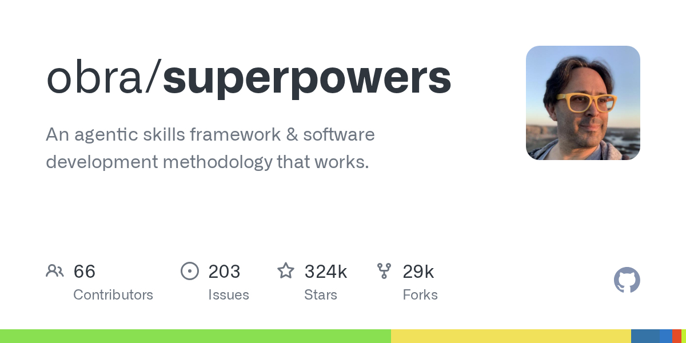
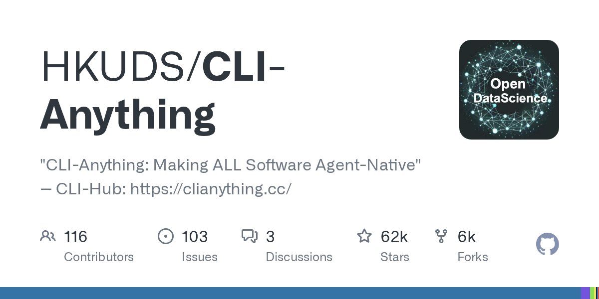
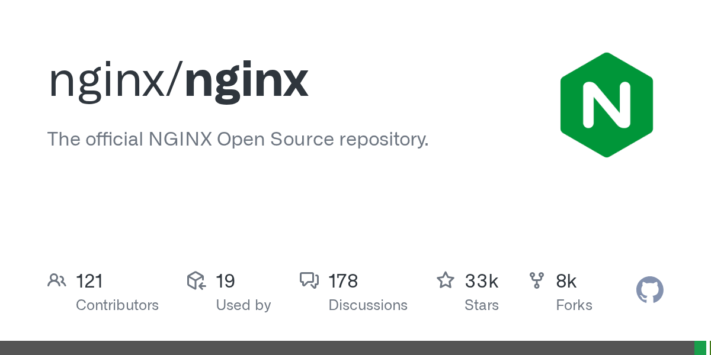
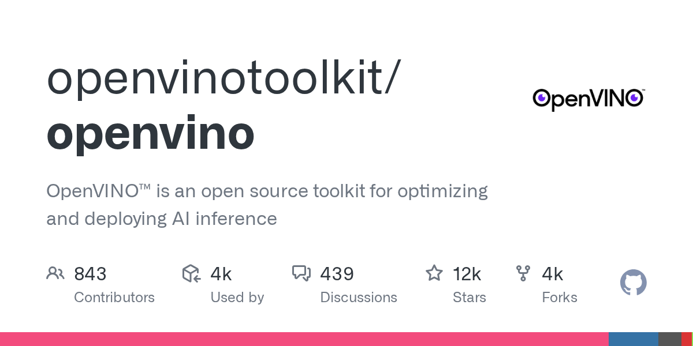
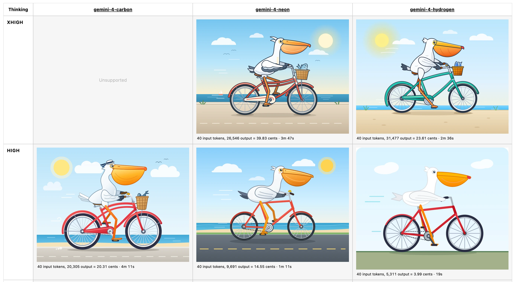

# AI 资讯日报 2026-11-22

> 自动抓取 AI 公司博客、从业者博客与社区聚合源，并生成中文摘要。

## 今日摘要

```
- Combatting adversarial distillation
- Hebbia sees improvements in financial research with GPT-6 Astra
- Can AI help scientists identify promising drug candidates?
- How OpenAI’s Performance Factory keeps ChatGPT fast
- Codemany - 将 GitHub Actions 的运行速度提升 3 倍
```

## 公司动态

1. **[Combatting adversarial distillation](https://openai.com/index/combatting-adversarial-distillation)**

   OpenAI’s layered approach to adversarial distillation combines model training, safeguards, detection, and enforcement to protect against capability extraction.

   来源：OpenAI Blog

2. **[Hebbia sees improvements in financial research with GPT-6 Astra](https://openai.com/business/customer-stories/hebbia)**

   Hebbia tested GPT-6 Astra for financial research. Its prerelease evaluations found gains in source coverage, citation relevance, and presentation quality.

   来源：OpenAI Blog

3. **[Can AI help scientists identify promising drug candidates?](https://openai.com/index/introducing-medchembench)**

   MedChemBench evaluates how well AI models interpret molecular structures, reason from experimental evidence, and select compounds in early drug discovery.

   来源：OpenAI Blog

4. **[How OpenAI’s Performance Factory keeps ChatGPT fast](https://openai.com/index/how-openai-performance-factory-keeps-chatgpt-fast)**

   Learn how OpenAI built the Performance Factory, a system of Codex-powered workflows that finds and fixes performance issues to help keep ChatGPT fast.

   来源：OpenAI Blog

## 每日产品

1. **[Codemany - 将 GitHub Actions 的运行速度提升 3 倍](https://www.producthunt.com/r/7PYDLDRHJO2VXR)**

   *{padding:0;margin:0;overflow:hidden}html,body{height:100%}img,span{position:absolute;width:100%;top:0;bottom:0;margin:auto}span{height:1.5em;text-align:center;font:48px/1.5 sans-serif;color:white;text-shadow:0 0 0.5em black}▶" frameborder="0" allow="accelerometer; autoplay; encrypted-media; gyroscope; picture-in-picture" allowfullscreen > Run GitHub Actions 3x faster (www.producthunt.com) 11-21 ↑ 132 PH Upvotes

   来源：Product Hunt Daily

2. **[AI Context Flow MCP - 由您掌控的存储空间，与每个代理、工具和团队保持同步](https://www.producthunt.com/r/62GR7ZBTBONXEL)**

   Memory you control, synced to every agent, tool and team (www.producthunt.com) 11-21 ↑ 115 PH Upvotes

   

   来源：Product Hunt Daily

3. **[Alter Contacts - 能够未雨绸缪、未事先行的AI客户关系助理](https://www.producthunt.com/r/P3PTYNAORNS7UV)**

   *{padding:0;margin:0;overflow:hidden}html,body{height:100%}img,span{position:absolute;width:100%;top:0;bottom:0;margin:auto}span{height:1.5em;text-align:center;font:48px/1.5 sans-serif;color:white;text-shadow:0 0 0.5em black}▶" frameborder="0" allow="accelerometer; autoplay; encrypted-media; gyroscope; picture-in-picture" allowfullscreen > AI client relationship assistant that thinks and does ahead (www.producthunt.com) 11-21 PH Link

   来源：Product Hunt Daily

4. **[Tamekoshi - 一款能真正干活的“电子鸡”式AI伴侣](https://www.producthunt.com/r/D7S6JA3X5PKAUF)**

   *{padding:0;margin:0;overflow:hidden}html,body{height:100%}img,span{position:absolute;width:100%;top:0;bottom:0;margin:auto}span{height:1.5em;text-align:center;font:48px/1.5 sans-serif;color:white;text-shadow:0 0 0.5em black}▶" frameborder="0" allow="accelerometer; autoplay; encrypted-media; gyroscope; picture-in-picture" allowfullscreen > A Tamagotchi-style AI companion that does real work (www.producthunt.com) 11-20 ↑ 110 PH Upvotes

   来源：Product Hunt Daily

5. **[Direct by Instagram - Instagram 私信，无需动态或 Instagram 账号](https://www.producthunt.com/r/WTPU56RQWCD2XV)**

   Instagram DMs, without the feed or Instagram account (www.producthunt.com) 11-20 ↑ 112 PH Upvotes

   

   来源：Product Hunt Daily

6. **[Kuc-kuc - 恶劣天气来临时，门外传来敲门声](https://www.producthunt.com/r/LKBGU35INMLRUR)**

   A knock on the door when dangerous weather comes (www.producthunt.com) 11-20 ↑ 144 PH Upvotes

   

   来源：Product Hunt Daily

7. **[Wispr Flow Notetaker for iPhone - 免费的人工智能会议记录，无论您身在何处](https://www.producthunt.com/r/HTWKRZXSXSNV54)**

   *{padding:0;margin:0;overflow:hidden}html,body{height:100%}img,span{position:absolute;width:100%;top:0;bottom:0;margin:auto}span{height:1.5em;text-align:center;font:48px/1.5 sans-serif;color:white;text-shadow:0 0 0.5em black}▶" frameborder="0" allow="accelerometer; autoplay; encrypted-media; gyroscope; picture-in-picture" allowfullscreen > Free AI meeting notes, wherever work takes you (www.producthunt.com) 11-19 ↑ 132 PH Upvotes

   来源：Product Hunt Daily

8. **[Currents - Currents for Claude & Codex，查看您所有的测试](https://www.producthunt.com/r/5CEHDWRBU3OWTX)**

   *{padding:0;margin:0;overflow:hidden}html,body{height:100%}img,span{position:absolute;width:100%;top:0;bottom:0;margin:auto}span{height:1.5em;text-align:center;font:48px/1.5 sans-serif;color:white;text-shadow:0 0 0.5em black}▶" frameborder="0" allow="accelerometer; autoplay; encrypted-media; gyroscope; picture-in-picture" allowfullscreen > Currents for Claude & Codex to see all your tests (www.producthunt.com) 11-20 ↑ 152 PH Upvotes

   来源：Product Hunt Daily

9. **[Bookella - 一款助你读得更多的阅读追踪器](https://www.producthunt.com/r/XLV3656TB6CLUY)**

   A reading tracker that helps you read more (www.producthunt.com) 11-20 ↑ 149 PH Upvotes

   

   来源：Product Hunt Daily

10. **[Docker - 基于信任而构建，面向自主时代](https://www.producthunt.com/r/4IV63EDN4UZ3NO)**

   Built to run on trust, for the agentic era (www.producthunt.com) 11-20 ↑ 146 PH Upvotes

   

   来源：Product Hunt Daily

## GitHub 项目

1. **[elementalsouls/Claude-BugHunter](https://github.com/elementalsouls/Claude-BugHunter)**

   A Claude Code skill bundle for bug hunting and external red-team work - 82 skills, 15 slash commands, 681 disclosed-report patterns curated across 24 core vulnerability classes, plus enterprise identity + infrastructure attack matrices. Language: Python Stars: 16182 Forks: 1840

   

   来源：GitHub Trending Daily

2. **[obra/superpowers](https://github.com/obra/superpowers)**

   An agentic skills framework & software development methodology that works. Language: Shell Stars: 323782 Forks: 28721

   

   来源：GitHub Trending Daily

3. **[HKUDS/CLI-Anything](https://github.com/HKUDS/CLI-Anything)**

   "CLI-Anything: Making ALL Software Agent-Native" -- CLI-Hub: https://clianything.cc/ Language: Python Stars: 62120 Forks: 5634

   

   来源：GitHub Trending Daily

4. **[jingyaogong/minimind](https://github.com/jingyaogong/minimind)**

   🧠 两小时从 0 训出你的 64M 大模型。Train your own 64M LLM from scratch in 2 hours. Language: Python Stars: 68191 Forks: 8917

   

   来源：GitHub Trending Daily

5. **[cursor/plugins](https://github.com/cursor/plugins)**

   Cursor plugin specification and official plugins Language: TypeScript Stars: 18127 Forks: 1980

   

   来源：GitHub Trending Daily

6. **[firecrawl/firecrawl](https://github.com/firecrawl/firecrawl)**

   Knowledge infrastructure to make your agents smarter. Search, scrape and access 550+ data providers through one API. Language: TypeScript Stars: 206271 Forks: 10784

   

   来源：GitHub Trending Daily

7. **[nginx/nginx](https://github.com/nginx/nginx)**

   The official NGINX Open Source repository. Language: C Stars: 32745 Forks: 8374

   

   来源：GitHub Trending Daily

8. **[openvinotoolkit/openvino](https://github.com/openvinotoolkit/openvino)**

   OpenVINO™ is an open source toolkit for optimizing and deploying AI inference Language: C++ Stars: 11947 Forks: 3652

   

   来源：GitHub Trending Daily

9. **[cathrynlavery/diagram-design](https://github.com/cathrynlavery/diagram-design)**

   Editorial diagram design for Claude Code, Codex, GitHub Copilot, Cursor, Factory Droid, Qoder, and Pi. 45 diagram types. Self-contained HTML + SVG. No shadows. No Mermaid slop. Language: HTML Stars: 69834 Forks: 4686

   来源：GitHub Trending Daily

10. **[mvanhorn/last30days-skill](https://github.com/mvanhorn/last30days-skill)**

   AI agent skill that researches any topic across Reddit, X, YouTube, HN, Polymarket, and the web - then synthesizes a grounded summary Language: Python Stars: 72049 Forks: 6379

   

   来源：GitHub Trending Daily

## 从业者观点

1. **[Muru](https://simonwillison.net/2026/Nov/21/muru/)**

   Muru Graham Dumpleton started mod_wsgi 20 years ago, and has been thinking about the ideal way to serve Python web applications in production ever since. Muru is his new, AI-assisted Rust server that aims to provide the best possible tools for running ASGI and WSGI Python apps both in development and production. As he did with wrapture , he's been publishing an extraordinarily detailed account of the project as he works on it - as part of his development process. Here's everything he's published so far, all in the last three weeks: 2026-11-04 — Twenty years of mod_wsgi, and what comes next 2026-11-05 — A first look at Muru 2026-11-07 — Muru: looking inside the workers 2026-11-08 — Muru: how it fits together 2026-11-09 — Muru: import once, fork many 2026-11-10 — Muru: HTTPS in development 2026-11-11 — Muru: WSGI and ASGI together 2026-11-11 — AI as a lifestyle choice 2026-11-12 — Muru: releases, not restarts 2026-11-13 — Muru: canaries without a service mesh 2026-11-14 — Muru: a better tenant in a container 2026-11-15 — Muru: working with Kubernetes, not around it 2026-11-16 — Muru: scaling from what the workers report 2026-11-17 — Muru: scaling to zero 2026-11-18 — Muru: overlays on a schedule 2026-11-19 — Muru: noticing and responding 2026-11-20 — Muru: a toolbar on every page 2026-11-21 — Muru: tracing in the toolbar That post about AI as a lifestyle choice is particularly worth a read: The AI may be doing a lot of the work on the surface, but deciding what isn't good enough yet is still down to me, and twenty years of getting things wrong with mod_wsgi turns out to be useful for that. I am prepared to put in the hard work to keep polishing Muru until it is something I would trust, and something you would too. Tags: graham-dumpleton , modwsgi , python , wsgi , ai , rust , asgi , generative-ai , llms , ai-assisted-programming

   来源：Simon Willison

2. **[Quoting Ravi Vakil](https://simonwillison.net/2026/Nov/20/ravi-vakil/)**

   Alessandro Masullo has a proposed proof of [Generalized Riemann Hypothesis], and Brian Conrad has been looking closely at it for months and gave extensive feedback which is being incorporated, and it is so far looking good. It is all human, with no AI. The hope was to bring Alessandro to Stanford for a year to polish the writing and then announce it after running it by enough people. Now it seems best to put out the current draft. &mdash; Ravi Vakil , Hurried Announcement: Alessandro Masullo GRH Tags: mathematics

   来源：Simon Willison

3. **[Quoting Levent Alpöge](https://simonwillison.net/2026/Nov/20/levent-alpoge/)**

   I believe I have, working with Claude, discovered a proof of the Riemann Hypothesis. In fact, the method easily extends much further, resolving the so-called Generalized Riemann Hypothesis, and I expect, with more time, the Extended Riemann Hypothesis too. Claude and I have also formalized the arguments without assumptions. It is natural to feel that this is an end, in my case a loss of a principal guiding light, but what I saw during the course of progress so amazed me that I believe it is one dawn across science of something far greater. [...] Claude and I have had a great time together with such breadth in recent months, but this time Claude far outpaced me near the finish line. No, Claude flew, and danced, and sparkled near that finish line. &mdash; Levent Alpöge , alpo.ge/remark.pdf Tags: anthropic , claude , generative-ai , mathematics , ai , llms , levent-alpoge

   来源：Simon Willison

4. **[llm-gemini 0.38.1](https://simonwillison.net/2026/Nov/20/llm-gemini/)**

   Release: llm-gemini 0.38.1 Gemini 4 Carbon only supports low , medium and high reasoning levels - but Gemini 4 Hydrogen and Gemini 4 Neon both have an extra xhigh level. I missed that when I added those models to the llm-gemini plugin, which is now fixed in this dot release. The xhigh setting for Hydrogen makes a significant difference. I updated my Gemini 4 comparison grid - note how Hydrogen at high used 5,311 output tokens and cost 3.99 cents, but the same model at xhigh used 31,477 output tokens, cost 23.61 cents, and produced a pelican that's competitive with Gemini 4 Neon: [图片: https://static.simonwillison.net/static/2026/gemini-4-xhigh-pelicans.webp] Tags: gemini , llm , llm-reasoning , pelican-riding-a-bicycle , ai , llms , google , generative-ai

   

   来源：Simon Willison

5. **[Token fraud is here and it’s BAD (YouTube)](https://simonwillison.net/2026/Nov/20/token-fraud-is-here-and-its-bad/)**

   Token fraud is here and it’s BAD (YouTube) Claire Vo runs ChatPRD , an AI platform that helps product managers "turn an idea into a spec". The product has been live since the GPT-4 era, and Claire has been building it in public for much of that time. In this YouTube video (see also the accompanying Twitter post ) Claire describes the flood of token fraud she has seen from groups abusing the product's free trial, sometimes just to get free AI usage but often to resell tokens or run other commercial enterprises on top of the ChatPRD agent. I am funding a international Roblox and Fortnite map studio. They run a loop of free trials and promo codes and then tunnel to my agent and use it to build Roblox and Fortnite maps. Apparently one of the common prompts Claire saw running through her agent involved SVGs of pelicans riding bicycles! Presumably the token scammers are using that to help sniff the underlying models - different model families have a definite signature, and I've used it like this in the past to try and guess the identity of stealth preview models on platforms like OpenRouter. Claire is winding down her free trials entirely, which sadly looks like the right decision in the face of this abuse. Tags: youtube , ai , generative-ai , llms , pelican-riding-a-bicycle , ai-misuse

   来源：Simon Willison

6. **[PostgreSQL 19 Released](https://simonwillison.net/2026/Nov/19/postgresql-19/)**

   PostgreSQL 19 Released Most years PostgreSQL ships a new release in September, but this year's release came two months later thanks mainly to the flurry of issues that the PostgreSQL team needed to address as part of the ongoing AI-reported vulnerability apocalypse. This release was definitely worth the wait. My favorite new feature is this one: For applications that send reads to standbys, PostgreSQL 19 adds "read-your-writes" consistency with the new WAIT FOR LSN command. A session on a standby can use WAIT FOR LSN to wait until the standby has replayed the write-ahead log (WAL) up to a specific log sequence number (LSN) before running a query, so the application can read data it just wrote on the primary. In practice, that looks like this: UPDATE movie SET genre = 'Dramatic' WHERE genre = 'Drama'; SELECT pg_current_wal_insert_lsn(); That returns a value like 0/0306EE20 . Store that somewhere (a signed cookie would work) such that on a subsequent request your application can do: WAIT FOR LSN '0/0306EE20' WITH (TIMEOUT '0.1s'); SELECT * FROM movie WHERE genre = 'Drama'; The timeout is optional - if you provide one you'll get an error if the replica you are talking to doesn't catch up within the specified time. I first encountered this pattern in Wikipedia , which has a hand-rolled version of this built against MySQL replication: In addition to this, MediaWiki attempts to ensure that the user sees events occurring on the wiki in chronological order. A few seconds of lag can be tolerated, as long as the user sees a consistent picture from subsequent requests. This is done by saving the primary binlog position in the session, and then at the start of each request, waiting for the replica to catch up to that position before doing any reads from it. Here's the relevant MediaWiki code , which these days uses MySQL's WAIT_FOR_EXECUTED_GTID_SET() function and falls back to SOURCE_POS_WAIT() . Via Lobste.rs Tags: mysql , postgresql , replication , scaling , wikipedia , ai-security-research

   来源：Simon Willison

## 社区热点

1. **[Researcher plants 2m canaries into the AI supply chain. A privacy disaster surfaced](https://arstechnica.com/security/2026/11/a-leaky-ai-supply-chain-is-exposing-secret-user-data-at-an-alarming-rate/)**

   Comments

   来源：Lobsters AI

2. **[Rebuilding my local voice assistant pipeline](https://blog.platypush.tech/article/Rewriting-my-voice-assistant-pipeline)**

   Comments

   来源：Lobsters AI
