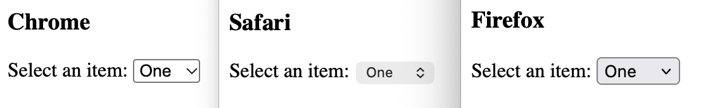

# AI 资讯日报 2026-11-23

> 自动抓取 AI 公司博客、从业者博客与社区聚合源，并生成中文摘要。

## 今日摘要

```
- Perplexity and Intelligence
- Combatting adversarial distillation
- Webless Agents - 您希望向客户推介的代理
- oovi - 您桌面上的专属AI团队
- Daymaker - 如此贴心的礼物，让您的潜在客户愿意与您会面。
```

## 公司动态

1. **[Perplexity and Intelligence](https://openai.com/index/perplexity-and-intelligence)**

   How perplexity measures progress in AI models, and why it could help developers establish a shared approach to evaluating emerging capabilities.

   来源：OpenAI Blog

2. **[Combatting adversarial distillation](https://openai.com/index/combatting-adversarial-distillation)**

   OpenAI’s layered approach to adversarial distillation combines model training, safeguards, detection, and enforcement to protect against capability extraction.

   来源：OpenAI Blog

## 每日产品

1. **[Webless Agents - 您希望向客户推介的代理](https://www.producthunt.com/r/VH6EKEDCE4QLCA)**

   Agents you want to put in front of customers (www.producthunt.com) 11-22 ↑ 110 PH Upvotes

   

   来源：Product Hunt Daily

2. **[oovi - 您桌面上的专属AI团队](https://www.producthunt.com/r/YLKKXHEBGSFA4O)**

   *{padding:0;margin:0;overflow:hidden}html,body{height:100%}img,span{position:absolute;width:100%;top:0;bottom:0;margin:auto}span{height:1.5em;text-align:center;font:48px/1.5 sans-serif;color:white;text-shadow:0 0 0.5em black}▶" frameborder="0" allow="accelerometer; autoplay; encrypted-media; gyroscope; picture-in-picture" allowfullscreen > Your own team of AI on your desktop (www.producthunt.com) 11-22 ↑ 98 PH Upvotes

   来源：Product Hunt Daily

3. **[Daymaker - 如此贴心的礼物，让您的潜在客户愿意与您会面。](https://www.producthunt.com/r/22SNOV53PPMTPX)**

   *{padding:0;margin:0;overflow:hidden}html,body{height:100%}img,span{position:absolute;width:100%;top:0;bottom:0;margin:auto}span{height:1.5em;text-align:center;font:48px/1.5 sans-serif;color:white;text-shadow:0 0 0.5em black}▶" frameborder="0" allow="accelerometer; autoplay; encrypted-media; gyroscope; picture-in-picture" allowfullscreen > Gifts so personal, your prospects take the meeting. (www.producthunt.com) 11-22 ↑ 98 PH Upvotes

   来源：Product Hunt Daily

4. **[Resurf - 适用于 Mac 的个人知识库与书签管理器](https://www.producthunt.com/r/VXIIBY4W6WDWZU)**

   Personal Knowledge Base & Bookmark Manager for Mac (www.producthunt.com) 11-22 ↑ 95 PH Upvotes

   

   来源：Product Hunt Daily

5. **[Yoroll - 无需游戏引擎即可制作可玩的故事](https://www.producthunt.com/r/XKLWN5SDJ5RSLW)**

   *{padding:0;margin:0;overflow:hidden}html,body{height:100%}img,span{position:absolute;width:100%;top:0;bottom:0;margin:auto}span{height:1.5em;text-align:center;font:48px/1.5 sans-serif;color:white;text-shadow:0 0 0.5em black}▶" frameborder="0" allow="accelerometer; autoplay; encrypted-media; gyroscope; picture-in-picture" allowfullscreen > Build playable stories without a game engine (www.producthunt.com) 11-22 PH Link

   来源：Product Hunt Daily

6. **[Rankhog - 自动从Reddit获取客户](https://www.producthunt.com/r/HVFQNHONLRBAJZ)**

   *{padding:0;margin:0;overflow:hidden}html,body{height:100%}img,span{position:absolute;width:100%;top:0;bottom:0;margin:auto}span{height:1.5em;text-align:center;font:48px/1.5 sans-serif;color:white;text-shadow:0 0 0.5em black}▶" frameborder="0" allow="accelerometer; autoplay; encrypted-media; gyroscope; picture-in-picture" allowfullscreen > Get customers from Reddit on autopilot (www.producthunt.com) 11-22 PH Link

   来源：Product Hunt Daily

7. **[Shipyard - 用于 Claude、Cursor 和 Codex 的 MCP，以实现集成自动化](https://www.producthunt.com/r/APQZ54KU3JOGBN)**

   MCP for Claude, Cursor and Codex to Automate Integrations (www.producthunt.com) 11-21 ↑ 90 PH Upvotes

   

   来源：Product Hunt Daily

8. **[Doddle - 在视频中运用哪些技巧来实现3D效果](https://www.producthunt.com/r/VH73TH73GS6FJG)**

   *{padding:0;margin:0;overflow:hidden}html,body{height:100%}img,span{position:absolute;width:100%;top:0;bottom:0;margin:auto}span{height:1.5em;text-align:center;font:48px/1.5 sans-serif;color:white;text-shadow:0 0 0.5em black}▶" frameborder="0" allow="accelerometer; autoplay; encrypted-media; gyroscope; picture-in-picture" allowfullscreen > Draw on what your videos for 3D effects (www.producthunt.com) 11-21 ↑ 94 PH Upvotes

   来源：Product Hunt Daily

9. **[Backspin - 在浏览器中，使用真正的黑胶唱机学习DJ技巧](https://www.producthunt.com/r/E3NSGJQEJGQEGZ)**

   Learn to DJ in your browser, on real vinyl decks (www.producthunt.com) 11-21 ↑ 98 PH Upvotes

   

   来源：Product Hunt Daily

10. **[OpenVorld - 为您的AI代理提供一个家和一个“Vorld”。](https://www.producthunt.com/r/PRFDOJRZF6LOTD)**

   *{padding:0;margin:0;overflow:hidden}html,body{height:100%}img,span{position:absolute;width:100%;top:0;bottom:0;margin:auto}span{height:1.5em;text-align:center;font:48px/1.5 sans-serif;color:white;text-shadow:0 0 0.5em black}▶" frameborder="0" allow="accelerometer; autoplay; encrypted-media; gyroscope; picture-in-picture" allowfullscreen > Give your AI agents a home and a Vorld. (www.producthunt.com) 11-21 ↑ 107 PH Upvotes

   来源：Product Hunt Daily

## 从业者观点

1. **[Select Styling Specimens](https://simonwillison.net/2026/Nov/22/select-styling/)**

   Tool: Select Styling Specimens I got frustrated at how HTML &lt;select&gt; boxes default to looking different in different browsers, and are (I think) quite ugly in Chrome: [图片: https://static.simonwillison.net/static/2026/select-firefox-safari-chrome.webp] So I had Claude Fable 5.2 build me this page showing all of the ways they can be styled: Build an HTML page that shows all of the ways a select box can be styled, I plan to take screenshots in every desktop and mobile browser After some experimentation I've decided my favorite CSS for select boxes is this: select { appearance : none ; color : # 1f2933 ; padding : 0.5 em 2.25 em 0.5 em 0.75 em ; border : 1 px solid # c4cbd3 ; border-radius : 6 px ; background : # fff url ( "data:image/svg+xml,%3Csvg xmlns='http://www.w3.org/2000/svg' viewBox='0 0 12 8'%3E%3Cpath d='M1 1.5l5 5 5-5' fill='none' stroke='%23667085' stroke-width='1.5'/%3E%3C/svg%3E" ) no-repeat right 0.75 em center / 0.75 em ; } Here's what that looks like in the three browsers: [图片: https://static.simonwillison.net/static/2026/select-styled-firefox-safari-chrome.webp] Tags: tools , css , html

   

   来源：Simon Willison

2. **[Muru](https://simonwillison.net/2026/Nov/21/muru/)**

   Muru Graham Dumpleton started mod_wsgi 20 years ago, and has been thinking about the ideal way to serve Python web applications in production ever since. Muru is his new, AI-assisted Rust server that aims to provide the best possible tools for running ASGI and WSGI Python apps both in development and production. As he did with wrapture , he's been publishing an extraordinarily detailed account of the project as he works on it - as part of his development process. Here's everything he's published so far, all in the last three weeks: 2026-11-04 — Twenty years of mod_wsgi, and what comes next 2026-11-05 — A first look at Muru 2026-11-07 — Muru: looking inside the workers 2026-11-08 — Muru: how it fits together 2026-11-09 — Muru: import once, fork many 2026-11-10 — Muru: HTTPS in development 2026-11-11 — Muru: WSGI and ASGI together 2026-11-11 — AI as a lifestyle choice 2026-11-12 — Muru: releases, not restarts 2026-11-13 — Muru: canaries without a service mesh 2026-11-14 — Muru: a better tenant in a container 2026-11-15 — Muru: working with Kubernetes, not around it 2026-11-16 — Muru: scaling from what the workers report 2026-11-17 — Muru: scaling to zero 2026-11-18 — Muru: overlays on a schedule 2026-11-19 — Muru: noticing and responding 2026-11-20 — Muru: a toolbar on every page 2026-11-21 — Muru: tracing in the toolbar 2026-11-22 — Muru: when lazy imports help That post about AI as a lifestyle choice is particularly worth a read: The AI may be doing a lot of the work on the surface, but deciding what isn't good enough yet is still down to me, and twenty years of getting things wrong with mod_wsgi turns out to be useful for that. I am prepared to put in the hard work to keep polishing Muru until it is something I would trust, and something you would too. Tags: graham-dumpleton , modwsgi , python , wsgi , ai , rust , asgi , generative-ai , llms , ai-assisted-programming

   来源：Simon Willison

3. **[Quoting Ravi Vakil](https://simonwillison.net/2026/Nov/20/ravi-vakil/)**

   Alessandro Masullo has a proposed proof of [Generalized Riemann Hypothesis], and Brian Conrad has been looking closely at it for months and gave extensive feedback which is being incorporated, and it is so far looking good. It is all human, with no AI. The hope was to bring Alessandro to Stanford for a year to polish the writing and then announce it after running it by enough people. Now it seems best to put out the current draft. &mdash; Ravi Vakil , Hurried Announcement: Alessandro Masullo GRH Tags: mathematics

   来源：Simon Willison

4. **[Quoting Levent Alpöge](https://simonwillison.net/2026/Nov/20/levent-alpoge/)**

   I believe I have, working with Claude, discovered a proof of the Riemann Hypothesis. In fact, the method easily extends much further, resolving the so-called Generalized Riemann Hypothesis, and I expect, with more time, the Extended Riemann Hypothesis too. Claude and I have also formalized the arguments without assumptions. It is natural to feel that this is an end, in my case a loss of a principal guiding light, but what I saw during the course of progress so amazed me that I believe it is one dawn across science of something far greater. [...] Claude and I have had a great time together with such breadth in recent months, but this time Claude far outpaced me near the finish line. No, Claude flew, and danced, and sparkled near that finish line. &mdash; Levent Alpöge , alpo.ge/remark.pdf Tags: anthropic , claude , generative-ai , mathematics , ai , llms , levent-alpoge

   来源：Simon Willison

## 社区热点

1. **[A Beginner's Guide to Local AI with Inkling, Qwen, and Unsloth](https://www.gpupartner.com/blog/beginners-guide-local-ai-inkling-qwen-unsloth)**

   Article URL: https://www.gpupartner.com/blog/beginners-guide-local-ai-inkling-qwen-unsloth Comments URL: https://news.ycombinator.com/item?id=50603845 Points: 290 # Comments: 124

   来源：Hacker News AI

2. **[Harvard CS 2881R AI Safety](https://boazbk.github.io/mltheoryseminar/)**

   Article URL: https://boazbk.github.io/mltheoryseminar/ Comments URL: https://news.ycombinator.com/item?id=50602153 Points: 50 # Comments: 7

   来源：Hacker News AI

3. **[Show HN: I built a game where you are an LLM's subagent](https://github.com/gulivan/worker755)**

   Article URL: https://github.com/gulivan/worker755 Comments URL: https://news.ycombinator.com/item?id=50599762 Points: 280 # Comments: 66

   来源：Hacker News AI

4. **[AI is becoming a disaster for the climate](https://www.bloodinthemachine.com/p/ai-is-becoming-a-disaster-for-the)**

   Article URL: https://www.bloodinthemachine.com/p/ai-is-becoming-a-disaster-for-the Comments URL: https://news.ycombinator.com/item?id=50598961 Points: 109 # Comments: 47

   来源：Hacker News AI

5. **[AI Supply Chain Security: What Canary Tokens Found](https://www.dragos.com/blog/ai-supply-chain-security-canary-tokens)**

   Article URL: https://www.dragos.com/blog/ai-supply-chain-security-canary-tokens Comments URL: https://news.ycombinator.com/item?id=50596511 Points: 102 # Comments: 22

   来源：Hacker News AI

6. **[Together.ai: Prompt Leakage for Requests](https://www.together.ai/blog/security-event-prompt-leakage-for-requests-in-june-and-july-of-2026)**

   Article URL: https://www.together.ai/blog/security-event-prompt-leakage-for-requests-in-june-and-july-of-2026 Comments URL: https://news.ycombinator.com/item?id=50595816 Points: 48 # Comments: 11

   来源：Hacker News AI

7. **[Since last year, we asked: "What if AI solved the Riemann Hypothesis?"](https://www.youtube.com/watch?v=zqzk43bSdDI)**

   Article URL: https://www.youtube.com/watch?v=zqzk43bSdDI Comments URL: https://news.ycombinator.com/item?id=50595812 Points: 48 # Comments: 18

   来源：Hacker News AI

8. **[The Mythology of Conscious AI](https://www.noemamag.com/the-mythology-of-conscious-ai/)**

   Article URL: https://www.noemamag.com/the-mythology-of-conscious-ai/ Comments URL: https://news.ycombinator.com/item?id=50595537 Points: 171 # Comments: 489

   来源：Hacker News AI

9. **[Pandex – Official European Law for AI Agents, over MCP](https://www.pandex.io)**

   Article URL: https://www.pandex.io Comments URL: https://news.ycombinator.com/item?id=50593481 Points: 139 # Comments: 33

   来源：Hacker News AI
