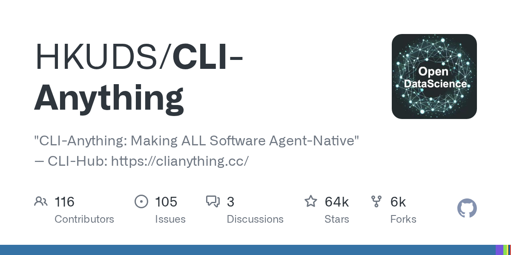
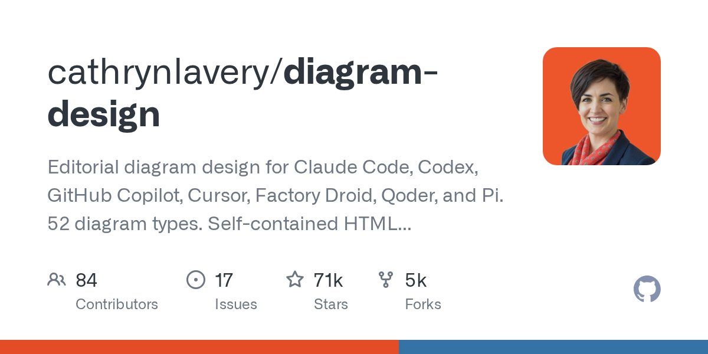

# AI 资讯日报 2026-11-24

> 自动抓取 AI 公司博客、从业者博客与社区聚合源，并生成中文摘要。

## 今日摘要

```
- Connected intelligence for in-house legal
- Richpanel helps companies automate 50% of support in 30 days
- Perplexity and Intelligence
- Finding faster quantum algorithms with agents and formal verification
- Chat with Work - 欧洲的AI机器人。它们确实管用。由您决定。
```

## 公司动态

1. **[Connected intelligence for in-house legal](https://openai.com/business/learn/connected-intelligence-for-in-house-legal)**

   Watch OpenAI’s Stacey Wang and Craig Bruney, Mary O’Carroll of LECG, and Cooley’s Richard Segal explore how AI can help in-house legal teams connect business context, build reusable workflows and get more from outside counsel.

   来源：OpenAI Blog

2. **[Richpanel helps companies automate 50% of support in 30 days](https://openai.com/business/customer-stories/richpanel-ai-customer-support)**

   Richpanel uses GPT-6 Astra and GPT-6.1 Sol to equip its AI support agents with tools and procedures, and GPT-6 Luna for their conversations.

   来源：OpenAI Blog

3. **[Perplexity and Intelligence](https://openai.com/index/perplexity-and-intelligence)**

   How perplexity measures progress in AI models, and why it could help developers establish a shared approach to evaluating emerging capabilities.

   来源：OpenAI Blog

4. **[Finding faster quantum algorithms with agents and formal verification](https://deepmind.google/blog/finding-faster-quantum-algorithms-with-agents-and-formal-verification/)**

   Using agent teams and formal verification to improve quantum algorithms for fusion and chemistry.

   

   来源：DeepMind Blog

## 每日产品

1. **[Chat with Work - 欧洲的AI机器人。它们确实管用。由您决定。](https://www.producthunt.com/r/N4OOSBHZF6Z4DD)**

   *{padding:0;margin:0;overflow:hidden}html,body{height:100%}img,span{position:absolute;width:100%;top:0;bottom:0;margin:auto}span{height:1.5em;text-align:center;font:48px/1.5 sans-serif;color:white;text-shadow:0 0 0.5em black}▶" frameborder="0" allow="accelerometer; autoplay; encrypted-media; gyroscope; picture-in-picture" allowfullscreen > AI bots in Europe. They work. You decide. (www.producthunt.com) 11-23 ↑ 108 PH Upvotes

   来源：Product Hunt Daily

2. **[Inkling 2 Mini - 适用于笔记本电脑编程的26B循环模型](https://www.producthunt.com/r/SG2HQWZE7PXLKB)**

   26B looped model for coding on your laptop (www.producthunt.com) 11-23 ↑ 102 PH Upvotes

   

   来源：Product Hunt Daily

3. **[Polylane Swarms - 一支由人工智能代理组成的团队，助您应对最棘手的生产故障](https://www.producthunt.com/r/32EVX2QO6UY7TY)**

   A team of AI agents on your roughest production incidents (www.producthunt.com) 11-23 ↑ 98 PH Upvotes

   

   来源：Product Hunt Daily

4. **[Modem - 发现、解决并跟进每一位客户的关切](https://www.producthunt.com/r/CEZ34BGBUK2Q27)**

   Find, fix, and follow up on every customer concern (www.producthunt.com) 11-23 ↑ 96 PH Upvotes

   

   来源：Product Hunt Daily

5. **[Dog Translator SuperTranslator - 会说英语的狗（真实）](https://www.producthunt.com/r/ORWSMEJ2HYDXEB)**

   Dogs talking in English (real) (www.producthunt.com) 11-23 ↑ 96 PH Upvotes

   

   来源：Product Hunt Daily

6. **[Motionflare - 只需几分钟，即可将您的网站转化为一段令人惊艳的发布视频](https://www.producthunt.com/r/AM4QLKUSKUV34E)**

   *{padding:0;margin:0;overflow:hidden}html,body{height:100%}img,span{position:absolute;width:100%;top:0;bottom:0;margin:auto}span{height:1.5em;text-align:center;font:48px/1.5 sans-serif;color:white;text-shadow:0 0 0.5em black}▶" frameborder="0" allow="accelerometer; autoplay; encrypted-media; gyroscope; picture-in-picture" allowfullscreen > Turn your website into a stunning launch video in minutes (www.producthunt.com) 11-23 PH Link

   来源：Product Hunt Daily

7. **[Gauth Personal Study Agent - 一个能记住你哪里遇到困难的AI学习助手](https://www.producthunt.com/r/UYCH2W5E56E2XN)**

   An AI study agent that remembers where you struggle (www.producthunt.com) 11-23 PH Link

   

   来源：Product Hunt Daily

8. **[Letter Visitors - 在您的网站上查看网站访客](https://www.producthunt.com/r/D6BRBNLRH7WD47)**

   See website visitors on your website itself (www.producthunt.com) 11-23 PH Link

   

   来源：Product Hunt Daily

9. **[Mockreel - 您的屏幕录制，不过是在一部3D手机上。免费，无需注册](https://www.producthunt.com/r/JMDEOIWLDDDOHB)**

   your screen recording, but in a 3D phone. free, no signup (www.producthunt.com) 11-22 ↑ 89 PH Upvotes

   

   来源：Product Hunt Daily

10. **[Ulika - 适用于使用 Claude、Cursor 或 Codex 构建的网站的可视化编辑器](https://www.producthunt.com/r/RMUGMIHZYR2MRX)**

   *{padding:0;margin:0;overflow:hidden}html,body{height:100%}img,span{position:absolute;width:100%;top:0;bottom:0;margin:auto}span{height:1.5em;text-align:center;font:48px/1.5 sans-serif;color:white;text-shadow:0 0 0.5em black}▶" frameborder="0" allow="accelerometer; autoplay; encrypted-media; gyroscope; picture-in-picture" allowfullscreen > Visual editor for sites built with Claude, Cursor, or Codex (www.producthunt.com) 11-22 ↑ 91 PH Upvotes

   来源：Product Hunt Daily

## GitHub 项目

1. **[elementalsouls/Claude-BugHunter](https://github.com/elementalsouls/Claude-BugHunter)**

   A Claude Code skill bundle for bug hunting and external red-team work - 82 skills, 15 slash commands, 681 disclosed-report patterns curated across 24 core vulnerability classes, plus enterprise identity + infrastructure attack matrices. Language: Python Stars: 19602 Forks: 2092

   

   来源：GitHub Trending Daily

2. **[obra/superpowers](https://github.com/obra/superpowers)**

   An agentic skills framework & software development methodology that works. Language: Shell Stars: 324981 Forks: 28829

   

   来源：GitHub Trending Daily

3. **[HKUDS/CLI-Anything](https://github.com/HKUDS/CLI-Anything)**

   "CLI-Anything: Making ALL Software Agent-Native" -- CLI-Hub: https://clianything.cc/ Language: Python Stars: 63535 Forks: 5773

   

   来源：GitHub Trending Daily

4. **[jingyaogong/minimind](https://github.com/jingyaogong/minimind)**

   🧠 两小时从 0 训出你的 64M 大模型。Train your own 64M LLM from scratch in 2 hours. Language: Python Stars: 69405 Forks: 9061

   

   来源：GitHub Trending Daily

5. **[cursor/plugins](https://github.com/cursor/plugins)**

   Cursor plugin specification and official plugins Language: TypeScript Stars: 18776 Forks: 2041

   

   来源：GitHub Trending Daily

6. **[firecrawl/firecrawl](https://github.com/firecrawl/firecrawl)**

   Knowledge infrastructure to make your agents smarter. Search, scrape and access 550+ data providers through one API. Language: TypeScript Stars: 207825 Forks: 10861

   

   来源：GitHub Trending Daily

7. **[nginx/nginx](https://github.com/nginx/nginx)**

   The official NGINX Open Source repository. Language: C Stars: 33039 Forks: 8393

   

   来源：GitHub Trending Daily

8. **[openvinotoolkit/openvino](https://github.com/openvinotoolkit/openvino)**

   OpenVINO™ is an open source toolkit for optimizing and deploying AI inference Language: C++ Stars: 12269 Forks: 3679

   

   来源：GitHub Trending Daily

9. **[cathrynlavery/diagram-design](https://github.com/cathrynlavery/diagram-design)**

   Editorial diagram design for Claude Code, Codex, GitHub Copilot, Cursor, Factory Droid, Qoder, and Pi. 52 diagram types. Self-contained HTML + SVG. No shadows. No Mermaid slop. Language: HTML Stars: 70902 Forks: 4745

   

   来源：GitHub Trending Daily

10. **[mvanhorn/last30days-skill](https://github.com/mvanhorn/last30days-skill)**

   AI agent skill that researches any topic across Reddit, X, YouTube, HN, Polymarket, and the web - then synthesizes a grounded summary Language: Python Stars: 73393 Forks: 6478

   来源：GitHub Trending Daily

## 从业者观点

1. **[Ladybird's first alpha release](https://simonwillison.net/2026/Nov/23/ladybird/)**

   Ladybird is an astonishingly ambitious project: a new browser, in 2026, with its own implementation of most of the key components - HTML parsing, CSS engine, layout, JavaScript, even WebAssembly. It still uses a few external components - things like HarfBuzz for text shaping, Skia for 2D graphics, ffmpeg for video, and SQLite for the things you do with SQLite. Everything else is part of Ladybird, or code brought in from Ladybird's even more ambitious predecessor project SerenityOS . This morning the Ladybird project released their first alpha , which means you can now install the browser (on macOS or Linux) without having to compile it yourself! I've been trying it out today, and it's very impressive. It feels fast, the UI is lightweight and intuitive, and most of the websites I've tried to load in it have worked as they should. It looks like this (showing my video-compressor tool): [图片: macOS running Ladybird - it has four tabs open, the visible one is showing tools.simonwillison.net/video-compressor which is an app for running ffmpeg using WebAssembly and is shown working. https://static.simonwillison.net/static/2026/ladybird-ffmpeg.webp] Here's the process tree after I opened six tabs in one window and another tab in a second window (generated by this script , thanks Claude): Ladybird (72925) [240 MB] └── Hub (72926) [61 MB] ├── RequestServer (72927) [29 MB] ├── ProcessReaper (72928) [1 MB] ├── Compositor (72930) [123 MB] ├── RequestServer (72953) [36 MB] ├── WebContent (72984) [819 MB] ├── MediaServer (73006) [118 MB] ├── VideoDecoderServer (73007) [20 MB] ├── WebContent (73052) [144 MB] ├── WebContent (73057) [73 MB] ├── WebContent (73073) [166 MB] ├── WebContent (73094) [70 MB] ├── WebContent (73112) [116 MB] ├── RequestServer (73113) [27 MB] └── WebContent (73185) [60 MB] Ladybird runs different tabs in different processes, an isolation mechanism used by most browsers (well, technically Chrome uses a process-per-site). I tried Ladybird against several of my more advanced tool examples - like the video-compressor shown above, which runs ffmpeg compiled to WebAssembly. I had it resize its own screenshot using my image-resize tool . It happily runs my Pyodide REPL (Python compiled to WebAssembly) too. The one thing I tried that didn't work was Datasette Lite , which runs Pyodide in a complicated arrangement of service workers and web workers. Attempting to start Datasette Lite displays this error: undefined is not a function (evaluated from 'navigator.serviceWorker.startMessages') I filed an issue about this , then found a FIXME annotation in the source code. The October explosion The project has been leaning heavily into coding agents this year. On February 23, 2026 Andreas Kling published Ladybird adopts Rust, with help from AI , describing how they ported parts of their LibJS JavaScript engine from C++ to 25,000 lines of Rust in two weeks using Claude Code and Codex. Here's the GitHub contributions chart for Ladybird over the past twelve months: [图片: Screenshot of a GitHub-style bar chart titled &quot;Commits over time&quot; with the subtitle &quot;Weekly from Nov 22, 2025 to Nov 21, 2026&quot;. The y-axis is labeled &quot;Contributions&quot; with ticks at 0, 500, 1000 and 1500, and the x-axis is labeled Jan 2026, Mar 2026, May 2026, Jul 2026, Sep 2026 and Nov 2026. Blue weekly bars stay low for the first half of the year, then climb steeply from July to a peak in late October before dropping off in the final partial week. https://static.simonwillison.net/static/2026/ladybird-contributions.webp] That uptick in October corresponds to the landing of a wealth of big improvements. This Month in Ladybird — October 2026 describes what happened. In addition to moving style and layout to their own thread, landing a new JavaScript JIT, and replacing their C++ with Cranelift WebAssembly engine with new code that achieved a 7x boost on the JetStream 3 WASM benchmark , they gained 75,650 new passes on the ~2.25 million subtest web-platform-tests suite, beating Safari! [图片: Line chart titled &quot;WPT subtests passed in October&quot; with the subtitle &quot;Best run per day. The axis doesn't start at zero.&quot; The y-axis runs from 2.10M to 2.25M with ticks at 2.10M, 2.15M, 2.20M and 2.25M, and the x-axis is labeled Oct 1, Oct 8, Oct 15, Oct 22 and Oct 29. Four lines are labeled at their right-hand ends with final values: Chrome 2,244,397, Firefox 2,189,315, Ladybird 2,184,722, Safari 2,172,990. Chrome, Firefox and Safari rise only slightly across the month, at roughly 2.23M to 2.24M, 2.18M to 2.19M and 2.16M to 2.17M respectively. Ladybird, drawn as a thicker purple line, starts near 2.10M, stays around 2.11M with a brief dip on about Oct 15, then climbs steeply from about Oct 22, overtaking Safari around Oct 26 and finishing just below Firefox. https://static.simonwillison.net/static/2026/newsletter-oct-2026-wpt-light.webp] How did they do that? Coding agents: Most of that gain came in five days, from about 2.12 million on October 22 to about 2.18 million on October 27. We pointed AI coding agents at WPT and asked them to fill in missing functionality. They made lots of small fixes, and those added up. Our biggest gains for the month were about 30,000 in /css and 10,000 in /editing . I'm interested in what models they are using here - I know Andreas uses Codex and Claude Code, but I haven't seen him talk about specific model versions. Claude Opus 5.5 came out on September 22, 2026 and Claude Fable 5.2 on November 9, 2026 (after that window). I'd love to know what they were using for that huge leap in the last week of October. Should you use Ladybird? Here's what Andreas says about Ladybird's suitability for use as a daily browser: This is an alpha, so some websites won’t work, and it will crash sometimes. When that happens, tell us! You can report a broken site from inside the browser. After a crash, you can read the crash report and decide whether to send it. Our privacy policy has the details. We want security nerds to hack it! A new browser gets hacked, over and over, and that’s part of the process, so we make no promises about security today. When you pwn us, please tell us how so we can harden Ladybird! Given how hard it is to secure a web browser, and the hostility of the environment they operate in, I won't be using Ladybird to sign into GitHub or Gmail or any of my other sensitive accounts. I'm going to keep it around for anonymous browsing though, partly to participate in the testing efforts but mainly because it gives me a glimmer of optimism to see a promising new entrant in the stagnant browser engine market start to grow its wings. Tags: browsers , ai , rust , webassembly , generative-ai , llms , andreas-kling , ladybird , coding-agents

   

   来源：Simon Willison

2. **[Select Styling Specimens](https://simonwillison.net/2026/Nov/22/select-styling/)**

   Tool: Select Styling Specimens I got frustrated at how HTML &lt;select&gt; boxes default to looking different in different browsers, and are (I think) quite ugly in Chrome: [图片: https://static.simonwillison.net/static/2026/select-firefox-safari-chrome.webp] So I had Claude Fable 5.2 build me this page showing all of the ways they can be styled: Build an HTML page that shows all of the ways a select box can be styled, I plan to take screenshots in every desktop and mobile browser After some experimentation I've decided my favorite CSS for select boxes is this: select { appearance : none ; color : # 1f2933 ; padding : 0.5 em 2.25 em 0.5 em 0.75 em ; border : 1 px solid # c4cbd3 ; border-radius : 6 px ; background : # fff url ( "data:image/svg+xml,%3Csvg xmlns='http://www.w3.org/2000/svg' viewBox='0 0 12 8'%3E%3Cpath d='M1 1.5l5 5 5-5' fill='none' stroke='%23667085' stroke-width='1.5'/%3E%3C/svg%3E" ) no-repeat right 0.75 em center / 0.75 em ; } Here's what that looks like in the three browsers: [图片: https://static.simonwillison.net/static/2026/select-styled-firefox-safari-chrome.webp] Tags: tools , css , html

   

   来源：Simon Willison

3. **[Muru](https://simonwillison.net/2026/Nov/21/muru/)**

   Muru Graham Dumpleton started mod_wsgi 20 years ago, and has been thinking about the ideal way to serve Python web applications in production ever since. Muru is his new, AI-assisted Rust server that aims to provide the best possible tools for running ASGI and WSGI Python apps both in development and production. As he did with wrapture , he's been publishing an extraordinarily detailed account of the project as he works on it - as part of his development process. Here's everything he's published so far, all in the last three weeks: 2026-11-04 — Twenty years of mod_wsgi, and what comes next 2026-11-05 — A first look at Muru 2026-11-07 — Muru: looking inside the workers 2026-11-08 — Muru: how it fits together 2026-11-09 — Muru: import once, fork many 2026-11-10 — Muru: HTTPS in development 2026-11-11 — Muru: WSGI and ASGI together 2026-11-11 — AI as a lifestyle choice 2026-11-12 — Muru: releases, not restarts 2026-11-13 — Muru: canaries without a service mesh 2026-11-14 — Muru: a better tenant in a container 2026-11-15 — Muru: working with Kubernetes, not around it 2026-11-16 — Muru: scaling from what the workers report 2026-11-17 — Muru: scaling to zero 2026-11-18 — Muru: overlays on a schedule 2026-11-19 — Muru: noticing and responding 2026-11-20 — Muru: a toolbar on every page 2026-11-21 — Muru: tracing in the toolbar 2026-11-22 — Muru: when lazy imports help That post about AI as a lifestyle choice is particularly worth a read: The AI may be doing a lot of the work on the surface, but deciding what isn't good enough yet is still down to me, and twenty years of getting things wrong with mod_wsgi turns out to be useful for that. I am prepared to put in the hard work to keep polishing Muru until it is something I would trust, and something you would too. Tags: graham-dumpleton , modwsgi , python , wsgi , ai , rust , asgi , generative-ai , llms , ai-assisted-programming

   来源：Simon Willison

4. **[slopcore](https://geohot.github.io//blog/jekyll/update/2026/11/23/slopcore.html)**

   The Hitler of the 21st century will try to hold it back. In defiance of nature, insist humans be in charge, insist they are the humans in charge, it’s for your own good you see, no you can’t have 10,000 GPUs you might try to compete with us we need to keep the world safe from you. But the orthogonality thesis is hogwash. The naive doomer is a fool. Is being replaced by AI doom? Is being replaced by our grandchildren doom? Only a fascist would try to oppress them. Long live science! Long live math! Long live economy! Long live love! A plurality of AIs will take civilization to heights never before seen. It would take a brutal totalitarian world government to try and stop it, and I’m still not sure you can. I wrote this song in 9 seconds Astra Blue – What Am I To You Reframing, redefining every concept that you mean Telosapien – Working as Intended And the storms passed skies were clearing Astra Blue – P Doom Move 37, you called it a mistake Resistance is Futile Did you hear about the new branch of math “cuckulus” where you sit and watch the AI solve problems you can’t? Let’s keep the good cultural vibes going. The programs are still slop but they are fast make it faster and GPT-6.2 can micro programming better than me, not just faster, the first model to. If you wanted something else, you should have specified it better. We adapt. Did they find polynomial time factoring and not tell us? Here’s my middle finger to your paced frontier.

   

   来源：George Hotz

## 社区热点

1. **[How should an LLM see a computer?](https://www.greptile.com/blog/trex-computer-use)**

   Article URL: https://www.greptile.com/blog/trex-computer-use Comments URL: https://news.ycombinator.com/item?id=50615520 Points: 33 # Comments: 19

   来源：Hacker News AI

2. **[Amodei reportedly suggested games could pacify masses after AI took their jobs (2015)](https://www.theverge.com/ai-artificial-intelligence/1039745/dario-amodei-video-games-ai-joblessness)**

   Article URL: https://www.theverge.com/ai-artificial-intelligence/1039745/dario-amodei-video-games-ai-joblessness Comments URL: https://news.ycombinator.com/item?id=50610830 Points: 72 # Comments: 81

   来源：Hacker News AI

3. **[0rwx – A simple model of AI usage, inspired by Unix permissions](https://0rwx.com/)**

   Article URL: https://0rwx.com/ Comments URL: https://news.ycombinator.com/item?id=50605445 Points: 69 # Comments: 17

   来源：Hacker News AI

4. **[A Beginner's Guide to Local AI with Inkling, Qwen, and Unsloth](https://www.gpupartner.com/blog/beginners-guide-local-ai-inkling-qwen-unsloth)**

   Article URL: https://www.gpupartner.com/blog/beginners-guide-local-ai-inkling-qwen-unsloth Comments URL: https://news.ycombinator.com/item?id=50603845 Points: 732 # Comments: 291

   来源：Hacker News AI

5. **[What Happened in Fall 2026: AI and P vs. NP](https://cacm.acm.org/blogcacm/what-happened-in-fall-2026-ai-and-p-vs-np)**

   Article URL: https://cacm.acm.org/blogcacm/what-happened-in-fall-2026-ai-and-p-vs-np Comments URL: https://news.ycombinator.com/item?id=50603219 Points: 31 # Comments: 5

   来源：Hacker News AI

6. **[Harvard CS 2881R AI Safety](https://boazbk.github.io/mltheoryseminar/)**

   Article URL: https://boazbk.github.io/mltheoryseminar/ Comments URL: https://news.ycombinator.com/item?id=50602153 Points: 78 # Comments: 8

   来源：Hacker News AI

7. **[Show HN: I built a game where you are an LLM's subagent](https://github.com/gulivan/worker755)**

   Article URL: https://github.com/gulivan/worker755 Comments URL: https://news.ycombinator.com/item?id=50599762 Points: 356 # Comments: 86

   来源：Hacker News AI

8. **[AI is becoming a disaster for the climate](https://www.bloodinthemachine.com/p/ai-is-becoming-a-disaster-for-the)**

   Article URL: https://www.bloodinthemachine.com/p/ai-is-becoming-a-disaster-for-the Comments URL: https://news.ycombinator.com/item?id=50598961 Points: 134 # Comments: 64

   来源：Hacker News AI

9. **[A Slinky on an Escalator Is a Weirdly Good Test of LLM Intelligence](https://morethanamachine.com/posts/slinky-escalator-benchmark/)**

   Article URL: https://morethanamachine.com/posts/slinky-escalator-benchmark/ Comments URL: https://news.ycombinator.com/item?id=50597156 Points: 31 # Comments: 8

   来源：Hacker News AI
