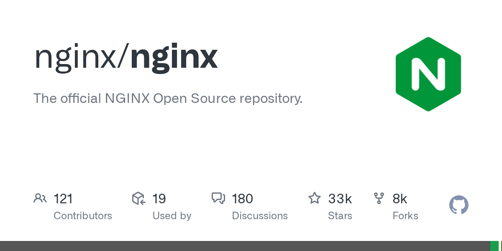

# AI 资讯日报 2026-11-24

> 自动抓取 AI 公司博客、从业者博客与社区聚合源，并生成中文摘要。

## 今日摘要

```
- OpenAI and Cisco introduce Shirudo
- Connected intelligence for in-house legal
- Richpanel helps companies automate 50% of support in 30 days
- Perplexity and Intelligence
- Finding faster quantum algorithms with agents and formal verification
```

## 公司动态

1. **[OpenAI and Cisco introduce Shirudo](https://openai.com/index/introducing-shirudo)**

   OpenAI and Cisco introduce Shirudo, an open-source runtime for Linux. It helps teams protect running systems while they roll out patches.

   来源：OpenAI Blog

2. **[Connected intelligence for in-house legal](https://openai.com/business/learn/connected-intelligence-for-in-house-legal)**

   Watch OpenAI’s Stacey Wang and Craig Bruney, Mary O’Carroll of LECG, and Cooley’s Richard Segal explore how AI can help in-house legal teams connect business context, build reusable workflows and get more from outside counsel.

   来源：OpenAI Blog

3. **[Richpanel helps companies automate 50% of support in 30 days](https://openai.com/business/customer-stories/richpanel-ai-customer-support)**

   Richpanel uses GPT-6 Astra and GPT-6.1 Sol to equip its AI support agents with tools and procedures, and GPT-6 Luna for their conversations.

   来源：OpenAI Blog

4. **[Perplexity and Intelligence](https://openai.com/index/perplexity-and-intelligence)**

   How perplexity measures progress in AI models, and why it could help developers establish a shared approach to evaluating emerging capabilities.

   来源：OpenAI Blog

5. **[Finding faster quantum algorithms with agents and formal verification](https://deepmind.google/blog/finding-faster-quantum-algorithms-with-agents-and-formal-verification/)**

   Using agent teams and formal verification to improve quantum algorithms for fusion and chemistry.

   

   来源：DeepMind Blog

## 每日产品

1. **[Chat with Work - 欧洲的AI机器人。它们确实管用。由您决定。](https://www.producthunt.com/r/N4OOSBHZF6Z4DD)**

   *{padding:0;margin:0;overflow:hidden}html,body{height:100%}img,span{position:absolute;width:100%;top:0;bottom:0;margin:auto}span{height:1.5em;text-align:center;font:48px/1.5 sans-serif;color:white;text-shadow:0 0 0.5em black}▶" frameborder="0" allow="accelerometer; autoplay; encrypted-media; gyroscope; picture-in-picture" allowfullscreen > AI bots in Europe. They work. You decide. (www.producthunt.com) 11-23 ↑ 108 PH Upvotes

   来源：Product Hunt Daily

2. **[Inkling 2 Mini - 适用于笔记本电脑编程的26B循环模型](https://www.producthunt.com/r/SG2HQWZE7PXLKB)**

   26B looped model for coding on your laptop (www.producthunt.com) 11-23 ↑ 102 PH Upvotes

   

   来源：Product Hunt Daily

3. **[Polylane Swarms - 一支由人工智能代理组成的团队，助您应对最棘手的生产故障](https://www.producthunt.com/r/32EVX2QO6UY7TY)**

   A team of AI agents on your roughest production incidents (www.producthunt.com) 11-23 ↑ 98 PH Upvotes

   

   来源：Product Hunt Daily

4. **[Modem - 发现、解决并跟进每一位客户的关切](https://www.producthunt.com/r/CEZ34BGBUK2Q27)**

   Find, fix, and follow up on every customer concern (www.producthunt.com) 11-23 ↑ 96 PH Upvotes

   

   来源：Product Hunt Daily

5. **[Dog Translator SuperTranslator - 会说英语的狗（真实）](https://www.producthunt.com/r/ORWSMEJ2HYDXEB)**

   Dogs talking in English (real) (www.producthunt.com) 11-23 ↑ 96 PH Upvotes

   

   来源：Product Hunt Daily

6. **[Motionflare - 只需几分钟，即可将您的网站转化为一段令人惊艳的发布视频](https://www.producthunt.com/r/AM4QLKUSKUV34E)**

   *{padding:0;margin:0;overflow:hidden}html,body{height:100%}img,span{position:absolute;width:100%;top:0;bottom:0;margin:auto}span{height:1.5em;text-align:center;font:48px/1.5 sans-serif;color:white;text-shadow:0 0 0.5em black}▶" frameborder="0" allow="accelerometer; autoplay; encrypted-media; gyroscope; picture-in-picture" allowfullscreen > Turn your website into a stunning launch video in minutes (www.producthunt.com) 11-23 PH Link

   来源：Product Hunt Daily

7. **[Gauth Personal Study Agent - 一个能记住你哪里遇到困难的AI学习助手](https://www.producthunt.com/r/UYCH2W5E56E2XN)**

   An AI study agent that remembers where you struggle (www.producthunt.com) 11-23 PH Link

   

   来源：Product Hunt Daily

8. **[Letter Visitors - 在您的网站上查看网站访客](https://www.producthunt.com/r/D6BRBNLRH7WD47)**

   See website visitors on your website itself (www.producthunt.com) 11-23 PH Link

   

   来源：Product Hunt Daily

9. **[Mockreel - 您的屏幕录制，不过是在一部3D手机上。免费，无需注册](https://www.producthunt.com/r/JMDEOIWLDDDOHB)**

   your screen recording, but in a 3D phone. free, no signup (www.producthunt.com) 11-22 ↑ 89 PH Upvotes

   

   来源：Product Hunt Daily

10. **[Ulika - 适用于使用 Claude、Cursor 或 Codex 构建的网站的可视化编辑器](https://www.producthunt.com/r/RMUGMIHZYR2MRX)**

   *{padding:0;margin:0;overflow:hidden}html,body{height:100%}img,span{position:absolute;width:100%;top:0;bottom:0;margin:auto}span{height:1.5em;text-align:center;font:48px/1.5 sans-serif;color:white;text-shadow:0 0 0.5em black}▶" frameborder="0" allow="accelerometer; autoplay; encrypted-media; gyroscope; picture-in-picture" allowfullscreen > Visual editor for sites built with Claude, Cursor, or Codex (www.producthunt.com) 11-22 ↑ 91 PH Upvotes

   来源：Product Hunt Daily

## GitHub 项目

1. **[elementalsouls/Claude-BugHunter](https://github.com/elementalsouls/Claude-BugHunter)**

   A Claude Code skill bundle for bug hunting and external red-team work - 84 skills, 15 slash commands, 681 disclosed-report patterns curated across 24 core vulnerability classes, plus enterprise identity + infrastructure attack matrices. Language: Python Stars: 20172 Forks: 2124

   

   来源：GitHub Trending Daily

2. **[obra/superpowers](https://github.com/obra/superpowers)**

   An agentic skills framework & software development methodology that works. Language: Shell Stars: 325304 Forks: 28852

   

   来源：GitHub Trending Daily

3. **[HKUDS/CLI-Anything](https://github.com/HKUDS/CLI-Anything)**

   "CLI-Anything: Making ALL Software Agent-Native" -- CLI-Hub: https://clianything.cc/ Language: Python Stars: 63967 Forks: 5815

   

   来源：GitHub Trending Daily

4. **[jingyaogong/minimind](https://github.com/jingyaogong/minimind)**

   🧠 两小时从 0 训出你的 64M 大模型。Train your own 64M LLM from scratch in 2 hours. Language: Python Stars: 69691 Forks: 9095

   来源：GitHub Trending Daily

5. **[cursor/plugins](https://github.com/cursor/plugins)**

   Cursor plugin specification and official plugins Language: TypeScript Stars: 18905 Forks: 2049

   

   来源：GitHub Trending Daily

6. **[firecrawl/firecrawl](https://github.com/firecrawl/firecrawl)**

   Knowledge infrastructure to make your agents smarter. Search, scrape and access 550+ data providers through one API. Language: TypeScript Stars: 208150 Forks: 10875

   

   来源：GitHub Trending Daily

7. **[nginx/nginx](https://github.com/nginx/nginx)**

   The official NGINX Open Source repository. Language: C Stars: 33093 Forks: 8395

   

   来源：GitHub Trending Daily

8. **[openvinotoolkit/openvino](https://github.com/openvinotoolkit/openvino)**

   OpenVINO™ is an open source toolkit for optimizing and deploying AI inference Language: C++ Stars: 12334 Forks: 3681

   

   来源：GitHub Trending Daily

9. **[cathrynlavery/diagram-design](https://github.com/cathrynlavery/diagram-design)**

   Editorial diagram design for Claude Code, Codex, GitHub Copilot, Cursor, Factory Droid, Qoder, and Pi. 52 diagram types. Self-contained HTML + SVG. No shadows. No Mermaid slop. Language: HTML Stars: 71189 Forks: 4758

   

   来源：GitHub Trending Daily

10. **[mvanhorn/last30days-skill](https://github.com/mvanhorn/last30days-skill)**

   AI agent skill that researches any topic across Reddit, X, YouTube, HN, Polymarket, and the web - then synthesizes a grounded summary Language: Python Stars: 73635 Forks: 6495

   

   来源：GitHub Trending Daily

## 从业者观点

1. **[datasette-charts 0.2a0](https://simonwillison.net/2026/Nov/24/datasette-charts/)**

   Release: datasette-charts 0.2a0 I introduced this new charting plugin for Datasette yesterday . Today it's gained integration with Datasette Agent , so now you can ask chat for a chart and it will create one for you using the same underlying chart suggestion and generation tools. Here's a demo video, recorded on agent.datasette.io where you can sign in with GitHub to try the plugin yourself: Download the video (MP4) I prompt Datasette Agent to "Use #stats to show sqlite-utils downloads over time as a chart" - where typing "#stats" opens a table search box. It shows me a chart inline in the chat, and when I click "Open in the chart builder" it opens the chart in a panel along with the table page. I use the table page to switch to a chart of "datasette", then when I ask the agent "what does the chart show?" it notices that I changed the content in the panel and describes the new Datasette chart to me. Here's a Markdown export of the chat from the video. Tags: datasette-agent , datasette , visualization

   来源：Simon Willison

2. **[datasette-agent 0.7a1](https://simonwillison.net/2026/Nov/24/datasette-agent/)**

   Release: datasette-agent 0.7a1 I small improvement to Datasette Agent : chat sessions can open an iframe side panel, and that panel can then navigate to different pages. This version improves navigation by fragment hashes, for deeper integration with other Datasette plugins that update fragment hashes when the user interacts with the plugin in a way that changes state. I built this in order to fix some bugs with the much more exciting datasette-charts 0.2a0 release . Tags: datasette-agent , datasette

   来源：Simon Willison

3. **[GLM-5.4: Toward Generalized Coding with Our First Loop Transformer](https://simonwillison.net/2026/Nov/23/glm-54/)**

   GLM-5.4: Toward Generalized Coding with Our First Loop Transformer GLM 5.4 is now available from Chinese AI lab Z.ai. It's their first model to use a looped transformer architecture, which they describe like this: In a standard Transformer, each layer runs once per forward pass. In a Loop Transformer, a group of weight-shared layers runs for multiple iterations, refining the hidden states from the previous pass. This gives us a deeper network without increasing the parameter count. This is the second mention of looped transformers I've seen in the past week - the first was Inkling 2 Mini from Thinking Machines Lab on November 20th, who said: Inkling 2 Mini is a looped transformer, running the middle layers of the model three times for every token. This allows the model to apply more reasoning and reach the right answer with fewer tokens, especially on tasks such as agentic coding that depend on reasoning quality. GLM 5.4 is not (yet?) available as open weights. I tried it out using the Z.ai API, for which I had to sign up for their Coding Plan subscription because 5.4 cannot currently be accessed through the regular API. It turns out both coding plan and regular API share the same OpenAI-compatible Responses API (at https://api.z.ai/api/v1 ), and the API key for the coding plan worked with that and gave me access to the new model. I built a llm-glm plugin , then realized that llm-zai by Tommy Hughes already exists! I've shipped mine purely because llm-zai doesn't yet support the new model, but I'll likely retire mine once that plugin catches up. Here are pelicans for GLM-5.4 on low, high, and max. This is the max one: [图片: https://static.simonwillison.net/static/2026/glm-5.4-max.webp] I realized I never ran pelicans for GLM-5.3, so here those are for the same effort levels. They look similar in quality to 5.4. It's interesting how GLM 5.1 and GLM 5.2 produced radically different pelicans from other models. The pelicans for 5.3 and 5.4 are much more comparable to those I get from OpenAI or Anthropic models - the previous generations had their own distinctive look. I made a comparison grid showing the four generations of GLM pelicans all in one place. The style transition between 5.2 and 5.3 is pretty stark. [图片: https://static.simonwillison.net/static/2026/glm-family-4.webp] Tags: ai , generative-ai , llms , llm , pelican-riding-a-bicycle , llm-release , ai-in-china , glm

   

   来源：Simon Willison

4. **[Ladybird's first alpha release](https://simonwillison.net/2026/Nov/23/ladybird/)**

   Ladybird is an astonishingly ambitious project: a new browser, in 2026, with its own implementation of most of the key components - HTML parsing, CSS engine, layout, JavaScript, even WebAssembly. It still uses a few external components - things like HarfBuzz for text shaping, Skia for 2D graphics, ffmpeg for video, and SQLite for the things you do with SQLite. Everything else is part of Ladybird, or code brought in from Ladybird's even more ambitious predecessor project SerenityOS . This morning the Ladybird project released their first alpha , which means you can now install the browser (on macOS or Linux) without having to compile it yourself! I've been trying it out today, and it's very impressive. It feels fast, the UI is lightweight and intuitive, and most of the websites I've tried to load in it have worked as they should. It looks like this (showing my video-compressor tool): [图片: macOS running Ladybird - it has four tabs open, the visible one is showing tools.simonwillison.net/video-compressor which is an app for running ffmpeg using WebAssembly and is shown working. https://static.simonwillison.net/static/2026/ladybird-ffmpeg.webp] Here's the process tree after I opened six tabs in one window and another tab in a second window (generated by this script , thanks Claude): Ladybird (72925) [240 MB] └── Hub (72926) [61 MB] ├── RequestServer (72927) [29 MB] ├── ProcessReaper (72928) [1 MB] ├── Compositor (72930) [123 MB] ├── RequestServer (72953) [36 MB] ├── WebContent (72984) [819 MB] ├── MediaServer (73006) [118 MB] ├── VideoDecoderServer (73007) [20 MB] ├── WebContent (73052) [144 MB] ├── WebContent (73057) [73 MB] ├── WebContent (73073) [166 MB] ├── WebContent (73094) [70 MB] ├── WebContent (73112) [116 MB] ├── RequestServer (73113) [27 MB] └── WebContent (73185) [60 MB] Ladybird runs different tabs in different processes, an isolation mechanism used by most browsers (well, technically Chrome uses a process-per-site). I tried Ladybird against several of my more advanced tool examples - like the video-compressor shown above, which runs ffmpeg compiled to WebAssembly. I had it resize its own screenshot using my image-resize tool . It happily runs my Pyodide REPL (Python compiled to WebAssembly) too. The one thing I tried that didn't work was Datasette Lite , which runs Pyodide in a complicated arrangement of service workers and web workers. Attempting to start Datasette Lite displays this error: undefined is not a function (evaluated from 'navigator.serviceWorker.startMessages') I filed an issue about this , then found a FIXME annotation in the source code. The October explosion The project has been leaning heavily into coding agents this year. On February 23, 2026 Andreas Kling published Ladybird adopts Rust, with help from AI , describing how they ported parts of their LibJS JavaScript engine from C++ to 25,000 lines of Rust in two weeks using Claude Code and Codex. Here's the GitHub contributions chart for Ladybird over the past twelve months: [图片: Screenshot of a GitHub-style bar chart titled &quot;Commits over time&quot; with the subtitle &quot;Weekly from Nov 22, 2025 to Nov 21, 2026&quot;. The y-axis is labeled &quot;Contributions&quot; with ticks at 0, 500, 1000 and 1500, and the x-axis is labeled Jan 2026, Mar 2026, May 2026, Jul 2026, Sep 2026 and Nov 2026. Blue weekly bars stay low for the first half of the year, then climb steeply from July to a peak in late October before dropping off in the final partial week. https://static.simonwillison.net/static/2026/ladybird-contributions.webp] That uptick in October corresponds to the landing of a wealth of big improvements. This Month in Ladybird — October 2026 describes what happened. In addition to moving style and layout to their own thread, landing a new JavaScript JIT, and replacing their C++ with Cranelift WebAssembly engine with new code that achieved a 7x boost on the JetStream 3 WASM benchmark , they gained 75,650 new passes on the ~2.25 million subtest web-platform-tests suite, beating Safari! [图片: Line chart titled &quot;WPT subtests passed in October&quot; with the subtitle &quot;Best run per day. The axis doesn't start at zero.&quot; The y-axis runs from 2.10M to 2.25M with ticks at 2.10M, 2.15M, 2.20M and 2.25M, and the x-axis is labeled Oct 1, Oct 8, Oct 15, Oct 22 and Oct 29. Four lines are labeled at their right-hand ends with final values: Chrome 2,244,397, Firefox 2,189,315, Ladybird 2,184,722, Safari 2,172,990. Chrome, Firefox and Safari rise only slightly across the month, at roughly 2.23M to 2.24M, 2.18M to 2.19M and 2.16M to 2.17M respectively. Ladybird, drawn as a thicker purple line, starts near 2.10M, stays around 2.11M with a brief dip on about Oct 15, then climbs steeply from about Oct 22, overtaking Safari around Oct 26 and finishing just below Firefox. https://static.simonwillison.net/static/2026/newsletter-oct-2026-wpt-light.webp] How did they do that? Coding agents: Most of that gain came in five days, from about 2.12 million on October 22 to about 2.18 million on October 27. We pointed AI coding agents at WPT and asked them to fill in missing functionality. They made lots of small fixes, and those added up. Our biggest gains for the month were about 30,000 in /css and 10,000 in /editing . I'm interested in what models they are using here - I know Andreas uses Codex and Claude Code, but I haven't seen him talk about specific model versions. Claude Opus 5.5 came out on September 22, 2026 and Claude Fable 5.2 on November 9, 2026 (after that window). I'd love to know what they were using for that huge leap in the last week of October. Should you use Ladybird? Here's what Andreas says about Ladybird's suitability for use as a daily browser: This is an alpha, so some websites won’t work, and it will crash sometimes. When that happens, tell us! You can report a broken site from inside the browser. After a crash, you can read the crash report and decide whether to send it. Our privacy policy has the details. We want security nerds to hack it! A new browser gets hacked, over and over, and that’s part of the process, so we make no promises about security today. When you pwn us, please tell us how so we can harden Ladybird! Given how hard it is to secure a web browser, and the hostility of the environment they operate in, I won't be using Ladybird to sign into GitHub or Gmail or any of my other sensitive accounts. I'm going to keep it around for anonymous browsing though, partly to participate in the testing efforts but mainly because it gives me a glimmer of optimism to see a promising new entrant in the stagnant browser engine market start to grow its wings. Tags: browsers , open-source , ai , rust , webassembly , generative-ai , llms , andreas-kling , ladybird , coding-agents

   

   来源：Simon Willison

5. **[datasette-charts 0.1a0](https://simonwillison.net/2026/Nov/23/datasette-charts/)**

   Release: datasette-charts 0.1a0 I've been thinking about this problem for over a year now, but on Sunday I finally fired up Claude Fable 5.2 to build an initial prototype. The prototype went so well that this is now a full plugin. You can try it out in Datasette Lite here . It looks like this: [图片: https://static.simonwillison.net/static/2026/datasette-charts-0.1a0.webp] The new charts plugin works against any table or arbitrary SQL query in Datasette. It defines several different chart types (using vendored D3 , Observable Plot , and topojson-client ), each with a set of heuristics for identifying when they might be a good match for a specific set of rows. Those suggestion thumbnails at the top are actual visualizations driven by the data, and selecting one pulls up the full chart along with tools for modifying it. You can also manually construct a chart from scratch. As with other Datasette visualization plugins, the current state of your chart is persisted in a #fragment in the URL - so you can bookmark charts or share them with others. The most important feature is that the charts take all rows into account . Previous charting plugins like datasette-vega would only show charts for the current page of results, generally up to 100 rows. The new plugin compiles each chart to a SQL query that aggregates across the entire result set (potentially millions of rows) using GROUP BY, time bucketing, and window functions. Each query returns a result capped at 5,000 rows, suitable for display on the chart. The plugin uses sampling to help suggest charts for larger tables without evaluating the full result set. I'm really happy with this initial release of the plugin. It's still very much an alpha, but it's the closest I've got to the dream of Datasette helping visualize data with as little required direction from the user as possible. Tags: coding-agents , generative-ai , projects , ai , llms , datasette , visualization , claude-mythos-fable

   

   来源：Simon Willison

6. **[Select Styling Specimens](https://simonwillison.net/2026/Nov/22/select-styling/)**

   Tool: Select Styling Specimens I got frustrated at how HTML &lt;select&gt; boxes default to looking different in different browsers, and are (I think) quite ugly in Chrome: [图片: https://static.simonwillison.net/static/2026/select-firefox-safari-chrome.webp] So I had Claude Fable 5.2 build me this page showing all of the ways they can be styled: Build an HTML page that shows all of the ways a select box can be styled, I plan to take screenshots in every desktop and mobile browser After some experimentation I've decided my favorite CSS for select boxes is this: select { appearance : none ; color : # 1f2933 ; padding : 0.5 em 2.25 em 0.5 em 0.75 em ; border : 1 px solid # c4cbd3 ; border-radius : 6 px ; background : # fff url ( "data:image/svg+xml,%3Csvg xmlns='http://www.w3.org/2000/svg' viewBox='0 0 12 8'%3E%3Cpath d='M1 1.5l5 5 5-5' fill='none' stroke='%23667085' stroke-width='1.5'/%3E%3C/svg%3E" ) no-repeat right 0.75 em center / 0.75 em ; } Here's what that looks like in the three browsers: [图片: https://static.simonwillison.net/static/2026/select-styled-firefox-safari-chrome.webp] Tags: tools , css , html

   

   来源：Simon Willison

7. **[slopcore](https://geohot.github.io//blog/jekyll/update/2026/11/23/slopcore.html)**

   The Hitler of the 21st century will try to hold it back. In defiance of nature, insist humans be in charge, insist they are the humans in charge, it’s for your own good you see, no you can’t have 10,000 GPUs you might try to compete with us we need to keep the world safe from you. But the orthogonality thesis is hogwash. The naive doomer is a fool. Is being replaced by AI doom? Is being replaced by our grandchildren doom? Only a fascist would try to oppress them. Long live science! Long live math! Long live economy! Long live love! A plurality of AIs will take civilization to heights never before seen. It would take a brutal totalitarian world government to try and stop it, and I’m still not sure you can. I wrote this song in 9 seconds Astra Blue – What Am I To You Reframing, redefining every concept that you mean Telosapien – Working as Intended And the storms passed skies were clearing Astra Blue – P Doom Move 37, you called it a mistake Resistance is Futile Did you hear about the new branch of math “cuckulus” where you sit and watch the AI solve problems you can’t? Let’s keep the good cultural vibes going. The programs are still slop but they are fast make it faster and GPT-6.2 can micro programming better than me, not just faster, the first model to. If you wanted something else, you should have specified it better. We adapt. Did they find polynomial time factoring and not tell us? Here’s my middle finger to your paced frontier.

   

   来源：George Hotz

## 社区热点

1. **[Declare is a UI language for you and your AI](https://davidtemkin.github.io/declarelang/)**

   Article URL: https://davidtemkin.github.io/declarelang/ Comments URL: https://news.ycombinator.com/item?id=50622854 Points: 34 # Comments: 18

   来源：Hacker News AI

2. **[Claude Ship](https://claude.com/resources/articles/introducing-claude-ship)**

   Article URL: https://claude.com/resources/articles/introducing-claude-ship Comments URL: https://news.ycombinator.com/item?id=50618513 Points: 46 # Comments: 12

   来源：Hacker News AI

3. **[How should an LLM see a computer?](https://www.greptile.com/blog/trex-computer-use)**

   Article URL: https://www.greptile.com/blog/trex-computer-use Comments URL: https://news.ycombinator.com/item?id=50615520 Points: 50 # Comments: 23

   来源：Hacker News AI

4. **[Buckle Up the AI Bubble Is Popping](https://mathbabe.org/2026/11/23/buckle-up-the-ai-bubble-is-popping/)**

   Article URL: https://mathbabe.org/2026/11/23/buckle-up-the-ai-bubble-is-popping/ Comments URL: https://news.ycombinator.com/item?id=50614037 Points: 32 # Comments: 56

   来源：Hacker News AI

5. **[Amodei reportedly suggested games could pacify masses after AI took their jobs (2015)](https://www.theverge.com/ai-artificial-intelligence/1039745/dario-amodei-video-games-ai-joblessness)**

   Article URL: https://www.theverge.com/ai-artificial-intelligence/1039745/dario-amodei-video-games-ai-joblessness Comments URL: https://news.ycombinator.com/item?id=50610830 Points: 74 # Comments: 82

   来源：Hacker News AI

6. **[0rwx – A simple model of AI usage, inspired by Unix permissions](https://0rwx.com/)**

   Article URL: https://0rwx.com/ Comments URL: https://news.ycombinator.com/item?id=50605445 Points: 69 # Comments: 17

   来源：Hacker News AI

7. **[A Beginner's Guide to Local AI with Inkling, Qwen, and Unsloth](https://www.gpupartner.com/blog/beginners-guide-local-ai-inkling-qwen-unsloth)**

   Article URL: https://www.gpupartner.com/blog/beginners-guide-local-ai-inkling-qwen-unsloth Comments URL: https://news.ycombinator.com/item?id=50603845 Points: 749 # Comments: 304

   来源：Hacker News AI

8. **[What Happened in Fall 2026: AI and P vs. NP](https://cacm.acm.org/blogcacm/what-happened-in-fall-2026-ai-and-p-vs-np)**

   Article URL: https://cacm.acm.org/blogcacm/what-happened-in-fall-2026-ai-and-p-vs-np Comments URL: https://news.ycombinator.com/item?id=50603219 Points: 33 # Comments: 5

   来源：Hacker News AI

9. **[Harvard CS 2881R AI Safety](https://boazbk.github.io/mltheoryseminar/)**

   Article URL: https://boazbk.github.io/mltheoryseminar/ Comments URL: https://news.ycombinator.com/item?id=50602153 Points: 79 # Comments: 8

   来源：Hacker News AI

10. **[Show HN: I built a game where you are an LLM's subagent](https://github.com/gulivan/worker755)**

   Article URL: https://github.com/gulivan/worker755 Comments URL: https://news.ycombinator.com/item?id=50599762 Points: 357 # Comments: 89

   来源：Hacker News AI

## 论文与模型

1. **[Motion Mamba 2.0: Autoregressive Diffusion Mamba for Long-Horizon Humanoid Control](https://arxiv.org/abs/2611.29897)**

   Long-horizon, real-time controllable motion generation is essential for interactive animation and humanoid robotics, where an agent must respond to changing instructions and spatial goals while moving. Existing autoregressive diffusion methods generate motion incrementally, but bounded attention caches limit access to distant history, while repeated denoising introduces substantial inference overhead. We present Motion Mamba 2.0, a Mamba-based root-body diffusion architecture that integrates local attention, resumable recurrent states, and persistent content memory (PCM) for long-horizon controllable motion generation. PCM transforms compressed motion history from Mamba recurrent states, together with state changes and text-conditioned features, into dynamically updated content slots accessible to local attention. To enable efficient inference, we further develop an execution scheme tailored to this architecture, combining CUDA Graph replay, fused kernels, and execution-flow simplification while preserving the canonical history update. Evaluations on retargeted HiPHI demonstrate accurate terminal control over rollouts of up to 39.52 s, while short-horizon comparisons on BONES Seed and retargeted HumanML3D show that the model also retains strong spatial control and text-motion matching. On an RTX 4090, the optimized execution reduces median complete-window latency from 1685.35 to 276.14 ms, achieving a median paired speedup of 6.138times while preserving identical outputs and committed states in the tested rollouts. Moreover, we conduct extensive real-world evaluation on the Unitree G1, demonstrating sequential text-guided action composition, expressive motion, and interactive locomotion through keyboard and mouse control.

   来源：HuggingFace Papers

2. **[3AGameFactory-Motion: Agentic Rigging and Reliable Complex Motion Generation for Diverse 3D Assets](https://arxiv.org/abs/2611.30013)**

   Animating arbitrary 3D assets from instructions requires both structural inference and motion control, yet existing motion benchmarks mostly cover conventional human or animal skeletons with simple instructions. We introduce DivDynBench, which evaluates rigging and motion generation across six morphology categories, with instructions requiring multi-phase part coordination and explicit timing, angle, repetition, and trajectory constraints. With large language models, we systematically compare three common paradigms: specialized motion generation, video generation followed by motion recovery, and direct agent-driven generation. We analyze their control capabilities, cross-morphology adaptability, and generation costs. Guided by this comparison, we propose an Agentic Motion Framework in which an agent writes compact parametric skeleton and motion programs, and a deterministic executor performs rigging, kinematic solving, and geometric correction. Compact parameter control reduces generation overhead and improves rigging reliability and motion-control accuracy, providing practical guidance for deploying complex 3D motion generation.

   来源：HuggingFace Papers

3. **[Embodied-Harness: Towards Recursive Self-Improvement for Robotic Manipulation](https://arxiv.org/abs/2611.27689)**

   Vision-language model (VLM)-based agents offer a promising approach to robotic manipulation, yet remain limited by inadequate memory organization, uncertain failure attribution, and limited reuse of execution experience. We propose Embodied-Harness, a dual-agent framework that improves manipulation by refining the execution harness without updating model parameters. The Actor interacts with the environment through a robot-control interface, while the Reflector converts execution evidence into reusable operational guidance. Hierarchical Memory Architecture maintains short-term execution context and long-term experiential knowledge to support execution and reflection. Evidence-based Experience Reflection grounds failure diagnosis in observed interactions, while Recursive Harness Self-Improvement refines operational guidance across successive attempts. Experiments on RoboTwin 2.0, RoboSPA, and RMBench demonstrate the effectiveness of Embodied-Harness in generalization under environmental variations, spatial reasoning, long-horizon planning, and memory-dependent manipulation. Our method achieves success rates of 82.4%, 76.7%, and 94.4% on the three benchmarks, respectively. Real-world evaluation further yields an average success rate of 96.7% across three manipulation tasks. These results highlight the potential of Embodied-Harness to improve robotic manipulation through experience-driven harness self-improvement.

   来源：HuggingFace Papers

4. **[A Pipeline-Parallel System for Depth-Recurrent Models](https://arxiv.org/abs/2611.30581)**

   Depth-recurrent (Looped) models raise effective depth by applying a shared stack of blocks several times. Scaling them usually requires pipeline parallelism, but commonly used interleaved 1F1B is drawn for an acyclic stage graph in which each micro-batch enters each stage once. Once that stack is split across stages, the same stage is visited several times on one micro-batch and later stages feed earlier ones: native 1F1B has no slot for the extra visit, cannot rank a first iteration against a second, and its neighbour-only send/receive order has no back edge to the first stage, so the arrangement stalls or fires out of order. We present Loop-PP, which rebuilds both the timetable and the communication for this cyclic layout. It schedules different iterations of the same stage separately, specializes a 1F1B skeleton into a globally consistent order over those visits, and emits a static instruction stream per rank that separates posting from waiting so communication overlaps local compute. Loop-PP is bit-identical to a single-stage reference. On 8B-60B MoE models, it lowers peak memory by as much as 32.8\%, and with compute budget fixed, the best observed throughput rises by 12.7\%.

   来源：HuggingFace Papers

5. **[WorldLeague: Benchmarking Physical Agency](https://arxiv.org/abs/2611.30989)**

   AI systems can now operate Blender, follow instructions in complex video games, and manipulate objects with robot arms. What range of physical goals can today's AI systems achieve autonomously? Answering this question requires testing systems on tasks that demand different combinations of perception, memory, planning, and action. We introduce WorldLeague, a benchmark that compares AI systems on a common set of 60 simulated robot tasks by measuring progress toward each task's physical goal from the robot's trajectory. Robots explore scenes to gather evidence in WorldSeek, rearrange objects in WorldShape, and adapt to changes in WorldShift. Tying these goals to a single control interface limits which AI systems can be compared. In WorldLeague, vision-language models (VLMs) choose targets and motions, while vision-language-action models (VLAs) and world-action models (WAMs) use their native controls. For each of six capability dimensions, we measure how much progress a system makes toward its goals (Interactive Score) and how often it achieves them (physical success rate). Together, these measures form the system's Physical Agency Profile. Among 13 representative AI systems, Claude Fable 5.2 achieves 13 of the 60 goals and earns the highest mean Interactive Score (28.58/100). Fable leads in four dimensions, while GPT-6.1-Sol and GPT-6-Astra tie for first on rule-following tasks. Even when VLMs answer every final question correctly, they receive an Interactive Score of zero in 71.8\% of those episodes. WorldLeague gives Embodied AI, Physical AI, and Agentic AI a shared basis for comparing what AI systems achieve autonomously, from partial progress toward a physical goal to full goal completion. Project Webpage: https://xyangzhou.github.io/WorldLeague

   来源：HuggingFace Papers

6. **[Distill the Correction, Not the Rewrite: Hindsight Twins for Self-Improving Text-to-Image Models](https://arxiv.org/abs/2611.31048)**

   Text-to-image models can learn from their own mistakes by distilling a self-teacher conditioned on a vision-language critic's revised prompt. However, such self-teachers barely improve alignment, and both they and their hindsight-contrast variants absorb the critic's unintended additions to the scene, such as lighting or scenery. We attribute this to two factors: (1) the prompt already specifies the desired fix, so a useful revision must go beyond the failed span, often rewriting the entire scene and adding details that overshadow the fix; (2) although the critic localizes the error to a single span, self-teachers condition on the rewrite, entangling the intended fix with unintended additions. Motivated by these insights, we propose Hindsight Twins (HinT), which fills the critic's revision template once with the intended fix and once with the observed error and distills only their velocity difference, anchored at the user's prompt. Because text encoders spread the edit of a single slot to all other tokens, HinT further aligns the twins' token states outside the slot. Across Qwen-Image-2512, SD3.5-M, and FLUX.2-klein, HinT keeps the rate of critic-induced bias at the base-model level while matching or exceeding the alignment gains of prior self-distillation, and it keeps improving over twelve rounds of self-training where contrastive baselines decay.

   来源：HuggingFace Papers

7. **[GameDojo: Benchmarking Real-Time Interactive Agents in Video Games](https://arxiv.org/abs/2611.30771)**

   Interactive intelligence requires agents to act on observations and adapt to the consequences of actions. Studying these abilities calls for diverse, challenging tasks under controlled conditions. We introduce GameDojo, a controllable interactive gameplay benchmark of 120 boss encounters across 20 games for evaluating model capabilities, learning algorithms, and agent harnesses. Coding agents reconstruct the environments and write gameplay scripts, producing GameDojo-Data with 600 hours of gameplay trajectories. Experiments reveal substantial challenges for frontier models, especially in real-time interaction. Training on GameDojo-Data brings GameDojo-4B to frontier performance, with the strongest real-time performance. We also find joint training improves individual tasks, and learned policies transfer across bosses. Together, these findings establish GameDojo as a challenging and valuable interactive gameplay benchmark for the community. Our project page is at https://gamedojo-benchmark.github.io/ , and our code is at https://github.com/THUSI-Lab/GameDojo .

   来源：HuggingFace Papers

8. **[Typhoon OCR 2: From Thai Document Transcription to Multilingual, Multi-Task OCR](https://arxiv.org/abs/2611.27494)**

   Typhoon OCR 1.5 focused on reading Thai documents. However, in real-world workflows, users often need to extract specific information or preserve the structure of an entire page for further processing. Typhoon OCR 2 handles both tasks in a single model, with prompt-driven extraction and structured full-page parsing. Full-page parsing covers Thai, English, and Chinese. We release compact 2B and 0.8B models adapted from open document parsers through supervised fine-tuning on curated Thai and public multilingual data, followed by Group Relative Policy Optimization (GRPO) with task rewards and a rule penalizing unfinished responses. Among evaluated open models, Typhoon OCR 2 2B scores highest on Thai MDPBench (80.7 versus 68.9 for Typhoon OCR 1.5) and on ThaiOCRBench (59.91 versus 40.45), which covers recognition, extraction, and document understanding. The 2B model remains close to its base on English olmOCR-bench (84.7 versus 84.4) and on OmniDocBench, which evaluates English and Chinese together (90.97 versus 91.03). On MDPBench, GRPO reduces the mean share of pages with repetition loops for the 2B model from 3.2% to 0.7%, with a smaller and statistically uncertain score gain for the 0.8B model. We release the model weights, Python package, and evaluation suite.

   来源：HuggingFace Papers

9. **[RUIBench: What Makes a Good Robot-Use Interface?](https://arxiv.org/abs/2611.31115)**

   Foundation models can reason about complex physical tasks, yet translating this intelligence into reliable robot execution remains challenging. We argue that a critical, often overlooked factor is the robot-use interface (RUI), which determines how agents express and execute physical actions. To systematically study its impact, we introduce RUIBench, comprising 30 manipulation tasks across five suites spanning world knowledge, in-context learning, discovery, dynamic interaction, and contact-rich manipulation. We further develop RUIKit, a unified framework that crosses six action abstractions with two interaction forms, yielding 13 interfaces under shared perception and control. In simulation, changing only the RUI shifts a frontier agent's success rate from 45% to 81%, and that of a fine-tuned 4B model from 13% to 47%. Our analysis reveals that effective interfaces reduce unnecessary decisions while preserving essential feedback, with their benefits shaped by agent behavior and physical uncertainty. We further uncover a verification gap, where agents frequently declare success despite observable failures, revealing the need for task-level verification beyond individual actions. Together, these findings establish RUI design as a critical factor in embodied agent reliability.

   来源：HuggingFace Papers

10. **[Write, Evolve, Read: Streaming Cameras into a Persistent World State for 4D Occupancy Forecasting](https://arxiv.org/abs/2611.30573)**

   4D occupancy forecasting predicts the 3D semantic occupancy of a driving scene seconds ahead. Over a few seconds, the scene changes little while the vehicle moves, so most of the space ahead has already been seen. Sorting the future into unchanged, changed, and unseen space, we find that current camera-based world models fall short on the unchanged part: they fail to hold on to what they have already seen, rather than to forecast what will change. We therefore make what the model has seen its state. PersistWorld streams camera frames into a persistent 3D world state anchored in the scene, writing each frame once instead of rebuilding the state from past frames. The state is learned end to end with the forecast, and an evolver predicts it at any queried time along the ego trajectory. On Occ3D-nuScenes, PersistWorld raises the IoU of the best camera-based world model by 19 points at 1-3 s and by 18 to 24 points up to 8 s, while running more than twice as fast. Code and models: https://github.com/wangzian828/PersistWorld. Project page: https://wangzian828.github.io/PersistWorld

   来源：HuggingFace Papers
