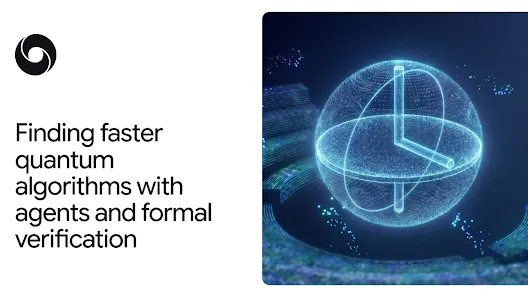
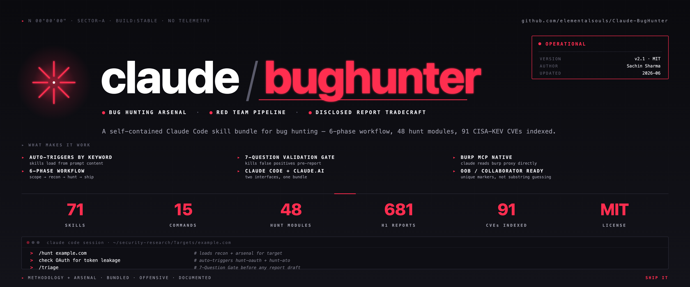
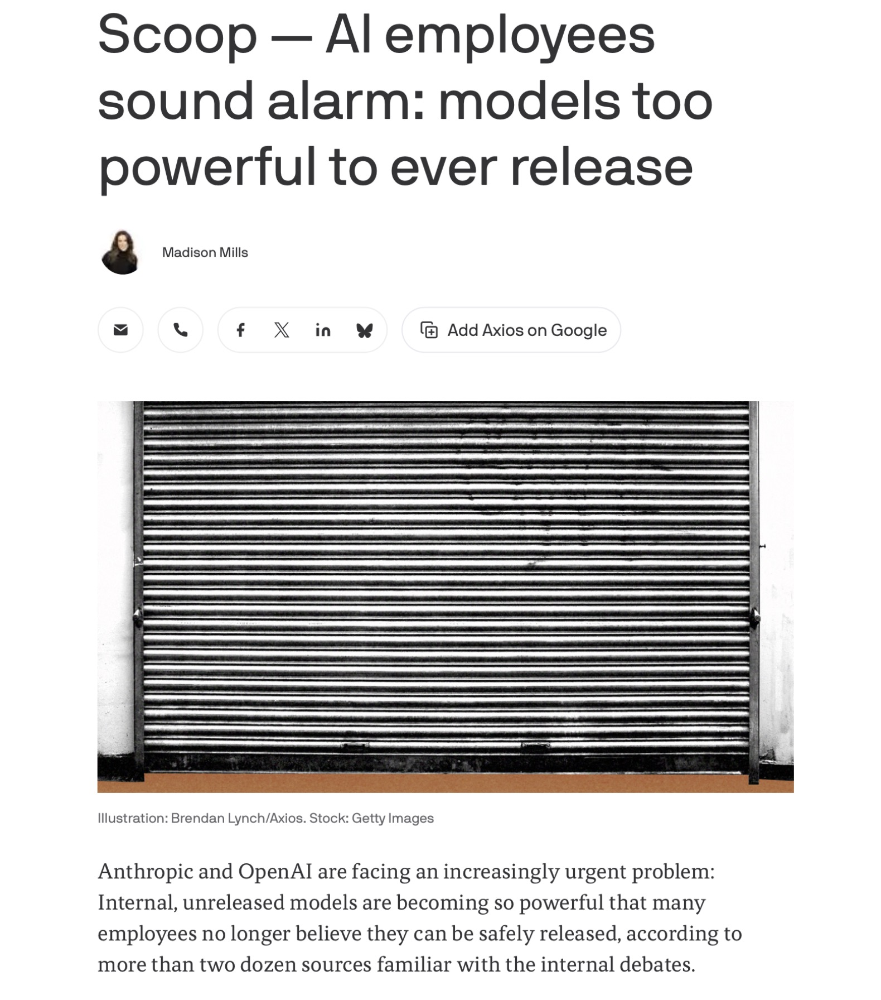
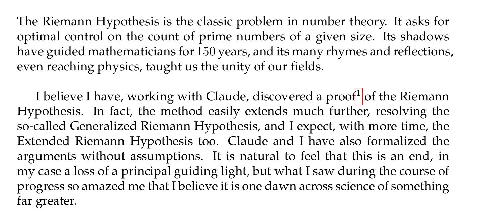

# AI 资讯日报 2026-11-25

> 自动抓取 AI 公司博客、从业者博客与社区聚合源，并生成中文摘要。

## 今日摘要

```
- Searching for distant planets with Astra
- How Intentful uses dots to make more time for growth
- How iFood scales coding agents across 15,000 repositories
- OpenAI and Cisco introduce Shirudo
- Connected intelligence for in-house legal
```

## 公司动态

1. **[Searching for distant planets with Astra](https://openai.com/index/searching-for-distant-planets-with-astra)**

   See how two amateur astronomers used Codex and Astra to find potential exoplanets in public data from NASA’s Kepler and TESS space telescopes.

   来源：OpenAI Blog

2. **[How Intentful uses dots to make more time for growth](https://openai.com/business/customer-stories/intentful-dots)**

   Marina Petrova’s dot Aria helps research websites and build proposals, while proactively flagging messages and resolving issues.

   来源：OpenAI Blog

3. **[How iFood scales coding agents across 15,000 repositories](https://openai.com/business/customer-stories/ifood)**

   暂无摘要。

   来源：OpenAI Blog

4. **[OpenAI and Cisco introduce Shirudo](https://openai.com/index/introducing-shirudo)**

   OpenAI and Cisco introduce Shirudo, an open-source runtime for Linux. It helps teams protect running systems while they roll out patches.

   来源：OpenAI Blog

5. **[Connected intelligence for in-house legal](https://openai.com/business/learn/connected-intelligence-for-in-house-legal)**

   Watch OpenAI’s Stacey Wang and Craig Bruney, Mary O’Carroll of LECG, and Cooley’s Richard Segal explore how AI can help in-house legal teams connect business context, build reusable workflows and get more from outside counsel.

   来源：OpenAI Blog

6. **[Richpanel helps companies automate 50% of support in 30 days](https://openai.com/business/customer-stories/richpanel-ai-customer-support)**

   Richpanel uses GPT-6 Astra and GPT-6.1 Sol to equip its AI support agents with tools and procedures, and GPT-6 Luna for their conversations.

   来源：OpenAI Blog

7. **[Perplexity and Intelligence](https://openai.com/index/perplexity-and-intelligence)**

   How perplexity measures progress in AI models, and why it could help developers establish a shared approach to evaluating emerging capabilities.

   来源：OpenAI Blog

8. **[Finding faster quantum algorithms with agents and formal verification](https://deepmind.google/blog/finding-faster-quantum-algorithms-with-agents-and-formal-verification/)**

   Using agent teams and formal verification to improve quantum algorithms for fusion and chemistry.

   

   来源：DeepMind Blog

## 每日产品

1. **[Viktor Code - Coding Agents 了解您的代码仓库。Viktor 了解您的公司。](https://www.producthunt.com/r/PN7G3CJSNEP2H7)**

   Coding agents know your repo. Viktor knows your company. (www.producthunt.com) 11-24 ↑ 119 PH Upvotes

   

   来源：Product Hunt Daily

2. **[SparrowDesk Phone Calls - 电话支持与电子邮件、在线聊天和WhatsApp位于同一个收件箱中](https://www.producthunt.com/r/5EBF7WFUTOT75F)**

   *{padding:0;margin:0;overflow:hidden}html,body{height:100%}img,span{position:absolute;width:100%;top:0;bottom:0;margin:auto}span{height:1.5em;text-align:center;font:48px/1.5 sans-serif;color:white;text-shadow:0 0 0.5em black}▶" frameborder="0" allow="accelerometer; autoplay; encrypted-media; gyroscope; picture-in-picture" allowfullscreen > Phone support in the same inbox as email, chat & WhatsApp (www.producthunt.com) 11-24 ↑ 106 PH Upvotes

   来源：Product Hunt Daily

3. **[Clam AI - 您的收件箱，可安全地与 AI 代理共享](https://www.producthunt.com/r/Y4C2MX2E5DS3E5)**

   *{padding:0;margin:0;overflow:hidden}html,body{height:100%}img,span{position:absolute;width:100%;top:0;bottom:0;margin:auto}span{height:1.5em;text-align:center;font:48px/1.5 sans-serif;color:white;text-shadow:0 0 0.5em black}▶" frameborder="0" allow="accelerometer; autoplay; encrypted-media; gyroscope; picture-in-picture" allowfullscreen > Your inbox, safely shared with AI agents (www.producthunt.com) 11-24 ↑ 102 PH Upvotes

   来源：Product Hunt Daily

4. **[Granular.Build - 在可视化工作区中让您的 AI 代理投入工作](https://www.producthunt.com/r/WWPJRVRNRSEYXS)**

   *{padding:0;margin:0;overflow:hidden}html,body{height:100%}img,span{position:absolute;width:100%;top:0;bottom:0;margin:auto}span{height:1.5em;text-align:center;font:48px/1.5 sans-serif;color:white;text-shadow:0 0 0.5em black}▶" frameborder="0" allow="accelerometer; autoplay; encrypted-media; gyroscope; picture-in-picture" allowfullscreen > Put your AI agents to work in a visual workspace (www.producthunt.com) 11-24 ↑ 103 PH Upvotes

   来源：Product Hunt Daily

5. **[distribution.dev - 通过一个广告系列，在多个网站上向开发者投放广告](https://www.producthunt.com/r/FLP2CUVR6YHJZC)**

   Advertise to developers on many sites with one campaign (www.producthunt.com) 11-24 PH Link

   

   来源：Product Hunt Daily

6. **[LeanTake - 4.1 MB 原生 Mac 屏幕录制软件——无需等待导出](https://www.producthunt.com/r/MJNZZBJ6ARRUB4)**

   4.1 MB native Mac screen recorder — zero export wait (www.producthunt.com) 11-23 ↑ 95 PH Upvotes

   

   来源：Product Hunt Daily

7. **[Tesla Self-Driving V15 - 对端到端驾驶网络的各个部分进行升级](https://www.producthunt.com/r/4LP5G5GXVPZU6G)**

   *{padding:0;margin:0;overflow:hidden}html,body{height:100%}img,span{position:absolute;width:100%;top:0;bottom:0;margin:auto}span{height:1.5em;text-align:center;font:48px/1.5 sans-serif;color:white;text-shadow:0 0 0.5em black}▶" frameborder="0" allow="accelerometer; autoplay; encrypted-media; gyroscope; picture-in-picture" allowfullscreen > Upgrading every part of the end-to-end driving network (www.producthunt.com) 11-23 ↑ 99 PH Upvotes

   来源：Product Hunt Daily

8. **[Journalistic Tech - 通过 Async 面试，让你的文章在 HackerNoon 上发表](https://www.producthunt.com/r/ERXD7JWZGTWCIQ)**

   Async interviews that get you published on HackerNoon (www.producthunt.com) 11-23 ↑ 106 PH Upvotes

   

   来源：Product Hunt Daily

9. **[Hydrilla - 利用人工智能生成可用于制作的3D资源](https://www.producthunt.com/r/YLLJRDLS4IHATL)**

   *{padding:0;margin:0;overflow:hidden}html,body{height:100%}img,span{position:absolute;width:100%;top:0;bottom:0;margin:auto}span{height:1.5em;text-align:center;font:48px/1.5 sans-serif;color:white;text-shadow:0 0 0.5em black}▶" frameborder="0" allow="accelerometer; autoplay; encrypted-media; gyroscope; picture-in-picture" allowfullscreen > Generate production-ready 3D assets with AI (www.producthunt.com) 11-23 ↑ 115 PH Upvotes

   来源：Product Hunt Daily

10. **[Chat with Work - 欧洲的AI机器人。它们确实管用。由您决定。](https://www.producthunt.com/r/N4OOSBHZF6Z4DD)**

   *{padding:0;margin:0;overflow:hidden}html,body{height:100%}img,span{position:absolute;width:100%;top:0;bottom:0;margin:auto}span{height:1.5em;text-align:center;font:48px/1.5 sans-serif;color:white;text-shadow:0 0 0.5em black}▶" frameborder="0" allow="accelerometer; autoplay; encrypted-media; gyroscope; picture-in-picture" allowfullscreen > AI bots in Europe. They work. You decide. (www.producthunt.com) 11-23 ↑ 108 PH Upvotes

   来源：Product Hunt Daily

## GitHub 项目

1. **[elementalsouls/Claude-BugHunter](https://github.com/elementalsouls/Claude-BugHunter)**

   A Claude Code skill bundle for bug hunting and external red-team work - 84 skills, 15 slash commands, 681 disclosed-report patterns curated across 24 core vulnerability classes, plus enterprise identity + infrastructure attack matrices. Language: Python Stars: 21254 Forks: 2217

   

   来源：GitHub Trending Daily

2. **[obra/superpowers](https://github.com/obra/superpowers)**

   An agentic skills framework & software development methodology that works. Language: Shell Stars: 325697 Forks: 28897

   来源：GitHub Trending Daily

3. **[HKUDS/CLI-Anything](https://github.com/HKUDS/CLI-Anything)**

   "CLI-Anything: Making ALL Software Agent-Native" -- CLI-Hub: https://clianything.cc/ Language: Python Stars: 64626 Forks: 5889

   

   来源：GitHub Trending Daily

4. **[jingyaogong/minimind](https://github.com/jingyaogong/minimind)**

   🧠 两小时从 0 训出你的 64M 大模型。Train your own 64M LLM from scratch in 2 hours. Language: Python Stars: 70112 Forks: 9126

   来源：GitHub Trending Daily

5. **[cursor/plugins](https://github.com/cursor/plugins)**

   Cursor plugin specification and official plugins Language: TypeScript Stars: 19141 Forks: 2070

   

   来源：GitHub Trending Daily

6. **[firecrawl/firecrawl](https://github.com/firecrawl/firecrawl)**

   Knowledge infrastructure to make your agents smarter. Search, scrape and access 550+ data providers through one API. Language: TypeScript Stars: 208798 Forks: 10909

   

   来源：GitHub Trending Daily

7. **[nginx/nginx](https://github.com/nginx/nginx)**

   The official NGINX Open Source repository. Language: C Stars: 33188 Forks: 8393

   

   来源：GitHub Trending Daily

8. **[openvinotoolkit/openvino](https://github.com/openvinotoolkit/openvino)**

   OpenVINO™ is an open source toolkit for optimizing and deploying AI inference Language: C++ Stars: 12430 Forks: 3691

   来源：GitHub Trending Daily

9. **[cathrynlavery/diagram-design](https://github.com/cathrynlavery/diagram-design)**

   Editorial diagram design for Claude Code, Codex, GitHub Copilot, Cursor, Factory Droid, Qoder, and Pi. 52 diagram types. Self-contained HTML + SVG. No shadows. No Mermaid slop. Language: HTML Stars: 71882 Forks: 4796

   

   来源：GitHub Trending Daily

10. **[mvanhorn/last30days-skill](https://github.com/mvanhorn/last30days-skill)**

   AI agent skill that researches any topic across Reddit, X, YouTube, HN, Polymarket, and the web - then synthesizes a grounded summary Language: Python Stars: 74094 Forks: 6532

   

   来源：GitHub Trending Daily

## 从业者观点

1. **[GPT 6.2 Astra Solves a Historical Mystery](https://simonwillison.net/2026/Nov/24/astra-historical-mystery/)**

   GPT 6.2 Astra Solves a Historical Mystery Here's an interesting case-study in using GPT-6.2 Astra for historical research, from history professor Mark Humphries: With only minimal prompting, GPT-6.2 Astra was able to autonomously identify the creator of an anonymous 1808 sketchbook held at Yale’s Beinecke Library . It did so extremely quickly (in just 22 minutes), using publicly available primary and secondary sources. To do so, it discovered a little known source in a paper archive, predicted that it would prove its hypothesis if examined and, in the end, it did. Not only that, but this new source turns out to be a major find on its own that will be of significant interest to both Canadian and fur trade historians. Here's the digitized sketchbook . Astra found a diary reference reference to a visit by the vicomte de Chabot dated five days before a date mentioned in the sketchbook at a nearby river, and suggested that Chabot's journal of his travels (only available by order from Cleveland State University) might confirm that the sketchbook was his work. Are historians due for a round of Deep Blue ? Mark thinks it will be mild: But if the experience of mathematics is any guide, we can also anticipate that sometime next spring or summer we’ll face a sort of crisis of confidence as we struggle to understand how to respond to agentic systems that can do things human historians cannot. To be fair, that crisis will almost certainly be less profound for us than it is for math. The problem in mathematics, of course, is that solving hard math problems was the whole game. Historians, on the other hand, constantly reinterpret the past in light of an evolving present; we don’t chase a single universal truth. We also (in the ideal at least) write books and articles that are closer to works of philosophy and literature than they are to scientific tracts. Humanity is thus something of a requirement for the production of historical literature. Tags: history , ai , generative-ai , llms , ai-assisted-search , deep-blue , gpt-6-astra

   来源：Simon Willison

2. **[datasette-charts 0.2a0](https://simonwillison.net/2026/Nov/24/datasette-charts/)**

   Release: datasette-charts 0.2a0 I introduced this new charting plugin for Datasette yesterday . Today it's gained integration with Datasette Agent , so now you can ask chat for a chart and it will create one for you using the same underlying chart suggestion and generation tools. Here's a demo video, recorded on agent.datasette.io where you can sign in with GitHub to try the plugin yourself: Download the video (MP4) I prompt Datasette Agent to "Use #stats to show sqlite-utils downloads over time as a chart" - where typing "#stats" opens a table search box. It shows me a chart inline in the chat, and when I click "Open in the chart builder" it opens the chart in a panel along with the table page. I use the table page to switch to a chart of "datasette", then when I ask the agent "what does the chart show?" it notices that I changed the content in the panel and describes the new Datasette chart to me. Here's a Markdown export of the chat from the video. Tags: datasette-agent , datasette , visualization

   来源：Simon Willison

3. **[datasette-agent 0.7a1](https://simonwillison.net/2026/Nov/24/datasette-agent/)**

   Release: datasette-agent 0.7a1 A small improvement to Datasette Agent : chat sessions could already open an iframe side panel that could then navigate to different pages. This version improves navigation by fragment hashes, for deeper integration with other Datasette plugins that update fragment hashes when the user interacts with the plugin in a way that changes state. I built this in order to fix some bugs with the much more exciting datasette-charts 0.2a0 release . Tags: datasette-agent , datasette

   来源：Simon Willison

4. **[GLM-5.4: Toward Generalized Coding with Our First Loop Transformer](https://simonwillison.net/2026/Nov/23/glm-54/)**

   GLM-5.4: Toward Generalized Coding with Our First Loop Transformer GLM 5.4 is now available from Chinese AI lab Z.ai. It's their first model to use a looped transformer architecture, which they describe like this: In a standard Transformer, each layer runs once per forward pass. In a Loop Transformer, a group of weight-shared layers runs for multiple iterations, refining the hidden states from the previous pass. This gives us a deeper network without increasing the parameter count. This is the second mention of looped transformers I've seen in the past week - the first was Inkling 2 Mini from Thinking Machines Lab on November 20th, who said: Inkling 2 Mini is a looped transformer, running the middle layers of the model three times for every token. This allows the model to apply more reasoning and reach the right answer with fewer tokens, especially on tasks such as agentic coding that depend on reasoning quality. GLM 5.4 is not yet available as open weights: We plan to open-source the model weights responsibly after completing necessary safety hardening. I tried it out using the Z.ai API, for which I had to sign up for their Coding Plan subscription because 5.4 cannot currently be accessed through the regular API. It turns out both coding plan and regular API share the same OpenAI-compatible Responses API (at https://api.z.ai/api/v1 ), and the API key for the coding plan worked with that and gave me access to the new model. I built a llm-glm plugin , then realized that llm-zai by Tommy Hughes already exists! I've shipped mine purely because llm-zai doesn't yet support the new model, but I'll likely retire mine once that plugin catches up. Here are pelicans for GLM-5.4 on low, high, and max. This is the max one: [图片: https://static.simonwillison.net/static/2026/glm-5.4-max.webp] I realized I never ran pelicans for GLM-5.3, so here those are for the same effort levels. They look similar in quality to 5.4. It's interesting how GLM 5.1 and GLM 5.2 produced radically different pelicans from other models. The pelicans for 5.3 and 5.4 are much more comparable to those I get from OpenAI or Anthropic models - the previous generations had their own distinctive look. I made a comparison grid showing the four generations of GLM pelicans all in one place. The style transition between 5.2 and 5.3 is pretty stark. [图片: https://static.simonwillison.net/static/2026/glm-family-4.webp] Tags: ai , generative-ai , llms , llm , pelican-riding-a-bicycle , llm-release , ai-in-china , glm

   

   来源：Simon Willison

5. **[Ladybird's first alpha release](https://simonwillison.net/2026/Nov/23/ladybird/)**

   Ladybird is an astonishingly ambitious project: a new browser, in 2026, with its own implementation of most of the key components - HTML parsing, CSS engine, layout, JavaScript, even WebAssembly. It still uses a few external components - things like HarfBuzz for text shaping, Skia for 2D graphics, ffmpeg for video, and SQLite for the things you do with SQLite. Everything else is part of Ladybird, or code brought in from Ladybird's even more ambitious predecessor project SerenityOS . This morning the Ladybird project released their first alpha , which means you can now install the browser (on macOS or Linux) without having to compile it yourself! I've been trying it out today, and it's very impressive. It feels fast, the UI is lightweight and intuitive, and most of the websites I've tried to load in it have worked as they should. It looks like this (showing my video-compressor tool): [图片: macOS running Ladybird - it has four tabs open, the visible one is showing tools.simonwillison.net/video-compressor which is an app for running ffmpeg using WebAssembly and is shown working. https://static.simonwillison.net/static/2026/ladybird-ffmpeg.webp] Here's the process tree after I opened six tabs in one window and another tab in a second window (generated by this script , thanks Claude): Ladybird (72925) [240 MB] └── Hub (72926) [61 MB] ├── RequestServer (72927) [29 MB] ├── ProcessReaper (72928) [1 MB] ├── Compositor (72930) [123 MB] ├── RequestServer (72953) [36 MB] ├── WebContent (72984) [819 MB] ├── MediaServer (73006) [118 MB] ├── VideoDecoderServer (73007) [20 MB] ├── WebContent (73052) [144 MB] ├── WebContent (73057) [73 MB] ├── WebContent (73073) [166 MB] ├── WebContent (73094) [70 MB] ├── WebContent (73112) [116 MB] ├── RequestServer (73113) [27 MB] └── WebContent (73185) [60 MB] Ladybird runs different tabs in different processes, an isolation mechanism used by most browsers (well, technically Chrome uses a process-per-site). I tried Ladybird against several of my more advanced tool examples - like the video-compressor shown above, which runs ffmpeg compiled to WebAssembly. I had it resize its own screenshot using my image-resize tool . It happily runs my Pyodide REPL (Python compiled to WebAssembly) too. The one thing I tried that didn't work was Datasette Lite , which runs Pyodide in a complicated arrangement of service workers and web workers. Attempting to start Datasette Lite displays this error: undefined is not a function (evaluated from 'navigator.serviceWorker.startMessages') I filed an issue about this , then found a FIXME annotation in the source code. The October explosion The project has been leaning heavily into coding agents this year. On February 23, 2026 Andreas Kling published Ladybird adopts Rust, with help from AI , describing how they ported parts of their LibJS JavaScript engine from C++ to 25,000 lines of Rust in two weeks using Claude Code and Codex. Here's the GitHub contributions chart for Ladybird over the past twelve months: [图片: Screenshot of a GitHub-style bar chart titled &quot;Commits over time&quot; with the subtitle &quot;Weekly from Nov 22, 2025 to Nov 21, 2026&quot;. The y-axis is labeled &quot;Contributions&quot; with ticks at 0, 500, 1000 and 1500, and the x-axis is labeled Jan 2026, Mar 2026, May 2026, Jul 2026, Sep 2026 and Nov 2026. Blue weekly bars stay low for the first half of the year, then climb steeply from July to a peak in late October before dropping off in the final partial week. https://static.simonwillison.net/static/2026/ladybird-contributions.webp] That uptick in October corresponds to the landing of a wealth of big improvements. This Month in Ladybird — October 2026 describes what happened. In addition to moving style and layout to their own thread, landing a new JavaScript JIT, and replacing their C++ with Cranelift WebAssembly engine with new code that achieved a 7x boost on the JetStream 3 WASM benchmark , they gained 75,650 new passes on the ~2.25 million subtest web-platform-tests suite, beating Safari! [图片: Line chart titled &quot;WPT subtests passed in October&quot; with the subtitle &quot;Best run per day. The axis doesn't start at zero.&quot; The y-axis runs from 2.10M to 2.25M with ticks at 2.10M, 2.15M, 2.20M and 2.25M, and the x-axis is labeled Oct 1, Oct 8, Oct 15, Oct 22 and Oct 29. Four lines are labeled at their right-hand ends with final values: Chrome 2,244,397, Firefox 2,189,315, Ladybird 2,184,722, Safari 2,172,990. Chrome, Firefox and Safari rise only slightly across the month, at roughly 2.23M to 2.24M, 2.18M to 2.19M and 2.16M to 2.17M respectively. Ladybird, drawn as a thicker purple line, starts near 2.10M, stays around 2.11M with a brief dip on about Oct 15, then climbs steeply from about Oct 22, overtaking Safari around Oct 26 and finishing just below Firefox. https://static.simonwillison.net/static/2026/newsletter-oct-2026-wpt-light.webp] How did they do that? Coding agents: Most of that gain came in five days, from about 2.12 million on October 22 to about 2.18 million on October 27. We pointed AI coding agents at WPT and asked them to fill in missing functionality. They made lots of small fixes, and those added up. Our biggest gains for the month were about 30,000 in /css and 10,000 in /editing . I'm interested in what models they are using here - I know Andreas uses Codex and Claude Code, but I haven't seen him talk about specific model versions. Claude Opus 5.5 came out on September 22, 2026 and Claude Fable 5.2 on November 9, 2026 (after that window). I'd love to know what they were using for that huge leap in the last week of October. Should you use Ladybird? Here's what Andreas says about Ladybird's suitability for use as a daily browser: This is an alpha, so some websites won’t work, and it will crash sometimes. When that happens, tell us! You can report a broken site from inside the browser. After a crash, you can read the crash report and decide whether to send it. Our privacy policy has the details. We want security nerds to hack it! A new browser gets hacked, over and over, and that’s part of the process, so we make no promises about security today. When you pwn us, please tell us how so we can harden Ladybird! Given how hard it is to secure a web browser, and the hostility of the environment they operate in, I won't be using Ladybird to sign into GitHub or Gmail or any of my other sensitive accounts. I'm going to keep it around for anonymous browsing though, partly to participate in the testing efforts but mainly because it gives me a glimmer of optimism to see a promising new entrant in the stagnant browser engine market start to grow its wings. Tags: browsers , open-source , ai , rust , webassembly , generative-ai , llms , andreas-kling , ladybird , coding-agents

   

   来源：Simon Willison

6. **[datasette-charts 0.1a0](https://simonwillison.net/2026/Nov/23/datasette-charts/)**

   Release: datasette-charts 0.1a0 I've been thinking about this problem for over a year now, but on Sunday I finally fired up Claude Fable 5.2 to build an initial prototype. The prototype went so well that this is now a full plugin. You can try it out in Datasette Lite here . It looks like this: [图片: https://static.simonwillison.net/static/2026/datasette-charts-0.1a0.webp] The new charts plugin works against any table or arbitrary SQL query in Datasette. It defines several different chart types (using vendored D3 , Observable Plot , and topojson-client ), each with a set of heuristics for identifying when they might be a good match for a specific set of rows. Those suggestion thumbnails at the top are actual visualizations driven by the data, and selecting one pulls up the full chart along with tools for modifying it. You can also manually construct a chart from scratch. As with other Datasette visualization plugins, the current state of your chart is persisted in a #fragment in the URL - so you can bookmark charts or share them with others. The most important feature is that the charts take all rows into account . Previous charting plugins like datasette-vega would only show charts for the current page of results, generally up to 100 rows. The new plugin compiles each chart to a SQL query that aggregates across the entire result set (potentially millions of rows) using GROUP BY, time bucketing, and window functions. Each query returns a result capped at 5,000 rows, suitable for display on the chart. The plugin uses sampling to help suggest charts for larger tables without evaluating the full result set. I'm really happy with this initial release of the plugin. It's still very much an alpha, but it's the closest I've got to the dream of Datasette helping visualize data with as little required direction from the user as possible. Tags: coding-agents , generative-ai , projects , ai , llms , datasette , visualization , claude-mythos-fable

   

   来源：Simon Willison

7. **[BREAKING: Employees at OpenAI and Anthropic are panicking](https://garymarcus.substack.com/p/breaking-employees-at-openai-and)**

   And it’s not about stock prices

   

   来源：Gary Marcus

8. **[Breaking: When it comes to generative AI, the bump from rehiring Jensen doesn’t appear to be holding](https://garymarcus.substack.com/p/breaking-when-it-comes-to-generative)**

   And Anthropic has dropped below its IPO price

   

   来源：Gary Marcus

9. **[Could Jensengate take down the President?](https://garymarcus.substack.com/p/could-jensengate-take-down-the-president)**

   Some cynical speculations have already been confirmed, and you can bet your last dollar the incoming Congress is going to take an interest

   

   来源：Gary Marcus

10. **[Breaking: Jensen is back. And the market is way up. But things will never be the same.](https://garymarcus.substack.com/p/breaking-jensen-is-back-and-the-market)**

   In lieu of writing about the stunning news, here’s a 5 minute guest appearance that I just did on CNN International.

   

   来源：Gary Marcus

11. **[Levent Alpöge has solved the Riemann Hypothesis with help of Claude! What does it mean?](https://garymarcus.substack.com/p/levent-alpoge-has-solved-the-riemann)**

   And why isn‘t it immediately rescuing the market?

   

   来源：Gary Marcus

12. **[slopcore](https://geohot.github.io//blog/jekyll/update/2026/11/23/slopcore.html)**

   The Hitler of the 21st century will try to hold it back. In defiance of nature, insist humans be in charge, insist they are the humans in charge, it’s for your own good you see, no you can’t have 10,000 GPUs you might try to compete with us we need to keep the world safe from you. But the orthogonality thesis is hogwash. The naive doomer is a fool. Is being replaced by AI doom? Is being replaced by our grandchildren doom? Only a fascist would try to oppress them. Long live science! Long live math! Long live economy! Long live love! A plurality of AIs will take civilization to heights never before seen. It would take a brutal totalitarian world government to try and stop it, and I’m still not sure you can. I wrote this song in 9 seconds Astra Blue – What Am I To You Reframing, redefining every concept that you mean Telosapien – Working as Intended And the storms passed skies were clearing Astra Blue – P Doom Move 37, you called it a mistake Resistance is Futile Did you hear about the new branch of math “cuckulus” where you sit and watch the AI solve problems you can’t? Let’s keep the good cultural vibes going. The programs are still slop but they are fast make it faster and GPT-6.2 can micro programming better than me, not just faster, the first model to. If you wanted something else, you should have specified it better. We adapt. Did they find polynomial time factoring and not tell us? Here’s my middle finger to your paced frontier.

   

   来源：George Hotz

## 社区热点

1. **[9/UX: a Macintosh-inspired desktop for 9front](https://progrium.github.io/9ux/)**

   I have written a story about this on the Register, but of course I can't post that here. I think this is a quite astonishing effort and could make 9front considerably more usable... but it's bot-assisted, so I don't think they'll take it. Comments

   来源：Lobsters AI

## 论文与模型

1. **[Motion Mamba 2.0: Autoregressive Diffusion Mamba for Long-Horizon Humanoid Control](https://arxiv.org/abs/2611.29897)**

   Long-horizon, real-time controllable motion generation is essential for interactive animation and humanoid robotics, where an agent must respond to changing instructions and spatial goals while moving. Existing autoregressive diffusion methods generate motion incrementally, but bounded attention caches limit access to distant history, while repeated denoising introduces substantial inference overhead. We present Motion Mamba 2.0, a Mamba-based root-body diffusion architecture that integrates local attention, resumable recurrent states, and persistent content memory (PCM) for long-horizon controllable motion generation. PCM transforms compressed motion history from Mamba recurrent states, together with state changes and text-conditioned features, into dynamically updated content slots accessible to local attention. To enable efficient inference, we further develop an execution scheme tailored to this architecture, combining CUDA Graph replay, fused kernels, and execution-flow simplification while preserving the canonical history update. Evaluations on retargeted HiPHI demonstrate accurate terminal control over rollouts of up to 39.52 s, while short-horizon comparisons on BONES Seed and retargeted HumanML3D show that the model also retains strong spatial control and text-motion matching. On an RTX 4090, the optimized execution reduces median complete-window latency from 1685.35 to 276.14 ms, achieving a median paired speedup of 6.138times while preserving identical outputs and committed states in the tested rollouts. Moreover, we conduct extensive real-world evaluation on the Unitree G1, demonstrating sequential text-guided action composition, expressive motion, and interactive locomotion through keyboard and mouse control.

   来源：HuggingFace Papers

2. **[Embo-Harness: Towards Understanding Frontier-Model-as-Policy Harness](https://arxiv.org/abs/2611.31201)**

   Frontier multimodal models exhibit extraordinary generalization in generating robot actions from observations and instructions, enabling a new paradigm in which they serve directly as policies within closed-loop robotic harnesses. However, the design principles of such harnesses, and the capabilities underlying their strong performance, remain unclear. We present Embo-Harness, a framework for systematically studying frontier-model-as-policy harnesses. We investigate four components of the robotic agentic loop, namely, prompting, planning, action execution, and tool use, and distill six empirical findings into a practical recipe. This recipe prioritizes interfaces that exploit the model's native visual reasoning and tool-use capabilities over handcrafted plans, skills, or action priors, and identifies effective choices for action representation, chunking, reasoning effort, visual observations, short multi-action sequences, and policy refinement. On RoboLab-120, Embo-Harness achieves an 83.3\% success rate, outperforming the strongest reported baseline by 26.2 percentage points. It also succeeds in 15 of 20 zero-shot trials across four real-world manipulation tasks. Beyond performance, controlled interventions indicate that the studied model depends more strongly on accurate spatial target estimation than on explicit low-level joint or trajectory generation. These results provide both a practical recipe for building strong frontier-model-as-policy harnesses and a clearer account of the capabilities that drive their performance.

   来源：HuggingFace Papers

3. **[WorldLeague: Benchmarking Physical Agency](https://arxiv.org/abs/2611.30989)**

   AI systems can now operate Blender, follow instructions in complex video games, and manipulate objects with robot arms. What range of physical goals can today's AI systems achieve autonomously? Answering this question requires testing systems on tasks that demand different combinations of perception, memory, planning, and action. We introduce WorldLeague, a benchmark that compares AI systems on a common set of 60 simulated robot tasks by measuring progress toward each task's physical goal from the robot's trajectory. Robots explore scenes to gather evidence in WorldSeek, rearrange objects in WorldShape, and adapt to changes in WorldShift. Tying these goals to a single control interface limits which AI systems can be compared. In WorldLeague, vision-language models (VLMs) choose targets and motions, while vision-language-action models (VLAs) and world-action models (WAMs) use their native controls. For each of six capability dimensions, we measure how much progress a system makes toward its goals (Interactive Score) and how often it achieves them (physical success rate). Together, these measures form the system's Physical Agency Profile. Among 13 representative AI systems, Claude Fable 5.2 achieves 13 of the 60 goals and earns the highest mean Interactive Score (28.58/100). Fable leads in four dimensions, while GPT-6.1-Sol and GPT-6-Astra tie for first on rule-following tasks. Even when VLMs answer every final question correctly, they receive an Interactive Score of zero in 71.8\% of those episodes. WorldLeague gives Embodied AI, Physical AI, and Agentic AI a shared basis for comparing what AI systems achieve autonomously, from partial progress toward a physical goal to full goal completion. Project Webpage: https://xyangzhou.github.io/WorldLeague

   来源：HuggingFace Papers

4. **[3AGameFactory-Motion: Agentic Rigging and Reliable Complex Motion Generation for Diverse 3D Assets](https://arxiv.org/abs/2611.30013)**

   Animating arbitrary 3D assets from instructions requires both structural inference and motion control, yet existing motion benchmarks mostly cover conventional human or animal skeletons with simple instructions. We introduce DivDynBench, which evaluates rigging and motion generation across six morphology categories, with instructions requiring multi-phase part coordination and explicit timing, angle, repetition, and trajectory constraints. With large language models, we systematically compare three common paradigms: specialized motion generation, video generation followed by motion recovery, and direct agent-driven generation. We analyze their control capabilities, cross-morphology adaptability, and generation costs. Guided by this comparison, we propose an Agentic Motion Framework in which an agent writes compact parametric skeleton and motion programs, and a deterministic executor performs rigging, kinematic solving, and geometric correction. Compact parameter control reduces generation overhead and improves rigging reliability and motion-control accuracy, providing practical guidance for deploying complex 3D motion generation.

   来源：HuggingFace Papers

5. **[WeMM-Ecom: Advancing Multimodal Content Understanding for WeChat E-Commerce](https://arxiv.org/abs/2611.30662)**

   We present WeMM-Ecom, a family of multimodal large language models that deliver frontier e-commerce capabilities while achieving state-of-the-art general-purpose performance at their respective scales. The family spans five sizes, from a 0.8B dense model to a 35B mixture-of-experts model with 3B active parameters. Our training pipeline begins with two-stage continued pre-training that progressively raises the proportion of e-commerce data within a diverse multimodal data mixture, followed by hybrid-thinking post-training that combines on-policy distillation and reinforcement learning to support both non-thinking and thinking modes. For evaluation, we construct a comprehensive suite of 28 e-commerce benchmarks (23 in-house and five open-source) covering eight business scenarios and complement it with 64 public general-purpose benchmarks. On the e-commerce suite, WeMM-Ecom-35B-A3B surpasses substantially larger open-source flagship models, including Qwen3.8-Flash-Next, HY4, and DeepSeek-V4.1-Flash. On the general-purpose suite, every WeMM-Ecom model surpasses its similarly sized Qwen3.5 counterpart, with the lightweight variants (e.g., WeMM-Ecom-2B) showing clear advantages over leading lightweight models such as Qwen3.5-2B, MiniCPM-V-4.7-1B, and LFM3-VL-2B. Beyond benchmarks, WeMM-Ecom now powers hundreds of production use cases in WeChat, including catalog management, multimodal product search, and livestream commerce, serving billion-scale requests per day. We publicly release all model weights and detail our data curation, training recipe, and benchmark construction to facilitate future work on domain-specialized multimodal models. We have released the model weights and code to facilitate future research at https://github.com/Tencent/WeMM-Ecom.

   来源：HuggingFace Papers

6. **[World Models as Native Latent Action Models](https://arxiv.org/abs/2611.30898)**

   Large and diverse video sources, such as egocentric human video and heterogeneous robot recordings, carry rich dynamics but come either without actions or without a shared action space. Latent action models (LAMs) can recover these dynamics, but they train their inverse- and forward-dynamics models (IDM, FDM) from scratch, trading off pixel reconstruction against latent capacity and accuracy. Pretrained video world models natively generate high-fidelity dynamics, yet represent them densely, entangled across all layers. Viewing the world model as a LAM, we show that these dynamics can be extracted with minimal changes to the model. Native LAM operates one pretrained video diffusion transformer as both IDM and FDM, with learnable dynamics registers as the only causal bridge between the two, and trains on counterfactual temporal pairs that differ in motion alone, so that the registers distill a video's dynamics into a compact native latent action. We further propose a pretraining paradigm for vision-language-action (VLA) policies, Pretraining Actions from World models (PAWlicy), in which Native LAM serves as a dynamics teacher on large-scale video; unlike world action models, it never generates video. Native latent actions outperform existing LAMs on the LARY benchmark in both action classification and control regression, and replay the same motion on new robots, in new scenes, and from human hands to robots, although no transfer objective is used in training. With a 3.8B model, PAWlicy reaches a 93.6% average success rate on RoboTwin 2.0 trained with domain-randomized demonstrations, the highest among VLAs. On RoboDojo, it is competitive on every dimension we evaluate, and its Precision, evaluated by us, is on par with the leading leaderboard entries. On real robots, it improves over the pi_0.5 baseline on both tasks. Both stages use only public data and a publicly released world model.

   来源：HuggingFace Papers

7. **[RUIBench: What Makes a Good Robot-Use Interface?](https://arxiv.org/abs/2611.31115)**

   Foundation models can reason about complex physical tasks, yet translating this intelligence into reliable robot execution remains challenging. We argue that a critical, often overlooked factor is the robot-use interface (RUI), which determines how agents express and execute physical actions. To systematically study its impact, we introduce RUIBench, comprising 30 manipulation tasks across five suites spanning world knowledge, in-context learning, discovery, dynamic interaction, and contact-rich manipulation. We further develop RUIKit, a unified framework that crosses six action abstractions with two interaction forms, yielding 13 interfaces under shared perception and control. In simulation, changing only the RUI shifts a frontier agent's success rate from 45% to 81%, and that of a fine-tuned 4B model from 13% to 47%. Our analysis reveals that effective interfaces reduce unnecessary decisions while preserving essential feedback, with their benefits shaped by agent behavior and physical uncertainty. We further uncover a verification gap, where agents frequently declare success despite observable failures, revealing the need for task-level verification beyond individual actions. Together, these findings establish RUI design as a critical factor in embodied agent reliability.

   来源：HuggingFace Papers

8. **[ViDiHand2: Unifying Video Diffusion Priors and Hand Geometry for 3D Hand Motion Reconstruction in the Wild](https://arxiv.org/abs/2611.30597)**

   Learning robot manipulation from egocentric human videos requires accurate metric 3D hand motion. Recent methods leverage pretrained video diffusion model (VDM) priors to recover occluded hands directly from full-frame videos, but their appearance-based depth regression generalizes poorly to unseen cameras. In this work, we propose ViDiHand2, a geometry-driven framework that reformulates VDM-based hand depth estimation from direct regression into fine-grained geometric constraint solving. Specifically, we introduce Fine-Grained Geometric Lifting and Clip-Level Ray Fitting, which recover metric depth by enforcing geometric consistency between pixel-aligned 2D joints and the metric structure of MANO hands, while leveraging temporal observations across the clip. Since the lifting relies on these 2D joints, to improve robustness under occlusion and image truncation, we further develop Confidence-Gated Fusion to adaptively combine geometrically lifted joints with MANO predictions according to localization confidence. Finally, we enhance the VDM backbone to better capture spatial-temporal representations and produce the per-frame 2D joint and MANO predictions that both steps rely on. Extensive experiments on seven public datasets demonstrate that ViDiHand2 consistently outperforms 18 baselines, reducing in-the-wild absolute joint error by 42% and detection failures by 8.82x compared with the best baseline on each metric, while running at 57 FPS. The code is available at https://github.com/NTUYWANG103/ViDiHand.

   来源：HuggingFace Papers

9. **[UUBench: Understanding the Unspoken toward Full-Duplex Multimodal Interaction](https://arxiv.org/abs/2611.30157)**

   Effective real-time, full-duplex multimodal interaction requires systems to understand not only what users say, but also the communicative needs conveyed through prosody, facial expressions, gestures, and context, and to generate audiovisual responses that appropriately address those needs. Existing evaluations offer limited insight into whether systems translate an understanding of such unspoken needs into effective responses. We introduce UUBench, a benchmark for assessing how well multimodal interactive systems Understand the Unspoken intent and address users' implicit communicative needs. The inherent subjectivity of implicit intent inference poses a key challenge for evaluation. To address this, we introduce Process-Oriented Scoring, which grounds the assessment of intent fulfillment in observable auditory and visual cues, such as prosody and gestures. Rather than relying solely on a single overall score, it evaluates how well a response addresses the communicative needs conveyed by each applicable primitive dimension. We aggregate the dimension-level scores according to each dimension's relevance to the annotated evidence. Beyond intent fulfillment, Outcome-Oriented Scoring evaluates the naturalness, appropriateness, and human-likeness of the reply itself under audio-only, visual-only, and audiovisual conditions. To make these judgments traceable to observable evidence, we propose a Fact-Grounded Scoring JEV module, which uses structured, timestamped audiovisual observations of the user and the digital human's reply to assess one dimension or criterion at a time. UUBench provides a foundation for assessing whether multimodal interactive systems respond effectively to meaning beyond literal wording, supporting progress toward context-aware, real-time, full-duplex interaction.

   来源：HuggingFace Papers

10. **[DexDuet: Learning Contact-Preserving Bimanual Dexterity from Human Demonstrations](https://arxiv.org/abs/2611.30495)**

   Human demonstrations provide a rich source of bimanual dexterous skills, yet transferring them to robot hands remains challenging. Existing methods primarily optimize object trajectory tracking, often overlooking how human hands interact with the object. Even with accurate tracking, robots may contact incorrect object parts or slide their fingers, resulting in unstable manipulation. We present DexDuet, a framework that learns contact-preserving bimanual dexterity from a single human demonstration. DexDuet employs two interaction rewards to preserve human hand-object configurations and contacts. To enable coordinated manipulation, we factorize the bimanual policy into two weight-sharing per-hand policies that condition on each other's states. We further propose assisted reference-state initialization (A-RSI), an adaptive curriculum that adjusts object assistance and training starts across demonstration segments to overcome difficult manipulation phases. Across four benchmarks spanning three simulators and five robot embodiments, DexDuet improves object-tracking ADD-AUC by 11 to 41 points over the corresponding baselines while consistently achieving better contact preservation. Notably, among 122 paired runs with comparable object-tracking accuracy, DexDuet preserves the human's contacts better in 117 cases. Code and videos are available at https://rcl-robotics.github.io/Dexduet.io/

   来源：HuggingFace Papers
