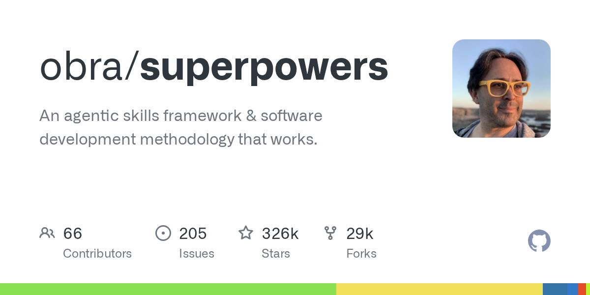
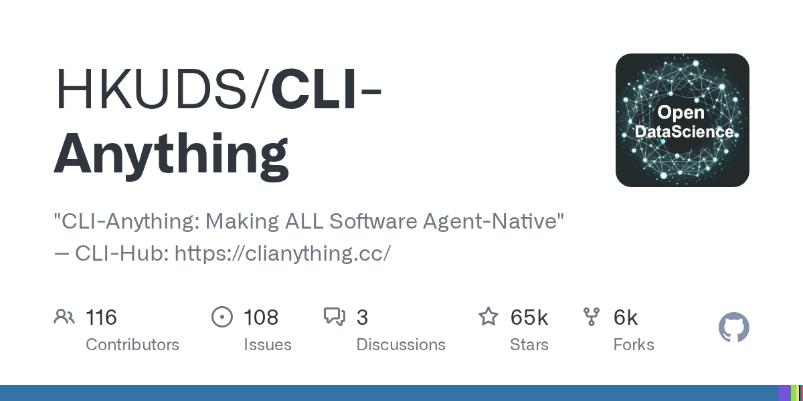
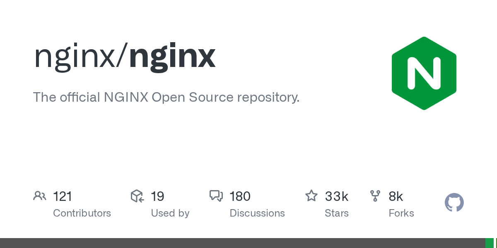
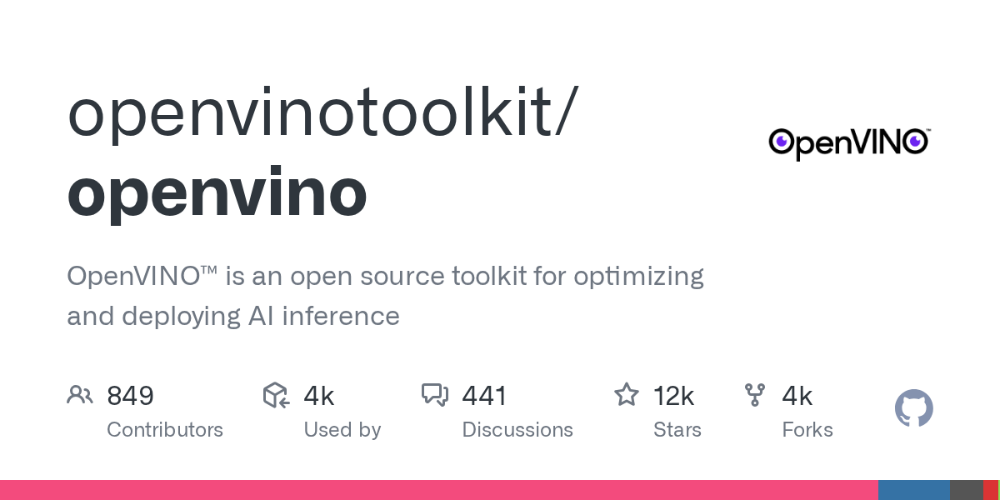
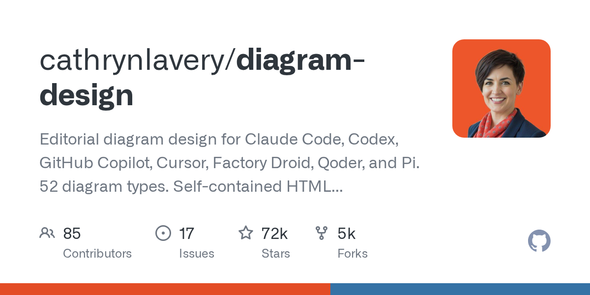
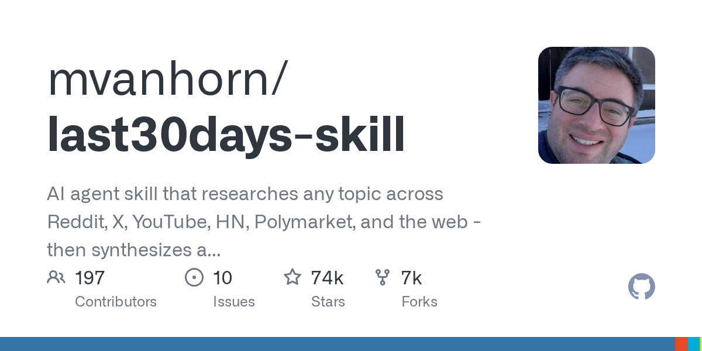

# AI 资讯日报 2026-11-25

> 自动抓取 AI 公司博客、从业者博客与社区聚合源，并生成中文摘要。

## 今日摘要

```
- GPT-6 models demonstrate intrinsic protein-design capabilities
- Searching for distant planets with Astra
- How Intentful uses dots to make more time for growth
- How iFood scales coding agents across 15,000 repositories
- Clay helps sales teams win with Codex and ChatGPT
```

## 公司动态

1. **[GPT-6 models demonstrate intrinsic protein-design capabilities](https://openai.com/index/gpt-6-models-demonstrate-intrinsic-protein-design-capabilities)**

   GPT-6 models design protein structures and sequences using reasoning and code. Lab tests found evidence of binding across five targets.

   来源：OpenAI Blog

2. **[Searching for distant planets with Astra](https://openai.com/index/searching-for-distant-planets-with-astra)**

   See how two amateur astronomers used Codex and Astra to find potential exoplanets in public data from NASA’s Kepler and TESS space telescopes.

   来源：OpenAI Blog

3. **[How Intentful uses dots to make more time for growth](https://openai.com/business/customer-stories/intentful-dots)**

   Marina Petrova’s dot Aria helps research websites and build proposals, while proactively flagging messages and resolving issues.

   来源：OpenAI Blog

4. **[How iFood scales coding agents across 15,000 repositories](https://openai.com/business/customer-stories/ifood)**

   暂无摘要。

   来源：OpenAI Blog

5. **[Clay helps sales teams win with Codex and ChatGPT](https://openai.com/business/customer-stories/clay-plugins-openai)**

   ChatGPT and Codex integrations help Clay’s users research deals and turn data into go-to-market plays, with GPT-6 models handling the reasoning.

   来源：OpenAI Blog

6. **[OpenAI and Cisco introduce Shirudo](https://openai.com/index/introducing-shirudo)**

   OpenAI and Cisco introduce Shirudo, an open-source runtime for Linux. It helps teams protect running systems while they roll out patches.

   来源：OpenAI Blog

7. **[Connected intelligence for in-house legal](https://openai.com/business/learn/connected-intelligence-for-in-house-legal)**

   Watch OpenAI’s Stacey Wang and Craig Bruney, Mary O’Carroll of LECG, and Cooley’s Richard Segal explore how AI can help in-house legal teams connect business context, build reusable workflows and get more from outside counsel.

   来源：OpenAI Blog

8. **[Richpanel helps companies automate 50% of support in 30 days](https://openai.com/business/customer-stories/richpanel-ai-customer-support)**

   Richpanel uses GPT-6 Astra and GPT-6.1 Sol to equip its AI support agents with tools and procedures, and GPT-6 Luna for their conversations.

   来源：OpenAI Blog

9. **[Finding faster quantum algorithms with agents and formal verification](https://deepmind.google/blog/finding-faster-quantum-algorithms-with-agents-and-formal-verification/)**

   Using agent teams and formal verification to improve quantum algorithms for fusion and chemistry.

   

   来源：DeepMind Blog

## 每日产品

1. **[Claude Ship - 代码写得有多快，就发布得有多快](https://www.producthunt.com/r/3ENQV4OYKF2LDA)**

   Ship code as fast as you can write it (www.producthunt.com) 11-24 ↑ 124 PH Upvotes

   

   来源：Product Hunt Daily

2. **[frwrd.to - 个人简介中的链接，由您的AI整理成一条消息](https://www.producthunt.com/r/WXNOFU2KUUJDSV)**

   *{padding:0;margin:0;overflow:hidden}html,body{height:100%}img,span{position:absolute;width:100%;top:0;bottom:0;margin:auto}span{height:1.5em;text-align:center;font:48px/1.5 sans-serif;color:white;text-shadow:0 0 0.5em black}▶" frameborder="0" allow="accelerometer; autoplay; encrypted-media; gyroscope; picture-in-picture" allowfullscreen > Your link in bio, sorted by your AI in one message (www.producthunt.com) 11-24 ↑ 126 PH Upvotes

   来源：Product Hunt Daily

3. **[Viktor Code - Coding Agents 了解您的代码仓库。Viktor 了解您的公司。](https://www.producthunt.com/r/PN7G3CJSNEP2H7)**

   Coding agents know your repo. Viktor knows your company. (www.producthunt.com) 11-24 ↑ 119 PH Upvotes

   

   来源：Product Hunt Daily

4. **[SparrowDesk Phone Calls - 电话支持与电子邮件、在线聊天和WhatsApp位于同一个收件箱中](https://www.producthunt.com/r/5EBF7WFUTOT75F)**

   *{padding:0;margin:0;overflow:hidden}html,body{height:100%}img,span{position:absolute;width:100%;top:0;bottom:0;margin:auto}span{height:1.5em;text-align:center;font:48px/1.5 sans-serif;color:white;text-shadow:0 0 0.5em black}▶" frameborder="0" allow="accelerometer; autoplay; encrypted-media; gyroscope; picture-in-picture" allowfullscreen > Phone support in the same inbox as email, chat & WhatsApp (www.producthunt.com) 11-24 ↑ 106 PH Upvotes

   来源：Product Hunt Daily

5. **[Clam AI - 您的收件箱，可安全地与 AI 代理共享](https://www.producthunt.com/r/Y4C2MX2E5DS3E5)**

   *{padding:0;margin:0;overflow:hidden}html,body{height:100%}img,span{position:absolute;width:100%;top:0;bottom:0;margin:auto}span{height:1.5em;text-align:center;font:48px/1.5 sans-serif;color:white;text-shadow:0 0 0.5em black}▶" frameborder="0" allow="accelerometer; autoplay; encrypted-media; gyroscope; picture-in-picture" allowfullscreen > Your inbox, safely shared with AI agents (www.producthunt.com) 11-24 ↑ 102 PH Upvotes

   来源：Product Hunt Daily

6. **[Granular.Build - 在可视化工作区中让您的 AI 代理投入工作](https://www.producthunt.com/r/WWPJRVRNRSEYXS)**

   *{padding:0;margin:0;overflow:hidden}html,body{height:100%}img,span{position:absolute;width:100%;top:0;bottom:0;margin:auto}span{height:1.5em;text-align:center;font:48px/1.5 sans-serif;color:white;text-shadow:0 0 0.5em black}▶" frameborder="0" allow="accelerometer; autoplay; encrypted-media; gyroscope; picture-in-picture" allowfullscreen > Put your AI agents to work in a visual workspace (www.producthunt.com) 11-24 ↑ 103 PH Upvotes

   来源：Product Hunt Daily

7. **[distribution.dev - 通过一个广告系列，在多个网站上向开发者投放广告](https://www.producthunt.com/r/FLP2CUVR6YHJZC)**

   Advertise to developers on many sites with one campaign (www.producthunt.com) 11-24 PH Link

   

   来源：Product Hunt Daily

8. **[LeanTake - 4.1 MB 原生 Mac 屏幕录制软件——无需等待导出](https://www.producthunt.com/r/MJNZZBJ6ARRUB4)**

   4.1 MB native Mac screen recorder — zero export wait (www.producthunt.com) 11-23 ↑ 95 PH Upvotes

   

   来源：Product Hunt Daily

9. **[Tesla Self-Driving V15 - 对端到端驾驶网络的各个部分进行升级](https://www.producthunt.com/r/4LP5G5GXVPZU6G)**

   *{padding:0;margin:0;overflow:hidden}html,body{height:100%}img,span{position:absolute;width:100%;top:0;bottom:0;margin:auto}span{height:1.5em;text-align:center;font:48px/1.5 sans-serif;color:white;text-shadow:0 0 0.5em black}▶" frameborder="0" allow="accelerometer; autoplay; encrypted-media; gyroscope; picture-in-picture" allowfullscreen > Upgrading every part of the end-to-end driving network (www.producthunt.com) 11-23 ↑ 99 PH Upvotes

   来源：Product Hunt Daily

10. **[Journalistic Tech - 通过 Async 面试，让你的文章在 HackerNoon 上发表](https://www.producthunt.com/r/ERXD7JWZGTWCIQ)**

   Async interviews that get you published on HackerNoon (www.producthunt.com) 11-23 ↑ 106 PH Upvotes

   

   来源：Product Hunt Daily

## GitHub 项目

1. **[obra/superpowers](https://github.com/obra/superpowers)**

   An agentic skills framework & software development methodology that works. Language: Shell Stars: 325954 Forks: 28926

   

   来源：GitHub Trending Daily

2. **[HKUDS/CLI-Anything](https://github.com/HKUDS/CLI-Anything)**

   "CLI-Anything: Making ALL Software Agent-Native" -- CLI-Hub: https://clianything.cc/ Language: Python Stars: 65004 Forks: 5919

   

   来源：GitHub Trending Daily

3. **[jingyaogong/minimind](https://github.com/jingyaogong/minimind)**

   🧠 两小时从 0 训出你的 64M 大模型。Train your own 64M LLM from scratch in 2 hours. Language: Python Stars: 70427 Forks: 9158

   来源：GitHub Trending Daily

4. **[cursor/plugins](https://github.com/cursor/plugins)**

   Cursor plugin specification and official plugins Language: TypeScript Stars: 19299 Forks: 2082

   

   来源：GitHub Trending Daily

5. **[firecrawl/firecrawl](https://github.com/firecrawl/firecrawl)**

   Knowledge infrastructure to make your agents smarter. Search, scrape and access 550+ data providers through one API. Language: TypeScript Stars: 209118 Forks: 10926

   

   来源：GitHub Trending Daily

6. **[nginx/nginx](https://github.com/nginx/nginx)**

   The official NGINX Open Source repository. Language: C Stars: 33253 Forks: 8397

   

   来源：GitHub Trending Daily

7. **[openvinotoolkit/openvino](https://github.com/openvinotoolkit/openvino)**

   OpenVINO™ is an open source toolkit for optimizing and deploying AI inference Language: C++ Stars: 12499 Forks: 3696

   

   来源：GitHub Trending Daily

8. **[cathrynlavery/diagram-design](https://github.com/cathrynlavery/diagram-design)**

   Editorial diagram design for Claude Code, Codex, GitHub Copilot, Cursor, Factory Droid, Qoder, and Pi. 52 diagram types. Self-contained HTML + SVG. No shadows. No Mermaid slop. Language: HTML Stars: 72243 Forks: 4817

   

   来源：GitHub Trending Daily

9. **[mvanhorn/last30days-skill](https://github.com/mvanhorn/last30days-skill)**

   AI agent skill that researches any topic across Reddit, X, YouTube, HN, Polymarket, and the web - then synthesizes a grounded summary Language: Python Stars: 74411 Forks: 6558

   

   来源：GitHub Trending Daily

10. **[elementalsouls/Claude-BugHunter](https://github.com/elementalsouls/Claude-BugHunter)**

   A Claude Code skill bundle for bug hunting and external red-team work - 84 skills, 15 slash commands, 681 disclosed-report patterns curated across 24 core vulnerability classes, plus enterprise identity + infrastructure attack matrices. Language: Python Stars: 21728 Forks: 2258

   

   来源：GitHub Trending Daily

## 从业者观点

1. **[Three LLM inflection points in twelve months](https://simonwillison.net/2026/Nov/24/llm-inflection-points/)**

   I gave a keynote at the AI Engineer Code Summit a couple of weeks ago, constructed around the idea that there have been three significant inflection points in the abilities of LLMs and coding agents in the past twelve months. Here's the video of the talk. In this post I'm going to pull out the major inflection point theme and interrogate it more deeply. Coding agents in November 2025 Today, November 24th 2026, is the one year anniversary of the release of Claude Opus 4.5 . With hindsight, this was a consequential model. In the Opus 4.5 announcement, Anthropic said: Testers noted that Claude Opus 4.5 handles ambiguity and reasons about tradeoffs without hand-holding. They told us that, when pointed at a complex, multi-system bug, Opus 4.5 figures out the fix. They said that tasks that were near-impossible for Sonnet 4.5 just a few weeks ago are now within reach. This held up. Claude Code was 9 months old at that point, having been introduced alongside Claude 3.7 Sonnet on February 24th, 2025. Opus 4.5 was the first model I had used with Claude Code where the default result was generally the right thing. I hadn't been using Claude Code as a daily driver because it didn't feel reliable enough - I had to correct it often enough that it didn't feel like a clear accelerant. The new Opus changed that. For most of the coding problems I faced on a daily basis, Opus would get them right . It was clearly faster than working through the problems myself. Also in November, OpenAI released GPT-5.1 Instant, GPT-5.1 Thinking, GPT-5.1-Codex, and GPT-5.1-Codex-Max. These had a similar effect on their Codex coding agent: it became reliably useful for many of my coding tasks. The timing was convenient, because the December holidays were upon us. A lot of people, myself included, spent December tinkering with these new tools to see what they could do. By January we were ready to use them for our actual work. Fable class models in June/July We got our first hint of Claude Fable in April, when Anthropic announced Claude Mythos and said that it was too dangerous to release , due to its improved cybersecurity capabilities. Mythos was a model that could not just find security vulnerabilities, it could also figure out how to exploit them. In June we got to see how good that model was for ourselves, with the release of Claude Fable 5 - a defanged Mythos, that would solve most problems but would actively block you from using it for security work. After three glorious days... the US government took it away from us. Fable 5 was placed under export controls that effectively banned the model. We wouldn't get it back until July 1st. For me, Fable was an inflection point because it introduced us to what I now think of as Fable class models . My definition of these: [图片: Inflection point 2: Fable class models If you can define a goal and provide necessary tools They can solve your problem with brute force https://static.simonwillison.net/static/2026/fable-class.webp] In June I wrote about how Claude Fable is relentlessly proactive , after I asked it to help fix a display glitch in Safari and it spun up its own pyobjc-framework-Quartz screenshot mechanism and a CORS-enabled localhost logging server to help resolve the bug. A more recent example of the power of Fable class models is my mysterious beep finder from a couple of weeks ago. I gave Opus 5.5 and then Fable 5.2 access to five WebAudio microphones in a room full of boxes and it was able to triangulate the source of an infuriating mysterious beep to within about 40cm. Give it a goal, give it the right tools, and watch it cook. I'd currently class Claude Fable 5, 5.1, 5.2 and Claude Opus 5.5 as Fable class (I think of Opus 5.5 as "cheap Fable"). GPT-6 Astra got there for me too, and I think the new Gemini 4 Neon may count as well. These now represent the baseline for what I expect from a frontier model. 3D modeling and game development in September/October Something interesting happened with frontier LLMs over just the past four months: they got really good at 3D modeling. Set them up with Blender or ask them to write Three.js code and they'll produce credible models of almost anything you ask for. I first noticed this with Claude Fable 5, but it really kicked into gear with Opus 5.5, GPT-5.6 Sol, GPT-6 Astra, and most recently the Gemini 4 family. Here's Gemini 4 Neon's attempt at "Make a three js animation where yonkers stands up as a big mech (cool stand up motion) and stomps around manhattan and queens and Brooklyn, use openstreetmap mapping data", for example. 3D spatial awareness is crucial if you want to use vision LLMs for robotics. I don't know if 3D modeling capabilities are a side-effect of the labs focusing on that or vice-versa. Back in August I experimented with having Fable 5 build me a raccoon heist game . It had 3D graphics, looked like a game, and played really poorly. GPT-5.6 Sol Ultra did a much better job but the game itself was still pretty dull after the first 90 seconds of play. I was somewhat relieved that designing a game that was fun appeared to remain a uniquely human pursuit. I even used that in a talk in September to reassure people that us humans still had a role to play! Then, I tried telling Claude Opus 5.5 "This game isn't fun enough yet. Make it a LOT more fun." And it worked . My Command &amp; Conquer-style RTS went from boring to deeply entertaining overnight, after Opus spent 12 hours playtesting new features and rebalancing the gameplay. Opus 5.5 was the first model I'd used that appeared to understand fun. I've since worked on several little game projects where prompts like "Think hard about how to make sure it is both fun and beautiful" produced results that kept me engaged for significant amounts of time. Opus 5.5 came out on September 22nd, 2026. I've been to two different conferences since then where people showed me game projects they'd been working on that really did feel like proper, worthwhile games. The indie games scene has descended into a full-blown culture war over AI-assisted programming. A lot of people are calling GTA VI the last pre-generative AI blockbuster . It feels like another inflection point to me. Is Fable 5.2 an inflection point too? I'm still trying to decide if Fable 5.2 represents a new inflection point, or just another incremental improvement. I'm getting so much done with that model right now! It seems to have taste that almost exactly matches my own. I have been burning through all sorts of gnarly problems that I've been thinking about (or procrastinating on) for several years now. The release notes for Datasette 1.0a42 , 1.0a43 , and 1.0a44 - plus LLM 0.37 , 0.37.1 , 0.37.2 , 0.37.3 , and 0.38 - all in the last three weeks , represent a flood of fixes, features and improvements. If this does represent an inflection point, the key feature seems to be that if you can imagine and then clearly describe a piece of software, Fable can build it . That's a wild thing to say, but it matches my experience over the past few weeks. Software development has transformed beyond recognition in the last year. I don't think I'll ever go back to typing most of my code by hand. Tags: game-design , my-talks , ai , generative-ai , llms , annotated-talks , coding-agents , claude-code , codex , claude-mythos-fable

   

   来源：Simon Willison

2. **[GPT 6.2 Astra Solves a Historical Mystery](https://simonwillison.net/2026/Nov/24/astra-historical-mystery/)**

   GPT 6.2 Astra Solves a Historical Mystery Here's an interesting case-study in using GPT-6.2 Astra for historical research, from history professor Mark Humphries: With only minimal prompting, GPT-6.2 Astra was able to autonomously identify the creator of an anonymous 1808 sketchbook held at Yale’s Beinecke Library . It did so extremely quickly (in just 22 minutes), using publicly available primary and secondary sources. To do so, it discovered a little known source in a paper archive, predicted that it would prove its hypothesis if examined and, in the end, it did. Not only that, but this new source turns out to be a major find on its own that will be of significant interest to both Canadian and fur trade historians. Here's the digitized sketchbook . Astra found a diary reference reference to a visit by the vicomte de Chabot dated five days before a date mentioned in the sketchbook at a nearby river, and suggested that Chabot's journal of his travels (only available by order from Cleveland State University) might confirm that the sketchbook was his work. Are historians due for a round of Deep Blue ? Mark thinks it will be mild: But if the experience of mathematics is any guide, we can also anticipate that sometime next spring or summer we’ll face a sort of crisis of confidence as we struggle to understand how to respond to agentic systems that can do things human historians cannot. To be fair, that crisis will almost certainly be less profound for us than it is for math. The problem in mathematics, of course, is that solving hard math problems was the whole game. Historians, on the other hand, constantly reinterpret the past in light of an evolving present; we don’t chase a single universal truth. We also (in the ideal at least) write books and articles that are closer to works of philosophy and literature than they are to scientific tracts. Humanity is thus something of a requirement for the production of historical literature. Tags: history , ai , generative-ai , llms , ai-assisted-search , deep-blue , gpt-6-astra

   来源：Simon Willison

3. **[datasette-charts 0.2a0](https://simonwillison.net/2026/Nov/24/datasette-charts/)**

   Release: datasette-charts 0.2a0 I introduced this new charting plugin for Datasette yesterday . Today it's gained integration with Datasette Agent , so now you can ask chat for a chart and it will create one for you using the same underlying chart suggestion and generation tools. Here's a demo video, recorded on agent.datasette.io where you can sign in with GitHub to try the plugin yourself: Download the video (MP4) I prompt Datasette Agent to "Use #stats to show sqlite-utils downloads over time as a chart" - where typing "#stats" opens a table search box. It shows me a chart inline in the chat, and when I click "Open in the chart builder" it opens the chart in a panel along with the table page. I use the table page to switch to a chart of "datasette", then when I ask the agent "what does the chart show?" it notices that I changed the content in the panel and describes the new Datasette chart to me. Here's a Markdown export of the chat from the video. Tags: datasette-agent , datasette , visualization

   来源：Simon Willison

4. **[datasette-agent 0.7a1](https://simonwillison.net/2026/Nov/24/datasette-agent/)**

   Release: datasette-agent 0.7a1 A small improvement to Datasette Agent : chat sessions could already open an iframe side panel that could then navigate to different pages. This version improves navigation by fragment hashes, for deeper integration with other Datasette plugins that update fragment hashes when the user interacts with the plugin in a way that changes state. I built this in order to fix some bugs with the much more exciting datasette-charts 0.2a0 release . Tags: datasette-agent , datasette

   来源：Simon Willison

5. **[GLM-5.4: Toward Generalized Coding with Our First Loop Transformer](https://simonwillison.net/2026/Nov/23/glm-54/)**

   GLM-5.4: Toward Generalized Coding with Our First Loop Transformer GLM 5.4 is now available from Chinese AI lab Z.ai. It's their first model to use a looped transformer architecture, which they describe like this: In a standard Transformer, each layer runs once per forward pass. In a Loop Transformer, a group of weight-shared layers runs for multiple iterations, refining the hidden states from the previous pass. This gives us a deeper network without increasing the parameter count. This is the second mention of looped transformers I've seen in the past week - the first was Inkling 2 Mini from Thinking Machines Lab on November 20th, who said: Inkling 2 Mini is a looped transformer, running the middle layers of the model three times for every token. This allows the model to apply more reasoning and reach the right answer with fewer tokens, especially on tasks such as agentic coding that depend on reasoning quality. GLM 5.4 is not yet available as open weights: We plan to open-source the model weights responsibly after completing necessary safety hardening. I tried it out using the Z.ai API, for which I had to sign up for their Coding Plan subscription because 5.4 cannot currently be accessed through the regular API. It turns out both coding plan and regular API share the same OpenAI-compatible Responses API (at https://api.z.ai/api/v1 ), and the API key for the coding plan worked with that and gave me access to the new model. I built a llm-glm plugin , then realized that llm-zai by Tommy Hughes already exists! I've shipped mine purely because llm-zai doesn't yet support the new model, but I'll likely retire mine once that plugin catches up. Here are pelicans for GLM-5.4 on low, high, and max. This is the max one: [图片: https://static.simonwillison.net/static/2026/glm-5.4-max.webp] I realized I never ran pelicans for GLM-5.3, so here those are for the same effort levels. They look similar in quality to 5.4. It's interesting how GLM 5.1 and GLM 5.2 produced radically different pelicans from other models. The pelicans for 5.3 and 5.4 are much more comparable to those I get from OpenAI or Anthropic models - the previous generations had their own distinctive look. I made a comparison grid showing the four generations of GLM pelicans all in one place. The style transition between 5.2 and 5.3 is pretty stark. [图片: https://static.simonwillison.net/static/2026/glm-family-4.webp] Tags: ai , generative-ai , llms , llm , pelican-riding-a-bicycle , llm-release , ai-in-china , glm

   

   来源：Simon Willison

6. **[Ladybird's first alpha release](https://simonwillison.net/2026/Nov/23/ladybird/)**

   Ladybird is an astonishingly ambitious project: a new browser, in 2026, with its own implementation of most of the key components - HTML parsing, CSS engine, layout, JavaScript, even WebAssembly. It still uses a few external components - things like HarfBuzz for text shaping, Skia for 2D graphics, ffmpeg for video, and SQLite for the things you do with SQLite. Everything else is part of Ladybird, or code brought in from Ladybird's even more ambitious predecessor project SerenityOS . This morning the Ladybird project released their first alpha , which means you can now install the browser (on macOS or Linux) without having to compile it yourself! I've been trying it out today, and it's very impressive. It feels fast, the UI is lightweight and intuitive, and most of the websites I've tried to load in it have worked as they should. It looks like this (showing my video-compressor tool): [图片: macOS running Ladybird - it has four tabs open, the visible one is showing tools.simonwillison.net/video-compressor which is an app for running ffmpeg using WebAssembly and is shown working. https://static.simonwillison.net/static/2026/ladybird-ffmpeg.webp] Here's the process tree after I opened six tabs in one window and another tab in a second window (generated by this script , thanks Claude): Ladybird (72925) [240 MB] └── Hub (72926) [61 MB] ├── RequestServer (72927) [29 MB] ├── ProcessReaper (72928) [1 MB] ├── Compositor (72930) [123 MB] ├── RequestServer (72953) [36 MB] ├── WebContent (72984) [819 MB] ├── MediaServer (73006) [118 MB] ├── VideoDecoderServer (73007) [20 MB] ├── WebContent (73052) [144 MB] ├── WebContent (73057) [73 MB] ├── WebContent (73073) [166 MB] ├── WebContent (73094) [70 MB] ├── WebContent (73112) [116 MB] ├── RequestServer (73113) [27 MB] └── WebContent (73185) [60 MB] Ladybird runs different tabs in different processes, an isolation mechanism used by most browsers (well, technically Chrome uses a process-per-site). I tried Ladybird against several of my more advanced tool examples - like the video-compressor shown above, which runs ffmpeg compiled to WebAssembly. I had it resize its own screenshot using my image-resize tool . It happily runs my Pyodide REPL (Python compiled to WebAssembly) too. The one thing I tried that didn't work was Datasette Lite , which runs Pyodide in a complicated arrangement of service workers and web workers. Attempting to start Datasette Lite displays this error: undefined is not a function (evaluated from 'navigator.serviceWorker.startMessages') I filed an issue about this , then found a FIXME annotation in the source code. The October explosion The project has been leaning heavily into coding agents this year. On February 23, 2026 Andreas Kling published Ladybird adopts Rust, with help from AI , describing how they ported parts of their LibJS JavaScript engine from C++ to 25,000 lines of Rust in two weeks using Claude Code and Codex. Here's the GitHub contributions chart for Ladybird over the past twelve months: [图片: Screenshot of a GitHub-style bar chart titled &quot;Commits over time&quot; with the subtitle &quot;Weekly from Nov 22, 2025 to Nov 21, 2026&quot;. The y-axis is labeled &quot;Contributions&quot; with ticks at 0, 500, 1000 and 1500, and the x-axis is labeled Jan 2026, Mar 2026, May 2026, Jul 2026, Sep 2026 and Nov 2026. Blue weekly bars stay low for the first half of the year, then climb steeply from July to a peak in late October before dropping off in the final partial week. https://static.simonwillison.net/static/2026/ladybird-contributions.webp] That uptick in October corresponds to the landing of a wealth of big improvements. This Month in Ladybird — October 2026 describes what happened. In addition to moving style and layout to their own thread, landing a new JavaScript JIT, and replacing their C++ with Cranelift WebAssembly engine with new code that achieved a 7x boost on the JetStream 3 WASM benchmark , they gained 75,650 new passes on the ~2.25 million subtest web-platform-tests suite, beating Safari! [图片: Line chart titled &quot;WPT subtests passed in October&quot; with the subtitle &quot;Best run per day. The axis doesn't start at zero.&quot; The y-axis runs from 2.10M to 2.25M with ticks at 2.10M, 2.15M, 2.20M and 2.25M, and the x-axis is labeled Oct 1, Oct 8, Oct 15, Oct 22 and Oct 29. Four lines are labeled at their right-hand ends with final values: Chrome 2,244,397, Firefox 2,189,315, Ladybird 2,184,722, Safari 2,172,990. Chrome, Firefox and Safari rise only slightly across the month, at roughly 2.23M to 2.24M, 2.18M to 2.19M and 2.16M to 2.17M respectively. Ladybird, drawn as a thicker purple line, starts near 2.10M, stays around 2.11M with a brief dip on about Oct 15, then climbs steeply from about Oct 22, overtaking Safari around Oct 26 and finishing just below Firefox. https://static.simonwillison.net/static/2026/newsletter-oct-2026-wpt-light.webp] How did they do that? Coding agents: Most of that gain came in five days, from about 2.12 million on October 22 to about 2.18 million on October 27. We pointed AI coding agents at WPT and asked them to fill in missing functionality. They made lots of small fixes, and those added up. Our biggest gains for the month were about 30,000 in /css and 10,000 in /editing . I'm interested in what models they are using here - I know Andreas uses Codex and Claude Code, but I haven't seen him talk about specific model versions. Claude Opus 5.5 came out on September 22, 2026 and Claude Fable 5.2 on November 9, 2026 (after that window). I'd love to know what they were using for that huge leap in the last week of October. Should you use Ladybird? Here's what Andreas says about Ladybird's suitability for use as a daily browser: This is an alpha, so some websites won’t work, and it will crash sometimes. When that happens, tell us! You can report a broken site from inside the browser. After a crash, you can read the crash report and decide whether to send it. Our privacy policy has the details. We want security nerds to hack it! A new browser gets hacked, over and over, and that’s part of the process, so we make no promises about security today. When you pwn us, please tell us how so we can harden Ladybird! Given how hard it is to secure a web browser, and the hostility of the environment they operate in, I won't be using Ladybird to sign into GitHub or Gmail or any of my other sensitive accounts. I'm going to keep it around for anonymous browsing though, partly to participate in the testing efforts but mainly because it gives me a glimmer of optimism to see a promising new entrant in the stagnant browser engine market start to grow its wings. Tags: browsers , open-source , ai , rust , webassembly , generative-ai , llms , andreas-kling , ladybird , coding-agents

   

   来源：Simon Willison

7. **[Responding to objections to recursive self-improvement](https://www.dwarkesh.com/p/rsiobjections)**

   What the skeptics get right about superintelligence

   来源：Dwarkesh Patel

8. **[slopcore](https://geohot.github.io//blog/jekyll/update/2026/11/23/slopcore.html)**

   The Hitler of the 21st century will try to hold it back. In defiance of nature, insist humans be in charge, insist they are the humans in charge, it’s for your own good you see, no you can’t have 10,000 GPUs you might try to compete with us we need to keep the world safe from you. But the orthogonality thesis is hogwash. The naive doomer is a fool. Is being replaced by AI doom? Is being replaced by our grandchildren doom? Only a fascist would try to oppress them. Long live science! Long live math! Long live economy! Long live love! A plurality of AIs will take civilization to heights never before seen. It would take a brutal totalitarian world government to try and stop it, and I’m still not sure you can. I wrote this song in 9 seconds Astra Blue – What Am I To You Reframing, redefining every concept that you mean Telosapien – Working as Intended And the storms passed skies were clearing Astra Blue – P Doom Move 37, you called it a mistake Resistance is Futile Did you hear about the new branch of math “cuckulus” where you sit and watch the AI solve problems you can’t? Let’s keep the good cultural vibes going. The programs are still slop but they are fast make it faster and GPT-6.2 can micro programming better than me, not just faster, the first model to. If you wanted something else, you should have specified it better. We adapt. Did they find polynomial time factoring and not tell us? Here’s my middle finger to your paced frontier.

   

   来源：George Hotz

## 社区热点

1. **[Marginalia Search, Money, C++, Rust, AI, Stuff](https://www.marginalia.nu/log/a_141_marginalia_update/)**

   Article URL: https://www.marginalia.nu/log/a_141_marginalia_update/ Comments URL: https://news.ycombinator.com/item?id=50638220 Points: 32 # Comments: 6

   来源：Hacker News AI

2. **[New York Ban AI Toys for 5 Years](https://www.governor.ny.gov/news/consumers-begin-their-holiday-shopping-season-governor-hochul-signs-five-year-ban-ai-chatbot)**

   Article URL: https://www.governor.ny.gov/news/consumers-begin-their-holiday-shopping-season-governor-hochul-signs-five-year-ban-ai-chatbot Comments URL: https://news.ycombinator.com/item?id=50635246 Points: 31 # Comments: 3

   来源：Hacker News AI

3. **[Working with AI](https://www.anthropic.com/research/working-with-ai)**

   Article URL: https://www.anthropic.com/research/working-with-ai Comments URL: https://news.ycombinator.com/item?id=50634734 Points: 65 # Comments: 66

   来源：Hacker News AI

4. **[Compiling web applications into verified operations for AI agents](https://protocolis.co/paper/)**

   Article URL: https://protocolis.co/paper/ Comments URL: https://news.ycombinator.com/item?id=50632998 Points: 34 # Comments: 12

   来源：Hacker News AI

5. **[Tidal bans AI-generated music](https://variety.com/2026/music/news/tidal-bans-ai-generated-music-1236956924/)**

   Article URL: https://variety.com/2026/music/news/tidal-bans-ai-generated-music-1236956924/ Comments URL: https://news.ycombinator.com/item?id=50630309 Points: 320 # Comments: 308

   来源：Hacker News AI

6. **[LLM agents work for their parent companies, not for you](https://michaelharley.net/posts/2026/11/01/llm-agents-work-for-their-parent-companies-not-for-you/)**

   Article URL: https://michaelharley.net/posts/2026/11/01/llm-agents-work-for-their-parent-companies-not-for-you/ Comments URL: https://news.ycombinator.com/item?id=50627340 Points: 951 # Comments: 393

   来源：Hacker News AI

7. **[Quit Internet Videos Before AI Perfects Them](https://nomagicpill.substack.com/p/quit-internet-videos-before-ai-perfects)**

   Article URL: https://nomagicpill.substack.com/p/quit-internet-videos-before-ai-perfects Comments URL: https://news.ycombinator.com/item?id=50627131 Points: 34 # Comments: 13

   来源：Hacker News AI

8. **[Jevons Paradox in AI: Cheaper Tokens Won't Pay for Capex](https://philippdubach.com/posts/cheaper-ai-tokens-wont-pay-for-capex/)**

   Article URL: https://philippdubach.com/posts/cheaper-ai-tokens-wont-pay-for-capex/ Comments URL: https://news.ycombinator.com/item?id=50625888 Points: 79 # Comments: 40

   来源：Hacker News AI

9. **[Declare is a UI language for you and your AI](https://davidtemkin.github.io/declarelang/)**

   Article URL: https://davidtemkin.github.io/declarelang/ Comments URL: https://news.ycombinator.com/item?id=50622854 Points: 110 # Comments: 92

   来源：Hacker News AI

10. **[Matrix Multiplication is Θ(n^2.25)](https://raw.githubusercontent.com/openai/math/main/preprints/The-matrix-multiplication-exponent-is-nine-fourths-November-24-2026/paper.pdf)**

   Comments

   来源：Lobsters AI

11. **[9/UX: a Macintosh-inspired desktop for 9front](https://progrium.github.io/9ux/)**

   I have written a story about this on the Register, but of course I can't post that here. I think this is a quite astonishing effort and could make 9front considerably more usable... but it's bot-assisted, so I don't think they'll take it. Comments

   来源：Lobsters AI
