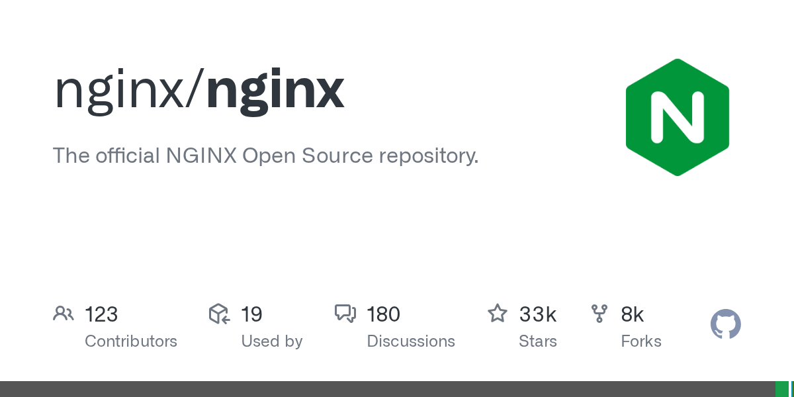
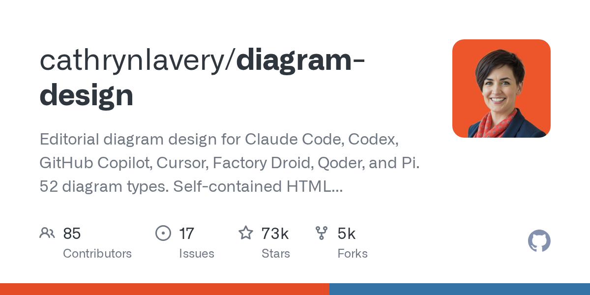

# AI 资讯日报 2026-11-26

> 自动抓取 AI 公司博客、从业者博客与社区聚合源，并生成中文摘要。

## 今日摘要

```
- GPT-6 models demonstrate intrinsic protein-design capabilities
- Searching for distant planets with Astra
- How Intentful uses dots to make more time for growth
- How iFood scales coding agents across 15,000 repositories
- Clay helps sales teams win with Codex and ChatGPT
```

## 公司动态

1. **[GPT-6 models demonstrate intrinsic protein-design capabilities](https://openai.com/index/gpt-6-models-demonstrate-intrinsic-protein-design-capabilities)**

   GPT-6 models design protein structures and sequences using reasoning and code. Lab tests found evidence of binding across five targets.

   来源：OpenAI Blog

2. **[Searching for distant planets with Astra](https://openai.com/index/searching-for-distant-planets-with-astra)**

   See how two amateur astronomers used Codex and Astra to find potential exoplanets in public data from NASA’s Kepler and TESS space telescopes.

   来源：OpenAI Blog

3. **[How Intentful uses dots to make more time for growth](https://openai.com/business/customer-stories/intentful-dots)**

   Marina Petrova’s dot Aria helps research websites and build proposals, while proactively flagging messages and resolving issues.

   来源：OpenAI Blog

4. **[How iFood scales coding agents across 15,000 repositories](https://openai.com/business/customer-stories/ifood)**

   暂无摘要。

   来源：OpenAI Blog

5. **[Clay helps sales teams win with Codex and ChatGPT](https://openai.com/business/customer-stories/clay-plugins-openai)**

   ChatGPT and Codex integrations help Clay’s users research deals and turn data into go-to-market plays, with GPT-6 models handling the reasoning.

   来源：OpenAI Blog

6. **[OpenAI and Cisco introduce Shirudo](https://openai.com/index/introducing-shirudo)**

   OpenAI and Cisco introduce Shirudo, an open-source runtime for Linux. It helps teams protect running systems while they roll out patches.

   来源：OpenAI Blog

7. **[Connected intelligence for in-house legal](https://openai.com/business/learn/connected-intelligence-for-in-house-legal)**

   Watch OpenAI’s Stacey Wang and Craig Bruney, Mary O’Carroll of LECG, and Cooley’s Richard Segal explore how AI can help in-house legal teams connect business context, build reusable workflows and get more from outside counsel.

   来源：OpenAI Blog

8. **[Richpanel helps companies automate 50% of support in 30 days](https://openai.com/business/customer-stories/richpanel-ai-customer-support)**

   Richpanel uses GPT-6 Astra and GPT-6.1 Sol to equip its AI support agents with tools and procedures, and GPT-6 Luna for their conversations.

   来源：OpenAI Blog

9. **[From spectrum to structure: Identifying molecules with Mass Spec Skills for Google Antigravity](https://deepmind.google/blog/interpreting-mass-spectra-with-google-antigravity/)**

   Mass Spec Skills empowers scientists using Google Antigravity to interpret tandem mass spectra.

   

   来源：DeepMind Blog

10. **[Finding faster quantum algorithms with agents and formal verification](https://deepmind.google/blog/finding-faster-quantum-algorithms-with-agents-and-formal-verification/)**

   Using agent teams and formal verification to improve quantum algorithms for fusion and chemistry.

   

   来源：DeepMind Blog

## 每日产品

1. **[Hiring Right Now - 哪些初创公司会录用你？](https://www.producthunt.com/r/PX2A4HLUDBWHZK)**

   Which startups would hire you? (www.producthunt.com) 11-25 ↑ 126 PH Upvotes

   

   来源：Product Hunt Daily

2. **[Canva MCP - 将任何AI代理转变为创意引擎](https://www.producthunt.com/r/R2X5P4ZWZ37ZCY)**

   Turn any AI agent into a creative powerhouse (www.producthunt.com) 11-25 ↑ 121 PH Upvotes

   

   来源：Product Hunt Daily

3. **[Snag by Parallel - 从您的代理处寻找最优惠的产品](https://www.producthunt.com/r/MANSMUJQCJ47AN)**

   *{padding:0;margin:0;overflow:hidden}html,body{height:100%}img,span{position:absolute;width:100%;top:0;bottom:0;margin:auto}span{height:1.5em;text-align:center;font:48px/1.5 sans-serif;color:white;text-shadow:0 0 0.5em black}▶" frameborder="0" allow="accelerometer; autoplay; encrypted-media; gyroscope; picture-in-picture" allowfullscreen > Find the best deals on products from your agents (www.producthunt.com) 11-25 ↑ 120 PH Upvotes

   来源：Product Hunt Daily

4. **[Airbot - 那个会先给你发短信的AI幕僚长](https://www.producthunt.com/r/EGSFSGAVXJ7PGU)**

   *{padding:0;margin:0;overflow:hidden}html,body{height:100%}img,span{position:absolute;width:100%;top:0;bottom:0;margin:auto}span{height:1.5em;text-align:center;font:48px/1.5 sans-serif;color:white;text-shadow:0 0 0.5em black}▶" frameborder="0" allow="accelerometer; autoplay; encrypted-media; gyroscope; picture-in-picture" allowfullscreen > The AI chief of staff that texts you first (www.producthunt.com) 11-25 ↑ 116 PH Upvotes

   来源：Product Hunt Daily

5. **[MyClaw 3.0 - 利用共享内存构建一个始终在线的 AI 团队](https://www.producthunt.com/r/I5P5AWTAYY2JLB)**

   *{padding:0;margin:0;overflow:hidden}html,body{height:100%}img,span{position:absolute;width:100%;top:0;bottom:0;margin:auto}span{height:1.5em;text-align:center;font:48px/1.5 sans-serif;color:white;text-shadow:0 0 0.5em black}▶" frameborder="0" allow="accelerometer; autoplay; encrypted-media; gyroscope; picture-in-picture" allowfullscreen > Build an always-on AI team with shared memory (www.producthunt.com) 11-25 PH Link

   来源：Product Hunt Daily

6. **[tday.com - 由AI录制的、Screen Studio风格的可编辑演示视频](https://www.producthunt.com/r/XR4BWOLUZFCM5O)**

   *{padding:0;margin:0;overflow:hidden}html,body{height:100%}img,span{position:absolute;width:100%;top:0;bottom:0;margin:auto}span{height:1.5em;text-align:center;font:48px/1.5 sans-serif;color:white;text-shadow:0 0 0.5em black}▶" frameborder="0" allow="accelerometer; autoplay; encrypted-media; gyroscope; picture-in-picture" allowfullscreen > AI-recorded Screen Studio style editable demos (www.producthunt.com) 11-24 ↑ 119 PH Upvotes

   来源：Product Hunt Daily

7. **[Kodak SlideTag - 一款1935年电影幻灯片风格的电子墨水框架，其追踪方式类似于AirTag](https://www.producthunt.com/r/NDZXUM47GD262O)**

   *{padding:0;margin:0;overflow:hidden}html,body{height:100%}img,span{position:absolute;width:100%;top:0;bottom:0;margin:auto}span{height:1.5em;text-align:center;font:48px/1.5 sans-serif;color:white;text-shadow:0 0 0.5em black}▶" frameborder="0" allow="accelerometer; autoplay; encrypted-media; gyroscope; picture-in-picture" allowfullscreen > A 1935 film-slide E-Ink frame that tracks like an AirTag (www.producthunt.com) 11-24 ↑ 123 PH Upvotes

   来源：Product Hunt Daily

8. **[Valley - 外联系统，用于寻找最有可能向您购买的客户](https://www.producthunt.com/r/HWUZY7SWS43SXN)**

   *{padding:0;margin:0;overflow:hidden}html,body{height:100%}img,span{position:absolute;width:100%;top:0;bottom:0;margin:auto}span{height:1.5em;text-align:center;font:48px/1.5 sans-serif;color:white;text-shadow:0 0 0.5em black}▶" frameborder="0" allow="accelerometer; autoplay; encrypted-media; gyroscope; picture-in-picture" allowfullscreen > Outbound system to find people most likely to buy from you (www.producthunt.com) 11-24 ↑ 110 PH Upvotes

   来源：Product Hunt Daily

9. **[Agenda Hero Magic Labs - 任何时间表。任何布局。任何风格。](https://www.producthunt.com/r/BRD7ISDGYKEIV4)**

   Any schedule. Any layout. Any style. (www.producthunt.com) 11-24 ↑ 113 PH Upvotes

   

   来源：Product Hunt Daily

10. **[Claude Ship - 代码写得有多快，就发布得有多快](https://www.producthunt.com/r/3ENQV4OYKF2LDA)**

   Ship code as fast as you can write it (www.producthunt.com) 11-24 ↑ 124 PH Upvotes

   

   来源：Product Hunt Daily

## GitHub 项目

1. **[elementalsouls/Claude-BugHunter](https://github.com/elementalsouls/Claude-BugHunter)**

   A Claude Code skill bundle for bug hunting and external red-team work - 85 skills, 16 slash commands, 681 disclosed-report patterns curated across 24 core vulnerability classes, plus enterprise identity + infrastructure attack matrices. Language: Python Stars: 23244 Forks: 2378

   

   来源：GitHub Trending Daily

2. **[obra/superpowers](https://github.com/obra/superpowers)**

   An agentic skills framework & software development methodology that works. Language: Shell Stars: 326755 Forks: 28991

   来源：GitHub Trending Daily

3. **[HKUDS/CLI-Anything](https://github.com/HKUDS/CLI-Anything)**

   "CLI-Anything: Making ALL Software Agent-Native" -- CLI-Hub: https://clianything.cc/ Language: Python Stars: 65810 Forks: 5990

   来源：GitHub Trending Daily

4. **[jingyaogong/minimind](https://github.com/jingyaogong/minimind)**

   🧠 两小时从 0 训出你的 64M 大模型。Train your own 64M LLM from scratch in 2 hours. Language: Python Stars: 71133 Forks: 9238

   

   来源：GitHub Trending Daily

5. **[cursor/plugins](https://github.com/cursor/plugins)**

   Cursor plugin specification and official plugins Language: TypeScript Stars: 19584 Forks: 2114

   

   来源：GitHub Trending Daily

6. **[firecrawl/firecrawl](https://github.com/firecrawl/firecrawl)**

   Knowledge infrastructure to make your agents smarter. Search, scrape and access 550+ data providers through one API. Language: TypeScript Stars: 210208 Forks: 10998

   

   来源：GitHub Trending Daily

7. **[nginx/nginx](https://github.com/nginx/nginx)**

   The official NGINX Open Source repository. Language: C Stars: 33403 Forks: 8407

   

   来源：GitHub Trending Daily

8. **[openvinotoolkit/openvino](https://github.com/openvinotoolkit/openvino)**

   OpenVINO™ is an open source toolkit for optimizing and deploying AI inference Language: C++ Stars: 12686 Forks: 3717

   

   来源：GitHub Trending Daily

9. **[cathrynlavery/diagram-design](https://github.com/cathrynlavery/diagram-design)**

   Editorial diagram design for Claude Code, Codex, GitHub Copilot, Cursor, Factory Droid, Qoder, and Pi. 52 diagram types. Self-contained HTML + SVG. No shadows. No Mermaid slop. Language: HTML Stars: 73200 Forks: 4871

   

   来源：GitHub Trending Daily

10. **[mvanhorn/last30days-skill](https://github.com/mvanhorn/last30days-skill)**

   AI agent skill that researches any topic across Reddit, X, YouTube, HN, Polymarket, and the web - then synthesizes a grounded summary Language: Python Stars: 75225 Forks: 6633

   

   来源：GitHub Trending Daily

## 从业者观点

1. **[Quoting Scott Aaronson](https://simonwillison.net/2026/Nov/25/scott-aaronson/)**

   It’s now obvious that we’ll be getting, not one-off solutions to this or that complexity question, but a whole new continent of mathematical truth, one that we’d previously only glimpsed through fog. Picture van Leeuwenhoek first training a microscope on pondwater, or Galileo first training his telescope on the stars. That might give you some idea of how our resolution into the complexity-theoretic universe, and the whole universe of mathematical truth beyond it, has now improved. &mdash; Scott Aaronson Tags: mathematics , llms , ai , generative-ai

   来源：Simon Willison

2. **[Three LLM inflection points in twelve months](https://simonwillison.net/2026/Nov/24/llm-inflection-points/)**

   I gave a keynote at the AI Engineer Code Summit a couple of weeks ago, constructed around the idea that there have been three significant inflection points in the abilities of LLMs and coding agents in the past twelve months. Here's the video of the talk. In this post I'm going to pull out the major inflection point theme and interrogate it more deeply. Coding agents in November 2025 Today, November 24th 2026, is the one year anniversary of the release of Claude Opus 4.5 . With hindsight, this was a consequential model. In the Opus 4.5 announcement, Anthropic said: Testers noted that Claude Opus 4.5 handles ambiguity and reasons about tradeoffs without hand-holding. They told us that, when pointed at a complex, multi-system bug, Opus 4.5 figures out the fix. They said that tasks that were near-impossible for Sonnet 4.5 just a few weeks ago are now within reach. This held up. Claude Code was 9 months old at that point, having been introduced alongside Claude 3.7 Sonnet on February 24th, 2025. Opus 4.5 was the first model I had used with Claude Code where the default result was generally the right thing. I hadn't been using Claude Code as a daily driver because it didn't feel reliable enough - I had to correct it often enough that it didn't feel like a clear accelerant. The new Opus changed that. For most of the coding problems I faced on a daily basis, Opus would get them right . It was clearly faster than working through the problems myself. Also in November, OpenAI released GPT-5.1 Instant, GPT-5.1 Thinking, GPT-5.1-Codex, and GPT-5.1-Codex-Max. These had a similar effect on their Codex coding agent: it became reliably useful for many of my coding tasks. The timing was convenient, because the December holidays were upon us. A lot of people, myself included, spent December tinkering with these new tools to see what they could do. By January we were ready to use them for our actual work. Fable class models in June/July We got our first hint of Claude Fable in April, when Anthropic announced Claude Mythos and said that it was too dangerous to release , due to its improved cybersecurity capabilities. Mythos was a model that could not just find security vulnerabilities, it could also figure out how to exploit them. In June we got to see how good that model was for ourselves, with the release of Claude Fable 5 - a defanged Mythos, that would solve most problems but would actively block you from using it for security work. After three glorious days... the US government took it away from us. Fable 5 was placed under export controls that effectively banned the model. We wouldn't get it back until July 1st. For me, Fable was an inflection point because it introduced us to what I now think of as Fable class models . My definition of these: [图片: Inflection point 2: Fable class models If you can define a goal and provide necessary tools They can solve your problem with brute force https://static.simonwillison.net/static/2026/fable-class.webp] In June I wrote about how Claude Fable is relentlessly proactive , after I asked it to help fix a display glitch in Safari and it spun up its own pyobjc-framework-Quartz screenshot mechanism and a CORS-enabled localhost logging server to help resolve the bug. A more recent example of the power of Fable class models is my mysterious beep finder from a couple of weeks ago. I gave Opus 5.5 and then Fable 5.2 access to five WebAudio microphones in a room full of boxes and it was able to triangulate the source of an infuriating mysterious beep to within about 40cm. Give it a goal, give it the right tools, and watch it cook. I'd currently class Claude Fable 5, 5.1, 5.2 and Claude Opus 5.5 as Fable class (I think of Opus 5.5 as "cheap Fable"). GPT-6 Astra got there for me too, and I think the new Gemini 4 Neon may count as well. These now represent the baseline for what I expect from a frontier model. 3D modeling and game development in September/October Something interesting happened with frontier LLMs over just the past four months: they got really good at 3D modeling. Set them up with Blender or ask them to write Three.js code and they'll produce credible models of almost anything you ask for. I first noticed this with Claude Fable 5, but it really kicked into gear with Opus 5.5, GPT-5.6 Sol, GPT-6 Astra, and most recently the Gemini 4 family. Here's Gemini 4 Neon's attempt at "Make a three js animation where yonkers stands up as a big mech (cool stand up motion) and stomps around manhattan and queens and Brooklyn, use openstreetmap mapping data", for example. 3D spatial awareness is crucial if you want to use vision LLMs for robotics. I don't know if 3D modeling capabilities are a side-effect of the labs focusing on that or vice-versa. Back in August I experimented with having Fable 5 build me a raccoon heist game . It had 3D graphics, looked like a game, and played really poorly. GPT-5.6 Sol Ultra did a much better job but the game itself was still pretty dull after the first 90 seconds of play. I was somewhat relieved that designing a game that was fun appeared to remain a uniquely human pursuit. I even used that in a talk in September to reassure people that us humans still had a role to play! Then, I tried telling Claude Opus 5.5 "This game isn't fun enough yet. Make it a LOT more fun." And it worked . My Command &amp; Conquer-style RTS went from boring to deeply entertaining overnight, after Opus spent 12 hours playtesting new features and rebalancing the gameplay. Opus 5.5 was the first model I'd used that appeared to understand fun. I've since worked on several little game projects where prompts like "Think hard about how to make sure it is both fun and beautiful" produced results that kept me engaged for significant amounts of time. Opus 5.5 came out on September 22nd, 2026. I've been to two different conferences since then where people showed me game projects they'd been working on that really did feel like proper, worthwhile games. The indie games scene has descended into a full-blown culture war over AI-assisted programming. A lot of people are calling GTA VI the last pre-generative AI blockbuster . It feels like another inflection point to me. Is Fable 5.2 an inflection point too? I'm still trying to decide if Fable 5.2 represents a new inflection point, or just another incremental improvement. I'm getting so much done with that model right now! It seems to have taste that almost exactly matches my own. I have been burning through all sorts of gnarly problems that I've been thinking about (or procrastinating on) for several years now. The release notes for Datasette 1.0a42 , 1.0a43 , and 1.0a44 - plus LLM 0.37 , 0.37.1 , 0.37.2 , 0.37.3 , and 0.38 - all in the last three weeks , represent a flood of fixes, features and improvements. If this does represent an inflection point, the key feature seems to be that if you can imagine and then clearly describe a piece of software, Fable can build it . That's a wild thing to say, but it matches my experience over the past few weeks. Software development has transformed beyond recognition in the last year. I don't think I'll ever go back to typing most of my code by hand. Tags: game-design , my-talks , ai , generative-ai , llms , annotated-talks , coding-agents , claude-code , codex , claude-mythos-fable

   

   来源：Simon Willison

3. **[GPT 6.2 Astra Solves a Historical Mystery](https://simonwillison.net/2026/Nov/24/astra-historical-mystery/)**

   GPT 6.2 Astra Solves a Historical Mystery Here's an interesting case-study in using GPT-6.2 Astra for historical research, from history professor Mark Humphries: With only minimal prompting, GPT-6.2 Astra was able to autonomously identify the creator of an anonymous 1808 sketchbook held at Yale’s Beinecke Library . It did so extremely quickly (in just 22 minutes), using publicly available primary and secondary sources. To do so, it discovered a little known source in a paper archive, predicted that it would prove its hypothesis if examined and, in the end, it did. Not only that, but this new source turns out to be a major find on its own that will be of significant interest to both Canadian and fur trade historians. Here's the digitized sketchbook . Astra found a diary reference reference to a visit by the vicomte de Chabot dated five days before a date mentioned in the sketchbook at a nearby river, and suggested that Chabot's journal of his travels (only available by order from Cleveland State University) might confirm that the sketchbook was his work. Are historians due for a round of Deep Blue ? Mark thinks it will be mild: But if the experience of mathematics is any guide, we can also anticipate that sometime next spring or summer we’ll face a sort of crisis of confidence as we struggle to understand how to respond to agentic systems that can do things human historians cannot. To be fair, that crisis will almost certainly be less profound for us than it is for math. The problem in mathematics, of course, is that solving hard math problems was the whole game. Historians, on the other hand, constantly reinterpret the past in light of an evolving present; we don’t chase a single universal truth. We also (in the ideal at least) write books and articles that are closer to works of philosophy and literature than they are to scientific tracts. Humanity is thus something of a requirement for the production of historical literature. Tags: history , ai , generative-ai , llms , ai-assisted-search , deep-blue , gpt-6-astra

   来源：Simon Willison

4. **[datasette-charts 0.2a0](https://simonwillison.net/2026/Nov/24/datasette-charts/)**

   Release: datasette-charts 0.2a0 I introduced this new charting plugin for Datasette yesterday . Today it's gained integration with Datasette Agent , so now you can ask chat for a chart and it will create one for you using the same underlying chart suggestion and generation tools. Here's a demo video, recorded on agent.datasette.io where you can sign in with GitHub to try the plugin yourself: Download the video (MP4) I prompt Datasette Agent to "Use #stats to show sqlite-utils downloads over time as a chart" - where typing "#stats" opens a table search box. It shows me a chart inline in the chat, and when I click "Open in the chart builder" it opens the chart in a panel along with the table page. I use the table page to switch to a chart of "datasette", then when I ask the agent "what does the chart show?" it notices that I changed the content in the panel and describes the new Datasette chart to me. Here's a Markdown export of the chat from the video. Tags: datasette-agent , datasette , visualization

   来源：Simon Willison

5. **[datasette-agent 0.7a1](https://simonwillison.net/2026/Nov/24/datasette-agent/)**

   Release: datasette-agent 0.7a1 A small improvement to Datasette Agent : chat sessions could already open an iframe side panel that could then navigate to different pages. This version improves navigation by fragment hashes, for deeper integration with other Datasette plugins that update fragment hashes when the user interacts with the plugin in a way that changes state. I built this in order to fix some bugs with the much more exciting datasette-charts 0.2a0 release . Tags: datasette-agent , datasette

   来源：Simon Willison

6. **[GLM-5.4: Toward Generalized Coding with Our First Loop Transformer](https://simonwillison.net/2026/Nov/23/glm-54/)**

   GLM-5.4: Toward Generalized Coding with Our First Loop Transformer GLM 5.4 is now available from Chinese AI lab Z.ai. It's their first model to use a looped transformer architecture, which they describe like this: In a standard Transformer, each layer runs once per forward pass. In a Loop Transformer, a group of weight-shared layers runs for multiple iterations, refining the hidden states from the previous pass. This gives us a deeper network without increasing the parameter count. This is the second mention of looped transformers I've seen in the past week - the first was Inkling 2 Mini from Thinking Machines Lab on November 20th, who said: Inkling 2 Mini is a looped transformer, running the middle layers of the model three times for every token. This allows the model to apply more reasoning and reach the right answer with fewer tokens, especially on tasks such as agentic coding that depend on reasoning quality. GLM 5.4 is not yet available as open weights: We plan to open-source the model weights responsibly after completing necessary safety hardening. I tried it out using the Z.ai API, for which I had to sign up for their Coding Plan subscription because 5.4 cannot currently be accessed through the regular API. It turns out both coding plan and regular API share the same OpenAI-compatible Responses API (at https://api.z.ai/api/v1 ), and the API key for the coding plan worked with that and gave me access to the new model. I built a llm-glm plugin , then realized that llm-zai by Tommy Hughes already exists! I've shipped mine purely because llm-zai doesn't yet support the new model, but I'll likely retire mine once that plugin catches up. Here are pelicans for GLM-5.4 on low, high, and max. This is the max one: [图片: https://static.simonwillison.net/static/2026/glm-5.4-max.webp] I realized I never ran pelicans for GLM-5.3, so here those are for the same effort levels. They look similar in quality to 5.4. It's interesting how GLM 5.1 and GLM 5.2 produced radically different pelicans from other models. The pelicans for 5.3 and 5.4 are much more comparable to those I get from OpenAI or Anthropic models - the previous generations had their own distinctive look. I made a comparison grid showing the four generations of GLM pelicans all in one place. The style transition between 5.2 and 5.3 is pretty stark. [图片: https://static.simonwillison.net/static/2026/glm-family-4.webp] Tags: ai , generative-ai , llms , llm , pelican-riding-a-bicycle , llm-release , ai-in-china , glm

   

   来源：Simon Willison

7. **[Responding to objections to recursive self-improvement](https://www.dwarkesh.com/p/rsiobjections)**

   What the skeptics get right about superintelligence

   来源：Dwarkesh Patel

## 社区热点

1. **[OpenAI cuts GPT-6.2 usage: Astra hits limits 40% faster, Sol 25% faster](https://twitter.com/thsottiaux/status/2125784147889393806)**

   Article URL: https://twitter.com/thsottiaux/status/2125784147889393806 Comments URL: https://news.ycombinator.com/item?id=50651117 Points: 31 # Comments: 10

   来源：Hacker News AI

2. **[The New York Times warns photographers not to update Photoshop over AI features](https://www.theverge.com/ai-artificial-intelligence/1041227/the-new-york-times-warns-photographers-not-to-update-photoshop-over-ai-features)**

   https://archive.ph/pcUgy Comments URL: https://news.ycombinator.com/item?id=50647673 Points: 263 # Comments: 222

   来源：Hacker News AI

3. **[New York bans AI toys, including those using internet to talk to children](https://www.theguardian.com/us-news/2026/nov/25/new-york-bans-ai-toys)**

   Article URL: https://www.theguardian.com/us-news/2026/nov/25/new-york-bans-ai-toys Comments URL: https://news.ycombinator.com/item?id=50644909 Points: 49 # Comments: 9

   来源：Hacker News AI

4. **[Marginalia Search, Money, C++, Rust, AI, Stuff](https://www.marginalia.nu/log/a_141_marginalia_update/)**

   Article URL: https://www.marginalia.nu/log/a_141_marginalia_update/ Comments URL: https://news.ycombinator.com/item?id=50638220 Points: 219 # Comments: 83

   来源：Hacker News AI

5. **[Top open problems in mathematics ranked by LLM-assessed importance](https://www.proofatlas.ai/open-problems/)**

   Article URL: https://www.proofatlas.ai/open-problems/ Comments URL: https://news.ycombinator.com/item?id=50637871 Points: 103 # Comments: 52

   来源：Hacker News AI

6. **[New York Ban AI Toys for 5 Years](https://www.governor.ny.gov/news/consumers-begin-their-holiday-shopping-season-governor-hochul-signs-five-year-ban-ai-chatbot)**

   Article URL: https://www.governor.ny.gov/news/consumers-begin-their-holiday-shopping-season-governor-hochul-signs-five-year-ban-ai-chatbot Comments URL: https://news.ycombinator.com/item?id=50635246 Points: 38 # Comments: 3

   来源：Hacker News AI

7. **[Working with AI](https://www.anthropic.com/research/working-with-ai)**

   Article URL: https://www.anthropic.com/research/working-with-ai Comments URL: https://news.ycombinator.com/item?id=50634734 Points: 88 # Comments: 76

   来源：Hacker News AI

8. **[Ask HN: Am I the only one whose AI hype is cooling down a lot?](https://news.ycombinator.com/item?id=50633601)**

   I am in the industry for 15+ years, studied CS, and actually, never really "liked" programming. It was a means to an end. I have written about programming (and published books), so don't get me wrong: I like the craft and I miss the sense of accomplishment after hours and days of struggling and fixing a problem with 2 lines of code. What I see in my personal spending and habits: I get free tokens from my company, and I spent between 3k-5k a month at the start of the year. Models got cheaper, but also: The usefullness ran its course a little bit for me. I still don't write code by hand, but when doing research, finding solutions, even some decisions (using Opus 5.5 and Astra 6.2 for example) are more and more questionable. I handed large research tasks to models, but even small questions like: "What do you think about these PR comments pointing out issues" (I need to be vague, working for a larger company), it didn't find even basic facts I found via Google and reading the docs for 2mins. I usually did higher level thinking, researched with the model, and then went to the implementation phase. But lately, I am not happy with both the research results (I continuesly have to narrow it down, go back, refine... I spend a day or 2 days refining, which in the end, I can do by myself now and actually feel a sense of accomplishment). Even the implementation isn't all that great. Maybe my bar for acceptable work is higher now, since these tools are not "magic" anymore. I think I gave them more leeway in the beginning because they wowed me. But now... not so much anymore. I even dread opening up Claude Code or Codex and I'd rather read and write code myself, and just give them smaller tasks, or once I nailed it down, I let a large chunk of code write by a model (because it "types" faster...). Am I alone? I read a lot of think pieces, I have agents working on my private dedicated server to maintain my machine and set up my self-hosting services. But more and more, I'd rather.... do it myself again, be more precise, and use it as a workhorse instead of a thinking researcher. Comments URL: https://news.ycombinator.com/item?id=50633601 Points: 35 # Comments: 23

   来源：Hacker News AI

9. **[Compiling web applications into verified operations for AI agents](https://protocolis.co/paper/)**

   Article URL: https://protocolis.co/paper/ Comments URL: https://news.ycombinator.com/item?id=50632998 Points: 34 # Comments: 14

   来源：Hacker News AI

10. **[Matrix Multiplication is Θ(n^2.25)](https://raw.githubusercontent.com/openai/math/main/preprints/The-matrix-multiplication-exponent-is-nine-fourths-November-24-2026/paper.pdf)**

   Comments

   来源：Lobsters AI

11. **[9/UX: a Macintosh-inspired desktop for 9front](https://progrium.github.io/9ux/)**

   I have written a story about this on the Register, but of course I can't post that here. I think this is a quite astonishing effort and could make 9front considerably more usable... but it's bot-assisted, so I don't think they'll take it. Comments

   来源：Lobsters AI

## 论文与模型

1. **[SEEK: Self-Evolution through Execution Knowledge for Agentic Robot Manipulation](https://arxiv.org/abs/2611.33915)**

   General-purpose multimodal foundation models enable robots to adapt during deployment from observations and execution feedback, without task-specific demonstrations or training. However, the robot retains what it learns only in the model's working context. Once the task ends, it loses this execution knowledge, such as how to carry a bowl between two grippers. On the next attempt at the task, the robot may take just as long and repeat the same mistakes. To avoid this repetition, robots must retain execution knowledge across attempts. Yet replaying past actions is insufficient, because their effects depend on the current conditions. Procedures that determine actions from the current scene address this, but when they meet conditions that earlier attempts did not cover, revising them requires the measured effects of earlier actions. We therefore propose SEEK, an agentic framework that retains both, enabling robots to improve across attempts while keeping the underlying model fixed. To adapt retained knowledge to the current scene, SEEK adopts a Self-Evolving Programmatic Policy (SEPP) that encodes manipulation as executable procedures and determines each action from current observations. As the robot executes these procedures, SEEK records the measured effects of its actions, including those from failed attempts, in a Persistent Action-Effect Bank (PAEB). Where a retained procedure applies, it acts without a model request; where it meets a condition it does not cover, this evidence guides its revision. On RoboDojo, knowledge retained over ten attempts raises SEEK's average task score from 27.0 to 54.4 and its success rate from 19.7% to 48.0% across all 42 tasks. On 34 of these tasks with GPT-6.2 Astra, SEEK reaches 80.1 after five attempts, against 49.6 for the same model acting directly, and uses 77.6% fewer model requests. https://zeyangguan.github.io/SEEK-Agentic-Robot-Manipulation/

   来源：HuggingFace Papers

2. **[Agentic LongLive: Asynchronous Agentic Memory for Long Video Generation](https://arxiv.org/abs/2611.34907)**

   Real-time autoregressive video generators stream minutes of video and accept new prompts on the fly, but struggle to keep people, objects, and places consistent over a long interactive story. Agent systems provide such memory for offline multi-shot generation, yet they read the whole script in advance, plan each shot before generating it, and regenerate failed shots, which a live stream does not allow. We present Agentic LongLive, an asynchronous agentic memory for long video generation. A memory agent on separate GPUs reads only the prompts revealed so far, never the generated video, and keeps a text state and evolving images for every person, object, and scene. From this entity memory it composes a global image and a per-shot memory image, which an auxiliary GPU prefills into the generator's attention sink before the next shot starts, and writes entity cards for the prompts that name them, so the video never waits for memory and video errors are not written back. A small language model, trained with reinforcement learning and an image reward calibrated using downstream video outcomes, decides what to remember before the next prompt is known. On LongStory-Online, a new benchmark of 25 stories (857 shots) revealed one shot at a time, Agentic LongLive improves persistent-state accuracy of LongLive-2.0, its base generator, by 26.3 points, protagonist identity by 44.9, and revisited-place consistency by 40.4, at about 1% extra generation time on H100. The full system streams faster than real time on one 8xB200 node with the generator in BF16 (34.3 FPS), keeps image quality stable over 14-minute stories, and improves identity on two MiniMax-H3 generators, one of which, LongLive-H3, also runs in real time with it. To our knowledge, it is the first real-time video generator with text and image memory kept by an LLM agent.

   来源：HuggingFace Papers

3. **[Beyond Code and Pixels: Co-Generating Editable and Visually Rich Presentations](https://arxiv.org/abs/2611.28010)**

   Generating PPTX presentations is a structured task that requires semantic planning, visual composition, precise layout, and editability, motivating collaboration among specialized agents. However, programmatic methods offer editability but often produce rigid designs, while image-based methods provide visual richness but flatten content into difficult-to-edit pixels. A hybrid system can combine these strengths, but must coordinate interdependent decisions across content, layout, and appearance. To address this challenge, we propose SlidesWeaver, a hybrid multi-agent system that coordinates language and vision agents through shared deck- and slide-level states. Specifically, it uses staged multimodal commitment, diffusion-based composition planning, and two generation schedules for different priorities between composition freedom and accurate text preservation, while preserving native text and geometry. Across 1,728 generations spanning 24 system-model configurations, SlidesWeaver achieves consistently superior overall quality across all evaluated dimensions while maintaining structural control, editability, and practical generation efficiency.

   来源：HuggingFace Papers

4. **[CONCOR: Benchmarking Contrastive Decoding for Visual Hallucination Mitigation Beyond Final-Output Performance](https://arxiv.org/abs/2611.30460)**

   Contrastive decoding (CD) mitigates object hallucination in multimodal large language models (MLLMs) by contrasting token distributions under different conditions to adjust token scores. However, existing generative and discriminative benchmarks primarily measure final task scores, which can be confounded by candidate filtering, changes in generation trajectories, and response biases, making it difficult to isolate the effects of the underlying contrastive adjustments. To address these limitations while complementing existing evaluations, we introduce CONCOR (Contrastive Correction Evaluation), a controlled benchmark that directly evaluates the competition between ground-truth and different types of hallucinated candidates using the Contrastive Grounding Margin (CGM). CGM also enables analysis of directional consistency, composition, and reliability of contrastive corrections. Our evaluation reveals that existing CD methods exhibit distinct correction behaviors: some consistently favor ground-truth candidates, whereas others produce strong corrections but also introduce more errors. Crucially, these differences help explain their contrasting responses to increased contrast strength, which improves some methods while degrading others. These findings highlight the importance of evaluating the contrastive correction itself, rather than relying solely on final-output performance, and CONCOR provides a controlled and interpretable framework for understanding and improving CD methods for hallucination mitigation.

   来源：HuggingFace Papers

5. **[PyRUA-Dex: Learning Programmatic Policies for Dexterous Bimanual Manipulation with Coding Agents](https://arxiv.org/abs/2611.33144)**

   Learning for dexterous manipulation is limited by the scarcity of high-quality demonstrations: retargeting from human video is imprecise, teleoperation gives no force feedback to the operator, and exoskeleton-based collection is hard to scale up. We present PyRUA-Dex, a framework that enables coding agents to develop dexterous manipulation through programmatic policy, without the need of demonstrations. The programmatic policy is developed in two stages: during exploration, multiple agents explore in parallel for task skills and ways to compose them, and a distilling agent condenses the successful attempts into a task library and one program. During refinement, this program is improved through randomized layouts for enhanced robustness and execution efficiency. In simulated environments, PyRUA-Dex achieves SOTA on Bench2Dex with a score of 72.9 and reaches 81.0% success on DexJoCo under full randomization, ahead of every trained policy on both benchmarks. In real world experiments on a bimanual platform with two 22-DoF hands, PyRUA-Dex learns to play piano, write calligraphy, and other tasks efficiently: learning a new piece from sheet music takes as little as 30 minutes. These results suggest that PyRUA-Dex is an effective framework for developing dexterous manipulation policies with coding agents in the absence of high quality dexterous manipulation demonstrations.

   来源：HuggingFace Papers

6. **[ROAM-Bench: Evaluating Embodied Active Spatial Intelligence through Evidence Verification](https://arxiv.org/abs/2611.33143)**

   Embodied spatial intelligence requires agents to gather information through exploration and interaction, then use it to reason and act. Existing benchmarks insufficiently distinguish correct outcomes from completion of these task requirements. We introduce ROAM-Bench to evaluate these abilities under robot motion and collision constraints. Independent checks use simulation state and episode records to assess outcomes and task requirements, with stronger checks of geometry, coverage, or placement. It comprises 250 manually validated tasks across 11 types in five groups and 27 indoor environments, covering object and room search, counting, geometric judgments, direction reasoning, and relocation. Human evaluators achieve 84% strict task success on 100 sampled tasks, with every correct outcome satisfying the required checks. Across seven frontier vision-language models, we identify two complementary failure modes: correct outcomes with unmet task requirements, and incorrect outcomes despite passing stronger checks. Oracle-input diagnostics show that more complete target observations and calibrated feedback improve final spatial judgments.

   来源：HuggingFace Papers

7. **[Loupe: Reinforcing Knowledge-Intensive Video Generation Agents](https://arxiv.org/abs/2611.31895)**

   Knowledge-intensive video generation remains challenging because prompts often omit the facts, appearances, and temporal relationships required for accurate generation. While search-based workflows can retrieve missing evidence, manually designed strategies limit adaptive planning, and conventional training suffers from costly video-level feedback and coarse trajectory-level credit assignment. In this paper, we present Loupe, a video generation agent that retrieves and verifies textual and visual evidence to construct evidence-grounded temporal video prompts with reference images. We further introduce Rubric-Based Credit (RBC), which leverages prompt-specific factual, visual, and temporal requirements to evaluate intermediate search and planning decisions before video rendering. Building on RBC, RBC-SFT reweights assistant-token learning by step quality, while RBC-GRPO incorporates step-level credits alongside a final planning reward, without rendering videos during RL. To address the lack of dedicated search-oriented evaluation, we construct Search-VBench, which contains 150 held-out prompts across seven categories. Experiments show that Loupe improves all four evaluation dimensions across three video generators, raising the overall score of MiniMax-H3 from 32.80 to 70.67 and outperforming an untrained search workflow. Ablation experiments show that full RBC training outperforms standard SFT followed by trajectory-level GRPO by 5.27 points. Human evaluations and results on Sci-VBench and KIVI-Bench further demonstrate improved generation quality, scientific grounding, factual precision, and helpfulness. Our project page is available at https://zengkaiya.github.io/Loupe/.

   来源：HuggingFace Papers
