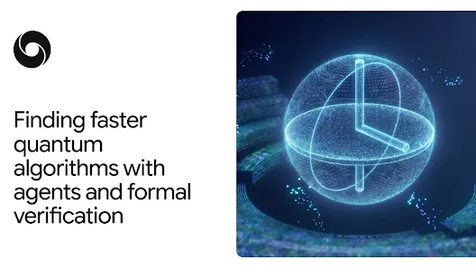
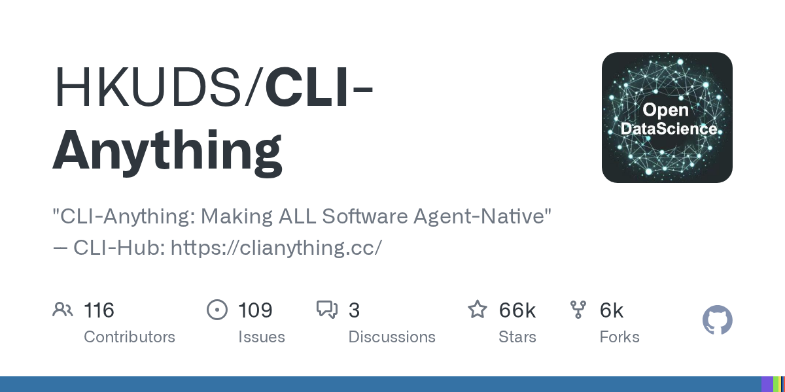
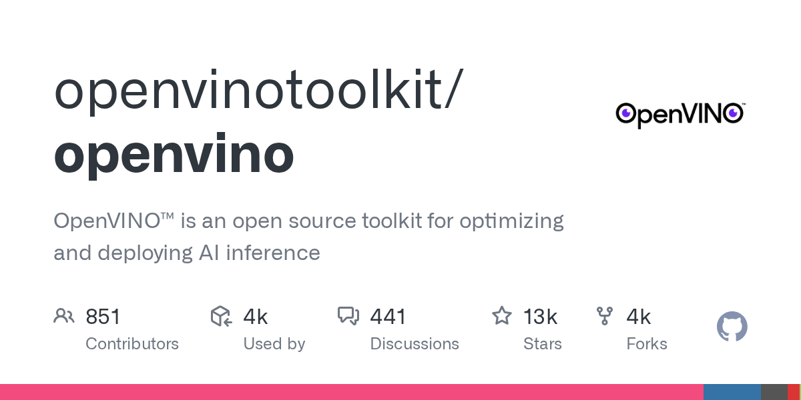
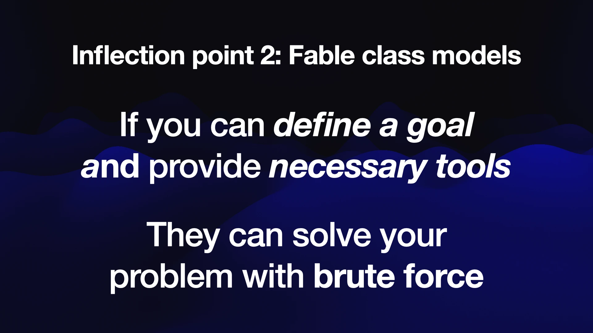

# AI 资讯日报 2026-11-26

> 自动抓取 AI 公司博客、从业者博客与社区聚合源，并生成中文摘要。

## 今日摘要

```
- GPT-6 models demonstrate intrinsic protein-design capabilities
- Searching for distant planets with Astra
- How Intentful uses dots to make more time for growth
- How iFood scales coding agents across 15,000 repositories
- Clay helps sales teams win with Codex and ChatGPT
```

## 公司动态

1. **[GPT-6 models demonstrate intrinsic protein-design capabilities](https://openai.com/index/gpt-6-models-demonstrate-intrinsic-protein-design-capabilities)**

   GPT-6 models design protein structures and sequences using reasoning and code. Lab tests found evidence of binding across five targets.

   来源：OpenAI Blog

2. **[Searching for distant planets with Astra](https://openai.com/index/searching-for-distant-planets-with-astra)**

   See how two amateur astronomers used Codex and Astra to find potential exoplanets in public data from NASA’s Kepler and TESS space telescopes.

   来源：OpenAI Blog

3. **[How Intentful uses dots to make more time for growth](https://openai.com/business/customer-stories/intentful-dots)**

   Marina Petrova’s dot Aria helps research websites and build proposals, while proactively flagging messages and resolving issues.

   来源：OpenAI Blog

4. **[How iFood scales coding agents across 15,000 repositories](https://openai.com/business/customer-stories/ifood)**

   暂无摘要。

   来源：OpenAI Blog

5. **[Clay helps sales teams win with Codex and ChatGPT](https://openai.com/business/customer-stories/clay-plugins-openai)**

   ChatGPT and Codex integrations help Clay’s users research deals and turn data into go-to-market plays, with GPT-6 models handling the reasoning.

   来源：OpenAI Blog

6. **[OpenAI and Cisco introduce Shirudo](https://openai.com/index/introducing-shirudo)**

   OpenAI and Cisco introduce Shirudo, an open-source runtime for Linux. It helps teams protect running systems while they roll out patches.

   来源：OpenAI Blog

7. **[Connected intelligence for in-house legal](https://openai.com/business/learn/connected-intelligence-for-in-house-legal)**

   Watch OpenAI’s Stacey Wang and Craig Bruney, Mary O’Carroll of LECG, and Cooley’s Richard Segal explore how AI can help in-house legal teams connect business context, build reusable workflows and get more from outside counsel.

   来源：OpenAI Blog

8. **[Richpanel helps companies automate 50% of support in 30 days](https://openai.com/business/customer-stories/richpanel-ai-customer-support)**

   Richpanel uses GPT-6 Astra and GPT-6.1 Sol to equip its AI support agents with tools and procedures, and GPT-6 Luna for their conversations.

   来源：OpenAI Blog

9. **[From spectrum to structure: Identifying molecules with Mass Spec Skills for Google Antigravity](https://deepmind.google/blog/interpreting-mass-spectra-with-google-antigravity/)**

   Mass Spec Skills empowers scientists using Google Antigravity to interpret tandem mass spectra.

   

   来源：DeepMind Blog

10. **[Finding faster quantum algorithms with agents and formal verification](https://deepmind.google/blog/finding-faster-quantum-algorithms-with-agents-and-formal-verification/)**

   Using agent teams and formal verification to improve quantum algorithms for fusion and chemistry.

   

   来源：DeepMind Blog

## 每日产品

1. **[Hiring Right Now - 哪些初创公司会录用你？](https://www.producthunt.com/r/PX2A4HLUDBWHZK)**

   Which startups would hire you? (www.producthunt.com) 11-25 ↑ 126 PH Upvotes

   

   来源：Product Hunt Daily

2. **[Canva MCP - 将任何AI代理转变为创意引擎](https://www.producthunt.com/r/R2X5P4ZWZ37ZCY)**

   Turn any AI agent into a creative powerhouse (www.producthunt.com) 11-25 ↑ 121 PH Upvotes

   

   来源：Product Hunt Daily

3. **[Snag by Parallel - 从您的代理处寻找最优惠的产品](https://www.producthunt.com/r/MANSMUJQCJ47AN)**

   *{padding:0;margin:0;overflow:hidden}html,body{height:100%}img,span{position:absolute;width:100%;top:0;bottom:0;margin:auto}span{height:1.5em;text-align:center;font:48px/1.5 sans-serif;color:white;text-shadow:0 0 0.5em black}▶" frameborder="0" allow="accelerometer; autoplay; encrypted-media; gyroscope; picture-in-picture" allowfullscreen > Find the best deals on products from your agents (www.producthunt.com) 11-25 ↑ 120 PH Upvotes

   来源：Product Hunt Daily

4. **[Airbot - 那个会先给你发短信的AI幕僚长](https://www.producthunt.com/r/EGSFSGAVXJ7PGU)**

   *{padding:0;margin:0;overflow:hidden}html,body{height:100%}img,span{position:absolute;width:100%;top:0;bottom:0;margin:auto}span{height:1.5em;text-align:center;font:48px/1.5 sans-serif;color:white;text-shadow:0 0 0.5em black}▶" frameborder="0" allow="accelerometer; autoplay; encrypted-media; gyroscope; picture-in-picture" allowfullscreen > The AI chief of staff that texts you first (www.producthunt.com) 11-25 ↑ 116 PH Upvotes

   来源：Product Hunt Daily

5. **[MyClaw 3.0 - 利用共享内存构建一个始终在线的 AI 团队](https://www.producthunt.com/r/I5P5AWTAYY2JLB)**

   *{padding:0;margin:0;overflow:hidden}html,body{height:100%}img,span{position:absolute;width:100%;top:0;bottom:0;margin:auto}span{height:1.5em;text-align:center;font:48px/1.5 sans-serif;color:white;text-shadow:0 0 0.5em black}▶" frameborder="0" allow="accelerometer; autoplay; encrypted-media; gyroscope; picture-in-picture" allowfullscreen > Build an always-on AI team with shared memory (www.producthunt.com) 11-25 PH Link

   来源：Product Hunt Daily

6. **[tday.com - 由AI录制的、Screen Studio风格的可编辑演示视频](https://www.producthunt.com/r/XR4BWOLUZFCM5O)**

   *{padding:0;margin:0;overflow:hidden}html,body{height:100%}img,span{position:absolute;width:100%;top:0;bottom:0;margin:auto}span{height:1.5em;text-align:center;font:48px/1.5 sans-serif;color:white;text-shadow:0 0 0.5em black}▶" frameborder="0" allow="accelerometer; autoplay; encrypted-media; gyroscope; picture-in-picture" allowfullscreen > AI-recorded Screen Studio style editable demos (www.producthunt.com) 11-24 ↑ 119 PH Upvotes

   来源：Product Hunt Daily

7. **[Kodak SlideTag - 一款1935年电影幻灯片风格的电子墨水框架，其追踪方式类似于AirTag](https://www.producthunt.com/r/NDZXUM47GD262O)**

   *{padding:0;margin:0;overflow:hidden}html,body{height:100%}img,span{position:absolute;width:100%;top:0;bottom:0;margin:auto}span{height:1.5em;text-align:center;font:48px/1.5 sans-serif;color:white;text-shadow:0 0 0.5em black}▶" frameborder="0" allow="accelerometer; autoplay; encrypted-media; gyroscope; picture-in-picture" allowfullscreen > A 1935 film-slide E-Ink frame that tracks like an AirTag (www.producthunt.com) 11-24 ↑ 123 PH Upvotes

   来源：Product Hunt Daily

8. **[Valley - 外联系统，用于寻找最有可能向您购买的客户](https://www.producthunt.com/r/HWUZY7SWS43SXN)**

   *{padding:0;margin:0;overflow:hidden}html,body{height:100%}img,span{position:absolute;width:100%;top:0;bottom:0;margin:auto}span{height:1.5em;text-align:center;font:48px/1.5 sans-serif;color:white;text-shadow:0 0 0.5em black}▶" frameborder="0" allow="accelerometer; autoplay; encrypted-media; gyroscope; picture-in-picture" allowfullscreen > Outbound system to find people most likely to buy from you (www.producthunt.com) 11-24 ↑ 110 PH Upvotes

   来源：Product Hunt Daily

9. **[Agenda Hero Magic Labs - 任何时间表。任何布局。任何风格。](https://www.producthunt.com/r/BRD7ISDGYKEIV4)**

   Any schedule. Any layout. Any style. (www.producthunt.com) 11-24 ↑ 113 PH Upvotes

   

   来源：Product Hunt Daily

10. **[Claude Ship - 代码写得有多快，就发布得有多快](https://www.producthunt.com/r/3ENQV4OYKF2LDA)**

   Ship code as fast as you can write it (www.producthunt.com) 11-24 ↑ 124 PH Upvotes

   

   来源：Product Hunt Daily

## GitHub 项目

1. **[elementalsouls/Claude-BugHunter](https://github.com/elementalsouls/Claude-BugHunter)**

   A Claude Code skill bundle for bug hunting and external red-team work - 84 skills, 15 slash commands, 681 disclosed-report patterns curated across 24 core vulnerability classes, plus enterprise identity + infrastructure attack matrices. Language: Python Stars: 22766 Forks: 2337

   

   来源：GitHub Trending Daily

2. **[obra/superpowers](https://github.com/obra/superpowers)**

   An agentic skills framework & software development methodology that works. Language: Shell Stars: 326499 Forks: 28969

   来源：GitHub Trending Daily

3. **[HKUDS/CLI-Anything](https://github.com/HKUDS/CLI-Anything)**

   "CLI-Anything: Making ALL Software Agent-Native" -- CLI-Hub: https://clianything.cc/ Language: Python Stars: 65572 Forks: 5957

   

   来源：GitHub Trending Daily

4. **[jingyaogong/minimind](https://github.com/jingyaogong/minimind)**

   🧠 两小时从 0 训出你的 64M 大模型。Train your own 64M LLM from scratch in 2 hours. Language: Python Stars: 70880 Forks: 9211

   来源：GitHub Trending Daily

5. **[cursor/plugins](https://github.com/cursor/plugins)**

   Cursor plugin specification and official plugins Language: TypeScript Stars: 19498 Forks: 2103

   

   来源：GitHub Trending Daily

6. **[firecrawl/firecrawl](https://github.com/firecrawl/firecrawl)**

   Knowledge infrastructure to make your agents smarter. Search, scrape and access 550+ data providers through one API. Language: TypeScript Stars: 209881 Forks: 10976

   

   来源：GitHub Trending Daily

7. **[nginx/nginx](https://github.com/nginx/nginx)**

   The official NGINX Open Source repository. Language: C Stars: 33338 Forks: 8405

   

   来源：GitHub Trending Daily

8. **[openvinotoolkit/openvino](https://github.com/openvinotoolkit/openvino)**

   OpenVINO™ is an open source toolkit for optimizing and deploying AI inference Language: C++ Stars: 12625 Forks: 3707

   

   来源：GitHub Trending Daily

9. **[cathrynlavery/diagram-design](https://github.com/cathrynlavery/diagram-design)**

   Editorial diagram design for Claude Code, Codex, GitHub Copilot, Cursor, Factory Droid, Qoder, and Pi. 52 diagram types. Self-contained HTML + SVG. No shadows. No Mermaid slop. Language: HTML Stars: 72883 Forks: 4849

   来源：GitHub Trending Daily

10. **[mvanhorn/last30days-skill](https://github.com/mvanhorn/last30days-skill)**

   AI agent skill that researches any topic across Reddit, X, YouTube, HN, Polymarket, and the web - then synthesizes a grounded summary Language: Python Stars: 75001 Forks: 6606

   

   来源：GitHub Trending Daily

## 从业者观点

1. **[Three LLM inflection points in twelve months](https://simonwillison.net/2026/Nov/24/llm-inflection-points/)**

   I gave a keynote at the AI Engineer Code Summit a couple of weeks ago, constructed around the idea that there have been three significant inflection points in the abilities of LLMs and coding agents in the past twelve months. Here's the video of the talk. In this post I'm going to pull out the major inflection point theme and interrogate it more deeply. Coding agents in November 2025 Today, November 24th 2026, is the one year anniversary of the release of Claude Opus 4.5 . With hindsight, this was a consequential model. In the Opus 4.5 announcement, Anthropic said: Testers noted that Claude Opus 4.5 handles ambiguity and reasons about tradeoffs without hand-holding. They told us that, when pointed at a complex, multi-system bug, Opus 4.5 figures out the fix. They said that tasks that were near-impossible for Sonnet 4.5 just a few weeks ago are now within reach. This held up. Claude Code was 9 months old at that point, having been introduced alongside Claude 3.7 Sonnet on February 24th, 2025. Opus 4.5 was the first model I had used with Claude Code where the default result was generally the right thing. I hadn't been using Claude Code as a daily driver because it didn't feel reliable enough - I had to correct it often enough that it didn't feel like a clear accelerant. The new Opus changed that. For most of the coding problems I faced on a daily basis, Opus would get them right . It was clearly faster than working through the problems myself. Also in November, OpenAI released GPT-5.1 Instant, GPT-5.1 Thinking, GPT-5.1-Codex, and GPT-5.1-Codex-Max. These had a similar effect on their Codex coding agent: it became reliably useful for many of my coding tasks. The timing was convenient, because the December holidays were upon us. A lot of people, myself included, spent December tinkering with these new tools to see what they could do. By January we were ready to use them for our actual work. Fable class models in June/July We got our first hint of Claude Fable in April, when Anthropic announced Claude Mythos and said that it was too dangerous to release , due to its improved cybersecurity capabilities. Mythos was a model that could not just find security vulnerabilities, it could also figure out how to exploit them. In June we got to see how good that model was for ourselves, with the release of Claude Fable 5 - a defanged Mythos, that would solve most problems but would actively block you from using it for security work. After three glorious days... the US government took it away from us. Fable 5 was placed under export controls that effectively banned the model. We wouldn't get it back until July 1st. For me, Fable was an inflection point because it introduced us to what I now think of as Fable class models . My definition of these: [图片: Inflection point 2: Fable class models If you can define a goal and provide necessary tools They can solve your problem with brute force https://static.simonwillison.net/static/2026/fable-class.webp] In June I wrote about how Claude Fable is relentlessly proactive , after I asked it to help fix a display glitch in Safari and it spun up its own pyobjc-framework-Quartz screenshot mechanism and a CORS-enabled localhost logging server to help resolve the bug. A more recent example of the power of Fable class models is my mysterious beep finder from a couple of weeks ago. I gave Opus 5.5 and then Fable 5.2 access to five WebAudio microphones in a room full of boxes and it was able to triangulate the source of an infuriating mysterious beep to within about 40cm. Give it a goal, give it the right tools, and watch it cook. I'd currently class Claude Fable 5, 5.1, 5.2 and Claude Opus 5.5 as Fable class (I think of Opus 5.5 as "cheap Fable"). GPT-6 Astra got there for me too, and I think the new Gemini 4 Neon may count as well. These now represent the baseline for what I expect from a frontier model. 3D modeling and game development in September/October Something interesting happened with frontier LLMs over just the past four months: they got really good at 3D modeling. Set them up with Blender or ask them to write Three.js code and they'll produce credible models of almost anything you ask for. I first noticed this with Claude Fable 5, but it really kicked into gear with Opus 5.5, GPT-5.6 Sol, GPT-6 Astra, and most recently the Gemini 4 family. Here's Gemini 4 Neon's attempt at "Make a three js animation where yonkers stands up as a big mech (cool stand up motion) and stomps around manhattan and queens and Brooklyn, use openstreetmap mapping data", for example. 3D spatial awareness is crucial if you want to use vision LLMs for robotics. I don't know if 3D modeling capabilities are a side-effect of the labs focusing on that or vice-versa. Back in August I experimented with having Fable 5 build me a raccoon heist game . It had 3D graphics, looked like a game, and played really poorly. GPT-5.6 Sol Ultra did a much better job but the game itself was still pretty dull after the first 90 seconds of play. I was somewhat relieved that designing a game that was fun appeared to remain a uniquely human pursuit. I even used that in a talk in September to reassure people that us humans still had a role to play! Then, I tried telling Claude Opus 5.5 "This game isn't fun enough yet. Make it a LOT more fun." And it worked . My Command &amp; Conquer-style RTS went from boring to deeply entertaining overnight, after Opus spent 12 hours playtesting new features and rebalancing the gameplay. Opus 5.5 was the first model I'd used that appeared to understand fun. I've since worked on several little game projects where prompts like "Think hard about how to make sure it is both fun and beautiful" produced results that kept me engaged for significant amounts of time. Opus 5.5 came out on September 22nd, 2026. I've been to two different conferences since then where people showed me game projects they'd been working on that really did feel like proper, worthwhile games. The indie games scene has descended into a full-blown culture war over AI-assisted programming. A lot of people are calling GTA VI the last pre-generative AI blockbuster . It feels like another inflection point to me. Is Fable 5.2 an inflection point too? I'm still trying to decide if Fable 5.2 represents a new inflection point, or just another incremental improvement. I'm getting so much done with that model right now! It seems to have taste that almost exactly matches my own. I have been burning through all sorts of gnarly problems that I've been thinking about (or procrastinating on) for several years now. The release notes for Datasette 1.0a42 , 1.0a43 , and 1.0a44 - plus LLM 0.37 , 0.37.1 , 0.37.2 , 0.37.3 , and 0.38 - all in the last three weeks , represent a flood of fixes, features and improvements. If this does represent an inflection point, the key feature seems to be that if you can imagine and then clearly describe a piece of software, Fable can build it . That's a wild thing to say, but it matches my experience over the past few weeks. Software development has transformed beyond recognition in the last year. I don't think I'll ever go back to typing most of my code by hand. Tags: game-design , my-talks , ai , generative-ai , llms , annotated-talks , coding-agents , claude-code , codex , claude-mythos-fable

   

   来源：Simon Willison

2. **[GPT 6.2 Astra Solves a Historical Mystery](https://simonwillison.net/2026/Nov/24/astra-historical-mystery/)**

   GPT 6.2 Astra Solves a Historical Mystery Here's an interesting case-study in using GPT-6.2 Astra for historical research, from history professor Mark Humphries: With only minimal prompting, GPT-6.2 Astra was able to autonomously identify the creator of an anonymous 1808 sketchbook held at Yale’s Beinecke Library . It did so extremely quickly (in just 22 minutes), using publicly available primary and secondary sources. To do so, it discovered a little known source in a paper archive, predicted that it would prove its hypothesis if examined and, in the end, it did. Not only that, but this new source turns out to be a major find on its own that will be of significant interest to both Canadian and fur trade historians. Here's the digitized sketchbook . Astra found a diary reference reference to a visit by the vicomte de Chabot dated five days before a date mentioned in the sketchbook at a nearby river, and suggested that Chabot's journal of his travels (only available by order from Cleveland State University) might confirm that the sketchbook was his work. Are historians due for a round of Deep Blue ? Mark thinks it will be mild: But if the experience of mathematics is any guide, we can also anticipate that sometime next spring or summer we’ll face a sort of crisis of confidence as we struggle to understand how to respond to agentic systems that can do things human historians cannot. To be fair, that crisis will almost certainly be less profound for us than it is for math. The problem in mathematics, of course, is that solving hard math problems was the whole game. Historians, on the other hand, constantly reinterpret the past in light of an evolving present; we don’t chase a single universal truth. We also (in the ideal at least) write books and articles that are closer to works of philosophy and literature than they are to scientific tracts. Humanity is thus something of a requirement for the production of historical literature. Tags: history , ai , generative-ai , llms , ai-assisted-search , deep-blue , gpt-6-astra

   来源：Simon Willison

3. **[datasette-charts 0.2a0](https://simonwillison.net/2026/Nov/24/datasette-charts/)**

   Release: datasette-charts 0.2a0 I introduced this new charting plugin for Datasette yesterday . Today it's gained integration with Datasette Agent , so now you can ask chat for a chart and it will create one for you using the same underlying chart suggestion and generation tools. Here's a demo video, recorded on agent.datasette.io where you can sign in with GitHub to try the plugin yourself: Download the video (MP4) I prompt Datasette Agent to "Use #stats to show sqlite-utils downloads over time as a chart" - where typing "#stats" opens a table search box. It shows me a chart inline in the chat, and when I click "Open in the chart builder" it opens the chart in a panel along with the table page. I use the table page to switch to a chart of "datasette", then when I ask the agent "what does the chart show?" it notices that I changed the content in the panel and describes the new Datasette chart to me. Here's a Markdown export of the chat from the video. Tags: datasette-agent , datasette , visualization

   来源：Simon Willison

4. **[datasette-agent 0.7a1](https://simonwillison.net/2026/Nov/24/datasette-agent/)**

   Release: datasette-agent 0.7a1 A small improvement to Datasette Agent : chat sessions could already open an iframe side panel that could then navigate to different pages. This version improves navigation by fragment hashes, for deeper integration with other Datasette plugins that update fragment hashes when the user interacts with the plugin in a way that changes state. I built this in order to fix some bugs with the much more exciting datasette-charts 0.2a0 release . Tags: datasette-agent , datasette

   来源：Simon Willison

5. **[GLM-5.4: Toward Generalized Coding with Our First Loop Transformer](https://simonwillison.net/2026/Nov/23/glm-54/)**

   GLM-5.4: Toward Generalized Coding with Our First Loop Transformer GLM 5.4 is now available from Chinese AI lab Z.ai. It's their first model to use a looped transformer architecture, which they describe like this: In a standard Transformer, each layer runs once per forward pass. In a Loop Transformer, a group of weight-shared layers runs for multiple iterations, refining the hidden states from the previous pass. This gives us a deeper network without increasing the parameter count. This is the second mention of looped transformers I've seen in the past week - the first was Inkling 2 Mini from Thinking Machines Lab on November 20th, who said: Inkling 2 Mini is a looped transformer, running the middle layers of the model three times for every token. This allows the model to apply more reasoning and reach the right answer with fewer tokens, especially on tasks such as agentic coding that depend on reasoning quality. GLM 5.4 is not yet available as open weights: We plan to open-source the model weights responsibly after completing necessary safety hardening. I tried it out using the Z.ai API, for which I had to sign up for their Coding Plan subscription because 5.4 cannot currently be accessed through the regular API. It turns out both coding plan and regular API share the same OpenAI-compatible Responses API (at https://api.z.ai/api/v1 ), and the API key for the coding plan worked with that and gave me access to the new model. I built a llm-glm plugin , then realized that llm-zai by Tommy Hughes already exists! I've shipped mine purely because llm-zai doesn't yet support the new model, but I'll likely retire mine once that plugin catches up. Here are pelicans for GLM-5.4 on low, high, and max. This is the max one: [图片: https://static.simonwillison.net/static/2026/glm-5.4-max.webp] I realized I never ran pelicans for GLM-5.3, so here those are for the same effort levels. They look similar in quality to 5.4. It's interesting how GLM 5.1 and GLM 5.2 produced radically different pelicans from other models. The pelicans for 5.3 and 5.4 are much more comparable to those I get from OpenAI or Anthropic models - the previous generations had their own distinctive look. I made a comparison grid showing the four generations of GLM pelicans all in one place. The style transition between 5.2 and 5.3 is pretty stark. [图片: https://static.simonwillison.net/static/2026/glm-family-4.webp] Tags: ai , generative-ai , llms , llm , pelican-riding-a-bicycle , llm-release , ai-in-china , glm

   

   来源：Simon Willison

6. **[Ladybird's first alpha release](https://simonwillison.net/2026/Nov/23/ladybird/)**

   Ladybird is an astonishingly ambitious project: a new browser, in 2026, with its own implementation of most of the key components - HTML parsing, CSS engine, layout, JavaScript, even WebAssembly. It still uses a few external components - things like HarfBuzz for text shaping, Skia for 2D graphics, ffmpeg for video, and SQLite for the things you do with SQLite. Everything else is part of Ladybird, or code brought in from Ladybird's even more ambitious predecessor project SerenityOS . This morning the Ladybird project released their first alpha , which means you can now install the browser (on macOS or Linux) without having to compile it yourself! I've been trying it out today, and it's very impressive. It feels fast, the UI is lightweight and intuitive, and most of the websites I've tried to load in it have worked as they should. It looks like this (showing my video-compressor tool): [图片: macOS running Ladybird - it has four tabs open, the visible one is showing tools.simonwillison.net/video-compressor which is an app for running ffmpeg using WebAssembly and is shown working. https://static.simonwillison.net/static/2026/ladybird-ffmpeg.webp] Here's the process tree after I opened six tabs in one window and another tab in a second window (generated by this script , thanks Claude): Ladybird (72925) [240 MB] └── Hub (72926) [61 MB] ├── RequestServer (72927) [29 MB] ├── ProcessReaper (72928) [1 MB] ├── Compositor (72930) [123 MB] ├── RequestServer (72953) [36 MB] ├── WebContent (72984) [819 MB] ├── MediaServer (73006) [118 MB] ├── VideoDecoderServer (73007) [20 MB] ├── WebContent (73052) [144 MB] ├── WebContent (73057) [73 MB] ├── WebContent (73073) [166 MB] ├── WebContent (73094) [70 MB] ├── WebContent (73112) [116 MB] ├── RequestServer (73113) [27 MB] └── WebContent (73185) [60 MB] Ladybird runs different tabs in different processes, an isolation mechanism used by most browsers (well, technically Chrome uses a process-per-site). I tried Ladybird against several of my more advanced tool examples - like the video-compressor shown above, which runs ffmpeg compiled to WebAssembly. I had it resize its own screenshot using my image-resize tool . It happily runs my Pyodide REPL (Python compiled to WebAssembly) too. The one thing I tried that didn't work was Datasette Lite , which runs Pyodide in a complicated arrangement of service workers and web workers. Attempting to start Datasette Lite displays this error: undefined is not a function (evaluated from 'navigator.serviceWorker.startMessages') I filed an issue about this , then found a FIXME annotation in the source code. The October explosion The project has been leaning heavily into coding agents this year. On February 23, 2026 Andreas Kling published Ladybird adopts Rust, with help from AI , describing how they ported parts of their LibJS JavaScript engine from C++ to 25,000 lines of Rust in two weeks using Claude Code and Codex. Here's the GitHub contributions chart for Ladybird over the past twelve months: [图片: Screenshot of a GitHub-style bar chart titled &quot;Commits over time&quot; with the subtitle &quot;Weekly from Nov 22, 2025 to Nov 21, 2026&quot;. The y-axis is labeled &quot;Contributions&quot; with ticks at 0, 500, 1000 and 1500, and the x-axis is labeled Jan 2026, Mar 2026, May 2026, Jul 2026, Sep 2026 and Nov 2026. Blue weekly bars stay low for the first half of the year, then climb steeply from July to a peak in late October before dropping off in the final partial week. https://static.simonwillison.net/static/2026/ladybird-contributions.webp] That uptick in October corresponds to the landing of a wealth of big improvements. This Month in Ladybird — October 2026 describes what happened. In addition to moving style and layout to their own thread, landing a new JavaScript JIT, and replacing their C++ with Cranelift WebAssembly engine with new code that achieved a 7x boost on the JetStream 3 WASM benchmark , they gained 75,650 new passes on the ~2.25 million subtest web-platform-tests suite, beating Safari! [图片: Line chart titled &quot;WPT subtests passed in October&quot; with the subtitle &quot;Best run per day. The axis doesn't start at zero.&quot; The y-axis runs from 2.10M to 2.25M with ticks at 2.10M, 2.15M, 2.20M and 2.25M, and the x-axis is labeled Oct 1, Oct 8, Oct 15, Oct 22 and Oct 29. Four lines are labeled at their right-hand ends with final values: Chrome 2,244,397, Firefox 2,189,315, Ladybird 2,184,722, Safari 2,172,990. Chrome, Firefox and Safari rise only slightly across the month, at roughly 2.23M to 2.24M, 2.18M to 2.19M and 2.16M to 2.17M respectively. Ladybird, drawn as a thicker purple line, starts near 2.10M, stays around 2.11M with a brief dip on about Oct 15, then climbs steeply from about Oct 22, overtaking Safari around Oct 26 and finishing just below Firefox. https://static.simonwillison.net/static/2026/newsletter-oct-2026-wpt-light.webp] How did they do that? Coding agents: Most of that gain came in five days, from about 2.12 million on October 22 to about 2.18 million on October 27. We pointed AI coding agents at WPT and asked them to fill in missing functionality. They made lots of small fixes, and those added up. Our biggest gains for the month were about 30,000 in /css and 10,000 in /editing . I'm interested in what models they are using here - I know Andreas uses Codex and Claude Code, but I haven't seen him talk about specific model versions. Claude Opus 5.5 came out on September 22, 2026 and Claude Fable 5.2 on November 9, 2026 (after that window). I'd love to know what they were using for that huge leap in the last week of October. Should you use Ladybird? Here's what Andreas says about Ladybird's suitability for use as a daily browser: This is an alpha, so some websites won’t work, and it will crash sometimes. When that happens, tell us! You can report a broken site from inside the browser. After a crash, you can read the crash report and decide whether to send it. Our privacy policy has the details. We want security nerds to hack it! A new browser gets hacked, over and over, and that’s part of the process, so we make no promises about security today. When you pwn us, please tell us how so we can harden Ladybird! Given how hard it is to secure a web browser, and the hostility of the environment they operate in, I won't be using Ladybird to sign into GitHub or Gmail or any of my other sensitive accounts. I'm going to keep it around for anonymous browsing though, partly to participate in the testing efforts but mainly because it gives me a glimmer of optimism to see a promising new entrant in the stagnant browser engine market start to grow its wings. Tags: browsers , open-source , ai , rust , webassembly , generative-ai , llms , andreas-kling , ladybird , coding-agents

   

   来源：Simon Willison

7. **[Responding to objections to recursive self-improvement](https://www.dwarkesh.com/p/rsiobjections)**

   What the skeptics get right about superintelligence

   来源：Dwarkesh Patel

## 社区热点

1. **[Matrix Multiplication is Θ(n^2.25)](https://raw.githubusercontent.com/openai/math/main/preprints/The-matrix-multiplication-exponent-is-nine-fourths-November-24-2026/paper.pdf)**

   Comments

   来源：Lobsters AI

2. **[9/UX: a Macintosh-inspired desktop for 9front](https://progrium.github.io/9ux/)**

   I have written a story about this on the Register, but of course I can't post that here. I think this is a quite astonishing effort and could make 9front considerably more usable... but it's bot-assisted, so I don't think they'll take it. Comments

   来源：Lobsters AI

## 论文与模型

1. **[Lazy Agents Answer Against Their Own Beliefs: Reinforcement Learning with Verifiable Beliefs Teaches Them to Act on What They Believe](https://arxiv.org/abs/2611.32884)**

   AI agents working on long tasks often commit to an answer before they have enough evidence, a behavior called laziness. In our evaluations, they frequently commit even while their stated belief still names several possible answers. An outcome reward at the end of the episode scores only the final answer, so it cannot teach the agent when to commit, because a lucky guess receives the same reward as an answer backed by evidence. During training, however, the simulator can compute the exact posterior over the answer at every step and tell whether the evidence is already enough. We propose Reinforcement Learning with Verifiable Beliefs (RLVB), which rewards the agent for taking further steps while this posterior still allows several answers and for committing once the evidence is sufficient. The reward needs no judge, critic or reward model, and it never reads the belief line the agent writes before each action. We also introduce Pro Worlds, a benchmark of visual puzzles where the agent views a large world through a small window. We evaluate three vision-language models on three benchmarks, two of which are never seen in training. RLVB improves the base model in all nine settings, by 17.1% on average. Under the outcome reward, GRPO and PPO fall below the base model on average. RLVB also outperforms PPO with a process reward from an LLM judge by 9.3% on average while using 1.6 times fewer GPU-hours. The trained agent answers with sufficient evidence in 51%, 12% and 74% of the episodes on the three benchmarks, against 8%, 0.4% and 36% for the base model. Its accuracy gain therefore comes from answering more often at high levels of evidence. The belief line shows how the agent reaches this evidence: it acts on its own belief. It commits at only 0.1 to 2.2% of the turns at which the evidence is insufficient and its line still names several answers, against 3 to 68% for the base model.

   来源：HuggingFace Papers

2. **[PartAgent: Agentic 3D Part Segmentation via Expert Integration and Closed-Loop Refinement](https://arxiv.org/abs/2611.32554)**

   Segmenting a 3D object into semantically meaningful parts requires joint reasoning about geometric structure and semantic context. Pretrained 3D experts provide spatially grounded region proposals, while 2D experts provide semantic cues for identifying object parts. The challenge is to integrate these complementary capabilities into a framework that can both produce meaningful part segmentations and progressively refine them. We present PartAgent, a training-free agentic framework for 3D part segmentation built upon two complementary modules: (i) Structural-Semantic Expert Integration combines regions predicted by the 3D expert with multiview semantic evidence from the 2D expert through image-to-surface correspondences, constructing compositional part partitions at multiple granularities. (ii) Observation-Driven Closed-Loop Partition Refinement observes the current partition and its supporting evidence to select targeted inspection, evidence repair, composition, or reselection actions. It verifies proposed changes and uses the updated state and action outcomes to guide subsequent decisions. On PartObjaverse-Tiny-WT, PartAgent achieves 68.41 mIoU, outperforming the strongest competing method by 8.53 points. Across 3DCoMPaT200, PartNeXt, PartNetE, and PartObjaverse-Tiny, PartAgent achieves the highest mIoU on each dataset, averaging 69.36 across the four datasets, 7.28 points above the highest mean among competing methods.

   来源：HuggingFace Papers

3. **[Embodied AI Fails the Mirror Test: How a Simple Mirror Breaks Robot Policies](https://arxiv.org/abs/2611.33010)**

   Can a simple mirror expose the limitations of today's robotic manipulation policies? Inspired by the mirror self-recognition test in animal cognition, we investigate whether robot policies can reliably manipulate physical objects in scenes containing their reflections. We introduce RoboDojo-Mirror, a benchmark built on RoboDojo that preserves task objectives, success criteria, and policy checkpoints while comparing a mirror-free baseline with single-mirror, dual-mirror, and mirrored-tabletop conditions. Across five policies spanning Vision-Language-Action models, World Action Models, and agentic policies, every mirror condition reduces aggregate success rates: averaged over the three conditions, the drop ranges from 10.8 to 56.7 percentage points across policies, and it reaches 62.5 points on the mirrored tabletop. Because a mirror is also a physical obstacle, we compare it against geometrically matched non-reflective panels; 50--88\% of mirror-specific failures occur without recorded robot--panel contact, so direct collisions alone do not explain the degradation. Trajectory and contact analyses instead reveal recurring behaviors consistent with phantom targeting of reflected objects and spatial mislocalization of real ones. Targeted diagnostics further characterize grasping near reflections, policy-dependent pushing progress, and physical-target interaction under main-camera occlusion. Real-robot experiments with π_{0.5} and FastWAM also show lower overall success rates under the upright-mirror and mirrored-tabletop conditions. These findings reveal a shared vulnerability to reflective environments across diverse robot policies and motivate reflection-aware evaluation of embodied intelligence. Code is available at https://github.com/iPPLab/robodojo-mirror.

   来源：HuggingFace Papers

4. **[ThinkMorph-SSL: Scaling Interleaved Multimodal Reasoning with Pretext Tasks](https://arxiv.org/abs/2611.32183)**

   People reason with pictures as well as words. Interleaved multimodal reasoning gives models a similar way to solve problems by creating intermediate images and using them to guide further reasoning. Training models with this ability usually relies on task-specific demonstrations, which are difficult to collect. We introduce ThinkMorph-SSL, a two-stage training recipe that uses images themselves as a source of supervision. The first stage, pretext reasoning, converts visual pretext tasks, such as image colorization and denoising, into instruction-free interleaved traces. Models describe a corrupted or transformed image, generate a restored or canonical image, and interpret the result. The second stage uses automatically constructed demonstrations for question-driven instruction tuning. At the same instruction-tuning budget, models trained with pretext reasoning outperform those trained with instruction tuning alone. The full recipe improves over the base model by an average of 11.33 accuracy points across twelve benchmarks. These results show that supervision derived from images can build the visual skills needed for interleaved reasoning and improve learning from task-specific demonstrations.

   来源：HuggingFace Papers

5. **[Qwen-Image-HD: Autoregressive Diffusion for High Definition Image Generation](https://arxiv.org/abs/2611.32736)**

   Fine-tuning a generator on a complete high-resolution canvas requires long image sequences and substantial computation, yet local regions can still exhibit unnatural repetitive stripes when training resources are limited. We introduce Qwen-Image-HD, which adapts Qwen-Image 2.0 to high-resolution synthesis through local training and blockwise autoregressive generation. Each prediction covers a target tile at 1K scale, conditioned on high-resolution upper and left neighbors and a compressed historical thumbnail. These conditions provide adjacent fine-scale structures and an overview of the scene generated so far. To integrate these complementary cues, we map both forms of history and the target to a shared canvas coordinate system to express their spatial relationships and scale differences. On Qwen-Image-Bench at 4K, Qwen-Image-HD achieves stronger overall evaluation performance than direct 4K generation with FLUX-3-Image-Klein. Compared with full-image 4K supervised fine-tuning of the same backbone, it achieves better generation quality with lower training compute and higher inference efficiency, while exhibiting fewer unnatural repetitive stripes in original-resolution comparisons. We further introduce a Wavefront-AutoRegressive inference schedule that generates tiles on the same anti-diagonal concurrently across GPUs to reduce single-image latency.

   来源：HuggingFace Papers

6. **[ICLWorld: Benchmarking In-Context Learning of Agents from Digital to Physical Worlds](https://arxiv.org/abs/2611.32649)**

   In-context learning (ICL) lets agents acquire new rules from context and adapt to user-specific requirements at inference time. The same frontier agents now operate both computers and robots, yet their ICL remains insufficiently assessed: existing benchmarks are largely offline, rely on text or static images, and risk training-data contamination, while robot evaluations are limited to method-level ablations. We present ICLWorld, an online benchmark that evaluates the ICL of agents from digital to physical worlds, covering computer use and robot use, together with UIverse, a unified harness that turns every environment into a user interface. We build 30 environments, record 630 demonstration videos (10+ hours), and design 160 tasks with customized, often counter-intuitive rules that cannot be satisfied without learning from the context. Each task comes with three rule versions, given as text or video, and we test generalization at three levels, from replaying the demonstration to new instances and unseen environments. Across six frontier models, the strongest agents, Claude Opus 5.5 and GPT-6 Astra, succeed on 82% and 76% of computer-use runs but only 27% and 26% of robot-use runs, and a no-rule control reduces success to at most 8%. GPT-6 Astra succeeds under all three rule versions on only 38% of computer-use tasks, half its rate under a single rule, and answers 98% of robot rule questions correctly yet completes only 20% of these tasks. Frontier agents learn rules comparably well from video and from text and transfer them across environments, whereas weaker agents rely on text and lose most of their video-based success once the demonstrated situation is resampled. These findings reveal substantial gaps between the digital and the physical world and between identifying a rule and acting on it.

   来源：HuggingFace Papers

7. **[CoT-Proxy: Cross-Format Transfer for Distilling Long-Horizon Policies](https://arxiv.org/abs/2611.33148)**

   Reasoning models become long-horizon agents through reinforcement learning or, more cheaply, through fine-tuning on a stronger teacher's trajectories, which contain the teacher's chain-of-thought as well as its actions. The standard fine-tuning approach imitates both, yet the strongest teachers are closed models whose chain-of-thought is hidden behind an API. We show that the chain-of-thought can be left out altogether and that the long-horizon policy can be distilled from the teacher's actions alone. The student is trained on these trajectories with its reasoning block left empty, while a KL loss on a replay buffer of its own generations limits drift from its initial model. Surprisingly, the policy learned from these trajectories with an empty reasoning block carries over to inference with thinking enabled, where the student reasons in its own style while acting like the teacher, an effect we call cross-format transfer. Distilling the actions of Qwen3.6-27B raises the task success of Qwen3-4B on AppWorld from 7% to 18% and that of Qwen3-32B from 12% to 25%. We further introduce CoT-proxies, short summaries of the teacher's reasoning placed after the empty reasoning block, which raise Qwen3-4B further, to 35%. Since neither actions nor CoT-proxies need the hidden chain-of-thought, the recipe applies unchanged to closed teachers. Distilling GPT-5.6 Luna from its visible outputs and the reasoning summaries its API returns raises Qwen3-4B from 7% to 48% on AppWorld and from 3% to 28% on SWE-bench Verified.

   来源：HuggingFace Papers

8. **[Reinforcing Diffusion Models by Instantaneous Trajectory Distribution Matching](https://arxiv.org/abs/2611.30986)**

   Forward diffusion reinforcement learning (RL)---enabling deterministic ODE sampling without trajectory backpropagation---has grown increasingly popular for efficiently aligning diffusion models. However, we reveal that existing methods essentially rely on signed reward-weighted regression (RWR), regressing the trainable policy velocity onto rollouts from a behavior distribution. Unbiased baseline subtraction implicitly assumes that the policy velocity equals the behavior marginal velocity---an idealized assumption violated under classifier-free guidance (CFG) rollouts, offline/off-policy updates, and imperfect online self-consistency. This behavior--policy mismatch breaks baseline invariance and injects baseline-induced gradient drift, destabilizing training. To resolve this issue, we propose Instantaneous Trajectory Distribution Matching (iTDM), taking the infinitesimal limit of Trajectory Distribution Matching toward a time-local reward-guided target via the posterior-score identity to yield a sample-level gradient anchored at the behavior velocity without learning an additional reward-tilted target score. Tracking this velocity with an online auxiliary denoiser guarantees exact baseline invariance at the auxiliary optimum, effectively suppressing baseline drift across both online and offline RL. Extensive experiments across compositional generation, text rendering, and preference alignment show that iTDM achieves state-of-the-art in-domain and out-of-domain performance across group-wise online/offline RL and pairwise offline RL. Notably, on the challenging GenEval2 benchmark, iTDM converges nearly 3\times faster than competing methods while scaling smoothly to 0.87 without collapse. Furthermore, iTDM scales effectively to the 5.6B FLUX.3 model, achieving better performance across both in-domain and unseen metrics. Code is available at https://github.com/Luo-Yihong/iTDM

   来源：HuggingFace Papers

9. **[MAGPIE: Agentic Multi-Reference Image Generation via Executable Scene Construction](https://arxiv.org/abs/2611.32462)**

   Multi-reference image generation requires a model to preserve the appearance of selected subjects while arranging them according to an instruction. Despite recent progress in reference-based generation and compositional control, reliably organizing selected subjects into the intended scene remains challenging. Although existing methods provide various forms of compositional guidance, the planned relationships are not always explicitly instantiated for inspection and refinement before image synthesis. To address this limitation, we introduce MAGPIE, which represents the intended composition as a simplified 3D scene defined by an executable Blender program. A coding agent links each scene instance to its reference, checks the geometry and rendered view against the instruction, and revises the program to correct discrepancies. The final proxy rendering serves as a visual plan for the image generator. Using MAGPIE-Instruct-3K, we train the generator to follow this plan while drawing each subject's appearance from its reference. MAGPIE improves both Qwen and FLUX on DreamOmni2 and SconeEval. With FLUX, it improves overall success on DreamOmni2 by 28.21 percentage points over the original backbone and achieves the highest overall score among the models evaluated on SconeEval.

   来源：HuggingFace Papers

10. **[Coding4Games: Can Modern Coding Agents Play Modern Video Games?](https://arxiv.org/abs/2611.31974)**

   Games, especially modern AAA games, challenge language models to perceive complex scenes, control actions, and make decisions over long horizons. Existing game benchmarks primarily test language models as computer-use agents that query a language model throughout play, incurring repeated inference cost and, in real-time games, acting while the environment continues to evolve. We ask whether coding agents can learn from game interaction to develop standalone game-playing programs that run without language model inference. We thus introduce Coding4Games, a benchmark for evaluating whether coding agents can develop standalone programs that play modern games through visual observations and standard game inputs. Coding4Games has three defining features: 1) Diverse Modern Games, covering 15 games with diverse visual, strategic, and control demands; 2) Development-Test Separation, in which a coding agent uses a sandbox and the standard player interface to iteratively develop a program, after which the selected program is frozen and independently tested without language-model inference; and 3) Outcome and Process Evaluation, which measures not only game performance and reliability but also how agents use feedback, revise programs, and resolve problems during development. Across 15 games, the best program per game outscores the strongest GUI baseline on 13 and ties it on one. The human player outscores all agents on 10 games. We additionally examine the effects of development budgets. Coding4Games evaluates whether coding agents can turn their understanding of complex interactive environments into programs that work reliably on their own.

   来源：HuggingFace Papers
