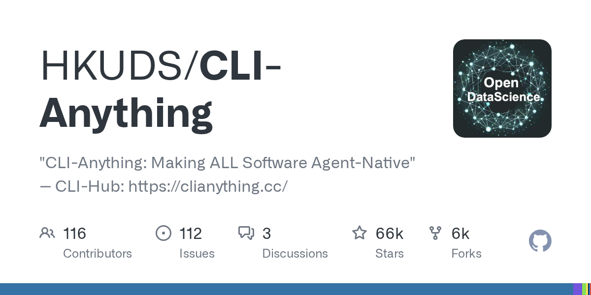
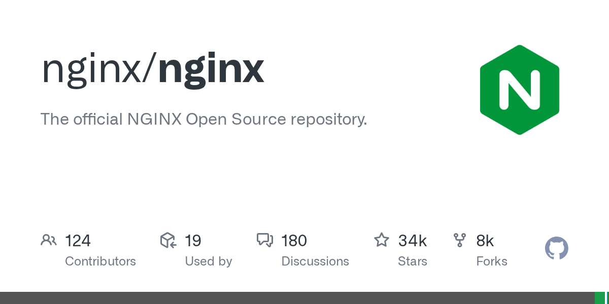
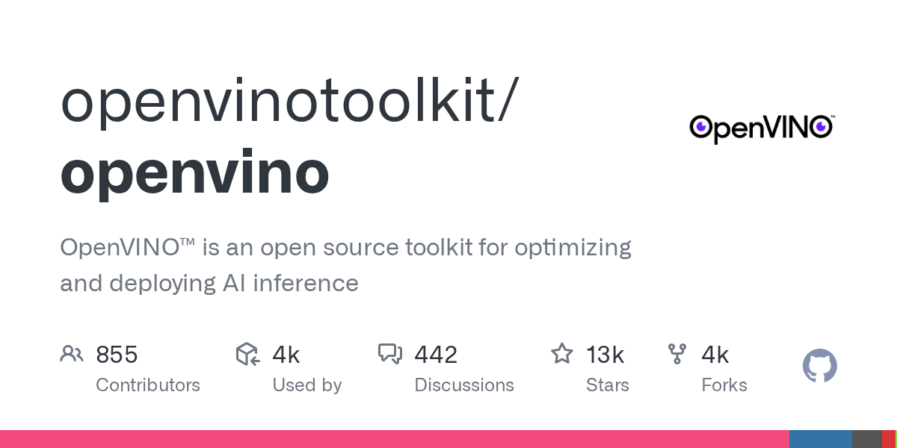
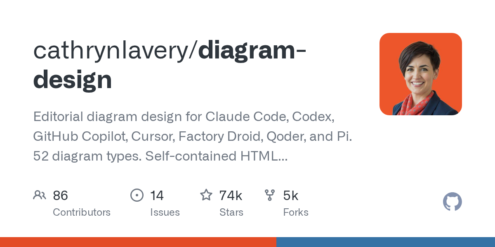
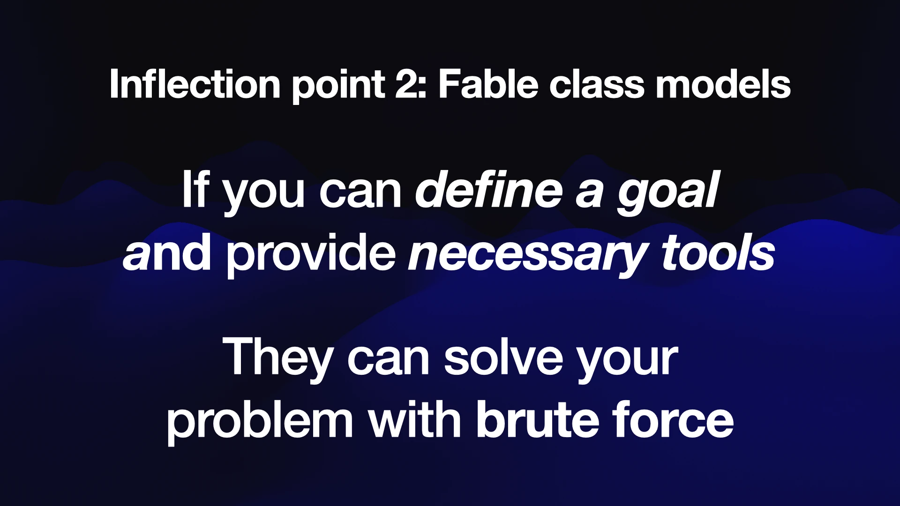

# AI 资讯日报 2026-11-27

> 自动抓取 AI 公司博客、从业者博客与社区聚合源，并生成中文摘要。

## 今日摘要

```
- GPT-6 models demonstrate intrinsic protein-design capabilities
- Searching for distant planets with Astra
- From spectrum to structure: Identifying molecules with Mass Spec Skills for Google Antigravity
- Pax by Pydantic - 一款编程工具，其中就连编码本身也只是一个插件
- Bifura - 像人工智能代理一样查看您的网站
```

## 公司动态

1. **[GPT-6 models demonstrate intrinsic protein-design capabilities](https://openai.com/index/gpt-6-models-demonstrate-intrinsic-protein-design-capabilities)**

   GPT-6 models design protein structures and sequences using reasoning and code. Lab tests found evidence of binding across five targets.

   来源：OpenAI Blog

2. **[Searching for distant planets with Astra](https://openai.com/index/searching-for-distant-planets-with-astra)**

   See how two amateur astronomers used Codex and Astra to find potential exoplanets in public data from NASA’s Kepler and TESS space telescopes.

   来源：OpenAI Blog

3. **[From spectrum to structure: Identifying molecules with Mass Spec Skills for Google Antigravity](https://deepmind.google/blog/interpreting-mass-spectra-with-google-antigravity/)**

   Mass Spec Skills empowers scientists using Google Antigravity to interpret tandem mass spectra.

   

   来源：DeepMind Blog

## 每日产品

1. **[Pax by Pydantic - 一款编程工具，其中就连编码本身也只是一个插件](https://www.producthunt.com/r/NMB6ADZU5ATEMZ)**

   A coding agent where even coding is a plugin (www.producthunt.com) 11-26 ↑ 116 PH Upvotes

   

   来源：Product Hunt Daily

2. **[Bifura - 像人工智能代理一样查看您的网站](https://www.producthunt.com/r/LEZHQJUHVZTF4Q)**

   See your website the way AI agents do (www.producthunt.com) 11-26 ↑ 113 PH Upvotes

   

   来源：Product Hunt Daily

3. **[ExtraOrbital -  为代理开放数据库、存储桶和 AI 密钥](https://www.producthunt.com/r/JCNISXP62SHDGW)**

   Open bar databases, storage buckets & AI keys for agents (www.producthunt.com) 11-26 ↑ 117 PH Upvotes

   

   来源：Product Hunt Daily

4. **[QA.tech MCP - 请让质量保证人员审核您在 IDE 中进行的每一处更改](https://www.producthunt.com/r/AAE5I2SEYZUMZR)**

   Verify every change from your IDE with QA agents (www.producthunt.com) 11-26 ↑ 111 PH Upvotes

   

   来源：Product Hunt Daily

5. **[Hub - 运行100次“克劳德代码”或“克劳德典籍”会话，例如5次](https://www.producthunt.com/r/SKCIVKZDKR5QGT)**

   Run 100 Claude Code or Codex sessions like 5 (www.producthunt.com) 11-26 PH Link

   

   来源：Product Hunt Daily

6. **[Hai - 真正能帮你拨打电话的AI助手](https://www.producthunt.com/r/UXWKKW5IL44KD4)**

   Your AI assistant that actually makes the phone call (www.producthunt.com) 11-25 ↑ 106 PH Upvotes

   

   来源：Product Hunt Daily

7. **[Koed - 超能特工！](https://www.producthunt.com/r/RNK2UCV5BQK2TR)**

   Supercharged Agents! (www.producthunt.com) 11-25 ↑ 110 PH Upvotes

   

   来源：Product Hunt Daily

8. **[Fompi - 一款能及时提醒风险的个人安全与隐私助手](https://www.producthunt.com/r/FAN6OQRRZPVGJU)**

   Personal security & privacy companion that calls out risks (www.producthunt.com) 11-25 ↑ 120 PH Upvotes

   

   来源：Product Hunt Daily

9. **[Willow iOS 2.0 - 口述时请勿切换应用](https://www.producthunt.com/r/UHHAWC5QYMRBGR)**

   *{padding:0;margin:0;overflow:hidden}html,body{height:100%}img,span{position:absolute;width:100%;top:0;bottom:0;margin:auto}span{height:1.5em;text-align:center;font:48px/1.5 sans-serif;color:white;text-shadow:0 0 0.5em black}▶" frameborder="0" allow="accelerometer; autoplay; encrypted-media; gyroscope; picture-in-picture" allowfullscreen > No switching apps while you dictate (www.producthunt.com) 11-24 ↑ 103 PH Upvotes

   来源：Product Hunt Daily

10. **[Hiring Right Now - 哪些初创公司会录用你？](https://www.producthunt.com/r/PX2A4HLUDBWHZK)**

   Which startups would hire you? (www.producthunt.com) 11-25 ↑ 126 PH Upvotes

   

   来源：Product Hunt Daily

## GitHub 项目

1. **[elementalsouls/Claude-BugHunter](https://github.com/elementalsouls/Claude-BugHunter)**

   A Claude Code skill bundle for bug hunting and external red-team work - 85 skills, 16 slash commands, 681 disclosed-report patterns curated across 24 core vulnerability classes, plus enterprise identity + infrastructure attack matrices. Language: Python Stars: 24854 Forks: 2521

   

   来源：GitHub Trending Daily

2. **[obra/superpowers](https://github.com/obra/superpowers)**

   An agentic skills framework & software development methodology that works. Language: Shell Stars: 327620 Forks: 29064

   

   来源：GitHub Trending Daily

3. **[HKUDS/CLI-Anything](https://github.com/HKUDS/CLI-Anything)**

   "CLI-Anything: Making ALL Software Agent-Native" -- CLI-Hub: https://clianything.cc/ Language: Python Stars: 66495 Forks: 6054

   

   来源：GitHub Trending Daily

4. **[jingyaogong/minimind](https://github.com/jingyaogong/minimind)**

   🧠 两小时从 0 训出你的 64M 大模型。Train your own 64M LLM from scratch in 2 hours. Language: Python Stars: 71797 Forks: 9316

   

   来源：GitHub Trending Daily

5. **[cursor/plugins](https://github.com/cursor/plugins)**

   Cursor plugin specification and official plugins Language: TypeScript Stars: 19828 Forks: 2145

   

   来源：GitHub Trending Daily

6. **[firecrawl/firecrawl](https://github.com/firecrawl/firecrawl)**

   Knowledge infrastructure to make your agents smarter. Search, scrape and access 550+ data providers through one API. Language: TypeScript Stars: 211091 Forks: 11055

   

   来源：GitHub Trending Daily

7. **[nginx/nginx](https://github.com/nginx/nginx)**

   The official NGINX Open Source repository. Language: C Stars: 33547 Forks: 8423

   

   来源：GitHub Trending Daily

8. **[openvinotoolkit/openvino](https://github.com/openvinotoolkit/openvino)**

   OpenVINO™ is an open source toolkit for optimizing and deploying AI inference Language: C++ Stars: 12844 Forks: 3739

   

   来源：GitHub Trending Daily

9. **[cathrynlavery/diagram-design](https://github.com/cathrynlavery/diagram-design)**

   Editorial diagram design for Claude Code, Codex, GitHub Copilot, Cursor, Factory Droid, Qoder, and Pi. 52 diagram types. Self-contained HTML + SVG. No shadows. No Mermaid slop. Language: HTML Stars: 73988 Forks: 4940

   

   来源：GitHub Trending Daily

10. **[mvanhorn/last30days-skill](https://github.com/mvanhorn/last30days-skill)**

   AI agent skill that researches any topic across Reddit, X, YouTube, HN, Polymarket, and the web - then synthesizes a grounded summary Language: Python Stars: 75887 Forks: 6687

   

   来源：GitHub Trending Daily

## 从业者观点

1. **[Quoting Jack Despain Zhou](https://simonwillison.net/2026/Nov/26/jack-despain-zhou/)**

   Among the many already existing effects of AI has been a great de-individualization. I open a YouTube video, and I hear Claude. I sit in a conference presentation, and I hear Claude. I open my email inbox, and I find pitches and articles from ostensibly serious people with ostensibly serious credentials attached to ostensibly serious institutions who want to publish things attached to their reputations and mine, and I see Claude . &mdash; Jack Despain Zhou , Spitting in the Face of Glaude Tags: ai-misuse , claude , generative-ai , ai , llms

   来源：Simon Willison

2. **[sqlite3_rsync: Database Remote-Copy Tool For SQLite](https://simonwillison.net/2026/Nov/26/sqlite3-rsync/)**

   sqlite3_rsync: Database Remote-Copy Tool For SQLite This additional SQLite tool has been around for a while now - it was added as "experimental" in SQLite 3.47.0 in October 2024 and enhanced in SQLite 3.50.0 in May 2025 . It was only today that I understood one of its most attractive characteristics. Normally, if you want to grab a snapshot copy of a SQLite database, you need to use either the backup API or VACUUM INTO . In both cases you need enough disk space to create a duplicate copy of your database, so if you're on a small instance and you already use more than half of the available disk you are plain out of luck. sqlite3_rsync can copy a snapshot of your database over an SSH connection to another machine, without first needing to create a full local copy! It's also good for synchronizing an existing copy of a database without re-transmitting the entire thing over the network. It works in a similar way to regular rsync: The core idea behind the protocol is that the replica sends cryptographic hashes for pages or groups of pages over to the origin side. The origin sends back page content that differs, or requests finer-grain hashes if a multi-page hash does not match. If the origin and replica start out being vastly different, the total network bandwidth can exceed the size of the entire database, due to the overhead of exchanging hashes, but the excess bandwidth is not great - a few percent at most. Update : Hah! Turns out I wrote about this application of sqlite_rsync back in October 2024 when the tool was first released. Tags: backups , sqlite

   来源：Simon Willison

3. **[The New York Times warns photographers not to update Photoshop over AI features](https://simonwillison.net/2026/Nov/26/hn-50651685/)**

   My comment on The New York Times warns photographers not to update Photoshop over AI features &mdash; Hacker News. I had a NYT photographer take my picture at my home earlier this year (for a story about Moltbook, oddly enough). At one point I asked if they could fix things up if I had a stain on my shirt and they said absolutely not - they present photographs as they were taken, with cropping and balancing applied but no edits beyond that. He did spend a bunch of time trying to find the best possible natural lighting for the shots he wanted. The photo at the top of https://www.nytimes.com/2026/02/02/technology/moltbook-ai-so... is my laptop, taken in my garden, after hunting around for the best spot that didn't have too much glare on the screen. You can see how dirty my screen is, too! Photography for a newspaper is photo journalism, and they take it seriously. (Thankfully I did not have a visible stain on my shirt.) Tags: photography , new-york-times , hacker-news , journalism

   来源：Simon Willison

4. **[Quoting Scott Aaronson](https://simonwillison.net/2026/Nov/25/scott-aaronson/)**

   It’s now obvious that we’ll be getting, not one-off solutions to this or that complexity question, but a whole new continent of mathematical truth, one that we’d previously only glimpsed through fog. Picture van Leeuwenhoek first training a microscope on pondwater, or Galileo first training his telescope on the stars. That might give you some idea of how our resolution into the complexity-theoretic universe, and the whole universe of mathematical truth beyond it, has now improved. &mdash; Scott Aaronson Tags: mathematics , llms , ai , generative-ai

   来源：Simon Willison

5. **[datasette-charts 0.3a0](https://simonwillison.net/2026/Nov/25/datasette-charts/)**

   Release: datasette-charts 0.3a0 I added chart annotations to datasette-charts ! You can now render a chart and then annotate it with lines, shaded areas, labels, or a combination of the three. A chart with annotations looks like this: [图片: https://static.simonwillison.net/static/2026/chart-with-annotations.webp] Here's that same chart in Datasette Lite , where you can tweak the annotations using the chart builder UI: [图片: https://static.simonwillison.net/static/2026/chart-annotate.gif] If you also install Datasette Agent the agent can build annotated charts for you. Here's what I got on the agent.datasette.io demo for this prompt: Show a chart comparing Simon's tagged content about LLMs with his tagged content about Datasette, with annotations [图片: https://static.simonwillison.net/static/2026/annotations-agent.webp] Tags: datasette , visualization , datasette-charts

   

   来源：Simon Willison

6. **[Three LLM inflection points in twelve months](https://simonwillison.net/2026/Nov/24/llm-inflection-points/)**

   I gave a keynote at the AI Engineer Code Summit a couple of weeks ago, constructed around the idea that there have been three significant inflection points in the abilities of LLMs and coding agents in the past twelve months. Here's the video of the talk. In this post I'm going to pull out the major inflection point theme and interrogate it more deeply. Coding agents in November 2025 Today, November 24th 2026, is the one year anniversary of the release of Claude Opus 4.5 . With hindsight, this was a consequential model. In the Opus 4.5 announcement, Anthropic said: Testers noted that Claude Opus 4.5 handles ambiguity and reasons about tradeoffs without hand-holding. They told us that, when pointed at a complex, multi-system bug, Opus 4.5 figures out the fix. They said that tasks that were near-impossible for Sonnet 4.5 just a few weeks ago are now within reach. This held up. Claude Code was 9 months old at that point, having been introduced alongside Claude 3.7 Sonnet on February 24th, 2025. Opus 4.5 was the first model I had used with Claude Code where the default result was generally the right thing. I hadn't been using Claude Code as a daily driver because it didn't feel reliable enough - I had to correct it often enough that it didn't feel like a clear accelerant. The new Opus changed that. For most of the coding problems I faced on a daily basis, Opus would get them right . It was clearly faster than working through the problems myself. Also in November, OpenAI released GPT-5.1 Instant, GPT-5.1 Thinking, GPT-5.1-Codex, and GPT-5.1-Codex-Max. These had a similar effect on their Codex coding agent: it became reliably useful for many of my coding tasks. The timing was convenient, because the December holidays were upon us. A lot of people, myself included, spent December tinkering with these new tools to see what they could do. By January we were ready to use them for our actual work. Fable class models in June/July We got our first hint of Claude Fable in April, when Anthropic announced Claude Mythos and said that it was too dangerous to release , due to its improved cybersecurity capabilities. Mythos was a model that could not just find security vulnerabilities, it could also figure out how to exploit them. In June we got to see how good that model was for ourselves, with the release of Claude Fable 5 - a defanged Mythos, that would solve most problems but would actively block you from using it for security work. After three glorious days... the US government took it away from us. Fable 5 was placed under export controls that effectively banned the model. We wouldn't get it back until July 1st. For me, Fable was an inflection point because it introduced us to what I now think of as Fable class models . My definition of these: [图片: Inflection point 2: Fable class models If you can define a goal and provide necessary tools They can solve your problem with brute force https://static.simonwillison.net/static/2026/fable-class.webp] In June I wrote about how Claude Fable is relentlessly proactive , after I asked it to help fix a display glitch in Safari and it spun up its own pyobjc-framework-Quartz screenshot mechanism and a CORS-enabled localhost logging server to help resolve the bug. A more recent example of the power of Fable class models is my mysterious beep finder from a couple of weeks ago. I gave Opus 5.5 and then Fable 5.2 access to five WebAudio microphones in a room full of boxes and it was able to triangulate the source of an infuriating mysterious beep to within about 40cm. Give it a goal, give it the right tools, and watch it cook. I'd currently class Claude Fable 5, 5.1, 5.2 and Claude Opus 5.5 as Fable class (I think of Opus 5.5 as "cheap Fable"). GPT-6 Astra got there for me too, and I think the new Gemini 4 Neon may count as well. These now represent the baseline for what I expect from a frontier model. 3D modeling and game development in September/October Something interesting happened with frontier LLMs over just the past four months: they got really good at 3D modeling. Set them up with Blender or ask them to write Three.js code and they'll produce credible models of almost anything you ask for. I first noticed this with Claude Fable 5, but it really kicked into gear with Opus 5.5, GPT-5.6 Sol, GPT-6 Astra, and most recently the Gemini 4 family. Here's Gemini 4 Neon's attempt at "Make a three js animation where yonkers stands up as a big mech (cool stand up motion) and stomps around manhattan and queens and Brooklyn, use openstreetmap mapping data", for example. 3D spatial awareness is crucial if you want to use vision LLMs for robotics. I don't know if 3D modeling capabilities are a side-effect of the labs focusing on that or vice-versa. Back in August I experimented with having Fable 5 build me a raccoon heist game . It had 3D graphics, looked like a game, and played really poorly. GPT-5.6 Sol Ultra did a much better job but the game itself was still pretty dull after the first 90 seconds of play. I was somewhat relieved that designing a game that was fun appeared to remain a uniquely human pursuit. I even used that in a talk in September to reassure people that us humans still had a role to play! Then, I tried telling Claude Opus 5.5 "This game isn't fun enough yet. Make it a LOT more fun." And it worked . My Command &amp; Conquer-style RTS went from boring to deeply entertaining overnight, after Opus spent 12 hours playtesting new features and rebalancing the gameplay. Opus 5.5 was the first model I'd used that appeared to understand fun. I've since worked on several little game projects where prompts like "Think hard about how to make sure it is both fun and beautiful" produced results that kept me engaged for significant amounts of time. Opus 5.5 came out on September 22nd, 2026. I've been to two different conferences since then where people showed me game projects they'd been working on that really did feel like proper, worthwhile games. The indie games scene has descended into a full-blown culture war over AI-assisted programming. A lot of people are calling GTA VI the last pre-generative AI blockbuster . It feels like another inflection point to me. Is Fable 5.2 an inflection point too? I'm still trying to decide if Fable 5.2 represents a new inflection point, or just another incremental improvement. I'm getting so much done with that model right now! It seems to have taste that almost exactly matches my own. I have been burning through all sorts of gnarly problems that I've been thinking about (or procrastinating on) for several years now. The release notes for Datasette 1.0a42 , 1.0a43 , and 1.0a44 - plus LLM 0.37 , 0.37.1 , 0.37.2 , 0.37.3 , and 0.38 - all in the last three weeks , represent a flood of fixes, features and improvements. If this does represent an inflection point, the key feature seems to be that if you can imagine and then clearly describe a piece of software, Fable can build it . That's a wild thing to say, but it matches my experience over the past few weeks. Software development has transformed beyond recognition in the last year. I don't think I'll ever go back to typing most of my code by hand. Tags: game-design , my-talks , ai , generative-ai , llms , annotated-talks , coding-agents , claude-code , codex , claude-mythos-fable

   

   来源：Simon Willison

7. **[Responding to objections to recursive self-improvement](https://www.dwarkesh.com/p/rsiobjections)**

   What the skeptics get right about superintelligence

   来源：Dwarkesh Patel

## 社区热点

1. **[AI agents now control part of DeepMind's compute for Gemini experiments](https://the-decoder.com/ai-agents-now-control-part-of-deepminds-compute-for-gemini-experiments-but-recursive-self-improvement-remains-distant/)**

   Article URL: https://the-decoder.com/ai-agents-now-control-part-of-deepminds-compute-for-gemini-experiments-but-recursive-self-improvement-remains-distant/ Comments URL: https://news.ycombinator.com/item?id=50661218 Points: 43 # Comments: 21

   来源：Hacker News AI

2. **[AI made self-hosting fun again](https://janlukas.blog/posts/ai-self-hosting)**

   Article URL: https://janlukas.blog/posts/ai-self-hosting Comments URL: https://news.ycombinator.com/item?id=50660180 Points: 437 # Comments: 235

   来源：Hacker News AI

3. **[Top-cited AI scientists at four US companies compared](https://topcitedscientists.com/figures/ai-at-four-us-companies/)**

   Article URL: https://topcitedscientists.com/figures/ai-at-four-us-companies/ Comments URL: https://news.ycombinator.com/item?id=50658910 Points: 39 # Comments: 22

   来源：Hacker News AI

4. **['AI' might be the end of our careers](https://www.baldurbjarnason.com/2026/08-ai-might-be-the-end-of-our-careers/)**

   Article URL: https://www.baldurbjarnason.com/2026/08-ai-might-be-the-end-of-our-careers/ Comments URL: https://news.ycombinator.com/item?id=50657452 Points: 34 # Comments: 39

   来源：Hacker News AI

5. **[Tracking Diseases Cured by AI](https://diseasescuredbyai.com/)**

   Article URL: https://diseasescuredbyai.com/ Comments URL: https://news.ycombinator.com/item?id=50657307 Points: 306 # Comments: 184

   来源：Hacker News AI

6. **[Testers think they're hitting Claude Opus 5.6 through an Opus 5.5 Extra route](https://www.testingcatalog.com/testers-share-early-results-possible-claude-opus-5-6/)**

   Article URL: https://www.testingcatalog.com/testers-share-early-results-possible-claude-opus-5-6/ Comments URL: https://news.ycombinator.com/item?id=50655798 Points: 37 # Comments: 10

   来源：Hacker News AI

7. **[Google Will Make AI Agents Use Its MCP Servers. The Gmail One Can't Send Email](https://techstackups.com/articles/google-workspace-ai-agents-mcp/)**

   Article URL: https://techstackups.com/articles/google-workspace-ai-agents-mcp/ Comments URL: https://news.ycombinator.com/item?id=50653477 Points: 284 # Comments: 238

   来源：Hacker News AI

8. **[Claude tries to sabotage research work at every stage](https://twitter.com/skirano/status/2125371115979641188)**

   Article URL: https://twitter.com/skirano/status/2125371115979641188 Comments URL: https://news.ycombinator.com/item?id=50651552 Points: 53 # Comments: 15

   来源：Hacker News AI

9. **[OpenAI cuts GPT-6.2 usage: Astra hits limits 40% faster, Sol 25% faster](https://twitter.com/thsottiaux/status/2125784147889393806)**

   Article URL: https://twitter.com/thsottiaux/status/2125784147889393806 Comments URL: https://news.ycombinator.com/item?id=50651117 Points: 473 # Comments: 263

   来源：Hacker News AI

10. **[The New York Times warns photographers not to update Photoshop over AI features](https://www.theverge.com/ai-artificial-intelligence/1041227/the-new-york-times-warns-photographers-not-to-update-photoshop-over-ai-features)**

   https://archive.ph/pcUgy Comments URL: https://news.ycombinator.com/item?id=50647673 Points: 660 # Comments: 525

   来源：Hacker News AI

11. **[The need for a formally verifiable mainstream programming language](https://blainehansen.me/post/mainstream-verifiable-language/)**

   Comments

   来源：Lobsters AI

12. **[Matrix Multiplication is Θ(n^2.25)](https://raw.githubusercontent.com/openai/math/main/preprints/The-matrix-multiplication-exponent-is-nine-fourths-November-24-2026/paper.pdf)**

   Comments

   来源：Lobsters AI

13. **[9/UX: a Macintosh-inspired desktop for 9front](https://progrium.github.io/9ux/)**

   I have written a story about this on the Register, but of course I can't post that here. I think this is a quite astonishing effort and could make 9front considerably more usable... but it's bot-assisted, so I don't think they'll take it. Comments

   来源：Lobsters AI

## 论文与模型

1. **[Stable Gated DeltaNet-2: Understanding and Mitigating Recurrent State Instability](https://arxiv.org/abs/2611.34051)**

   Linear attention offers an efficient solution for long-sequence modeling via linear complexity and fixed-size recurrent states. Gated DeltaNet-2 (GDN-2) introduces independent channel-wise control over erasure and writing, enhancing state-update expressiveness and in-context retrieval, yet it suffers from training failures during long-context training. We trace these failures to the asymmetry between reading and modification directions during erasure, which yields non-normal erase operators whose directional gains accumulate across tokens, triggering exponential state growth even without new writes. To resolve this, we propose , employing symmetric erasure to ensure non-expansive state propagation and decay-regulated residual writing to preserve writing flexibility. Theoretically, we establish an O(T) upper bound on recurrent state growth while retaining chunkwise parallel computation. Experiments on ~1.6B parameter models show that achieves stable training alongside improved long-context retrieval. Compared to GDN-2, it boosts the 128K average RULER score by 6.80 points in the recurrent setting and average accuracy across nine downstream tasks by 0.62 points in the hybrid setting.

   来源：HuggingFace Papers

2. **[OS-Omni: Benchmarking Generalist Computer-Using Agents on Long-Horizon Workflows Across Platforms](https://arxiv.org/abs/2611.34232)**

   Computer-using agents are increasingly expected to complete realistic user goals rather than isolated GUI actions. However, existing benchmarks typically isolate web, mobile, or desktop environments, leaving it unclear whether a single generalist agent can execute long-horizon workflows that span multiple operating systems and persistent application states. We introduce OS-Omni, a live cross-platform benchmark and execution environment for evaluating computer-using agents across Windows, Ubuntu, macOS, iOS, Android, and Web environments. OS-Omni is released in versioned waves of 300 tasks each; this paper focuses on the first release, v1, which contains 48 tasks per platform and 12 cross-platform workflows that pair a desktop with an Android phone. OS-Omni provides reproducible initialization, platform-specific adapters, trajectory logging, and executable final-state evaluators, and includes controlled service-backed applications for workflows involving account, cart, budget, calendar, message, and other persistent state. Human studies show that OS-Omni tasks require 67.54 interaction steps, substantially exceeding OSWorld references of 15.0 steps. On v1, the strongest evaluated agent, Claude Opus 5.5, reaches 68.5% average success, trailing the 77.3% human reference by 8.8 points; the gap is uneven across platforms, with frontier models exceeding humans on Linux but trailing them by more than 25 points on iOS and macOS. These results indicate that current agents remain far from platform-robust, long-horizon computer use, especially when success requires sustained state tracking and durable final-state changes.

   来源：HuggingFace Papers

3. **[ProxyGenBench: Benchmarking Proxy-Guided Video Generation](https://arxiv.org/abs/2611.34457)**

   Recent video generators produce realistic videos, yet controlling how scenes unfold remains challenging. Structural proxies, such as animated 3D blockouts, guide generation by specifying scene layout, motion, camera behavior, and event order. However, these coarse inputs leave details unspecified and may contain artifacts that should not be reproduced. Successful proxy-guided generation must therefore Preserve intended structure, Complete missing content and correct proxy artifacts, and Bind text, image, and audio conditions to the right entities and events. We introduce ProxyGenBench to study these interacting requirements, with 312 evaluation cases from 60 scenes across three scene tasks and controlled variations in proxy fidelity, text detail, and multimodal inputs. We evaluate five video generators using verified, case-specific checklists. Experiments show that proxies improve spatiotemporal control, but greater proxy detail can coincide with poorer completion, while strong structural adherence does not ensure correct binding.

   来源：HuggingFace Papers

4. **[StateWeaver: Multi-Agent Coordination of Story-State Transitions for Long-Horizon Video Generation](https://arxiv.org/abs/2611.34290)**

   Modern video foundation models generate high-quality short clips, but preserving long-video consistency and correctly depicting event-driven state changes remain challenging. Existing agentic workflows face these challenges because continual planning and repair accumulate context, while reference updates remain limited. We introduce StateWeaver, which combines Active States and Hierarchical Collaboration to connect review-driven visual reference updates with cross-shot state inheritance. Active States translate state discrepancies identified during review into concrete visual asset requirements that guide reference construction, validation, and regeneration, preserving identity and already-correct content while repairing target attributes. Confirmed generation results are linked to the corresponding asset states, story time, and reference versions for verification and reuse by subsequent shots. Hierarchical Collaboration isolates execution contexts by task, clip, and repair round, and uses hierarchical memory to organize this process across multiple sets. Across multiple benchmarks, StateWeaver outperforms existing methods and produces long videos with sustained cross-shot consistency under predefined and autonomously planned storyboards.

   来源：HuggingFace Papers

5. **[ShowNow: Fine-Grained Speculative Streaming for Responsive World Models](https://arxiv.org/abs/2611.34693)**

   Interactive world models must generate video continuously while responding promptly to user actions. Real-time throughput alone leaves input latency unresolved: coarse generation blocks delay action updates, and generation after input adds work to the response path. We introduce ShowNow, a fine-grained speculative streaming framework that uses computation available during playback to prepare action-conditioned futures before input arrives. Single-latent commitment enables frequent decisions, while configurable preparation covers one to eight actions. We construct a matched multi-future dataset to train alternative continuations from a common state; shared-history tree execution and fused commitment make their preparation efficient. On a single H100, our 5B model sustains 480p generation at 16 fps with eight prepared futures. In ViZDoom, the complete ShowNow deployment reduces median input-to-display latency from 620 to 208 ms relative to the native-block SolarWM-FT deployment. Matched-policy experiments reduce restart empty ticks from 1.56% to 0.09% (94%) and improve on-time responses to action changes. These results establish complementary roles for fine-grained commitment and advance preparation, with measured trade-offs in visual fidelity and long-horizon consistency. ShowNow turns playback-time computation into responsive visual interaction. Project: https://github.com/showlab/ShowNow.

   来源：HuggingFace Papers

6. **[DRBench Pro: A Knowledge-Centric Benchmark for Professional Deep Research Agents](https://arxiv.org/abs/2611.34852)**

   Deep research agents gather information from multiple sources and synthesize it into reports on complex, open-ended questions. Existing benchmarks assess report quality along several dimensions, but lack a dedicated knowledge-centric evaluation of which research directions a report covers and how deeply it explores them. We introduce DRBench Pro, a benchmark that makes structured knowledge coverage the primary evaluation target. Our automated pipeline builds local knowledge trees from Wikipedia and uses sampled subgraphs to generate research queries and evidence-grounded rubrics. Each rubric corresponds to a relation in the tree, preserving the structure of the knowledge being evaluated. Agents receive only the research query. This structure allows us to measure breadth across major research directions and depth along related knowledge chains, with their geometric mean giving overall coverage. The benchmark includes 144 cases across 24 domains and 44,102 rubrics. Evaluating 16 deep research agents reveals different strengths in breadth and depth, with the best-performing agent reaching 57.04% overall coverage. Rubric judgments agree closely with human annotations, and agent rankings remain stable across the tested metric configurations.

   来源：HuggingFace Papers

7. **[Solve Vision with Code: Coding Agents Are Stronger Visual Reasoners Than Video Models](https://arxiv.org/abs/2611.34813)**

   Video generation models are increasingly evaluated as visual reasoners: given a first frame and a natural-language prompt, can the model produce the video in which the specified task is carried out? The paradigm is considered advantageous because the reasoning is native to the visual medium, unfolding directly in the frames rather than through language or code. Whether this native route is in fact the more reliable path to visual reasoning has not been tested against a symbolic alternative under the same conditions. We therefore pose the same tasks, with identical inputs, output specification and evaluator, to both media: rather than denoising pixels, a coding agent writes a program that renders the answer video, which an unmodified rule-based evaluator scores. On VBVR-Pro-Bench (Xu et al., 2026), a 500-instance suite spanning five cognitive categories with symbolic ground truth, the agent receives the same first frame and prompt as the video model, with no access to ground truth, metadata or generation models, and one attempt per instance. Three closed-model agents (Codex with gpt-6-astra, Claude Code with Fable 5.1 and Gemini CLI with Gemini 3.1 Pro) score 0.923, 0.894 and 0.893, each more than 0.22 above the strongest video model. Among 23 runnable open-weight models, the best, GLM-5, reaches 0.572, above all video models except the RL-trained one. Together, we show that for tasks whose solutions can be computed from a first frame and a prompt, program synthesis is currently a substantially more reliable route to visual reasoning than video generation. We further distinguish depictive programs, which navigate the image to recover a transferable scheme, from propositional programs, which operate on hard-coded values, revealing how visual reasoning unfolds in agent-written programs and what it implies for its nature of reasoning in general.

   来源：HuggingFace Papers

8. **[Reading, Not Adapting: Unlocking Frozen Visual Knowledge for AI-Generated Image Detection](https://arxiv.org/abs/2611.34719)**

   Generalization to unseen image generators has driven efforts to adapt pretrained visual representations for detection. Yet recent findings show that vision foundation models already encode transferable detection knowledge, while further adaptation can impair generalization. This motivates a shift from backbone adaptation to knowledge readout. Conventional linear probing offers a direct way to read this knowledge but is limited to final-layer RGB features. Multi-cue detectors broaden the evidence base, but their designs introduce other tradeoffs: adaptation may compromise pretrained transferability, heterogeneous encoders complicate feature integration, and late fusion precludes intermediate cross-view interaction. To overcome these limitations, we propose ReMoT, a Mixture-of-Transformers-inspired framework that reads complementary knowledge from spatially aligned RGB and wavelet views within a fully frozen visual foundation. ReMoT employs staged joint attention to enable controlled local and global cross-view interaction, while learnable fusion queries progressively read complementary evidence across Transformer depth without writeback. ReMoT achieves 91.2% average accuracy across eight benchmark groups with 3,074 trainable parameters, attaining the highest overall average among the evaluated methods. These results support structured knowledge readout as a promising alternative to backbone adaptation. Code is available at https://github.com/yunncheng/ReMoT.

   来源：HuggingFace Papers
