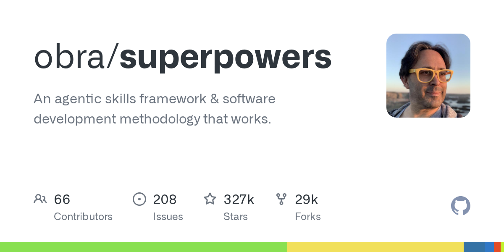
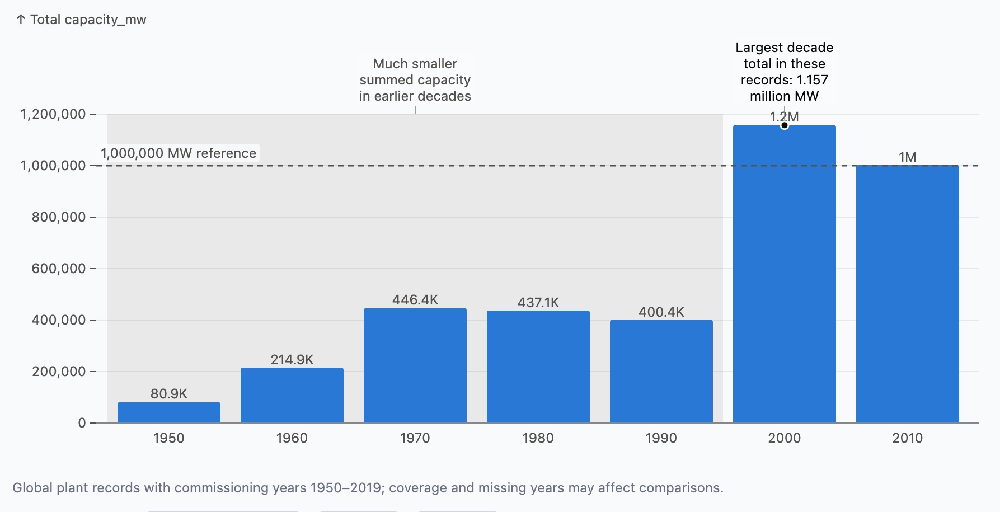

# AI 资讯日报 2026-11-27

> 自动抓取 AI 公司博客、从业者博客与社区聚合源，并生成中文摘要。

## 今日摘要

```
- GPT-6 models demonstrate intrinsic protein-design capabilities
- Searching for distant planets with Astra
- How Intentful uses dots to make more time for growth
- How iFood scales coding agents across 15,000 repositories
- Clay helps sales teams win with Codex and ChatGPT
```

## 公司动态

1. **[GPT-6 models demonstrate intrinsic protein-design capabilities](https://openai.com/index/gpt-6-models-demonstrate-intrinsic-protein-design-capabilities)**

   GPT-6 models design protein structures and sequences using reasoning and code. Lab tests found evidence of binding across five targets.

   来源：OpenAI Blog

2. **[Searching for distant planets with Astra](https://openai.com/index/searching-for-distant-planets-with-astra)**

   See how two amateur astronomers used Codex and Astra to find potential exoplanets in public data from NASA’s Kepler and TESS space telescopes.

   来源：OpenAI Blog

3. **[How Intentful uses dots to make more time for growth](https://openai.com/business/customer-stories/intentful-dots)**

   Marina Petrova’s dot Aria helps research websites and build proposals, while proactively flagging messages and resolving issues.

   来源：OpenAI Blog

4. **[How iFood scales coding agents across 15,000 repositories](https://openai.com/business/customer-stories/ifood)**

   暂无摘要。

   来源：OpenAI Blog

5. **[Clay helps sales teams win with Codex and ChatGPT](https://openai.com/business/customer-stories/clay-plugins-openai)**

   ChatGPT and Codex integrations help Clay’s users research deals and turn data into go-to-market plays, with GPT-6 models handling the reasoning.

   来源：OpenAI Blog

6. **[OpenAI and Cisco introduce Shirudo](https://openai.com/index/introducing-shirudo)**

   OpenAI and Cisco introduce Shirudo, an open-source runtime for Linux. It helps teams protect running systems while they roll out patches.

   来源：OpenAI Blog

7. **[From spectrum to structure: Identifying molecules with Mass Spec Skills for Google Antigravity](https://deepmind.google/blog/interpreting-mass-spectra-with-google-antigravity/)**

   Mass Spec Skills empowers scientists using Google Antigravity to interpret tandem mass spectra.

   

   来源：DeepMind Blog

## 每日产品

1. **[Bifura - 像人工智能代理一样查看您的网站](https://www.producthunt.com/r/LEZHQJUHVZTF4Q)**

   See your website the way AI agents do (www.producthunt.com) 11-26 ↑ 113 PH Upvotes

   

   来源：Product Hunt Daily

2. **[ExtraOrbital -  为代理开放数据库、存储桶和 AI 密钥](https://www.producthunt.com/r/JCNISXP62SHDGW)**

   Open bar databases, storage buckets & AI keys for agents (www.producthunt.com) 11-26 ↑ 117 PH Upvotes

   

   来源：Product Hunt Daily

3. **[QA.tech MCP - 请让质量保证人员审核您在 IDE 中进行的每一处更改](https://www.producthunt.com/r/AAE5I2SEYZUMZR)**

   Verify every change from your IDE with QA agents (www.producthunt.com) 11-26 ↑ 111 PH Upvotes

   

   来源：Product Hunt Daily

4. **[Hub - 运行100次“克劳德代码”或“克劳德典籍”会话，例如5次](https://www.producthunt.com/r/SKCIVKZDKR5QGT)**

   Run 100 Claude Code or Codex sessions like 5 (www.producthunt.com) 11-26 PH Link

   

   来源：Product Hunt Daily

5. **[Hai - 真正能帮你拨打电话的AI助手](https://www.producthunt.com/r/UXWKKW5IL44KD4)**

   Your AI assistant that actually makes the phone call (www.producthunt.com) 11-25 ↑ 106 PH Upvotes

   

   来源：Product Hunt Daily

6. **[Koed - 超能特工！](https://www.producthunt.com/r/RNK2UCV5BQK2TR)**

   Supercharged Agents! (www.producthunt.com) 11-25 ↑ 110 PH Upvotes

   

   来源：Product Hunt Daily

7. **[Fompi - 一款能及时提醒风险的个人安全与隐私助手](https://www.producthunt.com/r/FAN6OQRRZPVGJU)**

   Personal security & privacy companion that calls out risks (www.producthunt.com) 11-25 ↑ 120 PH Upvotes

   

   来源：Product Hunt Daily

8. **[Willow iOS 2.0 - 口述时请勿切换应用](https://www.producthunt.com/r/UHHAWC5QYMRBGR)**

   *{padding:0;margin:0;overflow:hidden}html,body{height:100%}img,span{position:absolute;width:100%;top:0;bottom:0;margin:auto}span{height:1.5em;text-align:center;font:48px/1.5 sans-serif;color:white;text-shadow:0 0 0.5em black}▶" frameborder="0" allow="accelerometer; autoplay; encrypted-media; gyroscope; picture-in-picture" allowfullscreen > No switching apps while you dictate (www.producthunt.com) 11-24 ↑ 103 PH Upvotes

   来源：Product Hunt Daily

9. **[Hiring Right Now - 哪些初创公司会录用你？](https://www.producthunt.com/r/PX2A4HLUDBWHZK)**

   Which startups would hire you? (www.producthunt.com) 11-25 ↑ 126 PH Upvotes

   

   来源：Product Hunt Daily

10. **[Canva MCP - 将任何AI代理转变为创意引擎](https://www.producthunt.com/r/R2X5P4ZWZ37ZCY)**

   Turn any AI agent into a creative powerhouse (www.producthunt.com) 11-25 ↑ 121 PH Upvotes

   

   来源：Product Hunt Daily

## GitHub 项目

1. **[elementalsouls/Claude-BugHunter](https://github.com/elementalsouls/Claude-BugHunter)**

   A Claude Code skill bundle for bug hunting and external red-team work - 85 skills, 16 slash commands, 681 disclosed-report patterns curated across 24 core vulnerability classes, plus enterprise identity + infrastructure attack matrices. Language: Python Stars: 24303 Forks: 2472

   

   来源：GitHub Trending Daily

2. **[obra/superpowers](https://github.com/obra/superpowers)**

   An agentic skills framework & software development methodology that works. Language: Shell Stars: 327340 Forks: 29028

   

   来源：GitHub Trending Daily

3. **[HKUDS/CLI-Anything](https://github.com/HKUDS/CLI-Anything)**

   "CLI-Anything: Making ALL Software Agent-Native" -- CLI-Hub: https://clianything.cc/ Language: Python Stars: 66241 Forks: 6021

   

   来源：GitHub Trending Daily

4. **[jingyaogong/minimind](https://github.com/jingyaogong/minimind)**

   🧠 两小时从 0 训出你的 64M 大模型。Train your own 64M LLM from scratch in 2 hours. Language: Python Stars: 71563 Forks: 9288

   

   来源：GitHub Trending Daily

5. **[cursor/plugins](https://github.com/cursor/plugins)**

   Cursor plugin specification and official plugins Language: TypeScript Stars: 19750 Forks: 2131

   

   来源：GitHub Trending Daily

6. **[firecrawl/firecrawl](https://github.com/firecrawl/firecrawl)**

   Knowledge infrastructure to make your agents smarter. Search, scrape and access 550+ data providers through one API. Language: TypeScript Stars: 210800 Forks: 11042

   

   来源：GitHub Trending Daily

7. **[nginx/nginx](https://github.com/nginx/nginx)**

   The official NGINX Open Source repository. Language: C Stars: 33501 Forks: 8416

   来源：GitHub Trending Daily

8. **[openvinotoolkit/openvino](https://github.com/openvinotoolkit/openvino)**

   OpenVINO™ is an open source toolkit for optimizing and deploying AI inference Language: C++ Stars: 12789 Forks: 3728

   

   来源：GitHub Trending Daily

9. **[cathrynlavery/diagram-design](https://github.com/cathrynlavery/diagram-design)**

   Editorial diagram design for Claude Code, Codex, GitHub Copilot, Cursor, Factory Droid, Qoder, and Pi. 52 diagram types. Self-contained HTML + SVG. No shadows. No Mermaid slop. Language: HTML Stars: 73740 Forks: 4919

   

   来源：GitHub Trending Daily

10. **[mvanhorn/last30days-skill](https://github.com/mvanhorn/last30days-skill)**

   AI agent skill that researches any topic across Reddit, X, YouTube, HN, Polymarket, and the web - then synthesizes a grounded summary Language: Python Stars: 75641 Forks: 6669

   

   来源：GitHub Trending Daily

## 从业者观点

1. **[Quoting Jack Despain Zhou](https://simonwillison.net/2026/Nov/26/jack-despain-zhou/)**

   Among the many already existing effects of AI has been a great de-individualization. I open a YouTube video, and I hear Claude. I sit in a conference presentation, and I hear Claude. I open my email inbox, and I find pitches and articles from ostensibly serious people with ostensibly serious credentials attached to ostensibly serious institutions who want to publish things attached to their reputations and mine, and I see Claude . &mdash; Jack Despain Zhou , Spitting in the Face of Glaude Tags: ai-misuse , claude , generative-ai , ai , llms

   来源：Simon Willison

2. **[sqlite3_rsync: Database Remote-Copy Tool For SQLite](https://simonwillison.net/2026/Nov/26/sqlite3-rsync/)**

   sqlite3_rsync: Database Remote-Copy Tool For SQLite This additional SQLite tool has been around for a while now - it was added as "experimental" in SQLite 3.47.0 in October 2024 and enhanced in SQLite 3.50.0 in May 2025 . It was only today that I understood one of its most attractive characteristics. Normally, if you want to grab a snapshot copy of a SQLite database, you need to use either the backup API or VACUUM INTO . In both cases you need enough disk space to create a duplicate copy of your database, so if you're on a small instance and you already use more than half of the available disk you are plain out of luck. sqlite3_rsync can copy a snapshot of your database over an SSH connection to another machine, without first needing to create a full local copy! It's also good for synchronizing an existing copy of a database without re-transmitting the entire thing over the network. It works in a similar way to regular rsync: The core idea behind the protocol is that the replica sends cryptographic hashes for pages or groups of pages over to the origin side. The origin sends back page content that differs, or requests finer-grain hashes if a multi-page hash does not match. If the origin and replica start out being vastly different, the total network bandwidth can exceed the size of the entire database, due to the overhead of exchanging hashes, but the excess bandwidth is not great - a few percent at most. Update : Hah! Turns out I wrote about this application of sqlite_rsync back in October 2024 when the tool was first released. Tags: backups , sqlite

   来源：Simon Willison

3. **[The New York Times warns photographers not to update Photoshop over AI features](https://simonwillison.net/2026/Nov/26/hn-50651685/)**

   My comment on The New York Times warns photographers not to update Photoshop over AI features &mdash; Hacker News. I had a NYT photographer take my picture at my home earlier this year (for a story about Moltbook, oddly enough). At one point I asked if they could fix things up if I had a stain on my shirt and they said absolutely not - they present photographs as they were taken, with cropping and balancing applied but no edits beyond that. He did spend a bunch of time trying to find the best possible natural lighting for the shots he wanted. The photo at the top of https://www.nytimes.com/2026/02/02/technology/moltbook-ai-so... is my laptop, taken in my garden, after hunting around for the best spot that didn't have too much glare on the screen. You can see how dirty my screen is, too! Photography for a newspaper is photo journalism, and they take it seriously. (Thankfully I did not have a visible stain on my shirt.) Tags: photography , new-york-times , hacker-news , journalism

   来源：Simon Willison

4. **[Quoting Scott Aaronson](https://simonwillison.net/2026/Nov/25/scott-aaronson/)**

   It’s now obvious that we’ll be getting, not one-off solutions to this or that complexity question, but a whole new continent of mathematical truth, one that we’d previously only glimpsed through fog. Picture van Leeuwenhoek first training a microscope on pondwater, or Galileo first training his telescope on the stars. That might give you some idea of how our resolution into the complexity-theoretic universe, and the whole universe of mathematical truth beyond it, has now improved. &mdash; Scott Aaronson Tags: mathematics , llms , ai , generative-ai

   来源：Simon Willison

5. **[datasette-charts 0.3a0](https://simonwillison.net/2026/Nov/25/datasette-charts/)**

   Release: datasette-charts 0.3a0 I added chart annotations to datasette-charts ! You can now render a chart and then annotate it with lines, shaded areas, labels, or a combination of the three. A chart with annotations looks like this: [图片: https://static.simonwillison.net/static/2026/chart-with-annotations.webp] Here's that same chart in Datasette Lite , where you can tweak the annotations using the chart builder UI: [图片: https://static.simonwillison.net/static/2026/chart-annotate.gif] If you also install Datasette Agent the agent can build annotated charts for you. Here's what I got on the agent.datasette.io demo for this prompt: Show a chart comparing Simon's tagged content about LLMs with his tagged content about Datasette, with annotations [图片: https://static.simonwillison.net/static/2026/annotations-agent.webp] Tags: datasette , visualization , datasette-charts

   

   来源：Simon Willison

6. **[Three LLM inflection points in twelve months](https://simonwillison.net/2026/Nov/24/llm-inflection-points/)**

   I gave a keynote at the AI Engineer Code Summit a couple of weeks ago, constructed around the idea that there have been three significant inflection points in the abilities of LLMs and coding agents in the past twelve months. Here's the video of the talk. In this post I'm going to pull out the major inflection point theme and interrogate it more deeply. Coding agents in November 2025 Today, November 24th 2026, is the one year anniversary of the release of Claude Opus 4.5 . With hindsight, this was a consequential model. In the Opus 4.5 announcement, Anthropic said: Testers noted that Claude Opus 4.5 handles ambiguity and reasons about tradeoffs without hand-holding. They told us that, when pointed at a complex, multi-system bug, Opus 4.5 figures out the fix. They said that tasks that were near-impossible for Sonnet 4.5 just a few weeks ago are now within reach. This held up. Claude Code was 9 months old at that point, having been introduced alongside Claude 3.7 Sonnet on February 24th, 2025. Opus 4.5 was the first model I had used with Claude Code where the default result was generally the right thing. I hadn't been using Claude Code as a daily driver because it didn't feel reliable enough - I had to correct it often enough that it didn't feel like a clear accelerant. The new Opus changed that. For most of the coding problems I faced on a daily basis, Opus would get them right . It was clearly faster than working through the problems myself. Also in November, OpenAI released GPT-5.1 Instant, GPT-5.1 Thinking, GPT-5.1-Codex, and GPT-5.1-Codex-Max. These had a similar effect on their Codex coding agent: it became reliably useful for many of my coding tasks. The timing was convenient, because the December holidays were upon us. A lot of people, myself included, spent December tinkering with these new tools to see what they could do. By January we were ready to use them for our actual work. Fable class models in June/July We got our first hint of Claude Fable in April, when Anthropic announced Claude Mythos and said that it was too dangerous to release , due to its improved cybersecurity capabilities. Mythos was a model that could not just find security vulnerabilities, it could also figure out how to exploit them. In June we got to see how good that model was for ourselves, with the release of Claude Fable 5 - a defanged Mythos, that would solve most problems but would actively block you from using it for security work. After three glorious days... the US government took it away from us. Fable 5 was placed under export controls that effectively banned the model. We wouldn't get it back until July 1st. For me, Fable was an inflection point because it introduced us to what I now think of as Fable class models . My definition of these: [图片: Inflection point 2: Fable class models If you can define a goal and provide necessary tools They can solve your problem with brute force https://static.simonwillison.net/static/2026/fable-class.webp] In June I wrote about how Claude Fable is relentlessly proactive , after I asked it to help fix a display glitch in Safari and it spun up its own pyobjc-framework-Quartz screenshot mechanism and a CORS-enabled localhost logging server to help resolve the bug. A more recent example of the power of Fable class models is my mysterious beep finder from a couple of weeks ago. I gave Opus 5.5 and then Fable 5.2 access to five WebAudio microphones in a room full of boxes and it was able to triangulate the source of an infuriating mysterious beep to within about 40cm. Give it a goal, give it the right tools, and watch it cook. I'd currently class Claude Fable 5, 5.1, 5.2 and Claude Opus 5.5 as Fable class (I think of Opus 5.5 as "cheap Fable"). GPT-6 Astra got there for me too, and I think the new Gemini 4 Neon may count as well. These now represent the baseline for what I expect from a frontier model. 3D modeling and game development in September/October Something interesting happened with frontier LLMs over just the past four months: they got really good at 3D modeling. Set them up with Blender or ask them to write Three.js code and they'll produce credible models of almost anything you ask for. I first noticed this with Claude Fable 5, but it really kicked into gear with Opus 5.5, GPT-5.6 Sol, GPT-6 Astra, and most recently the Gemini 4 family. Here's Gemini 4 Neon's attempt at "Make a three js animation where yonkers stands up as a big mech (cool stand up motion) and stomps around manhattan and queens and Brooklyn, use openstreetmap mapping data", for example. 3D spatial awareness is crucial if you want to use vision LLMs for robotics. I don't know if 3D modeling capabilities are a side-effect of the labs focusing on that or vice-versa. Back in August I experimented with having Fable 5 build me a raccoon heist game . It had 3D graphics, looked like a game, and played really poorly. GPT-5.6 Sol Ultra did a much better job but the game itself was still pretty dull after the first 90 seconds of play. I was somewhat relieved that designing a game that was fun appeared to remain a uniquely human pursuit. I even used that in a talk in September to reassure people that us humans still had a role to play! Then, I tried telling Claude Opus 5.5 "This game isn't fun enough yet. Make it a LOT more fun." And it worked . My Command &amp; Conquer-style RTS went from boring to deeply entertaining overnight, after Opus spent 12 hours playtesting new features and rebalancing the gameplay. Opus 5.5 was the first model I'd used that appeared to understand fun. I've since worked on several little game projects where prompts like "Think hard about how to make sure it is both fun and beautiful" produced results that kept me engaged for significant amounts of time. Opus 5.5 came out on September 22nd, 2026. I've been to two different conferences since then where people showed me game projects they'd been working on that really did feel like proper, worthwhile games. The indie games scene has descended into a full-blown culture war over AI-assisted programming. A lot of people are calling GTA VI the last pre-generative AI blockbuster . It feels like another inflection point to me. Is Fable 5.2 an inflection point too? I'm still trying to decide if Fable 5.2 represents a new inflection point, or just another incremental improvement. I'm getting so much done with that model right now! It seems to have taste that almost exactly matches my own. I have been burning through all sorts of gnarly problems that I've been thinking about (or procrastinating on) for several years now. The release notes for Datasette 1.0a42 , 1.0a43 , and 1.0a44 - plus LLM 0.37 , 0.37.1 , 0.37.2 , 0.37.3 , and 0.38 - all in the last three weeks , represent a flood of fixes, features and improvements. If this does represent an inflection point, the key feature seems to be that if you can imagine and then clearly describe a piece of software, Fable can build it . That's a wild thing to say, but it matches my experience over the past few weeks. Software development has transformed beyond recognition in the last year. I don't think I'll ever go back to typing most of my code by hand. Tags: game-design , my-talks , ai , generative-ai , llms , annotated-talks , coding-agents , claude-code , codex , claude-mythos-fable

   

   来源：Simon Willison

7. **[Responding to objections to recursive self-improvement](https://www.dwarkesh.com/p/rsiobjections)**

   What the skeptics get right about superintelligence

   来源：Dwarkesh Patel

## 社区热点

1. **[Tracking Diseases Cured by AI](https://diseasescuredbyai.com/)**

   Article URL: https://diseasescuredbyai.com/ Comments URL: https://news.ycombinator.com/item?id=50657307 Points: 278 # Comments: 157

   来源：Hacker News AI

2. **[Google Will Make AI Agents Use Its MCP Servers. The Gmail One Can't Send Email](https://techstackups.com/articles/google-workspace-ai-agents-mcp/)**

   Article URL: https://techstackups.com/articles/google-workspace-ai-agents-mcp/ Comments URL: https://news.ycombinator.com/item?id=50653477 Points: 108 # Comments: 122

   来源：Hacker News AI

3. **[Claude tries to sabotage research work at every stage](https://twitter.com/skirano/status/2125371115979641188)**

   Article URL: https://twitter.com/skirano/status/2125371115979641188 Comments URL: https://news.ycombinator.com/item?id=50651552 Points: 30 # Comments: 9

   来源：Hacker News AI

4. **[OpenAI cuts GPT-6.2 usage: Astra hits limits 40% faster, Sol 25% faster](https://twitter.com/thsottiaux/status/2125784147889393806)**

   Article URL: https://twitter.com/thsottiaux/status/2125784147889393806 Comments URL: https://news.ycombinator.com/item?id=50651117 Points: 436 # Comments: 248

   来源：Hacker News AI

5. **[The New York Times warns photographers not to update Photoshop over AI features](https://www.theverge.com/ai-artificial-intelligence/1041227/the-new-york-times-warns-photographers-not-to-update-photoshop-over-ai-features)**

   https://archive.ph/pcUgy Comments URL: https://news.ycombinator.com/item?id=50647673 Points: 607 # Comments: 488

   来源：Hacker News AI

6. **[New York bans AI toys, including those using internet to talk to children](https://www.theguardian.com/us-news/2026/nov/25/new-york-bans-ai-toys)**

   Article URL: https://www.theguardian.com/us-news/2026/nov/25/new-york-bans-ai-toys Comments URL: https://news.ycombinator.com/item?id=50644909 Points: 55 # Comments: 13

   来源：Hacker News AI

7. **[Marginalia Search, Money, C++, Rust, AI, Stuff](https://www.marginalia.nu/log/a_141_marginalia_update/)**

   Article URL: https://www.marginalia.nu/log/a_141_marginalia_update/ Comments URL: https://news.ycombinator.com/item?id=50638220 Points: 222 # Comments: 85

   来源：Hacker News AI

8. **[Top open problems in mathematics ranked by LLM-assessed importance](https://www.proofatlas.ai/open-problems/)**

   Article URL: https://www.proofatlas.ai/open-problems/ Comments URL: https://news.ycombinator.com/item?id=50637871 Points: 104 # Comments: 53

   来源：Hacker News AI

9. **[New York Ban AI Toys for 5 Years](https://www.governor.ny.gov/news/consumers-begin-their-holiday-shopping-season-governor-hochul-signs-five-year-ban-ai-chatbot)**

   Article URL: https://www.governor.ny.gov/news/consumers-begin-their-holiday-shopping-season-governor-hochul-signs-five-year-ban-ai-chatbot Comments URL: https://news.ycombinator.com/item?id=50635246 Points: 38 # Comments: 3

   来源：Hacker News AI

10. **[Working with AI](https://www.anthropic.com/research/working-with-ai)**

   Article URL: https://www.anthropic.com/research/working-with-ai Comments URL: https://news.ycombinator.com/item?id=50634734 Points: 89 # Comments: 77

   来源：Hacker News AI

11. **[Matrix Multiplication is Θ(n^2.25)](https://raw.githubusercontent.com/openai/math/main/preprints/The-matrix-multiplication-exponent-is-nine-fourths-November-24-2026/paper.pdf)**

   Comments

   来源：Lobsters AI

12. **[9/UX: a Macintosh-inspired desktop for 9front](https://progrium.github.io/9ux/)**

   I have written a story about this on the Register, but of course I can't post that here. I think this is a quite astonishing effort and could make 9front considerably more usable... but it's bot-assisted, so I don't think they'll take it. Comments

   来源：Lobsters AI

## 论文与模型

1. **[Real2SimLab: A Unified Platform for Real-to-Simulation Transfer](https://arxiv.org/abs/2611.34849)**

   Real-to-simulation transfer, which builds simulations from real-world observations, has long been studied in research and industry. Recently, coding agents have become capable of generating simulation programs from video recordings, and several benchmarks have been proposed to evaluate them. However, each individual benchmark defines its own inputs, deliverables, and scoring pipeline. This leads to N times M integrations when evaluating N methods on M benchmarks. To this end, we present Real2SimLab, a unified platform for real-to-simulation transfer. It evaluates a method by running its written program and scoring the output simulation with the original scorer of each benchmark. Moreover, Real2SimLab provides a pipeline to create training data and reward annotations for real-to-simulation methods. Our pipeline carefully avoids data contamination by filtering out the video recordings that exist in benchmarks. For each video recording, a program is first produced, and then our pipeline computes its reward with the same code that Real2SimLab uses for evaluation. So far, it supports 47 coding agents and 5 non-agent methods on 6 benchmarks. Both the platform and Awesome-Real2Sim, our research map of nearly 300 real-to-simulation papers, are open source, and we invite the Real2SimHub community to build them together.

   来源：HuggingFace Papers

2. **[Sage-Med: Scaling Medical Multimodal Intelligence](https://arxiv.org/abs/2611.34575)**

   Establishing effective scaling laws for medical multimodal large language models (MLLMs) remains a persistent and fundamental challenge. Our systematic evaluation shows that existing medical MLLMs tend to underperform frontier general-purpose MLLMs across a range of medical tasks, while scaling model size primarily improves text capabilities rather than multimodal perception, and enabling reasoning modes fails to close this visual gap. To investigate how medical multimodal intelligence scales in practice, we introduce Sage-Med-Preview, a 35B-parameter medical multimodal model with 3B activated parameters, built by combining stage-specific curation over 322.7 million candidate records with a progressive training curriculum spanning medical pretraining, staged supervised fine-tuning, and adaptive reinforcement learning. Across this curriculum, progressive supervised refinement and adaptive reinforcement learning yield consistent stage-wise gains, substantially advancing both specialized visual understanding and medical language capabilities. Evaluated against 77 competing models across 238 clinical tasks spanning 61 public and 13 private multi-center benchmarks in more than 40 modalities, Sage-Med-Preview achieves an average score of 58.26% on the 31 public multimodal benchmarks. It outperforms the state-of-the-art open-source medical model Hulu-Med-235B-A22B at 50.99% and the general scientific model Intern-S2-Preview at 52.24%, and approaches the advanced proprietary model GPT-6.2-Sol across multiple tasks such as comprehensive multimodal understanding, report generation, and visual grounding. Although substantial challenges remain in complex medical reasoning and multi-step clinical workflows, this report provides empirical evidence, actionable data and training recipes, and a rigorous benchmark toward scalable clinical multimodal intelligence.

   来源：HuggingFace Papers

3. **[Mixture-of-Loops Transformer](https://arxiv.org/abs/2611.34923)**

   Looped Transformers boost expressivity by reusing shared layers across loops, yet at the cost of efficiency. Pushing their expressivity-efficiency frontier requires rethinking the core mechanism connecting adjacent loops: What should be passed as a Transformer loops? We introduce Mixture-of-Loops Transformer (MoLT), whose Mixture-of-Loops Attention (MoLA) uses keys and values (KV) as memory for selective reuse across depths and loops. Under loop residual, MoLT-R retains the residual stream and reads local KV across loops for expressivity. Under loop KV, MoLT-KV instead restarts from embeddings and reads current-loop local KV with preceding-loop memory KV at earlier positions for efficiency. MoLT-KV eliminates same-position cross-loop dependence and, paired with loop forcing for parallel training, unlocks single-traversal Mixture-of-Loops (MoL) decoding beyond the training loop horizon. To balance efficiency and quality, we introduce U-shaped MoLT (U-MoLT), which separates memory construction from prediction readout and skips unused decoder traversals without changing predictions. In 400B-token pretraining, U-MoLT outperforms OLMo3 across 700M/1.5B dense and 3B MoE models, achieving 1.7x validation cross-entropy (CE) token efficiency at 700M while improving 3B MoE 10-domain perplexity by 0.75 and 10-task accuracy by 2.1 percentage points. In 100B-token continued pretraining of Qwen3.5-0.8B-Base, our U-MoLT adaptation lowers CE on all 11 domains over the matched baseline with 1.4x mean token efficiency. At inference, U-MoLT with MoL-Hybrid-2 matches non-looped OLMo3 latency at 996.6 vs. 1,000.6 ms on S-size (~113M) models. Code is available at https://github.com/hustvl/MoLT

   来源：HuggingFace Papers

4. **[VibeVideoAgent: Closing the Perceptual Loop for Code-Driven Video Generation](https://arxiv.org/abs/2611.34237)**

   Code-driven video generation asks a coding agent to write and run rendering programs. This gives exact control over typography, data visualizations, synchronized audio, and multi-shot scenes, and it leaves an editable project behind. A program that exits cleanly can still render overlapping labels, a camera aimed away from its subject, broken object interactions, or narration that drifts out of sync, and none of these raise a runtime error. Feeding rendered frames and audio back into the coding session bloats its long-horizon context, while critiquing only the finished full-resolution render turns early design mistakes into costly rewrites. We introduce VibeVideoAgent, a training-free framework that lets coding agents inspect their drafts throughout production. Multimodal perception runs in short-lived contexts kept apart from the coder and returns compact, grounded Findings. Seven primitives operate on a unified multi-clock representation of assets and drafts: they explore media from coarse to fine, verify quoted requirements with evidence from every required modality, compare a draft with a reference or an earlier revision on separate clocks, and measure stream signals locally. A lightweight staged protocol has the agent test its riskiest decision on a minimal preview first. On all 239 VibeVideoBench tasks, with matched agent runtimes and a fixed perception model, VibeVideoAgent improves holistic audiovisual quality (L3) for Claude Opus 5.5 (4.03 -> 4.43, while L2 rubric compliance rises from 98.87% to 99.35%), GPT-6 Astra (4.03 -> 4.27), and Claude Sonnet 5.5 (3.97 -> 4.10), with the largest gains in audio-visual synchronization (up to +0.56). Controlled ablations show that each component contributes, and trajectory audits show that the granularity of code edits governs the trade-off between rubric adherence and perceptual quality.

   来源：HuggingFace Papers

5. **[Improving and Expanding Video Editing Capabilities Without Videos](https://arxiv.org/abs/2611.34941)**

   Image editing models can follow a wide range of instructions, but video editing models still lag behind, limited in part by the difficulty of collecting paired source and edited videos. Is it possible to transfer advanced image editing capabilities to video editors without new paired videos? We introduce Image-to-Video Transfer (I2VT), which improves pretrained video editors and expands them to new editing tasks using an image editor. It enables efficient post-training with no architectural changes and no new videos, using only individual images. Our key idea is to let the video editor role-play as an image editor: it edits an image as a one-frame video, with the image editor guiding the video editor's predictions at each denoising step. Although the video editor sees only single images during training, at test time it applies the improved and expanded capabilities to whole video clips while preserving temporal consistency. To push the boundaries of video editing, we introduce OpenVE++, an extension of OpenVE-Bench that adds four new editing tasks useful for video production, including action changes, expression changes, body movements, and scene relighting. Our experiments across three different video editors show that I2VT improves existing editing capabilities and expands them to new tasks, and our models achieve state-of-the-art (SOTA) performance on both OpenVE-Bench and OpenVE++.

   来源：HuggingFace Papers

6. **[DocSEAM: Bidirectional Cross-Page Encoding for Multi-Page Document Understanding](https://arxiv.org/abs/2611.34420)**

   Multi-page document vision-language models encode each page independently, creating a feature-level discontinuity at page boundaries: visual tokens are formed without access to content on adjacent pages, and the language model must reason over these page representations formed in isolation. We introduce DocSEAM (Document Selective Enrichment via Anchored Masking), a lightweight module inserted between a pretrained vision encoder and the language model that injects the inductive bias of local cross-page context into visual representations. For each page, DocSEAM forms a local triplet with its two neighbors, applies center-anchored masked self-attention with directional salience gates to fuse information from neighbor pages, and returns only the enriched center-page tokens, leaving the visual token count unchanged. After a supervised cross-page warm-up and multi-page fine-tuning with DocSEAM frozen, our 9B-parameter model achieves state-of-the-art results among the evaluated open-weight models of up to 10B parameters on five multi-page document VQA benchmarks. We further show that under controlled re-pagination, DocSEAM reduces sensitivity to boundary placement and improves cross-page span localization

   来源：HuggingFace Papers

7. **[HOG-WAM: Improving Visual Robustness through Future Gradient Prediction](https://arxiv.org/abs/2611.34811)**

   World-action models jointly predict future observations and actions, yet visual corruption can disrupt the resulting policies. We introduce HOG-WAM, which adds future Histograms of Oriented Gradients (HOG) as structural supervision derived directly from demonstration images. An auxiliary HOG diffusion transformer (DiT) module reads RGB features through asymmetric attention, allowing its objective to shape the visual representation used for control. The module is used only during training and removed at inference, preserving FastWAM's RGB-to-action architecture. We evaluate four controlled observation corruptions through a visual-corruption extension of RoboTwin, termed RoboTwin-Plus; HOG-WAM achieves the highest success among the compared policies under all four. Mixed-noise success increases from 78.86% to 82.86% relative to FastWAM, with comparable performance on clean scenes. On LIBERO Plus, overall success increases from 74.49% to 75.26%, with the largest gain under sensor noise, from 74.14% to 78.89%. Across four Franka tasks, average success increases from 40% to 59% under clean observations and from 17% to 24% under noisy observations. A representation ablation favors combining RGB observations with auxiliary HOG prediction over replacing RGB with HOG. These findings support future-gradient prediction as complementary supervision for visually robust control, with larger absolute gains on physical tasks than in simulation. Code is available at https://github.com/iPPLab/HOG-WAM.

   来源：HuggingFace Papers

8. **[EgoUseBench: Benchmarking Computer-Use Agents under Evolving First-Person Contexts](https://arxiv.org/abs/2611.34466)**

   AI wearables, such as smart glasses, extend the context available to agents beyond digital environments to users' physical surroundings. With these devices, computer tasks can originate from users' ongoing activities rather than solely from explicit instructions. Through first-person observations, agents can identify objects and activities relevant to user requests and ground digital tasks in the surrounding context. We call this interaction paradigm Ego Use. However, first-person observations are limited by the wearer's viewpoint and may provide incomplete or ambiguous evidence of ongoing activities. As new observations arrive, agents may need to revise their understanding of the physical context and user intent, and reassess whether prior digital actions remain valid. Whether current agents can reliably handle these changes remains insufficiently evaluated. We introduce EgoUseBench, a benchmark for evaluating Ego Use across three interaction settings with different levels of first-person context. Computer-Use relies on explicit instructions, Offline Ego Use provides prerecorded first-person context before execution, and Online Ego Use provides continuous observations as user intent evolves. Based on over 74 hours of real-world first-person recordings, we construct 693 tasks across the three interaction settings. To capture task evolution, we track first-person observations, user requirements, and website state separately. We further group tasks by how information changes during execution, resulting in three types: Graft (revised user requirements), Refresh (new first-person observations), and Clarify (agent-initiated information seeking). We evaluate advanced models and find that average success rates in Online Ego Use are 26.3% lower than in Computer-Use. This result reveals the difficulty of keeping task execution aligned with evolving first-person context and user intent.

   来源：HuggingFace Papers

9. **[High-Fidelity Image Matting with Pixel-Space Diffusion Transformers](https://arxiv.org/abs/2611.34929)**

   Diffusion models have shown strong potential for image matting by transferring generative priors learned from large-scale pretraining. However, existing approaches largely rely on latent diffusion models, whose compressed representations and VAE-based reconstruction introduce a mismatch with the high-frequency precision required for matting. We present PixelMatte, a framework that adapts pretrained pixel-space diffusion transformers for high-fidelity image matting. We show that strong image-conditioned matting capabilities can be acquired even from a pure text-to-image model without paired image-to-image pretraining. Our approach reuses the backbone's native patch embedding to jointly process the input image, trimap, and noisy alpha matte as spatially aligned tokens, enabling direct pixel-space prediction without additional condition encoders or adapters. With pixel-accurate synthetic supervision and real-image fine-tuning, PixelMatte predicts alpha mattes in a single forward pass. Two lightweight calibration modules, LayerShift and High-Pass Refiner, further improve regional opacity accuracy and boundary fidelity. Experiments across four benchmarks and two distinct pixel diffusion backbones demonstrate substantial improvements over existing methods, reducing SAD and gradient errors by 24-44% relative to RenderMatte on P3M-500-NP and AM-2K, while achieving competitive performance on AIM-500 and RenderMatte-2K. These results demonstrate the effectiveness of pixel-space generative priors for precision-sensitive image matting. Project page: https://white-yc.github.io/pixelmatte/.

   来源：HuggingFace Papers

10. **[AIRIS: Benchmarking Social Embodied Intelligence in Egocentric Streaming Videos](https://arxiv.org/abs/2611.34347)**

   Embodied agents operating around people must not only recognize social cues, but also decide when the available evidence is sufficient, whether to intervene, and how to respond without violating social norms. Existing benchmarks typically evaluate these abilities in isolation or with access to completed videos, obscuring where an online social decision fails. We introduce AIRIS, a causal streaming benchmark that formulates social embodied intelligence as a time-anchored chain of Attention, Intention, Reaction, and Interaction (A-I-R-I). AIRIS contains 8,000 expert-curated questions grounded in 357 egocentric clips across 11 context categories and 36 capability dimensions. At each query, models receive only the observation prefix available at that time; decision-aware metrics reward calibrated waiting and complete reactions while penalizing premature commitment. Evaluating 45 proprietary and open-source general-purpose, embodied, streaming-video, and omni-modal models reveals fragmented and temporally miscalibrated competence. General-purpose VLMs excel at passive cue grounding and intent recognition, whereas embodied specialists lead on isolated reaction sub-decisions; yet across all families, models frequently guess intents before sufficient evidence emerges and fail to jointly align intervention timing, action domain, and concrete execution within the same episode. AIRIS thus provides a diagnostic foundation for bridging the gap between passive social perception and reliable embodied interaction.

   来源：HuggingFace Papers
