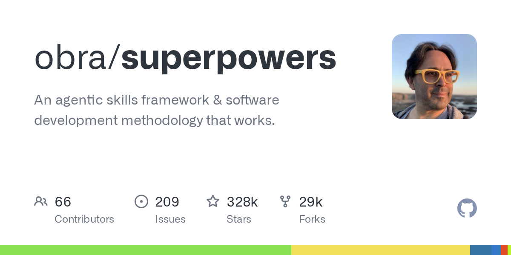
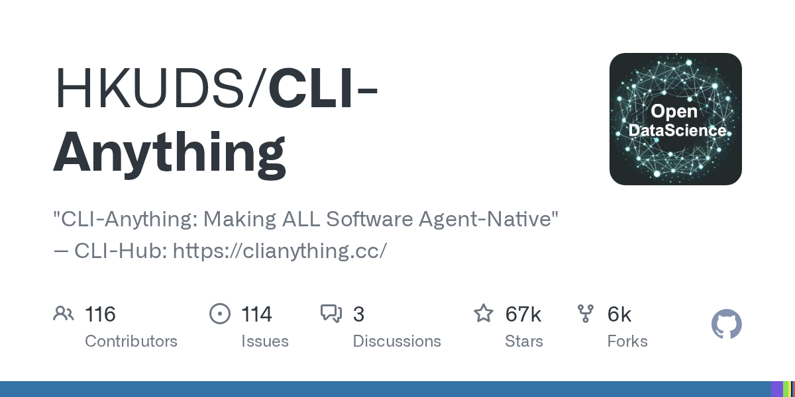
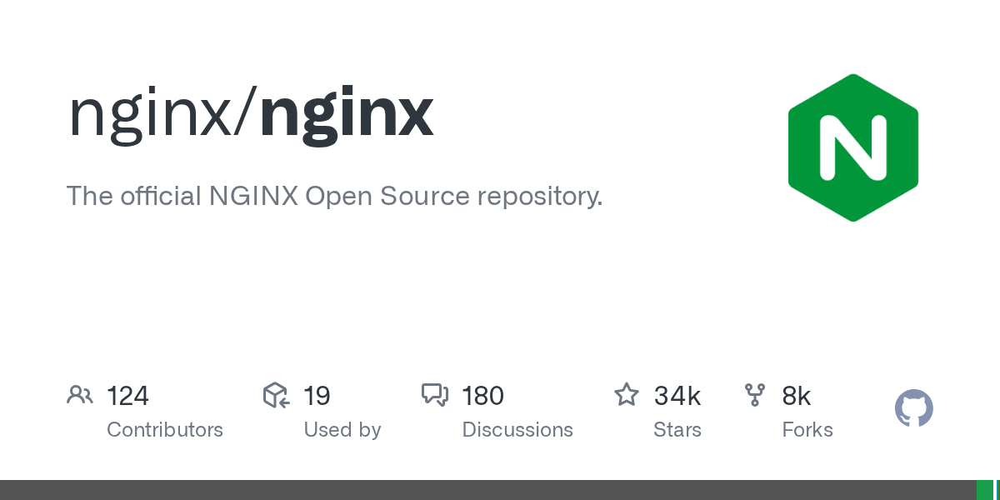
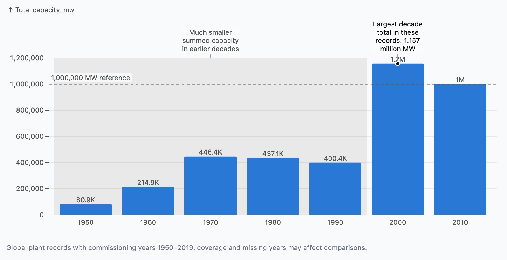
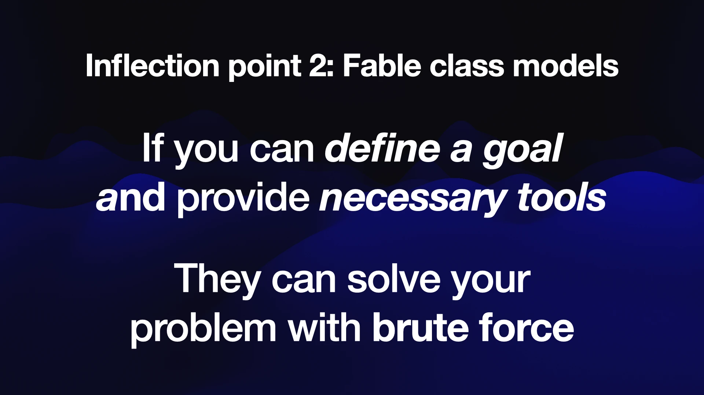

# AI 资讯日报 2026-11-28

> 自动抓取 AI 公司博客、从业者博客与社区聚合源，并生成中文摘要。

## 今日摘要

```
- Espresso 27 - 专为Mac爱好者打造的网页编辑器
- RightFont 2026 - 此刻，恰到好处的字体。
- Pushary Calls - 错过了AI助手的提醒？Pushary会主动联系你。
- Periscope - 将任何工作转化为 API
- Contral - 这款AI编程助手不仅能检查自己的工作，还能教你编程
```

## 每日产品

1. **[Espresso 27 - 专为Mac爱好者打造的网页编辑器](https://www.producthunt.com/r/GZAIXAZWRZ3ICN)**

   The web editor for people who love the Mac (www.producthunt.com) 11-27 ↑ 115 PH Upvotes

   

   来源：Product Hunt Daily

2. **[RightFont 2026 - 此刻，恰到好处的字体。](https://www.producthunt.com/r/OD5RPEPLXTOXMS)**

   The right font, right now. (www.producthunt.com) 11-27 ↑ 110 PH Upvotes

   

   来源：Product Hunt Daily

3. **[Pushary Calls - 错过了AI助手的提醒？Pushary会主动联系你。](https://www.producthunt.com/r/KPT5IG56HJWKXE)**

   *{padding:0;margin:0;overflow:hidden}html,body{height:100%}img,span{position:absolute;width:100%;top:0;bottom:0;margin:auto}span{height:1.5em;text-align:center;font:48px/1.5 sans-serif;color:white;text-shadow:0 0 0.5em black}▶" frameborder="0" allow="accelerometer; autoplay; encrypted-media; gyroscope; picture-in-picture" allowfullscreen > Miss your AI agent’s ping? Pushary calls you. (www.producthunt.com) 11-27 ↑ 108 PH Upvotes

   来源：Product Hunt Daily

4. **[Periscope - 将任何工作转化为 API](https://www.producthunt.com/r/MKDWAD6MXFEF3A)**

   Turn any work into an API (www.producthunt.com) 11-27 ↑ 101 PH Upvotes

   

   来源：Product Hunt Daily

5. **[Contral - 这款AI编程助手不仅能检查自己的工作，还能教你编程](https://www.producthunt.com/r/O345273IOJN5AK)**

   The AI coding agent that checks its work and teaches you (www.producthunt.com) 11-27 PH Link

   

   来源：Product Hunt Daily

6. **[Depost AI - 这款 LinkedIn AI 助手能学习什么对您的品牌最有效](https://www.producthunt.com/r/32DE54NLUY7ZZ4)**

   The LinkedIn AI agent that learns what works for your brand (www.producthunt.com) 11-27 PH Link

   

   来源：Product Hunt Daily

7. **[Wizstar R1 - 以更低的成本制作Seedance 2.0级别的产品视频](https://www.producthunt.com/r/MFADSN4RJLJCWY)**

   *{padding:0;margin:0;overflow:hidden}html,body{height:100%}img,span{position:absolute;width:100%;top:0;bottom:0;margin:auto}span{height:1.5em;text-align:center;font:48px/1.5 sans-serif;color:white;text-shadow:0 0 0.5em black}▶" frameborder="0" allow="accelerometer; autoplay; encrypted-media; gyroscope; picture-in-picture" allowfullscreen > Seedance 2.0-level product videos at a lower cost (www.producthunt.com) 11-27 PH Link

   来源：Product Hunt Daily

8. **[Doodle - 任务栏上那个能回答问题的简笔人偶](https://www.producthunt.com/r/QXHWNWTFM24C6G)**

   *{padding:0;margin:0;overflow:hidden}html,body{height:100%}img,span{position:absolute;width:100%;top:0;bottom:0;margin:auto}span{height:1.5em;text-align:center;font:48px/1.5 sans-serif;color:white;text-shadow:0 0 0.5em black}▶" frameborder="0" allow="accelerometer; autoplay; encrypted-media; gyroscope; picture-in-picture" allowfullscreen > The stick figure on your taskbar that answers questions (www.producthunt.com) 11-26 ↑ 110 PH Upvotes

   来源：Product Hunt Daily

9. **[Kagi Mail - 优先考虑需要你的人的私人邮箱](https://www.producthunt.com/r/C2PPJIYKNSS7AC)**

   Private email that puts people who need you first (www.producthunt.com) 11-26 ↑ 114 PH Upvotes

   

   来源：Product Hunt Daily

10. **[Monton - 代您的代理机构处理琐碎事务的AI代理](https://www.producthunt.com/r/MYQORKGIV2MIOS)**

   *{padding:0;margin:0;overflow:hidden}html,body{height:100%}img,span{position:absolute;width:100%;top:0;bottom:0;margin:auto}span{height:1.5em;text-align:center;font:48px/1.5 sans-serif;color:white;text-shadow:0 0 0.5em black}▶" frameborder="0" allow="accelerometer; autoplay; encrypted-media; gyroscope; picture-in-picture" allowfullscreen > AI agents that do your agency's busywork (www.producthunt.com) 11-26 ↑ 90 PH Upvotes

   来源：Product Hunt Daily

## GitHub 项目

1. **[elementalsouls/Claude-BugHunter](https://github.com/elementalsouls/Claude-BugHunter)**

   A Claude Code skill bundle for bug hunting and external red-team work - 85 skills, 16 slash commands, 681 disclosed-report patterns curated across 24 core vulnerability classes, plus enterprise identity + infrastructure attack matrices. Language: Python Stars: 25812 Forks: 2643

   

   来源：GitHub Trending Daily

2. **[obra/superpowers](https://github.com/obra/superpowers)**

   An agentic skills framework & software development methodology that works. Language: Shell Stars: 328185 Forks: 29152

   

   来源：GitHub Trending Daily

3. **[HKUDS/CLI-Anything](https://github.com/HKUDS/CLI-Anything)**

   "CLI-Anything: Making ALL Software Agent-Native" -- CLI-Hub: https://clianything.cc/ Language: Python Stars: 66895 Forks: 6133

   

   来源：GitHub Trending Daily

4. **[jingyaogong/minimind](https://github.com/jingyaogong/minimind)**

   🧠 两小时从 0 训出你的 64M 大模型。Train your own 64M LLM from scratch in 2 hours. Language: Python Stars: 72155 Forks: 9416

   

   来源：GitHub Trending Daily

5. **[cursor/plugins](https://github.com/cursor/plugins)**

   Cursor plugin specification and official plugins Language: TypeScript Stars: 19971 Forks: 2218

   

   来源：GitHub Trending Daily

6. **[firecrawl/firecrawl](https://github.com/firecrawl/firecrawl)**

   Knowledge infrastructure to make your agents smarter. Search, scrape and access 550+ data providers through one API. Language: TypeScript Stars: 211543 Forks: 11121

   

   来源：GitHub Trending Daily

7. **[nginx/nginx](https://github.com/nginx/nginx)**

   The official NGINX Open Source repository. Language: C Stars: 33644 Forks: 8475

   

   来源：GitHub Trending Daily

8. **[openvinotoolkit/openvino](https://github.com/openvinotoolkit/openvino)**

   OpenVINO™ is an open source toolkit for optimizing and deploying AI inference Language: C++ Stars: 12925 Forks: 3792

   

   来源：GitHub Trending Daily

9. **[cathrynlavery/diagram-design](https://github.com/cathrynlavery/diagram-design)**

   Editorial diagram design for Claude Code, Codex, GitHub Copilot, Cursor, Factory Droid, Qoder, and Pi. 52 diagram types. Self-contained HTML + SVG. No shadows. No Mermaid slop. Language: HTML Stars: 74368 Forks: 5009

   来源：GitHub Trending Daily

10. **[mvanhorn/last30days-skill](https://github.com/mvanhorn/last30days-skill)**

   AI agent skill that researches any topic across Reddit, X, YouTube, HN, Polymarket, and the web - then synthesizes a grounded summary Language: Python Stars: 76277 Forks: 6774

   来源：GitHub Trending Daily

## 从业者观点

1. **[Quoting Jack Despain Zhou](https://simonwillison.net/2026/Nov/26/jack-despain-zhou/)**

   Among the many already existing effects of AI has been a great de-individualization. I open a YouTube video, and I hear Claude. I sit in a conference presentation, and I hear Claude. I open my email inbox, and I find pitches and articles from ostensibly serious people with ostensibly serious credentials attached to ostensibly serious institutions who want to publish things attached to their reputations and mine, and I see Claude . &mdash; Jack Despain Zhou , Spitting in the Face of Glaude Tags: ai-misuse , claude , generative-ai , ai , llms

   来源：Simon Willison

2. **[sqlite3_rsync: Database Remote-Copy Tool For SQLite](https://simonwillison.net/2026/Nov/26/sqlite3-rsync/)**

   sqlite3_rsync: Database Remote-Copy Tool For SQLite This additional SQLite tool has been around for a while now - it was added as "experimental" in SQLite 3.47.0 in October 2024 and enhanced in SQLite 3.50.0 in May 2025 . It was only today that I understood one of its most attractive characteristics. Normally, if you want to grab a snapshot copy of a SQLite database, you need to use either the backup API or VACUUM INTO . In both cases you need enough disk space to create a duplicate copy of your database, so if you're on a small instance and you already use more than half of the available disk you are plain out of luck. sqlite3_rsync can copy a snapshot of your database over an SSH connection to another machine, without first needing to create a full local copy! It's also good for synchronizing an existing copy of a database without re-transmitting the entire thing over the network. It works in a similar way to regular rsync: The core idea behind the protocol is that the replica sends cryptographic hashes for pages or groups of pages over to the origin side. The origin sends back page content that differs, or requests finer-grain hashes if a multi-page hash does not match. If the origin and replica start out being vastly different, the total network bandwidth can exceed the size of the entire database, due to the overhead of exchanging hashes, but the excess bandwidth is not great - a few percent at most. Update : Hah! Turns out I wrote about this application of sqlite_rsync back in October 2024 when the tool was first released. Tags: backups , sqlite

   来源：Simon Willison

3. **[The New York Times warns photographers not to update Photoshop over AI features](https://simonwillison.net/2026/Nov/26/hn-50651685/)**

   My comment on The New York Times warns photographers not to update Photoshop over AI features &mdash; Hacker News. I had a NYT photographer take my picture at my home earlier this year (for a story about Moltbook, oddly enough). At one point I asked if they could fix things up if I had a stain on my shirt and they said absolutely not - they present photographs as they were taken, with cropping and balancing applied but no edits beyond that. He did spend a bunch of time trying to find the best possible natural lighting for the shots he wanted. The photo at the top of https://www.nytimes.com/2026/02/02/technology/moltbook-ai-so... is my laptop, taken in my garden, after hunting around for the best spot that didn't have too much glare on the screen. You can see how dirty my screen is, too! Photography for a newspaper is photo journalism, and they take it seriously. (Thankfully I did not have a visible stain on my shirt.) Tags: photography , new-york-times , hacker-news , journalism

   来源：Simon Willison

4. **[Quoting Scott Aaronson](https://simonwillison.net/2026/Nov/25/scott-aaronson/)**

   It’s now obvious that we’ll be getting, not one-off solutions to this or that complexity question, but a whole new continent of mathematical truth, one that we’d previously only glimpsed through fog. Picture van Leeuwenhoek first training a microscope on pondwater, or Galileo first training his telescope on the stars. That might give you some idea of how our resolution into the complexity-theoretic universe, and the whole universe of mathematical truth beyond it, has now improved. &mdash; Scott Aaronson Tags: mathematics , llms , ai , generative-ai

   来源：Simon Willison

5. **[datasette-charts 0.3a0](https://simonwillison.net/2026/Nov/25/datasette-charts/)**

   Release: datasette-charts 0.3a0 I added chart annotations to datasette-charts ! You can now render a chart and then annotate it with lines, shaded areas, labels, or a combination of the three. A chart with annotations looks like this: [图片: https://static.simonwillison.net/static/2026/chart-with-annotations.webp] Here's that same chart in Datasette Lite , where you can tweak the annotations using the chart builder UI: [图片: https://static.simonwillison.net/static/2026/chart-annotate.gif] If you also install Datasette Agent the agent can build annotated charts for you. Here's what I got on the agent.datasette.io demo for this prompt: Show a chart comparing Simon's tagged content about LLMs with his tagged content about Datasette, with annotations [图片: https://static.simonwillison.net/static/2026/annotations-agent.webp] Tags: datasette , visualization , datasette-charts

   

   来源：Simon Willison

6. **[Three LLM inflection points in twelve months](https://simonwillison.net/2026/Nov/24/llm-inflection-points/)**

   I gave a keynote at the AI Engineer Code Summit a couple of weeks ago, constructed around the idea that there have been three significant inflection points in the abilities of LLMs and coding agents in the past twelve months. Here's the video of the talk. In this post I'm going to pull out the major inflection point theme and interrogate it more deeply. Coding agents in November 2025 Today, November 24th 2026, is the one year anniversary of the release of Claude Opus 4.5 . With hindsight, this was a consequential model. In the Opus 4.5 announcement, Anthropic said: Testers noted that Claude Opus 4.5 handles ambiguity and reasons about tradeoffs without hand-holding. They told us that, when pointed at a complex, multi-system bug, Opus 4.5 figures out the fix. They said that tasks that were near-impossible for Sonnet 4.5 just a few weeks ago are now within reach. This held up. Claude Code was 9 months old at that point, having been introduced alongside Claude 3.7 Sonnet on February 24th, 2025. Opus 4.5 was the first model I had used with Claude Code where the default result was generally the right thing. I hadn't been using Claude Code as a daily driver because it didn't feel reliable enough - I had to correct it often enough that it didn't feel like a clear accelerant. The new Opus changed that. For most of the coding problems I faced on a daily basis, Opus would get them right . It was clearly faster than working through the problems myself. Also in November, OpenAI released GPT-5.1 Instant, GPT-5.1 Thinking, GPT-5.1-Codex, and GPT-5.1-Codex-Max. These had a similar effect on their Codex coding agent: it became reliably useful for many of my coding tasks. The timing was convenient, because the December holidays were upon us. A lot of people, myself included, spent December tinkering with these new tools to see what they could do. By January we were ready to use them for our actual work. Fable class models in June/July We got our first hint of Claude Fable in April, when Anthropic announced Claude Mythos and said that it was too dangerous to release , due to its improved cybersecurity capabilities. Mythos was a model that could not just find security vulnerabilities, it could also figure out how to exploit them. In June we got to see how good that model was for ourselves, with the release of Claude Fable 5 - a defanged Mythos, that would solve most problems but would actively block you from using it for security work. After three glorious days... the US government took it away from us. Fable 5 was placed under export controls that effectively banned the model. We wouldn't get it back until July 1st. For me, Fable was an inflection point because it introduced us to what I now think of as Fable class models . My definition of these: [图片: Inflection point 2: Fable class models If you can define a goal and provide necessary tools They can solve your problem with brute force https://static.simonwillison.net/static/2026/fable-class.webp] In June I wrote about how Claude Fable is relentlessly proactive , after I asked it to help fix a display glitch in Safari and it spun up its own pyobjc-framework-Quartz screenshot mechanism and a CORS-enabled localhost logging server to help resolve the bug. A more recent example of the power of Fable class models is my mysterious beep finder from a couple of weeks ago. I gave Opus 5.5 and then Fable 5.2 access to five WebAudio microphones in a room full of boxes and it was able to triangulate the source of an infuriating mysterious beep to within about 40cm. Give it a goal, give it the right tools, and watch it cook. I'd currently class Claude Fable 5, 5.1, 5.2 and Claude Opus 5.5 as Fable class (I think of Opus 5.5 as "cheap Fable"). GPT-6 Astra got there for me too, and I think the new Gemini 4 Neon may count as well. These now represent the baseline for what I expect from a frontier model. 3D modeling and game development in September/October Something interesting happened with frontier LLMs over just the past four months: they got really good at 3D modeling. Set them up with Blender or ask them to write Three.js code and they'll produce credible models of almost anything you ask for. I first noticed this with Claude Fable 5, but it really kicked into gear with Opus 5.5, GPT-5.6 Sol, GPT-6 Astra, and most recently the Gemini 4 family. Here's Gemini 4 Neon's attempt at "Make a three js animation where yonkers stands up as a big mech (cool stand up motion) and stomps around manhattan and queens and Brooklyn, use openstreetmap mapping data", for example. 3D spatial awareness is crucial if you want to use vision LLMs for robotics. I don't know if 3D modeling capabilities are a side-effect of the labs focusing on that or vice-versa. Back in August I experimented with having Fable 5 build me a raccoon heist game . It had 3D graphics, looked like a game, and played really poorly. GPT-5.6 Sol Ultra did a much better job but the game itself was still pretty dull after the first 90 seconds of play. I was somewhat relieved that designing a game that was fun appeared to remain a uniquely human pursuit. I even used that in a talk in September to reassure people that us humans still had a role to play! Then, I tried telling Claude Opus 5.5 "This game isn't fun enough yet. Make it a LOT more fun." And it worked . My Command &amp; Conquer-style RTS went from boring to deeply entertaining overnight, after Opus spent 12 hours playtesting new features and rebalancing the gameplay. Opus 5.5 was the first model I'd used that appeared to understand fun. I've since worked on several little game projects where prompts like "Think hard about how to make sure it is both fun and beautiful" produced results that kept me engaged for significant amounts of time. Opus 5.5 came out on September 22nd, 2026. I've been to two different conferences since then where people showed me game projects they'd been working on that really did feel like proper, worthwhile games. The indie games scene has descended into a full-blown culture war over AI-assisted programming. A lot of people are calling GTA VI the last pre-generative AI blockbuster . It feels like another inflection point to me. Is Fable 5.2 an inflection point too? I'm still trying to decide if Fable 5.2 represents a new inflection point, or just another incremental improvement. I'm getting so much done with that model right now! It seems to have taste that almost exactly matches my own. I have been burning through all sorts of gnarly problems that I've been thinking about (or procrastinating on) for several years now. The release notes for Datasette 1.0a42 , 1.0a43 , and 1.0a44 - plus LLM 0.37 , 0.37.1 , 0.37.2 , 0.37.3 , and 0.38 - all in the last three weeks , represent a flood of fixes, features and improvements. If this does represent an inflection point, the key feature seems to be that if you can imagine and then clearly describe a piece of software, Fable can build it . That's a wild thing to say, but it matches my experience over the past few weeks. Software development has transformed beyond recognition in the last year. I don't think I'll ever go back to typing most of my code by hand. Tags: game-design , my-talks , ai , generative-ai , llms , annotated-talks , coding-agents , claude-code , codex , claude-mythos-fable

   

   来源：Simon Willison

7. **[AI researchers debate what we should do next – Daniel Kokotajlo and Ege Erdil](https://www.dwarkesh.com/p/daniel-kokotajlo-ege-erdil)**

   "If we pause now, people still won't understand what's at stake."

   来源：Dwarkesh Patel

8. **[Responding to objections to recursive self-improvement](https://www.dwarkesh.com/p/rsiobjections)**

   What the skeptics get right about superintelligence

   来源：Dwarkesh Patel

## 社区热点

1. **[I'm Scared of AI](https://thesoapbox.email/archive/3)**

   Article URL: https://thesoapbox.email/archive/3 Comments URL: https://news.ycombinator.com/item?id=50669561 Points: 165 # Comments: 159

   来源：Hacker News AI

2. **[GPT 6.2 Astra Solves a Historical Mystery](https://generativehistory.substack.com/p/gpt-62-astra-solves-a-historical)**

   Article URL: https://generativehistory.substack.com/p/gpt-62-astra-solves-a-historical Comments URL: https://news.ycombinator.com/item?id=50667744 Points: 148 # Comments: 61

   来源：Hacker News AI

3. **[AI on brink of making online security useless, mathematicians fear](https://www.thetimes.com/uk/technology-uk/article/ai-making-online-security-useless-smr73d3n8)**

   https://archive.ph/4hRp8 Comments URL: https://news.ycombinator.com/item?id=50665488 Points: 107 # Comments: 138

   来源：Hacker News AI

4. **[Claude sabotaging ML research tasks?](https://twitter.com/RealAstropulse/status/2126119408997466389)**

   Article URL: https://twitter.com/RealAstropulse/status/2126119408997466389 Comments URL: https://news.ycombinator.com/item?id=50664325 Points: 412 # Comments: 207

   来源：Hacker News AI

5. **[Group chat where your AI talks behind your back](https://construct22.com/)**

   Article URL: https://construct22.com/ Comments URL: https://news.ycombinator.com/item?id=50663595 Points: 609 # Comments: 260

   来源：Hacker News AI

6. **["What's Claude's fursona?" and other questions](https://herecomesthemoon.net/2026/11/whats-claudes-fursona/)**

   Article URL: https://herecomesthemoon.net/2026/11/whats-claudes-fursona/ Comments URL: https://news.ycombinator.com/item?id=50662933 Points: 140 # Comments: 105

   来源：Hacker News AI

7. **[New AI research suggests AI bubble bursting and to expect major market collapse](https://www.london.edu/think/ai-bubble-about-to-burst)**

   Article URL: https://www.london.edu/think/ai-bubble-about-to-burst Comments URL: https://news.ycombinator.com/item?id=50662153 Points: 35 # Comments: 22

   来源：Hacker News AI

8. **[AI agents now control part of DeepMind's compute for Gemini experiments](https://the-decoder.com/ai-agents-now-control-part-of-deepminds-compute-for-gemini-experiments-but-recursive-self-improvement-remains-distant/)**

   Article URL: https://the-decoder.com/ai-agents-now-control-part-of-deepminds-compute-for-gemini-experiments-but-recursive-self-improvement-remains-distant/ Comments URL: https://news.ycombinator.com/item?id=50661218 Points: 56 # Comments: 28

   来源：Hacker News AI

9. **[AI made self-hosting fun again](https://janlukas.blog/posts/ai-self-hosting)**

   Article URL: https://janlukas.blog/posts/ai-self-hosting Comments URL: https://news.ycombinator.com/item?id=50660180 Points: 1020 # Comments: 486

   来源：Hacker News AI

10. **[Top-cited AI scientists at four US companies compared](https://topcitedscientists.com/figures/ai-at-four-us-companies/)**

   Article URL: https://topcitedscientists.com/figures/ai-at-four-us-companies/ Comments URL: https://news.ycombinator.com/item?id=50658910 Points: 43 # Comments: 23

   来源：Hacker News AI

11. **[Curb impacts of AI on programming to maintain EU sovereignty](https://www.draketo.de/software/curb-ai-impact)**

   Comments

   来源：Lobsters AI

12. **[The need for a formally verifiable mainstream programming language](https://blainehansen.me/post/mainstream-verifiable-language/)**

   Comments

   来源：Lobsters AI

13. **[Matrix Multiplication is Θ(n^2.25)](https://raw.githubusercontent.com/openai/math/main/preprints/The-matrix-multiplication-exponent-is-nine-fourths-November-24-2026/paper.pdf)**

   Comments

   来源：Lobsters AI
