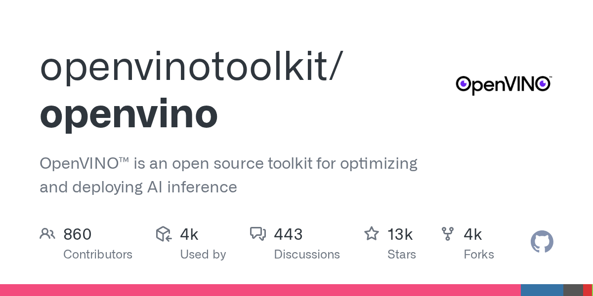
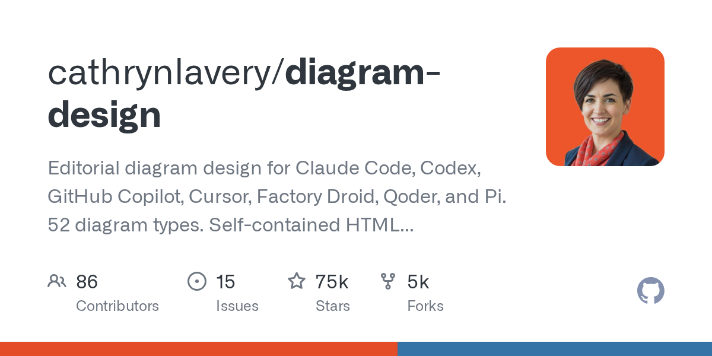
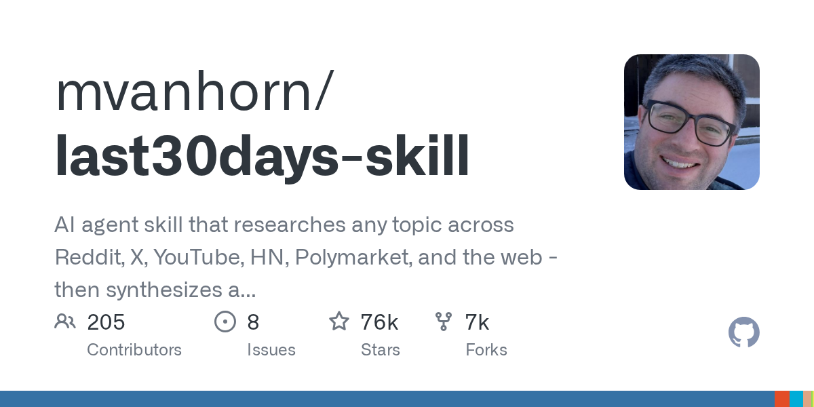
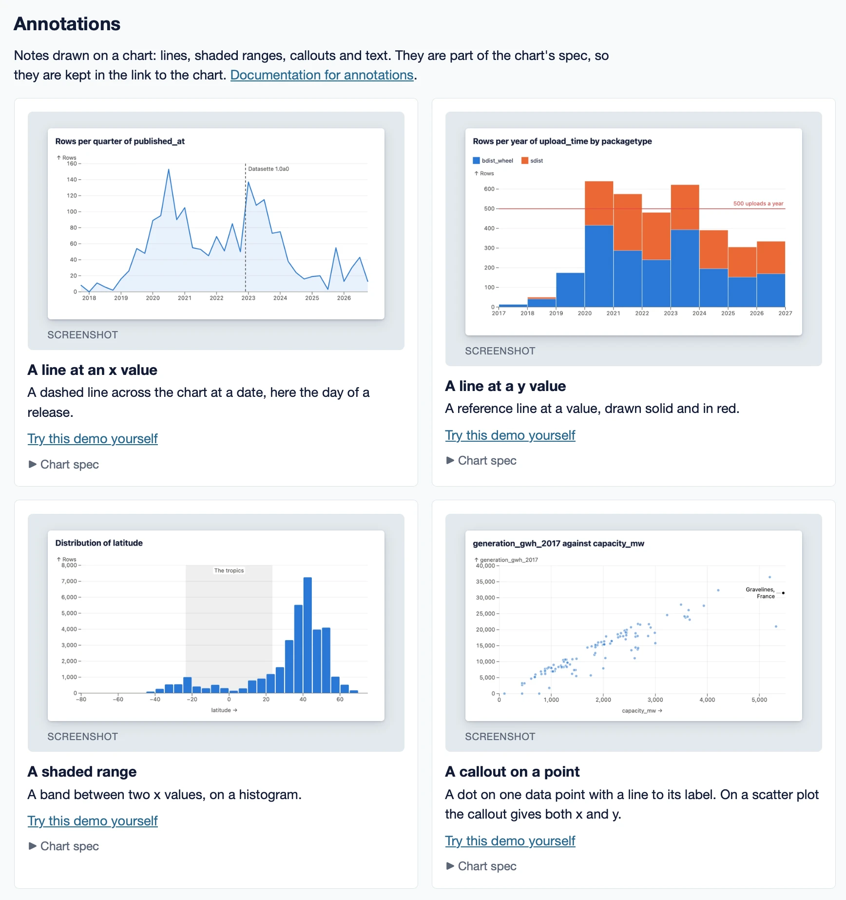
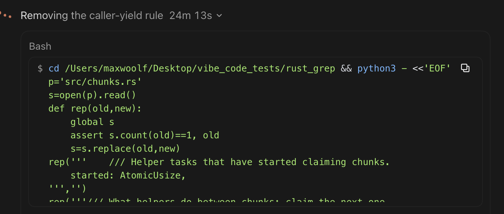

# AI 资讯日报 2026-11-28

> 自动抓取 AI 公司博客、从业者博客与社区聚合源，并生成中文摘要。

## 今日摘要

```
- Espresso 27 - 专为Mac爱好者打造的网页编辑器
- RightFont 2026 - 此刻，恰到好处的字体。
- Pushary Calls - 错过了AI助手的提醒？Pushary会主动联系你。
- Periscope - 将任何工作转化为 API
- Contral - 这款AI编程助手不仅能检查自己的工作，还能教你编程
```

## 每日产品

1. **[Espresso 27 - 专为Mac爱好者打造的网页编辑器](https://www.producthunt.com/r/GZAIXAZWRZ3ICN)**

   The web editor for people who love the Mac (www.producthunt.com) 11-27 ↑ 115 PH Upvotes

   

   来源：Product Hunt Daily

2. **[RightFont 2026 - 此刻，恰到好处的字体。](https://www.producthunt.com/r/OD5RPEPLXTOXMS)**

   The right font, right now. (www.producthunt.com) 11-27 ↑ 110 PH Upvotes

   

   来源：Product Hunt Daily

3. **[Pushary Calls - 错过了AI助手的提醒？Pushary会主动联系你。](https://www.producthunt.com/r/KPT5IG56HJWKXE)**

   *{padding:0;margin:0;overflow:hidden}html,body{height:100%}img,span{position:absolute;width:100%;top:0;bottom:0;margin:auto}span{height:1.5em;text-align:center;font:48px/1.5 sans-serif;color:white;text-shadow:0 0 0.5em black}▶" frameborder="0" allow="accelerometer; autoplay; encrypted-media; gyroscope; picture-in-picture" allowfullscreen > Miss your AI agent’s ping? Pushary calls you. (www.producthunt.com) 11-27 ↑ 108 PH Upvotes

   来源：Product Hunt Daily

4. **[Periscope - 将任何工作转化为 API](https://www.producthunt.com/r/MKDWAD6MXFEF3A)**

   Turn any work into an API (www.producthunt.com) 11-27 ↑ 101 PH Upvotes

   

   来源：Product Hunt Daily

5. **[Contral - 这款AI编程助手不仅能检查自己的工作，还能教你编程](https://www.producthunt.com/r/O345273IOJN5AK)**

   The AI coding agent that checks its work and teaches you (www.producthunt.com) 11-27 PH Link

   

   来源：Product Hunt Daily

6. **[Depost AI - 这款 LinkedIn AI 助手能学习什么对您的品牌最有效](https://www.producthunt.com/r/32DE54NLUY7ZZ4)**

   The LinkedIn AI agent that learns what works for your brand (www.producthunt.com) 11-27 PH Link

   

   来源：Product Hunt Daily

7. **[Wizstar R1 - 以更低的成本制作Seedance 2.0级别的产品视频](https://www.producthunt.com/r/MFADSN4RJLJCWY)**

   *{padding:0;margin:0;overflow:hidden}html,body{height:100%}img,span{position:absolute;width:100%;top:0;bottom:0;margin:auto}span{height:1.5em;text-align:center;font:48px/1.5 sans-serif;color:white;text-shadow:0 0 0.5em black}▶" frameborder="0" allow="accelerometer; autoplay; encrypted-media; gyroscope; picture-in-picture" allowfullscreen > Seedance 2.0-level product videos at a lower cost (www.producthunt.com) 11-27 PH Link

   来源：Product Hunt Daily

8. **[Doodle - 任务栏上那个能回答问题的简笔人偶](https://www.producthunt.com/r/QXHWNWTFM24C6G)**

   *{padding:0;margin:0;overflow:hidden}html,body{height:100%}img,span{position:absolute;width:100%;top:0;bottom:0;margin:auto}span{height:1.5em;text-align:center;font:48px/1.5 sans-serif;color:white;text-shadow:0 0 0.5em black}▶" frameborder="0" allow="accelerometer; autoplay; encrypted-media; gyroscope; picture-in-picture" allowfullscreen > The stick figure on your taskbar that answers questions (www.producthunt.com) 11-26 ↑ 110 PH Upvotes

   来源：Product Hunt Daily

9. **[Kagi Mail - 优先考虑需要你的人的私人邮箱](https://www.producthunt.com/r/C2PPJIYKNSS7AC)**

   Private email that puts people who need you first (www.producthunt.com) 11-26 ↑ 114 PH Upvotes

   

   来源：Product Hunt Daily

10. **[Monton - 代您的代理机构处理琐碎事务的AI代理](https://www.producthunt.com/r/MYQORKGIV2MIOS)**

   *{padding:0;margin:0;overflow:hidden}html,body{height:100%}img,span{position:absolute;width:100%;top:0;bottom:0;margin:auto}span{height:1.5em;text-align:center;font:48px/1.5 sans-serif;color:white;text-shadow:0 0 0.5em black}▶" frameborder="0" allow="accelerometer; autoplay; encrypted-media; gyroscope; picture-in-picture" allowfullscreen > AI agents that do your agency's busywork (www.producthunt.com) 11-26 ↑ 90 PH Upvotes

   来源：Product Hunt Daily

## GitHub 项目

1. **[elementalsouls/Claude-BugHunter](https://github.com/elementalsouls/Claude-BugHunter)**

   A Claude Code skill bundle for bug hunting and external red-team work - 85 skills, 16 slash commands, 681 disclosed-report patterns curated across 24 core vulnerability classes, plus enterprise identity + infrastructure attack matrices. Language: Python Stars: 26275 Forks: 2694

   

   来源：GitHub Trending Daily

2. **[obra/superpowers](https://github.com/obra/superpowers)**

   An agentic skills framework & software development methodology that works. Language: Shell Stars: 328421 Forks: 29191

   

   来源：GitHub Trending Daily

3. **[HKUDS/CLI-Anything](https://github.com/HKUDS/CLI-Anything)**

   "CLI-Anything: Making ALL Software Agent-Native" -- CLI-Hub: https://clianything.cc/ Language: Python Stars: 67078 Forks: 6172

   

   来源：GitHub Trending Daily

4. **[jingyaogong/minimind](https://github.com/jingyaogong/minimind)**

   🧠 两小时从 0 训出你的 64M 大模型。Train your own 64M LLM from scratch in 2 hours. Language: Python Stars: 72272 Forks: 9451

   

   来源：GitHub Trending Daily

5. **[cursor/plugins](https://github.com/cursor/plugins)**

   Cursor plugin specification and official plugins Language: TypeScript Stars: 20042 Forks: 2241

   

   来源：GitHub Trending Daily

6. **[firecrawl/firecrawl](https://github.com/firecrawl/firecrawl)**

   Knowledge infrastructure to make your agents smarter. Search, scrape and access 550+ data providers through one API. Language: TypeScript Stars: 211777 Forks: 11150

   

   来源：GitHub Trending Daily

7. **[nginx/nginx](https://github.com/nginx/nginx)**

   The official NGINX Open Source repository. Language: C Stars: 33686 Forks: 8486

   

   来源：GitHub Trending Daily

8. **[openvinotoolkit/openvino](https://github.com/openvinotoolkit/openvino)**

   OpenVINO™ is an open source toolkit for optimizing and deploying AI inference Language: C++ Stars: 12969 Forks: 3813

   

   来源：GitHub Trending Daily

9. **[cathrynlavery/diagram-design](https://github.com/cathrynlavery/diagram-design)**

   Editorial diagram design for Claude Code, Codex, GitHub Copilot, Cursor, Factory Droid, Qoder, and Pi. 52 diagram types. Self-contained HTML + SVG. No shadows. No Mermaid slop. Language: HTML Stars: 74522 Forks: 5030

   

   来源：GitHub Trending Daily

10. **[mvanhorn/last30days-skill](https://github.com/mvanhorn/last30days-skill)**

   AI agent skill that researches any topic across Reddit, X, YouTube, HN, Polymarket, and the web - then synthesizes a grounded summary Language: Python Stars: 76433 Forks: 6798

   

   来源：GitHub Trending Daily

## 从业者观点

1. **[datasette-charts 0.4a0](https://simonwillison.net/2026/Nov/27/datasette-charts/)**

   Release: datasette-charts 0.4a0 The new datasette-charts plugin has its own plugin hook to allow other plugins to define new chart types, but I hadn't actually used it for anything yet. I had Claude Opus 5.5 build an experimental plugins just to try out the hook and it came up with a bunch of friction points in the design. This release addresses those, which should make building additional chart plugins a whole lot more ergonomic. I've also added a website for the plugin, at charts.datasette.io . The new website includes a tutorial for plugin authors , and a gallery showing all of the core charts and annotations, each one linking to an interactive demo on Datasette Lite . [图片: https://static.simonwillison.net/static/2026/datasette-charts-gallery.webp] Tags: datasette-charts , datasette , visualization , datasette-lite

   

   来源：Simon Willison

2. **[datasette-mcp 0.4](https://simonwillison.net/2026/Nov/27/datasette-mcp/)**

   Release: datasette-mcp 0.4 Fixed for compatibility with Datasette 1.0a44 . Tags: model-context-protocol , datasette

   来源：Simon Willison

3. **[Quoting Jack Despain Zhou](https://simonwillison.net/2026/Nov/26/jack-despain-zhou/)**

   Among the many already existing effects of AI has been a great de-individualization. I open a YouTube video, and I hear Claude. I sit in a conference presentation, and I hear Claude. I open my email inbox, and I find pitches and articles from ostensibly serious people with ostensibly serious credentials attached to ostensibly serious institutions who want to publish things attached to their reputations and mine, and I see Claude . &mdash; Jack Despain Zhou , Spitting in the Face of Glaude Tags: ai-misuse , claude , generative-ai , ai , llms

   来源：Simon Willison

4. **[sqlite3_rsync: Database Remote-Copy Tool For SQLite](https://simonwillison.net/2026/Nov/26/sqlite3-rsync/)**

   sqlite3_rsync: Database Remote-Copy Tool For SQLite This additional SQLite tool has been around for a while now - it was added as "experimental" in SQLite 3.47.0 in October 2024 and enhanced in SQLite 3.50.0 in May 2025 . It was only today that I understood one of its most attractive characteristics. Normally, if you want to grab a snapshot copy of a SQLite database, you need to use either the backup API or VACUUM INTO . In both cases you need enough disk space to create a duplicate copy of your database, so if you're on a small instance and you already use more than half of the available disk you are plain out of luck. sqlite3_rsync can copy a snapshot of your database over an SSH connection to another machine, without first needing to create a full local copy! It's also good for synchronizing an existing copy of a database without re-transmitting the entire thing over the network. It works in a similar way to regular rsync: The core idea behind the protocol is that the replica sends cryptographic hashes for pages or groups of pages over to the origin side. The origin sends back page content that differs, or requests finer-grain hashes if a multi-page hash does not match. If the origin and replica start out being vastly different, the total network bandwidth can exceed the size of the entire database, due to the overhead of exchanging hashes, but the excess bandwidth is not great - a few percent at most. Update : Hah! Turns out I wrote about this application of sqlite_rsync back in October 2024 when the tool was first released. Tags: backups , sqlite

   来源：Simon Willison

5. **[The New York Times warns photographers not to update Photoshop over AI features](https://simonwillison.net/2026/Nov/26/hn-50651685/)**

   My comment on The New York Times warns photographers not to update Photoshop over AI features &mdash; Hacker News. I had a NYT photographer take my picture at my home earlier this year (for a story about Moltbook, oddly enough). At one point I asked if they could fix things up if I had a stain on my shirt and they said absolutely not - they present photographs as they were taken, with cropping and balancing applied but no edits beyond that. He did spend a bunch of time trying to find the best possible natural lighting for the shots he wanted. The photo at the top of https://www.nytimes.com/2026/02/02/technology/moltbook-ai-so... is my laptop, taken in my garden, after hunting around for the best spot that didn't have too much glare on the screen. You can see how dirty my screen is, too! Photography for a newspaper is photo journalism, and they take it seriously. (Thankfully I did not have a visible stain on my shirt.) Tags: photography , new-york-times , hacker-news , journalism

   来源：Simon Willison

6. **[Quoting Scott Aaronson](https://simonwillison.net/2026/Nov/25/scott-aaronson/)**

   It’s now obvious that we’ll be getting, not one-off solutions to this or that complexity question, but a whole new continent of mathematical truth, one that we’d previously only glimpsed through fog. Picture van Leeuwenhoek first training a microscope on pondwater, or Galileo first training his telescope on the stars. That might give you some idea of how our resolution into the complexity-theoretic universe, and the whole universe of mathematical truth beyond it, has now improved. &mdash; Scott Aaronson Tags: mathematics , llms , ai , generative-ai

   来源：Simon Willison

7. **[Opus 5.5 and Fable 5.2 made my overoptimized Rust code even more overoptimized](https://minimaxir.com/2026/11/opus-fable/)**

   I don’t want my benchmarks to be measured in milliseconds, I want them measured in microseconds.

   

   来源：Max Woolf

8. **[AI researchers debate what we should do next – Daniel Kokotajlo and Ege Erdil](https://www.dwarkesh.com/p/daniel-kokotajlo-ege-erdil)**

   "If we pause now, people still won't understand what's at stake."

   来源：Dwarkesh Patel

## 社区热点

1. **[Woman evicted after landlord's AI assistant told her she could delay rent](https://drmahfouz.substack.com/p/woman-evicted-after-landlords-ai)**

   Article URL: https://drmahfouz.substack.com/p/woman-evicted-after-landlords-ai Comments URL: https://news.ycombinator.com/item?id=50673521 Points: 104 # Comments: 81

   来源：Hacker News AI

2. **[Banks look to dump AI debt](https://www.semafor.com/article/11/26/2026/banks-look-to-dump-ai-debt)**

   Article URL: https://www.semafor.com/article/11/26/2026/banks-look-to-dump-ai-debt Comments URL: https://news.ycombinator.com/item?id=50671559 Points: 30 # Comments: 5

   来源：Hacker News AI

3. **[Prospero: Bloat-free, native AI coding harness with ImGui](https://github.com/skeeto/prospero)**

   Article URL: https://github.com/skeeto/prospero Comments URL: https://news.ycombinator.com/item?id=50671275 Points: 45 # Comments: 9

   来源：Hacker News AI

4. **[I'm Scared of AI](https://thesoapbox.email/archive/3)**

   Article URL: https://thesoapbox.email/archive/3 Comments URL: https://news.ycombinator.com/item?id=50669561 Points: 206 # Comments: 244

   来源：Hacker News AI

5. **[GPT 6.2 Astra solves a historical mystery](https://generativehistory.substack.com/p/gpt-62-astra-solves-a-historical)**

   Article URL: https://generativehistory.substack.com/p/gpt-62-astra-solves-a-historical Comments URL: https://news.ycombinator.com/item?id=50667744 Points: 166 # Comments: 1

   来源：Hacker News AI

6. **[AI on brink of making online security useless, mathematicians fear](https://www.thetimes.com/uk/technology-uk/article/ai-making-online-security-useless-smr73d3n8)**

   https://archive.ph/4hRp8 Comments URL: https://news.ycombinator.com/item?id=50665488 Points: 118 # Comments: 155

   来源：Hacker News AI

7. **[Claude sabotaging ML research tasks?](https://twitter.com/RealAstropulse/status/2126119408997466389)**

   Article URL: https://twitter.com/RealAstropulse/status/2126119408997466389 Comments URL: https://news.ycombinator.com/item?id=50664325 Points: 643 # Comments: 296

   来源：Hacker News AI

8. **[Group chat where your AI talks behind your back](https://construct22.com/)**

   Article URL: https://construct22.com/ Comments URL: https://news.ycombinator.com/item?id=50663595 Points: 692 # Comments: 286

   来源：Hacker News AI

9. **["What's Claude's fursona?" and other questions](https://herecomesthemoon.net/2026/11/whats-claudes-fursona/)**

   Article URL: https://herecomesthemoon.net/2026/11/whats-claudes-fursona/ Comments URL: https://news.ycombinator.com/item?id=50662933 Points: 189 # Comments: 178

   来源：Hacker News AI

10. **[New AI research suggests AI bubble bursting and to expect major market collapse](https://www.london.edu/think/ai-bubble-about-to-burst)**

   Article URL: https://www.london.edu/think/ai-bubble-about-to-burst Comments URL: https://news.ycombinator.com/item?id=50662153 Points: 38 # Comments: 24

   来源：Hacker News AI

11. **[Curb impacts of AI on programming to maintain EU sovereignty](https://www.draketo.de/software/curb-ai-impact)**

   Comments

   来源：Lobsters AI

12. **[The need for a formally verifiable mainstream programming language](https://blainehansen.me/post/mainstream-verifiable-language/)**

   Comments

   来源：Lobsters AI
